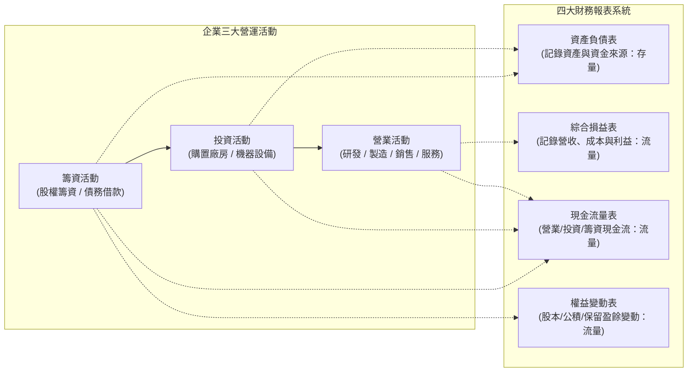
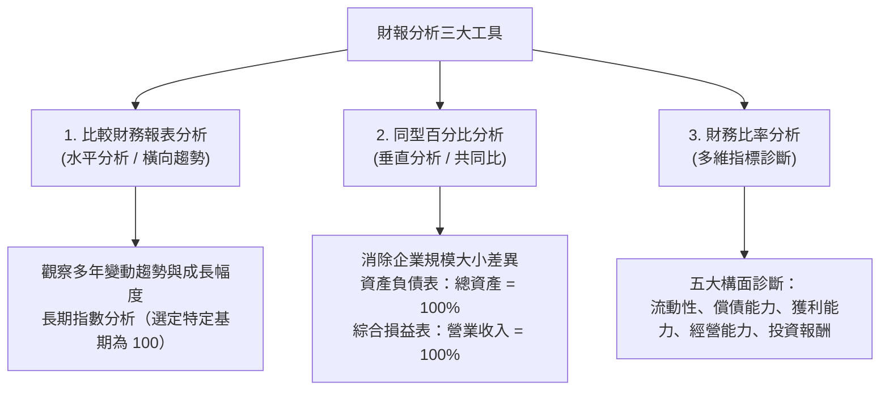

---
{"dg-publish":true,"permalink":"/01/01/ch01/","title":"Ch01 企業營運與財務報表簡介","tags":["PMBA","財務報表分析","企業營運","四大報表","存量與流量"],"dg-note-properties":{"title":"Ch01 企業營運與財務報表簡介","course":"財務報表分析","category":"01_基礎先修","type":"lecture-note","lecture":"01_Ch01","tags":["PMBA","財務報表分析","企業營運","四大報表","存量與流量"],"aliases":["企業營運與財務報表簡介","Ch01_企業營運與財務報表簡介","L01_企業營運與財務報表簡介","Ch01","L01"],"permalink":"/01/01-ch01/"}}
---

# Ch01 企業營運與財務報表簡介

## 💡 核心摘要

1. **財報是企業營運決策的「數位投影」**：企業營運本質上是由[[98_商業概念庫/financing-activities_籌資活動\|chou-zi-huo-dong_籌資活動]]（取得資金）、[[98_商業概念庫/investing-activities_投資活動\|investment-huo-dong_投資活動]]（購置資本支出與設備）、[[98_商業概念庫/operating-activities_營業活動\|ying-ye-huo-dong_營業活動]]（產銷營運以創造營收）三大循環交織而成，四大報表即為記錄這三大決策在不同維度上的財務成果。
2. **「[[98_商業概念庫/stocks-and-flows_存量與流量\|cun-liang-yu-flow_存量與流量]]」的動態勾稽**：[[98_商業概念庫/balance-sheet_資產負債表\|balance-sheet_資產負債表]]提供特定時點的靜態「存量」（Snapshot）；[[98_商業概念庫/income-loss-3_綜合損益表\|zong-he-income-statement_綜合損益表]]、[[98_商業概念庫/cash-flow-statement_現金流量表\|cash-flow-statement_現金流量表]]與[[98_商業概念庫/statement-of-changes-in-equity_權益變動表\|equity-bian-dong-biao_權益變動表]]則記錄特定期間的動態「流量」（Flow）。企業價值透過本期流量推移，決定了期末資產、負債與權益的存量餘額（$期初存量 + 本期流量 = 期末存量$）。
3. **IFRS 框架以「[[98_商業概念庫/value_公允價值\|gong-yun-value_公允價值]] / [[98_商業概念庫/balance-sheet_資產負債表\|balance-sheet_資產負債表]]」為核心**：國際財務報導準則（IFRS）重視[[98_商業概念庫/value_公允價值\|gong-yun-value_公允價值]]與實質重於形式。淨資產從期初到期末的[[98_商業概念庫/value_公允價值\|gong-yun-value_公允價值]]變動，被細分為已實現的「[[98_商業概念庫/net-income_本期淨利\|ben-qi-jing-li_本期淨利]]」與未實現的「[[98_商業概念庫/income-loss-2_其他綜合損益\|qi-ta-zong-he-sun-yi_其他綜合損益]] (OCI)」，兩者合稱為「綜合損益總額」。
4. **獲利不等於現金（Earnings $\neq$ Cash Flow）**：受[[98_商業概念庫/accrual-accounting_權責發生制\|quan-ze-fa-sheng-zhi_權責發生制]]影響，帳面上的[[98_商業概念庫/operating-income_營業利益\|operating-income_營業利益]]與淨利並不等同於現金落袋。經理人若忽視[[98_商業概念庫/receivable_應收帳款\|ying-shou-zhang-kuan_應收帳款]]積壓或[[98_商業概念庫/operating-cycle_營業週期\|operating-cycle_營業週期]]拖長，極易陷入「帳面獲利、實質週轉不靈」的黑洞。
5. **由外而內的整體性研判**：財報分析絕非單純的比率計算，必須結合外部產業環境、公司競爭策略與內部經營決策；同時需穿透五六十頁的[[98_商業概念庫/financial-2_財務報表附註\|finance-bao-biao-fu-zhu_財務報表附註]]，才能識破經理人的[[98_商業概念庫/management-2_盈餘管理\|ying-yu-management_盈餘管理]]動機與會計估計誤差。

---

## 📚 核心觀念與架構

### 一、 企業營運循環與四大財務報表連動架構

企業日常營運的資源流轉循著明確的三大步驟推進：
$$\text{籌資活動} \xrightarrow{\text{取得資金}} \text{投資活動} \xrightarrow{\text{資本支出/建廠}} \text{營業活動} \xrightarrow{\text{產銷/獲利}} \text{創造股東價值}$$

#### 四大報表之本質與勾稽關係

| 報表名稱 | 英文 / IFRS 名稱 | 資訊屬性 | 記錄之營運活動與核心內涵 |
| :--- | :--- | :--- | :--- |
| **[[98_商業概念庫/balance-sheet_資產負債表\|balance-sheet_資產負債表]]** | Balance Sheet / Statement of Financial Position | **特定時點（存量）** 例如：12/31 當日 | 記錄企業資金來源（負債與[[98_商業概念庫/shareholder-equity_股東權益\|shareholder-equity_股東權益]]）及資金配置（資產），反映歷史累積之財務結構。 |
| **[[98_商業概念庫/income-loss-3_綜合損益表\|zong-he-income-statement_綜合損益表]]** | Statement of Comprehensive Income | **特定期間（流量）** 例如：全年 1/1~12/31 | 記錄[[98_商業概念庫/operating-activities_營業活動\|ying-ye-huo-dong_營業活動]]創造的收入與耗費成本，區分本業獲利、業外收支、已實現淨利與未實現之 [[98_商業概念庫/income-loss-2_其他綜合損益\|qi-ta-zong-he-sun-yi_其他綜合損益]]。 |
| **[[98_商業概念庫/cash-flow-statement_現金流量表\|cash-flow-statement_現金流量表]]** | Statement of Cash Flows | **特定期間（流量）** 例如：全年 1/1~12/31 | 依[[98_商業概念庫/operating-activities_營業活動\|ying-ye-huo-dong_營業活動]]、[[98_商業概念庫/investing-activities_投資活動\|investment-huo-dong_投資活動]]、[[98_商業概念庫/financing-activities_籌資活動\|chou-zi-huo-dong_籌資活動]]三大維度，還原現金之實質流入與流出。 |
| **[[98_商業概念庫/statement-of-changes-in-equity_權益變動表\|equity-bian-dong-biao_權益變動表]]** | Statement of Changes in Equity | **特定期間（流量）** 例如：全年 1/1~12/31 | 記錄[[98_商業概念庫/shareholder-equity_股東權益\|shareholder-equity_股東權益]]各組成項目（股本、[[98_商業概念庫/capital-3_資本公積\|capital-gong-ji_資本公積]]、[[98_商業概念庫/retained-earnings_保留盈餘\|bao-liu-ying-yu_保留盈餘]]、其他權益）的全年演變與股利分配軌跡。 |

---

### 二、 會計恆等式與核心財務公式

#### 1. 基本會計恆等式
企業掌控的一切經濟資源（資產），必定來自外部借貸（負債）或股東自備與歷年積累（[[98_商業概念庫/shareholder-equity_股東權益\|shareholder-equity_股東權益]]）：
$$資產 = 負債 + 股東權益$$

將負債項移項後，即為**淨資產（Net Assets）**或**[[98_商業概念庫/shareholder-equity_股東權益\|shareholder-equity_股東權益]]**之定義：
$$淨資產 = 資產 - 負債 = 股東權益$$
> [!NOTE]
> 債權人享有法定**優先清償權**；股東則擁有企業清償債務後的**剩餘資產請求權（Residual Claim）**，這奠定了企業[[98_商業概念庫/capital-structure_資本結構\|capital-structure_資本結構]]權衡的基礎。

#### 2. 股東權益細分公式
$$股東權益 = 股本 + 資本公積 + 保留盈餘 + 其他權益$$
- **股本（Capital Stock）**：股東原始出資額在每股法定面額以內的部分（台灣通常為每股 10 元）。
- **[[98_商業概念庫/capital-3_資本公積\|capital-gong-ji_資本公積]]（Additional Paid-in Capital）**：股東溢價增資（如每股 25 元發行，超出面額之 15 元列入[[98_商業概念庫/capital-3_資本公積\|capital-gong-ji_資本公積]]）及其他資本性質之利得。
- **[[98_商業概念庫/retained-earnings_保留盈餘\|bao-liu-ying-yu_保留盈餘]]（Retained Earnings）**：企業歷年營運賺得並留存於內部的盈餘累積：
  $$保留盈餘 = 法定盈餘公積 + 特別盈餘公積 + 未分配盈餘$$
  $$本期期末保留盈餘 = 期初保留盈餘 + 本期淨利 - 發放現金股利 \pm 盈餘公積提撥$$

#### 3. 綜合損益推導公式
$$營業收入 - 營業成本 = 營業毛利$$
$$營業毛利 - 營業費用（銷管研） = 營業利益（本業獲利）$$
$$營業利益 \pm 營業外收入及支出 = 稅前淨利$$
$$稅前淨利 - 所得稅費用 = 本期淨利（已實現損益）$$
$$綜合損益總額 = 本期淨利 + 其他綜合損益 (OCI，未實現損益)$$

- **[[98_商業概念庫/income-loss-2_其他綜合損益\|qi-ta-zong-he-sun-yi_其他綜合損益]]（OCI）典型項目**：
  1. 國外營運機構財務報表換算之兌換差額。
  2. 透過[[98_商業概念庫/income-loss-2_其他綜合損益\|qi-ta-zong-he-sun-yi_其他綜合損益]]按[[98_商業概念庫/value_公允價值\|gong-yun-value_公允價值]]衡量之金融資產（FVOCI）未實現評價損益。
  3. 現金流量避險工具之未實現評價損益。
  4. 不動產重估增值利益。
  5. 確定給付退休金計畫之精算損益。

#### 4. 營業現金流調整邏輯（間接法）
受[[98_商業概念庫/accrual-accounting_權責發生制\|quan-ze-fa-sheng-zhi_權責發生制]]影響，損益表上的淨利必須剔除非現金與非營業項目，方能還原為實質現金流：
$$營業活動現金流量 = 稅前淨利 + 非現金費用（折舊、攤銷） \pm 營運資產與負債變動 - 非營業損益（處分資產利益）$$

---

### 三、 IFRS 核心變革與分析工具

#### 1. IFRS 準則下的重要轉變
- **原則基礎（Principle-based）**：取代舊制 GAAP 的細部規則，強調忠實表述與經濟實質，但亦增加經理人主觀會計估計的裁量空間。
- **以合併報表為主體**：以實質控制力為邊界，母子公司內部交易必須全數沖銷，唯有銷售至集團外的交易才計入實現毛利。
- **[[98_商業概念庫/value_公允價值\|gong-yun-value_公允價值]]與[[98_商業概念庫/balance-sheet_資產負債表\|balance-sheet_資產負債表]]導向**：重估資產與負債之現時價值，淨資產的期末與期初[[98_商業概念庫/value_公允價值\|gong-yun-value_公允價值]]變動，催生出反映未實現損益的 [[98_商業概念庫/income-loss-2_其他綜合損益\|qi-ta-zong-he-sun-yi_其他綜合損益]]（OCI）。
- **費用分類雙軌制**：
  - **功能法（Function of Expense）**：按營運功能區分[[98_商業概念庫/cost-2_銷貨成本\|xiao-huo-cost_銷貨成本]]、銷售費用、管理費用、[[98_商業概念庫/rd-expense_研發費用\|yan-fa-fei-yong_研發費用]]（實務最常見）。
  - **性質法（Nature of Expense）**：按費用原始性質區分[[98_商業概念庫/zhe-jiu_折舊\|zhe-jiu_折舊]]費用、原物料耗用、員工薪酬等。

#### 2. 財務報表分析三大工具
財務報表分析主要仰賴三大核心工具：運用[[98_商業概念庫/comparative-financial-statement-analysis_比較財務報表分析\|bi-jiao-finance-bao-biao-analysis_比較財務報表分析]]掌握跨期橫向趨勢、透過[[98_商業概念庫/common-size-analysis_同型百分比分析\|tong-xing-bai-fen-bi-analysis_同型百分比分析]]消除規模差異以洞察結構比重，以及運用財務比率進行多維度營運診斷。

---

## ⚠️ 實務應用與經理人思維

### 一、 逐字稿實例深度剖析：光學領導廠商「假公司」vs.「乙公司」

逐字稿以光學鏡頭產業龍頭「假公司」與其競爭對手「乙公司」的對比，展示了企業競爭策略如何精確投射至財務報表：

#### 1. 損益表同型百分比對比（第 8 年度）

| 報表項目 | 假公司（營收 60） | 乙公司（營收 12） | 商業分析與經理人解讀 |
| :--- | :---: | :---: | :--- |
| **[[98_商業概念庫/operating-revenue_營業收入\|ying-ye-shou-ru_營業收入]]** | **100%** | **100%** | 假公司營收規模為乙公司的 5 倍。 |
| **[[98_商業概念庫/cost-of-goods-sold_營業成本\|ying-ye-cost_營業成本]]** | 30% | 53% | 假公司製造良率高、具備規模經濟與優異的成本控制力。 |
| **[[98_商業概念庫/gross-profit_營業毛利\|ying-ye-gross-margin_營業毛利]]** | **69%** | **47%** | 假公司採取「技術[[98_商業概念庫/differentiation-strategy_差異化策略\|cha-yi-hua-strategy_差異化策略]]」，每 1 元營收創造 0.69 元毛利，具備極深的產品護城河。 |
| **[[98_商業概念庫/operating-expenses_營業費用\|operating-expenses_營業費用]]** | 9% | 19% | 假公司營收體量大，展現出高度營業槓桿效益（銷管研費用率僅 9%）。 |
| **[[98_商業概念庫/operating-income_營業利益\|operating-income_營業利益]]** | **60%** | **28%** | **本業[[98_商業概念庫/profitability_獲利能力\|huo-li-neng-li_獲利能力]]懸殊**：假公司每 1 元營收能留下 0.6 元的本業利潤。 |
| **[[98_商業概念庫/net-income_本期淨利\|ben-qi-jing-li_本期淨利]]** | **47%** | **21%** | 假公司[[98_商業概念庫/net-profit-margin_淨利率\|jing-li-rate_淨利率]]高達 47%，獲利含金量與[[98_商業概念庫/competitive-advantage_競爭優勢\|competition-you-shi_競爭優勢]]完勝對手。 |

#### 2. 資產負債表結構與資本來源對比

| 報表項目 | 假公司（總資產 153） | 乙公司（總資產 1） | [[98_商業概念庫/capital-structure_資本結構\|capital-structure_資本結構]]與經營穩健度分析 |
| :--- | :---: | :---: | :--- |
| **[[98_商業概念庫/current-assets_流動資產\|liu-dong-asset_流動資產]]** | 7% | 較高 | 假公司屬重資產精密製造，資產高度配置於先進光學廠房與設備。 |
| **負債總額** | **18%** | **58%** | 假公司財務極度穩健；乙公司過半資產來自舉債，面臨沉重利息與償債壓力。 |
| **[[98_商業概念庫/shareholder-equity_股東權益\|shareholder-equity_股東權益]]** | **82%** | **42%** | 假公司 8 成以上資產由自有資金支撐。 |
| **[[98_商業概念庫/retained-earnings_保留盈餘\|bao-liu-ying-yu_保留盈餘]]** | **82%** | **-7% (保留虧損)** | **關鍵分水嶺**：假公司龐大資產是由經理人歷年營運獲利累積之[[98_商業概念庫/retained-earnings_保留盈餘\|bao-liu-ying-yu_保留盈餘]]所創造；乙公司則陷入保留虧損，本金遭持續侵蝕。 |

#### 3. 長期趨勢與指數分析洞察（以第 3 年為基期 100）
- 假公司至第 8 年：
  - **[[98_商業概念庫/operating-revenue_營業收入\|ying-ye-shou-ru_營業收入]]**：$100 \rightarrow 133$（成長 1.33 倍）。
  - **[[98_商業概念庫/gross-profit_營業毛利\|ying-ye-gross-margin_營業毛利]]**：$100 \rightarrow 171$（成長 1.71 倍）。
  - **[[98_商業概念庫/operating-income_營業利益\|operating-income_營業利益]]**：$100 \rightarrow 173$（成長 1.73 倍）。
- **管理洞察**：毛利與[[98_商業概念庫/operating-income_營業利益\|operating-income_營業利益]]成長幅度遠高於營收成長，證實該公司卓越的製造成本與[[98_商業概念庫/operating-expenses_營業費用\|operating-expenses_營業費用]]控管能力。

---

### 二、 經理人判讀財報的四大「眉角」與防坑指南

> [!WARNING]
> 財務報表是各方利益相關者博弈的結果。經理人解讀財報時必須具備批判性視角，嚴防以下四大地雷：

1. **警惕「淨利與現金流背離」的[[98_商業概念庫/liquidity_流動性\|liu-dong-xing_流動性]]假象**：
   - 假公司第 8 年稅前淨利達 36，但營業現金流僅 25；相較之下，第 7 年淨利 31，營業現金流卻高達 31。
   - **眉角**：營業現金流是檢驗獲利真實性的試金石。淨利攀升但現金流停滯，往往是因為**[[98_商業概念庫/receivable_應收帳款\|ying-shou-zhang-kuan_應收帳款]]拖延、客戶賒銷塞貨或[[98_商業概念庫/inventory_存貨\|cun-huo_存貨]]積壓**，拖長了[[98_商業概念庫/operating-cycle_營業週期\|operating-cycle_營業週期]]，帶來實質[[98_商業概念庫/liquidity_流動性\|liu-dong-xing_流動性]]風險。
2. **識破「業外收益平滑損益」的遮羞布**：
   - 假公司第 7 年本業[[98_商業概念庫/operating-income_營業利益\|operating-income_營業利益]]受到衝擊（由 32 降至 29），但業外收支卻出現大額收益，使得最終淨利持平。
   - **眉角**：經理人面臨業績考核時，常藉由處分固定資產或投資等一次性業外收入來「美化利潤」。分析時必須嚴格將本業「[[98_商業概念庫/operating-income_營業利益\|operating-income_營業利益]]」與「業外收支」分離剖析。
3. **厚達五六十頁的「[[98_商業概念庫/financial-2_財務報表附註\|finance-bao-biao-fu-zhu_財務報表附註]]」才是靈魂所在**：
   - 四大表主表僅有十餘頁，真正決定數字品質的關鍵在於附註：
     - **重大會計政策與估計假設**（[[98_商業概念庫/zhe-jiu_折舊\|zhe-jiu_折舊]]年限、壞帳準備提列比率）。
     - **關係人交易**（是否存在利益輸送或非公允價格交易）。
     - **資產質押與保證**（資產是否具備完整控制權與處分權）。
     - **或有負債與合約承諾**（重大訴訟、環保裁罰或產品保固賠償）。
     - **[[98_商業概念庫/operating-information_營運部門資訊\|operations-bu-men-zi-xun_營運部門資訊]]**（看清各事業部真實的成長動能與虧損黑洞）。
4. **防範經理人的「[[98_商業概念庫/management-2_盈餘管理\|ying-yu-management_盈餘管理]]與篡改誘因」**：
   - 當經理人績效獎金、分紅或股權激勵直接與會計淨利（EPS）掛鉤時，經理人具有強烈誘因透過提前認列營收、延遲提列費用或主觀調降壞帳準備來粉飾財報。
