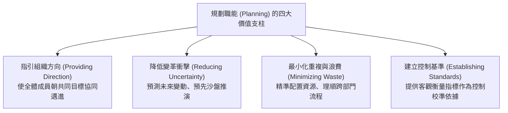
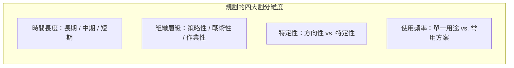
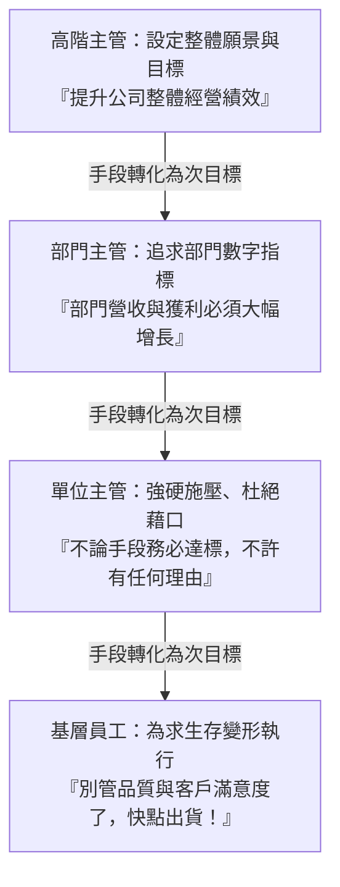
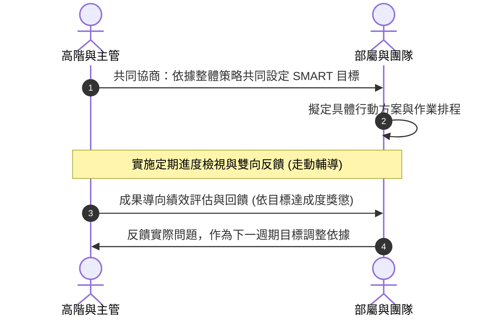
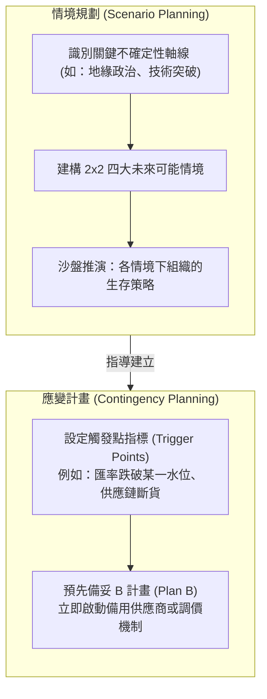

---
{"dg-publish":true,"permalink":"/01/02/ch03/","title":"Ch03 規劃概論","tags":["PMBA","管理概論","規劃","目標管理","MBO","SMART原則","情境規劃"],"dg-note-properties":{"title":"Ch03 規劃概論","course":"管理概論","category":"01_基礎先修","type":"lecture-note","lecture":"02_Ch03","tags":["PMBA","管理概論","規劃","目標管理","MBO","SMART原則","情境規劃"],"aliases":["規劃概論","Ch03_規劃概論","L03_規劃概論","Ch03","L03"],"permalink":"/01/02/ch03/"}}
---

# Ch03 規劃概論

## 💡 核心摘要
- **規劃是管理的首要職能（POLC 之首）**：規劃（Planning）為組織界定目標與航向，其核心價值在於減少未來不確定性、最小化資源浪費、降低變革衝擊，並為後續的「控制（Controlling）」建立客觀的檢核基準。
- **規劃維度的立體多維交織**：規劃並非單一維度的排程，而是依據「時間長短（長/中/短）」、「層級範疇（策略/戰術/作業）」、「特定性（方向性 vs. 特定性）」及「使用頻率（單一用途 vs. 常用方案）」動態適配的架構體系。
- **手段—目標鏈的異化危機**：傳統由上而下的目標分解若缺乏核心價值與倫理錨定，容易在金字塔層層傳遞中被扭曲為「不擇手段追求短期獲利」，引發《哈佛企研所秘辛》所警示的手段導向、道德盲區與管理醜聞。
- **MBO 與 SMART 原則的雙向賦能**：彼得·杜拉克提出的「[[98_商業概念庫/management_目標管理\|mu-biao-management_目標管理]]」揚棄單向命令，改採上下級協同參與，並結合「[[98_商業概念庫/SMART原則\|SMART原則]]」將抽象願景轉化為具體當責的績效承諾，創造高層承諾與基層認同。
- **以[[98_商業概念庫/scenario-planning_情境規劃\|qing-jing-gui-hua_情境規劃]]打破「計畫趕不上變化」的宿命**：在動態多變（VUCA）環境中，經理人不可陷入過度僵化的死板計畫，應以方向性規劃指引大局，並輔以「[[98_商業概念庫/scenario-planning_情境規劃\|qing-jing-gui-hua_情境規劃]]」與「[[98_商業概念庫/contingency-planning_應變計畫\|ying-bian-ji-hua_應變計畫]]」建構敏捷應變的組織韌性。

---
## 📚 核心觀念與架構

### 1. 規劃的本質與重要性

規劃是經理人定義組織目標、確立達成目標之策略，並擬定全面性計畫以整合與協調各項活動的動態過程。規劃在管理實務中具有四大支柱功能：

---

### 2. 規劃的多維分類矩陣

經理人在擬定計畫時，必須依據組織層級與內外部情境，在四大維度間進行精準配置：

| 劃分維度 | 類型 | 核心特徵 | 實務範例 |
| :--- | :--- | :--- | :--- |
| **時間維度** | **長期規劃** | 涵蓋時間通常在 **3 年以上**，聚焦長遠願景與大趨勢 | 企業五年數位轉型戰略、跨國新市場開拓 |
| | **中期規劃** | 涵蓋時間約 **1 至 3 年**，作為長短期之間的轉化橋樑 | 新產品研發生命週期專案、工廠產能擴建 |
| | **短期規劃** | 涵蓋時間在 **1 年以內**，聚焦季度、月份甚至每週作業 | 年度營運預算、季度銷售促銷計畫 |
| **層級維度** | **[[98_商業概念庫/strategic-planning_策略規劃\|strategy-xing-gui-hua_策略性規劃]]** | 高階主管主導，涵蓋全公司範疇，確立長遠[[98_商業概念庫/competitive-advantage_競爭優勢\|competition-you-shi_競爭優勢]] | 決定進入半導體先進製程或退出非核心市場 |
| | **戰術性規劃** | 中階主管主導，將策略轉化為特定部門之資源配置 | 行銷部年度整合行銷溝通（IMC）方案 |
| | **[[98_商業概念庫/operational-planning_作業性規劃\|zuo-ye-xing-gui-hua_作業性規劃]]** | 基層主管主導，針對特定作業流程排定具體進度表 | 產線每日排程表、業務員週拜訪清單 |
| **特定性維度** | **方向性規劃** | 設定清晰大方向但保留高度執行彈性，**適用動態環境** | 確立「從傳統代工轉型為綠能科技」的大方針 |
| | **特定性規劃** | 目標明確且執行細節、路徑、規範無歧義，**適用穩定環境** | 半導體晶圓製造標準無塵室操作作業手冊 |
| **使用頻率** | **單一用途方案** | 為達成特定且非例行性目標量身打造，目標達成即告終止 | 興建新竹科學園區主體工程、跨國併購專案 |
| | **常用方案** | 針對組織內部重複發生的日常活動所建立的持續指導準則 | 科學園區法規體系、企業請假制度、報帳 SOP |

---

### 3. 傳統由上而下規劃的盲點：「手段—目標鏈」的異化

傳統規劃模式仰賴層級金字塔，由高階主管確立總體目標，再層層向下分解。此過程被稱為「[[98_商業概念庫/means-end-chain_手段目標鏈\|shou-duan-mu-biao-lian_手段目標鏈]]」（Means-End Chain）。

#### (1) 手段—目標鏈的結構性危機
- **初衷流失與目標置換（Goal Displacement）**：隨著目標向下層層分解，上層利益良善的願景（如創造卓越價值）被過濾掉，基層只接收到冷酷的數字符號。手段（追求利潤指標）反客為主，取代了組織存在的真正目的（服務客戶與社會責任）。
- **心理距離造成道德脫勾**：基層員工距離高層決策者過於遙遠，感受不到企業文化與使命，在生存壓力下容易演變為「為求達標不擇手段」，犧牲產品品質、違反法規或弄虛作假。

#### (2) 管理教育的深刻反思：《記得您是誰》
- **《哈佛企研所秘辛》（Peter Cohen）的批判**：揭露頂尖商學院學生在長期的目標手段鏈高壓競爭下，容易將短暫的功利追求異化為貪婪的本能，陷入「目光如豆、手段導向、只求生存、道德冷漠」的心理泥淖，導致日後涉入眾多華爾街金融醜聞與企業道德危機。
- **《記得您是誰》（Remember Who You Are）的啟發**：哈佛教授提醒所有未來的經理人：**「莫忘初衷」**。在面對複雜艱難的商業抉擇時，經理人必須隨時審視目標背後的價值信念，不可讓目標分解工具摧毀了企業的倫理靈魂。

---

### 4. 有效目標設定框架：SMART 原則

為了避免目標過於空洞或產生歧義，現代管理要求目標設定必須嚴格符合「[[98_商業概念庫/SMART原則\|SMART原則]]」：

1. **Specific（具體明確）**：目標不可模糊抽象。例如不可只寫「提升銷售」，應明確為「開拓東南亞市場 B2B 雲端軟體業務」。
2. **Measurable（可衡量評估）**：必須包含可量化的指標或明確的成果檢驗標準。例如「新客戶簽約數達 50 家，合約總金額達 2,000 萬元」。
3. **Attainable / Accountable（可達成與清楚當責）**：目標應具備挑戰性但並非天方夜譚；同時必須釐清責任歸屬（Accountability），確保專人負責。
4. **Relevant（具關聯性）**：個人與部門目標必須與公司整體的策略方向緊密扣合，防止各行其是。
5. **Time-bound / Timely（具有明確實現時程）**：必須設定起訖時間與關鍵里程碑（Milestones），例如「於第三季結束前（9 月 30 日前）完成驗收交付」。

---

### 5. 目標管理（Management by Objectives, MBO）

彼得·杜拉克（Peter Drucker）於 1954 年在《管理的實踐》中首度提出「[[98_商業概念庫/management_目標管理\|mu-biao-management_目標管理]]」，其核心宗旨是以「**自我控制（Self-control）**」取代傳統的「專制控制（Authoritarian Control）」。

#### MBO 的雙重激勵心理機制
1. **高層的承諾與參與（Top Management Commitment）**：目標不再是高層單向施壓，而是雙向協商的承諾，使高層主動提供必要資源與授權。
2. **基層的參與感與當責（Employee Participation & Ownership）**：心理學研究指出，**「人們一旦親自參與了目標的制定，就不便亦不願反對它」**。參與式設定將「要我做」轉化為「我要做」，激發部屬的內在自主動機。

---

## ⚠️ 實務應用與經理人思維

### 1. 破解「計畫趕不上變化」的宿命：動態與敏捷規劃
- **僵化規劃的致命傷**：在穩定時代，三年或五年的特定性規劃（SOP/里程碑）是效率利器；但在 VUCA（易變、不確定、複雜、模糊）與 AI 變革時代，過度鎖死細節的計畫反而成為因應市場變革的絆腳石。
- **經理人的動態因應策略**：
  - **方向性規劃大於特定性規劃**：高層負責定下堅定不移的策略願景（北極星指標），但在執行路徑上保留高度戰術彈性。
  - **縮短規劃反饋週期（滾動式規劃 Rolling Wave Planning）**：採取「長戰略、短排程」，以季度甚至雙週為迭代單位，根據外部市場反饋動態調校下一週期的計畫細部。

### 2. MBO 落地實務的四大盲點與避坑指南
- **盲點一：指標扭曲與博弈（[[98_商業概念庫/goodharts-law_古德哈特定律\|gu-de-ha-te-ding-lv_古德哈特定律]] Goodhart's Law）**：
  - *現象*：「當一項指標變成目標時，它就不再是一項好指標。」員工為了衝刺表面指標，可能採取傷害長期利益的手段（如客服人員為縮短通話時間直接掛斷客戶電話）。
  - *避坑*：採用多維度平衡指標（如 OKR 思維），將產出指標（獲利、營收）與守門指標（顧客滿意度、員工留任率、品質良率）搭配考核。
- **盲點二：打勾文化（Check-the-box Formalism）**：
  - *現象*：MBO 淪為繁瑣的人資行政填表遊戲，主管與部屬年初隨便寫、年底照本宣科，失去溝通與輔導本質。
  - *避坑*：經理人應重視「週期中的持續對話（Continuous Check-in）」與 1-on-1 教練輔導，而非年底結算時的一錘定音。
- **盲點三：設定過度保守目標以確保達標**：
  - *現象*：因為薪酬獎金與 MBO 達成率百分之百掛鉤，導致部屬傾向設定缺乏野心的平庸目標。
  - *避坑*：將「激勵性目標（Stretch Goals）」與常規維運目標區隔開，鼓勵創新嘗試並建立合理的容錯機制。

### 3. 提升抗脆弱韌性：情境規劃與應變計畫
經理人不可只依賴單一劇本（Single-scenario Forecast）經營企業，必須具備沙盤推演的韌性架構：

- **[[98_商業概念庫/scenario-planning_情境規劃\|qing-jing-gui-hua_情境規劃]]（Scenario Planning）**：源自殼牌石油（Royal Dutch Shell）因應 1970 年代石油危機的經典管理實踐。經理人不預測「哪一個未來一定會發生」，而是預演「如果未來發生 X、Y 或 Z，我們各自該如何應對」，從而大幅縮短危機爆發時的決策遲滯期。
- **[[98_商業概念庫/contingency-planning_應變計畫\|ying-bian-ji-hua_應變計畫]]（Contingency Planning）**：為可能發生的突發事件預先設定「觸發條件（Trigger Points）」與對應的預案（Plan B）。一旦外部指標達到警戒門檻，組織能不經猶豫立即切換作業模式，將衝擊降至最低。
