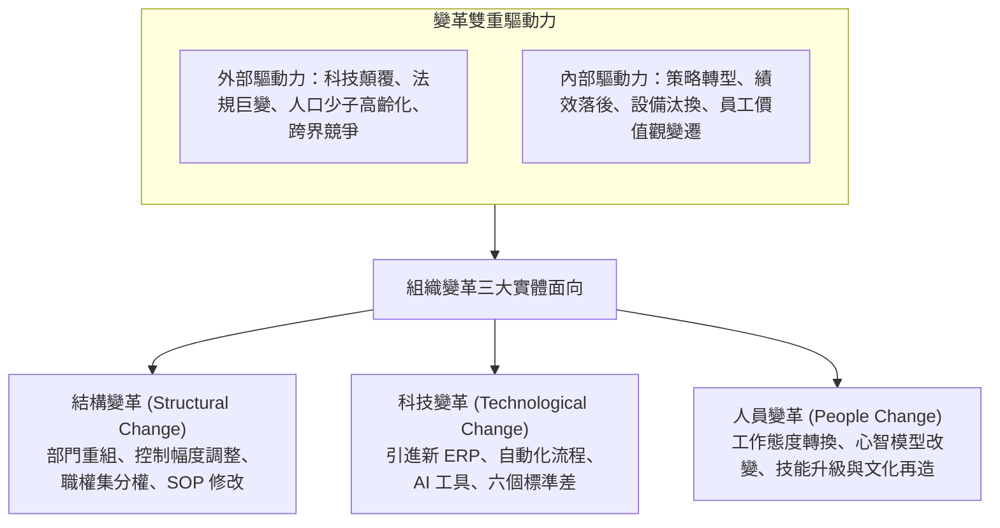
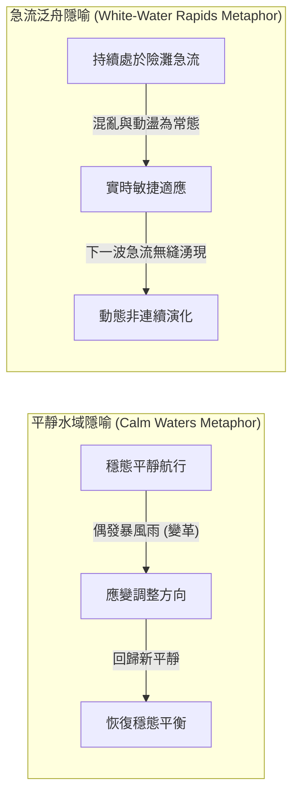
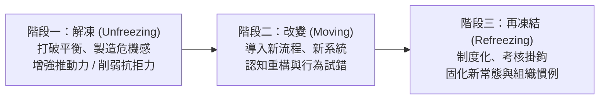
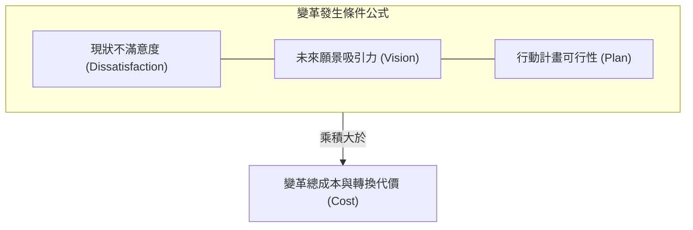
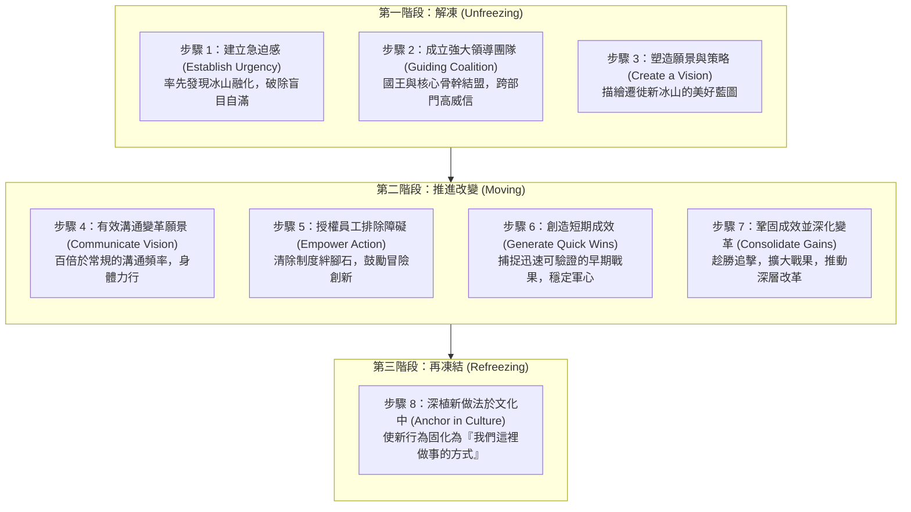

---
{"dg-publish":true,"permalink":"/01/02/ch07/","title":"Ch07 變革管理","tags":["PMBA","管理概論","變革管理","柯特八步驟","盧因三階段","變革抗拒","組織轉型"],"dg-note-properties":{"title":"Ch07 變革管理","course":"管理概論","category":"01_基礎先修","type":"lecture-note","lecture":"02_Ch07","tags":["PMBA","管理概論","變革管理","柯特八步驟","盧因三階段","變革抗拒","組織轉型"],"aliases":["變革管理","Ch07_變革管理","L07_變革管理","Ch07","L07"],"permalink":"/01/02/ch07/"}}
---

# Ch07 變革管理

## 💡 核心摘要
- **變革不是單一事件，而是持續的心理調適歷程**：[[98_商業概念庫/change-management_變革管理\|bian-ge-management_變革管理]]並非僅是更換系統或調整組織圖，其本質在於重塑全體成員的[[98_商業概念庫/mode_心智模式\|心智模型]]與行為習慣；未觸及人性與文化的變革，往往在短期熱潮後迅速復辟。
- **變革的深層阻力源於「恐懼與既得利益」**：[[98_商業概念庫/resistance-to-change_抗拒變革\|kang-ju-bian-ge_抗拒變革]]並非員工惡意對抗，而是源自安全感喪失、能力不確定性與權益重新洗牌；卓越領導者應視抗拒為「正常訊號」，透過對話與賦能化解阻力，而非單純高壓碾壓。
- **雙重環境隱喻決定變革節奏**：「平靜水域（靜水行舟）」視變革為偶發擾動，適合漸進式的 TQM [[98_商業概念庫/quality-management_全面品質管理\|quan-mian-pin-zhi-management_全面品質管理]]；「急流泛舟」視混亂為動態常態，適合大刀闊斧的[[98_商業概念庫/corporate-process_企業流程再造\|enterprise-liu-cheng-zai-zao_企業流程再造]]（BPR），適應 VUCA 與數位顛覆時代。
- **Kotter 八步驟的引擎在於「[[98_商業概念庫/sense-of-urgency_急迫感\|ji-po-gan_急迫感]]」與「短期戰果」**：約翰·科特（John Kotter）指出，逾半數變革失敗源於未能建立足夠的「[[98_商業概念庫/sense-of-urgency_急迫感\|ji-po-gan_急迫感]]」；而在漫長轉型陣痛期中，唯有持續創造「短期成效（Quick Wins）」，才能擊碎質疑、穩定軍心並累積推進動能。
- **管理變革副產品——壓力與倦怠**：組織必須警惕「變革倦怠（Change Fatigue）」，在推動轉型時辨識 A 型與 B 型行為特質的心理適應差異，提供[[98_商業概念庫/organizational-development_組織發展\|organizational-development_組織發展]]（OD）支持，在變革衝刺與喘息沉澱之間取得動態平衡。

---
## 📚 核心觀念與理論模型

### 1. 組織變革的三大面向與驅動力

[[98_商業概念庫/organizational-change_組織變革\|organizational-change_組織變革]]（Organizational Change）是指組織對內外部環境變化所做出的任何調整。

---

### 2. 變革的兩種觀點與環境隱喻

管理學界對變革環境的本質存在兩種截然不同的隱喻視角：

| 構面 | 平靜水域（靜水行舟） | 急流泛舟（白浪急流） |
| :--- | :--- | :--- |
| **環境特性** | 相對穩定、可預測，變革僅是偶發事件 | 高度不確定、混亂、動盪且不可預測（VUCA） |
| **變革邏輯** | 漸進式、改良型、打破穩態後尋求新平衡 | 破壞式、非連續、打掉重練、持續動態適應 |
| **代表理論** | [[98_商業概念庫/Lewin三階段模型\|勒溫變革三階段模型]] | [[98_商業概念庫/corporate-process_企業流程再造\|enterprise-liu-cheng-zai-zao_企業流程再造]]（Reengineering）、敏捷轉型 |
| **管理實務工具** | **[[98_商業概念庫/quality-management_全面品質管理\|quan-mian-pin-zhi-management_全面品質管理]]（TQM）**：戴明「品質是做出來的」，持續小步改善 | **[[98_商業概念庫/corporate-process_企業流程再造\|enterprise-liu-cheng-zai-zao_企業流程再造]]（BPR）**：Hammer & Champy 根本性（Fundamental）、徹底性（Radical）、戲劇性（Dramatic）流程再造 |

---

### 3. 勒溫（Kurt Lewin）變革三階段模型與力場分析

心理學家庫爾特·勒溫（Kurt Lewin）指出，任何現狀都是「推動力」與「抗拒力」達到相持平衡的結果。

#### (1) 力場分析（Force Field Analysis）
- **平衡狀態**：運用[[98_商業概念庫/force-field-analysis_力場分析\|li-chang-analysis_力場分析]]（Force Field Analysis）評估，當推動變革的力量（Driving Forces，如市場競爭、獲利衰退）等於阻礙變革的力量（Restraining Forces，如習慣、既得利益）時，組織停滯不前。
- **解凍路徑**：
  - *策略 A*：大幅增加推動力（易引發反彈，抗拒力隨之被動增強）。
  - *策略 B（推薦）*：**優先辨識並削弱抗拒力**（如提供培訓支持、安撫焦慮），阻力降低後平衡自然被打破。
- **再凍結的關鍵**：包含「個人再凍結」（員工形成新的自我認同與工作習慣）與「組織再凍結」（將新流程寫入考核與獎酬制度，建立新的組織慣例），防止組織彈回老舊舒適圈。

---

### 4. 變革阻力與效益成本評估公式

組織成員在內心深處會對變革進行「潛意識精算」：

$$\text{變革發生勝率} \propto (D \times V \times P) > C$$

- **核心啟示**：
  - 此三者為**相乘關係**而非相加關係。若員工對現狀麻木（$D=0$）、看不清未來希望（$V=0$）或不知第一步該做什麼（$P=0$），即便管理層再多號召，變革發生的機率依然為零。
- **[[98_商業概念庫/resistance-to-change_抗拒變革\|kang-ju-bian-ge_抗拒變革]]四大深層原因**：
  1. **安全感喪失**：對習慣打破的天然防禦心理。
  2. **既得利益重新分配**：權力、預算、人脈或地位受到威脅。
  3. **對未知的恐懼**：擔心自身能力無法勝任新系統（能力恐慌）。
  4. **經濟與資源考量**：擔心短期獎金受損或轉型耗費過多精力成本。

---

### 5. 科特（John Kotter）領導變革八步驟（《冰山在融化》實踐）

約翰·科特（John Kotter）提出的 **[[98_商業概念庫/Kotter變革八步驟\|Kotter變革八步驟]]** 將變革細化為環環相扣的八個操作步驟，並以童話寓言《冰山在融化（Our Iceberg Is Melting）》中企鵝佛雷德（Fred）帶領族群遷徙為經典隱喻：

#### 變革中的五種典型角色
1. **變革啟動者（Change Initiator）**：敏銳洞察危機者（如企鵝佛雷德）。
2. **變革實踐家（Change Practitioner）**：負責具體規劃與推動的中高階經理人。
3. **擁有者（Change Owner）**：掌握最終資源與人事任命權的最高決策者（企鵝國王/企業老闆）。
4. **內部專家／外部顧問（Change Consultant）**：提供專業工具、診斷與客觀中立視角。
5. **變革抗拒者（Change Resister）**：公開或私下阻撓變革的既得利益者。

---

### 6. 克服變革阻力之六大策略與組織發展（OD）技術

經理人面對組織抗拒時，可依情境靈活運用六大干預策略：

| 策略手段 | 適用情境 | 核心優點 | 潛在代價與風險 |
| :--- | :--- | :--- | :--- |
| **教育與溝通** | 阻力源於資訊不對稱、誤解與謠言 | 建立信任、從根本消除焦慮 | 極度耗費時間與精力 |
| **參與和投入** | 變革發起人未掌握全部資訊，抗拒者具影響力 | 激發當責心理，將阻力轉為推力 | 決策時間拉長，可能妥協出平庸方案 |
| **促進與支持** | 員工因恐懼未知或缺乏新技能而焦慮 | 舒緩情緒痛苦、提升新勝任力 | 耗費培訓成本且無法保證成功 |
| **談判與妥協** | 阻力來自勢力龐大的明確既得利益集團 | 迅速中和強烈阻力，確保專案推進 | 成本昂貴，可能引發其他部門連鎖索求 |
| **操縱與拉攏** | 其他手段無效或成本過高時 | 成本低、速度快（如拉攏反對派領袖） | 一旦被看破將徹底摧毀領導誠信 |
| **明確與隱含強制** | 危機迫在眉睫、生死存亡且別無選擇時 | 速度極快、強制打破僵局 | 引發深層怨恨、高離職率與長期士氣崩潰 |

#### 組織發展（Organizational Development, OD）五大常用工具
1. **敏感度訓練（Sensitivity Training）**：非結構化團體互動，打破階級防備，提升人際共情能力。
2. **團隊建立（Team Building）**：促進小組內部成員相互了解工作風格與信任。
3. **跨組發展（Intergroup Development）**：打破部門間的刻板印象與對立。
4. **流程諮商（Process Consultation）**：外部顧問介入觀察會議與人際流程，指出溝通盲點。
5. **調查回饋（Survey Feedback）**：以匿名問卷普查組織氣候，用量化數據指導變革校準。

---

## ⚠️ 實務應用與經理人思維

### 1. 警惕「溫水煮青蛙」的危機意識缺失
- **病徵**：在外部環境劇變初期，企業往往因當期財報尚佳而沉浸於「歲月靜好」的盲目自滿中，誤將漸進式衰退視為正常波動。
- **經理人作為**：**主動「製造危機感（Burning Platform）」**。領導者需在冰山尚未完全崩塌前，向全體員工透明揭露競爭者動態、客戶流失數據與技術替代威脅，喚醒全員危機神經。

### 2. 擊退「變革倦怠（Change Fatigue）」
- **現象**：許多組織陷入「狼來了」的惡性循環——每換一位新長官就發起一場新變革，口號震天價響卻無疾而終，導致基層員工產生習得性無助與冷眼旁觀的倦怠感。
- **破解原則**：
  - **嚴控變革戰線**：同一時期不可發起過多跨部門大專案。
  - **閉環交代**：每一個發起的專案必須給出明確的結案與成效公告，避免爛尾。

### 3. 為什麼「短期成效（Quick Wins）」是變革生死線？
- **實務痛點**：宏大的願景往往需要 3 到 5 年才能顯現財務成果，但組織成員的耐心通常不超過 6 個月。缺乏短期回饋會讓質疑派與反對者大作文章。
- **避坑法寶**：
  - 領導者在啟動變革前，必須**刻意設計可在 3~6 個月內達成的「低垂果實（Low-hanging Fruit）」**。
  - 當短期成果出現時，大張旗鼓公開表揚並頒發獎勵，以確鑿的事實向懷疑者證明「新方法真的管用」，迅速鞏固變革聯盟。

### 4. 變革壓力管理：A 型 vs. B 型行為特質
- **A 型人格（Type A）**：高度時間緊迫感、好勝心強、以成就為導向（**成就帶來快樂**）。在變革中往往擔任急先鋒，但易因過度焦慮而崩潰或逼瘋部屬。
- **B 型人格（Type B）**：放鬆無罪惡感、耐性足、樂在當下（**快樂帶來成就**）。在變革中適應節奏較慢，但具備較高心理韌性。
- **經理人調適**：變革推動者需搭配不同人格特質的部屬，為 A 型同仁提供減壓支持，為 B 型同仁設定明確節奏，確保組織在長期轉型馬拉松中維持健康活力。
