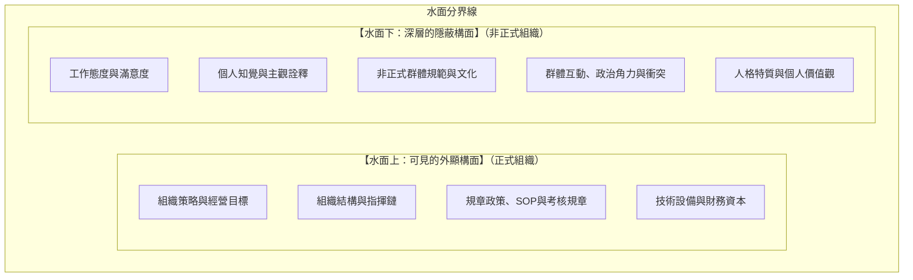
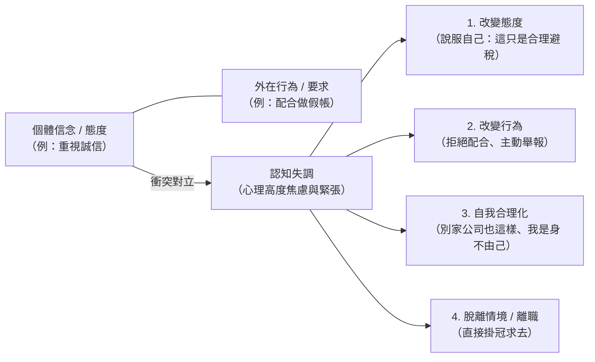
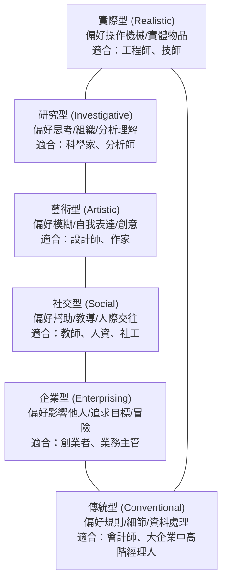
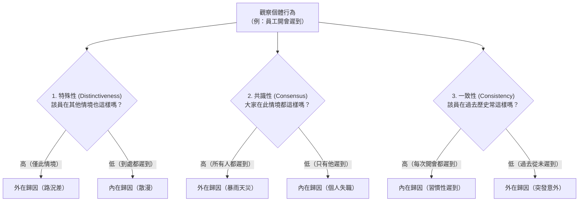

---
{"dg-publish":true,"permalink":"/01/02/ch08/","title":"Ch08 組織管理中的個體行為","tags":["PMBA","管理概論","組織行為","個體行為","人格特質","知覺偏差","工作滿意度","組織公民行為"],"dg-note-properties":{"title":"Ch08 組織管理中的個體行為","course":"管理概論","category":"01_基礎先修","type":"lecture-note","lecture":"02_Ch08","tags":["PMBA","管理概論","組織行為","個體行為","人格特質","知覺偏差","工作滿意度","組織公民行為"],"aliases":["組織管理中的個體行為","Ch08_組織管理中的個體行為","L08_組織管理中的個體行為","Ch08","L08"],"permalink":"/01/02/ch08/"}}
---

# Ch08 組織管理中的個體行為

## 💡 核心摘要

1. **組織冰山效應**：組織中唯有策略、結構、規章與科技等外顯要素浮於水面；驅動組織實際運作與績效成敗的，是深藏於水面下的[[98_商業概念庫/three-components-of-attitude_態度三要素\|態度]]、[[98_商業概念庫/perception-2_知覺\|zhi-jue_知覺]]、非正式規範、價值觀與人際衝突。高階經理人若僅盯著水面上的規章，無法真正解決[[98_商業概念庫/organizational-behavior_組織行為\|organization-xing-wei_組織行為]]的核心問題。
2. **[[98_商業概念庫/perception-2_知覺\|zhi-jue_知覺]]即現實（Perception is Reality）**：員工的行為並非基於「客觀事實」做出反應，而是基於他們所[[98_商業概念庫/perception-2_知覺\|zhi-jue_知覺]]到的世界。經理人若忽視[[98_商業概念庫/perception-2_知覺\|zhi-jue_知覺]]偏誤（如月暈效應、刻板印象、選擇性認知），就無法建立公正的績效考核與組織信任文化。
3. **態度一致性與[[98_商業概念庫/cognitive-dissonance_認知失調\|ren-zhi-shi-diao_認知失調]]**：當個人的信念、價值觀與外在行為產生衝突時，會引發強烈的「[[98_商業概念庫/cognitive-dissonance_認知失調\|ren-zhi-shi-diao_認知失調]]」。員工會透過改變態度、改變行為、自我合理化或選擇離職來化解心理壓力；[[98_商業概念庫/corporate_企業倫理\|enterprise-lun-li_企業倫理]]危機（如安隆案）往往源於系統性壓迫員工合理化不當行為。
4. **[[98_商業概念庫/person-job-fit_人職匹配\|ren-zhi-pi-pei_人職匹配]]與特質選才**：沒有絕對優劣的人格，只有適才適所的「[[98_商業概念庫/person-job-fit_人職匹配\|ren-zhi-pi-pei_人職匹配]]」（Holland 性格—職業配合理論、[[98_商業概念庫/model-2_大五人格模型\|da-wu-ren-ge-model_大五人格模型]]）。「盡責性」是所有職務績效最強的單一預測指標；而在管理與領導層次，[[98_商業概念庫/emotional-intelligence_情緒智商\|qing-xu-zhi-shang_情緒智商]]的影響力更勝傳統智商。
5. **歸因偏誤是管理衝突的溫床**：主管習慣犯「[[98_商業概念庫/fundamental-attribution-error_基本歸因謬誤\|ji-ben-gui-yin-miu-wu_基本歸因謬誤]]」（將部屬的失敗歸咎於怠惰或能力不足），員工則常出現「[[98_商業概念庫/self-serving-bias_自利偏誤\|zi-li-pian-wu_自利偏誤]]」（成功歸己、失敗歸咎環境）。透過客觀三維度（特殊性、共識性、一致性）落實[[98_商業概念庫/gui-yin-theory_歸因理論\|gui-yin-theory_歸因理論]]的系統化分析，是破除管理對立的關鍵技術。

---

## 📚 核心觀念與理論架構

### 一、組織行為冰山模型（The Iceberg Model of Organizational Behavior）

[[98_商業概念庫/organizational-behavior_組織行為\|organization-xing-wei_組織行為]]學（Organizational Behavior, OB）研究個體、群體以及[[98_商業概念庫/organizational-structure_組織結構\|organizational-structure_組織結構]]對組織內部行為的影響。管理學者常用「冰山模型」說明組織運作的本質：

- **經理人洞察**：管理者常誤以為修改 SOP、調整組織圖或引進新 IT 系統就能解決績效問題，但最終決定專案成敗的往往是水面下的政治角力、員工對變革的恐懼、以及團隊內部的非正式規範。

---

### 二、態度構面與認知失調理論

#### 1. 態度的三要素模型（ABC Model）

態度（Attitude）是個體對特定人、事、物的評價性陳述，由緊密關聯的「[[98_商業概念庫/three-components-of-attitude_態度三要素\|tai-du-san-yao-su_態度三要素]]」所組成：

| 構面 | 英文 | 定義與意涵 | 職場情境範例 |
| :--- | :--- | :--- | :--- |
| **認知構面** | **Cognition** | 個體所持有的信念、知識、客觀資訊或觀點。 | 「主管分配這個專案給我，但我認為這項專案技術規格不可行。」 |
| **情感構面** | **Affect** | 態度中的情緒或感受部分，驅動正負面喜惡。 | 「每次跟這個專案經理開會，我都感到無比焦慮與憤怒。」 |
| **行為構面** | **Behavior** | 基於認知與情感，個體傾向採取的具體行動。 | 「我決定向人資申請轉調部門，或者開始投遞外部履歷。」 |

#### 2. 費斯汀格之認知失調理論（Cognitive Dissonance Theory）

心理學家 Leon Festinger 於 1957 年提出：當個人的信念（態度）與其行為出現不一致時，會在心理上產生一種極不舒適的緊張狀態，稱為「[[98_商業概念庫/cognitive-dissonance_認知失調\|ren-zhi-shi-diao_認知失調]]」。個體會本能地尋求減少失調：

> [!NOTE] **經典商業案例：安隆案（Enron）與吹哨人**
> 在 2001 年安隆弊案爆發前，副總裁雪倫·華金斯（Sherron Watkins）發現內部龐大的特殊目的實體（SPE）作假帳。面對「企業高壓文化」與「個人職業道德」的極端失調，多數員工選擇「自我合理化」與「盲從高薪」，而華金斯選擇向執行長雷（Kenneth Lay）遞交備忘錄並成為**吹哨人（Whistleblower）**。該事件直接催生了美國 2002 年的《沙賓法案》（Sarbanes-Oxley Act, SOX），以聯邦法律強制要求設立內部舉報與吹哨人保護機制。

#### 3. 三大核心工作態度與可口可樂「五顆球」哲學

- **[[98_商業概念庫/job-satisfaction_工作滿意度\|gong-zuo-man-yi-du_工作滿意度]]（Job Satisfaction）**：員工對工作的整體正面感受。研究證實[[98_商業概念庫/job-satisfaction_工作滿意度\|gong-zuo-man-yi-du_工作滿意度]]與離職率、缺勤率顯著負相關；且「快樂的員工未必是高績效員工，但高績效往往能反饋帶來高滿意度」。
- **工作投入度（Job Involvement）**：員工在心理上認同工作、並將工作績效視為自我價值實現的程度。
- **[[98_商業概念庫/organizational-commitment_組織承諾\|organization-cheng-nuo_組織承諾]]（Organizational Commitment）**：員工認同組織目標與價值，並渴望持續留在組織中的程度（分為情感性承諾、延續性承諾、規範性承諾）。

> [!TIP] **可口可樂總裁的名言：人生五顆球**
> 「生命是一場在空中拋接五顆球的雜技遊戲。這五顆球分別是：**工作、健康、家庭、朋友、靈魂**。
> 其中，**工作是一顆橡膠球（Rubber Ball）**，掉在地上還會彈起來；但其餘四顆——健康、家庭、朋友與靈魂——都是**玻璃球（Glass Ball）**，一旦掉落，就會產生無法挽回的裂痕甚至碎裂。」
> 此哲學深刻提醒高階經理人在追求職涯[[98_商業概念庫/organizational-commitment_組織承諾\|organization-cheng-nuo_組織承諾]]時，必須審視個人生活平衡與身心健康的底線。

---

### 三、人格特質模型與人職匹配

#### 1. MBTI 職業性格評量（Myers-Briggs Type Indicator）

基於榮格（Carl Jung）心理類型理論，透過四個維度將人格分為 16 種型態：
1. **精力來源**：外向型（E, Extraversion） vs. 內向型（I, Introversion）
2. **收集資訊**：實感型（S, Sensing，重細節與具體事實） vs. 直覺型（N, Intuition，重宏觀與趨勢）
3. **決策方式**：思考型（T, Thinking，重邏輯與客觀準則） vs. 情感型（F, Feeling，重人際與價值觀）
4. **生活型態**：判斷型（J, Judging，重計畫與結構） vs. 感知型（P, Perceiving，重靈活與彈性）

> 職場實務：**ENTJ** 常被視為天生的企業領導者與高階統帥；**INTP** 則多見於深思熟慮的研究學者或技術專家。

#### 2. 當代主流：大五人格模型（Big Five Model）

學術界與企業評鑑公認效度最高的[[98_商業概念庫/model-2_大五人格模型\|da-wu-ren-ge-model_大五人格模型]]（OCEAN）：

| 維度名稱 | 特質表現（高分端 vs. 低分端） | 職場與績效關聯 |
| :--- | :--- | :--- |
| **盡責性 (Conscientiousness)** | **高**：自律、負責、有條理、追求成就 **低**：隨性、散漫、易分心、不可靠 | **預測工作績效最強的單一維度**。不論職務類型，高盡責性員工展現最高的工作成果與品質。 |
| **情緒穩定性 (Emotional Stability)** | **高**：冷靜、抗壓、自信、不易焦慮 **低**：神經質、焦慮、情緒化、易受挫 | 高階主管與高壓工作必備特質；低情緒穩定者在高壓下容易做出衝動決策。 |
| **外向性 (Extraversion)** | **高**：健談、熱情、善社交、果斷主動 **低**：安靜、內斂、獨處、偏好低刺激 | 顯著預測**業務銷售與領導職務**的成功率；但在研發技術崗位並無顯著優勢。 |
| **親和性 (Agreeableness)** | **高**：信任他人、合作、善良、具同理心 **低**：多疑、競爭、冷漠、好爭辯 | 適合**跨部門協作、顧客服務與團隊作戰**；但在要求冷靜談判或推動霹靂裁員時可能受限。 |
| **經驗開放性 (Openness to Experience)** | **高**：富想像力、具好奇心、思想開明 **低**：務實、傳統、墨守成規、抗拒新事物 | 顯著預測**創新能力、策略洞察力與適應變革**的能力。 |

#### 3. 霍蘭德性格—職業配合理論（Holland's RIASEC Model）

John Holland 提出：員工的[[98_商業概念庫/job-satisfaction_工作滿意度\|gong-zuo-man-yi-du_工作滿意度]]與離職傾向，取決於其人格特質與工作環境的契合度，即「[[98_商業概念庫/person-job-fit_人職匹配\|ren-zhi-pi-pei_人職匹配]]」。六大人格類型：

> [!IMPORTANT] **高階經理人的 Holland 特質**
> 在成熟型大企業中，**「傳統型（Conventional）」結合「企業型（Enterprising）」**往往最容易晉升至中高階管理層。因為傳統型具備對規章、制度、財務報表與法規的高度敬畏與執行力，能夠在龐大科層組織中確保營運滴水不漏。

#### 4. 關鍵職場特質與情緒智商

1. **控制信念與[[98_商業概念庫/locus-of-control_內外控傾向\|nei-wai-kong-qing-xiang_內外控傾向]]（Locus of Control）**：
   - **內控型（Internal）**：認為命運掌握在自己手中。績效較佳、主動性強、具有較高自省與內疚感，適合自主性高的管理職位。
   - **外控型（External）**：認為成敗受運氣、背景或環境主宰。抱怨較多，適合結構化、依循指令的工作。
2. **馬基維利主義（Machiavellianism）**：
   - 權謀傾向，「為達目的，不擇手段」（The ends justify the means）。高馬基者情感冷靜、擅長操控與利益交換，在需要高談判技巧或零和博弈中表現強勢，但會破壞團隊長期信任。統計顯示男性與年輕人得分通常偏高，且與智力、教育程度無關。
3. **自尊（Self-Esteem, SE）**：
   - 高自尊者相信自己的能力、敢於冒險；低自尊者患得患失、極度依賴外部讚美，職場中常表現為「不主動聯絡客戶或主管」，本質是**源於害怕被拒絕（Fear of Rejection）**。
4. **自我監控（Self-Monitoring）**：
   - 個體依據外在情境線索調整自身行為的能力。高自我監控者猶如「職場變色龍」，擅長公關、跨文化溝通與政治協調；低自我監控者則始終如一、言行一致。
5. **風險傾向（Risk Taking）**：
   - 追求風險 vs. 趨避風險。財務長（CFO）與風控主管應具備風險趨避特質；而負責創新創投、新市場開拓的主管則需具備高風險承受度。
6. **[[98_商業概念庫/emotional-intelligence_情緒智商\|qing-xu-zhi-shang_情緒智商]]（Emotional Intelligence, EI）**：
   - 包含自我覺察、自我管理、自我激勵、同理心與社交技能。在管理高壓與團隊領導情境中，高 [[98_商業概念庫/emotional-intelligence_情緒智商\|qing-xu-zhi-shang_情緒智商]] 領導者能有效調節團隊焦慮、建立心理安全感，其對高階績效的預測力遠超傳統智商。

---

### 四、知覺與歸因理論

#### 1. 知覺（Perception）的本質與偏誤

[[98_商業概念庫/perception-2_知覺\|zhi-jue_知覺]]是個體組織並詮釋感覺印象，以賦予環境意義的歷程。**「人們看到的是他們想看到的，而非事物本身的樣子。」**
- **雙重圖案實驗**：同一張心理學圖片，既可被看作「年輕少婦」，也可被看作「老婦人」。觀看者先前的經驗與預設框架，直接決定了其[[98_商業概念庫/perception-2_知覺\|zhi-jue_知覺]]結果。
- **四大[[98_商業概念庫/perception-2_知覺\|zhi-jue_知覺]]捷徑與認知偏誤**：
  1. **選擇性認知（Selective Perception）**：人們只吸收符合自身利益、背景與態度的資訊（如同電影《羅生門》各執一詞）。
  2. **刻板印象（Stereotyping）**：依據某人所屬的群體特徵來評價該個體（如「工程師不擅社交」）。
  3. **月暈效應（Halo Effect）**：以個體的單一特徵（如外貌英俊、名校學歷）推論其整體特質（如能力好、人品高尚）。
  4. **對比效應（Contrast Effect）**：對某人的評價受到最近剛接觸過的其他人的扭曲（如在極優秀的面試者之後登場的應徵者會被低估）。

#### 2. 凱利（Harold Kelley）的歸因理論（Attribution Theory）

當我們觀察某人的行為時，會透過[[98_商業概念庫/gui-yin-theory_歸因理論\|gui-yin-theory_歸因理論]]試圖判斷該行為是起因於「內在因素（個人特質、能力、意願）」還是「外在因素（環境、運氣、情境逼迫）」：

- **三大判斷維度歸納**：
  - **情境特殊性（Distinctiveness）**：個體是否僅在特定情境表現該行為？（是 $\rightarrow$ 外在；否 $\rightarrow$ 內在）
  - **團體共識性（Consensus）**：面對相同情境，其他人是否表現相同行為？（是 $\rightarrow$ 外在；否 $\rightarrow$ 內在）
  - **時間一致性（Consistency）**：該個體在不同時間點是否持續表現該行為？（是 $\rightarrow$ **內在**；否 $\rightarrow$ 外在）

#### 3. 兩大毀滅性的歸因偏誤

1. **[[98_商業概念庫/fundamental-attribution-error_基本歸因謬誤\|ji-ben-gui-yin-miu-wu_基本歸因謬誤]]（Fundamental Attribution Error）**：
   - 在評估**他人**的行為時，**低估外在情境因素，高估內在個人特質**。主管看到員工未達標，直覺認為是「員工怠惰、能力不足」，卻忽視市場崩盤、原料斷貨或競爭對手削價等客觀外部障礙。
2. **[[98_商業概念庫/self-serving-bias_自利偏誤\|zi-li-pian-wu_自利偏誤]]（Self-Serving Bias）**：
   - 在評估**自己**的行為時，**將成功歸因於內部特質（我的遠見與努力），將失敗歸咎於外部環境（景氣不好、政策不利、團隊不給力）**。

---

### 五、學習理論與行為塑造（Behavior Shaping）

#### 1. 學習理論基礎

- **古典制約（Classical Conditioning）**：巴夫洛夫（Pavlov）的狗唾液實驗。透過非制約刺激（肉塊）與制約刺激（鈴聲）的重複配對，建立被動的條件反射。
- **操作制約（Operant Conditioning）**：史金納（B.F. Skinner）提出。個體的行為是其「結果的函數」；行為取決於隨後發生的增強或懲罰。

#### 2. 經理人的四大行為塑造工具

| 工具名稱 | 經理人操作方式 | 目的 | 職場實務範例 |
| :--- | :--- | :--- | :--- |
| **正向增強 (Positive Reinforcement)** | 當期望行為出現時，**給予令人愉悅的刺激**（獎勵、表揚）。 | **增加**期望行為的頻率 | 員工提出創新流程節省成本，立即於全體大會公開表揚並發放獎金。 |
| **負向增強 (Negative Reinforcement)** | 當期望行為出現時，**撤銷或停止令人不快的刺激**。 | **增加**期望行為的頻率 | 員工若能提前完成專案進度，免除其每週末必須提交冗長追蹤報告的要求。 |
| **懲罰 (Punishment)** | 當不良行為出現時，**給予令人厭惡的後果**。 | **減少**不良行為的頻率 | 員工嚴重違反資安規定洩漏公司機密，依規處以記過或減發年終獎金。 |
| **消滅 / 忽視 (Extinction)** | 當不良行為出現時，**撤除原本維持該行為的正面關注**（冷處理）。 | **消除**不當行為 | 員工在會議中屢次以插嘴講冷笑話博取注意，主席刻意無視並直接推進議程，使其自討沒趣而停止。 |

---

## ⚠️ 經理人實務決策與避坑指南

### 1. 人才甄選與人職匹配的避坑指南
- **落實[[98_商業概念庫/person-job-fit_人職匹配\|ren-zhi-pi-pei_人職匹配]]與科學選才**：警惕「月暈效應」與「外貌/名校偏見」，面試時採用「結構化面試」與工作樣本測試，以[[98_商業概念庫/model-2_大五人格模型\|da-wu-ren-ge-model_大五人格模型]]中的「盡責性」作為基礎篩選門檻，並依職位配置[[98_商業概念庫/locus-of-control_內外控傾向\|nei-wai-kong-qing-xiang_內外控傾向]]與[[98_商業概念庫/emotional-intelligence_情緒智商\|qing-xu-zhi-shang_情緒智商]]。
- **配置互補型特質**：業務或公關崗位篩選高外向性與高自我監控者；研發或策略崗位篩選高經驗開放性與高自尊者；財務與風控崗位篩選高傳統型與風險趨避者。

### 2. 績效考核與主管歸因避坑指南
- **戒除「[[98_商業概念庫/fundamental-attribution-error_基本歸因謬誤\|ji-ben-gui-yin-miu-wu_基本歸因謬誤]]」的指責心態**：當團隊未達標時，主管第一步應檢視「情境共識性」與「特殊性」——如果是整體市場逆風或供應鏈斷鏈，強加懲罰只會引發[[98_商業概念庫/cognitive-dissonance_認知失調\|ren-zhi-shi-diao_認知失調]]與大規模離職潮。
- **破解組織「[[98_商業概念庫/self-serving-bias_自利偏誤\|zi-li-pian-wu_自利偏誤]]」的卸責文化**：建立專案「事後檢討會（Post-Mortem）」，校準[[98_商業概念庫/perception-2_知覺\|zhi-jue_知覺]]偏差，明訂客觀量化指標與外部基線，要求覆盤時「功勞歸團隊與市場機遇，問題先自省決策漏洞」。

### 3. 激勵與行為塑造的執行要點
- **提升[[98_商業概念庫/job-satisfaction_工作滿意度\|gong-zuo-man-yi-du_工作滿意度]]與[[98_商業概念庫/organizational-commitment_組織承諾\|organization-cheng-nuo_組織承諾]]**：「即時增強」勝過「延遲重賞」，增強刺激越接近行為發生的時刻，塑造效果越強烈。
- **慎用「懲罰」，善用「消滅」與「正向增強」**：懲罰只能暫時壓制行為，並伴隨恐懼與敵意；要徹底改善不良行為，應透過正向增強引導替代行為，並對負面博取眼球的行為實施「消滅」。

---

## 🧠 PMBA 課堂討論與思辨題

### 問題一：在成熟企業推動敏捷數位轉型時，高傳統型（Holland C 型）的中層主管往往強烈抗拒變革。作為領導者，你該如何運用「認知失調」與「行為塑造」推動組織順利轉身？

> **經理人深度解析**：
> 1. **診斷抗拒根源**：C 型主管視「確定性、規則、程序」為安全感來源。敏捷轉型的「模糊性與快速迭代」挑戰其既有認知，引發極度不適的[[98_商業概念庫/cognitive-dissonance_認知失調\|ren-zhi-shi-diao_認知失調]]，進而採取「消極抵制」或「形式化遵循」來自我保護。
> 2. **化解[[98_商業概念庫/cognitive-dissonance_認知失調\|ren-zhi-shi-diao_認知失調]]**：
>    - **重構認知框架**：不將敏捷包裝為「拋棄規則」，而是定義為「應對極端市場波動的新型風險控制 SOP」，讓 C 型主管理解敏捷正是確保企業不被淘汰的最嚴謹手段。
>    - **提供過渡安全感**：明確界定「安全試錯邊界（Safe-to-fail boundaries）」，降低其因失控感產生的心理焦慮。
> 3. **運用行為塑造工具**：
>    - **小步快跑與正向增強**：將大型轉型拆解為 2 週一個 Sprint 的小里程碑，一旦主管落實短會或看板管理，立即給予公開表揚與資源傾斜。
>    - **負向增強**：對於配合採用數位協作工具（如 Jira / Slack）的團隊，主管可免除傳統每週冗長的紙本進度報告審批，以減輕行政負擔作為增強刺激。

---

### 問題二：某新創獨角獸企業為追求極速擴張，大量晉用高馬基維利主義（High Mach）與高風險傾向的業務戰將。短期內營收暴增，但隨後爆發虛報業績、霸凌部屬與核心技術外流危機。請從組織行為學視角評析此現象，並提出治理對策。

> **經理人深度解析**：
> 1. **現象本質剖析**：
>    - 高馬基者的核心特徵是「冷酷理性、重視結果、忽視道德底線」，高風險傾向則驅使他們遊走於法規與倫理邊緣。
>    - 在缺乏制衡制度的新創擴張期，這類特質能帶來野蠻生長，但「水面下的文化與價值觀」已被侵蝕。員工出現[[98_商業概念庫/self-serving-bias_自利偏誤\|zi-li-pian-wu_自利偏誤]]，將業績歸功個人神勇，將倫理風險拋諸腦後。
> 2. **治理對策**：
>    - **重構績效評估指標（KPI + Balance Scorecard）**：將「價值觀、團隊誠信、合規審查」納入一票否決制（Veto system），不再以單一營收業績論英雄。
>    - **人事結構制衡**：在業務團隊中導入高盡責性、高親和性與高[[98_商業概念庫/emotional-intelligence_情緒智商\|qing-xu-zhi-shang_情緒智商]]的營運與法遵主管，實行「雙簽制」，剝奪高馬基者的單向獨裁權力。
>    - **啟動吹哨人制度與懲罰機制**：對虛報業績與霸凌行為零容忍，公開嚴懲違規者以產生「替代性學習（Vicarious Learning）」效應，重塑健康的[[98_商業概念庫/organizational-behavior_組織行為\|organization-xing-wei_組織行為]]氛圍。

---

## 🔗 關聯章節與延伸學習

- **前置章節**：
  - [[01_基礎先修/02_管理概論/Ch01_什麼是企業管理\|01_基礎先修/02_管理概論/Ch01_什麼是企業管理]]：管理的本質是透過他人完成任務，個體行為是理解「他人」的基礎。
  - [[01_基礎先修/02_管理概論/Ch06_組織結構設計\|01_基礎先修/02_管理概論/Ch06_組織結構設計]]：[[98_商業概念庫/organizational-structure_組織結構\|organizational-structure_組織結構]]是水面上的骨架，個體行為與[[98_商業概念庫/organization-2_非正式組織\|fei-zheng-shi-organization_非正式組織]]是水面下的靈魂。
  - [[01_基礎先修/02_管理概論/Ch07_變革管理\|01_基礎先修/02_管理概論/Ch07_變革管理]]：Lewin 變革三階段中的「解凍」，本質上是打破個體的心理[[98_商業概念庫/cognitive-dissonance_認知失調\|ren-zhi-shi-diao_認知失調]]與防衛機制。
- **後續章節**：
  - [[01_基礎先修/02_管理概論/Ch09_當代激勵理論\|01_基礎先修/02_管理概論/Ch09_當代激勵理論]]：深化操作制約與行為塑造，探討馬斯洛、赫茲伯格、[[98_商業概念庫/theory-8_期望理論\|qi-wang-theory_期望理論]]等當代激勵模型。
  - [[01_基礎先修/02_管理概論/Ch10_當代領導理論\|01_基礎先修/02_管理概論/Ch10_當代領導理論]]：探討特質論、情境領導與轉化型領導如何激發個體潛能。
- **商業概念庫核心卡片**：
  - [[98_商業概念庫/organizational-behavior_組織行為\|organization-xing-wei_組織行為]]
  - [[98_商業概念庫/three-components-of-attitude_態度三要素\|tai-du-san-yao-su_態度三要素]]
  - [[98_商業概念庫/cognitive-dissonance_認知失調\|ren-zhi-shi-diao_認知失調]]
  - [[98_商業概念庫/job-satisfaction_工作滿意度\|gong-zuo-man-yi-du_工作滿意度]]
  - [[98_商業概念庫/organizational-commitment_組織承諾\|organization-cheng-nuo_組織承諾]]
  - [[98_商業概念庫/model-2_大五人格模型\|da-wu-ren-ge-model_大五人格模型]]
  - [[98_商業概念庫/locus-of-control_內外控傾向\|nei-wai-kong-qing-xiang_內外控傾向]]
  - [[98_商業概念庫/perception-2_知覺\|zhi-jue_知覺]]
  - [[98_商業概念庫/gui-yin-theory_歸因理論\|gui-yin-theory_歸因理論]]
  - [[98_商業概念庫/fundamental-attribution-error_基本歸因謬誤\|ji-ben-gui-yin-miu-wu_基本歸因謬誤]]
  - [[98_商業概念庫/self-serving-bias_自利偏誤\|zi-li-pian-wu_自利偏誤]]
  - [[98_商業概念庫/emotional-intelligence_情緒智商\|qing-xu-zhi-shang_情緒智商]]
  - [[98_商業概念庫/person-job-fit_人職匹配\|ren-zhi-pi-pei_人職匹配]]
