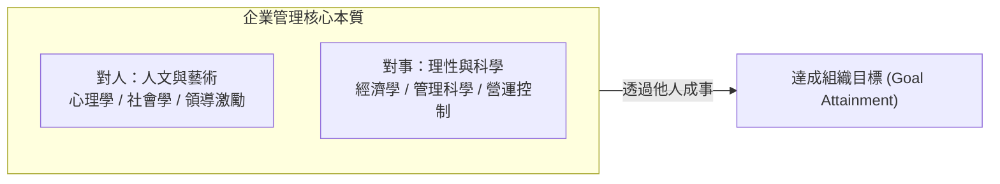
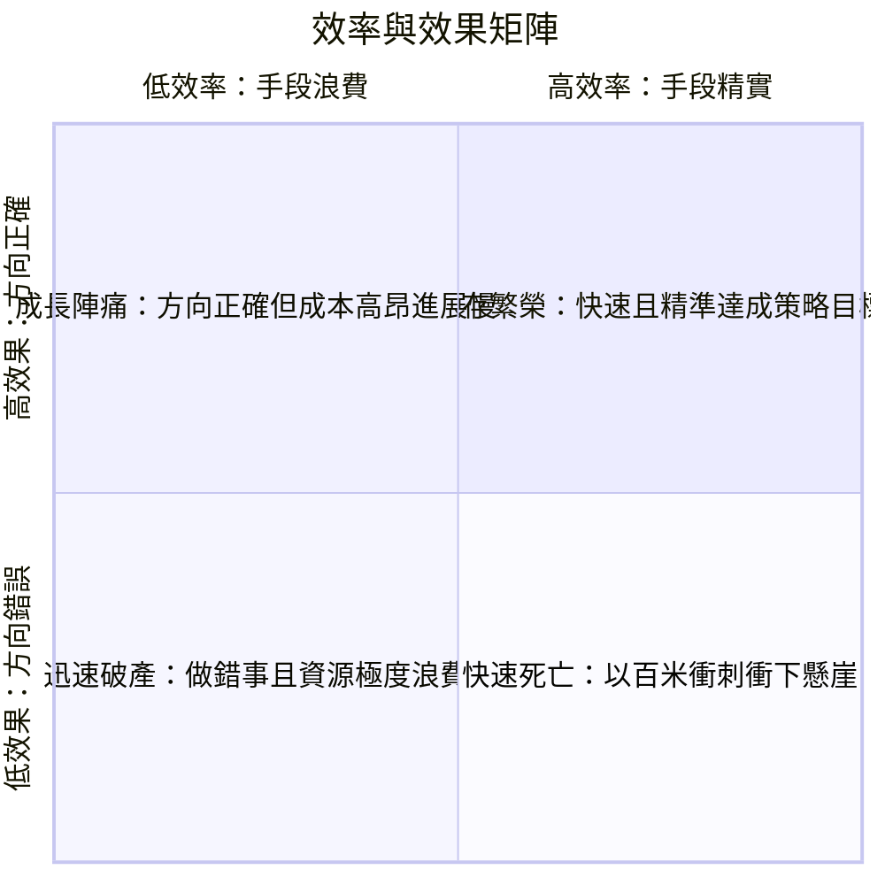
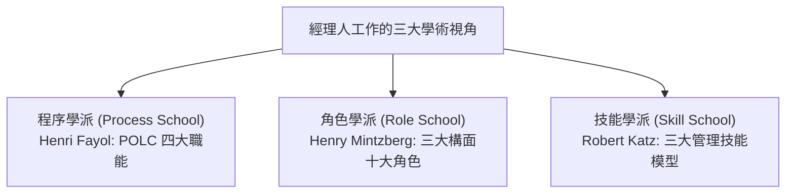
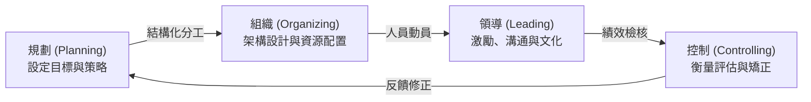
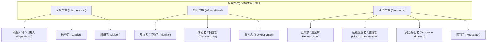
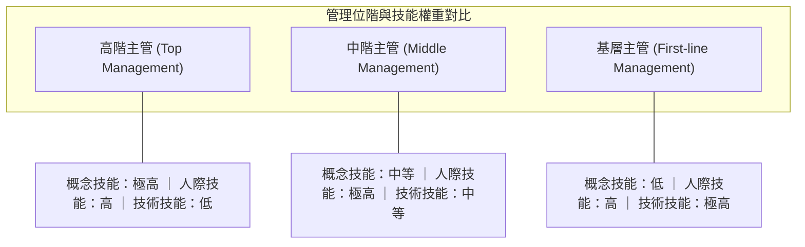

---
{"dg-publish":true,"permalink":"/01//ch01/","title":"Ch01 什麼是企業管理","tags":["PMBA","管理概論","POLC","管理技能","管理者角色","管理思維"],"dg-note-properties":{"title":"Ch01 什麼是企業管理","course":"管理概論","category":"01_基礎先修","type":"lecture-note","lecture":"02_Ch01","tags":["PMBA","管理概論","POLC","管理技能","管理者角色","管理思維"],"aliases":["什麼是企業管理","Ch01_什麼是企業管理","L01_什麼是企業管理","Ch01","L01"],"permalink":"/01/02/ch01/"}}
---

# Ch01 什麼是企業管理

## 💡 核心摘要
- **管理的本質是「透過他人以成事」**：[[98_商業概念庫/enterprise-management_企業管理\|enterprise-management_企業管理]]並非個人英雄主義式的親力親為，而是透過協調、監督與賦能他人，整合有限資源以共同達成組織目標的動態歷程。
- **做對的事（效果）遠重於把事做對（效率）**：高效率跑向錯誤的方向是組織最昂貴的浪費；卓越經理人必須先以「[[98_商業概念庫/efficiency-and-effectiveness_效率與效果\|效果]]」（Effectiveness）確立戰略導向，再以「[[98_商業概念庫/efficiency-and-effectiveness_效率與效果\|效率]]」（Efficiency）優化資源配置與營運流程。
- **管理職能的三維立體視角**：傳統「[[98_商業概念庫/POLC職能\|POLC職能]]」（程序學派）提供系統化的宏觀骨架，而「[[98_商業概念庫/Mintzberg管理者角色\|Mintzberg管理者角色]]」（角色學派）揭示了經理人日常碎片化與即興應變的真實動態，兩者互為表裡。
- **技能重心的動態移轉**：依據「[[98_商業概念庫/Katz管理技能模型\|Katz管理技能模型]]」，隨著管理階層提升，[[98_商業概念庫/technical-skills_技術技能\|ji-shu-ji-neng_技術技能]]的重要性遞減，而縱觀全局的「[[98_商業概念庫/conceptual-skills_概念技能\|gai-nian-ji-neng_概念技能]]」成為高階決策的核心勝任力，但「[[98_商業概念庫/interpersonal-skills_人際技能\|ren-ji-ji-neng_人際技能]]」則是貫穿所有層級的共通基石。
- **從執行者（Doer）到催化者（Catalyst）的心智躍遷**：優秀技術骨幹晉升經理人時，必須克服「[[98_商業概念庫/peter-principle_彼得原理\|bi-de-yuan-li_彼得原理]]」的慣性陷阱，學會授權與教練（Coaching），以組織系統的整體產出取代個人產能。

---
## 📚 核心觀念與架構

### 1. 什麼是企業管理與經理人？

#### (1) 管理的定義：對人與對事的交織
彼得·杜拉克（Peter Drucker）指出：「當代社會是一個機構化的社會（Society of Institutions）。」人類的所有活動皆在各類組織中開展，機構的良窳取決於[[98_商業概念庫/enterprise-management_企業管理\|enterprise-management_企業管理]]的效能。
管理學最精煉強大的定義為：
> **管理是「透過人以成事」的過程（Getting things done through people）。**

這一定義揭示了管理的雙重本質：
- **對人（人文與藝術）**：奠定在**心理學**與**社會學**基礎之上，涉及[[98_商業概念庫/organizational-behavior_組織行為\|organization-xing-wei_組織行為]]、領導力、動機激勵、團隊溝通與消費者心理。
- **對事（科學與理性）**：奠定在**經濟學**、**數量方法**與**管理科學**基礎之上，涉及資源配置、營運流程、指標控制與戰略決策。

#### (2) 經理人的層級劃分
經理人（Manager）是指在組織中負責協調與監督他人工作，以達成組織共同目標的人。在組織金字塔中，經理人依職責範圍分為三大層級：
1. **基層主管（First-line Managers）**：直接管理第一線非主管員工，聚焦於日常作業排程、操作規範與即時問題排除（如：科長、組長、工廠領班）。
2. **中階主管（Middle Managers）**：承上啟下的樞紐，將高階願景轉化為具體部門目標與行動方案，協調跨部門資源（如：部門經理、廠長、專案總監）。
3. **高階主管（Top Managers / Top Management）**：對組織整體運營與長期生存負責，負責制定長遠策略、塑造企業文化並因應外部環境動態（如：CEO、總裁、副總裁、執行長）。

---

### 2. 管理的核心雙軸：效率 vs. 效果

管理的兩大核心維度為「[[98_商業概念庫/efficiency-and-effectiveness_效率與效果\|xiao-rate-yu-xiao-guo_效率與效果]]」（Efficiency vs. Effectiveness），兩者構成衡量管理優劣的關鍵矩陣：

| 維度 | 效率 (Efficiency) | 效果 (Effectiveness) |
| :--- | :--- | :--- |
| **本質定義** | **把事情做對（Doing things right）** | **做對的事情（Doing the right things）** |
| **關注焦點** | 手段（Means）、資源利用與輸入輸出比 | 目標（Ends）、方向正確性與組織目標達成度 |
| **衡量指標** | 單位成本、週轉天數、報廢率、工時消耗 | 市場份額、顧客滿意度、營收成長、ROE |
| **追求境界** | 資源浪費極小化（Minimizing waste） | 價值產出極大化（Maximizing attainment） |

---

### 3. 經理人在做什麼？三大學派理論架構

管理學者從不同維度剖析經理人的工作本質，主要分為三大學派：

#### (1) 程序學派：費堯的四大管理職能（POLC 循環）
法國管理學者亨利·費堯（Henri Fayol）主張管理是由一套邏輯嚴密的步驟所構成的動態連續過程，稱為「[[98_商業概念庫/POLC職能\|POLC職能]]」：
1. **規劃（Planning）**：定義組織目標、確立願景與使命、分析外在機會與威脅、制定達成目標的全面策略與細部執行方案。
2. **組織（Organizing）**：決定達成目標所需的任務、部門架構劃分、職權指派、授權範圍與資源配置機制。
3. **領導（Leading）**：指導、激勵組織成員，建立共識與組織文化，化解團隊衝突，選擇最適溝通管道以凝聚向心力。
4. **控制（Controlling）**：監督各項實際績效，與預定標準進行比較，評估偏差原因並採取必要的矯正行動，確保目標如期達成。

#### (2) 角色學派：明茲伯格的三大構面與十大角色
加拿大管理學者亨利·明茲伯格（Henry Mintzberg）挑戰了程序學派「管理者總是在深思熟慮地按部就班」的假設。他透過實地觀察指出：**經理人的真實工作是零碎、短暫、多樣且高度即興回應的**。經理人如同隨時從抽屜中取出不同「面具」，扮演「[[98_商業概念庫/Mintzberg管理者角色\|Mintzberg管理者角色]]」：

- **三大構面與十大角色實務對照**：
  1. **人際角色（Interpersonal Roles）**：源自正式權威，建立組織內外關係。
     - *頭臉人物（Figurehead）*：代表組織出席法定或象徵性社交場合（如剪綵、頒獎）。
     - *領導者（Leader）*：負責激勵、指導、培訓部屬，塑造團隊士氣。
     - *聯絡者（Liaison）*：維繫組織外部情報網絡與內部跨部門合作管道（如參與外部公會、跨界拜訪）。
  2. **資訊角色（Informational Roles）**：神經中樞，負責情報的接收、過濾與傳遞。
     - *監視者（Monitor）*：主動蒐集內外部情報，掌握環境動態與異常徵兆。
     - *傳播者（Disseminator）*：將重要外界資訊或高層決策轉發、解讀給組織內部成員。
     - *發言人（Spokesperson）*：代表組織向外界（投資人、媒體、主管機關）發布正式政策或績效。
  3. **決策角色（Decisional Roles）**：將資訊化為具體行動與戰略抉擇。
     - *企業家（Entrepreneur）*：主動發掘變革機會，推動創新專案與流程改革。
     - *危機處理者（Disturbance Handler）*：面對突發意外、罷工、客訴或供應鏈中斷時迅速排除障礙。
     - *資源分配者（Resource Allocator）*：決定預算、人力、時間與關鍵設備的配置順序。
     - *談判者（Negotiator）*：代表組織與工會、供應商、關鍵客戶進行重大權益磋商。

#### (3) 技能學派：卡茲的三大管理技能模型
羅伯特·卡茲（Robert L. Katz）提出經理人所需具備的三種[[98_商業概念庫/core-competence_核心能力\|he-xin-neng-li_核心能力]]（「[[98_商業概念庫/Katz管理技能模型\|Katz管理技能模型]]」），並揭示其在不同管理位階的權重配置：

1. **[[98_商業概念庫/technical-skills_技術技能\|ji-shu-ji-neng_技術技能]]（Technical Skills）**：
   - 運用特定領域的方法、程序、工具與專業知識的能力（如撰寫程式碼、編製財務報表、半導體製程調控）。
   - **位階權重**：基層主管最高；高階主管只需具備基本理解即可，過度沉溺於技術反而阻礙全局決策。
2. **[[98_商業概念庫/interpersonal-skills_人際技能\|ren-ji-ji-neng_人際技能]]（Human Skills）**：
   - 與他人有效共事、溝通、理解、激勵與化解衝突的能力。
   - **位階權重**：**在基層、中層、高階皆極為關鍵**，是管理者的共通生命線（貫穿組織各層級）。
3. **[[98_商業概念庫/conceptual-skills_概念技能\|gai-nian-ji-neng_概念技能]]（Conceptual Skills）**：
   - 縱觀全局（Big Picture）、抽象思考、洞察複雜局勢、識別[[98_商業概念庫/business-model_商業模式\|business-model_商業模式]]機會與跨系統因果關聯的能力。
   - **位階權重**：高階主管的核心生命線，決定企業長遠願景與戰略成敗。

---

### 4. 當代管理環境的演進：從股東到利害關係人
- **股東至上主義（Shareholder Primacy）到利害關係人資本主義（Stakeholder Capitalism）**：傳統管理側重為股東創造最大財務回報；當代管理則強調兼顧員工、顧客、供應鏈、社群與生態環境的多方永續價值。
- **ESG 治理框架的內化**：環境保護（Environmental）、社會責任（Social）、[[98_商業概念庫/corporate-governance_公司治理\|company-zhi-li_公司治理]]（Governance）不再只是公關慈善，而是直接納入經理人的規劃（P）、組織（O）、領導（L）與控制（C）核心考量。

---

## ⚠️ 實務應用與經理人思維

### 1. 專業技術骨幹晉升的「彼得原理」陷阱
- **[[98_商業概念庫/peter-principle_彼得原理\|bi-de-yuan-li_彼得原理]]（Peter Principle）現象**：組織往往習慣提拔技術最強的工程師或業績最頂尖的業務員擔任主管，直到其晉升至「無法勝任的職位」為止。
- **實務痛點與盲區**：
  - **難以授權（Reluctance to Delegate）**：認為「自己做比較快、別人做不放心」，導致主管疲於奔命、部屬無法成長。
  - **微觀管理（Micromanagement）**：過度涉入技術細節與操作手法，忽視跨部門協調與人際激勵。
  - **缺乏概念思維**：沉迷於局部技術優化，忽視組織整體策略方向與商業變革。
- **避坑心法**：專業技術骨幹必須認知「個人產能有上限，團隊產能無上限」，將成就感的來源從「個人攻克難題」轉移為「透過團隊達成目標」。

### 2. 「高效率卻低效果」的致命戰略盲點
- **以百米速度跑錯方向**：許多組織陷入狂熱的流程精實化（Lean）、成本壓縮（Cost-down）或產能衝刺，卻忽略了市場需求早已轉向。
- **逐字稿經典案例解析**：
  - **飯店電梯抱怨案例（QBQ 思維）**：
    - *效率思維*：認為問題是「電梯速度太慢」，投入鉅資更換高功率馬達或重寫演算法，成本昂貴且效益邊際遞減。
    - *效果思維*：洞察「問題背後的問題（QBQ）」——客人的核心痛點不是速度慢，而是「等候時感到無聊」。經理人在大廳裝設全身鏡、陳列藝術品與播放資訊看板，以極低成本轉移顧客注意力，徹底消除抱怨。
  - **本田機車（Honda）進軍美國市場的啟示**：
    - 原本設定以大排氣量重機與哈雷競爭（預設戰略），但頻繁發生故障且難以打開市場。
    - 經理人敏銳觀察到員工騎乘代步的 50cc 小型機車（Super Cub）引發美國民眾熱烈詢問，果斷將策略轉向休閒輕型機車市場，做對了真正符合市場價值主張的事（Effectiveness），成就商業傳奇。

### 3. 經理人心智模式躍遷：從 Doer 到 Catalyst 與 Coach

| 構面 | 個人貢獻者 / 執行者 (Doer) | 經理人 / 催化者與教練 (Catalyst & Coach) |
| :--- | :--- | :--- |
| **工作本質** | 依靠個人技術直接產出成果 | **透過他人以成事**，打造高績效團隊 |
| **關注核心** | 「這件事我該怎麼做？」 | 「這件事該交給誰做？我該如何賦能他？」 |
| **成就感來源** | 個人任務的完美交付與技術優越感 | 部屬的快速成長與組織目標的集體突破 |
| **關鍵能力** | [[98_商業概念庫/technical-skills_技術技能\|ji-shu-ji-neng_技術技能]] | [[98_商業概念庫/conceptual-skills_概念技能\|gai-nian-ji-neng_概念技能]] 與 [[98_商業概念庫/interpersonal-skills_人際技能\|ren-ji-ji-neng_人際技能]] |
| **溝通風格** | 提供標準答案、指令傳達 | 提問引導、傾聽反饋、心理安全感建立 |
| **時間分配** | 執行日常作業、撲滅局部火苗 | 釐清優先級、排除體制障礙、建構賦能環境 |
