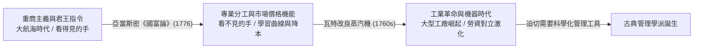
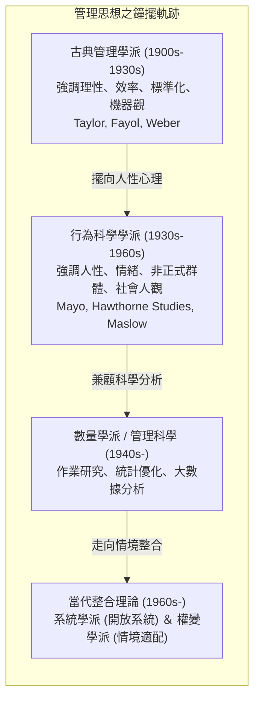
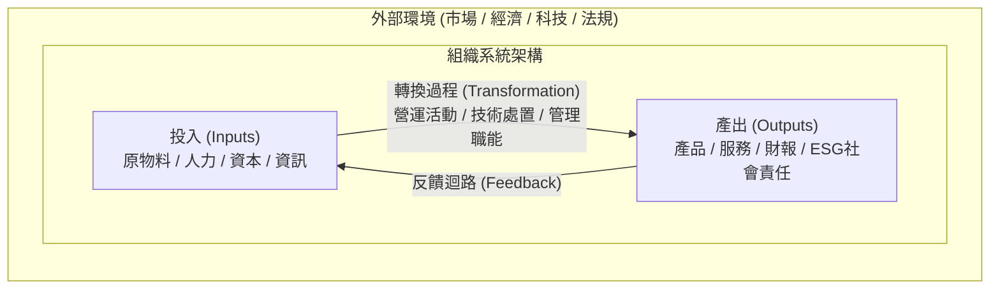
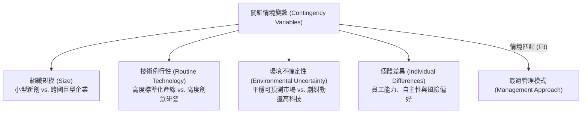
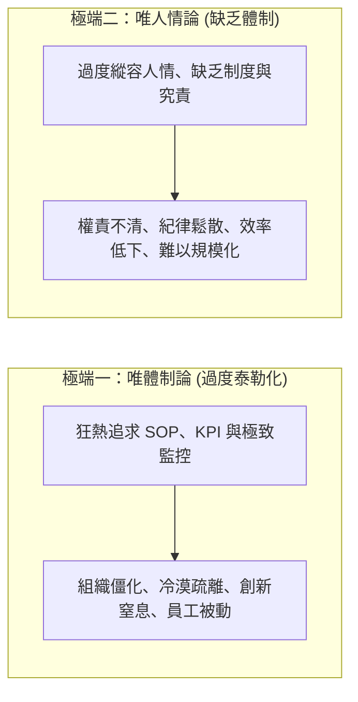

---
{"dg-publish":true,"permalink":"/01//ch02/","title":"Ch02 管理理論發展史","tags":["PMBA","管理概論","管理史","科學管理","行政管理","科層體制","霍桑實驗","權變理論"],"dg-note-properties":{"title":"Ch02 管理理論發展史","course":"管理概論","category":"01_基礎先修","type":"lecture-note","lecture":"02_Ch02","tags":["PMBA","管理概論","管理史","科學管理","行政管理","科層體制","霍桑實驗","權變理論"],"aliases":["管理理論發展史","Ch02_管理理論發展史","L02_管理理論發展史","Ch02","L02"]}}
---

# Ch02 管理理論發展史

## 💡 核心摘要
- **管理演進的「鐘擺效應」**：管理思想史並非單向累積的線性發展，而是如鐘擺般在「理性、工具與效率（對事）」與「人性、心理與社會（對人）」兩極之間反覆擺盪，最終走向兼顧兩者的整合視角。
- **古典學派追求「單一最佳解」（One Best Way）**：泰勒的「[[98_商業概念庫/management-4_科學管理\|ke-xue-management_科學管理]]」、費堯的「[[98_商業概念庫/administrative-principles_行政管理原則\|xing-zheng-management-yuan-ze_行政管理原則]]」與韋伯的「[[98_商業概念庫/bureaucratic-system_官僚體制\|guan-liao-ti-zhi_官僚體制]]」，奠定了現代組織的標準化作業（SOP）、專業分工與層級節制，將組織視為可精密調校的高效機器。
- **行為學派發現「社會人」與「非正式力量」**：梅奧透過「[[98_商業概念庫/hawthorne-experiments_霍桑實驗\|huo-sang-shi-yan_霍桑實驗]]」打破了「經濟人」假設，證實員工的心理歸屬感、群體規範與「[[98_商業概念庫/organization-2_非正式組織\|fei-zheng-shi-organization_非正式組織]]」對生產力的驅動力遠大於單純的物理工作條件與金錢誘因。
- **當代觀點邁向「[[98_商業概念庫/system-2_開放系統\|kai-fang-xi-tong_開放系統]]」與「情境權變」**：當代管理揚棄了絕對的最佳方法，「[[98_商業概念庫/systems-school_系統學派\|xi-tong-xue-pai_系統學派]]」強調組織作為「[[98_商業概念庫/system-2_開放系統\|kai-fang-xi-tong_開放系統]]」與外在環境的物質與資訊交換；「[[98_商業概念庫/contingency-theory_權變理論\|quan-bian-theory_權變理論]]」則確立「視情境而定（It depends）」的動態適配法則。
- **經理人的體制與人性平衡術**：卓越經理人必須在「制度紀律（SOP）」與「心理激勵（Empowerment）」之間取得動態平衡，既防範過度科層化導致的組織僵化，亦避免缺乏標準導致的營運失序。

---
## 📚 核心觀念與理論演進

### 1. 歷史背景：從工藝作坊到工業大生產

#### (1) 亞當斯密《國富論》（1776）的啟示
- **絕對利益與自由貿易**：反對重商主義由殖民君王「看得見的手」主導產業，主張各國應依據「絕對利益」專注擅長領域（如英國羊毛、法國紅酒），透過市場價格「看不見的手」進行交易。
- **專業分工（Division of Labor）**：透過工序拆解使工人專注於單一動作，大幅發揮「學習效應」（Learning Curve），降低單位生產成本並提升整體生產力，成為後續[[98_商業概念庫/management-4_科學管理\|ke-xue-management_科學管理]]與組織設計的基石。

#### (2) 工業革命與管理問題的爆發
- 瓦特改良蒸汽機引爆機械化大生產，工廠制取代傳統家庭手工作坊，催生大型企業組織。
- 工業初期因缺乏[[98_商業概念庫/management-4_科學管理\|ke-xue-management_科學管理]]體系，工人工作環境惡劣、生產浪費嚴重、勞資雙方互不信任且高度對立（正如卓別林電影《摩登時代》所諷刺的機器奴役現象），迫切需要一套系統性管理理論解決生產效率與協作難題。

---

### 2. 管理理論發展百年全景：鐘擺模型

---

### 3. 古典管理學派：強調理性、效率與組織結構（1900s - 1930s）

古典管理學派的核心假設為「經濟人（Economic Man）」——認為人是追求經濟利益最大化的理性存在。該學派致力於尋找「單一最佳解」（One Best Way）。

#### (1) 泰勒（Frederick W. Taylor）與科學管理
「[[98_商業概念庫/management-4_科學管理\|ke-xue-management_科學管理]]之父」泰勒主張以「科學研究與實驗」取代傳統經驗法則（Rule of Thumb）。
- **柏利恆鋼鐵廠（Bethlehem Steel）兩大經典實驗**：
  1. **搬運生鐵塊實驗**：
     - *問題*：工人生鐵搬運量缺乏標準，有的搬太重疲勞過度，有的搬太輕往返次數過多。
     - *科學實驗*：透過碼表計時與體力消耗記錄，測出每次搬運「92 磅」為最佳負載。
     - *成效*：工人人均日搬運量由 12.5 噸巨幅躍升至 47.5 噸（提升近 4 倍），工人日薪由 1.15 美元增加至 3.85 美元（提升逾 3 倍）。
  2. **鏟鐵沙實驗**：
     - *問題*：工人自備鐵鏟，形狀、材質、重量不一，每鏟載重混亂。
     - *科學實驗*：設計各種規格鏟子反覆測試，發現每鏟載重「21.5 磅」時總效率最高，進而將鏟子規格化並列為公用裝備。
     - *成效*：人均日鏟量由 16 噸增至 59 噸，工廠工人編制由 600 人精簡至 140 人，生產成本由每噸 7 美分降至 3 美分。
- **《[[98_商業概念庫/management-4_科學管理\|ke-xue-management_科學管理]]原理》（1911）四大原則**：
  1. **發展真實工作科學**：以科學方法制定標準作業程序（SOP），消除動作浪費。
  2. **科學化選拔與培訓員工**：根據崗位需求挑選適合人才，並以科學方法訓練，改變以往任意指派之作法。
  3. **誠心與員工合作**：提供具吸引力的經濟誘因（如「差別計件工資制」），確保工作按科學程序執行。
  4. **資方與勞方明確分工**：管理階層專責規劃、設計與監督，作業階層專注於標準化執行，扭轉管理不善互相推諉之風氣。
- **企管顧問之祖**：泰勒開創了知識密集型的現代管理顧問業，以每小時高達 600 美元（現值換算）的諮詢費輔導全球工廠轉型。

#### (2) 吉爾布雷斯夫婦（Frank & Lillian Gilbreth）與時間動作研究
- **「[[98_商業概念庫/time-and-motion-study_時間動作研究\|shi-jian-dong-zuo-yan-jiu_時間動作研究]]」（Time and Motion Study）**：利用攝影機與高精度碼表紀錄工人微細動作，消除無效動作，找出最佳動作組合。
- **動速（Therblig）**：將人類手部動作解構為 17 個基本動作元素（如：伸手、握取、移動、放置等）。「Therblig」一詞即為吉爾布雷斯（Gilbreth）姓氏之倒寫。

#### (3) 費堯（Henri Fayol）與行政管理學派
「現代經營管理之父」費堯從高階管理者視角出發，奠定了宏觀組織管理的通用架構。
- **管理五大要素**：規劃（Plan）、組織（Organize）、指揮（Command）、協調（Coordinate）、控制（Control），後續精煉為當代「[[98_商業概念庫/POLC職能\|POLC職能]]」。
- **[[98_商業概念庫/administrative-principles_行政管理原則\|xing-zheng-management-yuan-ze_行政管理原則]]（14 項管理原則）**：
  - 分工原則、權責相稱、紀律嚴明、**指揮統一（Unity of Command，一人只受一位主管指揮）**、目標統一、個人利益服從整體利益、合理報酬、集權化、**階層鏈（Scalar Chain，強調指揮鏈與跳板原則/費堯橋 Gangplank）**、秩序、公平、人員穩定、主動創新、團隊精神。

#### (4) 韋伯（Max Weber）與官僚體制（科層體制）
德國社會學家馬克斯·韋伯提出「[[98_商業概念庫/bureaucratic-system_官僚體制\|guan-liao-ti-zhi_官僚體制]]」（Bureaucracy），指出官僚制在學術上是中性詞彙，代表一種**高度理性、可預期、去個人化（Impersonality）**的理想組織型態。
- **權威的三種類型**：
  1. *傳統型權威*：依賴世襲、慣例（如封建君主）。
  2. *魅惑型/魅力型權威*：依賴領袖個人非凡魅力或宗教狂熱（極不穩定）。
  3. *理性合法型權威（Rational-Legal Authority）*：依據法律與白紙黑字的成文規章行使權力（現代官僚制基礎）。
- **[[98_商業概念庫/bureaucratic-system_官僚體制\|guan-liao-ti-zhi_官僚體制]]六大核心特徵**：
  1. **高度專業分工**：明確界定每項職位的職責邊界。
  2. **明確的職權層級**：金字塔式的階層指揮系統。
  3. **正式的規章與制度（SOP）**：一切作業皆有章可循，確保可預期性。
  4. **非個人化（Impersonality）**：不講人情關係，依制度一視同仁，杜絕裙帶關係與偏袒。
  5. **技術勝任力晉升**：選拔與晉升純粹依據專業能力與績效考核，而非私人關係。
  6. **職業化取向**：經理人為受薪專業人士，職位非私人財產。

---

### 4. 行為科學學派：重視人性、心理與社會互動（1930s - 1960s）

#### (1) 霍桑實驗（Hawthorne Studies, 1924–1932）與梅奧（Elton Mayo）
在西方電氣公司（Western Electric）霍桑廠進行的研究，徹底扭轉了古典學派將人視為機器的偏誤：
- **三大經典研究階段**：
  1. **照明實驗**：實驗組燈光從明亮調至極暗，控制組燈光不變。結果兩組產量皆持續上升；甚至在昏暗如月光的環境下產能依然維持高檔。
  2. **大規模員工訪談（為期 5 年，訪談逾兩萬人）**：員工在開放式對話中展現出真正在乎的是「群體接納度、人際關係、情緒舒緩、主管尊重」，而非工作物理條件。
  3. **繼電器裝配室與接線板觀察室（小團體實驗）**：證實工人群體中自發形成「[[98_商業概念庫/organization-2_非正式組織\|fei-zheng-shi-organization_非正式組織]]」，存在非正式領袖與不成文的群體規範（如：不可做太快成為「產量破壞者 Rate-buster」，不可做太慢成為「偷懶者 Chiseler」）。
- **[[98_商業概念庫/hawthorne-experiments_霍桑實驗\|huo-sang-shi-yan_霍桑實驗]]三大核心結論**：
  - **社會人假設（Social Man）**：人不僅追求金錢（經濟人），更有強烈的歸屬感、尊重與自我實現等社會心理需求。
  - **[[98_商業概念庫/organization-2_非正式組織\|fei-zheng-shi-organization_非正式組織]]的巨大影響**：非正式群體的情感認同與群體規範，對員工生產力的制約往往大於正式的規章與金錢激勵。
  - **[[98_商業概念庫/hawthorne-effect_霍桑效應\|huo-sang-effect_霍桑效應]]（Hawthorne Effect）**：**當被觀察者察覺自己正受到關注、重視與傾聽時，會自發性地改變行為並提升績效**。
- **後續行為理論淵源**：
  - 馬斯洛（Abraham Maslow）[[98_商業概念庫/xu-qiu-ceng-ci-theory_需求層次理論\|xu-qiu-ceng-ci-theory_需求層次理論]]（生理、安全、社交、尊重、自我實現）。
  - 麥格理格（Douglas McGregor）X 理論（人性本惰需嚴格管控）與 Y 理論（人性本善具自我激勵潛能）。

---

### 5. 當代整合理論：系統學派與權變學派（1960s 至今）

#### (1) 系統學派（Systems School）
將組織視為與外在環境高度互動的「[[98_商業概念庫/system-2_開放系統\|kai-fang-xi-tong_開放系統]]」（Open System），擺脫封閉系統的局限。

- **[[98_商業概念庫/systems-school_系統學派\|xi-tong-xue-pai_系統學派]]三大核心洞察**：
  1. **次系統協調性（Subsystems）**：組織由研發、生產、行銷、財務等人力次系統構成，「牽一髮而動全身」，經理人職責在於整合綜效（Synergy），防範局部最佳化危害整體。
  2. **[[98_商業概念庫/system-2_開放系統\|kai-fang-xi-tong_開放系統]] vs. 封閉系統**：封閉系統不與環境交換物質能量，根據熱力學第二定律，內部「熵（Entropy）」只增不減，最終必走向混亂與崩潰；組織必須作為[[98_商業概念庫/system-2_開放系統\|kai-fang-xi-tong_開放系統]]，不斷從環境吸收負熵（資源、資訊）以維持動態平衡。
  3. **邊界跨越（Boundary Spanning）**：組織必須具備對外部環境變革的敏銳感測與適應能力。

#### (2) 權變學派（Contingency School / 情境學派）
權變學派主張：**「不存在放諸四海皆準的最佳管理方式，一切視情況而定（It depends）。」**
經理人的核心任務是識別情境變數，並匹配最適的管理模式：

- **四大關鍵情境變數與管理適配**：
  1. **組織規模（Size）**：初創小型團隊適合扁平、彈性與人際激勵；隨著規模膨脹，[[98_商業概念庫/bureaucratic-system_官僚體制\|guan-liao-ti-zhi_官僚體制]]的 SOP、專業分工與層級控制變得必要。
  2. **技術與任務例行性（Technology Routineness）**：高度標準化、重複性高的作業（如半導體封裝產線）適用泰勒[[98_商業概念庫/management-4_科學管理\|ke-xue-management_科學管理]]與嚴格控制；高非例行性工作（如廣告行銷企劃）適用授權與 Y 理論領導。
  3. **環境不確定性（Environmental Uncertainty）**：環境穩定時，[[98_商業概念庫/organization-3_機械式組織\|ji-xie-shi-organization_機械式組織]]（Mechanistic Structure）效率最高；環境高度動態劇變時，[[98_商業概念庫/organization_有機式組織\|you-ji-shi-organization_有機式組織]]（Organic Structure）才能靈敏反應。
  4. **個人差異（Individual Differences）**：員工成熟度與價值觀迥異，對專制命令或參與式管理的反應大相徑庭。

---

## ⚠️ 實務應用與經理人思維

### 1. 「工具與體制 vs. 人性與激勵」的失衡陷阱
現代企業經營最常見的管理挫敗，往往源自過度偏廢古典理性工具或行為人性關懷：

- **避坑指針（動態陰陽平衡）**：
  - **體制是骨架，人性是血液**：以韋伯[[98_商業概念庫/bureaucratic-system_官僚體制\|guan-liao-ti-zhi_官僚體制]]的標準化規範打底（保障組織運作下限與可複製性），以梅奧[[98_商業概念庫/hawthorne-experiments_霍桑實驗\|huo-sang-shi-yan_霍桑實驗]]的人性關懷與心理安全感賦能（激發組織創新上限與自主動能）。

### 2. 現代經理人的「權變領導」與 VUCA 時代組織變革
在數位化、AI 浪潮與地緣政治動盪（VUCA）的時代，單一管理範式已徹底失效：
- **拋棄「最佳實踐（Best Practice）」迷思**：複製標竿企業的制度（如華為狼性文化或 Google 自由辦公）若脫離自身組織規模與環境變數，往往導致嚴重排斥反應。經理人應追求「情境適配（Best Fit）」。
- **組織的雙軌運作架構（Ambidextrous Organization）**：
  - *成熟核心業務*：採用[[98_商業概念庫/management-4_科學管理\|ke-xue-management_科學管理]]與官僚制度精準控本、追求營運效率。
  - *新興探索業務*：採用[[98_商業概念庫/system-2_開放系統\|kai-fang-xi-tong_開放系統]]與敏捷有機架構，透過小步快跑、容錯實驗探索新[[98_商業概念庫/business-model_商業模式\|business-model_商業模式]]。
- **正視[[98_商業概念庫/organization-2_非正式組織\|fei-zheng-shi-organization_非正式組織]]的地下力量**：
  - 聰明的經理人絕不忽視「茶水間情報」與「非正式意見領袖」。在推動任何變革（Change Management）前，應優先與非正式領袖溝通尋求同盟，將非正式群體的社會壓力轉化為變革推動力。
