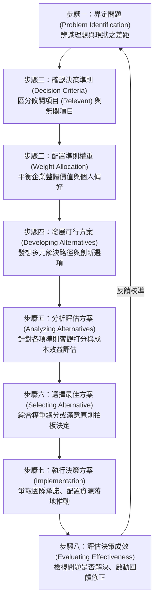
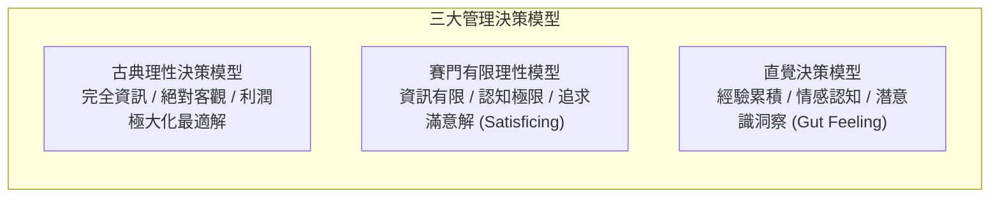
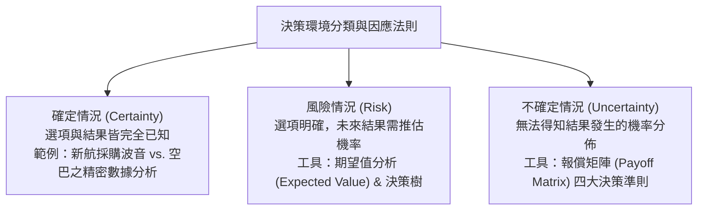
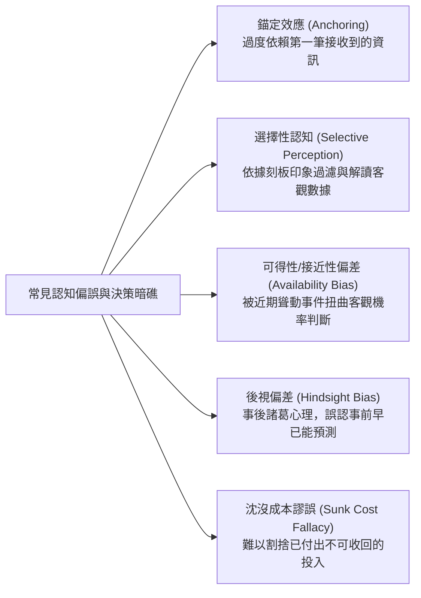
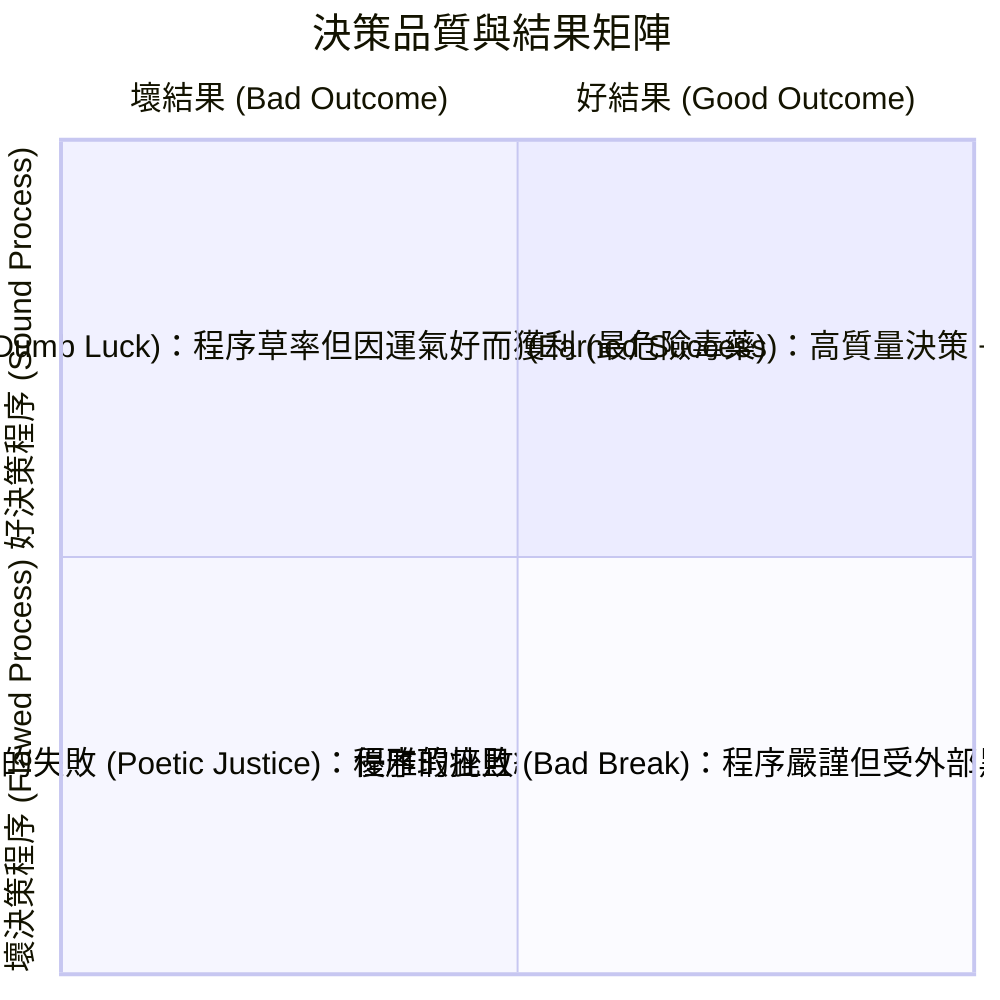

---
{"dg-publish":true,"permalink":"/01/02/ch04/","title":"Ch04 決策","tags":["PMBA","管理概論","決策制定","有限理性","滿意決策","認知偏差","團體迷思"],"dg-note-properties":{"title":"Ch04 決策","course":"管理概論","category":"01_基礎先修","type":"lecture-note","lecture":"02_Ch04","tags":["PMBA","管理概論","決策制定","有限理性","滿意決策","認知偏差","團體迷思"],"aliases":["決策","Ch04_決策","L04_決策","Ch04","L04"]}}
---

# Ch04 決策

## 💡 核心摘要
- **決策是管理行為的核心靈魂**：管理四大職能（POLC）無一不涉及決策；經理人的本質就是在一連串不確定性與資源限制下，持續做出資源配置與行動方向的抉擇。
- **完全理性不可得，滿意解勝於最佳解**：傳統經濟學的「[[98_商業概念庫/rational-decision-model_理性決策模型\|li-xing-jue-ce-model_理性決策模型]]」在現實中面臨資訊不對稱與認知極限；赫伯特·賽門（Herbert Simon）的「[[98_商業概念庫/bounded-rationality_有限理性\|you-xian-li-xing_有限理性]]」指出，經理人應追求實務可行的「[[98_商業概念庫/satisficing-decision_滿意決策\|man-yi-jue-ce_滿意決策]]」（Satisficing），而非理論上的利潤極大化最適解。
- **認知偏誤是組織的系統性暗礁**：捷思法（Heuristics）雖能加速判斷，但也帶來「[[98_商業概念庫/anchoring-effect_錨定效應\|mao-ding-effect_錨定效應]]」、「[[98_商業概念庫/confirmation-bias_確認偏誤\|que-ren-pian-wu_確認偏誤]]」、「[[98_商業概念庫/sunk-cost-2_沈沒成本謬誤\|shen-mei-cost-miu-wu_沈沒成本謬誤]]」與「可得性偏差」等認知盲區，經理人必須透過制度化流程對抗人性弱點。
- **群體決策的雙面刃與防範機制**：群體決策能匯聚多元觀點與強化執行承諾，但易衍生責任分散、耗時及致命的「[[98_商業概念庫/groupthink_團體迷思\|tuan-ti-mi-si_團體迷思]]」（Groupthink）；引入「魔鬼代言人」與「[[98_商業概念庫/delphi-method_德爾菲法\|de-er-fei-fa_德爾菲法]]」是確保決策品質的關鍵避坑機制。
- **區分決策品質與結果運氣**：卓越領導者不以單一成敗論英雄，而是建立「決策覆盤」機制，清晰區隔「好決策但壞結果（環境雜訊/運氣）」與「壞決策但好結果（僥倖）」，打造持續進化的組織學習迴路。

---
## 📚 核心觀念與架構

### 1. 決策制定八大步驟流程

理性決策並非憑空靈感，而是一套嚴謹的邏輯閉環：

#### 決策流程實務落地三大難題（逐字稿深度解析）
1. **準則界定難題（攸關 vs. 無關項目）**：
   - 經理人常將無關成本混入決策。例如在管理會計中，評估特定產品線是否停產時，只有「直接料工費」與「可避免成本」是**攸關項目（Relevant Items）**；總部已發生的固定攤提費用屬於**無關項目（Irrelevant Items）**，不應干擾單一產品決策。
2. **權重分配難題與代理問題（Agency Problem）**：
   - 權重分配往往涉及主觀價值判斷。依據「代理理論」，專業經理人的自利目標（如個人職涯聲譽、短期分紅、權力擴張）往往與股東的長遠企業價值產生衝突，導致權重配置偏離公司最大利益。
3. **方案選擇難題與評分矛盾**：
   - 「分項加總排序 $\neq$ 整體偏好排序」。例如在招聘面試中，應徵者 A 各項指標加總分數可能低於 B，但 A 具備不可替代的關鍵優勢；過度依賴機械式加權評分表格，常引發決策僵化與邏輯衝突。

---

### 2. 決策理論模型：理性、有限理性與直覺

| 維度 | [[98_商業概念庫/rational-decision-model_理性決策模型\|li-xing-jue-ce-model_理性決策模型]] (Rational Model) | [[98_商業概念庫/bounded-rationality_有限理性\|you-xian-li-xing_有限理性]]模型 (Bounded Rationality) | [[98_商業概念庫/intuitive-decision-making_直覺決策\|zhi-jue-jue-ce_直覺決策]] (Intuitive Decision Making) |
| :--- | :--- | :--- | :--- |
| **核心假設** | 完全理性經濟人（Economic Man） | 行政人（Administrative Man），認知有極限 | 奠基於深層經驗、內隱知識與情感價值 |
| **資訊條件** | 掌握所有可能方案與未來結果 | 資訊蒐集有成本，面臨不確定性與時間限制 | 依賴微弱訊號（Weak Signals）與快速模式辨識 |
| **目標境界** | 追求全局**最佳解（Optimizing）** | 追求符合門檻的**滿意解（Satisficing）** | 追求敏捷反應與突圍契機 |
| **代表學者/人物** | 古典經濟學家 | 赫伯特·賽門（Herbert Simon, 諾貝爾獎得主） | Andy Grove（《十倍速時代》）、Richard Branson |
| **適用情境** | 確定情況、結構化重複作業、量化分析 | 複雜商業決策、組織日常營運與資源分配 | 高度動態危機、重大戰略轉折、資訊極度匱乏時 |

#### 直覺決策的五大內在構成維度
直覺並非憑空猜測，而是大腦在潛意識中完成的精密模式比對：
1. **經驗導向**：提煉自過往數十年的成功與失敗模式。
2. **認知導向**：長期專業訓練與深度學識形成的思考框架。
3. **情感與情緒**：對人事物的主觀感受與契合度（Chemistry）。
4. **潛意識處理**：大腦在背景運算中將零散片段資訊拼湊出的洞見（Little bird told me）。
5. **價值觀與倫理感**：深植於內心的道德底線與社會責任感。

---

### 3. 三大決策情境與決策法則矩陣

經理人面對的外在環境可區分為三種不確定程度：

#### 不確定情境下的四大經理人決策準則（報償矩陣實務）
當未來事件發生機率完全未知時，經理人依據風險偏好採取不同法則：
1. **樂觀準則（Maximax / 大中取大）**：
   - 追求最極致的收益。「風險追求型」經理人專注於各方案在最佳情境下的最高報償，從中挑選最大者。
2. **悲觀準則（Maximin / 小中取大）**：
   - 守住最壞的底線。「風險趨避型」經理人找出各方案在最差情境下的最低報償，從中挑選損失最小（或獲利最高）者。
3. **機率均等準則（Laplace / 均等期望值）**：
   - 「風險中立型」經理人假設所有未來情境發生的機率均等，計算各方案的平均期望值，選擇最高者。
4. **後悔準則（Minimax Regret / 最小化最大遺憾）**：
   - 害怕錯失機會的經理人將「報償矩陣」轉為「後悔矩陣」（各情境最佳收益 $-$ 該方案實際收益），找出各方案的最大後悔值，從中挑選後悔程度最低者（大中取小）。

---

### 4. 常見認知偏誤與捷思法陷阱

大腦為了節省能量，常依賴捷思法（Heuristics）進行快速捷徑判斷，卻往往導致系統性決策偏差：

- **[[98_商業概念庫/anchoring-effect_錨定效應\|mao-ding-effect_錨定效應]]（Anchoring Effect）**：
  - *實驗證明*：心算 5 秒內估算 $1 \times 2 \times \dots \times 8$ 平均估值僅 512；反向 $8 \times 7 \times \dots \times 1$ 平均估值高達 2,250（正確答案皆為 40,320）。最初的數字直接錨定了大腦的判斷範圍。
  - *商業實務*：談判初始出價、建議零售價與促銷折扣定價。
- **選擇性認知（Selective Perception）**：
  - *實驗證明*：見到斯文戴眼鏡者猜教授而非銷售員，忽視市場上銷售員總數遠高於教授的客觀基礎機率（Base Rate Neglect）。
- **可得性／接近性偏差（Availability / Recency Bias）**：
  - *實驗證明*：聽到澳洲鯊魚咬人新聞後，大幅轉向選擇開車兜風。事實上車禍致死率（約 $1/1,000$）遠高於鯊魚襲擊率（約 $1/10,000,000$），人腦容易被近期、鮮明且情緒震撼的記憶主導決策。
- **後視偏差（Hindsight Bias / 事後諸葛）**：
  - *實驗證明*：觀看中性影片後被告知主角職業，受試者皆聲稱「我早就看出她是老師/主婦的特徵」。事後合理化摧毀了組織從失敗中汲取真正教訓的機會。

---

### 5. 個人決策 vs. 群體決策與「團體迷思」

| 構面 | 個人決策 (Individual Decision) | 群體決策 (Group Decision) |
| :--- | :--- | :--- |
| **決策速度** | **迅速敏捷**，溝通協調成本低 | 耗時費力，溝通成本高 |
| **資訊廣度** | 受限於單一個體之認知與經驗 | **資訊多元完整**，匯聚多方跨界視角 |
| **創意程度** | 視個人創造力而定，容易陷入盲點 | 透過碰撞激發創新與替代方案 |
| **方案認同感** | 下達命令容易，但可能面臨執行阻力 | **參與感強**，團隊成員對決策具高度承諾 |
| **責任歸屬** | 權責分明，成敗由個人承擔 | **責任分散（Diffusion of Responsibility）** |
| **潛在風險** | 個人主觀武斷、偏執盲區 | 妥協折衷出平庸方案、產生[[98_商業概念庫/groupthink_團體迷思\|tuan-ti-mi-si_團體迷思]] |

#### 團體迷思（Groupthink）的成因與解方
- **成因**：強勢領導者主導、團隊凝聚力過高導致成員不敢異議、追求表面和諧、盲目樂觀與道德優越感。
- **改善群體決策四大技術**：
  1. **腦力激盪法（Brainstorming）**：嚴禁批判，追求數量，鼓勵搭便車式創新。
  2. **名義團體技術（Nominal Group Technique, NGT）**：成員先獨立寫下想法，輪流報告，最後以匿名投票評分排序，杜絕少數權威壓制。
  3. **[[98_商業概念庫/delphi-method_德爾菲法\|de-er-fei-fa_德爾菲法]]（Delphi Technique）**：透過多輪匿名問卷向背對背的專家徵詢意見，反覆回饋收斂，徹底隔絕人際壓力與權威影響。
  4. **魔鬼代言人（Devil's Advocacy）**：指定專人在討論中扮演反對派，專門挑剔方案漏洞，強迫團隊進行壓力測試。

---

## ⚠️ 實務應用與經理人思維

### 1. 擺脫「分析癱瘓」：在不完整資訊下果斷決策
- **分析癱瘓（Analysis Paralysis）現象**：追求 $100\%$ 的確定性與海量數據支撐，導致決策延宕、錯失關鍵市場機會窗口。
- **Jeff Bezos 的「70% 法則」**：
  - 如果等待擁有 $90\%$ 的資訊才做決定，往往已經太遲；在獲得約 $70\%$ 的必要資訊時，就應果斷採取行動。
  - **區分單向門與雙向門決策**：
    - *Type 1 決策（單向門）*：不可逆、影響深遠（如重組併購），應深思熟慮。
    - *Type 2 決策（雙向門）*：可逆、可修正（如產品功能 A/B 測試），應快速推動、小步快跑、動態迭代。

### 2. 斬斷「沈沒成本盲區」：做出痛苦但正確的停損切割
- **[[98_商業概念庫/sunk-cost-2_沈沒成本謬誤\|shen-mei-cost-miu-wu_沈沒成本謬誤]]（Sunk Cost Fallacy）的組織病徵**：
  - 「我們已經投入了幾億元與三年青春，現在放棄就全泡湯了！」經理人常因不甘心、維護面子或害怕承擔失敗責任，持續向無底洞專案追加預算（承諾升級 Escalation of Commitment）。
- **避坑心法**：
  - **沉沒成本不是成本**：過去付出的資金與時間屬於歷史成本，無法收回；決策應只看「**未來現金流增量與機會成本**」。
  - 設立客觀的「停損閥值（Kill Switch）」與第三方獨立評審委員會，讓專案創始人之外的中立團隊評估是否終止專案。

### 3. 建立「決策覆盤」文化：區分品質與運氣
在商業世界中，結果往往受到外在環境雜訊與隨機性的巨大干擾：

- **卓越經理人的覆盤哲學**：
  - 絕不可陷入「結果偏誤（Outcome Bias）」——以成敗論英雄。
  - 警惕「僥倖的好運（Dumb Luck）」：因草率甚至違規的壞決策賺了錢，往往被誤認為英雄，進而埋下未來毀滅性的隱患。
  - 包容「優雅的挫敗（Bad Break）」：對於依循嚴謹決策程序、敢於承擔計算過風險（Calculated Risk）但因黑天鵝事件受挫的團隊，應給予肯定與保護，維護組織的創新動能。
