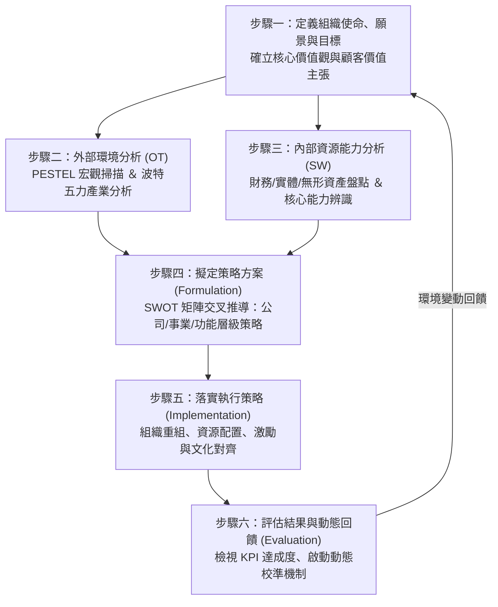
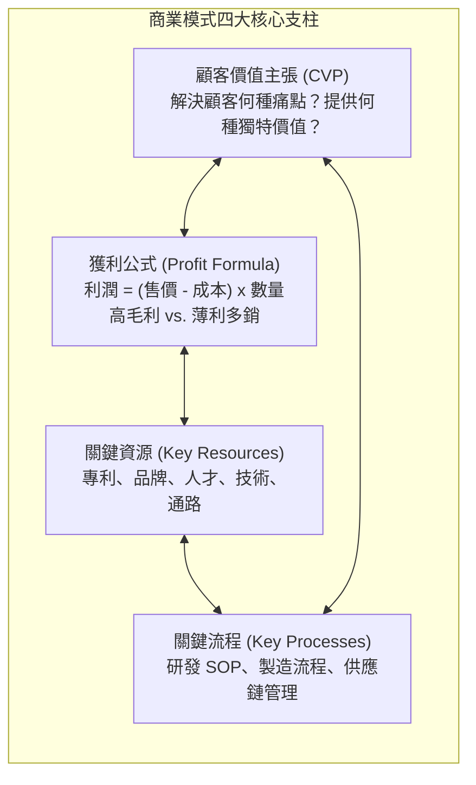
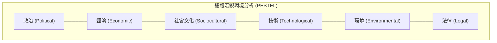
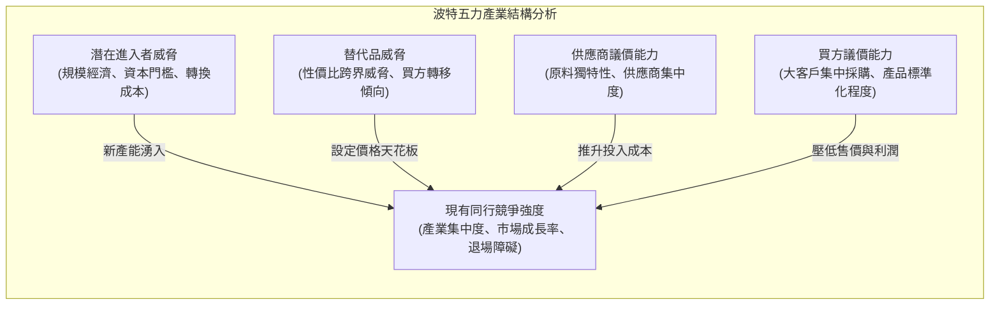
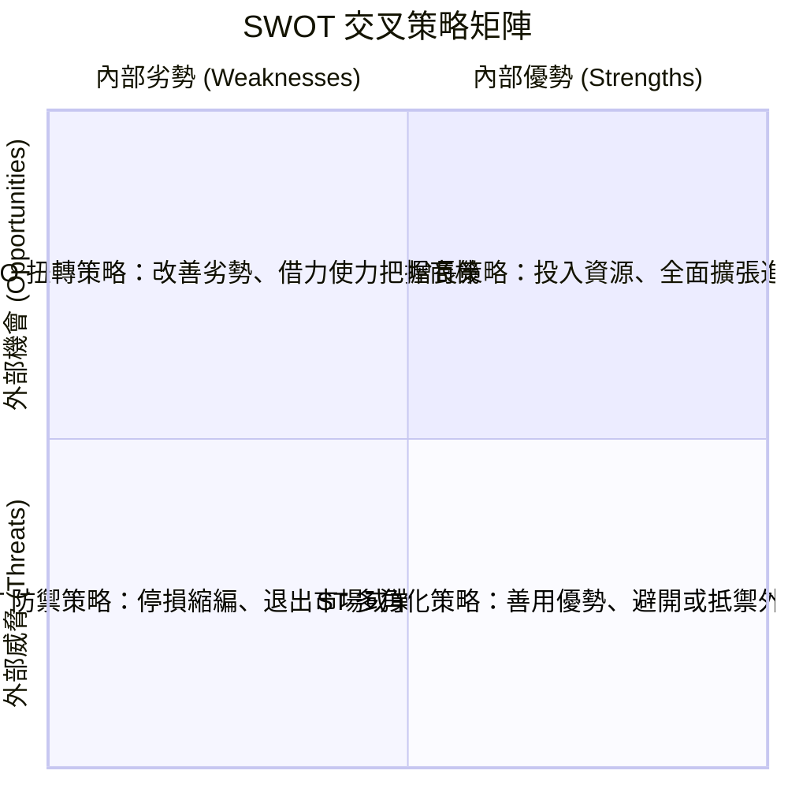
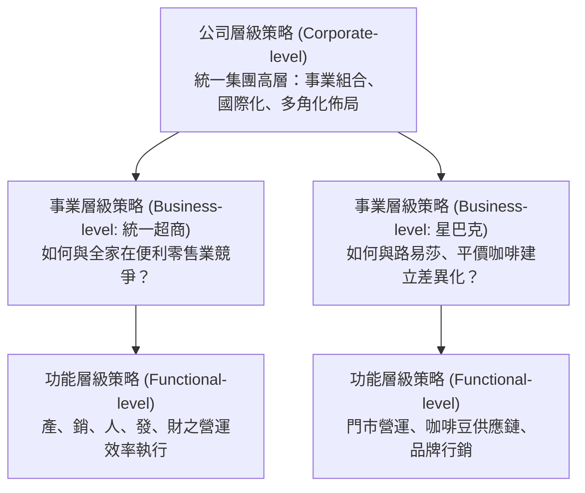
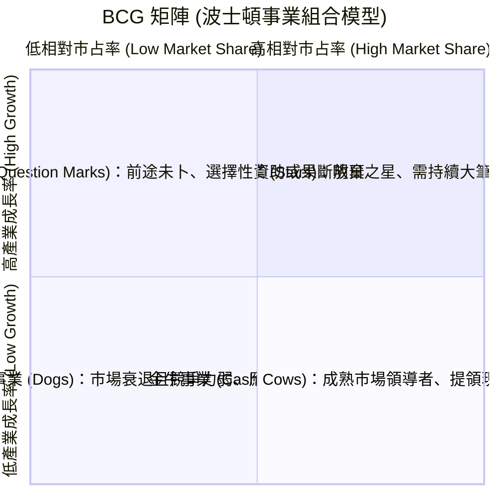
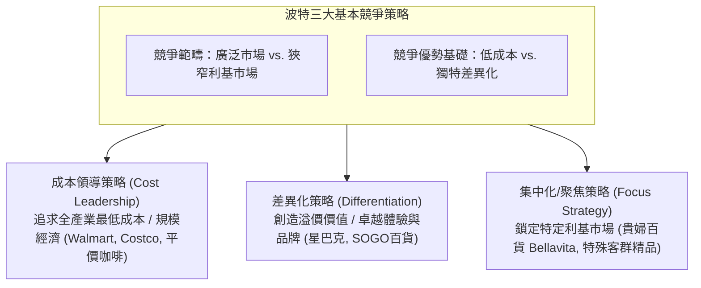

---
{"dg-publish":true,"permalink":"/01//ch05/","title":"Ch05 策略規劃與管理","tags":["PMBA","管理概論","策略管理","SWOT分析","波特五力","競爭優勢","BCG矩陣"],"dg-note-properties":{"title":"Ch05 策略規劃與管理","course":"管理概論","category":"01_基礎先修","type":"lecture-note","lecture":"Ch05","tags":["PMBA","管理概論","策略管理","SWOT分析","波特五力","競爭優勢","BCG矩陣"],"aliases":["策略規劃與管理","Ch05_策略規劃與管理","L05_策略規劃與管理","Ch05","L05"]}}
---

# Ch05 策略規劃與管理

## 💡 核心摘要
- **策略的本質是取捨（Trade-offs）**：麥可·波特（Michael Porter）指出，策略不是追求營運效益（Operational Effectiveness）的單純比拼，而是明確抉擇「做什麼與不做什麼」，以獨特的策略活動系統建立可持續的「[[98_商業概念庫/competitive-advantage_競爭優勢\|competition-you-shi_競爭優勢]]」。
- **內外兼修的動態適配（Strategic Fit）**：卓越策略源於外部分析（PESTEL 宏觀趨勢、[[98_商業概念庫/bo-te-five-forces-analysis_波特五力分析\|bo-te-five-forces-analysis_波特五力分析]]產業結構）與內部分析（資源基礎觀點 RBV、[[98_商業概念庫/core-competence_核心能力\|he-xin-neng-li_核心能力]]辨識）的深度咬合，透過 [[98_商業概念庫/SWOT分析\|SWOT分析]] 矩陣推導出具攻擊性或防禦性的實戰行動。
- **[[98_商業概念庫/business-model_商業模式\|business-model_商業模式]]是策略活動的有機整體**：[[98_商業概念庫/business-model_商業模式\|business-model_商業模式]]不僅是提出「顧客價值主張」，更包含可獲利的財務公式、關鍵資源與關鍵流程；如 IKEA、愛爾凡眼科透過環環相扣的策略活動系統，構築對手難以拆解模仿的立體護城河。
- **多角化矩陣與現金流轉的動態平衡**：運用「[[98_商業概念庫/BCG矩陣\|BCG矩陣]]」管理企業事業組合，以成熟「金牛」創造的充沛現金流，哺育高成長的「明星」事業與深具潛力的「問題兒童」，防範全盤老化落入「落水狗」陷阱。
- **跨越「規劃 10%、執行 90%」的鴻溝**：策略的成敗取決於組織資源配置與執行力，經理人需嚴防「[[98_商業概念庫/stuck-in-the-middle_卡在中間\|ka-zai-zhong-jian_卡在中間]]」的平庸泥淖，並在外部環境典範轉移時打破既有成功慣性，避免陷入「策略漂移（Strategic Drift）」。

---
## 📚 核心觀念與架構

### 1. 策略規劃流程六大步驟

[[98_商業概念庫/strategic-management_策略管理\|strategic-management_策略管理]]是一套循環推進的理性思維心法，引導企業回答三個終極問題：「我們目前在哪裡？」、「我們想去哪裡？」以及「我們如何到達那裡？」。

---

### 2. 商業模式與策略活動系統

成功的策略最終必須具象化為一套具備自我強化機能的「[[98_商業概念庫/business-model_商業模式\|business-model_商業模式]]」：

#### 經典商業模式實務案例（逐字稿深度啟發）
1. **印度愛爾凡眼科醫院（Aravind Eye Hospital）**：
   - *價值主張*：讓貧困白內障患者以極低成本甚至免費重見光明。
   - *活動系統*：引進泰勒[[98_商業概念庫/management-4_科學管理\|ke-xue-management_科學管理]]工序拆解，醫師專注高難度手術，護理師負責術前術後準備，手術效率為傳統 4 倍；以高收入病患自費補貼貧困病患，實現社會企業永續經營。
2. **印度塔塔汽車（Tata Motors - Nano）**：
   - *價值主張*：提供 2,500 美元安全代步微型車，解決平民全家擠乘機車的生命危險。
   - *獲利公式*：極致模組化設計、捨棄非核心配件，透過十倍級市場規模（Q）獲利。
3. **英國美體小舖（The Body Shop）**：
   - *價值主張*：打破傳統化妝品由男性審美主導的奢華包裝，主打天然、有機、友善環境、反對動物實驗與公平貿易。
4. **宜家家居（IKEA）策略活動系統圖**：
   - 鎖定「年輕、預算有限、追求北歐極簡設計」的首次購屋族。
   - 核心活動：自行組裝（DIY）節省組裝人工、平板包裝（Flat Pack）極大化物流空間、郊區大型展示賣場、目錄行銷與瑞典特色餐飲。各項活動彼此咬合，競爭同業若僅模仿單一環節（如單學平板包裝）無法形成體系優勢。

---

### 3. 外部環境分析：PESTEL 與波特五力架構

#### 波特五力分析（Porter's Five Forces）
產業獲利水位的根本決定因素，源於產業結構中的五種競爭作用力：

1. **現有同行業競爭強度**：小廠林立、完全競爭市場價格戰慘烈；寡占且具產品差異化之產業獲利較平穩。
2. **潛在進入者威脅**：產業進入障礙（進入門檻）決定獲利護城河。障礙愈高（如高資本支出、專利封鎖），超額利潤愈能持久。
3. **替代品威脅**：跨界替代品（如通訊軟體 Skype/LINE 替代傳統電信長途電話）往往以破壞式創新直接摧毀既有[[98_商業概念庫/business-model_商業模式\|business-model_商業模式]]。
4. **供應商議價力**：上游少數壟斷且具高轉換成本時（如 ASML 之於半導體設備），中間廠商毛利被嚴重擠壓。
5. **買方議價力**：下游買方集中採購、掌握充分資訊時，廠商定價權喪失。

---

### 4. 內部環境分析：資源基礎觀點（RBV）與核心能力

並非所有資源都能轉化為長期[[98_商業概念庫/competitive-advantage_競爭優勢\|competition-you-shi_競爭優勢]]。依據「資源基礎觀點（Resource-Based View, RBV）」：
- **有形資源（Tangible Resources）**：財務資本、廠房機器設備。易於被競爭者透過資本支出進行購買與複製。
- **無形資源（Intangible Resources）**：專利技術、內隱知識（Tacit Knowledge）、品牌[[98_商業概念庫/goodwill_商譽\|shang-yu_商譽]]、組織慣例與企業文化（如台積電製程良率文化、3M 創新 DNA、Apple 生態系）。**極難被模仿與替代，是長青優勢的源泉**。

#### VRIO 核心能力檢驗框架
一項內部資源唯有同時通過以下四項檢驗，方能構成組織的「[[98_商業概念庫/core-competence_核心能力\|he-xin-neng-li_核心能力]]（Core Competencies）」：
1. **Value（價值性）**：能否協助組織把握外部機會或中和外部威脅？
2. **Rarity（稀缺性）**：是否僅為極少數競爭同業所掌控？
3. **Inimitability（不可模仿性）**：對手是否難以複製？（源於歷史路徑依賴、因果模糊性或社會複雜性）。
4. **Organization（組織妥善運用）**：[[98_商業概念庫/organizational-structure_組織結構\|organizational-structure_組織結構]]、管理制度與流程是否準備好充分釋放該資源的潛力？

---

### 5. SWOT 矩陣交叉策略推導

---

### 6. 策略層級體系與分析工具

組織策略依據權責劃分為三大層級：

#### (1) 公司層級策略與 BCG 矩陣
總體策略分為**成長策略**（集中、水平整合併購同業如日月光併矽品、垂直整合如鴻海併夏普）、**穩定策略**（持盈保泰）與**更新策略**（內部整頓 Retrenchment vs. 公司重整 Restructuring）。

- **現金流轉法則（Cash Flow Dynamics）**：
  - 「金牛（如養樂多乳酸飲料）」產生源源不絕的獲利現金流，應優先轉移資助高成長但燒錢的「明星」事業。
  - 選擇性資助有潛力晉升明星的「問題兒童」，嚴控虧損；防範金牛被過度榨乾衰退為「落水狗」。

#### (2) 事業層級策略：波特三大通用競爭策略

#### (3) 市場競爭時機：先行者 vs. 次行者動態
- **先行者優勢（First-Mover Advantage）**：率先建立領導品牌聲譽、搶先沿著學習曲線降本、優先鎖定稀缺通路與客戶轉換成本。
- **先行者劣勢（First-Mover Disadvantage）**：
  - 承擔高昂的市場教育與技術研發試錯成本。
  - **技術鎖死陷阱（Lock-in Trap）**：如法國 1980 年代領先全球推廣 Minitel 家用網絡系統，卻在 1990 年代全球網際網路爆發時因轉換成本高昂而陷入落後。
  - **後發先至的次行者（Fast Follower）**：如 Apple（iPod 擊敗早期 MP3、iPhone 在 HTC 之後定義智慧手機）、可口可樂（在百事可樂推出低糖可樂後憑藉強大通路與品牌反超）。

---

## ⚠️ 實務應用與經理人思維

### 1. 致命的「卡在中間」陷阱（Stuck in the Middle）
- **現象剖析**：企業試圖兼顧低成本與差異化，卻在兩端皆缺乏深度承諾——既無龐大產能實現規模經濟以壓低成本，又無卓越技術與品牌文化支持產品溢價。
- **避坑法則**：戰略的本質在於承諾。經理人必須清晰選擇自己的競爭主軸：要打價格戰就必須徹底重構極簡供應鏈；要做差異化就必須甘願承擔研發與服務的必要溢價成本，切忌兩面討好導致資源稀釋。

### 2. 「策略漂移（Strategic Drift）」與成功方程式的詛咒
- **成因機制**：企業過去的巨大成功往往孕育出僵化的「[[98_商業概念庫/mode_心智模式\|xin-zhi-mo-shi_心智模式]]（Mental Models）」與龐大的既得利益部門。當外部 PESTEL 環境發生顛覆性突變（如數位化、AI、少子化）時，組織仍以漸進式小改款應對，導致策略與環境脫軌程度愈拉愈大。
- **避坑法則**：經理人應定期進行「紅隊演練（Red Teaming）」與反向思考：假設我們是明天的競爭對手，我們會如何摧毀現在的自己？在組織營運良好的巔峰期主動開創第二曲線。

### 3. 跨越「策略規劃 10%、執行力 90%」的資源斷層
- **實務痛點**：高階策略會議產出精美的 PPT 願景報告，但實際資源（預算、關鍵人才）依然被鎖死在老舊衰退業務中，新戰略淪為口號。
- **落地三部曲**：
  1. **預算與策略嚴格綁定**：未獲策略支持的專案堅決零預算，推行資源動態重配（Resource Reallocation）。
  2. **績效考核指標（KPI/OKR）對齊**：將公司層級戰略拆解為事業部與跨部門的共享指標。
  3. **打造當責與心理安全感並存的文化**：賦予第一線執行者足夠的決策裁量權，讓策略在即時市場反饋中敏捷微調。
