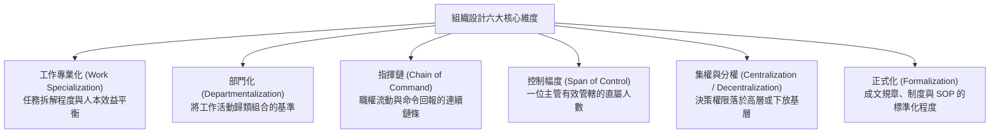
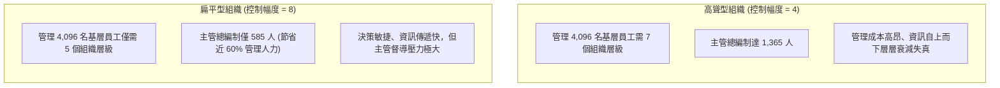
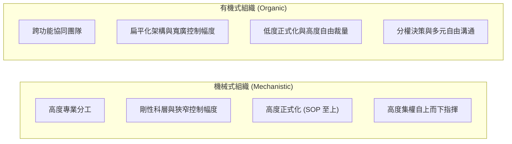
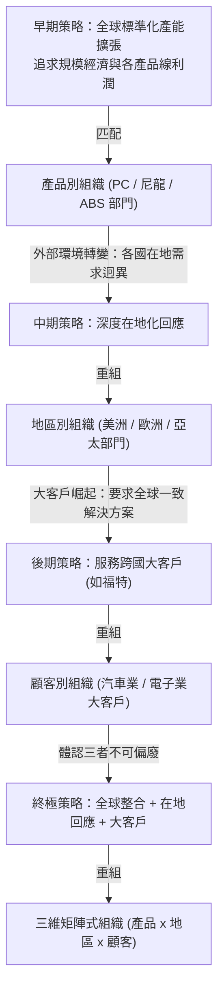

---
{"dg-publish":true,"permalink":"/01/02/ch06/","title":"Ch06 組織結構設計","tags":["PMBA","管理概論","組織結構","組織設計","矩陣型組織","控制幅度","集權與分權"],"dg-note-properties":{"title":"Ch06 組織結構設計","course":"管理概論","category":"01_基礎先修","type":"lecture-note","lecture":"02_Ch06","tags":["PMBA","管理概論","組織結構","組織設計","矩陣型組織","控制幅度","集權與分權"],"aliases":["組織結構設計","Ch06_組織結構設計","L06_組織結構設計","Ch06","L06"]}}
---

# Ch06 組織結構設計

## 💡 核心摘要
- **[[98_商業概念庫/structure-follows-strategy_結構跟隨策略\|structure-gen-sui-strategy_結構跟隨策略]]（Structure Follows Strategy）**：[[98_商業概念庫/organizational-structure_組織結構\|organizational-structure_組織結構]]並非一成不變的靜態骨架，而是落實企業策略的動態通道；當外部環境與競爭策略轉變時，[[98_商業概念庫/organizational-structure_組織結構\|organizational-structure_組織結構]]必須隨之重組，否則策略將淪為空談。
- **沒有完美的組織，只有權衡取捨（Trade-offs）**：組織設計六大基本要素（專業分工、部門化、指揮鏈、[[98_商業概念庫/control-2_控制幅度\|kong-zhi-fu-du_控制幅度]]、集分權、正式化）之間存在天然張力，經理人必須依據組織規模、技術型態與環境不確定性進行情境適配。
- **[[98_商業概念庫/control-2_控制幅度\|kong-zhi-fu-du_控制幅度]]的組織型態抉擇**：高聳型組織（狹窄[[98_商業概念庫/control-2_控制幅度\|kong-zhi-fu-du_控制幅度]]）能提供嚴密監控，但易衍生層級肥大、資訊傳遞失真與高昂管理成本；扁平型組織（寬廣[[98_商業概念庫/control-2_控制幅度\|kong-zhi-fu-du_控制幅度]]）具備敏捷溝通與賦權優勢，但高度考驗經理人的精力負荷與部屬的自主成熟度。
- **傳統科層與現代網絡/矩陣的互補演進**：為打破傳統部門壁壘，現代企業導入「[[98_商業概念庫/matrix-organization_矩陣型組織\|ju-zhen-xing-organization_矩陣型組織]]」與「虛擬/網絡型組織」，以雙重命令鏈或輕資產外包提升彈性，但同時伴隨著角色衝突與協調成本的急遽上升。
- **破除[[98_商業概念庫/silo-effect_穀倉效應\|gu-cang-effect_穀倉效應]]與避免過度扁平化**：經理人需警惕部門牆林立的「[[98_商業概念庫/silo-effect_穀倉效應\|gu-cang-effect_穀倉效應]]」，透過跨功能團隊與[[98_商業概念庫/learning-organization_學習型組織\|xue-xi-xing-organization_學習型組織]]機制促進協同；同時在數位敏捷轉型中，需避免「盲目過度扁平化」導致基層員工缺乏戰略錨定與指引。

---
## 📚 核心觀念與架構

### 1. 組織設計六大基本要素

組織設計是經理人建立、調整與維護組織架構的決策歷程，涵蓋六大核心維度：

#### (1) 工作專業化（Work Specialization）
- **亞當斯密大頭針實驗**：單一工人若獨立完成拉直、切斷、削尖、拋光、組裝等全套工序，每日產量僅 1 至 20 根；若將工序拆解由 10 位工人專業分工，人均日產量巨幅提升至 4,800 根。
- **分工收益與人本不經濟（Human Diseconomies）**：
  - 適度分工能產生熟練效應並降低培訓成本；但若分工過度，將引發單調乏味、身心疲勞、異化感與高缺勤率，導致整體生產力反向衰退。

#### (2) 部門化（Departmentalization）類型對比

| 部門化型態 | 劃分基準 | 核心優勢 | 潛在缺點與挑戰 |
| :--- | :--- | :--- | :--- |
| **功能別 (Functional)** | 依管理職能（產、銷、人、發、財）劃分 | 專業技能深度累積、內部規模經濟、資源集中 | 跨部門橫向溝通困難、狹隘本位主義（[[98_商業概念庫/silo-effect_穀倉效應\|gu-cang-effect_穀倉效應]]） |
| **產品別 (Product)** | 依特定產品線（如小客車、貨車、重機）劃分 | 緊貼特定產品市場動態、各產品線自負盈虧 | 各部門功能重疊、資源配置重複（疊床架屋） |
| **顧客別 (Customer)** | 依客戶類別（零售散客、企業大宗、政府採購）劃分 | 深入滿足特定客群痛點、客製化服務體驗 | 功能單位重複建置、缺乏全組織整體規模效益 |
| **地區別 (Geographic)** | 依地理區域（北美、大中華、歐洲）劃分 | 即時回應在地法規、文化與市場偏好 | 總部政策一致性難以貫徹、跨區資源難以共享 |
| **流程別 (Process)** | 依作業工序（紡紗、織布、染整、成衣）劃分 | 流程銜接流暢、加工設備利用率高 | 僅適用於特定製造業，缺乏跨階段全局彈性 |

#### (3) 指揮鏈（Chain of Command）與職權架構
- **指揮統一原則（Unity of Command）**：費堯提出每位部屬應僅向一位直接主管報告，避免多頭指令引發混亂。
- **巴納德職權接受理論（Acceptance Theory of Authority）**：切斯特·巴納德（Chester Barnard）指出，**職權並非單純源於職位賦予，而是取決於下屬是否願意接受該命令**。唯有當命令清楚、符合組織利益、不違背部屬個人利益且在能力範疇內時，職權才真正有效運作。
- **直線職權 vs. 幕僚職權**：
  - *直線職權（Line Authority）*：擁有指揮下屬、直接對組織營運成果負責的正式職權（如營運長對事業部經理）。
  - *幕僚職權（Staff Authority）*：負責提供專業建議、諮詢與行政支援的輔助職權（如人資長、財務長、法務長）。
  - *衝突防範*：直線主管常抱怨幕僚脫離實務、指手畫腳；幕僚則不滿直線忽視合規建議。經理人需清楚劃定諮詢與決策之權責界線。

#### (4) 控制幅度（Span of Control）：高聳 vs. 扁平組織
[[98_商業概念庫/control-2_控制幅度\|kong-zhi-fu-du_控制幅度]]指一位主管能有效監督的直屬部屬人數。其數值大小直接決定組織層級的高聳（Tall）或扁平（Flat）：

- **影響[[98_商業概念庫/control-2_控制幅度\|kong-zhi-fu-du_控制幅度]]的情境考量因素**：
  - *管理者與部屬特質*：部屬經驗豐富且自律性高、主管溝通能力強 $\rightarrow$ 寬[[98_商業概念庫/control-2_控制幅度\|kong-zhi-fu-du_控制幅度]]；新手員工多 $\rightarrow$ 窄[[98_商業概念庫/control-2_控制幅度\|kong-zhi-fu-du_控制幅度]]。
  - *工作特性*：任務高度標準化、例行化 $\rightarrow$ 寬[[98_商業概念庫/control-2_控制幅度\|kong-zhi-fu-du_控制幅度]]；工作複雜且充滿變數 $\rightarrow$ 窄[[98_商業概念庫/control-2_控制幅度\|kong-zhi-fu-du_控制幅度]]。
  - *組織特質*：擁有成熟的資訊系統（MIS）與明確 SOP $\rightarrow$ 寬[[98_商業概念庫/control-2_控制幅度\|kong-zhi-fu-du_控制幅度]]。

#### (5) 集權與分權（Centralization vs. Decentralization）
- **[[98_商業概念庫/centralization-decentralization_集權與分權\|ji-quan-yu-fen-quan_集權與分權]]定義**：決策權高度集中於高階主管為集權；將決策權下放至最接近現場的第一線為分權（員工賦權 Empowerment）。
- **麥克雷戈（Douglas McGregor）X-Y 理論對比**：
  - *X 理論（人性本惰需嚴管，偏向法家思維）*：主管傾向採取高度集權與嚴密監控。
  - *Y 理論（人性樂於承擔挑戰，偏向儒家思維）*：主管傾向落實分權與賦能，鼓勵自我控制。
- **情境決策法則**：
  - [[98_商業概念庫/cost-leadership-strategy_成本領導策略\|cost-leadership-strategy_成本領導策略]]、高度程式化作業、組織危機動盪期 $\rightarrow$ 傾向集權。
  - [[98_商業概念庫/differentiation-strategy_差異化策略\|cha-yi-hua-strategy_差異化策略]]、創新導向、跨國區域運營、穩定成熟期 $\rightarrow$ 傾向分權。

#### (6) 正式化（Formalization）
- 組織內部依靠白紙黑字的規章制度、工作說明書與 SOP 來約束員工行為的程度。高度正式化保障了可預期性與品質一致性，但壓抑了員工的即興應變與創新自由。

---

### 2. 機械式組織 vs. 有機式組織情境對比

#### 瓊·伍德沃（Joan Woodward）生產技術研究
伍德沃對英國製造業的經典實證研究指出，[[98_商業概念庫/organizational-structure_組織結構\|organizational-structure_組織結構]]的形式取決於其生產技術的「例行性程度」：
1. **單位/小批量生產（Unit / Small-batch Production）**：如客製化精品、米其林訂單料理、企管諮詢。技術例行性最低 $\rightarrow$ **適合[[98_商業概念庫/organization_有機式組織\|you-ji-shi-organization_有機式組織]]**。
2. **大量生產（Mass Production）**：如汽車組裝線、家電製造。技術例行性最高、高度標準化 $\rightarrow$ **適合[[98_商業概念庫/organization-3_機械式組織\|ji-xie-shi-organization_機械式組織]]**。
3. **流程生產（Process Production）**：如煉油廠、化工廠連續自動化生產。設備高度自動化但需技術專家隨時排解突發異常 $\rightarrow$ **適合[[98_商業概念庫/organization_有機式組織\|you-ji-shi-organization_有機式組織]]**。

---

### 3. 結構跟隨策略（Structure Follows Strategy）：GE 塑膠事業部案例

管理史學家阿爾弗雷德·錢德勒（Alfred Chandler）提出「[[98_商業概念庫/structure-follows-strategy_結構跟隨策略\|structure-gen-sui-strategy_結構跟隨策略]]」：企業策略轉型若未伴隨相應的組織重組，營運績效將迅速惡化。

---

### 4. 傳統組織結構 vs. 現代新型組織型態

#### (1) 傳統三大結構
1. **簡單結構（Simple Structure）**：所有權與經營權合一，業主直接指揮少量員工，低正式化、高彈性，適用於初創微型企業。
2. **功能型結構（Functional Structure）**：以產銷人發財專業功能為骨幹，深化職能專長。
3. **事業部結構（Divisional Structure）**：依產品或市場成立自負盈虧的獨立事業部（SBU），總部聚焦策略調控與資本配置。

#### (2) 現代四大新型組織
1. **團隊型結構（Team Structure）**：
   - 組織由跨功能工作團隊構成（如醫院設立「葉克膜團隊」或「達文西手術團隊」，成員涵蓋內科、外科、麻醉與護理）。打破部門藩籬，員工參與度高。
2. **專案型結構（Project Structure）**：
   - 員工不隸屬於固定部門，而是隨專案進駐與解散（如麥肯錫、BCG 等企管顧問公司），極具彈性。
3. **[[98_商業概念庫/matrix-organization_矩陣型組織\|ju-zhen-xing-organization_矩陣型組織]]（Matrix Structure）**：
   - 縱向為功能部門（研發、製造、行銷），橫向為專案或產品線。員工同時向兩位主管報告（功能主管與專案經理）。
4. **虛擬/網絡型組織（Virtual / Network Organization）**：
   - **以 Nike 為典型代表**：保留產品設計、專利氣墊研發與全球品牌行銷等[[98_商業概念庫/core-competence_核心能力\|he-xin-neng-li_核心能力]]，將 100% 製造組裝外包給全球供應商，以極度輕資產的網絡架構運作。

#### (3) 學習型組織（Learning Organization）與彼得·聖吉《第五項修練》
彼得·聖吉（Peter Senge）提出打造能持續學習、打破現狀與自我演化的組織：
- **五大修練維度**：
  1. *自我超越（Personal Mastery）*：員工持續深化個人願景與突破極限。
  2. *改善心智模型（Mental Models）*：破除既有偏見，以開放心態審視局勢。
  3. *建立共同願景（Shared Vision）*：凝聚跨部門共同奮鬥的崇高目標。
  4. *團隊學習（Team Learning）*：深度匯談、共享知識、建立革命情感。
  5. *[[98_商業概念庫/system_系統思考\|xi-tong-si-kao_系統思考]]（Systems Thinking）*：核心核心，洞察牽一髮而動全身的因果反饋迴路。
- **福特汽車 Taurus 研發實踐**：
  - 傳統分工導致空調、音響、引擎各部門各自為政，引發電池消耗過快問題。福特運用五項修練打破部門壁壘，由「小組競爭」轉為「系統協同」，成功打造暢銷全美的主力車款。

---

## ⚠️ 實務應用與經理人思維

### 1. 矩陣型組織「雙重老闆（Dual Reporting）」的衝突與協調成本
- **結構性困境**：矩陣組織徹底顛覆了「指揮統一原則」。員工夾在功能經理（注重專業標準與長遠技術）與專案經理（注重專案進度與成本交付）之間，極易淪為政治博弈的夾心餅乾，造成溝通內耗。
- **經理人破解心法**：
  - **清晰界定職責劃分**：專案經理決定「做什麼與何時完成（What & When）」，功能主管決定「如何完成與指派誰做（How & Who）」。
  - **建立雙重評估權重共識**：考核制度透明化，確保專案經理與功能經理共享評價權，並建立衝突升級協調機制。

### 2. 破除「大企業病」與「穀倉效應（Silo Effect）」
- **病徵表現**：各部門如同一座座封閉的高聳穀倉，各自固守本位利益，資訊不流通、橫向溝通築起高牆，甚至互相拆台，導致組織對外部市場變革反應遲鈍。
- **結構與機制化處方**：
  - **推動「費堯橋（Gangplank）」機制**：正式授權同級部門主管直接橫向協商，無需層層上報至總經理。
  - **設立跨部門共享 KPI**：將顧客滿意度或專案總體毛利納入各功能部門主管的連帶考核指標。
  - **實施輪調制度（Job Rotation）**：讓研發人員輪調至業務端，促進相互同理心與非正式網絡建立。

### 3. 數位時代「去中心化與敏捷組織」的轉型陷阱
- **過度扁平化的反噬**：許多企業盲目仿效矽谷「完全去中心化與零層級（Holacracy）」，一口氣砍除中階主管，反而導致第一線員工失去戰略指引、資源分配失序、績效考核無人負責。
- **平衡原則**：**「戰略集權、作戰分權」**。高階管理層必須牢牢掌握公司願景、資本分配與核心價值觀；第一線作戰單元則被賦予充分的戰術裁量權，並以透明的數位管理儀表板維持[[98_商業概念庫/control_即時控制\|ji-shi-kong-zhi_即時控制]]。
