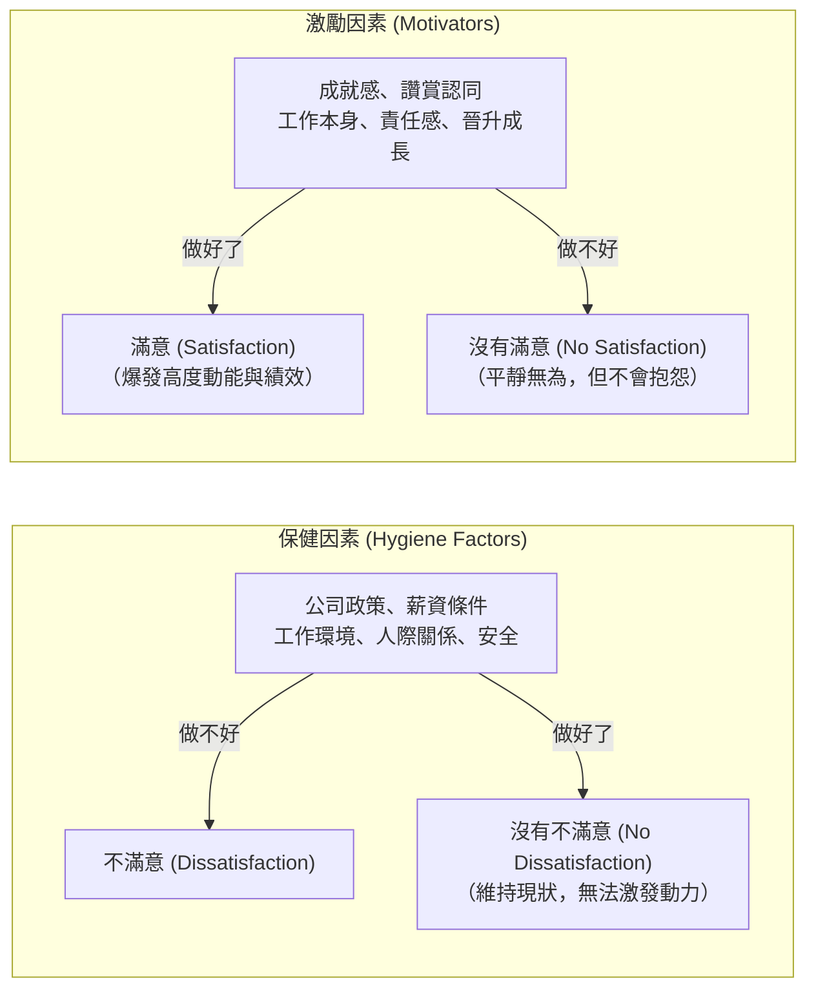
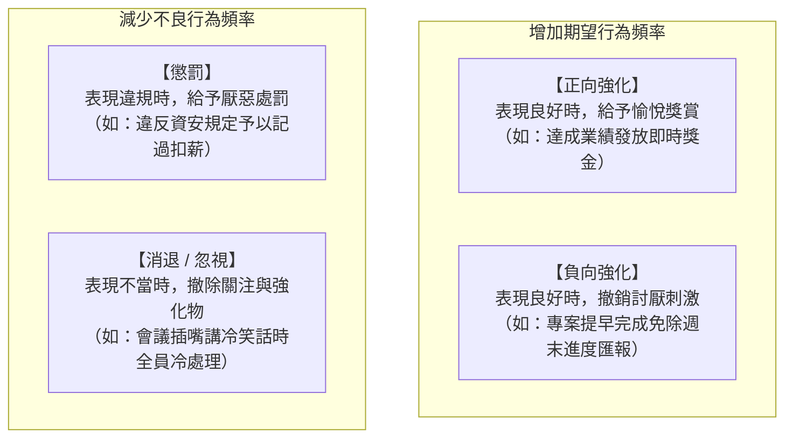
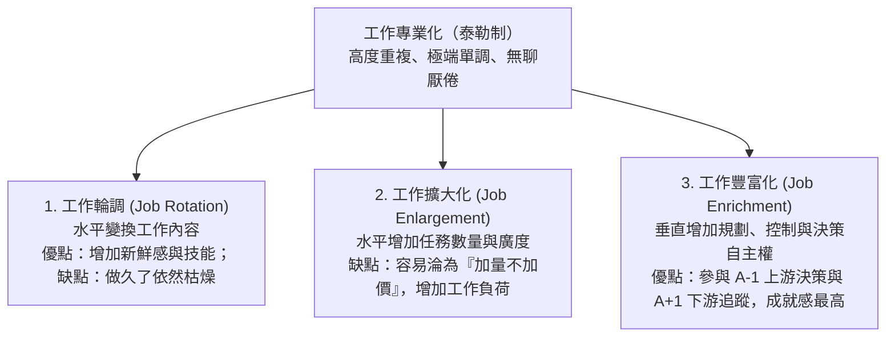
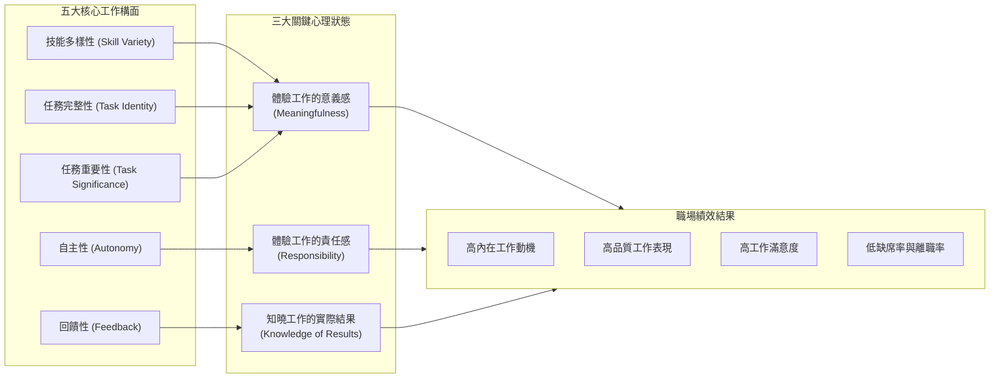

---
{"dg-publish":true,"permalink":"/01//ch09/","title":"Ch09 當代激勵理論","tags":["PMBA","管理概論","激勵理論","馬斯洛需求","雙因素理論","期望理論","公平理論","目標設定理論"],"dg-note-properties":{"title":"Ch09 當代激勵理論","course":"管理概論","category":"01_基礎先修","type":"lecture-note","lecture":"Ch09","tags":["PMBA","管理概論","激勵理論","馬斯洛需求","雙因素理論","期望理論","公平理論","目標設定理論"],"aliases":["當代激勵理論","Ch09_當代激勵理論","L09_當代激勵理論","Ch09","L09"]}}
---

# Ch09 當代激勵理論

## 💡 核心摘要

1. **未滿足的需求是動力的源泉**：激勵的心理歷程始於「未滿足的需求 $\rightarrow$ 心理緊張 $\rightarrow$ 驅力 $\rightarrow$ 搜尋行為 $\rightarrow$ 需求滿足 $\rightarrow$ 降低緊張」。內容學派著眼於「滿足何種需求」，程序學派則著眼於「心理認知如何轉化為行動」。
2. **保健因子不等於激勵因子（赫茲伯格盲點）**：薪資、福利與工作環境屬於「保健因素」，做好只能「消除不滿」，無法「帶來滿意與動力」。誤將加薪視為唯一激勵手段，是組織陷入高成本低績效的根本原因。
3. **激勵取決於心理鏈條的完整性（[[98_商業概念庫/theory-8_期望理論\|qi-wang-theory_期望理論]]）**：員工的努力意願取決於三個乘數關卡：努力與績效的連結（期望）、績效與獎酬的連結（工具性）、獎酬與個人價值的連結（效價）。任一關卡斷裂，激勵力直接歸零。
4. **相對公平勝過絕對報酬（[[98_商業概念庫/equity-theory_公平理論\|gong-ping-theory_公平理論]]）**：員工在組織中持續進行「社會比較（自身產出/投入 vs. 參考對象產出/投入）」。不公平感會引發摸魚、安靜離職（Quiet Quitting）甚至跳槽；「不患寡而患不均」是績效管理的核心心理學底層。
5. **工作設計重於單純物質獎勵（[[98_商業概念庫/model_工作特性模型\|gong-zuo-te-xing-model_工作特性模型]]）**：透過「[[98_商業概念庫/job-enrichment_工作豐富化\|gong-zuo-feng-fu-hua_工作豐富化]]（垂直擴權）」而非「[[98_商業概念庫/job-enlargement_工作擴大化\|gong-zuo-kuo-da-hua_工作擴大化]]（加量不加價）」，賦予員工技能多樣性、任務完整性、任務重要性、自主性與回饋，能自發喚醒高階[[98_商業概念庫/intrinsic-vs-extrinsic-motivation_內在激勵與外在激勵\|nei-zai-ji-li-yu-wai-zai-ji-li_內在激勵與外在激勵]]。

---

## 📚 核心觀念與理論模型

### 一、激勵心理歷程與兩大學派

激勵（Motivation）是指個體在付出努力以達成組織目標的過程中，其努力的強度、方向與堅持性。激勵的心理歷程具有普遍規律：

在當代管理學中，激勵理論主要分為兩大學派：
- **內容學派（Content School）**：著眼於「是什麼激勵了員工？」，深入剖析人類需求的本質、內涵與層次（如馬斯洛、麥克里蘭、麥克雷戈、赫茲伯格）。
- **程序學派（Process School）**：著眼於「激勵是如何發生的？」，關注個體如何評估環境、權衡付出與回報、並決定行為方向的認知過程（如佛洛姆、亞當斯、洛克、斯金納）。

---

### 二、早期內容型激勵理論

#### 1. 馬斯洛之需求層次理論（Hierarchy of Needs）

心理學家亞伯拉罕·馬斯洛（Abraham Maslow）提出[[xu-qiu-ceng-ci-theory_需求層次理論]]（Hierarchy of Needs Theory），主張人類需求由低階到高階呈金字塔結構演進。當低階需求獲得實質滿足後，高階需求便會成為主要激勵來源；已被滿足的需求不再具備強烈激勵效果。

| 需求層級 | 定義與心理本質 | [[enterprise-management_企業管理]]實務措施 |
| :--- | :--- | :--- |
| **生理需求 (Physiological)** | 維持生命基本生存所需（食衣住行、休息）。 | 具競爭力的起薪、免費員工餐、下午茶、充分午休時間。 |
| **安全需求 (Safety)** | 免於身體傷害、失業恐懼與經濟不確定性。 | 團體保險、完善退休金制度、職業安全防護、長約聘僱。 |
| **社會/歸屬需求 (Social / Belonging)** | 被愛、被接納、人際交往與群體歸屬感。 | 員工社團、家庭日、跨部門聯誼聚會、團隊建設（Team Building）。 |
| **自尊/權力需求 (Esteem / Power)** | 獲得他人敬重、地位、認可、聲望與獨立自主。 | 公開表揚、榮譽職稱、晉升拔擢、擴大專案主導決策權。 |
| **自我實現需求 (Self-Actualization)** | 發揮個人全部潛能、實現人生的終極使命與理想。 | 富有挑戰性的前瞻專案、自主創新試驗田、跨界學習機會。 |

> [!NOTE] **課堂思辨：贈送員工 CD / DVD 是滿足何種需求？**
> 主管贈送影音 CD/DVD 給員工以表揚績效，究竟滿足哪種需求？答案完全取決於**內容物與交付方式**：
> - 若是昂貴熱門演唱會門票或實用教學光碟，能替員工節省開銷，偏向**生理/物質需求**；
> - 若是贈送心靈舒壓音樂以緩解職涯焦慮，偏向**安全/心理需求**；
> - 若是邀請全團隊共同錄製並署名祝福的紀念專輯，則強烈滿足**社會歸屬需求**；
> - 若在公司年度大會由執行長親自頒授刻有專屬榮譽編號的典藏光碟，則極大滿足**自尊需求**；
> - 若光碟內容為員工歷時三年攻克技術難關的紀錄片，見證其職涯登峰造極，則是**自我實現需求**的最高體現。

#### 2. 麥克里蘭之三需求理論（Three Needs Theory）

大衛·麥克里蘭（David McClelland）提出[[san-xu-qiu-theory_三需求理論]]（Three Needs Theory），認為人在成長環境中習得三種核心動機需求：
- **成就需求（Need for Achievement, nAch）**：追求卓越、達到高標準、克服困難與追求個人成功的驅力。高 nAch 者偏好中等難度（成功機率約 50%）的挑戰，需要即時反饋，並強烈渴望個人當責。
- **權力需求（Need for Power, nPow）**：渴望影響、指導、控制他人，並使他人做出在其他情況下不會做出的行為。重視地位、影響力與威望。
- **親和需求（Need for Affiliation, nAff）**：建立友善、親密人際關係與渴望被他人喜愛接納的渴望。

> [!IMPORTANT] **卓越高階經理人的需求排序：nPow > nAch > nAff**
> 1. **為何高成就需求（nAch）不適合做高階經理人？**
>    高 nAch 者本質上是「超級個人貢獻者（Individual Contributor）」，他們渴望親力親為以確保成果完美，並追求個人目標而非組織目標；當主管後往往不懂授權，甚至搶部屬功勞。
> 2. **為何高親和需求（nAff）是高階統帥的災難？**
>    高 nAff 者的首要考量是「大家是否喜歡我」，極度恐懼人際衝突與被排斥。面對重大裁員、嚴厲考核或策略轉型等艱難決策時，容易因婦人之仁而優柔寡斷。
> 3. **理想統帥的特質**：具備高「制度化權力需求（Institutional Power）」，樂於運用權力調動資源、為組織構建制度，並具備中等成就需求與低親和需求，方能在風暴中堅定拍板。

#### 3. 麥克雷戈之 X 理論與 Y 理論（Theory X and Theory Y）

道格拉斯·麥克雷戈（Douglas McGregor）提出[[X理論與Y理論]]（Theory X and Theory Y），歸納了管理者對人性假設的兩種極端觀點：
- **X 理論（人性本惡）**：假設員工天生厭惡工作、逃避責任、缺乏野心、重視安全感。管理手段以「外部胡蘿蔔與大棒」（嚴密監督、命令控制、金錢誘因）為主，對應馬斯洛的低階需求。
- **Y 理論（人性本善）**：假設工作如遊戲般自然，員工具備自我引導與自我控制能力，主動尋求責任並擁有豐富創造力。管理手段以「內在賦權」（參與式管理、授權目標、挑戰性任務）為主，對應馬斯洛的高階需求。

#### 4. 赫茲伯格之雙因素理論（Two-Factor Theory）

弗雷德里克·赫茲伯格（Frederick Herzberg）提出[[two-factor-theory_雙因素理論|shuang-yin-su-theory_雙因素理論]]（Two-Factor Theory），透過大樣本訪談發現：**「滿意的對立面不是不滿意，而是沒有滿意；不滿意的對立面不是滿意，而是沒有不滿意。」**

- **保健因素（外在環境）**：如同衛生保健，預防生病但無法強身健體。薪資、福利、主管關係若不及格，員工會強烈抱怨；但即便調薪或裝潢辦公室，員工只是「不抱怨」，並不會因此更加賣命。
- **激勵因素（工作內在）**：直接源於工作本身的挑戰性、責任感與成長機會。唯有激勵因素才能真正驅動員工發揮潛能。

---

### 三、當代過程型與認知激勵理論

#### 1. 佛洛姆之期望理論（Vroom's Expectancy Theory）

維克多·佛洛姆（Victor Vroom）提出[[theory-8_期望理論|qi-wang-theory_期望理論]]（Expectancy Theory），指出個體採取某種行為的動能強度，取決於其對「該行為將帶來特定結果的心理預期」以及「該結果對個人的吸引力」。

$$\text{激勵力 (Motivation Force)} = \text{期望值 (E)} \times \text{工具性 (I)} \times \text{效價 (V)}$$

- **期望值（Expectancy, $E \rightarrow P$）**：員工主觀相信「付出努力就能達成績效」的機率。若目標定得不切實際（如要求新進業務首月業績成長 500%），$E=0$，激勵歸零。
- **工具性（Instrumentality, $P \rightarrow R$）**：員工相信「達成績效就能獲得承諾獎酬」的機率。若組織朝令夕改、主管信口開河，$I=0$，激勵歸零。
- **效價（Valence, $R \rightarrow V$）**：組織給予的獎酬對員工個人目標的吸引力。若獎勵是員工不感興趣的物品（如給不婚主義者送嬰兒用品禮券），$V=0$，激勵歸零。

#### 2. 亞當斯之公平理論（Adams' Equity Theory）

斯泰西·亞當斯（J. Stacy Adams）提出[[equity-theory_公平理論|gong-ping-theory_公平理論]]（Equity Theory，又稱社會比較理論），主張員工不僅在乎自己獲得的絕對報酬，更在乎**自己與參考對象之間的相對報酬率**。激勵的核心在於「不患寡而患不均」。

$$\frac{\text{自己的產出 } (O_A)}{\text{自己的投入 } (I_A)} \quad \text{vs.} \quad \frac{\text{參考對象的產出 } (O_B)}{\text{參考對象的投入 } (I_B)}$$

- **投入（Inputs）**：努力、工時、學歷、經驗、技能、忠誠度。
- **產出（Outcomes）**：薪資、獎金、認同、晉升、辦公室景觀、特權。
- **參考對象（Referent）**：
  - **橫向比較**：同期同儕、同部門同事、相同科系畢業之業界同行。
  - **縱向比較**：自己在前一家公司或數年前的投入產出比。

| 比較狀態 | 員工心理感受 | 員工可能採取的行為反應 |
| :--- | :--- | :--- |
| **$O_A / I_A < O_B / I_B$** （報酬過低 / 虧待） | 憤怒、受剝削感、強烈不滿 | 1. **減少投入**：遲到早退、摸魚、拒絕加班、安靜離職。 2. **爭取增加產出**：要求加薪、暗中兼職或順手牽羊。 3. **心理扭曲**：說服自己「對方其實背景硬、犧牲了健康」。 4. **逼退他人**：排擠參考對象使其增加投入或減少所得。 5. **更換參考對象**：改與更差的人比以求心靈慰藉。 6. **離職跳槽**：徹底脫離不公平環境。 |
| **$O_A / I_A = O_B / I_B$** （公平狀態） | 心情安定、體驗到公平感 | **產生持續激勵效果**，維持正常且高效的工作投入。 |
| **$O_A / I_A > O_B / I_B$** （報酬過高 / 溢酬） | 理論上產生罪惡感（實務上多迅速自我合理化） | 亞當斯認為會增加投入或主動放棄利益；但實務上員工多迅速調整心理：「因為我能力超群，這是我應得的」。 |

#### 3. 洛克之目標設定理論（Locke's Goal-Setting Theory）

愛德溫·洛克（Edwin Locke）提出[[goal-setting-theory_目標設定理論|mu-biao-she-ding-theory_目標設定理論]]（Goal-Setting Theory），指出：**「明確且具挑戰性的目標，能帶來比籠統目標（如『盡力而為』）顯著更高的績效。」**
- **核心機制**：明確目標能引導注意力、激發努力動能、增強堅持性，並促使個體主動發展出創新的策略與行動方案。
- **四大關鍵調節變數**：
  1. **目標承諾（Goal Commitment）**：員工公開承諾、參與目標制定、且相信目標可達成。
  2. **自我效能感（Self-Efficacy）**：員工對自己勝任該項任務的自信程度。高自我效能者在面對逆境時更有韌性。
  3. **任務特性（Task Characteristics）**：目標設定對簡單、獨立且熟練的任務效果最顯著；對於高度不確定、需探索創新的任務，過於僵化的目標反而會扼殺試錯。
  4. **[[SMART原則]]與文化情境**：在個人主義與低[[uncertainty-avoidance_不確定性規避|bu-que-ding-xing-gui-bi_不確定性規避]]（如美國）文化中效果最強；在集體主義與高[[uncertainty-avoidance_不確定性規避|bu-que-ding-xing-gui-bi_不確定性規避]]文化中，需搭配群體目標與心理安全感。

#### 4. 斯金納之強化理論（Skinner's Reinforcement Theory）

B.F. Skinner 提出[[reinforcement-theory_強化理論|qiang-hua-theory_強化理論]]（Reinforcement Theory），認為個體的行為是其「外部環境結果的函數」。透過控制行為後面的結果，可以塑造與調整行為：

---

### 四、工作設計與激勵實踐

#### 1. 工作設計的三大演進途徑

古典管理（泰勒[[management-4_科學管理|ke-xue-management_科學管理]]）將工作極度細分，導致員工淪為單調的工廠螺絲釘。為恢復工作的激勵力，工作設計經歷三次重大演進：

#### 2. 哈克曼與奧爾德姆之工作特性模型（Job Characteristics Model, JCM）

Hackman & Oldham 提出[[model_工作特性模型|gong-zuo-te-xing-model_工作特性模型]]（Job Characteristics Model, JCM），指出任何工作都可以透過五大核心構面進行診斷與重新設計：

- **激勵潛能分數（Motivating Potential Score, MPS）**：

$$\text{MPS} = \left( \frac{\text{技能多樣性} + \text{任務完整性} + \text{任務重要性}}{3} \right) \times \text{自主性} \times \text{回饋性}$$

> [!IMPORTANT] **MPS 公式的管理玄機**
> 1. 前三項（多樣性、完整性、重要性）是「加法取平均」，任一項偏低尚可由其他兩項彌補；
> 2. **「自主性」與「回饋性」是以乘數（Multiplier）形式存在！**
>    即便一份工作具備極高的社會重要性與多樣性，只要主管進行微觀管理（Micromanagement，自主性 $=0$），或者從不給予反饋（回饋性 $=0$），這份工作的激勵潛能直接歸零！
> 3. **調節變數（GNS）**：員工個人的「成長需求強度（Growth-Need Strength）」。[[model_工作特性模型|gong-zuo-te-xing-model_工作特性模型]]對高 GNS（追求自我超越）的員工效果極為顯著；對低 GNS（只求安穩打卡度日）的員工，過度豐富化反而引發焦慮。

---

## ⚠️ 實務應用與經理人思維

### 1. 「加薪為何無法持續激勵員工？」——破除赫茲伯格盲點
- **現象**：許多主管常困惑「明明上季才全面調薪 10%，為什麼這季團隊士氣依然低迷，甚至還在抱怨？」
- **經理人盲點剖析**：
  - 根據[[two-factor-theory_雙因素理論|shuang-yin-su-theory_雙因素理論]]，主管誤將「保健因素（薪資）」當作「激勵因素」。薪資增加帶來的愉悅感是暫時的（心理適應效應）；一旦員工習慣了新薪資水準，該水準便退化為新的「基準線保健因素」。
  - 調薪只能解決「不滿意」，無法創造「滿意」。若工作內容依舊枯燥乏味、決策過程依然官僚壓抑、員工依然缺乏認同與成就感，加薪便如同在破底的水桶裡倒水。
- **經理人解法**：薪資必須維持「外部競爭性與內部公平性」以消除不滿；但要創造爆發動能，必須轉向激勵因素——提供能被看見的讚賞（Recognition）、賦予專案主導權（Responsibility）、以及設計具備挑戰性與成長路徑的職務內容。

### 2. 績效考核中的「公平感失衡」與「安靜離職（Quiet Quitting）」
- **現象**：員工表面上準時上下班、依規打卡，但不再主動提供任何額外價值，拒絕承擔未寫入 Job Description 的任務。
- **[[equity-theory_公平理論|gong-ping-theory_公平理論]]視角**：
  - 當員工[[perception-2_知覺|zhi-jue_知覺]]到「自己付出 120% 的心力，拿到的考績與分紅卻跟旁邊混日子的老鳥差不多」，即面臨嚴重的 $O_{self} / I_{self} < O_{ref} / I_{ref}$。
  - 在無法爭取提高產出（無法加薪）且不敢冒險離職的情況下，員工最理性的防衛機制就是**「主動減少投入（Inputs）」**，將投入降低到與微薄回報相匹配的水準，這正是當代「安靜離職」的心理學本質。
- **經理人解法**：
  - 建立透明可衡量的績效指標，拉開「實質貢獻者」與「搭便車者」的獎酬差距；
  - 慎防「秘密薪資制」淪為主管黑箱操作與偏袒親信的遮羞布，維持程序的公正透明（Procedural Justice）。

### 3. 專業人士（Professionals）激勵與跨文化挑戰
- **專業人士的特殊性**：研發工程師、科學家、特許會計師、醫師等專業人士，其忠誠往往獻給「專業領域」而非「單一雇主」。
  - 他們最痛恨行政繁文縟節與外行領導內行；
  - 他們最渴求的是同行認可、技術前沿探索與客觀的專業自主權。
  - **激勵策略**：提供雙軌制晉升路徑（技術職與管理職平行）、保障研發資源、鼓勵對外發表成果與參與頂級學術論壇。
- **跨文化背景下的情境調整**：
  - **個人主義（如美、英） vs. 集體主義（如日、韓、台）**：在集體主義文化中，過度強調個人激勵英雄主義容易引發團隊猜忌；獎酬應更傾向於「團隊共享」與「群體榮譽」。
  - **高[[uncertainty-avoidance_不確定性規避|bu-que-ding-xing-gui-bi_不確定性規避]]文化**：根據[[goal-setting-theory_目標設定理論|mu-biao-she-ding-theory_目標設定理論]]，需更加注重明確的 SOP、過渡期培訓與心理安全感，避免因過於激進的挑戰目標而造成團隊恐慌與消極抵制。

---

## 🧠 PMBA 課堂討論與思辨題

### 問題一：某軟體公司為改善專案延誤問題，宣布「凡準時交付模組的工程師可獲 10 萬元獎金」。實施三個月後，專案延誤情況不但沒有改善，反而爆發嚴重的系統 Bug 飆升、同事間拒絕代班與核心架構師離職潮。請運用「期望理論」與「工作特性模型」診斷此激勵方案的致命漏洞，並提出改善方案。

> **經理人深度解析**：
> 1. **[[theory-8_期望理論|qi-wang-theory_期望理論]]診斷**：
>    - **工具性（$P \rightarrow R$）扭曲與外在動機排擠**：獎金只綁定「準時交付」單一指標，工程師為拿獎金，故意略過代碼審查與壓力測試，將技術債轉嫁給系統維運團隊。
>    - **效價（Valence）錯配**：對於頂級架構師而言，10 萬元外在物質獎金的吸引力，遠不及「撰寫優雅代碼、維護架構完整性」的內在專業自尊。強加低層次物質獎勵反而產生「過度辯證效應（Overjustification Effect）」，削弱其內在動機。
> 2. **[[model_工作特性模型|gong-zuo-te-xing-model_工作特性模型]]診斷**：
>    - **破壞「任務完整性」與「回饋性」**：工程師只關心自己名下的程式碼行數是否達標，不再關心軟體的整體架構與客戶體驗；模組切碎導致每個人都只盯著眼前的計時器。
>    - **「自主性」被指標異化**：工程師失去了技術探索的自由裁量權，被迫為趕死線而寫垃圾代碼。
> 3. **系統性改善方案**：
>    - **重構平衡計分考核**：將「準時交付率（40%）」、「程式碼品質與無故障運行天數（40%）」、「同儕協作與代碼審查貢獻（20%）」納入綜合評估，杜絕投機行為。
>    - **推動[[job-enrichment_工作豐富化|gong-zuo-feng-fu-hua_工作豐富化]]**：讓工程師參與前期產品需求評審（$A-1$）並直接與客戶反饋對接（$A+1$），提升任務重要性與工作意義感。

---

### 問題二：一家快速擴張的連鎖餐飲集團，店長常抱怨門市工讀生流動率極高（平均任職不到 3 個月），主管天天疲於奔命面試新人。總部提議全面調高時薪 15 元以留住人才。如果你是營運副總，你會批准這項預算嗎？請從「雙因素理論」與「工作設計」提出你的對策。

> **經理人深度解析**：
> 1. **否決全面調薪提案的決策依據**：
>    - 根據[[two-factor-theory_雙因素理論|shuang-yin-su-theory_雙因素理論]]，工讀生時薪本質上是「保健因素」。如果工讀生目前時薪已符合法定標準與市場行情，全面加薪 15 元只能在發薪日產生 2 週的短暫平靜，之後工讀生依然會因為「洗碗洗到腰酸背痛、被店長大聲呼喝、毫無成就感」而離職。
>    - 全面調薪將永久性墊高集團固定營運成本，卻無法根治高流動率問題。
> 2. **從「工作設計」與「激勵因素」重塑留才機制**：
>    - **推行結構化[[job-rotation_工作輪調|gong-zuo-lun-diao_工作輪調]]（Job Rotation）**：嚴禁讓新人連續數週只做外場端盤或內場洗碗。建立「外場迎賓 $\rightarrow$ 調製吧台 $\rightarrow$ 內場備料 $\rightarrow$ 收銀接待」的輪調機制，增加技能多樣性與趣味性。
>    - **導入微型[[job-enrichment_工作豐富化|gong-zuo-feng-fu-hua_工作豐富化]]與階梯認證**：設立「吧台大師」、「服務達人」等微認證。一旦工讀生考取特定技能，不僅賦予自主排班與帶徒弟的權力，更給予即時公開表揚。
>    - **強化即時回饋與社會歸屬**：店長每日交班時舉行 5 分鐘「星光感謝時間」，由同儕互相感謝今日協助。透過滿足社會與自尊需求，將工讀生對門市的冰冷打工關係轉化為溫暖的社群連結。

---

## 🔗 關聯章節與延伸學習

- **前置章節**：
  - [[Ch01_什麼是企業管理]]：管理的本質是透過他人完成任務，激勵是驅動「他人」全力以赴的核心引擎。
  - [[Ch03_規劃概論]]：[[goal-setting-theory_目標設定理論|mu-biao-she-ding-theory_目標設定理論]]與 MBO 目標管理、[[SMART原則]]高度協同。
  - [[Ch08_組織管理中的個體行為]]：個體特質（[[locus-of-control_內外控傾向|nei-wai-kong-qing-xiang_內外控傾向]]、[[job-satisfaction_工作滿意度|gong-zuo-man-yi-du_工作滿意度]]、[[organizational-commitment_組織承諾|organization-cheng-nuo_組織承諾]]）是激勵方案的受體與調節變數。
- **後續章節**：
  - [[Ch10_當代領導理論]]：領導者如何運用激勵理論激發願景，引導變革型領導。
  - [[Ch11_控制的原理與工具]]：績效考核與獎懲控制系統的制度化落地。
- **商業概念庫核心卡片**：
  - [[xu-qiu-ceng-ci-theory_需求層次理論]]
  - [[two-factor-theory_雙因素理論|shuang-yin-su-theory_雙因素理論]]
  - [[san-xu-qiu-theory_三需求理論]]
  - [[X理論與Y理論]]
  - [[theory-8_期望理論|qi-wang-theory_期望理論]]
  - [[equity-theory_公平理論|gong-ping-theory_公平理論]]
  - [[goal-setting-theory_目標設定理論|mu-biao-she-ding-theory_目標設定理論]]
  - [[reinforcement-theory_強化理論|qiang-hua-theory_強化理論]]
  - [[model_工作特性模型|gong-zuo-te-xing-model_工作特性模型]]
  - [[job-enrichment_工作豐富化|gong-zuo-feng-fu-hua_工作豐富化]]
  - [[job-enlargement_工作擴大化|gong-zuo-kuo-da-hua_工作擴大化]]
  - [[job-rotation_工作輪調|gong-zuo-lun-diao_工作輪調]]
  - [[intrinsic-vs-extrinsic-motivation_內在激勵與外在激勵|nei-zai-ji-li-yu-wai-zai-ji-li_內在激勵與外在激勵]]
