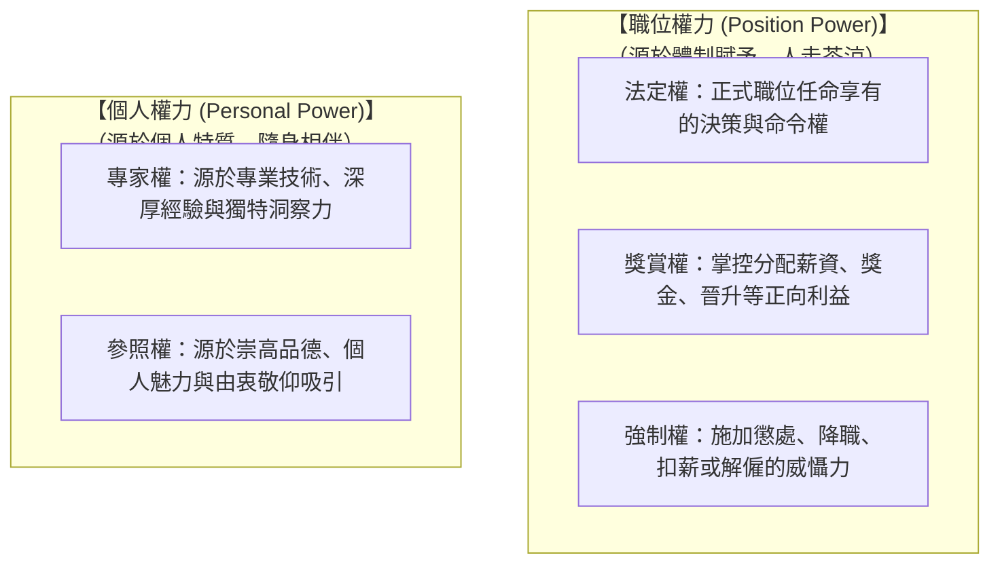
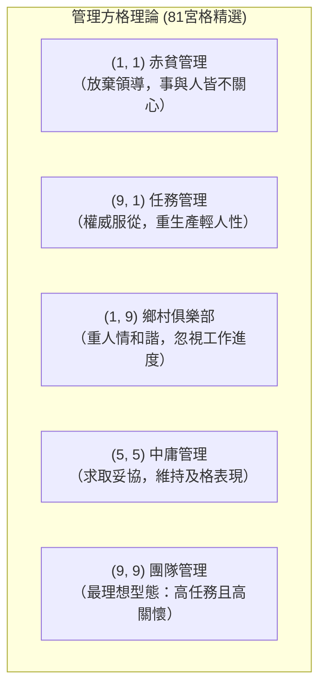
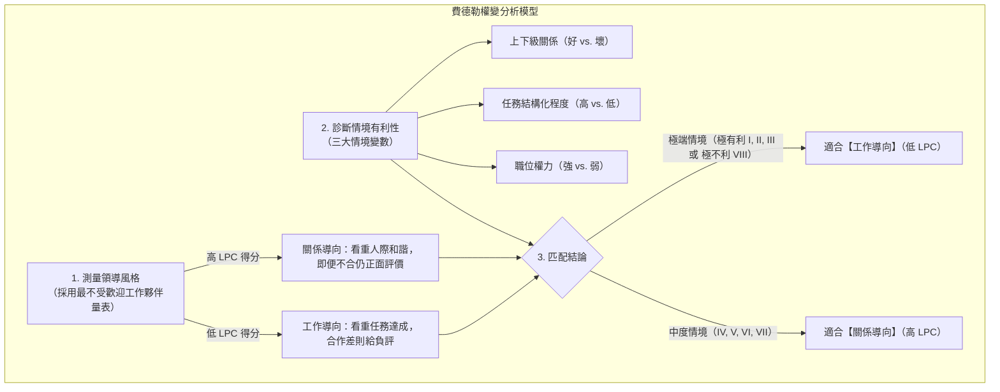
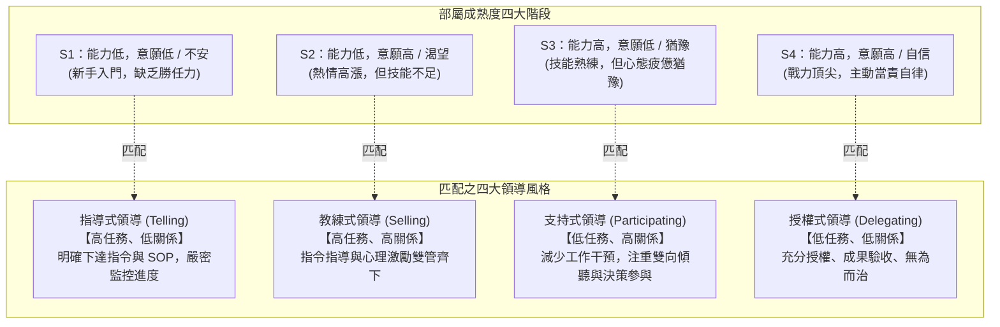

---
{"dg-publish":true,"permalink":"/01/02/ch10/","title":"Ch10 當代領導理論","tags":["PMBA","管理概論","領導理論","權變領導","轉型領導","僕人領導","費德勒權變模型","情境領導"],"dg-note-properties":{"title":"Ch10 當代領導理論","course":"管理概論","category":"01_基礎先修","type":"lecture-note","lecture":"02_Ch10","tags":["PMBA","管理概論","領導理論","權變領導","轉型領導","僕人領導","費德勒權變模型","情境領導"],"aliases":["當代領導理論","Ch10_當代領導理論","L10_當代領導理論","Ch10","L10"]}}
---

# Ch10 當代領導理論

## 💡 核心摘要

1. **聚焦[[98_商業概念庫/leadership-vs-management_領導與管理\|leadership-yu-management_領導與管理]]的本質區隔**：管理聚焦於「應對複雜性」，透過流程、SOP 與控制維持當前系統秩序（把事情做對）；領導則聚焦於「應對變革」，透過願景、激勵與賦能帶領組織開創新局（做對的事情）。
2. **[[98_商業概念庫/bases-of-social-power_權力基礎\|quan-li-ji-chu_權力基礎]]的層次質變**：領導者的影響力源於五大權力——職位權力（[[98_商業概念庫/legitimate-power_法定權\|fa-ding-quan_法定權]]、[[98_商業概念庫/coercive-power_強制權\|qiang-zhi-quan_強制權]]、[[98_商業概念庫/reward-power_獎賞權\|jiang-shang-quan_獎賞權]]）僅能換取部屬「不被懲罰」的表面服從；個人權力（[[98_商業概念庫/expert-power_專家權\|zhuan-jia-quan_專家權]]、[[98_商業概念庫/can-zhao-quan_參照權\|can-zhao-quan_參照權]]）才能贏得部屬發自內心的深層承諾與卓越追隨。
3. **權變思維破除單一風格迷思**：領導理論歷經[[98_商業概念庫/leadership-traits_領導特質論\|leadership-te-zhi-lun_領導特質論]]（生而為領導者之迷思）、[[98_商業概念庫/ohio-state-leadership-studies_俄亥俄州立大學研究\|e-hai-e-zhou-li-da-xue-yan-jiu_俄亥俄州立大學研究]]（倡議與關懷二維架構）與[[98_商業概念庫/managerial-grid-theory_管理方格理論\|management-fang-ge-theory_管理方格理論]]，最終走向[[98_商業概念庫/contingency-leadership-theory_權變領導理論\|quan-bian-leadership-theory_權變領導理論]]（如費德勒權變模型）與[[98_商業概念庫/path-goal-theory_路徑目標理論\|lu-jing-mu-biao-theory_路徑目標理論]]，證實沒有萬靈丹式的領導風格，唯有「領導者、追隨者與情境」三者的動態契合。
4. **因材施教的情境領導藝術**：在[[98_商業概念庫/situational-leadership-theory_情境領導理論\|qing-jing-leadership-theory_情境領導理論]]架構下，卓越主管懂得依循部屬的工作能力與意願成熟度，精準切換[[98_商業概念庫/leadership-6_指導式領導\|zhi-dao-shi-leadership_指導式領導]]（S1）、[[98_商業概念庫/leadership-5_教練式領導\|jiao-lian-shi-leadership_教練式領導]]（S2）、[[98_商業概念庫/leadership-4_支持式領導\|zhi-chi-shi-leadership_支持式領導]]（S3）與[[98_商業概念庫/leadership-3_授權式領導\|shou-quan-shi-leadership_授權式領導]]（S4），實現科學育才與組織賦能。
5. **當代前沿引領組織轉型**：面對知識經濟與跨世代員工，傳統基於利益交換的[[98_商業概念庫/transactional-leadership_交易型領導\|jiao-yi-xing-leadership_交易型領導]]已顯疲態；現代組織亟需具備遠見感召的[[98_商業概念庫/leadership-2_魅力型領導\|mei-li-xing-leadership_魅力型領導]]、以服務賦能為先的[[98_商業概念庫/servant-leadership_僕人式領導\|pu-ren-shi-leadership_僕人式領導]]、言行一致的[[98_商業概念庫/authentic-leadership_真誠領導\|zhen-cheng-leadership_真誠領導]]，以及透過 4I 架構全面激活團隊潛能的[[98_商業概念庫/transformational-leadership_轉換型領導\|zhuan-huan-xing-leadership_轉換型領導]]。

---

## 📚 核心觀念與理論架構

### 一、領導與管理之辨及五大權力基礎

#### 1. 領導與管理的本質對照

約翰·科特（John Kotter）深刻指出，卓越組織需要「強管理」與「強領導」的完美平衡：

| 比較維度 | 管理（Management） | 領導（Leadership） |
| :--- | :--- | :--- |
| **核心使命** | **應對複雜性（Coping with Complexity）**，維持當前秩序與穩定運作。 | **應對變革（Coping with Change）**，引導組織轉型與開拓未來。 |
| **目標確立** | 制定詳細計畫、排程規劃與預算資源編列。 | 確立策略方向、描繪動人願景與未來藍圖。 |
| **組織人員** | 建立科層體制、明確分工職責、制定 SOP 規章。 | 整合全員共識、溝通核心價值、建立跨部門同盟。 |
| **控制激勵** | 監控 KPI、落實[[98_商業概念庫/management-3_例外管理\|li-wai-management_例外管理]]、修正執行偏差以求效率。 | 激發內在動機、實施自主賦權、滿足個人高階成長。 |
| **終極產出** | 穩定秩序、可預測性、短期目標的高效達成。 | 突破變革、組織敏捷、具備持續競爭力的未來。 |

#### 2. 領導者的五大權力基礎

約翰·法蘭西與伯特倫·拉芬提出領導者影響力的五大來源，分為「職位權力」與「個人權力」：

- **職位權力（[[98_商業概念庫/legitimate-power_法定權\|fa-ding-quan_法定權]]、[[98_商業概念庫/reward-power_獎賞權\|jiang-shang-quan_獎賞權]]、[[98_商業概念庫/coercive-power_強制權\|qiang-zhi-quan_強制權]]）**：屬於外在控制機制，僅能促成部屬的最低限度「服從（Compliance）」，過度使用易引發被動攻擊與消極怠工。
- **個人權力（[[98_商業概念庫/expert-power_專家權\|zhuan-jia-quan_專家權]]、[[98_商業概念庫/can-zhao-quan_參照權\|can-zhao-quan_參照權]]）**：屬於內在感召機制，能激發部屬由衷的「承諾（Commitment）」，促成超越職責的自主貢獻。

---

### 二、古典領導理論演進：從特質論到行為論

#### 1. 領導特質論（Trait Theories / 偉人理論）

1920 至 1930 年代的研究主張「偉人乃天生」，聚焦於尋找成功領導者具備的 7 大共通人格特質：
1. **驅動力（Drive）**：極高成就慾、精力充沛、積極進取、孜孜不倦。
2. **領導動機（Desire to Lead）**：強烈的影響他人、承擔責任與帶領團隊之渴望。
3. **誠實與正直（Honesty and Integrity）**：言行一致、真誠透明，建立深厚互信。
4. **自信（Self-Confidence）**：對個人戰略判斷與決策抱持堅定信念。
5. **智慧（Intelligence）**：卓越的資訊整合、邏輯思考與複雜問題分析能力。
6. **工作相關知識（Job-Relevant Knowledge）**：對所處產業、核心技術與營運細節有深刻理解。
7. **外向性（Extraversion）**：熱情開朗、擅長人際社交與主動溝通。

> **特質論的學術盲點**：忽視了外在情境變數；具備這些特質的人未必能成為卓越領導者，且不同情境所需的特質往往互相衝突。

#### 2. 行為論里程碑與俄亥俄州立大學研究

1940 年代起，學者轉向研究「領導者的具體行為」：
- **愛荷華大學研究**：劃分專制型、民主型與放任型。實證發現**民主型領導下員工滿意度最高**。
- **[[98_商業概念庫/ohio-state-leadership-studies_俄亥俄州立大學研究\|e-hai-e-zhou-li-da-xue-yan-jiu_俄亥俄州立大學研究]]**：編製 LBDQ 問卷，提煉出兩大核心構面：
  - **定規行為（Initiating Structure，倡議）**：界定工作架構、制定流程 SOP、明確分工與嚴密追蹤進度（關心事）。
  - **關懷行為（Consideration，關懷）**：傾聽部屬心聲、建立信任氛圍、尊重部屬自尊與心理福祉（關心人）。
  - 結論指出「高定規—高關懷（高高型）」整體表現最佳，但仍受特定情境影響。
- **密西根大學研究**：區分為生產導向（關心事）與員工導向（關心人），證實員工導向領導者的團隊滿意度與生產力顯著較高。

#### 3. 管理方格理論（Managerial Grid）

羅伯·布萊克與珍·莫頓將「關心生產（X 軸）」與「關心員工（Y 軸）」交叉構成 81 個座標，歸納出 5 種經典型態：

---

### 三、情境與權變領導模型

#### 1. 費德勒權變模型（Fiedler's Contingency Model）

費德勒認為領導風格深植於人格底層，難以隨意改變；領導效能取決於「領導風格」與「情境有利性」的契合：

- **[[98_商業概念庫/partnership_最不受歡迎工作夥伴量表\|zui-bu-shou-huan-ying-gong-zuo-huo-ban-liang-biao_最不受歡迎工作夥伴量表]]（LPC 量表）**：衡量主管在面對合作最差的同儕時是否仍能維持客觀評價。
- **失配解法**：領導者不可強行扭曲自身風格，唯有「改變情境以適應領導者」（如重新設計任務結構或調整職權），或「更換適當人選接管該情境」。

#### 2. 情境領導理論（Situational Leadership Theory, SLT）

保羅·赫塞與肯尼斯·布蘭查德提出，領導風格必須隨著「被領導者的成熟度」動態調整：

- **四大領導風格實踐要領**：
  - **[[98_商業概念庫/leadership-6_指導式領導\|zhi-dao-shi-leadership_指導式領導]]（Telling）**：針對 S1 菜鳥，給予定向指令與標準化檢查清單，消除其未知恐懼。
  - **[[98_商業概念庫/leadership-5_教練式領導\|jiao-lian-shi-leadership_教練式領導]]（Selling）**：針對 S2 學習者，耐性解釋「為什麼這麼做」，兼顧技能爬坡與信心維護。
  - **[[98_商業概念庫/leadership-4_支持式領導\|zhi-chi-shi-leadership_支持式領導]]（Participating）**：針對 S3 資深員工，不干預技術細節，專注於排除心理障礙與共商決策。
  - **[[98_商業概念庫/leadership-3_授權式領導\|shou-quan-shi-leadership_授權式領導]]（Delegating）**：針對 S4 頂級骨幹，給予完全的策略自主權，僅驗收最終成果。

#### 3. 路徑目標理論（Path-Goal Theory）

羅伯特·豪斯借鑒[[98_商業概念庫/theory-8_期望理論\|qi-wang-theory_期望理論]]，指出領導者的核心任務在於：**協助部屬釐清實現目標的最佳路徑、沿途排除體制障礙，並確保績效能帶來個人所渴望的獎酬。**
- **核心哲學**：「**缺什麼，補什麼**」。領導風格並非天生固定，領導者如千面英雄，依情境自由切換。
- **四大領導行為模式**：
  1. 指導型（Directive）：明確目標與 SOP（適用於任務模糊、外控型部屬）。
  2. 支援型（Supportive）：關懷同理與尊嚴（適用於任務枯燥高壓、團隊人際緊張）。
  3. 參與型（Participative）：徵詢建言共同決策（適用於任務複雜、內控型部屬）。
  4. 成就導向型（Achievement-Oriented）：設定挑戰目標展現極致信任（適用於高能力專業人才）。

---

### 四、當代領導前沿視角

#### 1. 交易型領導 vs. 轉換型領導

| 比較構面 | [[98_商業概念庫/transactional-leadership_交易型領導\|jiao-yi-xing-leadership_交易型領導]]（Transactional） | [[98_商業概念庫/transformational-leadership_轉換型領導\|zhuan-huan-xing-leadership_轉換型領導]]（Transformational） |
| :--- | :--- | :--- |
| **運作基礎** | 社會交換理論、利益契約、外在獎懲。 | 共享價值觀、道德榜樣、內在精神啟發。 |
| **核心機制** | **條件式獎酬**（達標給獎）；**[[98_商業概念庫/management-3_例外管理\|li-wai-management_例外管理]]**（主動/被動糾偏）。 | **4I 架構**（理想化影響、動機啟發、智力激發、個別關懷）。 |
| **追隨者動機** | 算計個人得失，達到及格標準即停止。 | 超越個人私利，追求組織卓越使命。 |
| **組織產出** | 維持既定[[98_商業概念庫/performance-standards_績效標準\|ji-xiao-biao-zhun_績效標準]]、常規營運。 | 突破性創新、超越預期產出、深刻文化轉型。 |

> [!IMPORTANT] **[[98_商業概念庫/transformational-leadership_轉換型領導\|zhuan-huan-xing-leadership_轉換型領導]]的 4I 核心構面**
> 1. **理想化影響（Idealized Influence）**：以身作則展現高道德標準與自我犧牲，成為部屬景仰的榜樣。
> 2. **動機啟發（Inspirational Motivation）**：以熱情動人的語言描繪宏偉願景，賦予日常工作崇高使命感。
> 3. **智力激發（Intellectual Stimulation）**：鼓勵員工質疑既有假設、勇於顛覆傳統與探索新方法。
> 4. **個別關懷（Individualized Consideration）**：關注每位員工的獨特成長需求，扮演導師與教練給予支持。

#### 2. 魅力型領導、僕人式領導與真誠領導

- **[[98_商業概念庫/leadership-2_魅力型領導\|mei-li-xing-leadership_魅力型領導]]（Charismatic Leadership）**：領導者具備遠見口才、個人冒險精神、環境敏銳度與非傳統行為。賈伯斯（Steve Jobs）、金恩博士（Martin Luther King, Jr.）為典型代表。需防範「非道德型魅力領導」引發個人崇拜與組織盲從。
- **[[98_商業概念庫/servant-leadership_僕人式領導\|pu-ren-shi-leadership_僕人式領導]]（Servant Leadership）**：格林利夫提出「服務為先，領導隨後（Serve First, Lead Second）」，主管的工作是反轉權力金字塔，為第一線員工「搬走石頭（掃除障礙）」，賦能團隊全力服務客戶。
- **[[98_商業概念庫/authentic-leadership_真誠領導\|zhen-cheng-leadership_真誠領導]]（Authentic Leadership）**：比爾·喬治倡導，包含自我覺察、關係透明、平衡處理資訊與內化道德觀點四大維度，強調言行一致、不戴面具，以建立深厚組織互信。

---

## ⚠️ 實務應用與經理人思維

### 1. 新手主管的「微觀管理（Micromanagement）」痛點與授權障礙
- **病態表徵**：主管深陷業務細節，事事過問、郵件每封必 CC、過度干預步驟，導致團隊喪失主動性，主管自身心力交瘁。
- **根因分析**：
  1. 缺乏安全感：擔心部屬犯錯影響個人績效。
  2. 角色轉型失敗：仍沉溺於身為超級獨立貢獻者的掌控快感。
  3. 情境錯配：將 S3/S4 階段的成熟骨幹誤當 S1 菜鳥進行微觀控制。
- **破解之道**：實踐[[98_商業概念庫/leadership-3_授權式領導\|shou-quan-shi-leadership_授權式領導]]，僅界定「目標成果（What）」與「安全底線（Guardrails）」，將「執行路徑（How）」完全交由團隊發揮。

### 2. 擺脫「職權迷思」：深耕專家權與參照權
- **實務盲點**：新手經理人常落入「拿雞毛當令箭」的陷阱，動輒以[[98_商業概念庫/legitimate-power_法定權\|fa-ding-quan_法定權]]或[[98_商業概念庫/coercive-power_強制權\|qiang-zhi-quan_強制權]]壓制反對聲音，造成口服心不服。
- **長效影響力修煉**：
  - 厚植[[98_商業概念庫/expert-power_專家權\|zhuan-jia-quan_專家權]]：在產業趨勢、策略架構與[[98_商業概念庫/business-model_商業模式\|business-model_商業模式]]上持續學習，成為團隊面臨未知風暴時的主心骨。
  - 修煉[[98_商業概念庫/can-zhao-quan_參照權\|can-zhao-quan_參照權]]：踐行[[98_商業概念庫/authentic-leadership_真誠領導\|zhen-cheng-leadership_真誠領導]]，勇於承擔責任（功勞歸部屬、責任先自省），展現同理心與道德風範，贏得團隊由衷追隨。

### 3. 因材施教的領導陷阱：警惕「情境錯配」
- **致命錯誤 A（拔苗助長型）**：對 S1（熱情但無技能的新人）實施[[98_商業概念庫/leadership-3_授權式領導\|shou-quan-shi-leadership_授權式領導]]，美其名為信任，實為主管失職甩鍋，導致專案爆掉並重挫新人自信。
- **致命錯誤 B（窒息型）**：對 S4（技術精湛且高度自律的專家）實施[[98_商業概念庫/leadership-6_指導式領導\|zhi-dao-shi-leadership_指導式領導]]，天天盯打卡、查進度日報，迅速激怒優秀人才並引發集體跳槽。

---

## 🧠 PMBA 課堂討論與思辨題

### 問題一：某傳統製造業推動智慧製造轉型，引進一批平均年齡 28 歲的高學歷 AI 演算法工程師。原廠區資深廠長（58 歲，高度任務導向、作風威嚴）天天要求工程師準時穿工服排隊早操、嚴格記錄每小時作業日誌，引發工程師集體抗議並遞交辭呈。請從「五大權力基礎」與「情境領導理論（SLT）」診斷廠長的領導盲點，並提出系統性轉型解方。

> **經理人深度解析**：
> 1. **領導盲點診斷**：
>    - **過度依賴職位權力，缺乏個人權力**：廠長試圖以傳統的[[98_商業概念庫/legitimate-power_法定權\|fa-ding-quan_法定權]]與[[98_商業概念庫/coercive-power_強制權\|qiang-zhi-quan_強制權]]約束知識工作者，但在 AI 專業領域，廠長毫無[[98_商業概念庫/expert-power_專家權\|zhuan-jia-quan_專家權]]，且其官僚作風完全摧毀了[[98_商業概念庫/can-zhao-quan_參照權\|can-zhao-quan_參照權]]。
>    - **嚴重的成熟度錯配（SLT 視角）**：AI 工程師屬於「S3~S4 階段（專業能力極高，需要自主與尊重）」，廠長卻採用「[[98_商業概念庫/leadership-6_指導式領導\|zhi-dao-shi-leadership_指導式領導]]（S1）」的流水線工人管理模式，造成強烈的心理契約破裂。
> 2. **系統性轉型解方**：
>    - **重構權力結構與雙軌組織**：建立技術特區與雙軌制。廠長負責提供製造現場資源、數據接口與實體場地支持（轉向[[98_商業概念庫/servant-leadership_僕人式領導\|pu-ren-shi-leadership_僕人式領導]]）；AI 專案團隊之日常研發則賦予充分的敏捷自主權。
>    - **領導風格轉向「[[98_商業概念庫/leadership-4_支持式領導\|zhi-chi-shi-leadership_支持式領導]]」與「[[98_商業概念庫/leadership-3_授權式領導\|shou-quan-shi-leadership_授權式領導]]」**：廠長應就「生產瓶頸與痛點」向工程師提出挑戰性問題，而非干預程式碼撰寫細節；透過尊重專業贏得信任，重新建立跨世代領導力。

---

### 問題二：一家快速崛起的跨國企業，執行長具備極強的魅力與遠見，擅長發表煽動人心的演說；然而內部中高層主管卻普遍反映「伴君如伴虎」，執行長決策朝令夕改、不容許任何反對意見、甚至要求主管掩蓋財務數據瑕疵。請從「魅力型領導的陰暗面」與「真誠領導」評析此現象，並為董事會提出治理機制。

> **經理人深度解析**：
> 1. **[[98_商業概念庫/leadership-2_魅力型領導\|mei-li-xing-leadership_魅力型領導]]的陰暗面剖析**：
>    - 魅力是一把雙面刃。非道德的[[98_商業概念庫/leadership-2_魅力型領導\|mei-li-xing-leadership_魅力型領導]]者往往將個人崇拜置於組織利益之上，將宏大願景包裝為遮掩個人野心的工具。
>    - 當魅力演變為盲從，組織內部會產生嚴重的「[[98_商業概念庫/groupthink_團體迷思\|tuan-ti-mi-si_團體迷思]]（Groupthink）」；主管因恐懼遭到清洗而選擇沉默，使企業陷入系統性的戰略盲區與道德崩解（如安隆案、Theranos 案）。
> 2. **董事會之治理對策**：
>    - **導入[[98_商業概念庫/authentic-leadership_真誠領導\|zhen-cheng-leadership_真誠領導]]評鑑體系**：將「自我覺察、透明決策、內在道德操守」納入高階管理層核心考核指標，打破單純以口才、願景與短期股價論英雄的單一維度。
>    - **制度化制衡與獨立吹哨人機制**：強化獨立董事職權，設立直通董事會的審計委員會與倫理監督通道，確保反對意見能夠被安全表達。
>    - **建立集體決策架構**：限制執行長的單向獨裁權限，重大資本支出與策略轉型必須經由跨功能執委會進行嚴謹的數據論證。

---

## 🔗 關聯章節與延伸學習

- **前置章節**：
  - [[01_基礎先修/管理概論/Ch01_什麼是企業管理\|Ch01_什麼是企業管理]]：界定領導作為四大管理功能（POLC）的核心靈魂。
  - [[01_基礎先修/管理概論/Ch08_組織管理中的個體行為\|Ch08_組織管理中的個體行為]]：部屬的特質（[[98_商業概念庫/model-2_大五人格模型\|da-wu-ren-ge-model_大五人格模型]]、[[98_商業概念庫/locus-of-control_內外控傾向\|nei-wai-kong-qing-xiang_內外控傾向]]）是領導者實施權變領導的基石。
  - [[01_基礎先修/管理概論/Ch09_當代激勵理論\|Ch09_當代激勵理論]]：領導理論與[[98_商業概念庫/theory-8_期望理論\|qi-wang-theory_期望理論]]、JCM [[98_商業概念庫/model_工作特性模型\|gong-zuo-te-xing-model_工作特性模型]]高度交織，領導的本質在於點燃動能。
- **後續章節**：
  - [[01_基礎先修/管理概論/Ch11_控制的原理與工具\|Ch11_控制的原理與工具]]：領導激發願景，控制確保願景落地的軌道不發生偏離。
  - [[01_基礎先修/管理概論/Ch13_企業倫理與企業社會責任\|Ch13_企業倫理與企業社會責任]]：深究[[98_商業概念庫/authentic-leadership_真誠領導\|zhen-cheng-leadership_真誠領導]]、[[98_商業概念庫/servant-leadership_僕人式領導\|pu-ren-shi-leadership_僕人式領導]]在當代 ESG 與利害關係人治理中的實踐。
- **商業概念庫核心卡片**：
  - [[98_商業概念庫/leadership-vs-management_領導與管理\|leadership-yu-management_領導與管理]]
  - [[98_商業概念庫/legitimate-power_法定權\|fa-ding-quan_法定權]]
  - [[98_商業概念庫/reward-power_獎賞權\|jiang-shang-quan_獎賞權]]
  - [[98_商業概念庫/coercive-power_強制權\|qiang-zhi-quan_強制權]]
  - [[98_商業概念庫/expert-power_專家權\|zhuan-jia-quan_專家權]]
  - [[98_商業概念庫/can-zhao-quan_參照權\|can-zhao-quan_參照權]]
  - [[98_商業概念庫/leadership-traits_領導特質論\|leadership-te-zhi-lun_領導特質論]]
  - [[98_商業概念庫/ohio-state-leadership-studies_俄亥俄州立大學研究\|e-hai-e-zhou-li-da-xue-yan-jiu_俄亥俄州立大學研究]]
  - [[98_商業概念庫/managerial-grid-theory_管理方格理論\|management-fang-ge-theory_管理方格理論]]
  - [[98_商業概念庫/fiedler-contingency-model_費德勒權變模型\|fei-de-lei-quan-bian-model_費德勒權變模型]]
  - [[98_商業概念庫/partnership_最不受歡迎工作夥伴量表\|zui-bu-shou-huan-ying-gong-zuo-huo-ban-liang-biao_最不受歡迎工作夥伴量表]]
  - [[98_商業概念庫/situational-leadership-theory_情境領導理論\|qing-jing-leadership-theory_情境領導理論]]
  - [[98_商業概念庫/leadership-6_指導式領導\|zhi-dao-shi-leadership_指導式領導]]
  - [[98_商業概念庫/leadership-5_教練式領導\|jiao-lian-shi-leadership_教練式領導]]
  - [[98_商業概念庫/leadership-4_支持式領導\|zhi-chi-shi-leadership_支持式領導]]
  - [[98_商業概念庫/leadership-3_授權式領導\|shou-quan-shi-leadership_授權式領導]]
  - [[98_商業概念庫/path-goal-theory_路徑目標理論\|lu-jing-mu-biao-theory_路徑目標理論]]
  - [[98_商業概念庫/transformational-leadership_轉換型領導\|zhuan-huan-xing-leadership_轉換型領導]]
  - [[98_商業概念庫/transactional-leadership_交易型領導\|jiao-yi-xing-leadership_交易型領導]]
  - [[98_商業概念庫/leadership-2_魅力型領導\|mei-li-xing-leadership_魅力型領導]]
  - [[98_商業概念庫/servant-leadership_僕人式領導\|pu-ren-shi-leadership_僕人式領導]]
  - [[98_商業概念庫/authentic-leadership_真誠領導\|zhen-cheng-leadership_真誠領導]]
