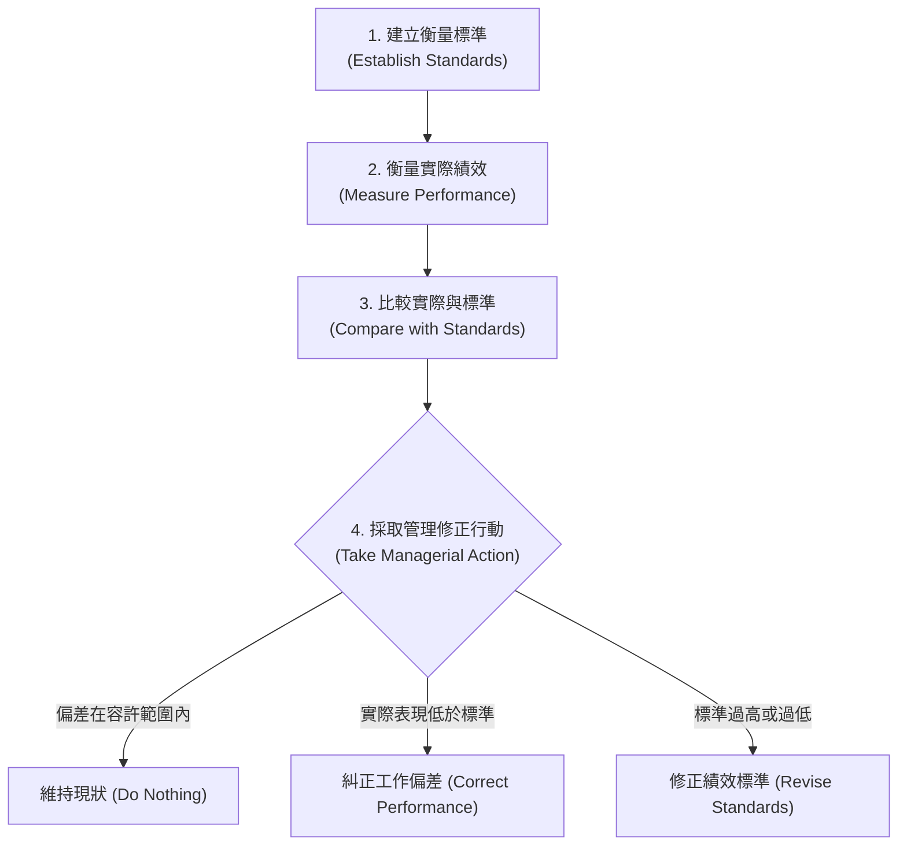
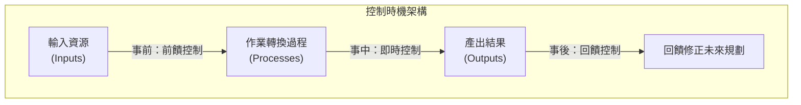
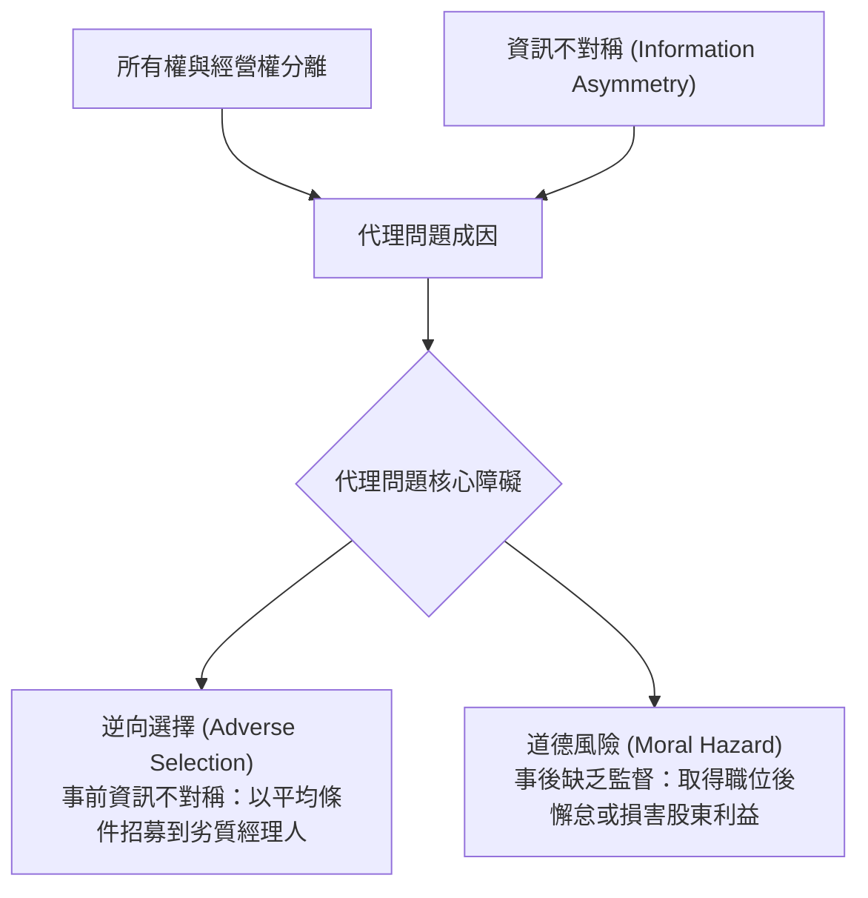
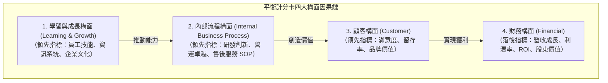

---
{"dg-publish":true,"permalink":"/01//ch11/","title":"Ch11 控制的原理與工具","tags":["PMBA","管理概論","控制職能","控制流程","平衡計分卡","BSC","內部控制","管理審計"],"dg-note-properties":{"title":"Ch11 控制的原理與工具","course":"管理概論","category":"01_基礎先修","type":"lecture-note","lecture":"02_Ch11","tags":["PMBA","管理概論","控制職能","控制流程","平衡計分卡","BSC","內部控制","管理審計"],"aliases":["控制的原理與工具","Ch11_控制的原理與工具","L11_控制的原理與工具","Ch11","L11"],"permalink":"/01/02/ch11/"}}
---

# Ch11 控制的原理與工具

## 💡 核心摘要

1. **控制是管理循環的終極閉環**：[[98_商業概念庫/control-7_控制職能\|kong-zhi-zhi-neng_控制職能]]不是獨立的孤島，而是與規劃、組織、領導緊密扣合的動態循環。沒有控制的規劃形同具文，沒有規劃的控制失去準星。控制的本質絕非事後懲罰，而是監控活動進程並持續校準組織航向。
2. **時機決定控制的成本結構（前饋 > 即時 > 回饋）**：事前防範未然的[[98_商業概念庫/control-6_前饋控制\|qian-kui-kong-zhi_前饋控制]]成本最低、效益最高；事中監控調適的[[98_商業概念庫/control_即時控制\|ji-shi-kong-zhi_即時控制]]防止損失擴大；事後評估獎懲的[[98_商業概念庫/control-5_回饋控制\|hui-kui-kong-zhi_回饋控制]]雖損害已成且成本最高，但對考核績效與修正未來策略不可或缺。
3. **解決代理問題的三大治理機制**：現代企業所有權與經營權分離，引發資訊不對稱、逆向選擇與道德風險。組織依據任務特性，分別採用以市場價格與財務報表為主的[[98_商業概念庫/market-control_市場控制\|market-kong-zhi_市場控制]]、以規章政策與 SOP 為主的[[98_商業概念庫/control-4_官僚控制\|guan-liao-kong-zhi_官僚控制]]，以及以共同信仰與社會化為主的[[98_商業概念庫/control-3_宗族控制\|zong-zu-kong-zhi_宗族控制]]。
4. **超越單一財務視角的平衡控制（BSC）**：傳統財務指標皆為「落後指標」，無法預測未來；[[98_商業概念庫/balanced-scorecard-bsc_平衡計分卡\|ping-heng-ji-fen-ka_平衡計分卡]]整合財務、顧客、內部流程、學習與成長四大構面，將領先指標與落後指標編織成因果鏈，確保企業願景與策略貫徹落地。
5. **警惕指標異化與[[98_商業概念庫/goodharts-law_古德哈特定律\|gu-de-ha-te-ding-lv_古德哈特定律]]**：當指標變成目標，該指標就不再是好指標。過度嚴苛或單一的[[98_商業概念庫/key-performance-indicator-kpi_關鍵績效指標\|guan-jian-ji-xiao-indicator_關鍵績效指標]]會誘發員工投機取巧與道德風險；卓越經理人必須評估[[98_商業概念庫/control-cost_控制成本與效益\|kong-zhi-cost-yu-xiao-yi_控制成本與效益]]，在硬性制度控制與軟性文化信任之間取得動態平衡。

---

## 📚 核心觀念與理論模型

### 一、控制的本質與四大步驟標準流程

#### 1. 控制在 POLC 四大管理程序中的角色

[[98_商業概念庫/control-7_控制職能\|kong-zhi-zhi-neng_控制職能]]是管理四大程序（Planning 規劃 $\rightarrow$ Organizing 組織 $\rightarrow$ Leading 領導 $\rightarrow$ Controlling 控制）的最後一個環節，也是啟動下一輪規劃的起點：
- **規劃**：確立組織使命、目標、策略與[[98_商業概念庫/business-model_商業模式\|business-model_商業模式]]。
- **組織**：建立組織架構、配置資源與職責分工。
- **領導**：激發員工動機、溝通願景與引導變革。
- **控制**：監控活動進展，確保實際成果與預定目標一致，並在發生偏差時採取更正行動。

#### 2. 標準控制流程的四大步驟

標準的[[98_商業概念庫/control-process_控制流程\|kong-zhi-liu-cheng_控制流程]]包含環環相扣的四個階段：

1. **第一步：建立[[98_商業概念庫/performance-standards_績效標準\|ji-xiao-biao-zhun_績效標準]]（Standards）**：
   - 標準源於規劃階段所設定的目標，必須具備具體性、可衡量性與可驗證性（如營收目標、瑕疵率、交期天數）。
2. **第二步：衡量實際績效（Measure Actual Performance）**：
   - **衡量方式（How to Measure）**：個人現場走動觀察（Personal Observation）、統計分析報表（Statistical Reports）、口頭匯報（Oral Reports）、書面日報/月報（Written Reports）。
   - **衡量標的（What to Measure）**：涵蓋財務產出、顧客反饋、營運效率與員工行為等多元維度。
   - **成本考量**：資料搜集與衡量過程均具備成本，必須評估[[98_商業概念庫/control-cost_控制成本與效益\|kong-zhi-cost-yu-xiao-yi_控制成本與效益]]。
3. **第三步：比較實際績效與標準（Compare Performance against Standards）**：
   - 評估實際表現與預定標準之間的差距。
   - 經理人必須事先劃定「[[98_商業概念庫/differentiation-3_容許差異範圍\|rong-xu-cha-yi-fan-wei_容許差異範圍]]（Acceptable Range of Variation）」，避免對微小波動過度反應，將精力聚焦於超出容許範圍的顯著偏差。
4. **第四步：採取[[98_商業概念庫/management-6_管理修正行動\|management-xiu-zheng-xing-dong_管理修正行動]]（Take Managerial Action）**：
   - **維持現狀（Do Nothing）**：當差異落在[[98_商業概念庫/differentiation-3_容許差異範圍\|rong-xu-cha-yi-fan-wei_容許差異範圍]]之內時，無需干預。
   - **糾正實際工作偏差（Correct Performance）**：分析根因，可採取「立即糾正行動」（迅速止血滅火）或「根本糾正行動」（修復流程與制度瓶頸）。
   - **修正標準（Revise the Standard）**：若標準因外在環境劇變（如極端通膨、天災或市場崩盤）而過於嚴苛，或因技術突破而過於寬鬆，則應即時調整[[98_商業概念庫/performance-standards_績效標準\|ji-xiao-biao-zhun_績效標準]]本身。

---

### 二、控制時機分類與成本效益分析

依據控制實施的時間節點，控制機制可劃分為三大類型：

| 控制時機類型 | 實施時點與核心機制 | 職場與管理實務範例 | 優缺點與成本結構 |
| :--- | :--- | :--- | :--- |
| **[[98_商業概念庫/control-6_前饋控制\|qian-kui-kong-zhi_前饋控制]] (Feedforward Control)** | **投入階段（事前）**。 預測潛在問題，在偏差發生前即予以防範。 | 嚴格篩選供應商原料品質、新進員工背景調查與培訓、設備預防性保養。 | **優點**：成本最低、效益最高，防患於未然。 **缺點**：高度依賴精準的預測與即時資訊，建置成本高。 |
| **[[98_商業概念庫/control_即時控制\|ji-shi-kong-zhi_即時控制]] (Concurrent Control)** | **作業階段（事中）**。 在工作進行的當下同步監控，即時發現問題並現場調適。 | 主管走動管理（MBWA）、生產線即時監控儀表板、機台異常自動斷電停止。 | **優點**：能在第一時間將錯誤扼殺在搖籃，防止損失擴大。 **缺點**：容易讓部屬產生被嚴密監視的不信任感。 |
| **[[98_商業概念庫/control-5_回饋控制\|hui-kui-kong-zhi_回饋控制]] (Feedback Control)** | **產出階段（事後）**。 在活動結束後進行成果評估與檢討。 | 審計年度財務報表、顧客滿意度售後問卷調查、考績評定與年終分紅。 | **優點**：數據最客觀確實；為考核激勵與未來規劃提供唯一依據。 **缺點**：損失已經造成（亡羊補牢），成本最高。 |

---

### 三、代理理論與三大控制機制

#### 1. 代理問題（Agency Problem）的本質

當代企業大多面臨「所有權與經營權分離」的結構：
- **主理人（Principal）**：股東（所有權人）。
- **代理人（Agent）**：專業經理人（經營權人）。

當主理人與代理人並存時，基於亞當·斯密「理性經濟人（自利性）」的假設，代理人必然追求個人效用最大化（如高薪、特權、在位消費），導致其效用函數與股東利益發生衝突。

#### 2. 解決代理問題的三大控制機制

為約束代理人並降低代理成本，管理學者奧奇（William Ouchi）提出三種經典控制途徑：

| 控制機制 | 核心手段與工具 | 適用工作情境 | 實務案例與特色 |
| :--- | :--- | :--- | :--- |
| **[[98_商業概念庫/market-control_市場控制\|market-kong-zhi_市場控制]] (Market Control)** | **結果導向**。 利用外部市場價格機制、財務報表與經濟產出指標進行客觀評估。 | 產出結果高度可量化、可清楚界定經濟價值的業務。 | 業務員業績抽成、利潤中心制、投資報酬率（ROI）、股價與經濟增加值（EVA）。 |
| **[[98_商業概念庫/control-4_官僚控制\|guan-liao-kong-zhi_官僚控制]] (Bureaucratic Control)** | **過程導向**。 仰賴科層組織權威，透過嚴密的規章、SOP、政策與稽核約束行為。 | 作業流程可標準化、可程式化程度（Programmed）高之工作。 | 銀行櫃員作業規範、生產線品管標準、核決權限表、[[98_商業概念庫/internal-control-2_內部控制\|nei-bu-kong-zhi_內部控制]]與預算審批。 |
| **[[98_商業概念庫/control-3_宗族控制\|zong-zu-kong-zhi_宗族控制]] (Clan Control)** | **價值觀導向**。 透過文化社會化、共享價值觀、信念與團隊規範引導員工自律。 | 產出難以客觀量化、作業高度非例行性且需要極高互信之工作。 | Google 研發團隊、台積電/台塑運動會、牛津劍橋划船賽、師徒傳承制。 |

---

### 四、當代多維度控制工具與實務

#### 1. 平衡計分卡（Balanced Scorecard, BSC）

羅伯·卡普蘭（Robert Kaplan）與大衛·諾頓（David Norton）於 1992 年提出[[98_商業概念庫/balanced-scorecard-bsc_平衡計分卡\|ping-heng-ji-fen-ka_平衡計分卡]]。該工具打破了傳統只看財務會計報表的片面觀點，主張透過四大構面的因果鏈結達成「平衡」：

- **「平衡」的核心意涵**：
  - 平衡**財務與非財務**指標；
  - 平衡**短期營運與長期策略**發展；
  - 平衡**落後指標（財務）與領先指標（顧客、流程、學習）**；
  - 平衡**外部市場表現與內部流程精進**。
- **[[98_商業概念庫/key-performance-indicator-kpi_關鍵績效指標\|guan-jian-ji-xiao-indicator_關鍵績效指標]]（KPI）配置**：Kaplan & Norton 建議全組織設定約 20~25 個指標，平均每構面約 5 個指標（內部流程構面可因涵蓋多個營運循環而略多）。

#### 2. 財務控制與預算控制

- **[[98_商業概念庫/budget-control_預算控制\|yu-suan-kong-zhi_預算控制]]（Budgetary Control）**：最普遍的財務量化控制工具。以貨幣形式預先規劃下一年度的收入、支出與資本投入，並在期末進行預算差異分析（Variance Analysis），落實當責。
- **關鍵財務比率**：
  - **[[98_商業概念庫/profitability_獲利能力\|huo-li-neng-li_獲利能力]]指標**：資產報酬率（ROA）、[[98_商業概念庫/shareholder-equity_股東權益\|shareholder-equity_股東權益]]報酬率（ROE）、[[98_商業概念庫/operating-income-rate_營業利益率\|operating-income-rate_營業利益率]]。
  - **[[98_商業概念庫/liquidity_流動性\|liu-dong-xing_流動性]]指標**：[[98_商業概念庫/ratio_流動比率\|liu-dong-bi-rate_流動比率]]、[[98_商業概念庫/ratio-2_速動比率\|su-dong-bi-rate_速動比率]]（監控償債風險與[[98_商業概念庫/working-capital_營運資金\|working-capital_營運資金]]安全）。
  - **槓桿比率**：[[98_商業概念庫/liability-ratio_負債比率\|liability-bi-rate_負債比率]]、[[98_商業概念庫/interest-coverage-ratio_利息保障倍數\|li-xi-bao-zhang-bei-shu_利息保障倍數]]。

#### 3. 例外管理原則（Management by Exception）

- **核心概念**：高階經理人不應將精力耗費在日常正常運作的事務上；唯有當實際績效出現「重大異常（超出[[98_商業概念庫/differentiation-3_容許差異範圍\|rong-xu-cha-yi-fan-wei_容許差異範圍]]的嚴重赤字或超額利潤）」時，才呈報高層介入處理。
- **實務效益**：防止主管陷入微觀管理，大幅節約高階經理人的注意力與時間資源。

#### 4. 最佳實務與標竿學習（Benchmarking）

- **定義**：在同業或不同行業中尋找具備卓越績效的企業作為「優秀標準（標竿）」，透過深入學習其作業流程、比較差距，並引進其成功經驗以達成自我突破。
- **經典案例**：1970~1980 年代，美國全錄（Xerox）因獲利暴跌，主動向其日本合資子公司「富士全錄（Fuji Xerox）」進行[[98_商業概念庫/learning-2_標竿學習\|biao-gan-xue-xi_標竿學習]]，全面導入日本品質管理手法，成功使全錄營收與獲利均飆升 50%。

#### 5. 營運品質與內部控制體系

- **六標準差（Six Sigma）**：由摩托羅拉於 1986 年創立、GE 奇異公司傑克·威爾許（Jack Welch）發揚光大。追求作業流程缺陷率達到「每百萬次機會僅容許 3.4 次錯誤（3.4 DPMO）」。包含 DMAIC（現有流程改善）與 DMADV（新產品流程設計）兩大路徑。
- **[[98_商業概念庫/quality-management_全面品質管理\|quan-mian-pin-zhi-management_全面品質管理]]（Total Quality Management, TQM）**：全員參與、持續改善（Kaizen）、以顧客為中心的全流程品質文化。
- **[[98_商業概念庫/internal-control-2_內部控制\|nei-bu-kong-zhi_內部控制]]（Internal Control）**：依循 COSO 委員會框架，建構涵蓋「控制環境、風險評估、控制活動、資訊與溝通、監督活動」五大要素的企業內部風控護城河。

---

## ⚠️ 實務應用與經理人思維

### 1. 指標陷阱：古德哈特定律與 KPI 異化
- **現象**：經濟學家查爾斯·古德哈特提出：「**當一個衡量指標變成管理目標時，它就不再是一個好指標（When a measure becomes a target, it ceases to be a good measure）。**」
- **經理人盲點**：
  - 主管過度迷信單一量化指標，員工便會採取最省力甚至扭曲的方式達成數字，卻破壞組織的長遠利益。
  - **案例**：以「客服通話時長」作為 KPI，客服人員為了壓低時長便主動掛斷客戶電話；以「Bug 修复數量」作為工程師 KPI，工程師便故意寫出容易修復的簡單程式碼以刷高數量。
- **應對之道**：建立平衡的多維度指標池（如 BSC），並搭配質化評估與同行審查，避免將單一指標與高額獎金直接線性掛鉤。

### 2. 控制過嚴引發的組織反彈與創意窒息
- **實務困境**：過度的[[98_商業概念庫/control-4_官僚控制\|guan-liao-kong-zhi_官僚控制]]（事事請示、繁複簽核、監控按鍵日誌）會營造出充滿猜忌與恐懼的氛圍。
- **後果**：
  - 扼殺創新：員工為避免出錯被罰，選擇「多做多錯、少做少錯」，徹底喪失主動試錯動能。
  - 道德風險反彈：嚴密控制會摧毀員工的內在動機，誘發組織內部的「安靜離職」與隱蔽對抗。

### 3. 平衡「官僚控制」與「宗族控制」
- **經理人架構選擇**：
  - **對於標準化業務（如產線作業、財務核銷）**：落實清晰嚴謹的[[98_商業概念庫/control-4_官僚控制\|guan-liao-kong-zhi_官僚控制]]與 SOP，確保合規與運作底線。
  - **對於知識創新業務（如產品研發、策略規劃）**：淡化行政管制，大力投資[[98_商業概念庫/control-3_宗族控制\|zong-zu-kong-zhi_宗族控制]]——透過共享願景、心理安全感與價值觀培訓，激發團隊的專業自律與協同創造。

### 4. 衡量控制成本與效益：防止「控制過度」
- **評估原則**：任何控制系統的建置與維護均需付出高昂代價（軟硬體採購、稽核工時、流程延誤的機會成本）。
- **黃金法則**：控制所帶來的「預防損失與增益價值」，必須顯著大於「控制本身的執行成本」。經理人切忌為抓一隻蒼蠅而花費數百萬購置大砲。

---

## 🧠 PMBA 課堂討論與思辨題

### 問題一：某知名連鎖診所為提升營運效率，導入嚴格的「計件制市場控制」——以「每小時看診病患人數」與「自費藥品銷售額」作為醫師唯一的考核 KPI。半年後，診所營收顯著成長，但隨後爆發嚴重的醫療糾紛激增、資深名醫集體跳槽、以及病患在社群媒體大量留下負評。請從「平衡計分卡（BSC）」與「古德哈特定律」診斷該診所的控制機制盲點，並提出系統性改善方案。

> **經理人深度解析**：
> 1. **控制機制盲點剖析**：
>    - **深陷[[98_商業概念庫/goodharts-law_古德哈特定律\|gu-de-ha-te-ding-lv_古德哈特定律]]陷阱**：當「看診人數」與「自費額」變成唯一目標，醫師被迫縮短每位病患的問診時間（過度辯證效應），犧牲醫療診斷品質並過度推銷自費項目，導致醫療專業倫理與患者信任徹底破裂。
>    - **嚴重的指標失衡（BSC 視角）**：診所只盯著「財務構面（短期營收）」，完全忽視了「顧客構面（病患滿意度與治癒率）」、「內部流程構面（醫療安全審查與 SOP 合規）」以及「學習與成長構面（醫師專業培育與留任率）」，落後指標看似亮麗，但領先指標已全面潰敗。
> 2. **系統性改善方案**：
>    - **導入[[98_商業概念庫/balanced-scorecard-bsc_平衡計分卡\|ping-heng-ji-fen-ka_平衡計分卡]]多維考核**：
>      - *財務構面（30%）*：診所整體可持續利潤率。
>      - *顧客構面（30%）*：病患術後滿意度、投訴率與回診率。
>      - *內部流程構面（20%）*：醫療差錯零容忍指標、病歷書寫規範合規率。
>      - *學習與成長構面（20%）*：醫師專業進修時數、團隊跨科協同與人才留任率。
>    - **融入[[98_商業概念庫/control-3_宗族控制\|zong-zu-kong-zhi_宗族控制]]機制**：建立「醫療倫理委員會」與同儕案件審查（Peer Review）機制，重塑以「醫者仁心」為核心的組織文化。

---

### 問題二：一家高速擴張的跨國科技獨角獸公司，執行長為防止各國分公司主管貪腐與濫權，推行了極致的「中央集權官僚控制」：任何超過 1,000 美元的支出或跨部門合作專案，均須總部三層主管審批。結果半年內總部未發現任何違規，但海外業務推進全面陷入癱瘓，屢屢被敏捷的本地競爭對手搶佔市場。請從「代理理論」、「例外管理」與「控制成本與效益」提出你的治理變革建議。

> **經理人深度解析**：
> 1. **現象本質剖析**：
>    - **控制成本嚴重超越控制效益**：執行長為了防範微小的代理人道德風險（1,000 美元），投入了龐大的審批審計成本，更付出了慘重且不可逆的「市場機會成本」與決策遲鈍代價。
>    - **[[98_商業概念庫/control-4_官僚控制\|guan-liao-kong-zhi_官僚控制]]的極端化反噬**：過度集權實質上剝奪了第一線主管的經營權，使分公司主管退化為「等待總部指示」的被動機器，徹底喪失企業家精神與敏捷應變能力。
> 2. **治理變革建議**：
>    - **實施「[[98_商業概念庫/management-3_例外管理\|li-wai-management_例外管理]]原則」與分層授權**：依據風險等級重構核決權限表（DOA）。將 5 萬美元以下的常規營運支出完全授權海外負責人自主拍板；總部僅對超出[[98_商業概念庫/differentiation-3_容許差異範圍\|rong-xu-cha-yi-fan-wei_容許差異範圍]]的重大資本支出或異常合約進行例外審批。
>    - **轉向「結果導向[[98_商業概念庫/market-control_市場控制\|market-kong-zhi_市場控制]]」與「[[98_商業概念庫/control-6_前饋控制\|qian-kui-kong-zhi_前饋控制]]」**：事前對海外主管進行嚴格合規培訓並簽署倫理承諾書（前饋）；事中給予充分自主權；期末以分公司的整體損益（P&L）與市場佔有率進行綜合考核（產出控制）。
>    - **以事後數位審計替代事前官僚堵截**：導入現代 ERP 與 AI 異常交易監控系統，平時不干預正常採購，透過即時大數據分析異常發票與關聯交易，達成「敏捷授權」與「風險可控」的雙贏。

---

## 🔗 關聯章節與延伸學習

- **前置章節**：
  - [[01_基礎先修/管理概論/Ch01_什麼是企業管理\|Ch01_什麼是企業管理]]：[[98_商業概念庫/control-7_控制職能\|kong-zhi-zhi-neng_控制職能]]是 POLC 四大管理功能的最終閉環與反饋檢驗。
  - [[01_基礎先修/管理概論/Ch03_規劃概論\|Ch03_規劃概論]]：規劃是控制的前提與標準來源，控制是規劃達成的具體保證。
  - [[01_基礎先修/管理概論/Ch06_組織結構設計\|Ch06_組織結構設計]]：[[98_商業概念庫/centralization-decentralization_集權與分權\|ji-quan-yu-fen-quan_集權與分權]]、[[98_商業概念庫/control-2_控制幅度\|kong-zhi-fu-du_控制幅度]]直接決定了[[98_商業概念庫/control-4_官僚控制\|guan-liao-kong-zhi_官僚控制]]的層級結構。
  - [[01_基礎先修/管理概論/Ch10_當代領導理論\|Ch10_當代領導理論]]：領導激發團隊願景與自驅力，控制確保[[98_商業概念庫/organizational-behavior_組織行為\|organization-xing-wei_組織行為]]在合規軌道上運行。
- **後續章節**：
  - [[01_基礎先修/管理概論/Ch12_全球環境下的企業管理\|Ch12_全球環境下的企業管理]]：[[98_商業概念庫/kua-guo-enterprise_跨國企業\|kua-guo-enterprise_跨國企業]]在不同文化背景下的控制機制調適（跨國官僚 vs. 在地[[98_商業概念庫/market-control_市場控制\|market-kong-zhi_市場控制]]）。
  - [[01_基礎先修/管理概論/Ch13_企業倫理與企業社會責任\|Ch13_企業倫理與企業社會責任]]：[[98_商業概念庫/internal-control-2_內部控制\|nei-bu-kong-zhi_內部控制]]與防範代理問題在[[98_商業概念庫/corporate-governance_公司治理\|company-zhi-li_公司治理]]與 ESG 揭露中的實踐。
- **商業概念庫核心卡片**：
  - [[98_商業概念庫/control-7_控制職能\|kong-zhi-zhi-neng_控制職能]]
  - [[98_商業概念庫/control-process_控制流程\|kong-zhi-liu-cheng_控制流程]]
  - [[98_商業概念庫/performance-standards_績效標準\|ji-xiao-biao-zhun_績效標準]]
  - [[98_商業概念庫/management-6_管理修正行動\|management-xiu-zheng-xing-dong_管理修正行動]]
  - [[98_商業概念庫/differentiation-3_容許差異範圍\|rong-xu-cha-yi-fan-wei_容許差異範圍]]
  - [[98_商業概念庫/control-6_前饋控制\|qian-kui-kong-zhi_前饋控制]]
  - [[98_商業概念庫/control_即時控制\|ji-shi-kong-zhi_即時控制]]
  - [[98_商業概念庫/control-5_回饋控制\|hui-kui-kong-zhi_回饋控制]]
  - [[98_商業概念庫/control-4_官僚控制\|guan-liao-kong-zhi_官僚控制]]
  - [[98_商業概念庫/market-control_市場控制\|market-kong-zhi_市場控制]]
  - [[98_商業概念庫/control-3_宗族控制\|zong-zu-kong-zhi_宗族控制]]
  - [[98_商業概念庫/balanced-scorecard-bsc_平衡計分卡\|ping-heng-ji-fen-ka_平衡計分卡]]
  - [[98_商業概念庫/budget-control_預算控制\|yu-suan-kong-zhi_預算控制]]
  - [[98_商業概念庫/management-3_例外管理\|li-wai-management_例外管理]]
  - [[98_商業概念庫/learning-2_標竿學習\|biao-gan-xue-xi_標竿學習]]
  - [[98_商業概念庫/quality-management_全面品質管理\|quan-mian-pin-zhi-management_全面品質管理]]
  - [[98_商業概念庫/internal-control-2_內部控制\|nei-bu-kong-zhi_內部控制]]
  - [[98_商業概念庫/goodharts-law_古德哈特定律\|gu-de-ha-te-ding-lv_古德哈特定律]]
  - [[98_商業概念庫/key-performance-indicator-kpi_關鍵績效指標\|guan-jian-ji-xiao-indicator_關鍵績效指標]]
  - [[98_商業概念庫/control-cost_控制成本與效益\|kong-zhi-cost-yu-xiao-yi_控制成本與效益]]
