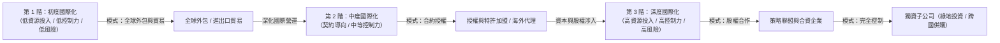

---
{"dg-publish":true,"permalink":"/01//ch12/","title":"Ch12 全球環境下的企業管理","tags":["PMBA","管理概論","全球化","跨國管理","霍夫斯泰德文化構面","全球策略","地緣政治"],"dg-note-properties":{"title":"Ch12 全球環境下的企業管理","course":"管理概論","category":"01_基礎先修","type":"lecture-note","lecture":"Ch12","tags":["PMBA","管理概論","全球化","跨國管理","霍夫斯泰德文化構面","全球策略","地緣政治"],"aliases":["全球環境下的企業管理","Ch12_全球環境下的企業管理","L12_全球環境下的企業管理","Ch12","L12"]}}
---


# Ch12 全球環境下的企業管理

## 💡 核心摘要

- **[[98_商業概念庫/globalization_全球化\|quan-qiu-hua_全球化]]不可逆與被動捲入**：「要不要[[98_商業概念庫/globalization_全球化\|quan-qiu-hua_全球化]]已經不再是個問題，因為遲早世界會找上你（Sooner or later, the world will come to you）」。當代企業無論主動出海或偏安本土，皆身處於[[98_商業概念庫/globalization_全球化\|quan-qiu-hua_全球化]]的競爭擂台，海外營收佔比與跨國競爭已成為衡量大企業體質的關鍵指標。
- **動機決定路徑，策略決定架構**：企業推動跨國擴張主要基於三大動機——「[[98_商業概念庫/core-competence_核心能力\|he-xin-neng-li_核心能力]]的跨國移轉」、「實現區位經濟優勢」與「達致規模經濟與經驗曲線」。成本領導廠商傾向追逐區位與規模經濟，差異化廠商則著重移轉核心優勢；動機本質決定了進入市場模式與組織架構。
- **[[98_商業概念庫/integration_全球整合與在地回應\|quan-qiu-zheng-he-yu-zai-di-hui-ying_全球整合與在地回應]]的永恆拉扯**：沒有一套萬用的國際經營模式。企業必須依據產業的「全球整合壓力」與「在地回應壓力」，在[[98_商業概念庫/strategy-7_全球化策略\|quan-qiu-hua-strategy_全球化策略]]、[[98_商業概念庫/strategy-6_多國化策略\|duo-guo-hua-strategy_多國化策略]]、國際化策略與[[98_商業概念庫/strategy-8_跨國化策略\|kua-guo-hua-strategy_跨國化策略]]之間權衡取捨，並檢視組織「行政傳承」是否與產業特徵高度匹配。
- **跨文化治理是跨國成敗的深層瓶頸**：國際擴張中最致命的風險並非財務或技術，而是組織內部的「文化盲區」與「自我參照準則（SRC）」。經理人唯有透過[[98_商業概念庫/culture-dimension_霍夫斯泰德文化維度\|huo-fu-si-tai-de-wen-hua-wei-du_霍夫斯泰德文化維度]]與[[98_商業概念庫/culture_高低語境文化\|gao-di-yu-jing-wen-hua_高低語境文化]]等分析工具，深化自身的[[98_商業概念庫/culture-2_文化智商\|wen-hua-zhi-shang_文化智商]]（CQ），才能在跨國併購、合資與多元團隊中落實有效治理。

---

## 📚 核心觀念與理論模型

### 1. 全球化浪潮與國際擴張三大動機

當代大型[[98_商業概念庫/kua-guo-enterprise_跨國企業\|kua-guo-enterprise_跨國企業]]（如 ExxonMobil、Colgate、Coca-Cola、IBM、Citigroup 等）的海外營收佔比普遍超過 60%。「世界是平的」象徵著產業[[98_商業概念庫/globalization_全球化\|quan-qiu-hua_全球化]]驅動企業[[98_商業概念庫/globalization_全球化\|quan-qiu-hua_全球化]]，進而迫使企業內部管理全面升級。

企業跨國擴張的核心動機可歸納為三大支柱：

```
                ┌─── 1. 核心能力的跨國移轉 (Transfer Core Competencies) ─── [差異化廠商導向]
                │
企業國際擴張動機 ├─── 2. 實現區位經濟優勢 (Location Economies) ───────────── [成本領導/逐水草而居]
                │
                └─── 3. 達致規模經濟與經驗曲線 (Scale Economies) ─────────── [高固定成本/突破母國限制]
```

1. **[[core-competence_核心能力|he-xin-neng-li_核心能力]]的跨國移轉（Transfer Core Competencies）**：
   - 企業在母國市場累積了卓越研發、精湛製程、強大品牌或獨特營運模式，將這些具備剩餘價值的核心資產移轉至海外市場，以獲取更高的邊際收益與市占率（例如西方品牌大廠的全球擴張）。
2. **實現區位經濟優勢（Location Economies）**：
   - 全球不同地理區域具備相異的要素稟賦（土地、低廉勞工、原料、能源、租稅優惠等）。追求極致成本優勢的廠商會採取「逐水草而居」策略，將價值鏈各活動配置於全球最具成本競爭力之區位（例如 1980 至 1990 年代台商大舉移往東南亞與中國大陸設立製造基地）。
3. **達致規模經濟與經驗曲線（Scale Economies & Experience Curve）**：
   - 特定資本密集或研發密集產業（如半導體晶圓製造、汽車、航太），前期固定成本極其高昂。若僅依賴規模狹小的母國市場，無法突破損益平衡點，必須藉由開拓廣袤的全球市場來攤提固定資產，並沿著經驗曲線快速降低單位產出成本。

---

### 2. 全球化態度與心態（EPRG 模型）

[[kua-guo-enterprise_跨國企業]]高層的[[globalization_全球化|quan-qiu-hua_全球化]]思維與經營哲學，深刻影響其總部與海外子公司的權力關係及資源配置：

| 管理導向 | 核心哲學 | 總部與子公司關係 | 決策風格與主管派任 | 潛在盲點與風險 |
| :--- | :--- | :--- | :--- | :--- |
| **[[orientation-5_母國中心導向|mu-guo-zhong-xin-dao-xiang_母國中心導向]]**<br>*(Ethnocentric)* | 「母國模式最優」<br>認為母國的技術、文化與管理流程放諸四海皆準。 | 高度中央集權，海外據點被視為母國業務的延伸與銷售管道。 | 海外關鍵職位皆由母國外派人員（Expatriates）擔任，決策權高度集中於總部。 | 忽視東道國在地法規與消費偏好，易陷入「文化盲區」並挫傷當地員工士氣。 |
| **[[orientation-4_多中心導向|duo-zhong-xin-dao-xiang_多中心導向]]**<br>*(Polycentric)* | 「在地經理人最懂」<br>認為各國市場環境迥異，母國模式難以直接套用。 | 地方高度分權，海外子公司享有高度自主權，視為獨立王國。 | 海外主管全數任用東道國當地人才（Host-country Nationals），總部僅施以財務控制。 | 缺乏全球整合與綜效，海外據點各自為政，重複投資且難以移轉核心知識。 |
| **[[orientation-3_全球中心導向|quan-qiu-zhong-xin-dao-xiang_全球中心導向]]**<br>*(Geocentric)* | 「超越國界尋求最佳實踐」<br>在全球範圍內尋找最優人才、技術與管理流程。 | 網絡協同與相互依存，中央與地方同等重要，形成緊密整合網絡。 | 打破國籍限制，全球遴選最適任管理者，推行全集團最佳實踐（Best Practices）。 | 跨文化協調溝通成本極高，組織架構複雜且決策流程耗時。 |

---

### 3. 進入國際市場之階梯模式

企業走向國際市場通常依循「由淺入深」的漸進式階梯軌跡，伴隨著資源承諾、控制程度與營運風險的逐步攀升：



#### 各進入模式之權衡比較表：

| 進入模式 | 資源投入與風險 | 管理控制力 | 核心優勢 | 核心風險與限制 |
| :--- | :--- | :--- | :--- | :--- |
| **[[global-outsourcing_全球外包|quan-qiu-wai-bao_全球外包]]**<br>*(Global Sourcing)* | 極低 | 低 | 快速取得低成本勞力或特定元件，保持資產彈性。 | 供應鏈斷鏈風險、品質監控困難、面臨地緣政治與物流衝擊。 |
| **進出口貿易**<br>*(Exporting/Importing)* | 低 | 低至中 | 試水溫成本低，可直接利用母國現有產能擴張銷售。 | 面臨高額關稅、匯率波動、運輸成本及貿易壁壘。 |
| **[[licensing-and-franchising_授權與特許加盟|shou-quan-yu-te-xu-jia-meng_授權與特許加盟]]**<br>*(Licensing & Franchising)* | 低至中 | 中 | 不需巨額資本投入即可透過品牌與專利迅速擴張規模（如麥當勞、迪士尼）。 | 可能培育出未來的潛在競爭對手，品牌聲譽易受加盟商脫序行為牽連。 |
| **[[strategy-alliance_策略聯盟|strategy-lian-meng_策略聯盟]]**<br>*(Strategic Alliances)* | 中等 | 中等 | 共享研發成本、分擔市場風險、優勢互補且保有組織獨立性。 | 夥伴目標可能衝突，協調成本高，存在技術與商業機密外洩風險。 |
| **[[corporate-3_合資企業|he-zi-enterprise_合資企業]]**<br>*(Joint Ventures)* | 中至高 | 共享控制權 | 借重東道國夥伴的政商人脈、通路與在地知識，降低政治與法規壁壘。 | 雙方控制權爭奪、利潤分配歧異、文化衝突導致合資破裂。 |
| **[[company-3_獨資子公司|du-zi-zi-company_獨資子公司]]**<br>*(Wholly Owned Subsidiary)* | 極高 | 完全控制 | 100% 掌控營運與技術機密，能全力推動全球一體化戰略。 | 資金負擔龐大，退出障礙極高，完全承擔[[risk-4_地緣政治風險|di-yuan-zheng-zhi-risk_地緣政治風險]]。 |
| └ **[[lv-di-investment_綠地投資]]**<br>*(Greenfield)* | 最高 | 完全自主 | 從零打造最適化產線與組織文化，無歷史包袱。 | 建廠周期漫長，前期資本沉沒成本大，市場切入速度緩慢。 |
| └ **跨國併購**<br>*(Cross-border M&A)* | 極高 | 高（但整合難） | 瞬間獲取當地既有品牌、通路、客戶群與生產設施，速度最快。 | 溢價過高（[[goodwill_商譽|shang-yu_商譽]]減損風險）、組織文化衝突激烈、整合失敗率高。 |

---

### 4. 全球策略定位架構（IR 矩陣）

國際管理大師 Prahalad & Doz 與 Bartlett & Ghoshal 提出了經典的 **IR 矩陣（Integration-Responsiveness Grid，整合—回應矩陣）**，透過「全球整合壓力（I）」與「在地回應壓力（R）」兩大維度，定義[[kua-guo-enterprise_跨國企業]]的四大策略定位：

```
全球整合壓力 (I)
   高 ▲
      │  ┌─────────────────────────┬─────────────────────────┐
      │  │      [[strategy-7_全球化策略|quan-qiu-hua-strategy_全球化策略]]       │      [[strategy-8_跨國化策略|kua-guo-hua-strategy_跨國化策略]]       │
      │  │     (Global Strategy)     │ (Transnational Strategy)│
      │  │ • 集中化生產、全球標準化  │ • 整合網絡架構          │
      │  │ • 追求極致規模經濟        │ • Think Globally,       │
      │  │ • 典型：消費性電子 (松下) │   Act Locally (P&G)     │
      │  ├─────────────────────────┼─────────────────────────┤
      │  │      國際化策略           │      [[strategy-6_多國化策略|duo-guo-hua-strategy_多國化策略]]       │
      │  │  (International Strategy) │ (Multidomestic Strategy)│
      │  │ • 母國核心能力向外移轉    │ • 高度地方分權          │
      │  │ • 總部嚴密控制核心技術    │ • 因地制宜滿足在地偏好  │
      │  │ • 典型：傳統美商 (IBM)    │ • 典型：民生快消品(聯合利華)│
      │  └─────────────────────────┴─────────────────────────┘
   低 ┼─────────────────────────────────────────────────────►
      低                                                  高
                           在地回應壓力 (R)
```

#### 四大策略定位之深層解構：

1. **[[strategy-7_全球化策略|quan-qiu-hua-strategy_全球化策略]]（Global Strategy，高 I、低 R）**：
   - 產品全球高度標準化，集中於少數最具區位優勢的基地生產，追求極致規模經濟與經驗曲線。決策權高度集中於總部（[[orientation-5_母國中心導向|mu-guo-zhong-xin-dao-xiang_母國中心導向]]）。
2. **[[strategy-6_多國化策略|duo-guo-hua-strategy_多國化策略]]（Multidomestic Strategy，低 I、高 R）**：
   - 將海外各國視為彼此割裂的獨立市場。產品配方、行銷話術、通路設計完全因地制宜，由當地國家經理人掌舵（[[orientation-4_多中心導向|duo-zhong-xin-dao-xiang_多中心導向]]）。
3. **國際化策略（International Strategy，低 I、低 R）**：
   - 仰賴母國強大的研發與創新優勢，將成功產品與模式標準化後「外溢」移轉至海外市場，總部保持對核心技術與品牌的協調控制。
4. **[[strategy-8_跨國化策略|kua-guo-hua-strategy_跨國化策略]]（Transnational Strategy，高 I、高 R）**：
   - 當代跨國管理的最高境界。同時追求全球規模效益與在地靈敏回應，並在全球範圍內促進「內部知識學習與創新移轉（Worldwide Learning）」。組織架構呈「整合網絡型（Integrated Network）」，各子公司平起平坐，資源相互依存。
   - *經典實例*：P&G 透過日本子公司研發清酒 Pitera 成分，開創頂級護膚品牌 SK-II，並成功經由全球網絡推廣為跨國旗艦品牌。

---

### 5. 企業行政傳承與三大經濟體文化模型

[[kua-guo-enterprise_跨國企業]]的現有行為與組織架構，深受其起家的歷史時空、母國文化與創辦人哲學所塑造，此即**行政傳承（Administrative Heritage）**。

| 經濟體原型 | 代表模式 | 典型組織型態 | 控制機制 | 歷史時空與代表企業 |
| :--- | :--- | :--- | :--- | :--- |
| **歐商** | **多國企業原型**<br>*(家族資本主義)* | **分散的聯邦**：中央為虛位共主，地方諸侯各據一方，享有極大實權。 | 財務控制、非正式個人人際網絡、家族親信信任。 | 19 世紀至兩戰期間崛起（如聯合利華 Unilever、雀巢 Nestlé）。 |
| **美商** | **國際企業原型**<br>*(管理的資本主義)* | **協調的聯邦**：總部掌握核心研發與品牌，指派專業經理人分駐海外推廣。 | 正式規範、層級授權、標準作業程序（SOP）與專業管理體系。 | 二戰後 1950~1960 年代崛起（如 IBM、可口可樂、通用汽車 GM）。 |
| **日商** | **全球企業原型**<br>*(集體資本主義)* | **中央集權樞紐**：中央高度集權，海外據點主要扮演母國製造基地的出海口與銷售管道。 | 緊密的作業程序控制、總部統一核准、企業文化忠誠。 | 1970~1980 年代崛起（如松下 Panasonic、豐田 Toyota、花王 Kao）。 |

#### 產業要求與行政傳承的匹配分析（Match vs. Mismatch）：
- **高度匹配（Match）**：日商松下（集權全球原型）投入消費性電子產業（高 I、低 R），組織慣性與產業成功關鍵要素（KFS）完美契合，全球擴張如魚得水；歐商聯合利華（分權多國原型）經營個人洗沐用品（低 I、高 R），在地靈敏度高，市場表現優異。
- **組織錯位（Mismatch）**：日商花王以母國集權模式經營高度需要因地制宜的化妝保養品市場，導致海外決策僵化；或歐商以鬆散分權結構跨足半導體或電子產業，面臨全球協調失靈與規模不彰的巨大挑戰。

---

### 6. 海外子公司的四大策略角色

在整合網絡型的[[strategy-8_跨國化策略|kua-guo-hua-strategy_跨國化策略]]架構下，[[kua-guo-enterprise_跨國企業]]總部應依據「當地市場策略重要性」與「當地子公司資源能力」，賦予海外據點不同的策略定位（Bartlett & Ghoshal 模型）：

```
當地市場策略重要性
   高 ▲
      │  ┌─────────────────────────┬─────────────────────────┐
      │  │          黑洞           │       策略領導者        │
      │  │       (Black Hole)      │    (Strategic Leader)   │
      │  │ • 關鍵市場，但實力孱弱   │ • 關鍵核心市場，實力頂尖 │
      │  │ • 絕不可放棄，需外部注資 │ • 擔任全球策略領頭羊     │
      │  ├─────────────────────────┼─────────────────────────┤
      │  │          執行者         │          貢獻者         │
      │  │      (Implementer)      │       (Contributor)     │
      │  │ • 市場次要，能力平平     │ • 市場次要，但能力精湛   │
      │  │ • 多數據點，貫徹執行     │ • 轉移利潤與技術支援黑洞 │
      │  └─────────────────────────┴─────────────────────────┘
   低 ┼─────────────────────────────────────────────────────►
      低                                                  高
                           當地子公司資源能力
```

1. **策略領導者（Strategic Leader）**：位於核心關鍵市場且具備頂尖能力，主導全集團某項產品或技術的全球戰略（如微軟在特定成熟市場的研發中心）。
2. **黑洞（Black Hole）**：位於戰略要地但實力嚴重不足。總部絕不能坐視不管（Too important to ignore），必須持續由集團其他據點注入資源予以補強。
3. **貢獻者（Contributor）**：位於小市場但累積了深厚技術與卓越產能，能將現金流、成熟技術或管理模式輸出支援其他區域（如台灣子公司常在跨國集團扮演高效率試點工廠與技術貢獻者）。
4. **執行者（Implementer）**：位於一般市場且資源有限，主要職責是高效落實總部與策略領導者制定的營運規範。

---

### 7. 國家文化差異分析工具

跨國經營不可依賴「刻板印象（Stereotyping）」，必須借助科學化的文化測量工具：

#### (1) 霍夫斯泰德文化維度（Hofstede Cultural Dimensions）
荷蘭學者 Geert Hofstede 透過對全球 IBM 跨國子公司 116,000 名員工的跨國實證研究，確立了國家文化的關鍵分析架構：

- **[[power-distance_權力距離|quan-li-ju-li_權力距離]]（Power Distance Index, PDI）**：弱勢成員對權力分配不平等的接受與預期程度。高[[power-distance_權力距離|quan-li-ju-li_權力距離]]文化（如馬來西亞、阿拉伯國家、部分東亞企業）講究階級尊卑、由上而下指令；低[[power-distance_權力距離|quan-li-ju-li_權力距離]]文化（如北歐、紐澳）強調平權、去階層化與參與式決策。
- **[[individualism-vs-collectivism_個人主義與集體主義|ge-ren-zhu-yi-yu-ji-ti-zhu-yi_個人主義與集體主義]]（Individualism vs. Collectivism, IDV）**：個人與群體連結的緊密程度。個人主義文化（如美國、英國）重視個人權利、個人成就與契約關係；集體主義文化（如日本、台灣、拉丁美洲）重視內部人關係（In-group）、團體和諧與組織忠誠。
- **男性化 vs. 女性化（Masculinity vs. Femininity, MAS）**：又稱「生活數量 vs. 生活品質」。男性化文化崇尚競爭、自信、賺錢、英雄主義與績效（Live in order to work）；女性化文化注重人際和諧、照顧弱者、生活品質與共融（Work in order to live）。
- **[[uncertainty-avoidance_不確定性規避|bu-que-ding-xing-gui-bi_不確定性規避]]（Uncertainty Avoidance Index, UAI）**：社會成員面對未知、模糊與風險情境時的焦慮與規避程度。高規避文化（如日本、希臘）偏好嚴格法規、標準作業程序與穩定秩序；低規避文化（如丹麥、新加坡、英國）勇於冒險、包容歧見並樂於嘗試創新。
- **長期導向 vs. 短期導向（Long-Term vs. Short-Term Orientation, LTO）**：重視未來的節儉、毅力與跨代傳承（如東亞儒家文化圈），對比於重視當下、傳統維護與短期財務季報表現。
- **放縱 vs. 克制（Indulgence vs. Restraint, IVR）**：社會對人類基本渴望與享受生活樂趣的允許程度。

#### (2) 高低語境文化（High-context vs. Low-context Cultures）
人類學家 Edward T. Hall 依據溝通訊息對情境的依賴程度劃分：
- **高語境文化（High-context）**：如日本、中國、阿拉伯文化。溝通仰賴言外之意、弦外之音、面部表情、人際信任與非語言線索。「說出來的話只是冰山一角」，合約往往是關係建立的起點。
- **低語境文化（Low-context）**：如德國、瑞士、美國。溝通直接直白（Say what you mean, mean what you say），高度依賴精確的口頭文字與嚴謹法律合約。「白紙黑字才算數」，公私分明。

---

## ⚠️ 實務應用與經理人思維

### 1. 跨國管理常見的「文化盲區」與自我參照準則（SRC）陷阱
- **自我參照準則（Self-Reference Criterion, SRC）**：經理人在面對海外決策時，習慣無意識地以「母國自身的文化價值觀、行為常態與經驗」作為評判外國行為的標準。
- **文化盲區的代價**：
  - *案例*：美國零售巨頭沃爾瑪（Walmart）進軍德國時，要求收銀員對顧客展現美式露出牙齒的微笑，並在早晨集合高喊激勵口號，被注重隱私與專業距離的德國員工和消費者視為荒謬侵犯，最終慘賠數十億美元退出德國市場。
- **經理人破解指南**：推動「跨文化同理心機制」，在重大跨國投資與行銷企劃出台前，強制納入東道國本土團隊進行「文化審計（Cultural Audit）」，剔除隱含的 SRC 偏誤。

### 2. 地緣政治、貿易壁壘與供應鏈去全球化衝擊
- **從「全球分工（Efficiency-first）」轉向「韌性安全（Resilience-first）」**：美中科技戰、俄烏戰爭、關稅壁壘促使全球供應鏈從長鏈（Global Supply Chains）迅速碎裂為短鏈化、區域化與友岸外包（Friendshoring / Nearshoring）。
- **經理人的戰略因應**：
  - 揚棄單一基地生產思維，採行「中國+1（China+1）」或「台灣+1」分散策略。
  - 將[[risk-4_地緣政治風險|di-yuan-zheng-zhi-risk_地緣政治風險]]正式納入企業全面風險管理（ERM）與資本支出評估模型，預留政策突變與供應斷鏈的避險準備金。

### 3. 經理人如何培養文化智商（CQ）帶領跨文化團隊
**[[culture-2_文化智商|wen-hua-zhi-shang_文化智商]]（Cultural Intelligence, CQ）**是指個人在跨文化環境中有效運作與適應的能力，包含四大關鍵維度：
1. **認知維度（Cognitive CQ）**：具備跨國文化的客觀知識（如宗教戒律、經濟體系、商業禮儀）。
2. **元認知維度（Metacognitive CQ）**：具備反思與覺察自身文化偏見的能力，在跨文化互動中隨時懸置既有定見，動態修正心理模型。
3. **動機維度（Motivational CQ）**：具備跨出舒適圈、主動與不同文化背景夥伴溝通協作的內在好奇心與自我效能感。
4. **行為維度（Behavioral CQ）**：能依據情境彈性調整非語言動作、語氣節奏與溝通風格（如在低語境會議中精準陳述，在高語境談判中耐心傾聽與觀察留白）。

---

## 🧠 PMBA 課堂討論與思辨題

### 個案思辨一：台灣半導體龍頭全球設廠的「跨文化碰撞」與「策略定位」
- **情境背景**：台積電（TSMC）因應地緣政治與客戶要求，近年大舉推進跨國深水區，陸續在美國亞利桑那、日本熊本及德國德勒斯登進行[[lv-di-investment_綠地投資]]設廠。然而在美國廠遭遇當地工會抵制、工時文化認知差異及建廠法規進度延宕；反觀日本熊本廠則迅速竣工量產。
- **PMBA 思辨題**：
  1. 請運用[[culture-dimension_霍夫斯泰德文化維度|huo-fu-si-tai-de-wen-hua-wei-du_霍夫斯泰德文化維度]]（[[power-distance_權力距離|quan-li-ju-li_權力距離]]、個人主義 vs. 集體主義、[[uncertainty-avoidance_不確定性規避|bu-que-ding-xing-gui-bi_不確定性規避]]）解構台積電在美國與日本管理現場所面臨的根本文化差異。
  2. 台灣晶圓代工模式傳統上依賴母國高素質工程師的超長工時與高敏捷彈性（日商集權原型風格）。當前進歐美高度個人主義與低[[power-distance_權力距離|quan-li-ju-li_權力距離]]環境時，台積電應採取[[orientation-5_母國中心導向|mu-guo-zhong-xin-dao-xiang_母國中心導向]]、[[orientation-4_多中心導向|duo-zhong-xin-dao-xiang_多中心導向]]還是[[orientation-3_全球中心導向|quan-qiu-zhong-xin-dao-xiang_全球中心導向]]？應如何調適其「行政傳承」？

### 個案思辨二：快消品 vs. 科技硬體的海外進入模式抉擇
- **情境背景**：兩家不同屬性的企業擬進軍人口迅速增長的東南亞市場：企業 A 為主打特色天然漢方保養品的民生快消品牌；企業 B 為工業自動化感測器模組製造商。
- **PMBA 思辨題**：
  1. 請利用 IR 矩陣（全球整合 vs. 在地回應）分析企業 A 與企業 B 的產業本質落點。
  2. 在進入策略的階梯模式中，企業 A 與企業 B 分別適合選擇[[licensing-and-franchising_授權與特許加盟|shou-quan-yu-te-xu-jia-meng_授權與特許加盟]]、[[corporate-3_合資企業|he-zi-enterprise_合資企業]]還是[[company-3_獨資子公司|du-zi-zi-company_獨資子公司]]？為什麼？若東道國具備高度外資持股限制與複雜政商關係，經理人該如何設計防禦條款以保護核心技術與品牌資產？
