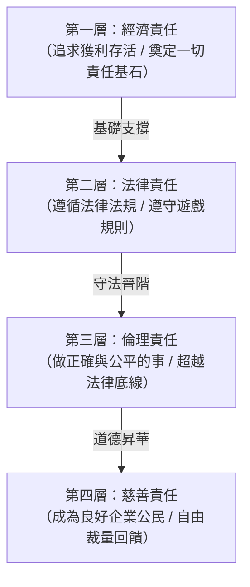

---
{"dg-publish":true,"permalink":"/01/02/ch13/","title":"Ch13 企業倫理與企業社會責任","tags":["PMBA","管理概論","企業倫理","CSR","ESG","永續發展","利害關係人理論","卡羅爾金字塔"],"dg-note-properties":{"title":"Ch13 企業倫理與企業社會責任","course":"管理概論","category":"01_基礎先修","type":"lecture-note","lecture":"02_Ch13","tags":["PMBA","管理概論","企業倫理","CSR","ESG","永續發展","利害關係人理論","卡羅爾金字塔"],"aliases":["企業倫理與企業社會責任","Ch13_企業倫理與企業社會責任","L13_企業倫理與企業社會責任","Ch13","L13"]}}
---


# Ch13 企業倫理與企業社會責任

## 💡 核心摘要

- **從股東至上邁向利害關係人共榮**：古典經濟學主張的「[[98_商業概念庫/value-4_股東價值極大化\|shareholder-value-ji-da-hua_股東價值極大化]]」在當代已不足以支撐企業長青。企業作為社會[[98_商業概念庫/system-2_開放系統\|kai-fang-xi-tong_開放系統]]的一環，必須兼顧內部與外部利害關係人的福祉，將履行[[98_商業概念庫/corporate-2_企業社會責任\|enterprise-she-hui-ze-ren_企業社會責任]]（CSR）視為獲取社會合法營運許可（Social License to Operate）的前提。
- **CSR 與 ESG 不再是公關成本，而是核心競爭力與避險護城河**：實證研究顯示，積極進行碳揭露與落實[[98_商業概念庫/ESG永續發展\|ESG永續發展]]的企業，享有顯著更高的市場估值、較低的系統性與非系統性風險，並在金融危機與重大負面事件衝擊下具備更強的抗跌與融資優勢。
- **由單向慈善捐贈演進為「[[98_商業概念庫/value-3_創造共享價值\|chuang-zao-gong-xiang-value_創造共享價值]]（CSV）」**：現代企業應擺脫「花錢買贖罪券」的外圍公關思維，邁向波特提出的[[98_商業概念庫/value-3_創造共享價值\|chuang-zao-gong-xiang-value_創造共享價值]]（CSV）。將社會與環境問題（如綠色能源、公平貿易、循環經濟）融入核心[[98_商業概念庫/business-model_商業模式\|business-model_商業模式]]與價值鏈設計中，實現「做善事」與「賺取可持續利潤」的互利共贏。
- **倫理制度化與防禦綠洗是永續治理的根本**：商業倫理若缺乏制度支撐，極易墮入自我交易、操縱資訊與「[[98_商業概念庫/anti-greenwashing_綠洗防範\|lv-xi-fang-fan_綠洗防範]]」危機。企業必須透過健全的[[98_商業概念庫/corporate-governance_公司治理\|company-zhi-li_公司治理]]、高階主管以身作則、[[98_商業概念庫/enterprise-dao-de-gui-fan_企業道德規範\|enterprise-dao-de-gui-fan_企業道德規範]]與[[98_商業概念庫/whistleblower-protection_吹哨者保護\|chui-shao-zhe-bao-hu_吹哨者保護]]機制，將誠信原則內化為組織日常營運與決策 DNA。

---

## 📚 核心觀念與理論模型

### 1. 企業社會責任兩大觀點之爭

在[[98_商業概念庫/enterprise-management_企業管理\|enterprise-management_企業管理]]學術發展史上，企業對社會應承擔何種責任存在兩大經典論陣：

```
                    ┌─── 1. 古典觀點 (Classical View) ─────────── [傅利曼 / 股東價值極大化 / 經濟效率優先]
                    │
企業社會責任兩大觀點 ┤
                    │
                    └─── 2. 社會經濟觀點 (Socioeconomic View) ─── [開放系統 / 利害關係人共榮 / 社會公民責任]
```

| 比較維度 | 古典觀點（Classical View） | 社會經濟觀點（Socioeconomic View） |
| :--- | :--- | :--- |
| **代表學者** | 密爾頓·傅利曼（Milton Friedman，諾貝爾經濟學獎得主） | 當代管理學者、[[98_商業概念庫/stakeholder-theory_利害關係人理論\|li-hai-guan-xi-ren-theory_利害關係人理論]]學者 |
| **核心論點** | 企業唯一的社會責任是在法律規範與商業規則內，努力追求「[[98_商業概念庫/value-4_股東價值極大化\|shareholder-value-ji-da-hua_股東價值極大化]]」與獲利最大化。 | 企業作為社會公民，享有社會資源與法律特權，必須兼顧保護與增進整體社會福祉。 |
| **首要對象** | 股東（Shareholders）是排名第一且唯一的利害關係人。 | 涵蓋所有內部（員工、經理人、股東）與外部（顧客、供應商、政府、社區、環境）利害關係人。 |
| **對 CSR 的看法** | 企業過度投入「社會財」會增加額外成本、降低利潤並推升產品價格，實質上侵蝕了經濟資源配置的效率。 | 「預防勝於治療」。履行社會責任有助於降低長期法律訴訟風險、提升品牌公共形象，並符合現代公民期待。 |
| **權力觀點** | 企業不應涉足政治與社會改造，否則會導致商業巨頭權力過度膨脹。 | 「責任鐵律（Iron Law of Responsibility）」：長期而言，擁有權力卻不承擔相應責任者，終將喪失該權力。 |

---

### 2. 卡羅爾企業社會責任四層金字塔

管理學者阿奇·卡羅爾（Archie Carroll）提出了著名的 **[[98_商業概念庫/csr_卡羅爾CSR金字塔\|ka-luo-ercsrjin-zi-ta_卡羅爾CSR金字塔]]**，將企業對社會的承諾與責任由基礎至頂層劃分為四個層級：



1. **[[98_商業概念庫/economic-responsibility_經濟責任\|economics-ze-ren_經濟責任]]（Economic Responsibilities，金字塔基石）**：
   - 「Be Profitable」。企業本質是經濟組織，首要責任是生產市場所需的商品與服務，創造合理利潤以維持存續、支付員工薪資並為股東創造回報。若無法獲利，其餘責任皆無從談起。
2. **[[98_商業概念庫/legal-responsibility_法律責任\|fa-lv-ze-ren_法律責任]]（Legal Responsibilities，法定底線）**：
   - 「Obey the Law」。企業必須在東道國政府所制定的法律架構下營運，嚴格遵守勞動法、消保法、稅法、環保法規與證券交易法，遵守市場遊戲規則。
3. **[[98_商業概念庫/ethical-responsibility_倫理責任\|lun-li-ze-ren_倫理責任]]（Ethical Responsibilities，社會期待）**：
   - 「Be Ethical」。超越法律的最低明文要求，做到社會大眾所預期與認同的公平、正義與道德準則。主動避免或降低對環境、員工與消費者的潛在傷害（例如不使用具爭議的動物實驗、提供高於法定基本工資的維生薪資）。
4. **[[98_商業概念庫/philanthropic-responsibility_慈善責任\|ci-shan-ze-ren_慈善責任]]（Philanthropic Responsibilities，自由裁量頂層）**：
   - 「Be a Good Corporate Citizen」。企業主動自願地回饋社會，投入教育文化贊助、扶貧濟弱、災後重建與社區營造，促進人類生活品質的提升。

---

### 3. 商業倫理的五大道德哲學思維

[[98_商業概念庫/corporate_企業倫理\|enterprise-lun-li_企業倫理]]（Business Ethics）是探討在商業情境與組織決策中，何者為對、何者為錯的價值判斷標準。當經理人面臨複雜的利益衝突與道德兩難時，西方倫理哲學提供了五大系統性的決策指引：

1. **[[98_商業概念庫/utilitarian-view_功利主義觀點\|gong-li-zhu-yi-guan-dian_功利主義觀點]]（Utilitarianism，邊沁 / 密爾）**：
   - 核心原則：「為最多數人謀求最大利益（The greatest good for the greatest number）」。
   - 決策標準：以行為的「結果」作為評判道德好壞的唯一準繩，注重手段-目標鏈的效益最大化（目的可以合理化手段）。在管理中常體現於成本效益分析（Cost-Benefit Analysis），但需防範為追求多數人利益而犧牲少數人權益的盲點。
2. **康德義務主義（Kantian Ethics / Deontology）**：
   - 核心原則：行為的對錯取決於該行為本身是否出於「道德義務」與普遍法則（絕對命令 Categorical Imperative），而非取決於結果好壞。
   - 決策標準：絕不認同「黑貓白貓抓到老鼠就是好貓」或「為了良好結果可以說謊欺瞞」。強調人是目的本身，絕不能將他人純粹當作達成目的的工具。
3. **[[98_商業概念庫/rights-view_權利觀點\|quan-li-guan-dian_權利觀點]]（Rights View）**：
   - 核心原則：人類生而享有不可剝奪的基本權利與自由（如隱私權、言論自由、工作安全權、知情同意權）。
   - 決策標準：商業決策絕不能侵犯或剝奪個人的基本人權。例如企業不得為了降低營運成本而強制勞工在缺乏防護裝備的有毒環境中作業。
4. **[[98_商業概念庫/justice-view_正義觀點\|zheng-yi-guan-dian_正義觀點]]（Justice View，羅爾斯 John Rawls）**：
   - 核心原則：依據公平、平等與正義的原則制定制度與分配資源。
   - 思想實驗：**「無知之幕（Veil of Ignorance）」**——假設決策者在制定規則時，完全不知道自己未來的出身、天賦、性別、財富或社會階級。只有在無知之幕背後，人們才會傾向設計出保護社會最弱勢群體、落實程序公平（Procedural Justice）與分配公平（Distributive Justice）的健全制度。
5. **整合社會契約觀（Integrative Social Contracts Theory）**：
   - 結合宏觀的普遍道德「超規範（Hypernorms）」（如禁止賄賂、尊重基本人權）與微觀社群內部的特定文化慣例，要求企業在融入在地習俗時，絕不得牴觸普遍人權超規範。

---

### 4. 柯爾伯格道德發展階段理論

心理學家勞倫斯·柯爾伯格（Lawrence Kohlberg）指出，個體的倫理道德判斷隨年齡與心智成熟經歷不同的 **[[98_商業概念庫/development-stage_道德發展階段\|dao-de-fa-zhan-jie-duan_道德發展階段]]（三層六階段）**，這深刻影響了組織中不同層級員工與經理人的道德決策：

```
   ┌── 階段六：普遍倫理原則導向（依循良心與普世人權價值）
┌──┴── 階段五：社會契約與個人權利導向（維護民主法治與多元權益） ── 【第三層：後常規期 (Postconventional)】
│
│  ┌── 階段四：維護社會秩序導向（恪遵法律、制度與社會規範）
├──┴── 階段三：尋求認同與人際和諧導向（做個好員工、迎合重要他人期待） ── 【第二層：常規期 (Conventional)】
│
│  ┌── 階段二：工具性格與相對主義導向（利己交換、追求個人利益）
└──┴── 階段一：避罰服從導向（懼怕處罰、服從絕對權威） ──────────── 【第一層：前常規期 (Preconventional)】
```

- **第一層：前常規期（Preconventional Level）**：道德判斷取決於個人外部後果。
  - *階段 1*：單純為了避免受罰而服從規則（如員工因害怕被開除而不違規）。
  - *階段 2*：為了獲得直接獎酬或進行利益交換（如「只要對我有好處我就做」）。
- **第二層：常規期（Conventional Level，多數成人所在階段）**：道德判斷取決於符合社會期待與維持秩序。
  - *階段 3*：尋求團隊同儕與主管的認同，維持良好人際關係。
  - *階段 4*：恪守組織規章與國家法律，重視社會秩序與職責履行。
- **第三層：後常規期（Postconventional Level，高階道德領導者）**：道德判斷超越既有法律，依據崇高的普遍道德價值。
  - *階段 5*：質疑不合理的現行法律，依據社會契約與基本人權追求制度改革。
  - *階段 6*：堅守普世正義、尊嚴與平等原則，即使面對法律制裁或組織高壓，亦絕不違背良心（勇於成為吹哨者）。

---

### 5. 當代永續前沿工具與概念

#### (1) 利害關係人理論（Stakeholder Theory）
- 企業是由「多元利益關係人」組成的開放網絡。經理人不能僅將目光鎖定於財務資本提供者（股東），必須將人力資本（員工）、市場夥伴（客戶、供應商）、社會資本（在地社群、政府）與自然資本（地球環境）同等納入決策矩陣。

#### (2) ESG永續發展 與社會責任投資（SRI）
- **E（Environment，環境）**：溫室氣體排放（範疇一/二/三）、能源轉型、水資源循環、生物多樣性。
- **S（Social，社會）**：員工勞動人權、職業健康安全、多元平等共融（DEI）、供應鏈人權監督。
- **G（[[98_商業概念庫/corporate-governance_公司治理\|company-zhi-li_公司治理]]）**：董事會多元化與獨立性、高階主管薪酬合理性、反貪腐、吹哨人保護機制。
- **實證研究支撐**：
  - *市值溢價*：實證數據顯示，主動揭露碳排放量的企業，平均市場價值顯著高於未揭露者達 **23 億美元**；每揭露 1,000 噸碳排，公司市值平均增加 **21.2 萬美元**。
  - *低風險與韌性*：ESG 機優股具備更低的系統性與非系統性風險，在金融海嘯等極端市場事件中具有顯著的抗跌特性與融資優勢。
  - *責任投資規模*：全球社會責任投資（SRI）總規模已突破 30 兆美元，歐美機構法人的 ESG 投資佔比普遍超越 50%。

#### (3) 綠色管理四階段光譜（Green Management）
企業在環境保護的承諾程度，呈現由淺入深的動態演進：
1. **守法取向（Legal Approach / 淺綠）**：完全出於被動守法，不挑戰法律紅線，純屬「避凶」。
2. **市場取向（Market Approach）**：因應環保意識抬頭的消費者偏好，推出綠色商品以爭取市場商機，屬於「趨吉」。
3. **利害關係人取向（Stakeholder Approach）**：全面回應員工、社區、供應鏈夥伴與環保團體的訴求，推動系統性環保。
4. **積極取向（Activist Approach / 深綠）**：將環境保護與地球永續視為組織的崇高使命，主動引領產業標準變革。

#### (4) 創造共享價值（Creating Shared Value, CSV）
哈佛學者邁克爾·波特（Michael Porter）與馬克·克萊默（Mark Kramer）提出，企業應將思維由 CSR 昇華至 CSV：

| 比較維度 | [[98_商業概念庫/corporate-2_企業社會責任\|enterprise-she-hui-ze-ren_企業社會責任]]（CSR） | [[98_商業概念庫/value-3_創造共享價值\|chuang-zao-gong-xiang-value_創造共享價值]]（CSV） |
| :--- | :--- | :--- |
| **核心思維** | 善行、慈善捐贈、道德責任、做個好公民。 | 經濟效益與社會效益的同步創造，開拓新商業機會。 |
| **驅動力** | 外部公關形象、公民壓力、企業社會回饋。 | 企業競爭力提升、價值鏈生產力革新。 |
| **與獲利關係** | 視為成本中心，屬於獲利之後的「利潤再分配」。 | 視為利潤中心，直接「創造全新總體價值」。 |
| **價值鏈整合** | 往往獨立於核心業務之外（如淨灘、文教基金會）。 | 深度內化於核心研發、採購與生產流程中。 |
| **三大實現路徑** | 贊助公益專案、捐贈設備。 | 1. 重新構思產品與市場（如針對底層金字塔設計平價醫療）。<br>2. 重新定義價值鏈生產力（如節能減碳降低物流成本）。<br>3. 促進在地產業聚落發展（如星巴克輔導咖啡農提升種植技術）。 |

#### (5) 永續供應鏈
[[98_商業概念庫/kua-guo-enterprise_跨國企業\|kua-guo-enterprise_跨國企業]]必須將倫理與永續標準延伸至全體供應鏈夥伴。包括推行「供應商行為準則（Supplier Code of Conduct）」、定期進行現場勞動人權審計，杜絕童工、強迫勞動與有毒製程，並採購「公平貿易認證（Fair Trade）」原物料，避免對第三世界弱勢生產者造成系統性剝削。

---

## ⚠️ 實務應用與經理人思維

### 1. 漂綠風潮與合規揭露不實之毀滅性危機（綠洗防範）
- **綠洗（Greenwashing）的致命陷阱**：企業為了迎合 ESG 潮流或資本市場青睞，在缺乏實質減碳作為的前提下，透過誇大、虛假或選擇性揭露綠色作為進行公關宣傳。
- **商業後果**：近年全球監管機構（如歐盟 SFDR、美國 SEC）對反漂綠大幅收緊執法尺度。一旦綠洗罪名成立，企業將面臨天文數字的監管罰鍰、遭 ESG 基金剔除拋售導致股價腰斬，以及長年累積的品牌信譽毀於一旦（如德國資產管理巨頭 DWS 漂綠調查風暴）。
- **經理人防範準則**：
  - 堅持「作為先於宣傳」，實質減碳數據未落實前絕不進行過度行銷。
  - 引進第三方權威機構獨立驗證（如 SBTi 科學基礎減量目標倡議）。

### 2. 短期財報利潤與長期倫理投資衝突時的價值取捨
- **代理問題的倫理誘惑**：
  - *自我交易（Self-Dealing）*：經理人透過紙上公司進行利益輸送（如安隆案 Enron）。
  - *資訊操縱（Information Manipulation）*：為達成每季 EPS 目標而隱瞞產品瑕疵或危害（如早期菸草巨頭隱瞞吸菸致癌風險、福斯汽車柴油門排放造假）。
  - *手段-目標鏈脫節*：高層施加不切實際的短期獲利壓力，導致基層鋌而走險跨越道德紅線。
- **經理人自我檢視之「12 大道德決策清單」核心守則**：
  1. *事無不可對人言原則*：如果這項決策明天被刊登在各大報紙頭條或被家人知曉，我是否能坦然面對？
  2. *受害者評估*：這項決策究竟會傷害到誰的利益？在拍板前是否曾與利害關係人充分溝通？
  3. *吉諾特集中營倖存者之信的警示*：教育與專業能力若脫離了人性與道德良知，只會培養出「學識淵博的怪物」與「身懷絕技的破壞者」。經理人應時刻守護人性與道德底線。

### 3. 組織 吹哨者保護 機制與 企業道德規範 制度化
改善組織內部道德行為，不能僅仰賴個人的良心發現，必須建立系統性的制度化六大機制：
1. **面試甄選高道德員工**：在招募階段導入誠信測驗與情境面試，篩選具備後常規期道德傾向的人才。
2. **制定明文之[[98_商業概念庫/enterprise-dao-de-gui-fan_企業道德規範\|enterprise-dao-de-gui-fan_企業道德規範]]（Code of Ethics）**：提供清晰具體的決策指引與紅線清單，打破灰色模糊地帶。
3. **高階主管以身作則（Tone at the Top）**：領導者親自實踐最高標準倫理，言行一致。
4. **設定務實可行的績效目標**：避免過度嚴苛、唯利潤導向的 KPI 誘發員工造假作弊。
5. **培訓與考評全面納入道德指標**：將商業倫理融入年度教育訓練，在升遷考核中設置「道德一票否決權」。
6. **建立獨立安全的[[98_商業概念庫/whistleblower-protection_吹哨者保護\|chui-shao-zhe-bao-hu_吹哨者保護]]與內部稽核機制**：提供具備絕對匿名性、直通獨立董事的檢舉專線，並以嚴厲制度防範任何形式的職場報復。

---

## 🧠 PMBA 課堂討論與思辨題

### 個案思辨一：跨國品牌委外代工廠之勞動人權與供應鏈治理
- **情境背景**：知名跨國運動用品龍頭為追求成本領先，將 90% 的鞋服製造外包至東南亞代工廠。某國際人權組織調查揭露，該品牌在某國的第二層（Tier 2）布料供應商存在大量聘用童工、每日工時超過 14 小時且缺乏基本化學防護裝備的惡劣工況。品牌總部公關第一時間回應：「該工廠非本公司直屬資產，本公司對供應商的獨立經營無實質控制權。」
- **PMBA 思辨題**：
  1. 請從「古典觀點」與「社會經濟學觀點」，評析該跨國品牌公關回應的商業邏輯與潛在風險。
  2. 依據[[98_商業概念庫/csr_卡羅爾CSR金字塔\|ka-luo-ercsrjin-zi-ta_卡羅爾CSR金字塔]]與[[98_商業概念庫/sustainable-supply-chain_永續供應鏈\|yong-xu-gong-ying-lian_永續供應鏈]]理論，[[98_商業概念庫/kua-guo-enterprise_跨國企業\|kua-guo-enterprise_跨國企業]]對海外委外供應商的[[98_商業概念庫/ethical-responsibility_倫理責任\|lun-li-ze-ren_倫理責任]]邊界應延伸至何處？經理人應如何設計供應商管理機制以防範人權地雷？

### 個案思辨二：短期 EPS 壓力 vs. 長期 ESG 綠色資本支出
- **情境背景**：一家上市科技製造企業面臨歐盟碳關稅（CBAM）與主要國際客戶的「淨零碳排」要求，技術長提出一項為期三年、總金額高達 20 億新台幣的綠電採購與產線節能改裝計畫。然而，財務模型顯示該投資將使未來兩年的[[98_商業概念庫/earnings-per-share_每股盈餘\|mei-gu-ying-yu_每股盈餘]]（EPS）下滑 15%，數家以短期收益為導向的機構投資法人已公開表態反對，並威脅將拋售持股或在股東會發動撤換經營層。
- **PMBA 思辨題**：
  1. 請運用邁克爾·波特的「[[98_商業概念庫/value-3_創造共享價值\|chuang-zao-gong-xiang-value_創造共享價值]]（CSV）」架構，分析經理人應如何重新包裝並調整此項節能計畫，將單純的「合規成本」轉化為「商業競爭力」？
  2. 在面對追求短期財務回報的股東與要求長期永續的國際客戶之間，執行長應如何運用[[98_商業概念庫/corporate-governance_公司治理\|company-zhi-li_公司治理]]機制（如董事會獨立董事溝通、引進長線 ESG 責任投資機構），化解這場資本市場的衝突？
