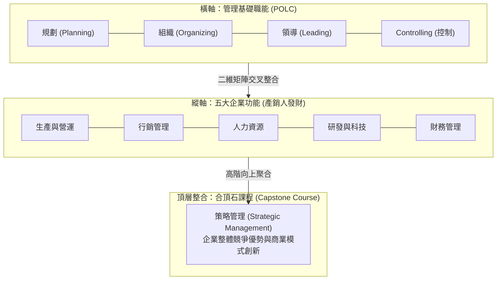

---
{"dg-publish":true,"permalink":"/01//ch14-emba/","title":"Ch14 管理概論在EMBA學習的定位","tags":["PMBA","管理概論","EMBA學習","管理思維","個案研究","跨領域整合","心智模式"],"dg-note-properties":{"title":"Ch14 管理概論在EMBA學習的定位","course":"管理概論","category":"01_基礎先修","type":"lecture-note","lecture":"02_Ch14","tags":["PMBA","管理概論","EMBA學習","管理思維","個案研究","跨領域整合","心智模式"],"aliases":["管理概論在EMBA學習的定位","Ch14_管理概論在EMBA學習的定位","L14_管理概論在EMBA學習的定位","Ch14","L14"]}}
---


# Ch14 管理概論在EMBA學習的定位

## 💡 核心摘要

- **從戰術執行者向戰略全局觀躍遷**：高階管理教育的本質不是傳授單一功能的操作技巧，而是推動[[98_商業概念庫/managerial-mindset-shift_經理人思維轉型\|jing-li-ren-si-wei-zhuan-xing_經理人思維轉型]]。經理人必須擺脫「只盯著自己部門一畝三分地」的局限視角，培養點線面體的[[98_商業概念庫/system_系統思考\|xi-tong-si-kao_系統思考]]與全局[[98_商業概念庫/strategy-5_戰略思維\|zhan-lve-si-wei_戰略思維]]。
- **管理概論是後續五管與高階策略的整合基座**：本課程所建立的 POLC（規劃、組織、領導、控制）橫向管理程序，與縱向的五大企業功能（產銷人發財）構成嚴密的二維管理矩陣，並最終向上匯聚至「合頂石課程（Capstone Course）」——[[98_商業概念庫/strategic-management_策略管理\|strategic-management_策略管理]]，奠定全方位[[98_商業概念庫/knowledge-integration_知識整合\|zhi-shi-zheng-he_知識整合]]的基石。
- **[[98_商業概念庫/case-method-teaching_個案教學法\|ge-an-jiao-xue-fa_個案教學法]]不是背誦標準答案，而是鍛鍊決策肌肉**：透過哈佛[[98_商業概念庫/case-method-teaching_個案教學法\|ge-an-jiao-xue-fa_個案教學法]]的情境代入與動態辯證，高階經理人學習在資訊不完備與高度不確定的情境下拍板抉擇，並透過[[98_商業概念庫/learning-learning_單環學習與雙環學習\|dan-huan-xue-xi-yu-shuang-huan-xue-xi_單環學習與雙環學習]]檢視底層假設，深化[[98_商業概念庫/decision-competence_模糊決策能力\|mo-hu-jue-ce-neng-li_模糊決策能力]]。
- **紅皇后賽跑與終身學習心態**：「你必須拼命奔跑才能維持在原地；若想去別的地方，至少得跑得比現在快兩倍（Red Queen's Race）。」在變幻莫測的商業世界中，過往經驗可能成為阻礙變革的包袱，經理人唯有建立[[98_商業概念庫/reflective-practice_反思實踐\|fan-si-shi-jian_反思實踐]]與[[98_商業概念庫/learning-organization_學習型組織\|xue-xi-xing-organization_學習型組織]]機制，方能持續引領企業穿越週期。

---

## 📚 核心觀念與架構模型

### 1. 管理概論在管理學程中的樞紐定位

在 EMBA / PMBA 的完整知識地圖中，《管理概論》作為先修預備課程，扮演著貫穿全局的「知識樞紐」與「認知鷹架」角色：



#### 二維管理矩陣（POLC × 產銷人發財）：
管理知識的架構可視為一個立體矩陣：
1. **橫軸（管理職能 POLC）**：本課程所講授的規劃（Ch03-05）、組織（Ch06-07）、領導（Ch08-10）與控制（Ch11-13），提供了一套放諸四海皆準的通用管理程序。
2. **縱軸（企業功能 產銷人發財）**：後續專業必修與選修課程所深化的五大領域：
   - **產（[[98_商業概念庫/operating-management_生產與營運管理\|sheng-chan-yu-operations-management_生產與營運管理]]）**：物流、供應鏈、排程、中位體系與品質管制。
   - **銷（[[98_商業概念庫/management-5_行銷管理\|xing-xiao-management_行銷管理]]）**：市場區隔（STP）、消費者行為、[[98_商業概念庫/marketing-4p-mix_行銷4P\|xing-xiao4p_行銷4P]] 與數位社群行銷。
   - **人（[[98_商業概念庫/human-resources-management_人力資源管理\|ren-li-zi-yuan-management_人力資源管理]]與[[98_商業概念庫/organizational-behavior_組織行為\|organization-xing-wei-xue_組織行為學]]）**：選育用留、激勵體系、團隊動力與人才治理。
   - **發（研發與科技管理）**：技術創新、專案管理、平台生態圈與數位轉型。
   - **財（[[98_商業概念庫/finance-management_財務管理\|finance-management_財務管理]]）**：籌資決策、[[98_商業概念庫/capital-structure_資本結構\|capital-structure_資本結構]]、股利政策、財務報表分析與現金流評價。
3. **合頂石課程（Capstone Course：[[98_商業概念庫/strategic-management_策略管理\|strategic-management_策略管理]]）**：
   - 猶如中世紀歐洲石造建築頂端的合頂石（Keystone），[[98_商業概念庫/strategic-management_策略管理\|strategic-management_策略管理]]將產銷人發財五大功能緊密扣合，聚焦於企業長期的[[98_商業概念庫/competitive-advantage_競爭優勢\|competition-you-shi_競爭優勢]]、[[98_商業概念庫/core-competence_核心能力\|he-xin-neng-li_核心能力]]構築、垂直整合與國際化戰略。

---

### 2. 高階管理學習的核心方法論

高階管理教育並非單純的單向知識灌輸，而是著重於認知結構的重塑與決策能力的淬鍊：

```
                    ┌─── 1. 哈佛個案教學法 (Case Method) ───── [情境代入 / 衝突辨識 / 鍛鍊決策肌肉]
                    │
高階管理三大核心方法 ├─── 2. 雙環學習 (Double-Loop Learning) ─── [挑戰底層心智模式 / 根本性價值反思]
                    │
                    └─── 3. 行動學習與反思實踐 (Reflection) ─── [做中學 / 實踐中反思 / 組織知識內化]
```

1. **哈佛[[98_商業概念庫/case-method-teaching_個案教學法\|ge-an-jiao-xue-fa_個案教學法]]（Case Method）**：
   - **拒絕標準答案**：真實商業世界從無標準解答。個案教學要求經理人代入決策者角色（CEO/GM），在時間緊迫、資訊模糊的情境下進行衝突辨識、利害權衡與拍板決策。
   - **課堂動態激盪**：透過跨產業同儕的觀點碰撞，理解不同背景經理人的思考盲區，學習兼顧多元利害關係人的視角。
2. **[[98_商業概念庫/learning-learning_單環學習與雙環學習\|dan-huan-xue-xi-yu-shuang-huan-xue-xi_單環學習與雙環學習]]（Single-Loop vs. Double-Loop Learning，阿吉里斯 Argyris 理論）**：
   - **單環學習**：發現錯誤後，僅修正行動手段（How），但維持既有的目標、常規與價值觀不變（如業績未達標便要求員工加班電銷）。
   - **雙環學習**：深入質疑並重構背後的底層假設、規範與[[98_商業概念庫/mode_心智模式\|xin-zhi-mo-shi_心智模式]]（Why）（如質疑現有產品是否已遭市場淘汰，進而顛覆既有[[98_商業概念庫/business-model_商業模式\|business-model_商業模式]]）。
3. **[[98_商業概念庫/reflective-practice_反思實踐\|fan-si-shi-jian_反思實踐]]（Reflection-in-Action，荀恩 Schön 理論）與[[98_商業概念庫/learning_行動學習\|xing-dong-xue-xi_行動學習]]（Action Learning）**：
   - 經理人在行動進行的當下保持敏銳覺察，隨機應變修正決策；並在行動完成後推動系統化的[[98_商業概念庫/organization-review-mechanism_組織覆盤機制\|organization-fu-pan-mechanism_組織覆盤機制]]，將隱性實戰經驗轉化為組織顯性智慧。

---

### 3. 經理人思維模型升級維度

高階領導者的卓越與否，取決於其大腦中思維模型的深度與廣度：

1. **點線面體的[[98_商業概念庫/system_系統思考\|xi-tong-si-kao_系統思考]]（Systems Thinking）**：
   - 超越單一事件（點）與線性因果關係（線），看見整體架構（面）與動態演化（體）。理解管理行動中的時間滯後（Time Delay）、反饋迴路（Feedback Loops）與非意圖後果。
2. **跨界[[98_商業概念庫/knowledge-integration_知識整合\|zhi-shi-zheng-he_知識整合]]與[[98_商業概念庫/leadership_跨界領導力\|kua-jie-leadership-li_跨界領導力]]**：
   - 培養「T 型」甚至「$\pi$ 型」人才架構：既具備某一專業領域的深厚根基，又具備橫跨科技、行銷、財會與人資的廣博理解力，能流暢進行跨部門溝通與資源調度。
3. **[[98_商業概念庫/decision-competence_模糊決策能力\|mo-hu-jue-ce-neng-li_模糊決策能力]]與心智韌性**：
   - 面臨 VUCA（易變、不確定、複雜、模糊）環境時，能妥善平衡[[98_商業概念庫/decision-analysis_決策直覺與分析\|jue-ce-zhi-jue-yu-analysis_決策直覺與分析]]，在數據不全時敢於拍板承擔，在情勢逆轉時具備敏捷調幼的心理韌性。

---

### 4. 課堂核心案例之跨領域貫穿解構

逐字稿中透過四大經典實務案例，具體示範了管理概論如何貫穿未來的必修課程：

#### (1) 行銷管理案例：紅牛（Red Bull）的逆向行銷
- **產品與客群**：單一口味配方，跳脫大眾市場，鎖定滑雪、風浪板等極限運動玩家與地下文化。
- **通路創新**：遭主流酒吧拒絕後，自建「專屬配銷網絡（專屬倉儲、貨車與專責員工）」，維持品牌神秘色彩。
- **行銷溝通**：巧妙利用「飲用混酒會致幻」的都市傳奇反向操作，並透過贊助極限跳水與「飢餓行銷」進軍美國，迫使飲料巨頭可口可樂推出 KMX 能量飲料防禦迎戰。
- **管理意涵**：精準的市場定位必須與專屬的[[98_商業概念庫/organizational-structure_組織結構\|organizational-structure_組織結構]]與[[98_商業概念庫/control-process_控制流程\|kong-zhi-liu-cheng_控制流程]]高度吻合。

#### (2) 研發與科技管理案例：Amazon 與 Google 的平台策略
- **經銷模式轉向平台模式**：Amazon 從自營零售轉向多邊平台，利用「刮鬍刀與刀片（交叉補貼）」策略獲取超額利潤；Google 則透過搜尋免費、向廣告主收費的雙邊市場奠定獲利典範。
- **組織架構與領導風格**：Google 的扁平敏捷研發文化與早期雅虎（Yahoo）的科層官僚形成強烈對比，決定了兩大巨頭的盛衰消長。

#### (3) 策略管理案例：可口可樂 vs. 百事可樂的垂直不整合
- **特許裝瓶模式**：雙雄總部僅專注生產高毛利的「可樂濃縮液」、研發與品牌行銷，將資本密集、物流繁瑣的後段裝瓶與配送交由獨立特許裝瓶廠。
- **策略兩難**：當企業欲跨足非碳酸飲料（茶飲、果汁、瓶裝水）時，原有的分散式裝瓶供應鏈即面臨整合與調整的巨大挑戰。

#### (4) 供應鏈與流通管理案例：庫存成本 vs. 缺貨風險
- **供應鏈核心兩難**：追求快速不缺貨需要高庫存，但會大幅墊高持有成本；降低庫存能節省資金，卻面臨缺貨與客戶流失風險。透過資訊整合（如 Amazon、Walmart）能有效減緩「長鞭效應（Bullwhip Effect）」。
- **成衣業供應鏈四大策略光譜**：
  1. *高度外包策略（H&M）*：逐水草而居，追逐低廉勞動力。
  2. *中間人代理模式（利豐集團 Li & Fung）*：協調全球數萬張外包契約，降低品牌廠交易成本。
  3. *準垂直整合 / 中位體系（班尼頓 Benetton）*：類似日本豐田汽車的中位體系，建立在地綿密的長期合作供應網。
  4. *完全垂直整合（Zara）*：100% 自營西班牙工廠，犧牲部分生產成本，換取兩週內將新設計鋪滿全球的極致快時尚彈性（對比智慧型手機業：三星自製 vs. 蘋果高度外包）。
  - *VF Corporation 總裁名言*：「直到南極洲的企鵝學會縫紉之前，我們再也找不到更廉價的勞動力，唯有靠供應鏈管理創造競爭力。」

---

### 5. 管理教育的三大終極啟示

回顧百年管理思想史，高階經理人應銘記三大根本原則：
1. **管理本質充滿兩難與取捨（Trade-offs & Dilemmas）**：效率與彈性、[[98_商業概念庫/centralization-decentralization_集權與分權\|ji-quan-yu-fen-quan_集權與分權]]、短期獲利與長期永續，沒有兩全其美的簡單答案，端視高階主管的權衡智慧。
2. **沒有唯一的最佳管理方式（No One Best Way）**：管理乃權變之學（Contingency Theory），適應企業內外部環境的情境解方，才是真正的好解方。
3. **管理是「環境、組織、人」的動態交互作用**：其中「人」的變數最為複雜。卓越的領導者不僅具備專業與戰略，更懂得洞察人性與激發團隊潛能。

---

## ⚠️ 實務應用與經理人思維

### 1. 「實務經驗包袱」與認知偏誤陷阱
- **成功是失敗之母**：經理人常將過往在特定產業、特定規模下獲致成功的經驗，視為放諸四海皆準的真理。當外在環境驟變時，既有的成功經驗往往轉化為嚴重的[[98_商業概念庫/experience_經驗偏誤\|jing-yan-pian-wu_經驗偏誤]]，成為抗拒[[98_商業概念庫/organizational-change_組織變革\|organizational-change_組織變革]]的最大阻力。
- **打破經驗牢籠**：在課堂與實務中，經理人應主動「卸下肩章（Unlearn）」，以空杯心態檢驗過去的直覺判斷，勇於承認「過去讓你成功的，可能正是未來讓你失敗的」。

### 2. 避免「理論派」與「實戰派」的二元對立
- **理論是高階決策的認知鷹架**：許多實戰派經理人常輕忽學術理論，認為「實務經驗比教科書管用」。然而，缺乏理論架構的經驗往往只是零碎的個人偏好；理論的真正價值在於提供一個經過科學驗證的「認知鷹架（Cognitive Scaffolding）」，幫助經理人在面對前所未見的危機時，能迅速建立分析框架、辨識關鍵變數。
- **理實交融**：將理論作為思考工具，結合自身實戰經驗進行批判性檢驗，方能昇華為個人專屬的高階商業洞察。

### 3. 從個人修課到企業現場的「行動轉化」
- **打破個人學習孤島**：經理人到商學院進修，最忌諱「自己學得熱血沸騰，回到公司卻與團隊脫節」。
- **輻射至團隊進化**：
  1. *引入共同語言*：將課堂所學的分析工具（如 IR 矩陣、BSC、CSV、五力分析）引入跨部門會議，建立管理層統一的戰略對話語言。
  2. *打造[[98_商業概念庫/learning-organization_學習型組織\|xue-xi-xing-organization_學習型組織]]*：定期舉辦內部專案覆盤會，將哈佛個案討論模式複製到企業內部的真實商業決策中，推動全員學習與集體智慧演化。

---

## 🧠 PMBA 課堂討論與思辨題

### 個案思辨一：從功能主管到事業部總經理（GM）的思維躍遷
- **情境背景**：某跨國科技製造公司的資深研發處長張博士，因技術研發戰功卓著，被拔擢為新成立的物聯網事業部總經理（GM）。上任後，張總經理依然將 80% 的時間投入於產品規格與技術細節的審查，要求研發團隊追求極致性能，卻忽略了該產品線因定價過高導致市場推廣受阻、現金流週轉天數拉長至 120 天，以及行銷與業務部門因缺乏授權而士氣低落的危機。
- **PMBA 思辨題**：
  1. 請運用本章之「二維管理矩陣（POLC $\times$ 產銷人發財）」與[[98_商業概念庫/managerial-mindset-shift_經理人思維轉型\|jing-li-ren-si-wei-zhuan-xing_經理人思維轉型]]理論，診斷張總經理在角色轉換中面臨的根本思維瓶頸。
  2. 若您是張總經理的學程導師或高階教練，您會建議他如何建立[[98_商業概念庫/system_系統思考\|xi-tong-si-kao_系統思考]]與[[98_商業概念庫/leadership_跨界領導力\|kua-jie-leadership-li_跨界領導力]]？他應如何重新分配時間與授權，以平衡研發、行銷與財務指標？

### 個案思辨二：供應鏈策略光譜的兩難抉擇
- **情境背景**：面對[[98_商業概念庫/risk-4_地緣政治風險\|di-yuan-zheng-zhi-risk_地緣政治風險]]加劇、關稅壁壘提高與全球供應鏈短鏈化趨勢，一家年營收 150 億元的台灣消費電子品牌正面臨供應鏈戰略重組：營運長主張仿效 Zara 模式，在東南亞自建垂直整合組裝廠以掌握極致生產彈性與防範斷鏈；財務長則堅持採取 Apple 模式，維持全面外包給專業代工廠（EMS）以保持資產輕量化並避免高額資本支出。
- **PMBA 思辨題**：
  1. 請從「庫存成本 vs. 缺貨風險」與「長鞭效應」的維度，分析兩位主管主張背後的權衡取捨（Trade-offs）。
  2. 依據本章介紹的供應鏈策略光譜與[[98_商業概念庫/strategic-management_策略管理\|strategic-management_策略管理]]核心思維，這家企業在拍板決策前，應優先評估哪些關鍵環境變數與內部[[98_商業概念庫/core-competence_核心能力\|he-xin-neng-li_核心能力]]？
