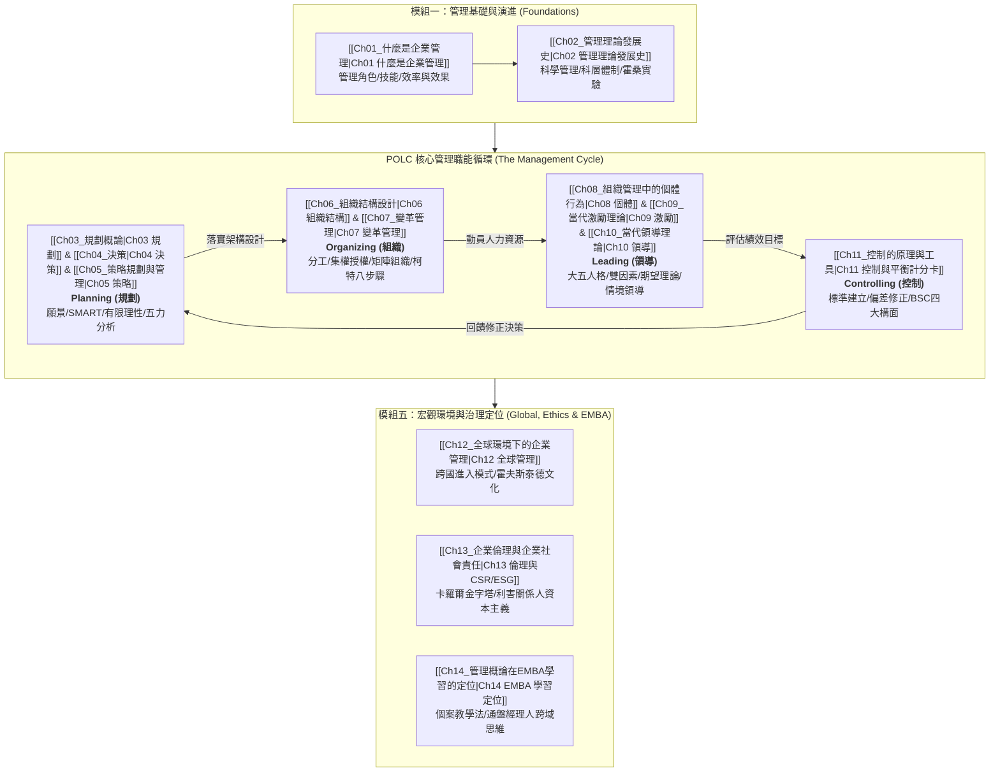

---
{"dg-publish":true,"permalink":"/01//moc/","title":"管理概論 MOC (課程總覽地圖)","tags":["PMBA","管理概論","MOC","知識地圖","POLC"],"dg-note-properties":{"title":"管理概論 MOC (課程總覽地圖)","course":"管理概論","category":"01_基礎先修","type":"moc","tags":["PMBA","管理概論","MOC","知識地圖","POLC"],"aliases":["管理概論","管理概論 MOC","管理學 MOC"],"permalink":"/01/02/sum/"}}
---

# 🏛️ 管理概論 MOC (Principles of Management)

> **課程定位**：國立臺灣大學 PMBA 基礎先修核心基石課程  
> **核心骨幹**：現代管理功能 **POLC 架構**（Planning 規劃 ➔ Organizing 組織 ➔ Leading 領導 ➔ Controlling 控制）  
> **銜接進階**：[[02_核心必修/03_組織行為/_組織行為 MOC\|組織行為 (Organizational Behavior)]] · [[02_核心必修/02_行銷管理/_行銷管理 MOC\|行銷管理 (Marketing Management)]] · [[04_主題選修/12_產業分析與投資策略/00_課程導航與進度/mindmap_產業分析與投資策略_心智圖導航\|產業分析與投資策略]]  
> **知識導航**：[[00_學程修課地圖 & 進度追蹤\|返回 PMBA 學程修課地圖與進度追蹤]]

---

## 🧭 POLC 管理職能生命週期與知識脈絡圖

管理概論旨在培養經理人具備系統性思考框架。從**管理思維本質與古典學派演進**出發，落實於**規劃、組織、領導、控制**四大核心機能，並貫通至**全球化、倫理治理與高階 EMBA 學習決策**：

---

## 📚 課程模組與筆記進度

### 模組一：管理基礎與演進 (Foundations & Evolution)
- [x] **[[01_基礎先修/管理概論/Ch01_什麼是企業管理\|Ch01 什麼是企業管理]]**  
  *管理本質、效率（Efficiency）與效果（Effectiveness）、明茲伯格三大類十種角色、卡茲三大技能。*
- [x] **[[01_基礎先修/管理概論/Ch02_管理理論發展史\|Ch02 管理理論發展史]]**  
  *泰勒科學管理、費堯十四管理原則、韋伯科層體制、霍桑實驗人際關係學派、權變理論。*

### 模組二：規劃與決策體系 (Planning & Decision Making)
- [x] **[[01_基礎先修/管理概論/Ch03_規劃概論\|Ch03 規劃概論]]**  
  *規劃價值、願景與使命、彼得杜拉克目標管理（MBO）、SMART 原則、情境規劃（Scenario Planning）。*
- [x] **[[01_基礎先修/管理概論/Ch04_決策\|Ch04 決策制定]]**  
  *理性決策六步驟、賽蒙有限理性（Bounded Rationality）、滿意模型、捷思法偏差與團體迷思防範。*
- [x] **[[01_基礎先修/管理概論/Ch05_策略規劃與管理\|Ch05 策略規劃與管理]]**  
  *策略管理流程、SWOT 分析、波特五力分析、三大通用競爭策略（成本領導/差異化/集中化）、BCG 矩陣。*

### 模組三：組織架構與變革動能 (Organizing & Change Dynamics)
- [x] **[[01_基礎先修/管理概論/Ch06_組織結構設計\|Ch06 組織結構設計]]**  
  *組織設計六大要素、功能型/事業部型/矩陣型組織架構優劣對比、虛擬網絡組織與去中心化。*
- [x] **[[01_基礎先修/管理概論/Ch07_變革管理\|Ch07 變革管理]]**  
  *盧因三階段變革模型（解凍/改變/再凍結）、柯特（Kotter）引導變革八大步驟、克服組織變革抗拒。*

### 模組四：領導激勵與個體行為 (Leading & Organizational Behavior)
- [x] **[[01_基礎先修/管理概論/Ch08_組織管理中的個體行為\|Ch08 組織管理中的個體行為]]**  
  *微觀組織行為基礎、大五人格特質（Big Five）、MBTI、知覺偏差（暈輪效應/刻板印象）、組織公民行為（OCB）。*
- [x] **[[01_基礎先修/管理概論/Ch09_當代激勵理論\|Ch09 當代激勵理論]]**  
  *馬斯洛需求層級、赫茲伯格雙因素理論、佛洛姆期望理論、亞當斯公平理論、目標設定理論與工作設計。*
- [x] **[[01_基礎先修/管理概論/Ch10_當代領導理論\|Ch10 當代領導理論]]**  
  *領導 vs. 管理本質分野、費德勒權變模型、情境領導理論（SLT）、交易型領導 vs. 轉換型/魅力型領導。*

### 模組五：控制監控、全球治理與學習定位 (Controlling, Global, Ethics & Integration)
- [x] **[[01_基礎先修/管理概論/Ch11_控制的原理與工具\|Ch11 控制的原理與工具]]**  
  *控制四步驟、前饋/即時/回饋控制、平衡計分卡（BSC 四大構面：財務/顧客/內部流程/學習成長）、COSO 內控。*
- [x] **[[01_基礎先修/管理概論/Ch12_全球環境下的企業管理\|Ch12 全球環境下的企業管理]]**  
  *跨國經營進入模式、霍夫斯泰德（Hofstede）國家文化構面、全球整合 vs. 本地回應之矩陣策略。*
- [x] **[[01_基礎先修/管理概論/Ch13_企業倫理與企業社會責任\|Ch13 企業倫理與企業社會責任]]**  
  *股東至上論 vs. 利害關係人資本主義、卡羅爾（Carroll）CSR 四層金字塔、當代 ESG 與永續治理策略。*
- [x] **[[01_基礎先修/管理概論/Ch14_管理概論在EMBA學習的定位\|Ch14 管理概論在EMBA學習的定位]]**  
  *PMBA 學習心態轉型、從「功能專家」到「通盤決策者」、哈佛個案教學法精髓、跨學科管理知識整合。*

---

## 🧮 POLC 經典管理學派與決策工具箱矩陣

| 管理機能 | 理論與學派 | 代表學者 | 核心思想與經理人工具箱 | 實務應用情境 |
| :--- | :--- | :--- | :--- | :--- |
| **基礎演進** | **科學管理** | 泰勒 (Taylor) | 時間動作研究、標準化作業、差別計件工資 | 工廠流水線與標準作業流程 (SOP) |
|  | **行政管理** | 費堯 (Fayol) | 管理五大功能 (POCCC)、管理十四項原則（統一指揮/秩序） | 企業階層建立與組織體系規範 |
|  | **經理人角色** | 明茲伯格 (Mintzberg) | 人際、資訊、決策三大類共十種角色 | 診斷高階主管每日時間配置與精力焦點 |
| **規劃決策** | **目標管理 (MBO)** | 杜拉克 (Drucker) | 上下共同訂定目標、自我控制、SMART 準則 | KPI 與 OKR 敏捷目標落地體系 |
|  | **有限理性** | 賽蒙 (Simon) | 資訊不完全與認知限制，追求「滿意解」而非「最優解」 | 複雜經營環境下的務實敏捷決策 |
|  | **競爭策略** | 波特 (Porter) | 五力模型、三大通用策略（成本領導/差異化/集中化） | 產業市場定位與構建經濟護城河 |
| **組織變革** | **組織設計** | - | 權衡集權 vs. 分權、控制幅度、矩陣型組織跨域協作 | 企業規模擴張與跨國事業部改組 |
|  | **變革八步驟** | 柯特 (Kotter) | 建立急迫感 ➔ 組成領導團隊 ➔ 願景溝通 ➔ 創造短期戰果 | 企業數位轉型與組織文化再造 |
| **領導激勵** | **雙因素理論** | 赫茲伯格 (Herzberg) | 保健因素（消除不滿）vs. 激勵因素（帶來成就感與滿意） | 薪酬福利設計與工作豐富化 (Job Enrichment) |
|  | **情境領導 (SLT)** | 赫塞 & 布蘭查德 | 依部屬成熟度（能力與意願）調適：告知/推銷/參與/授權 | 因材施教的部屬輔導與賦能領導 |
|  | **轉換型領導** | 伯恩斯 & 巴斯 | 魅力影響、智力啟發、個別關懷、鼓舞動機 | 危機轉型時凝聚願景並重塑心智模式 |
| **控制治理** | **平衡計分卡 (BSC)** | 柯普朗 & 諾頓 | 平衡財務、顧客、內部流程、學習與成長四大構面 | 避免短視近利，連結長期策略與日常行動 |
|  | **CSR 金字塔** | 卡羅爾 (Carroll) | 經濟責任 (基底) ➔ 法律責任 ➔ 倫理責任 ➔ 慈善責任 (頂端) | 現代企業永續治理與 ESG 品牌聲譽建構 |

---

## 🔗 跨學程雙向跳轉與綜效思考

- ➡️ **[[02_核心必修/03_組織行為/_組織行為 MOC\|核心必修：組織行為 (Organizational Behavior)]]**：承接 Ch08 個體行為、Ch09 激勵理論與 Ch10 領導模型，向組織文化、政治博弈與團隊動力學深度延伸。
- ➡️ **[[02_核心必修/02_行銷管理/_行銷管理 MOC\|核心必修：行銷管理 (Marketing Management)]]**：承接 Ch05 競爭策略與市場定位，延伸至 STP 理論、品牌權益與 4P 行銷組合。
- ➡️ **[[01_基礎先修/財務報表分析/_財務報表分析 MOC\|基礎先修：財務報表分析]]**：Ch11 控制工具與 KPI 預算體系，直接與財務分析之利潤率、資產周轉率與現金流勾稽對齊。
- ➡️ **[[04_主題選修/12_產業分析與投資策略/00_課程導航與進度/mindmap_產業分析與投資策略_心智圖導航\|主題選修：產業分析與投資策略]]**：Ch05 策略規劃與 Ch12 全球環境，為產業演化、價值鏈解構與資本配置之起點。

---

## 💎 推薦關聯之 [[98_商業概念庫\|98_商業概念庫]] 原子卡片

- **管理職能**：[[98_商業概念庫/control-7_控制職能\|control-7_控制職能]] · [[98_商業概念庫/bounded-rationality_有限理性\|bounded-rationality_有限理性]] · [[98_商業概念庫/strategic-planning_策略規劃\|strategic-planning_策略規劃]] · [[98_商業概念庫/strategic-management_策略管理\|strategic-management_策略管理]]
- **組織與變革**：[[98_商業概念庫/organizational-structure_組織結構\|organizational-structure_組織結構]] · [[98_商業概念庫/change-management_變革管理\|change-management_變革管理]] · [[98_商業概念庫/organizational-behavior_組織行為\|organizational-behavior_組織行為]]
- **領導與激勵**：[[98_商業概念庫/two-factor-theory_雙因素理論\|two-factor-theory_雙因素理論]] · [[98_商業概念庫/transformational-leadership_轉換型領導\|transformational-leadership_轉換型領導]] · [[98_商業概念庫/servant-leadership_僕人式領導\|servant-leadership_僕人式領導]]
- **策略工具箱**：[[98_商業概念庫/bo-te-five-forces-analysis_波特五力分析\|bo-te-five-forces-analysis_波特五力分析]] · [[swot-analysis_SWOT分析\|swot-analysis_SWOT分析]] · [[bcg-matrix_BCG矩陣\|bcg-matrix_BCG矩陣]] · [[balanced-scorecard_平衡計分卡\|balanced-scorecard_平衡計分卡]]
