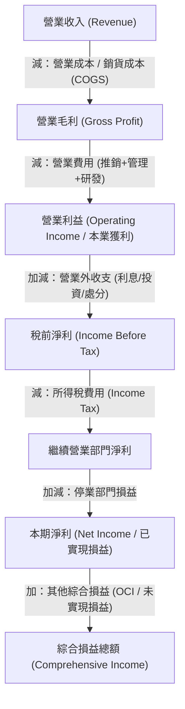
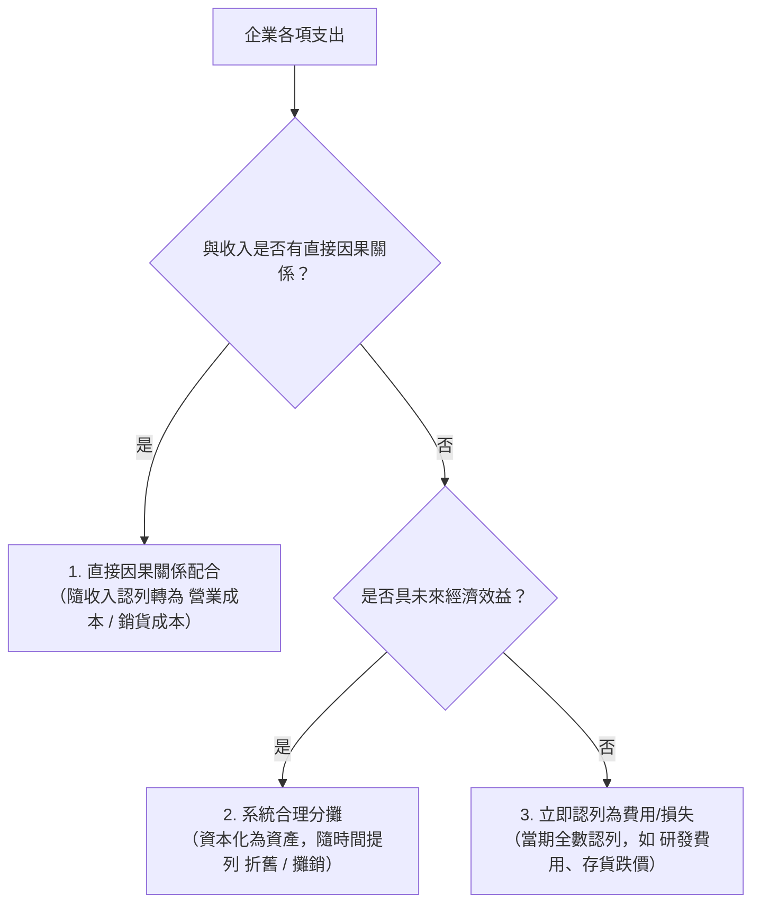

---
{"dg-publish":true,"permalink":"/01//ch02/","title":"Ch02 認識綜合損益表","tags":["PMBA","財務報表分析","綜合損益表","獲利模式","毛利率","本期淨利","OCI"],"dg-note-properties":{"title":"Ch02 認識綜合損益表","course":"財務報表分析","category":"01_基礎先修","type":"lecture-note","lecture":"01_Ch02","tags":["PMBA","財務報表分析","綜合損益表","獲利模式","毛利率","本期淨利","OCI"],"aliases":["認識綜合損益表","Ch02_認識綜合損益表","L02_認識綜合損益表","Ch02","L02"],"permalink":"/01/01/ch02/"}}
---

# Ch02 認識綜合損益表

## 💡 核心摘要

1. **獲利金字塔的逐層過濾機制**：[[98_商業概念庫/income-loss-3_綜合損益表\|zong-he-income-statement_綜合損益表]]並非單一獲利數字，而是透過「[[98_商業概念庫/operating-revenue_營業收入\|ying-ye-shou-ru_營業收入]] $\rightarrow$ [[98_商業概念庫/gross-profit_營業毛利\|ying-ye-gross-margin_營業毛利]] $\rightarrow$ [[98_商業概念庫/operating-income_營業利益\|operating-income_營業利益]] $\rightarrow$ 稅前淨利 $\rightarrow$ [[98_商業概念庫/net-income_本期淨利\|ben-qi-jing-li_本期淨利]] $\rightarrow$ 綜合損益總額」的遞進階梯，依序剔除產品直接製造成本、日常銷管研營運費用、業外投資與融資收支、所得稅及未實現[[98_商業概念庫/value_公允價值\|gong-yun-value_公允價值]]評價，精確診斷企業獲利的純度與永續性。
2. **收入認列的實質履約導向（[[98_商業概念庫/IFRS 15 客戶合約收入\|IFRS 15 客戶合約收入]]）**：在[[98_商業概念庫/accrual-accounting_權責發生制\|quan-ze-fa-sheng-zhi_權責發生制]]下，[[98_商業概念庫/operating-revenue_營業收入\|ying-ye-shou-ru_營業收入]]認列嚴格遵循「已賺得」與「已實現或可實現」兩大前提。IFRS 15 透過標準五步驟模型，將焦點由現金收付或形式開票轉移至「商品或服務控制權的實質移轉」，徹底規範了預收年費、買四送二搭售、分期付款及寄銷等複雜商業合約。
3. **成本與費用的「[[98_商業概念庫/matching-principle_配合原則\|pei-he-yuan-ze_配合原則]]」與資產轉換**：企業發生的各項支出依因果關係劃分：與收入有直接因果關係者，平時列為[[98_商業概念庫/balance-sheet_資產負債表\|balance-sheet_資產負債表]]上的[[98_商業概念庫/inventory_存貨\|cun-huo_存貨]]，商品售出實現收入時結轉為[[98_商業概念庫/cost-2_銷貨成本\|xiao-huo-cost_銷貨成本]]（[[98_商業概念庫/cost-of-goods-sold_營業成本\|ying-ye-cost_營業成本]]）；具未來效益但無直接因果者列為固定資產，按[[98_商業概念庫/depreciation-methods_折舊方法\|zhe-jiu-fang-fa_折舊方法]]逐期分攤；效益不明確者（如[[98_商業概念庫/rd-expense_研發費用\|yan-fa-fei-yong_研發費用]]）則當期立即費用化。
4. **本業造血（[[98_商業概念庫/operating-income_營業利益\|operating-income_營業利益]]）vs. 業外虛胖（[[98_商業概念庫/non-operating-income-expenses_營業外收支\|ying-ye-wai-shou-zhi_營業外收支]]）**：[[98_商業概念庫/operating-income_營業利益\|operating-income_營業利益]]反映企業[[98_商業概念庫/business-model_商業模式\|business-model_商業模式]]的護城河與核心產銷競爭力，具備高度可持續性；[[98_商業概念庫/non-operating-income-expenses_營業外收支\|ying-ye-wai-shou-zhi_營業外收支]]則多屬一次性或偶發性損益。經理人需警惕如案例中乙水泥公司業外佔營收高達 75% 的「假性獲利」，嚴防以賣地、賣股票掩飾本業虧損的財務障眼法。
5. **每股獲利防線與股權稀釋檢驗**：評估股東價值時，不能僅依賴基本[[98_商業概念庫/earnings-per-share_每股盈餘\|mei-gu-ying-yu_每股盈餘]]（Basic EPS），必須同步檢驗[[98_商業概念庫/diluted-eps_稀釋後每股盈餘\|稀釋後每股盈餘 (Diluted EPS)]]（Diluted EPS），嚴密測算可轉換公司債、可轉換特別股與員工認股權等潛在稀釋性證券在全數轉股後對每股獲利的稀釋衝擊。

---

## 📚 核心觀念與架構

### 一、 綜合損益表逐層拆解邏輯

[[98_商業概念庫/income-loss-3_綜合損益表\|zong-he-income-statement_綜合損益表]]採垂直遞減結構，將各項經濟活動清晰劃分為本業營運、非營業收支、已實現利潤與未實現評價四大區塊：

#### 核心利潤層次與標準 LaTeX 公式

1. **[[98_商業概念庫/gross-profit_營業毛利\|ying-ye-gross-margin_營業毛利]]（Gross Profit）**：
   衡量產品或勞務經產銷後最原始的獲利空間，扣除直接商品製造或進貨成本：
   $$營業毛利 = 營業收入 - 營業成本$$
   $$毛利率 = \frac{營業毛利}{營業收入} \times 100\%$$

2. **[[98_商業概念庫/operating-income_營業利益\|operating-income_營業利益]]（Operating Income）**：
   反映企業日常本業產銷經營之真實獲利，排除了[[98_商業概念庫/capital-structure_資本結構\|capital-structure_資本結構]]、財務融資及非營業投資之干擾：
   $$營業利益 = 營業毛利 - 營業費用$$
   $$營業費用 = 推銷費用 + 管理費用 + 研發費用$$
   $$營業利益率 = \frac{營業利益}{營業收入} \times 100\%$$

3. **稅前淨利（EBT）與[[98_商業概念庫/net-income_本期淨利\|ben-qi-jing-li_本期淨利]]（Net Income）**：
   $$稅前淨利 = 營業利益 \pm 營業外收支$$
   $$本期淨利 = 稅前淨利 - 所得稅費用 \pm 停業部門損益$$
   $$純益率 = \frac{本期淨利}{營業收入} \times 100\%$$

4. **綜合損益總額（Total Comprehensive Income）**：
   結合已實現之[[98_商業概念庫/net-income_本期淨利\|ben-qi-jing-li_本期淨利]]與因[[98_商業概念庫/value_公允價值\|gong-yun-value_公允價值]]變動產生之未實現損益：
   $$綜合損益總額 = 本期淨利 + 其他綜合損益 (OCI)$$

---

### 二、 營業收入認列原則與 IFRS 15 五步驟架構

在[[98_商業概念庫/accrual-accounting_權責發生制\|quan-ze-fa-sheng-zhi_權責發生制]]下，[[98_商業概念庫/operating-revenue_營業收入\|ying-ye-shou-ru_營業收入]]的認列並非取決於現金流入，而是依據「**收益認列雙原則**」：
- **已賺得（Earned）**：企業已實質完成交付商品或提供勞務等履行合約義務之工作。
- **已實現或可實現（Realized or Realizable）**：已取得現金、合法之現金請求權（[[98_商業概念庫/receivable_應收帳款\|ying-shou-zhang-kuan_應收帳款]]），或標的具活絡市價可隨時換現。

#### IFRS 15「客戶合約之收入」五步驟模型

1. **步驟 1：辨認客戶合約**：交易對象必須為本業客戶（例如肯德基賣炸雞屬客戶合約；賣舊廠房則非本號公報範圍）。
2. **步驟 2：辨認合約中之履約義務**：明確區分合約內承諾交付之個別商品或勞務（例如甜甜圈「買四送二」包含兩個獨立履約義務）。
3. **步驟 3：決定交易價格**：扣除折扣、折讓、預估退貨後之實質對價（買四送二客戶實付 120 元，而非原定價 180 元）。
4. **步驟 4：分攤交易價格至各履約義務**：按各商品或勞務之「相對單獨售價比例」分攤對價（依原價比 $120:60 = 2:1$ 分攤，購買項分攤 80 元，贈送項分攤 40 元）。
5. **步驟 5：於滿足履約義務時認列收入**：當控制權移轉給客戶時認列。若贈送券限下次兌換，當日僅能認列 80 元，剩餘 40 元列為合約負債。

---

### 三、 費用認列機制、配合原則與存貨結轉

費用的認列遵循「[[98_商業概念庫/matching-principle_配合原則\|pei-he-yuan-ze_配合原則]]（Matching Principle）」，即費用必須與其所協助創造的相關收入在同一會計期間認列，分為三大層次：

#### 1. 存貨與銷貨成本的勾稽轉換
商品在銷售前是[[98_商業概念庫/balance-sheet_資產負債表\|balance-sheet_資產負債表]]中的[[98_商業概念庫/current-assets_流動資產\|liu-dong-asset_流動資產]]（[[98_商業概念庫/inventory_存貨\|cun-huo_存貨]]）；一旦銷售實現，依[[98_商業概念庫/matching-principle_配合原則\|pei-he-yuan-ze_配合原則]]，其成本立即由[[98_商業概念庫/balance-sheet_資產負債表\|balance-sheet_資產負債表]]轉入[[98_商業概念庫/income-loss-3_綜合損益表\|zong-he-income-statement_綜合損益表]]作為「[[98_商業概念庫/cost-2_銷貨成本\|xiao-huo-cost_銷貨成本]]」（[[98_商業概念庫/cost-of-goods-sold_營業成本\|ying-ye-cost_營業成本]]）：
$$期初存貨 + 本期進貨（或製造成本） = 可供銷售商品總額$$
$$銷貨成本 = 可供銷售商品總額 - 期末存貨$$

- **[[98_商業概念庫/inventory-method_存貨計價方法\|cun-huo-ji-jia-fang-fa_存貨計價方法]]**：
  - **個別認定法**：適用高單價、客製化且可單獨辨認之商品。
  - **先進先出法 (FIFO)**：假設早期進貨先售出；物價上漲時會使期末[[98_商業概念庫/inventory_存貨\|cun-huo_存貨]]偏高、[[98_商業概念庫/cost-2_銷貨成本\|xiao-huo-cost_銷貨成本]]偏低，導致毛利虛增。
  - **加權平均法 (Weighted Average)**：計算平均單位成本結轉成本（假水泥公司採用），能有效平滑原料波動。
- **[[98_商業概念庫/cost-value_成本與淨變現價值孰低法\|cost-yu-jing-bian-xian-value-shu-di-fa_成本與淨變現價值孰低法]]（LCNRV）**：
  期末[[98_商業概念庫/inventory_存貨\|cun-huo_存貨]]若因陳廢、過時導致淨變現價值低於成本，其差額視為「[[98_商業概念庫/inventory-2_存貨跌價損失\|cun-huo-die-jia-sun-shi_存貨跌價損失]]」，直接列入當期[[98_商業概念庫/cost-of-goods-sold_營業成本\|ying-ye-cost_營業成本]]。

#### 2. 費用的表達方式：功能別 vs. 性質別
- **功能別（Function of Expense）**：依費用的營運職能劃分（[[98_商業概念庫/cost-2_銷貨成本\|xiao-huo-cost_銷貨成本]]、推銷費用、管理費用、[[98_商業概念庫/rd-expense_研發費用\|yan-fa-fei-yong_研發費用]]）。台灣主管機關與多數企業採用，清晰揭示各營運環節的投入產出效益。
- **性質別（Nature of Expense）**：依費用的原始性質劃分（[[98_商業概念庫/zhe-jiu_折舊\|zhe-jiu_折舊]]總額、原物料耗用、員工薪酬總額）。優點在於便於預測整體現金流與固定成本負擔。

---

### 四、 折舊、研發與每股盈餘（EPS）

#### 1. 資本密集產業之折舊提列
生產設備雖於取得時支付現金，但因效益延續數年，必須在耐用年限內提列[[98_商業概念庫/zhe-jiu_折舊\|zhe-jiu_折舊]]：
- **[[98_商業概念庫/depreciation-methods_折舊方法\|zhe-jiu-fang-fa_折舊方法]]選擇**：
  - **直線法 (Straight-line)**：每年提列均等[[98_商業概念庫/zhe-jiu_折舊\|zhe-jiu_折舊]]費用（假水泥公司採用）：
    $$\text{每年折舊額} = \frac{\text{資產成本} - \text{估計殘值}}{\text{耐用年限}}$$
  - **餘額遞減法 (Declining Balance)**：前期提列多、後期提列少之加速[[98_商業概念庫/zhe-jiu_折舊\|zhe-jiu_折舊]]。
  - **生產數量法 (Units of Production)**：按實際產量佔預估總產量比例提列。

#### 2. 研發費用的保守性與裁量空間
- **會計準則規範**：[[98_商業概念庫/rd-expense_研發費用\|yan-fa-fei-yong_研發費用]]中的「研究階段」一律費用化；僅少數「發展階段」具技術可行性且效益明確者方得資本化為[[98_商業概念庫/asset-2_無形資產\|wu-xing-asset_無形資產]]。
- **裁量性費用本質**：研發支出是經理人具高度自主裁量權的支出，需觀察[[98_商業概念庫/rd-expense_研發費用\|yan-fa-fei-yong_研發費用]]佔營收比重之長期穩定度。

#### 3. 每股盈餘（EPS）之計算與稀釋檢驗
- **基本[[98_商業概念庫/earnings-per-share_每股盈餘\|mei-gu-ying-yu_每股盈餘]]（Basic EPS）**：
  $$\text{基本每股盈餘} = \frac{\text{本期稅後淨利} - \text{特別股股利}}{\text{普通股加權平均流通在外面額股數}}$$
- **[[98_商業概念庫/diluted-eps_稀釋後每股盈餘\|稀釋後每股盈餘 (Diluted EPS)]]（Diluted EPS）**：
  假設所有具稀釋性潛在普通股（可轉換公司債、可轉換特別股、員工認股權）於期初已全數轉換：
  $$\text{稀釋每股盈餘} = \frac{\text{稅後淨利} - \text{特別股股利} + \text{可轉債稅後利息} + \text{可轉特別股股利}}{\text{普通股加權平均股數} + \text{具稀釋性潛在普通股約當股數}}$$

---

## ⚠️ 實務應用與經理人思維

### 一、 逐字稿實例深度剖析：假水泥公司 vs. 乙水泥公司

逐字稿以水泥產業龍頭「假水泥公司」與對手「乙水泥公司」的同型百分比對比，揭示了獲利品質的巨大鴻溝：

#### 1. 假水泥公司獲利體質演進（第 7 年 vs. 第 8 年）
- **[[98_商業概念庫/cost-of-goods-sold_營業成本\|ying-ye-cost_營業成本]]佔比改善**：自第七年的 73% 降至第八年的 70%（[[98_商業概念庫/cost-of-goods-sold_營業成本\|ying-ye-cost_營業成本]] 86，營收 122）。
- **[[98_商業概念庫/gross-margin-rate_毛利率\|gross-margin-rate_毛利率]]穩健走揚**：每 1 元營收之毛利由 0.26 元提升至 0.29 元（$29.25\%$），顯示生產製程與成本管控能力強化。
- **[[98_商業概念庫/non-operating-income-expenses_營業外收支\|ying-ye-wai-shou-zhi_營業外收支]]比重極低**：第八年業外收支僅 2，佔營收 2.02%，代表**獲利近 98% 來自水泥本業**。
- **淨利歸屬結構單純**：[[98_商業概念庫/net-income_本期淨利\|ben-qi-jing-li_本期淨利]] 25 中，歸屬於母公司業主達 24，非控制權益僅 1，股權集中且透明。
- **EPS 稀釋幅度極小**：基本[[98_商業概念庫/earnings-per-share_每股盈餘\|mei-gu-ying-yu_每股盈餘]] 4.43 元，完全稀釋後[[98_商業概念庫/earnings-per-share_每股盈餘\|mei-gu-ying-yu_每股盈餘]]為 4.25 元，顯示潛在稀釋性證券對每股獲利影響有限。

#### 2. 假水泥公司 vs. 乙水泥公司之獲利模式對比

| 分析項目 | 假水泥公司 | 乙水泥公司 | 經理人關鍵解讀 |
| :--- | :---: | :---: | :--- |
| **[[98_商業概念庫/non-operating-income-expenses_營業外收支\|ying-ye-wai-shou-zhi_營業外收支]]佔營收比** | **2.02%** | **75.0%** | **獲利結構天壤之別**：假公司專注本業；乙公司本業衰弱，高達 75% 收益依賴處分資產或轉投資等業外挹注。 |
| **獲利永續性 (Sustainability)** | 極高（本業造血） | 極低（一次性虛胖） | 乙公司業外收益無法年年複製，一旦資產賣盡，淨利將瞬間崩跌。 |
| **基本[[98_商業概念庫/earnings-per-share_每股盈餘\|mei-gu-ying-yu_每股盈餘]] (EPS)** | 4.43 元 | 2.02 元 | 假公司每股獲利厚實，乙公司獲利品質脆弱。 |
| **[[98_商業概念庫/diluted-eps_稀釋後每股盈餘\|稀釋後每股盈餘 (Diluted EPS)]] (EPS)** | 4.25 元 | 2.01 元 | 兩者稀釋性證券衝擊皆不大，但乙公司 EPS 含金量嚴重不足。 |

---

### 二、 收入與費用的會計操縱陷阱與防坑指南

> [!WARNING]
> [[98_商業概念庫/income-loss-3_綜合損益表\|zong-he-income-statement_綜合損益表]]是管理團隊展現績效的門面，但也最易淪為「[[98_商業概念庫/management-2_盈餘管理\|ying-yu-management_盈餘管理]]」的重災區。經理人需警惕以下五大常見操縱手法：

1. **營收提前認列的「塞貨」陷阱**：
   - **手法**：季末或年底為了達成業績目標，在尚未滿足 IFRS 15 履約義務前，強行出貨給通路經銷商並開立發票認列營收，甚至私下簽訂「退貨保證」或「售後買回協議」。
   - **判讀眉角**：檢視銷貨退回條款與歷史退貨率。若退貨率無法合理估計，交貨當下不得認列營收；若合約包含買回承諾，實質為「融資借款」，不可認列為銷貨收入。
2. **預收收入的「偷跑認列」**：
   - **手法**：如健身房預收一年期會費 12,000 元，若於收現當月一次性認列為營收，將嚴重虛增當期獲利。
   - **判讀眉角**：收到現金僅滿足「可實現」，但勞務尚未提供（未賺得）。必須列於[[98_商業概念庫/balance-sheet_資產負債表\|balance-sheet_資產負債表]]之「合約負債（預收收入）」，按月分攤認列 1,000 元。
3. **寄銷交易（Consignment）的混淆認列**：
   - **手法**：寄銷人將貨物送抵承銷商處所時即認列銷貨收入。
   - **判讀眉角**：承銷商並非客戶，貨物所有權與重大風險仍歸寄銷人所有。唯有當承銷商將商品轉售給第三方終端消費者時，履約義務方告滿足，始得認列營收。
4. **裁量性費用操縱（砍研發以保獲利）**：
   - **手法**：當年度本業毛利下滑時，經理人緊急凍結或縮減當期的[[98_商業概念庫/rd-expense_研發費用\|yan-fa-fei-yong_研發費用]]與推銷廣告支出，使當期[[98_商業概念庫/operating-income_營業利益\|operating-income_營業利益]]維持亮眼，製造獲利未減的假象。
   - **判讀眉角**：查閱[[98_商業概念庫/financial-2_財務報表附註\|finance-bao-biao-fu-zhu_財務報表附註]]，對比同業與歷年研發支出佔營收之百分比趨勢。若研發比率突發性驟降，往往是以犧牲企業未來 3~5 年的產品競爭力為代價。
5. **[[98_商業概念庫/zhe-jiu_折舊\|zhe-jiu_折舊]]政策與會計估計變更**：
   - **手法**：在不更新設備的情況下，經理人主觀延長機器設備之估計耐用年限（如從 5 年延長至 8 年）或拉高殘值，藉以壓低每年提列之[[98_商業概念庫/zhe-jiu_折舊\|zhe-jiu_折舊]]金額，變相推升毛利與淨利。
   - **判讀眉角**：細讀附註中重大會計估計之變更說明，評估年限變更是因維修保養改善，抑或僅為粉飾報表。
