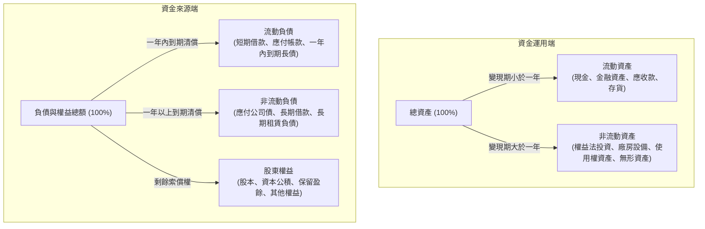
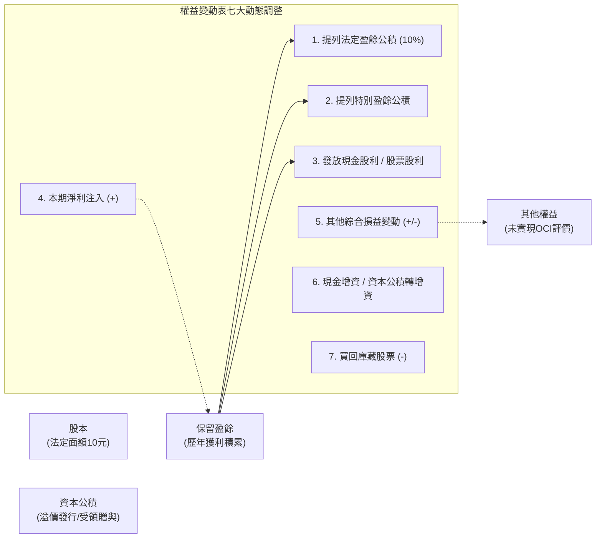

---
{"dg-publish":true,"permalink":"/01//ch03/","title":"Ch03 認識資產負債表與權益變動表","tags":["PMBA","財務報表分析","資產負債表","權益變動表","資本結構","保留盈餘"],"dg-note-properties":{"title":"Ch03 認識資產負債表與權益變動表","course":"財務報表分析","category":"01_基礎先修","type":"lecture-note","lecture":"01_Ch03","tags":["PMBA","財務報表分析","資產負債表","權益變動表","資本結構","保留盈餘"],"aliases":["認識資產負債表與權益變動表","Ch03_認識資產負債表與權益變動表","L03_認識資產負債表與權益變動表","Ch03","L03"]}}
---

# Ch03 認識資產負債表與權益變動表

## 💡 核心摘要

1. **[[98_商業概念庫/balance-sheet_資產負債表\|balance-sheet_資產負債表]]是企業實力的「靜態底盤」**：不同於[[98_商業概念庫/income-loss-3_綜合損益表\|zong-he-income-statement_綜合損益表]]的期間流量，[[98_商業概念庫/balance-sheet_資產負債表\|balance-sheet_資產負債表]]呈現特定日期的「存量（Stock）」，揭示企業累積的全部經濟資源（資產配置）以及相應的索償權來源（外部借貸 vs. [[98_商業概念庫/shareholder-equity_股東權益\|shareholder-equity_股東權益]]），是檢驗企業抗風險能力與長期清償能力的根本。
2. **[[98_商業概念庫/liquidity_流動性\|liu-dong-xing_流動性]]排序與資本匹配原則**：資產與負債嚴格依「[[98_商業概念庫/liquidity_流動性\|liu-dong-xing_流動性]]由高至低」排序（以一年或一個[[98_商業概念庫/operating-cycle_營業週期\|operating-cycle_營業週期]]為分水嶺）。健康的財務架構必須遵循「[[98_商業概念庫/matched-funding_以長支長\|yi-zhang-zhi-zhang_以長支長]]」，即以長期負債與[[98_商業概念庫/shareholder-equity_股東權益\|shareholder-equity_股東權益]]支應長期資產；若出現[[98_商業概念庫/maturity-mismatch_以短支長\|yi-duan-zhi-zhang_以短支長]]，[[98_商業概念庫/working-capital_營運資金\|working-capital_營運資金]]轉負，將埋下隨時斷鏈的[[98_商業概念庫/liquidity_流動性\|liu-dong-xing_流動性]]地雷。
3. **IFRS 16 租賃革命終結表外融資**：承租人除短期（小於 12 個月）與低價值（小於 5,000 美元）資產外，全面取消營業租賃。租賃合約必須「資產化與負債化」，帳上認列[[98_商業概念庫/asset-3_使用權資產\|shi-yong-quan-asset_使用權資產]]與租賃負債，徹底還原租賃交易的融資實質，杜絕航空公司「帳上無飛機」的表外美化。
4. **[[98_商業概念庫/statement-of-changes-in-equity_權益變動表\|equity-bian-dong-biao_權益變動表]]是股東價值的「動態軌跡」**：[[98_商業概念庫/statement-of-changes-in-equity_權益變動表\|equity-bian-dong-biao_權益變動表]]記錄股本、[[98_商業概念庫/capital-3_資本公積\|capital-gong-ji_資本公積]]、[[98_商業概念庫/retained-earnings_保留盈餘\|bao-liu-ying-yu_保留盈餘]]與其他權益的全年消長。經理人需特別警惕「[[98_商業概念庫/capital-3_資本公積\|capital-gong-ji_資本公積]]配息」的實務涵義——當本業獲利不足卻動用[[98_商業概念庫/capital-3_資本公積\|capital-gong-ji_資本公積]]發放股利時，實質上是「退還股東老本」，暗示企業獲利動能或再投資機會衰退。
5. **資產品質決定帳面價值的純度**：帳面資產不等於實際變現價值。經理人必須透過備抵呆帳（[[98_商業概念庫/receivable_應收帳款\|ying-shou-zhang-kuan_應收帳款]]淨額）、成本與淨變現價值孰低（[[98_商業概念庫/inventory_存貨\|cun-huo_存貨]]跌價）、累計減損（廠房設備與[[98_商業概念庫/goodwill_商譽\|shang-yu_商譽]]）等機制定期擠乾資產水份，防範虛胖資產掩飾經營虧損。

---

## 📚 核心觀念與架構

### 一、 資產負債表分類與流動性排序邏輯

[[98_商業概念庫/balance-sheet_資產負債表\|balance-sheet_資產負債表]]以「[[98_商業概念庫/accounting-equation_會計恆等式\|accounting-heng-deng-shi_會計恆等式]]」為骨架，左右兩端對稱平衡：
$$資產 = 負債 + 股東權益$$
$$淨資產 = 資產 - 負債 = 股東權益$$

報表項目嚴格按照「**變現速度或清償速度（[[98_商業概念庫/liquidity_流動性\|liu-dong-xing_流動性]]，Liquidity）**」由高至低排列：

#### 核心分類與重要術語定義

| 報表構面 | 核心分類 | 劃分標準與代表科目 | 商業實質與判讀重點 |
| :--- | :--- | :--- | :--- |
| **資產端** | **[[98_商業概念庫/current-assets_流動資產\|liu-dong-asset_流動資產]]** | 一年或一個正常[[98_商業概念庫/operating-cycle_營業週期\|operating-cycle_營業週期]]內可變現、出售或耗用。 • 現金及約當現金、[[98_商業概念庫/receivable_應收帳款\|ying-shou-zhang-kuan_應收帳款]]淨額、[[98_商業概念庫/inventory_存貨\|cun-huo_存貨]]、預付款項。 | 反映企業短期償債與日常營運週轉能力。 |
| | **[[98_商業概念庫/current-assets-2_非流動資產\|fei-liu-dong-asset_非流動資產]]** | 預期持有超過一年以上，支應長期營運。 • [[98_商業概念庫/equity-2_權益法\|equity-fa_權益法]]長期投資、不動產廠房設備、[[98_商業概念庫/asset-3_使用權資產\|shi-yong-quan-asset_使用權資產]]、[[98_商業概念庫/asset-2_無形資產\|wu-xing-asset_無形資產]]。 | 反映企業長期產能規模、技術壁壘與戰略佈局。 |
| **負債端** | **[[98_商業概念庫/current-liabilities_流動負債\|liu-dong-liability_流動負債]]** | 一年或一個正常[[98_商業概念庫/operating-cycle_營業週期\|operating-cycle_營業週期]]內須以[[98_商業概念庫/current-assets_流動資產\|liu-dong-asset_流動資產]]清償之債務。 • 短期借款、[[98_商業概念庫/payable_應付帳款\|ying-fu-zhang-kuan_應付帳款]]、一年內到期之長期借款與公司債。 | 衡量企業短期面臨的即期還款壓力與[[98_商業概念庫/liquidity_流動性\|liu-dong-xing_流動性]]風險。 |
| | **[[98_商業概念庫/non-current-liabilities_非流動負債\|fei-liu-dong-liability_非流動負債]]** | 到期日在一年以上之長期債務。 • 應付公司債、長期銀行借款、非流動租賃負債。 | 支應長期資本支出之外部資金來源，涉及[[98_商業概念庫/financial-leverage_財務槓桿\|finance-gang-gan_財務槓桿]]。 |
| **權益端** | **[[98_商業概念庫/shareholder-equity_股東權益\|shareholder-equity_股東權益]]** | 資產清償全部負債後的剩餘資產請求權（淨值）。 • 股本、[[98_商業概念庫/capital-3_資本公積\|capital-gong-ji_資本公積]]、[[98_商業概念庫/retained-earnings_保留盈餘\|bao-liu-ying-yu_保留盈餘]]、其他權益。 | 企業自主擁有的自有資金，代表企業抗風險底盤。 |

#### 營運資金公式與短期償債指標
企業日常維持正常運作所需的淨[[98_商業概念庫/liquidity_流動性\|liu-dong-xing_流動性]]緩衝稱為「[[98_商業概念庫/working-capital_營運資金\|working-capital_營運資金]]（Working Capital）」：
$$營運資金 = 流動資產 - 流動負債$$
$$流動比率 = \frac{流動資產}{流動負債} \times 100\%$$
$$速動比率 = \frac{流動資產 - 存貨 - 預付款項}{流動負債} \times 100\%$$

---

### 二、 股東權益流轉關係與權益變動表架構

[[98_商業概念庫/shareholder-equity_股東權益\|shareholder-equity_股東權益]]由原始資本投入、資本交易溢價、歷年經營積累及[[98_商業概念庫/value_公允價值\|gong-yun-value_公允價值]]未實現損益交織而成：
$$股東權益 = 股本 + 資本公積 + 保留盈餘 + 其他權益 - 庫藏股票$$

#### 股東權益四大支柱與流轉機制

1. **股本（Capital Stock）**：
   - 法定註冊之資本額，以股票面額（台灣多為 10 元）乘以流通在外發行股數計算：
     $$實收資本額 = 發行股數 \times 每股面額（10元）$$
2. **[[98_商業概念庫/capital-3_資本公積\|capital-gong-ji_資本公積]]（Additional Paid-in Capital）**：
   - 來自資本性質交易之溢價，主要包括股票溢價發行（如每股 18 元發行，超出面額之 8 元列入[[98_商業概念庫/capital-3_資本公積\|capital-gong-ji_資本公積]]）、受領股東贈與、併購溢價及[[98_商業概念庫/treasury-stock_庫藏股票\|ku-cang-stock_庫藏股票]]交易所生之差額。
3. **[[98_商業概念庫/retained-earnings_保留盈餘\|bao-liu-ying-yu_保留盈餘]]（Retained Earnings）**：
   - 企業歷年營運賺得並留存於內部的純益累積，依法分配順序如下：
     $$本期期末保留盈餘 = 期初保留盈餘 + 本期淨利 - 法定盈餘公積提撥 - 特別盈餘公積提撥 - 發放現金股利$$
     - **法定盈餘公積**：依法每年自稅後淨利提撥 10%，直至累積金額達到資本總額為止。
     - **特別盈餘公積**：依合約規定或因其他權益出現負數時等額提列以限制盈餘分配。
     - **未分配盈餘**：可供董事會擬定股利政策、發放股東股利之自由盈餘。
4. **[[98_商業概念庫/treasury-stock_庫藏股票\|ku-cang-stock_庫藏股票]]（Treasury Stock）**：
   - 企業買回自家流通在外股票，作為[[98_商業概念庫/shareholder-equity_股東權益\|shareholder-equity_股東權益]]的「直接減項」，代表實質流通股數減少。

---

### 三、 核心資產與負債之會計處理關鍵

#### 1. 金融資產（IFRS 9 與 IAS 28 權益法）
- **無重大影響力之金融資產（IFRS 9）**：
  - 經由「合約現金流量測試（SPPI）」與「企業經營模式測試」分為三類：
    1. **按攤銷後成本衡量（AC）**：以收取合約利息本金為目的（如債券），以有效利率法攤銷溢折價，採「預期信用損失模式（ECL）」評估減損。
    2. **透過[[98_商業概念庫/income-loss-2_其他綜合損益\|qi-ta-zong-he-sun-yi_其他綜合損益]]按[[98_商業概念庫/value_公允價值\|gong-yun-value_公允價值]]衡量（FVOCI）**：非交易目的之戰略股票或兼具收取與出售目的之債券，[[98_商業概念庫/value_公允價值\|gong-yun-value_公允價值]]變動列入 OCI。
    3. **透過損益按[[98_商業概念庫/value_公允價值\|gong-yun-value_公允價值]]衡量（FVTPL）**：以短期賺取價差為目的，[[98_商業概念庫/value_公允價值\|gong-yun-value_公允價值]]變動直接計入當期損益。
- **具重大影響力或控制力（IAS 28 [[98_商業概念庫/equity-2_權益法\|equity-fa_權益法]]）**：
  - 持股比例達 20%~50%（重大影響力）或超過 50%（控制力，納入合併報表）。
  - 帳面價值隨被投資公司[[98_商業概念庫/shareholder-equity_股東權益\|shareholder-equity_股東權益]]同向變動：被投資公司獲利時，投資方按持股比例增加投資帳面價值並認列投資收益；收到現金股利時，視為投資成本之收回（調減投資帳面價值），不列入損益。

#### 2. IFRS 16 租賃會計改革
- **承租人全面「上表」**：除短期租賃（租期小於 12 個月）與低價值資產（小於 5,000 美元 / 約 15 萬台幣）外，全面廢除營業租賃。
- **實務認列**：
  - 資產端認列「[[98_商業概念庫/asset-3_使用權資產\|shi-yong-quan-asset_使用權資產]]（Right-of-use Asset）」，後續逐期提列[[98_商業概念庫/zhe-jiu_折舊\|zhe-jiu_折舊]]。
  - 負債端認列「租賃負債（Lease Liability）」，後續依有效利率法攤銷本金與認列利息費用。損益表不再出現「租金費用」。

#### 3. 應付公司債溢折價攤銷
- **溢價發行（市場利率 < 票面利率）**：發行價格高於面額，溢價部分逐期攤銷以「調減」每期利息費用。
- **折價發行（市場利率 > 票面利率）**：發行價格低於面額，折價部分逐期攤銷以「加重」每期利息費用，使公司債帳面價值逐期回升至到期面額。

---

## ⚠️ 實務應用與經理人思維

### 一、 逐字稿實例深度剖析：塑化龍頭「假塑化公司」

逐字稿以塑化產業龍頭「假塑化公司」第八年度[[98_商業概念庫/balance-sheet_資產負債表\|balance-sheet_資產負債表]]（總資產 497 億元）與[[98_商業概念庫/statement-of-changes-in-equity_權益變動表\|equity-bian-dong-biao_權益變動表]]為例，揭示重資產龍頭企業的資本底盤特徵：

#### 1. 資產配置與資本結構分析（第 8 年底同型百分比）

| 報表項目 | 金額（億元） | 佔總資產比率 | 商業分析與經理人解讀 |
| :--- | :---: | :---: | :--- |
| **[[98_商業概念庫/current-assets_流動資產\|liu-dong-asset_流動資產]]** | 175 | 35.21% | 現金 18（3.62%）、[[98_商業概念庫/receivable_應收帳款\|ying-shou-zhang-kuan_應收帳款]]淨額與[[98_商業概念庫/inventory_存貨\|cun-huo_存貨]]各 18（3.62%），資產具備足夠變現彈性。 |
| **採用[[98_商業概念庫/equity-2_權益法\|equity-fa_權益法]]之投資** | **202** | **40.64%** | **全表最大資產項目**：反映集團企業透過龐大交叉持股鞏固供應鏈與產業話語權。 |
| **不動產廠房及設備** | 85 | 17.10% | 佔比低於預期，係因公司成立歷史悠久，早期低成本取得且已提列龐大累計[[98_商業概念庫/zhe-jiu_折舊\|zhe-jiu_折舊]]。 |
| **[[98_商業概念庫/asset-3_使用權資產\|shi-yong-quan-asset_使用權資產]]** | 105 | 21.13% | 依 IFRS 16 將重型乾燥機等租賃設備資本化入帳，資產透明度大幅提升。 |
| **[[98_商業概念庫/current-assets-2_非流動資產\|fei-liu-dong-asset_非流動資產]]合計** | **321** | **64.79%** | 資本密集特徵顯著，近 65% 資產屬於長期產能與股權投資。 |
| **[[98_商業概念庫/current-liabilities_流動負債\|liu-dong-liability_流動負債]]** | 89 | 17.91% | 短期借款 20（4.02%）、[[98_商業概念庫/payable_應付帳款\|ying-fu-zhang-kuan_應付帳款]]與流動租賃負債，短期還款壓力可控。 |
| **[[98_商業概念庫/non-current-liabilities_非流動負債\|fei-liu-dong-liability_非流動負債]]** | 58 | 11.67% | 應付公司債 32、長期借款僅 1，偏好發行公司債鎖定低成本長期資金。 |
| **負債總額** | **147** | **29.58%** | [[98_商業概念庫/liability-ratio_負債比率\|liability-bi-rate_負債比率]]不到 3 成，[[98_商業概念庫/financial-leverage_財務槓桿\|finance-gang-gan_財務槓桿]]保守穩健。 |
| **[[98_商業概念庫/shareholder-equity_股東權益\|shareholder-equity_股東權益]]總額** | **350** | **70.42%** | **自有資金高達 7 成**：[[98_商業概念庫/retained-earnings_保留盈餘\|bao-liu-ying-yu_保留盈餘]]達 198（佔權益過半），展現極強歷史造血積累。 |

#### 2. 資本匹配分析：完全消除「以短支長」風險
- **長期資金總額**：$\text{非流動負債 (58)} + \text{股東權益 (350)} = 408 \text{ 億元}$。
- **長期資產需求**：$\text{非流動資產} = 321 \text{ 億元}$。
- **長期資金適合率**：
  $$\text{長期資金適合率} = \frac{\text{非流動負債} + \text{股東權益}}{\text{非流動資產}} = \frac{408}{321} \times 100\% = 127.1\%$$
- **管理洞察**：指標遠大於 100%，顯示假公司的[[98_商業概念庫/current-assets-2_非流動資產\|fei-liu-dong-asset_非流動資產]]全數由長期負債與自有權益支應，甚至多出 87 億元長期資金沉澱為[[98_商業概念庫/current-assets_流動資產\|liu-dong-asset_流動資產]]（[[98_商業概念庫/working-capital_營運資金\|working-capital_營運資金]]高達 $175 - 89 = 86$ 億元），徹底杜絕[[98_商業概念庫/liquidity_流動性\|liu-dong-xing_流動性]]斷鏈風險。

---

### 二、 經理人解讀資產負債表的四大「地雷」與防坑指南

> [!WARNING]
> [[98_商業概念庫/balance-sheet_資產負債表\|balance-sheet_資產負債表]]是靜態的存量帳，極易被經理人透過跨期調度或會計估計進行「體質美化」。經理人必須具備穿透式思維：

1. **警惕致命的「[[98_商業概念庫/maturity-mismatch_以短支長\|yi-duan-zhi-zhang_以短支長]]（Funding Long-term Assets with Short-term Debt）」**：
   - **地雷本質**：為節省長期融資成本或因不易取得長期授信，經理人以隨時面臨抽銀根風險的短期銀行借款（[[98_商業概念庫/current-liabilities_流動負債\|liu-dong-liability_流動負債]]）去購建需 5~10 年才能回收的廠房設備（[[98_商業概念庫/current-assets-2_非流動資產\|fei-liu-dong-asset_非流動資產]]）。
   - **判讀眉角**：檢驗「[[98_商業概念庫/working-capital_營運資金\|working-capital_營運資金]]」是否轉為負數，或「長期資金適合率」是否跌破 100%。一旦景氣反轉或銀行緊縮信貸，企業將瞬間陷入[[98_商業概念庫/insolvency-with-profit_黑字倒閉\|hei-zi-dao-bi_黑字倒閉]]。
2. **識破「[[98_商業概念庫/capital-3_資本公積\|capital-gong-ji_資本公積]]配息」的獲利假象**：
   - **地雷本質**：公司本業獲利衰退甚至虧損，無法配發現金股利，卻為了維持股價迎合股東，決議「以[[98_商業概念庫/capital-3_資本公積\|capital-gong-ji_資本公積]]發放現金股利」。
   - **判讀眉角**：[[98_商業概念庫/capital-3_資本公積\|capital-gong-ji_資本公積]]是股東當初投入的本金溢價，拿[[98_商業概念庫/capital-3_資本公積\|capital-gong-ji_資本公積]]配息實質上是「退還股東老本（返還資本）」，並非由營運賺來的真金白銀。此舉嚴重削弱企業防禦風險的資本緩衝。
3. **穿透「資產品質水份」：呆帳、跌價與[[98_商業概念庫/goodwill_商譽\|shang-yu_商譽]]減損**：
   - **[[98_商業概念庫/receivable_應收帳款\|ying-shou-zhang-kuan_應收帳款]]水份**：檢視備抵呆帳提列比率是否隨帳齡拉長而遞減；若[[98_商業概念庫/receivable_應收帳款\|ying-shou-zhang-kuan_應收帳款]]週轉天數異常飆高但未提列壞帳，極可能是假銷貨或隱匿呆帳。
   - **[[98_商業概念庫/inventory_存貨\|cun-huo_存貨]]水份**：[[98_商業概念庫/inventory_存貨\|cun-huo_存貨]]是否採用加權平均法掩蓋個別料件過時？若市價重跌卻未依「[[98_商業概念庫/cost-value_成本與淨變現價值孰低法\|cost-yu-jing-bian-xian-value-shu-di-fa_成本與淨變現價值孰低法]]」認列跌價損失，毛利即為虛構。
   - **[[98_商業概念庫/goodwill_商譽\|shang-yu_商譽]]減損黑洞**：[[98_商業概念庫/goodwill_商譽\|shang-yu_商譽]]不能攤銷，但併購後的子公司若營運未達預期，經理人常因不願承認併購失敗而拖延認列「[[98_商業概念庫/goodwill_商譽\|shang-yu_商譽]]減損」，直至爆發巨額減損引發淨利崩跌。
4. **明辨「限制用途現金」的[[98_商業概念庫/liquidity_流動性\|liu-dong-xing_流動性]]假象**：
   - **地雷本質**：[[98_商業概念庫/balance-sheet_資產負債表\|balance-sheet_資產負債表]]上的現金看似充裕，但其中包含銀行要求質押的「補償性回存（Compensating Balance）」或指定用途之「償債基金」。
   - **判讀眉角**：查閱[[98_商業概念庫/financial-2_財務報表附註\|finance-bao-biao-fu-zhu_財務報表附註]]，確認現金是否受有限制。非自由動用的資金不可計入即期[[98_商業概念庫/liquidity_流動性\|liu-dong-xing_流動性]]儲備。
