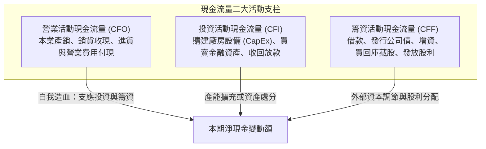
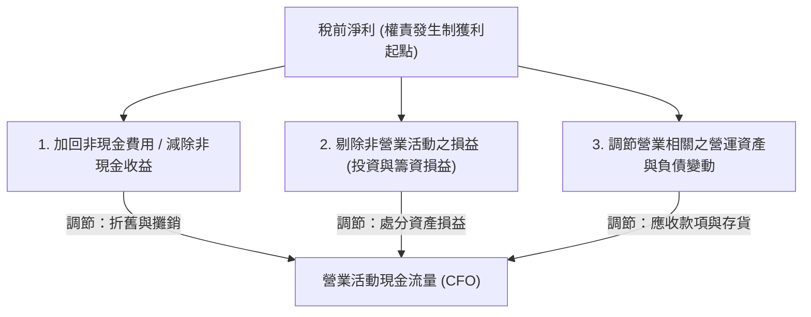

---
{"dg-publish":true,"permalink":"/01//ch04/","title":"Ch04 認識現金流量表","tags":["PMBA","財務報表分析","現金流量表","營業現金流","自由現金流","營運資金"],"dg-note-properties":{"title":"Ch04 認識現金流量表","course":"財務報表分析","category":"01_基礎先修","type":"lecture-note","lecture":"01_Ch04","tags":["PMBA","財務報表分析","現金流量表","營業現金流","自由現金流","營運資金"],"aliases":["認識現金流量表","Ch04_認識現金流量表","L04_認識現金流量表","Ch04","L04"],"permalink":"/01/01/ch04/"}}
---

# Ch04 認識現金流量表

## 💡 核心摘要

1. **現金是企業生存的「氧氣與血液」**：[[98_商業概念庫/income-loss-3_綜合損益表\|zong-he-income-statement_綜合損益表]]採[[98_商業概念庫/accrual-accounting_權責發生制\|quan-ze-fa-sheng-zhi_權責發生制]]衡量期間獲利，帳面淨利不等於實質現金流入。許多暴雷企業在出事前數年帳面淨利依然亮麗，但[[98_商業概念庫/operating-cash-flow-statement_營業活動現金流量\|operating-cash-flow-statement_營業活動現金流量]]早已持續淨流出，最終因無力償付到期債務而爆發「[[98_商業概念庫/insolvency-with-profit_黑字倒閉\|hei-zi-dao-bi_黑字倒閉]]」。
2. **現金流量三大支柱的分工邏輯**：[[98_商業概念庫/cash-flow-statement_現金流量表\|cash-flow-statement_現金流量表]]將資金流動拆解為[[98_商業概念庫/operating-activities_營業活動\|ying-ye-huo-dong_營業活動]]（CFO，本業動態造血能力）、[[98_商業概念庫/investing-activities_投資活動\|investment-huo-dong_投資活動]]（CFI，長期產能與資產佈局）及[[98_商業概念庫/financing-activities_籌資活動\|chou-zi-huo-dong_籌資活動]]（CFF，外部借貸與股利分配）。健康的企業必須以可持續的 CFO 作為核心引擎，支應 CFI 資本支出並支應 CFF 債務本息與股利。
3. **[[98_商業概念庫/indirect-method-cash-flow_間接法\|jian-jie-fa_間接法]]的盈餘品質檢驗價值**：雖然[[98_商業概念庫/direct-method-cash-flow_直接法\|zhi-jie-fa_直接法]]直觀呈現各項收現付現金額，但台灣絕大多數企業採行[[98_商業概念庫/indirect-method-cash-flow_間接法\|jian-jie-fa_間接法]]。[[98_商業概念庫/indirect-method-cash-flow_間接法\|jian-jie-fa_間接法]]以稅前淨利為起點，透過加回非現金費用（如[[98_商業概念庫/zhe-jiu_折舊\|zhe-jiu_折舊]]、攤提）、調整營運資產負債變動（如[[98_商業概念庫/receivable_應收帳款\|ying-shou-zhang-kuan_應收帳款]]與[[98_商業概念庫/inventory_存貨\|cun-huo_存貨]]積壓），清晰揭露「淨利與現金流的落差」，是評估盈餘品質與辨識財報美化的照妖鏡。
4. **自由現金流（FCF）是真實股東價值**：[[98_商業概念庫/free-cash-flow-liang_自由現金流量\|free-cash-flow-liang_自由現金流量]]代表企業在維持正常營運並滿足必要資本支出（CapEx）後，可自由分配給投資人的真實剩餘現金。持續為正且穩健成長的 FCF，是衡量企業內生性擴張實力、抗外部衝擊彈性與估值溢價的最硬核指標。
5. **八種現金流矩陣的生命週期解讀**：透過 (CFO, CFI, CFF) 的正負組合，能精準將企業分類為成熟金牛型 (+ - -)、積極擴張型 (+ - +)、體質惡化型 (- + +) 或全面失血型 (- - -) 等 8 種營運型態，協助經理人與投資人洞察企業所處的戰略週期與潛在財務危機。

---

## 📚 核心觀念與架構

### 一、 現金流量三大支柱拆解

[[98_商業概念庫/cash-flow-statement_現金流量表\|cash-flow-statement_現金流量表]]全面追蹤企業在特定會計期間內，現金及約當現金的全部實質流入與流出：
$$\Delta 現金及約當現金 = CFO + CFI + CFF$$

#### 三大活動之核心內涵與分類判讀

| 活動維度 | 英文代號 | 核心商業意涵 | 主要現金流入 (+) | 主要現金流出 (-) |
| :--- | :---: | :--- | :--- | :--- |
| **[[98_商業概念庫/operating-activities_營業活動\|ying-ye-huo-dong_營業活動]]** | **[[98_商業概念庫/operating-cash-flow-statement_營業活動現金流量\|operating-cash-flow-statement_營業活動現金流量]]** | 企業核心業務產銷循環之自我造血機能，具備最高可持續性。 | 銷售商品或提供勞務收現、其他營業收益收現。 | 進貨付現、支付員工薪資、支付[[98_商業概念庫/operating-expenses_營業費用\|operating-expenses_營業費用]]、繳納所得稅。 |
| **[[98_商業概念庫/investing-activities_投資活動\|investment-huo-dong_投資活動]]** | **[[98_商業概念庫/investing-cash-flow-statement_投資活動現金流量\|investing-cash-flow-statement_投資活動現金流量]]** | 購置或處分長期生產資產與戰略投資，反映未來擴張野心。 | 處分不動產廠房設備、出售金融資產、收回貸款本金。 | 購建不動產廠房設備（資本支出 CapEx）、取得長期股權與債券。 |
| **[[98_商業概念庫/financing-activities_籌資活動\|chou-zi-huo-dong_籌資活動]]** | **[[98_商業概念庫/financing-activities-cash-flow_籌資活動現金流量\|chou-zi-huo-dong-cash-flow_籌資活動現金流量]]** | [[98_商業概念庫/capital-structure_資本結構\|capital-structure_資本結構]]調整、向股東或債權人募集或償還資金之活動。 | 短期/長期銀行借款、發行公司債、現金增資發行新股。 | 償還借款本金、贖回公司債、償付租賃負債、買回[[98_商業概念庫/treasury-stock_庫藏股票\|ku-cang-stock_庫藏股票]]、發放現金股利。 |

---

### 二、 間接法編製邏輯與調節機制

台灣實務上絕大多數企業採行[[98_商業概念庫/indirect-method-cash-flow_間接法\|jian-jie-fa_間接法]]編製[[98_商業概念庫/operating-activities_營業活動\|ying-ye-huo-dong_營業活動]]現金流量。其核心邏輯是將[[98_商業概念庫/income-loss-3_綜合損益表\|zong-he-income-statement_綜合損益表]]中依[[98_商業概念庫/accrual-accounting_權責發生制\|quan-ze-fa-sheng-zhi_權責發生制]]認列之「稅前淨利」，透過三大維度調節為收付實現制之「[[98_商業概念庫/operating-activities_營業活動\|ying-ye-huo-dong_營業活動]]現金流量」：

#### 間接法調節核心公式與三大調節項目

$$CFO = 稅前淨利 + 非現金費用與收益調節 \pm 非營業損益調節 \pm 營運資金項目變動$$

1. **非現金費用與收益調節（加回未付現成本）**：
   - **加回[[98_商業概念庫/zhe-jiu_折舊\|zhe-jiu_折舊]]（+）與攤銷（+）**：固定資產與[[98_商業概念庫/asset-2_無形資產\|wu-xing-asset_無形資產]]之[[98_商業概念庫/zhe-jiu_折舊\|zhe-jiu_折舊]]攤銷在前期購置時已付現，本期僅為帳面費用，並無實際現金流出，故全數加回。
   - **加回預期信用減損損失（+）**：提列壞帳費用未實際流出現金。
2. **非[[98_商業概念庫/operating-activities_營業活動\|ying-ye-huo-dong_營業活動]]損益調節（剔除重複計算）**：
   - **扣除處分不動產廠房設備利益（-）** / **加回處分損失（+）**：處分資產之全額現金流入歸屬於[[98_商業概念庫/investing-activities_投資活動\|investment-huo-dong_投資活動]]（CFI），為避免雙重計算，必須自淨利中剔除其帳面損益。
   - **剔除採[[98_商業概念庫/equity-2_權益法\|equity-fa_權益法]]認列之關聯企業利益（-）**：[[98_商業概念庫/equity-2_權益法\|equity-fa_權益法]]帳面獲利若未收到現金股利，無現金流入，應予扣除。
3. **與營業相關之[[98_商業概念庫/working-capital_營運資金\|working-capital_營運資金]]項目變動調節**：
   - **[[98_商業概念庫/current-assets_流動資產\|liu-dong-asset_流動資產]]變動（反向變動）**：
     - 應收票據與帳款增加（-）：營收已認列但尚未收現（賒銷）。
     - [[98_商業概念庫/inventory_存貨\|cun-huo_存貨]]增加（-）：投入現金購料備貨，但尚未售出結轉成本。
     - 預付款項增加（-）：現金已流出但尚未認列費用。
     - （反之，[[98_商業概念庫/current-assets_流動資產\|liu-dong-asset_流動資產]]減少則代表收回現金或耗用[[98_商業概念庫/inventory_存貨\|cun-huo_存貨]]，應予以加回）。
   - **[[98_商業概念庫/current-liabilities_流動負債\|liu-dong-liability_流動負債]]變動（同向變動）**：
     - 應付票據與帳款增加（+）：享受供應商賒銷，[[98_商業概念庫/cost-of-goods-sold_營業成本\|ying-ye-cost_營業成本]]已計但尚未付現。
     - 應付薪資與費用增加（+）：費用已認列但尚未發放現金。
     - （反之，[[98_商業概念庫/current-liabilities_流動負債\|liu-dong-liability_流動負債]]減少代表實質支付現金還款，應予以扣除）。

---

### 三、 自由現金流（FCF）與現金流量分析指標

#### 1. 自由現金流量（Free Cash Flow, FCF）
衡量企業自我造血扣除維持產能基本開支後，能真正自由發放給股東或償付債權人的現金：
$$自由現金流 (FCF) = 營業活動現金流量 (CFO) - 資本支出 (CapEx)$$
$$自由現金流 (FCF) = CFO - 購建不動產廠房設備及無形資產現金支出$$

#### 2. 三大現金流量財務比率

1. **[[98_商業概念庫/cash-flow-ratio_現金流量比率\|cash-flow-bi-rate_現金流量比率]]（Cash Flow Ratio）**：
   衡量企業透過本業營業現金流償付即期[[98_商業概念庫/current-liabilities_流動負債\|liu-dong-liability_流動負債]]之能力：
   $$現金流量比率 = \frac{營業活動現金流量 (CFO)}{流動負債} \times 100\%$$
   （比率大於 50% 為佳，大於 100% 代表本業造血一年內可完全清償所有[[98_商業概念庫/current-liabilities_流動負債\|liu-dong-liability_流動負債]]）。

2. **[[98_商業概念庫/cash-flow-adequacy-ratio_現金流量允當比率\|cash-flow-yun-dang-bi-rate_現金流量允當比率]]（Cash Flow Adequacy Ratio）**：
   衡量企業長期（近 5 年）營業現金流是否足敷擴充設備、投資[[98_商業概念庫/inventory_存貨\|cun-huo_存貨]]及發放股利之自我滿足能力：
   $$現金流量允當比率 = \frac{\text{近五年 CFO 總額}}{\text{近五年資本支出} + \text{近五年存貨增加額} + \text{近五年現金股利}} \times 100\%$$
   （大於 100% 代表自給自足，無需仰賴外部舉債或增資；小於 100% 則存在資金缺口）。

3. **[[98_商業概念庫/cash-reinvestment-ratio_現金再投資比率\|cash-zai-investment-bi-rate_現金再投資比率]]（Cash Reinvestment Ratio）**：
   衡量企業本業現金流扣除股利後，剩餘資金再投入生產性資產之比率：
   $$現金再投資比率 = \frac{CFO - 現金股利}{\text{不動產廠房設備毛額} + \text{長期投資} + \text{其他非流動資產} + \text{營運資金}} \times 100\%$$
   （通常以 8%~10% 為健康水準，比率過低代表企業資本更新與再投資動能遲緩）。

---

## ⚠️ 實務應用與經理人思維

### 一、 經理人必備：八種現金流量矩陣與營運型態

經理人可透過 (CFO, CFI, CFF) 的正負訊號組合，精準判斷企業的營運體質與生命週期階段：

| 組合型態 | CFO | CFI | CFF | 典型企業特徵與管理洞察 | 經理人決策重點 |
| :---: | :---: | :---: | :---: | :--- | :--- |
| **1. 金牛型** | **+** | **-** | **-** | **成熟期績優龍頭**：本業大賺，持續進行必要資本支出，並充裕償還借款與發放高額現金股利。 | 保持產能效率，維持穩定股利政策，尋求第二成長曲線。 |
| **2. 積極擴張型**| **+** | **-** | **+** | **成長期潛力企業**：本業有造血能力，但資本擴充需求龐大，除營業現金外仍需外部增資或舉債。 | 嚴格控管資本預算（NPV/IRR），防範盲目過度擴產。 |
| **3. 轉型調整型**| **+** | **+** | **-** | **策略收縮 / 瘦身轉型**：本業有賺，同時處分非核心資產回收現金，用於大額還債或實施庫藏股。 | 加速處分閒置資產，大幅減輕[[98_商業概念庫/financial-leverage_財務槓桿\|finance-gang-gan_財務槓桿]]與利息負擔。 |
| **4. 資金囤積型**| **+** | **+** | **+** | **異常蓄水 / 備戰型**：本業賺錢、賣資產、又向外大舉借錢，帳面現金暴增。 | 檢視是否有大型跨國併購計畫；若無，需防範資金閒置或舞弊掏空。 |
| **5. 新創燒錢型**| **-** | **-** | **+** | **起步期新創 / 資本密集建廠**：本業尚未獲利，需持續投資設備與研發，完全依賴創投或舉債輸血。 | 緊盯現金跑道（Cash Runway），精準控制燒錢率（Burn Rate）。 |
| **6. 體質惡化型**| **-** | **+** | **+** | **衰退期掙扎 / 搶救型**：本業失血，被迫靠變賣家當與對外高利借款來維持日常營運。 | 必須立即啟動本業重整與止血，否則資產賣盡後將迅速崩潰。 |
| **7. 垂死掙扎型**| **-** | **+** | **-** | **瀕臨清算 / 處分償債**：本業持續失血，銀行抽銀根催債，只能變賣資產勉強還債。 | 面臨資不抵債風險，應積極評估債務重組或破產和解。 |
| **8. 全面失血型**| **-** | **-** | **-** | **致命斷崖 / 倒閉前夕**：本業虧損、投資失控、外部無法籌資且面臨還本催逼，現金急遽枯竭。 | 隨時爆發無預警停業或破產倒閉，屬極度危險地雷。 |

---

### 二、 假食品公司 vs. 乙食品公司實例深度剖析

逐字稿以飲料大廠「假食品公司」（碳酸飲料 54.5% + 高粱酒 49.6%）與同業「乙食品公司」對比，揭示了獲利與現金流背離的經典案例：

#### 1. 假食品公司現金流量體質演進
- **第八年現金流表現**：
  - 稅前淨利 967 萬，加回非現金費用[[98_商業概念庫/zhe-jiu_折舊\|zhe-jiu_折舊]] 334 萬，經[[98_商業概念庫/working-capital_營運資金\|working-capital_營運資金]]調節後，[[98_商業概念庫/operating-activities_營業活動\|ying-ye-huo-dong_營業活動]]現金流量（CFO）為 122 萬（第 7 年僅 46 萬）。
  - [[98_商業概念庫/investing-activities_投資活動\|investment-huo-dong_投資活動]]現金流量（CFI）為 +78 萬（主要是短線金融資產操作處分），[[98_商業概念庫/financing-activities_籌資活動\|chou-zi-huo-dong_籌資活動]]現金流量（CFF）為 -136 萬（償還短期借款 70 萬、發放現金股利 64 萬）。
  - 全年淨現金流出 52 萬，期末現金餘額降至 1,223 萬。
- **致命的第 4、5、6 年盈餘品質警訊**：
  - 假公司在此三年間[[98_商業概念庫/income-loss-3_綜合損益表\|zong-he-income-statement_綜合損益表]]皆呈現亮麗淨利，但**[[98_商業概念庫/operating-activities_營業活動\|ying-ye-huo-dong_營業活動]]現金流量（CFO）連續三年為負值（淨流出）**！
  - 本業產銷完全無法帶來現金，[[98_商業概念庫/cash-flow-ratio_現金流量比率\|cash-flow-bi-rate_現金流量比率]]與[[98_商業概念庫/cash-flow-adequacy-ratio_現金流量允當比率\|cash-flow-yun-dang-bi-rate_現金流量允當比率]]全數跌入負數，營運全靠消耗歷史現金儲備度日。
- **對比乙食品公司**：
  - 乙公司淨利雖然不高，但連續七年間淨利曲線與 CFO 曲線高度重疊，營業現金流穩定大於零，盈餘品質極佳。
- **管理洞察**：**獲利高不代表盈餘品質好**。假公司的獲利高度滯留在[[98_商業概念庫/receivable_應收帳款\|ying-shou-zhang-kuan_應收帳款]]與[[98_商業概念庫/inventory_存貨\|cun-huo_存貨]]中，若非有歷史現金老本支撐，早在此三年間引發[[98_商業概念庫/insolvency-with-profit_黑字倒閉\|hei-zi-dao-bi_黑字倒閉]]。

---

### 三、 經理人防坑指南：警惕「黑字倒閉」與現金流假象

> [!WARNING]
> 利潤是會計師計算出來的，現金是經理人實打實收回來的。經理人需嚴密監控以下現金流危機信號：

1. **防範「[[98_商業概念庫/insolvency-with-profit_黑字倒閉\|hei-zi-dao-bi_黑字倒閉]]（Bankruptcy with Profit）」**：
   - **成因機制**：企業營收與淨利高速成長，經理人誤以為形勢大好而盲目擴產（高額 CFI 流出）；然而，營收增長大多來自「寬鬆賒銷」（[[98_商業概念庫/receivable_應收帳款\|ying-shou-zhang-kuan_應收帳款]]暴增）與「過度備料」（[[98_商業概念庫/inventory_存貨\|cun-huo_存貨]]暴增），導致 CFO 嚴重失血。當外部信貸緊縮或銀行突然抽銀根，企業即使帳面賺錢，也會因掏不出一毛現金償還到期借款而宣告破產。
   - **防範策略**：密切追蹤「盈餘現金保障倍數」（$\text{CFO} / \text{淨利}$），該指標長期小於 1 即為危險信號。
2. **警惕「[[98_商業概念庫/investing-activities_投資活動\|investment-huo-dong_投資活動]]現金流假性為正」**：
   - CFI 大於零通常並非好事。若企業 CFI 為正係因「大舉處分核心廠房設備」或「拋售戰略股權」，代表企業正在變賣生產工具度日，未來產能將嚴重受損。
3. **識破「以借新還舊掩飾本業失血」**：
   - 企業若 CFO 長期為負，但帳面現金餘額未見減少，往往是依靠 CFF 持續借入短期借款或發行新債（以債養債）。經理人需審視籌資現金流入的真實代價，避免[[98_商業概念庫/financial-leverage_財務槓桿\|finance-gang-gan_財務槓桿]]雪球越滾越大。
