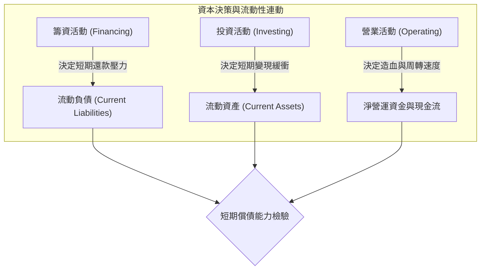
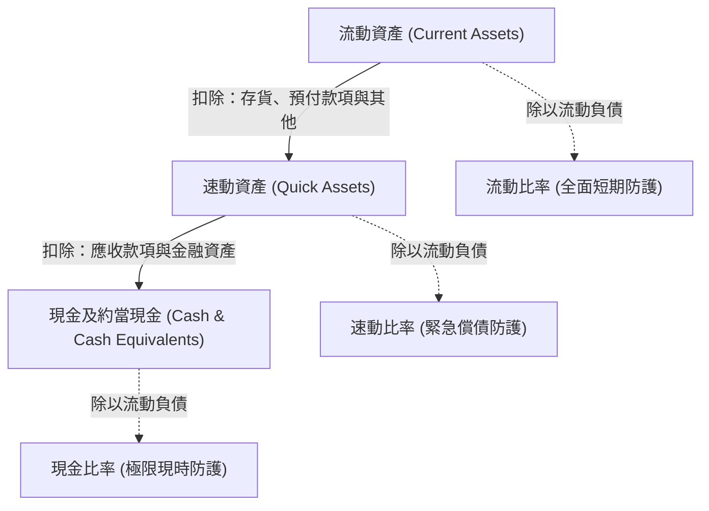
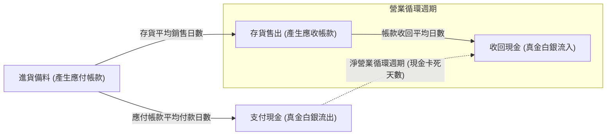

---
{"dg-publish":true,"permalink":"/01/01/ch05/","title":"Ch05 流動性分析","tags":["PMBA","財務報表分析","流動性分析","短期償債能力","流動比率","速動比率","淨營運資金"],"dg-note-properties":{"title":"Ch05 流動性分析","course":"財務報表分析","category":"01_基礎先修","type":"lecture-note","lecture":"01_Ch05","tags":["PMBA","財務報表分析","流動性分析","短期償債能力","流動比率","速動比率","淨營運資金"],"aliases":["流動性分析","Ch05_流動性分析","L05_流動性分析","Ch05","L05"]}}
---

# Ch05 流動性分析

## 💡 核心摘要

- **生存先於獲利，[[98_商業概念庫/liquidity_流動性\|liu-dong-xing_流動性]]是企業存續的真正底線**：[[98_商業概念庫/profitability_獲利能力\|huo-li-neng-li_獲利能力]]衡量長期[[98_商業概念庫/business-model_商業模式\|business-model_商業模式]]的價值創造，而[[98_商業概念庫/liquidity_流動性\|liu-dong-xing_流動性]]決定企業能否度過下個月的資金缺口。即使損益表上的[[98_商業概念庫/net-income_本期淨利\|ben-qi-jing-li_本期淨利]]再亮眼，若資金全被卡在[[98_商業概念庫/inventory_存貨\|cun-huo_存貨]]與[[98_商業概念庫/receivable_應收帳款\|ying-shou-zhang-kuan_應收帳款]]中無法變現清償[[98_商業概念庫/current-liabilities_流動負債\|liu-dong-liability_流動負債]]，企業仍會瞬間爆發「[[98_商業概念庫/insolvency-with-profit_黑字倒閉\|hei-zi-dao-bi_黑字倒閉]]」。
- **靜態指標三層防護網：嚴格度遞增的償債檢驗**：由寬至嚴依序檢視——從涵蓋全部短期資產的「[[98_商業概念庫/ratio_流動比率\|liu-dong-bi-rate_流動比率]]」、剔除變現不確定性最高之[[98_商業概念庫/inventory_存貨\|cun-huo_存貨]]與預付款項的「[[98_商業概念庫/ratio-2_速動比率\|su-dong-bi-rate_速動比率]]」，到只看真金白銀的「[[98_商業概念庫/cash-ratio_現金比率\|cash-bi-rate_現金比率]]」，層層過濾資產品質，精準透視企業在常態、緊急與極限危機情境下的抗風險底盤。
- **動態周轉與淨營業循環：[[98_商業概念庫/working-capital_營運資金\|working-capital_營運資金]]壓力的本質**：[[98_商業概念庫/liquidity_流動性\|liu-dong-xing_流動性]]不能只看[[98_商業概念庫/balance-sheet_資產負債表\|balance-sheet_資產負債表]]單一時點的靜態存量，更取決於產銷運作的流動速度。從賒購進料、製銷[[98_商業概念庫/inventory_存貨\|cun-huo_存貨]]到賒銷收現，「[[98_商業概念庫/cycle_淨營業循環週期\|jing-ying-ye-xun-huan-cycle_淨營業循環週期]]」越長，企業被鎖死在供應鏈中的現金越多，所需儲備的[[98_商業概念庫/net-working-capital_淨營運資金\|net-working-capital_淨營運資金]]緩衝就越大。
- **比率迷思與兩難平衡：過高[[98_商業概念庫/liquidity_流動性\|liu-dong-xing_流動性]]背後的代價**：[[98_商業概念庫/ratio_流動比率\|liu-dong-bi-rate_流動比率]]並非越高越好。過高的[[98_商業概念庫/ratio_流動比率\|liu-dong-bi-rate_流動比率]]或現金部位往往代表經營效率低落、資金閒置缺乏高投報率擴張機會，甚至反映出過度保守的授信政策扼殺了營收成長機會。
- **防範財務[[98_商業概念庫/window-dressing_窗飾\|chuang-shi_窗飾]]與淡旺季扭曲**：[[98_商業概念庫/ratio_流動比率\|liu-dong-bi-rate_流動比率]]容易受到人為操作，如期末暫時償還短期借款以美化數字的「[[98_商業概念庫/window-dressing_窗飾\|chuang-shi_窗飾]]」手法；此外，旺季時[[98_商業概念庫/current-assets_流動資產\|liu-dong-asset_流動資產]]與[[98_商業概念庫/current-liabilities_流動負債\|liu-dong-liability_流動負債]]同額擴張，反而會使原本大於 1 的比率產生數學性下滑，經理人必須結合長期趨勢與同業標竿進行立體交叉檢驗。

---

## 📚 核心觀念與架構

### 流動性本質與資產負債結構分析

[[98_商業概念庫/liquidity_流動性\|liu-dong-xing_流動性]]（Liquidity）是指企業在一年或一個正常[[98_商業概念庫/operating-cycle_營業週期\|operating-cycle_營業週期]]內，將資產轉換為現金以履行即期到期法定債務的能力。[[98_商業概念庫/liquidity_流動性\|liu-dong-xing_流動性]]分析屬於**短期償債能力分析**，聚焦於評估企業短期資產是否足以支應短期負債，與評估企業長期[[98_商業概念庫/capital-structure_資本結構\|capital-structure_資本結構]]的[[98_商業概念庫/capital-structure_資本結構\|長期償債能力]]以及創造盈餘的[[98_商業概念庫/profitability_獲利能力\|huo-li-neng-li_獲利能力]]分屬不同分析維度。

在評估企業[[98_商業概念庫/balance-sheet_資產負債表\|balance-sheet_資產負債表]]時，可將企業的[[98_商業概念庫/liquidity_流動性\|liu-dong-xing_流動性]]結構歸納為三種典型形態：
1. **A 類結構（[[98_商業概念庫/liquidity_流動性\|liu-dong-xing_流動性]]匱乏型）**：[[98_商業概念庫/current-assets_流動資產\|liu-dong-asset_流動資產]]遠小於[[98_商業概念庫/current-liabilities_流動負債\|liu-dong-liability_流動負債]]，每一元的短期債務僅有不到一元的短期資產支應。若[[98_商業概念庫/current-liabilities_流動負債\|liu-dong-liability_流動負債]]到期，必須被迫變賣廠房設備等[[98_商業概念庫/current-assets-2_非流動資產\|fei-liu-dong-asset_非流動資產]]，極易引發「[[98_商業概念庫/maturity-mismatch_以短支長\|yi-duan-zhi-zhang_以短支長]]」與[[98_商業概念庫/liquidity_流動性\|liu-dong-xing_流動性]]斷裂危機。
2. **B 類結構（臨界平衡型）**：[[98_商業概念庫/current-assets_流動資產\|liu-dong-asset_流動資產]]與[[98_商業概念庫/current-liabilities_流動負債\|liu-dong-liability_流動負債]]約略相等（1:1）。帳面上看似能完全覆蓋，但若[[98_商業概念庫/receivable_應收帳款\|ying-shou-zhang-kuan_應收帳款]]遭遇倒帳、或[[98_商業概念庫/inventory_存貨\|cun-huo_存貨]]面臨滯銷跌價，實際變現金額將縮水，仍存有高度周轉不確定性。
3. **C 類結構（超額安全型）**：[[98_商業概念庫/current-assets_流動資產\|liu-dong-asset_流動資產]]遠大於[[98_商業概念庫/current-liabilities_流動負債\|liu-dong-liability_流動負債]]，提供充裕的[[98_商業概念庫/liquidity_流動性\|liu-dong-xing_流動性]]安全邊際，能從容吸收[[98_商業概念庫/receivable_應收帳款\|ying-shou-zhang-kuan_應收帳款]]延宕與[[98_商業概念庫/inventory_存貨\|cun-huo_存貨]]銷售波動的衝擊。但需進一步檢視是否因資金閒置或[[98_商業概念庫/inventory_存貨\|cun-huo_存貨]]積壓所致。

---

### 淨營運資金（Net Working Capital, NWC）

[[98_商業概念庫/net-working-capital_淨營運資金\|net-working-capital_淨營運資金]]（又稱[[98_商業概念庫/working-capital_營運資金\|working-capital_營運資金]]）是衡量[[98_商業概念庫/liquidity_流動性\|liu-dong-xing_流動性]]最直接的絕對金額指標，代表企業清償所有一年內到期之短期債務後，仍可自由調度並投入日常產銷營運週轉的資金緩衝。

$$\text{淨營運資金 (NWC)} = \text{流動資產} - \text{流動負債}$$

#### 經理人判讀淨營運資金的四大考量
1. **規模效應與不可比性**：[[98_商業概念庫/working-capital_營運資金\|working-capital_營運資金]]是絕對金額，大型企業的[[98_商業概念庫/working-capital_營運資金\|working-capital_營運資金]]金額自然高於小型企業。若 A 公司資產為 B 公司的 10 倍，但[[98_商業概念庫/working-capital_營運資金\|working-capital_營運資金]]僅為 B 公司的 2 倍，去除規模因素後，無法斷定 A 公司的[[98_商業概念庫/liquidity_流動性\|liu-dong-xing_流動性]]優於 B 公司。
2. **歷史波動度與穩定性**：[[98_商業概念庫/working-capital_營運資金\|working-capital_營運資金]]是特定時點的存量數據。若企業歷年[[98_商業概念庫/working-capital_營運資金\|working-capital_營運資金]]波動劇烈，單期的高額數字不具備長期的預測價值。
3. **組成分子的品質差異**：相同金額的[[98_商業概念庫/working-capital_營運資金\|working-capital_營運資金]]，若內部主要由「現金及約當現金」構成，其變現品質極佳；若主要由「滯銷[[98_商業概念庫/inventory_存貨\|cun-huo_存貨]]」構成，則隨時面臨跌價損失與周轉停滯。
4. **一年內到期之長期負債重分類**：長期借款若採分期償還，在未來一年內到期的部分必須依規定改列為[[98_商業概念庫/current-liabilities_流動負債\|liu-dong-liability_流動負債]]，以防止企業高估可用的[[98_商業概念庫/net-working-capital_淨營運資金\|net-working-capital_淨營運資金]]。

---

### 靜態流動性指標拆解（嚴格度遞增邏輯）

為了消除企業規模差異並深入剖析資產變現品質，財務分析建立了一套由寬至嚴的三層靜態指標體系：

#### 1. 流動比率（Current Ratio）
- **定義與公式**：衡量企業以全部[[98_商業概念庫/current-assets_流動資產\|liu-dong-asset_流動資產]]覆蓋[[98_商業概念庫/current-liabilities_流動負債\|liu-dong-liability_流動負債]]的倍數，代表每一元[[98_商業概念庫/current-liabilities_流動負債\|liu-dong-liability_流動負債]]有多少[[98_商業概念庫/current-assets_流動資產\|liu-dong-asset_流動資產]]作為償債後盾。
  $$\text{流動比率} = \frac{\text{流動資產}}{\text{流動負債}} \times 100\%$$
- **實務標準**：傳統財務通則通常以 $200\%$ ($2.0$) 作為經驗安全標準，但需考量產業特性與資產轉換效率。

#### 2. 速動比率（Quick Ratio / 酸性測驗 Acid-Test Ratio）
- **定義與剔除邏輯**：[[98_商業概念庫/current-assets_流動資產\|liu-dong-asset_流動資產]]中各細項的變現能力差異甚大：
  - **[[98_商業概念庫/inventory_存貨\|cun-huo_存貨]]**：需歷經尋找買家、議價、出貨等銷售過程，變現時間最長，且面臨市場競爭、退流行及跌價減損風險，變現可控性最低。
  - **預付款項**：已付現預定未來勞務或租金（如預付租金、預付保險費），本質上是為了換取未來的服務而非現金，極難在短期內退現。
  - **其他[[98_商業概念庫/current-assets_流動資產\|liu-dong-asset_流動資產]] / 待出售[[98_商業概念庫/current-assets-2_非流動資產\|fei-liu-dong-asset_非流動資產]]**：內容雜項多、變現條件繁複。
  
  因此，[[98_商業概念庫/ratio-2_速動比率\|su-dong-bi-rate_速動比率]]將上述項目剔除，僅保留能在極短時間內變現的「[[98_商業概念庫/quick-assets_速動資產\|su-dong-asset_速動資產]]」：
  $$\text{速動資產} = \text{現金及約當現金} + \text{透過損益按公允價值衡量之金融資產} + \text{應收票據淨額} + \text{應收帳款淨額} + \text{其他應收款淨額}$$
  $$\text{速動比率} = \frac{\text{速動資產}}{\text{流動負債}} \times 100\%$$
- **實務標準**：衡量企業遭遇抽銀根或突發危機時的「**緊急償債能力**」，通常以 $100\%$ ($1.0$) 作為健康標準（每一元[[98_商業概念庫/current-liabilities_流動負債\|liu-dong-liability_流動負債]]皆有一元[[98_商業概念庫/quick-assets_速動資產\|su-dong-asset_速動資產]]即時支應）。

#### 3. 現金比率（Cash Ratio）
- **定義與公式**：完全不依賴[[98_商業概念庫/inventory_存貨\|cun-huo_存貨]]銷售，也不依賴向客戶催收應收款項，純粹衡量企業直接以手頭持有的真金白銀清償短期債務的能力。
  $$\text{現金比率} = \frac{\text{現金及約當現金}}{\text{流動負債}} \times 100\%$$
- **實務標準**：衡量「**極限情境下的即期清償力**」。[[98_商業概念庫/cash-ratio_現金比率\|cash-bi-rate_現金比率]]過低代表資金調度緊繃；但若過高，則代表大量資本處於零收益狀態，形成嚴重的資金閒置與機會成本。

---

### 動態流動性指標：營業循環與現金轉換

靜態比率僅反映特定基準日的存量，無法揭示資金在產銷營運中的流轉節奏。企業的[[98_商業概念庫/liquidity_流動性\|liu-dong-xing_流動性]]實質上是由「進料付現、製銷出貨、賒銷收現」的動態循環所決定。

#### 1. 應收帳款周轉率與平均收現日數
- **[[98_商業概念庫/receivable-3_應收帳款周轉率\|ying-shou-zhang-kuan-zhou-zhuan-rate_應收帳款周轉率]]**：衡量企業給予客戶信用（賒銷）的經營效率，反映一年內應收款項周轉轉化為營收的次數。
  $$\text{應收帳款周轉率} = \frac{\text{營業收入（銷貨淨額）}}{\text{平均應收款項}} = \frac{\text{營業收入}}{\frac{\text{期初應收款} + \text{期末應收款}}{2}}$$
- **帳款收回平均日數（DSO）**：將 365 天除以周轉次數，得出平均需耗費多少天才能將帳款收回變現。
  $$\text{帳款收回平均日數} = \frac{365}{\text{應收帳款周轉率}}$$

#### 2. 存貨周轉率與平均銷售日數
- **[[98_商業概念庫/inventory-3_存貨周轉率\|cun-huo-zhou-zhuan-rate_存貨周轉率]]**：衡量企業庫存管理效率，反映一年內[[98_商業概念庫/inventory_存貨\|cun-huo_存貨]]售出結轉為[[98_商業概念庫/cost-2_銷貨成本\|xiao-huo-cost_銷貨成本]]的次數。分母必須採用[[98_商業概念庫/cost-2_銷貨成本\|xiao-huo-cost_銷貨成本]]（而非[[98_商業概念庫/operating-revenue_營業收入\|ying-ye-shou-ru_營業收入]]），以維持成本對成本的計量一致性。
  $$\text{存貨周轉率} = \frac{\text{銷貨成本（營業成本）}}{\text{平均存貨}} = \frac{\text{銷貨成本}}{\frac{\text{期初存貨} + \text{期末存貨}}{2}}$$
- **[[98_商業概念庫/inventory_存貨\|cun-huo_存貨]]平均銷售日數（DIO）**：反映商品從進料/製成入庫到成功售出平均所需的停留天數。
  $$\text{存貨平均銷售日數} = \frac{365}{\text{存貨周轉率}}$$

#### 3. 營業循環週期（Operating Cycle）
假設企業以現金採購[[98_商業概念庫/inventory_存貨\|cun-huo_存貨]]，從投入現金取得[[98_商業概念庫/inventory_存貨\|cun-huo_存貨]]、加工銷售為[[98_商業概念庫/receivable_應收帳款\|ying-shou-zhang-kuan_應收帳款]]，至最終收回現金的完整時間跨度：
$$\text{營業循環週期} = \text{存貨平均銷售日數} + \text{帳款收回平均日數}$$
此週期越長，意味著資金滯留在營業資產的時間越久，[[98_商業概念庫/liquidity_流動性\|liu-dong-xing_流動性]]風險越高。

#### 4. 應付帳款周轉率與平均付款日數
企業採購通常採取賒購，延後支付現金是供應商提供的無息信用：
$$\text{應付帳款周轉率} = \frac{\text{銷貨成本（營業成本）}}{\text{平均應付帳款}} = \frac{\text{銷貨成本}}{\frac{\text{期初應付帳款} + \text{期末應付帳款}}{2}}$$
$$\text{應付帳款平均付款日數 (DPO)} = \frac{365}{\text{應付帳款周轉率}}$$

#### 5. 淨營業循環週期（Net Operating Cycle / 現金轉換週期 CCC）
考慮供應商提供的賒購信用期後，企業從「實質付現給供應商」到「最終向客戶收回現金」的真實資金缺口天數：
$$\text{淨營業循環週期} = \text{營業循環週期} - \text{應付帳款平均付款日數}$$
$$\text{淨營業循環週期} = \text{存貨平均銷售日數} + \text{帳款收回平均日數} - \text{應付帳款平均付款日數}$$
- **商業意涵**：淨營業循環天數即為「現金被完全卡在產銷鏈中」的時間。在此期間內，企業必須自籌[[98_商業概念庫/working-capital_營運資金\|working-capital_營運資金]]或依賴短期借款支應所有日常支出。淨營業循環越長，[[98_商業概念庫/liquidity_流動性\|liu-dong-xing_流動性]]壓力越大，企業對[[98_商業概念庫/working-capital_營運資金\|working-capital_營運資金]]的需求也越高。

---

## ⚠️ 實務應用與經理人思維

### 產業特性與流動性基準差異

分析[[98_商業概念庫/ratio_流動比率\|liu-dong-bi-rate_流動比率]]絕不可死守「200%」的教條，不同[[98_商業概念庫/business-model_商業模式\|business-model_商業模式]]的正常[[98_商業概念庫/liquidity_流動性\|liu-dong-xing_流動性]]結構存在本質差異：

| 產業類型 | [[98_商業概念庫/ratio_流動比率\|liu-dong-bi-rate_流動比率]]特徵 | [[98_商業概念庫/ratio-2_速動比率\|su-dong-bi-rate_速動比率]]特徵 | 核心商業機制與經理人思維 |
| :--- | :--- | :--- | :--- |
| **零售與連鎖超商** (如統一超、全家) | 偏低 (常在 $0.8 \sim 1.2$) | 極低 (通常 $< 0.8$) | **現銷模式，無[[98_商業概念庫/receivable_應收帳款\|ying-shou-zhang-kuan_應收帳款]]**；對供應商具強大議價力（[[98_商業概念庫/payable_應付帳款\|ying-fu-zhang-kuan_應付帳款]]天期長），且[[98_商業概念庫/inventory_存貨\|cun-huo_存貨]]周轉極快，每天有源源不絕的現金流入，低[[98_商業概念庫/ratio_流動比率\|liu-dong-bi-rate_流動比率]]屬健康常態。 |
| **重工業與裝備製造** (如機械設備、造船) | 偏高 (通常 $> 1.8$) | 中等或偏低 (常落差甚大) | **生產週期長、備料沉重**；產品客製化程度高且驗收期長，[[98_商業概念庫/inventory_存貨\|cun-huo_存貨]]比重大，若[[98_商業概念庫/ratio-2_速動比率\|su-dong-bi-rate_速動比率]]過低，需嚴防[[98_商業概念庫/inventory_存貨\|cun-huo_存貨]]跌價與客戶驗收延宕。 |
| **高科技代工與紡織製造** (如假公司、乙公司) | 中高 (通常 $1.5 \sim 2.5$) | 穩健 (通常 $\ge 1.0$) | **跨國供應鏈與品牌大廠客戶**；需維持充足[[98_商業概念庫/current-assets_流動資產\|liu-dong-asset_流動資產]]以應對國際原料價格波動與大客戶集中度風險。 |
| **純軟體與專業服務業** | 較高 (通常 $> 2.0$) | 與[[98_商業概念庫/ratio_流動比率\|liu-dong-bi-rate_流動比率]]接近 ($\approx$ [[98_商業概念庫/ratio_流動比率\|liu-dong-bi-rate_流動比率]]) | **輕資產無[[98_商業概念庫/inventory_存貨\|cun-huo_存貨]]**；[[98_商業概念庫/current-assets_流動資產\|liu-dong-asset_流動資產]]主要為現金與[[98_商業概念庫/receivable_應收帳款\|ying-shou-zhang-kuan_應收帳款]]，幾乎無[[98_商業概念庫/inventory_存貨\|cun-huo_存貨]]與原料跌價風險，[[98_商業概念庫/ratio-2_速動比率\|su-dong-bi-rate_速動比率]]與[[98_商業概念庫/ratio_流動比率\|liu-dong-bi-rate_流動比率]]幾乎重合。 |

---

### 指標過高的經營盲點與機會成本

「[[98_商業概念庫/ratio_流動比率\|liu-dong-bi-rate_流動比率]]越高越好」是初學者最常見的誤區。從[[98_商業概念庫/finance-management_財務管理\|finance-management_財務管理]]角度，過高的[[98_商業概念庫/ratio_流動比率\|liu-dong-bi-rate_流動比率]]往往暴露出經營層面的嚴重問題：
1. **資本配置低效（資本閒置）**：現金與短期金融資產的報酬率遠低於企業的加權平均資金成本（WACC）。若企業坐擁過多現金卻不進行高投報率的資本支出擴張，將嚴重拉低[[98_商業概念庫/shareholder-equity_股東權益\|shareholder-equity_股東權益]]報酬率（ROE）。
2. **保守授信扼殺營收**：若企業一味要求「現銷」以壓低[[98_商業概念庫/receivable_應收帳款\|ying-shou-zhang-kuan_應收帳款]]、拉高[[98_商業概念庫/cash-ratio_現金比率\|cash-bi-rate_現金比率]]，將使具備良好信用的客戶轉向競爭對手，產生龐大的機會成本。
3. **[[98_商業概念庫/inventory_存貨\|cun-huo_存貨]]管理失控與假性安全**：若高[[98_商業概念庫/ratio_流動比率\|liu-dong-bi-rate_流動比率]]是由「大量[[98_商業概念庫/inventory_存貨\|cun-huo_存貨]]」所撐起，這不是安全邊際，而是隨時會爆發的呆滯庫存與跌價減損地雷。

---

### 財報窗飾（Window Dressing）手法與防偽識別

[[98_商業概念庫/ratio_流動比率\|liu-dong-bi-rate_流動比率]]屬於「時點指標」（Point-in-time），極易在季末或年度財務報導日前夕透過人為操作進行「[[98_商業概念庫/window-dressing_窗飾\|chuang-shi_窗飾]]」美化：

#### 1. 期末暫時償還短期負債（分子分母同減效應）
當企業原始[[98_商業概念庫/ratio_流動比率\|liu-dong-bi-rate_流動比率]]大於 1 時，使用現金償還短期借款，會使分子與分母**同時減少相同金額**，從而在數學上顯著拉高[[98_商業概念庫/ratio_流動比率\|liu-dong-bi-rate_流動比率]]。
- **實例試算**：
  - 假設期末前：$\text{流動資產} = 200$，$\text{流動負債} = 100 \implies \text{流動比率} = \frac{200}{100} = 2.0$ ($200\%$)
  - 經理人於 12 月 30 日動用 50 現金償還短期銀行借款：
  - 調整後：$\text{流動資產} = 150$，$\text{流動負債} = 50 \implies \text{流動比率} = \frac{150}{50} = 3.0$ ($300\%$)
  - **結果**：企業的營運實質完全沒變，甚至手頭流動現金減少了 50，但帳面[[98_商業概念庫/ratio_流動比率\|liu-dong-bi-rate_流動比率]]卻從 2.0 暴增至 3.0。待跨年後（1 月初），企業再重新向銀行借入 50 現金。

#### 2. 延遲進貨與期末凍結採購
在財報截止日前暫停或推遲原物料進貨，避免產生新的[[98_商業概念庫/payable_應付帳款\|ying-fu-zhang-kuan_應付帳款]]（[[98_商業概念庫/current-liabilities_流動負債\|liu-dong-liability_流動負債]]），人為壓低分母。

#### 3. 提前確認銷貨
透過給予客戶額外折扣或寬鬆放款條件，促使客戶在期末前提前提貨，將[[98_商業概念庫/inventory_存貨\|cun-huo_存貨]]轉換為高額的[[98_商業概念庫/receivable_應收帳款\|ying-shou-zhang-kuan_應收帳款]]，短期衝高[[98_商業概念庫/current-assets_流動資產\|liu-dong-asset_流動資產]]與帳面營收。

#### 經理人與分析師防範對策
- **穿透式比對[[98_商業概念庫/cash-flow-statement_現金流量表\|cash-flow-statement_現金流量表]]**：檢視[[98_商業概念庫/operating-cash-flow-statement_營業活動現金流量\|operating-cash-flow-statement_營業活動現金流量]]是否與[[98_商業概念庫/ratio_流動比率\|liu-dong-bi-rate_流動比率]]變化同步。
- **跨期追蹤借款餘額**：觀察季初（如 1 月、4 月）與季末（如 3 月、12 月）短期借款餘額是否有劇烈的「V 型」波動。
- **檢驗周轉率跳躍**：分析第四季的[[98_商業概念庫/inventory-3_存貨周轉率\|cun-huo-zhou-zhuan-rate_存貨周轉率]]與[[98_商業概念庫/receivable_應收帳款\|ying-shou-zhang-kuan_應收帳款]]周轉天數是否與前三季存在異常乖離。

---

### 淡旺季效應的數學陷阱

在季節性波動明顯的產業中（如紡織、消費電子、玩具業），旺季期間企業通常會擴大進貨備料（增加[[98_商業概念庫/inventory_存貨\|cun-huo_存貨]]與[[98_商業概念庫/payable_應付帳款\|ying-fu-zhang-kuan_應付帳款]]），並大幅鋪貨賒銷（增加[[98_商業概念庫/receivable_應收帳款\|ying-shou-zhang-kuan_應收帳款]]與短期融資）。

當[[98_商業概念庫/ratio_流動比率\|liu-dong-bi-rate_流動比率]]大於 1 時，**[[98_商業概念庫/current-assets_流動資產\|liu-dong-asset_流動資產]]與[[98_商業概念庫/current-liabilities_流動負債\|liu-dong-liability_流動負債]]同額增加，會導致[[98_商業概念庫/ratio_流動比率\|liu-dong-bi-rate_流動比率]]在數學上下降**：
- **淡季基準**：$\text{流動資產} = 10$，$\text{流動負債} = 5 \implies \text{流動比率} = \frac{10}{5} = 2.0$
- **旺季擴張**：資產與負債各增 1：$\text{流動資產} = 11$，$\text{流動負債} = 6 \implies \text{流動比率} = \frac{11}{6} \approx 1.83$

> [!IMPORTANT]
> 旺季時[[98_商業概念庫/ratio_流動比率\|liu-dong-bi-rate_流動比率]]由 2.0 降至 1.83，絕非企業償債能力惡化，而是業務擴張帶動分子分母同步放大的數學必然。分析師若不察，容易誤判企業陷入[[98_商業概念庫/liquidity_流動性\|liu-dong-xing_流動性]]危機；反之，淡季時比率自然回升，亦不可盲目樂觀。

---

### 個案深度剖析：假公司 vs. 乙公司（紡織成衣大廠對決）

逐字稿以台灣機能布與成衣龍頭「假公司」與同業標竿「乙公司」為實例，展開全方位的[[98_商業概念庫/liquidity_流動性\|liu-dong-xing_流動性]]診斷：

#### 1. 假公司第八年各項指標總檢驗
- **靜態防護層**：
  - **[[98_商業概念庫/ratio_流動比率\|liu-dong-bi-rate_流動比率]]**：$237.9\%$ ($2.379$)，每一元[[98_商業概念庫/current-liabilities_流動負債\|liu-dong-liability_流動負債]]有 2.37 元[[98_商業概念庫/current-assets_流動資產\|liu-dong-asset_流動資產]]覆蓋，安全邊際看似非常充足。
  - **[[98_商業概念庫/ratio-2_速動比率\|su-dong-bi-rate_速動比率]]**：$147.8\%$ ($1.478$)，扣除[[98_商業概念庫/inventory_存貨\|cun-huo_存貨]]與預付款後仍遠大於 1.0，具備良好的緊急償債能力。
  - **[[98_商業概念庫/cash-ratio_現金比率\|cash-bi-rate_現金比率]]**：$87\%$ ($0.87$)，手頭現金可直接清償近九成的短期負債。
- **動態周轉層**：
  - **[[98_商業概念庫/receivable-3_應收帳款周轉率\|ying-shou-zhang-kuan-zhou-zhuan-rate_應收帳款周轉率]]**：$8.04 \implies \text{帳款收回平均日數} = \frac{365}{8.04} \approx 45.4 \text{ 天}$。
  - **[[98_商業概念庫/inventory-3_存貨周轉率\|cun-huo-zhou-zhuan-rate_存貨周轉率]]**：$4.71 \implies \text{存貨平均銷售日數} = \frac{365}{4.71} \approx 77.5 \text{ 天}$。
  - **營業循環週期**：$77.5 + 45.4 = 122.9 \approx 123 \text{ 天}$。
  - **[[98_商業概念庫/payable_應付帳款\|ying-fu-zhang-kuan_應付帳款]]平均付款日數**：$30.4 \text{ 天}$（周轉率 12.01 次）。
  - **[[98_商業概念庫/cycle_淨營業循環週期\|jing-ying-ye-xun-huan-cycle_淨營業循環週期]]**：$122.9 - 30.4 = 92.5 \approx 92 \text{ 天}$。

#### 2. 與同業乙公司的關鍵對照與經理人洞察
- **[[98_商業概念庫/receivable_應收帳款\|ying-shou-zhang-kuan_應收帳款]]周轉速度懸殊**：乙公司的[[98_商業概念庫/receivable-3_應收帳款周轉率\|ying-shou-zhang-kuan-zhou-zhuan-rate_應收帳款周轉率]]長期維持在 25 次以上，平均收現日數僅約 10 天；而假公司需花費 45 天才能收回帳款。假公司的主要客戶為美洲運動品牌大廠（占外銷 60%），給予大客戶較長的信用帳期是其維持高毛利的策略代價，但也放大了[[98_商業概念庫/liquidity_流動性\|liu-dong-xing_流動性]]暴露。
- **[[98_商業概念庫/inventory_存貨\|cun-huo_存貨]]去化效率差異**：乙公司[[98_商業概念庫/inventory_存貨\|cun-huo_存貨]]銷售日數約 57 天，假公司則需 77.5 天。假公司多花了 20 天將[[98_商業概念庫/inventory_存貨\|cun-huo_存貨]]變現。
- **高[[98_商業概念庫/ratio_流動比率\|liu-dong-bi-rate_流動比率]]的實質真相**：
  - 假公司的[[98_商業概念庫/ratio_流動比率\|liu-dong-bi-rate_流動比率]]（2.38）顯著高於乙公司（長期低於 2.0），表面上假公司[[98_商業概念庫/liquidity_流動性\|liu-dong-xing_流動性]]較佳。
  - 但結合動態分析發現：假公司的淨營業循環長達 92 天，資金被壓在[[98_商業概念庫/inventory_存貨\|cun-huo_存貨]]與[[98_商業概念庫/receivable_應收帳款\|ying-shou-zhang-kuan_應收帳款]]上的時間遠遠長於乙公司。
  - **結論**：假公司之所以需要維持高達 2.38 的[[98_商業概念庫/ratio_流動比率\|liu-dong-bi-rate_流動比率]]與 70 億的[[98_商業概念庫/net-working-capital_淨營運資金\|net-working-capital_淨營運資金]]，是因為其[[98_商業概念庫/business-model_商業模式\|business-model_商業模式]]與客戶結構迫使其承受長達 3 個月的現金真空期。假公司的高[[98_商業概念庫/ratio_流動比率\|liu-dong-bi-rate_流動比率]]不是「資本雄厚隨意浪費」，而是「支撐冗長周轉期所必須支付的[[98_商業概念庫/liquidity_流動性\|liu-dong-xing_流動性]]保險費」。一旦美洲大客戶銷貨受阻或推遲付款，假公司的資金鏈將面臨嚴峻考驗。
