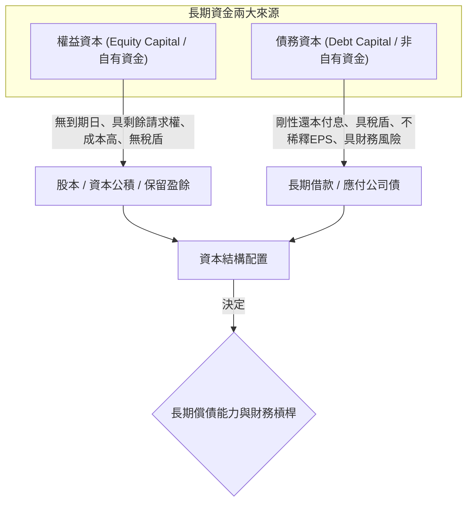
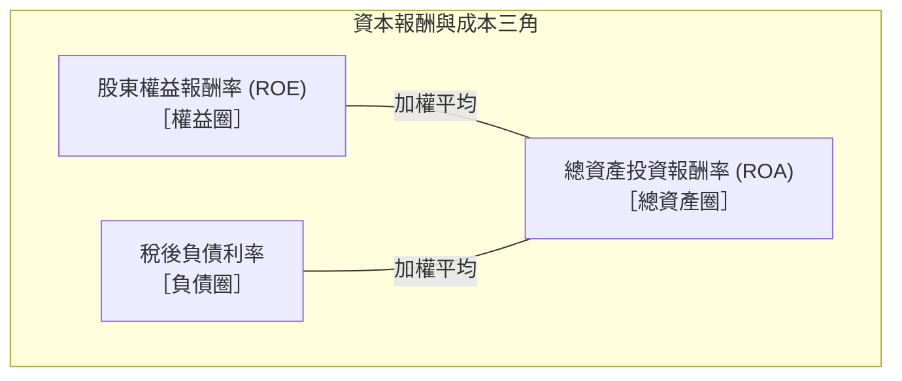
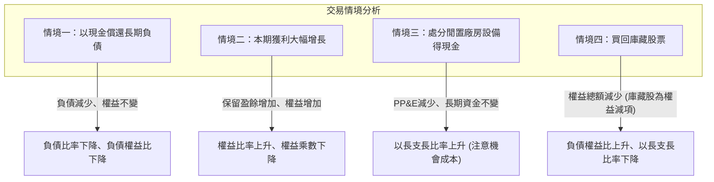

---
{"dg-publish":true,"permalink":"/01//ch06/","title":"Ch06 長期償債能力分析","tags":["PMBA","財務報表分析","長期償債能力","資本結構","負債比率","利息保障倍數","財務槓桿指數"],"dg-note-properties":{"title":"Ch06 長期償債能力分析","course":"財務報表分析","category":"01_基礎先修","type":"lecture-note","lecture":"Ch06","tags":["PMBA","財務報表分析","長期償債能力","資本結構","負債比率","利息保障倍數","財務槓桿指數"],"aliases":["長期償債能力分析","Ch06_長期償債能力分析","L06_長期償債能力分析","Ch06","L06"]}}
---

# Ch06 長期償債能力分析

## 💡 核心摘要

- **[[98_商業概念庫/long-term-solvency_長期償債能力\|zhang-qi-chang-zhai-neng-li_長期償債能力]]是企業穿越景氣循環的底盤實力**：與評估一年內資金缺口的「[[98_商業概念庫/liquidity_流動性\|liu-dong-xing_流動性]]」不同，[[98_商業概念庫/long-term-solvency_長期償債能力\|zhang-qi-chang-zhai-neng-li_長期償債能力]]衡量企業長達數年乃至數十年間，能否持續履約償還[[98_商業概念庫/non-current-liabilities_非流動負債\|fei-liu-dong-liability_非流動負債]]本金並按期支付利息。企業即使短期[[98_商業概念庫/liquidity_流動性\|liu-dong-xing_流動性]]充裕，若背負過度龐大的長期剛性債務，一旦產業景氣反轉，仍會因利息沉重而陷入財務危機。
- **[[98_商業概念庫/capital-structure_資本結構\|capital-structure_資本結構]]的本質：資金成本與財務風險的戰略權衡**：企業的長期資金由「自有資本（[[98_商業概念庫/shareholder-equity_股東權益\|shareholder-equity_股東權益]]）」與「非自有資本（長期負債）」構成。權益資金無到期日且無固定還本付息壓力，但要求較高的股權回報率且股利無[[98_商業概念庫/tax-shield_稅盾\|shui-dun_稅盾]]；長期負債利息具有「[[98_商業概念庫/tax-shield_稅盾\|shui-dun_稅盾]]」效益且不[[98_商業概念庫/diluted-eps_稀釋後每股盈餘\|稀釋後每股盈餘 (Diluted EPS)]]（[[98_商業概念庫/earnings-per-share_每股盈餘\|EPS]]），但具有剛性償付義務，直接推升企業的「財務風險」。
- **[[98_商業概念庫/financial-leverage_財務槓桿\|finance-gang-gan_財務槓桿]]是雙面刃，以[[98_商業概念庫/financial-leverage-index_財務槓桿指數\|finance-gang-gan-zhi-shu_財務槓桿指數]]（FLI）精準檢驗**：當企業的總資產報酬率（[[98_商業概念庫/asset-return-rate_資產報酬率\|ROA]]）高於借款利率時，舉債能為股東創造超額回報（[[98_商業概念庫/financial-leverage-index_財務槓桿指數\|finance-gang-gan-zhi-shu_財務槓桿指數]] $\text{FLI} > 1$），發揮正向槓桿效益；反之，若資產報酬率低於利率（$\text{FLI} < 1$），負債將嚴重侵蝕股東回報，形成致命的負向槓桿。
- **「[[98_商業概念庫/matched-funding_以長支長\|yi-zhang-zhi-zhang_以長支長]]」是資產負債期限匹配的鐵律**：廠房設備等長期生產性資產必須由長期資金（權益 + [[98_商業概念庫/non-current-liabilities_非流動負債\|fei-liu-dong-liability_非流動負債]]）支應，其比率必須嚴格大於 $100\%$。若以[[98_商業概念庫/current-liabilities_流動負債\|liu-dong-liability_流動負債]]支應長期資產（「[[98_商業概念庫/maturity-mismatch_以短支長\|yi-duan-zhi-zhang_以短支長]]」），一旦短債到期面臨抽銀根，企業將被迫緊急處分生產設備，引發經營停擺。
- **[[98_商業概念庫/interest-coverage-ratio_利息保障倍數\|li-xi-bao-zhang-bei-shu_利息保障倍數]]是銀行核貸與信用評等的金標準**：相較於靜態資產[[98_商業概念庫/liability-ratio_負債比率\|liability-bi-rate_負債比率]]，[[98_商業概念庫/interest-coverage-ratio_利息保障倍數\|li-xi-bao-zhang-bei-shu_利息保障倍數]]衡量本業真實獲利對剛性利息支出的涵蓋程度。它是外部債權人評估企業違約機率、設定借貸利率與債務限制條款（Covenants）的最關鍵指標。

---

## 📚 核心觀念與架構

### 長期償債能力與資本結構的基本意涵

[[98_商業概念庫/long-term-solvency_長期償債能力\|zhang-qi-chang-zhai-neng-li_長期償債能力]]（Long-term Solvency）指企業履行長期債務契約（如應付公司債、長期銀行借款等[[98_商業概念庫/non-current-liabilities_非流動負債\|fei-liu-dong-liability_非流動負債]]）之本金清償與利息支付的能力。企業的[[98_商業概念庫/long-term-solvency_長期償債能力\|zhang-qi-chang-zhai-neng-li_長期償債能力]]由其[[98_商業概念庫/capital-structure_資本結構\|capital-structure_資本結構]]（Capital Structure）所決定——即企業長期資金來源中，負債與權益的相對配置比例。

#### 自有資金 vs. 借貸資金的核心特性對比

| 比較維度 | 自有資金（[[shareholder-equity_股東權益]]） | 借貸資金（長期負債） |
| :--- | :--- | :--- |
| **資金期限** | 無限期（除非公司清算解散，否則無須還本） | 具有明確到期日，必須依約還本 |
| **支付義務** | 彈性發放股利；景氣低迷時可不發放 | 剛性義務；無論盈虧均須定期支付利息 |
| **清償順位** | 享有「剩餘請求權」，清算時順位最後，承受最終風險 | 優先於股東受償，受法律與合約嚴格保護 |
| **資金成本** | 較高（股東承擔經營風險，要求較高股權報酬率） | 較低（債權人風險較低，要求固定利息報酬） |
| **稅務效益** | **無[[tax-shield_稅盾|shui-dun_稅盾]]**（股利係由稅後淨利分配，無法抵稅） | **具[[tax-shield_稅盾|shui-dun_稅盾]]**（利息列為稅前費用，可合法扣抵課稅所得） |
| **控制權** | 具表決權，增資發行新股可能稀釋既有股權與 EPS | 無表決權，不稀釋股權，保障經營決策獨立性 |

---

### 財務槓桿原理與財務槓桿指數（FLI）

#### 1. 財務槓桿（Financial Leverage）機制
[[financial-leverage_財務槓桿|finance-gang-gan_財務槓桿]]指企業利用成本固定的負債資金，來擴大自有資金的獲利空間。
- **正面槓桿範例**：若企業發現一項報酬率高達 $20\%$ 的投資案，而銀行長期借款利率僅需 $5\%$。企業每向外借入 1 元，支付 0.05 元利息後，可為股東創造 0.15 元（$15\%$）的淨獲利。企業以少量的自有資金撬動龐大資產，即為「以小搏大」的[[financial-leverage_財務槓桿|finance-gang-gan_財務槓桿]]。
- **財務風險（Financial Risk）**：若景氣反轉，投資案報酬率跌至 $3\%$，不足以支付 $5\%$ 的固定利息，差額 $2\%$ 必須由自有資金補足，加速侵蝕[[shareholder-equity_股東權益]]。

#### 2. 財務槓桿指數（Financial Leverage Index, FLI）
[[financial-leverage-index_財務槓桿指數|finance-gang-gan-zhi-shu_財務槓桿指數]]是量化評估企業舉債經營對股東是否有利的核心指標：
$$\text{財務槓桿指數 (FLI)} = \frac{\text{股東權益報酬率 (ROE)}}{\text{總資產投資報酬率 (ROA)}}$$

- **分母：總資產投資報酬率（ROA）之精確定義**
  總資產是由權益與負債共同支持，因此衡量總資產產生的效益時，必須採用**償付債權人利息之前、且發放股東股利之前的息前報酬**，以客觀反映資產純粹的經營效率：
  $$\text{ROA} = \frac{\text{息前稅後淨利}}{\text{平均總資產}} = \frac{\text{稅後淨利} + \text{利息費用} \times (1 - \text{營所稅率})}{\text{平均總資產}}$$
- **分子：[[shareholder-equity_股東權益]]報酬率（ROE）**
  $$\text{ROE} = \frac{\text{稅後淨利}}{\text{平均股東權益}}$$

#### 3. 「三個圈圈」加權平均模型與判讀準則

總資產報酬率（ROA）本質上是由「[[shareholder-equity_股東權益]]報酬率（ROE）」與「負債利率」按資本比重加權平均而來，因此 ROA 必然介於 ROE 與負債利率之間：
1. **$\text{FLI} > 1.0$（正面槓桿，舉債經營有利）**：
   $$\text{ROE} > \text{ROA} > \text{負債利率}$$
   表示資產所賺得的報酬率高於借款成本，舉債為股東帶來超額回報。
2. **$\text{FLI} = 1.0$（槓桿中性）**：
   $$\text{ROE} = \text{ROA} = \text{負債利率}$$
   舉債報酬剛好抵銷借款利息，對股東無額外損益。
3. **$\text{FLI} < 1.0$（負面槓桿，舉債經營有害）**：
   $$\text{ROE} < \text{ROA} < \text{負債利率}$$
   資產賺取的報酬不足以支應借款利率，舉債反倒拖垮股東回報，財務風險極高，不宜擴大舉債。

---

### 資本結構核心比率（靜態存量指標）

#### 1. 負債比率（Debt Ratio / 負債佔資產比率）
- **定義與公式**：從資產角度出發，衡量企業總資產中透過舉債取得的比例。
  $$\text{負債比率} = \frac{\text{負債總額}}{\text{資產總額}} \times 100\%$$
- **判讀意涵**：反映企業整體依賴外部負債的程度。若[[liability-ratio_負債比率|liability-bi-rate_負債比率]]超過 $50\%$，代表自有資金佔比不到一半，一旦債務集中到期，資產清算變現的償債壓力沉重。一般穩健型產業建議維持在 $50\%$ 以下。

#### 2. 權益比率（Equity Ratio）
- **定義與公式**：衡量企業總資產中由股東自有資本支應的比例，與[[liability-ratio_負債比率|liability-bi-rate_負債比率]]形成互補。
  $$\text{權益比率} = \frac{\text{股東權益總額}}{\text{資產總額}} \times 100\%$$
  $$\text{負債比率} + \text{權益比率} = 100\%$$
- **判讀意涵**：代表企業[[capital-structure_資本結構]]的自主性與安全緩衝，通常期望維持在 $50\%$ 以上。

#### 3. 負債權益比（Debt-to-Equity Ratio, D/E / 產權比率）
- **定義與公式**：從股東角度出發，衡量股東每出 1 元自有資金，向外借款多少元。
  $$\text{負債權益比} = \frac{\text{負債總額}}{\text{股東權益總額}} \times 100\%$$
- **判讀意涵**：若 D/E $> 100\%$ ($1.0$)，代表債權人在總資產中的資本投入超過股東，股東角色相對弱化；清算時債權人保障降低，財務結構較不健全。

#### 4. 財務槓桿比率 / 權益乘數（Equity Multiplier）
- **定義與公式**：衡量股東每投入 1 元資本，能夠撬動與控制的資產總額倍數。
  $$\text{權益乘數} = \frac{\text{資產總額}}{\text{股東權益總額}} = 1 + \text{負債權益比}$$
- **乘數效應**：若[[liability-equity_負債權益比|liability-equity-bi_負債權益比]]為 $1.01$（$101\%$），則[[equity_權益乘數|equity-cheng-shu_權益乘數]]為 $2.01$。意即股東每出資 1 元，可額外借入 1.01 元，合計操縱 2.01 元的資產。若 D/E 不宜大於 1.0，則[[equity_權益乘數|equity-cheng-shu_權益乘數]]通常**不宜大於 2.0**。

#### 5. 長期資金佔不動產廠房及設備比率（以長支長比率）
- **定義與公式**：衡量企業的長期資產是否由穩定的長期資金全額支應，嚴格檢驗「[[matched-funding_以長支長|yi-zhang-zhi-zhang_以長支長]]」原則。
  $$\text{長期資金佔不動產廠房及設備比率} = \frac{\text{股東權益} + \text{非流動負債}}{\text{不動產、廠房及設備淨額 (PP\&E)}} \times 100\%$$
- **原則與門檻**：
  - **必須 $> 100\%$ ($1.0$)**：不動產廠房及設備屬長期使用、透過多年產銷創造現金流的生產性資產，無法在短期內迅速變賣。若此比率 $< 100\%$，代表企業動用了[[current-liabilities_流動負債|liu-dong-liability_流動負債]]（短期借款）去買廠房設備，陷入危險的「[[maturity-mismatch_以短支長|yi-duan-zhi-zhang_以短支長]]」。一旦短期債務到期被銀行抽銀根，企業將面臨查封或被迫賤賣生產設備的破產危機。

---

### 獲利涵蓋能力（動態流量指標）

#### 1. 利息保障倍數（Times Interest Earned, TIE）
- **定義與公式**：衡量企業由日常營業獲利中，支付債務利息費用的涵蓋倍數。
  $$\text{利息保障倍數} = \frac{\text{稅前息前利益 (EBIT)}}{\text{利息費用（財務成本）}} = \frac{\text{稅前淨利} + \text{利息費用}}{\text{利息費用}}$$
- **編製細節與考量**：
  - **採用繼續營業部門損益**：排除偶發、不可持續的「[[income-loss_停業部門損益|ting-ye-bu-men-sun-yi_停業部門損益]]」，以真實反映長期可持續的獲利涵蓋力。
  - **稅前息前邏輯**：稅前淨利原本已扣除利息費用，故分子必須將利息費用加回；且利息是在所得稅之前扣抵，故採用稅前基礎。

#### 2. 進階指標：EBITDA 利息保障倍數
- **定義與公式**：考量[[zhe-jiu_折舊]]與攤銷為「非現金費用」，企業實質可用於支付利息的現金流更接近 EBITDA：
  $$\text{EBITDA 利息保障倍數} = \frac{\text{稅前息前折舊攤銷前利益 (EBITDA)}}{\text{利息費用}} = \frac{\text{EBIT} + \text{折舊費用} + \text{攤銷費用}}{\text{利息費用}}$$
- **商業意義**：在重資本支出、[[zhe-jiu_折舊]]龐大的製造業中，EBITDA [[interest-coverage-ratio_利息保障倍數|li-xi-bao-zhang-bei-shu_利息保障倍數]]能更真實反映短中期的付息現金安全邊際。

---

## ⚠️ 實務應用與經理人思維

### 高負債結構在景氣循環反轉時的違約風險

在景氣繁榮擴張期，高槓桿企業因享受[[financial-leverage_財務槓桿|finance-gang-gan_財務槓桿]]帶來的 EPS 爆發成長而備受推崇；但一旦遭遇景氣反轉，高負債結構將演變為致命毒藥：
1. **剛性利息支出的黑洞效應**：原物料價格暴跌、客戶砍單導致營收銳減，但向銀行與債券持有人支付的利息費用**一毛都不能少**。
2. **債務螺旋與信用評等調降**：營收下滑 $\to$ EBIT 縮水 $\to$ [[interest-coverage-ratio_利息保障倍數|li-xi-bao-zhang-bei-shu_利息保障倍數]]跌破警戒線 $\to$ 信評機構降評 $\to$ 融資成本暴增、銀行拒絕展期或要求提前清償 $\to$ 資金鏈斷裂宣告破產。

---

### 表外負債（Off-balance-sheet Financing）的判讀盲點

財務分析師與經理人審視[[balance-sheet_資產負債表]]時，絕不能僅看帳面列示的負債總額，必須深入檢閱[[financial-2_財務報表附註|finance-bao-biao-fu-zhu_財務報表附註]]，挖掘潛在的「[[off-balance-sheet-liabilities_表外負債|biao-wai-liability_表外負債]]」：
1. **未資本化的租賃合約（歷史營運租賃）**：在 IFRS 16 實施前，企業常透過營運租賃形式租賃龐大飛機、船舶或廠房，規避認列資產與負債；即便現行會計準則要求認列[[asset-3_使用權資產|shi-yong-quan-asset_使用權資產]]與租賃負債，仍需注意短期租賃與低價值資產租賃之附註揭露。
2. **關係人背書保證與連帶擔保**：母公司常為轉投資子公司或關係企業向銀行借款提供背書保證。此類保證不入帳面[[balance-sheet_資產負債表]]，但一旦子公司經營失敗倒閉，母公司將承擔全額連帶清償責任，瞬間轉化為巨額實質負債。
3. **售後租回與[[receivable_應收帳款|ying-shou-zhang-kuan_應收帳款]]無追索權割讓**：透過複雜結構融資將實質借款包裝為資產處分交易，隱匿真實[[financial-leverage_財務槓桿|finance-gang-gan_財務槓桿]]。

---

### 為何利息保障倍數是銀行核貸與授信的核心指標？

在商業銀行審查企業大額聯貸案或信用評等時，[[interest-coverage-ratio_利息保障倍數|li-xi-bao-zhang-bei-shu_利息保障倍數]]的重要程度遠高於單純的資產[[liability-ratio_負債比率|liability-bi-rate_負債比率]]：
- **第一道違約防線**：[[balance-sheet_資產負債表]]反映的是靜態歷史成本，若資產無法變現，再高的資產規模也無法償債；而[[interest-coverage-ratio_利息保障倍數|li-xi-bao-zhang-bei-shu_利息保障倍數]]衡量企業「營業獲利能否覆蓋剛性利息支出」，是評估付息能力的動態指標。
- **債務限制條款（Debt Covenants）標準**：銀行在長期聯貸合約中，通常會強制要求借款企業在合約期間內，[[interest-coverage-ratio_利息保障倍數|li-xi-bao-zhang-bei-shu_利息保障倍數]]必須維持在特定門檻以上（例如 $\ge 3.0$ 或 $4.0$ 倍）。若企業跌破該門檻，即構成合約違約（Technical Default），銀行有權要求立即提高借款利率、要求提供額外擔保品，甚至要求提前清償全部本金。

---

### 個案深度剖析：假鋼鐵公司 vs. 乙鋼鐵公司（資本結構對決）

逐字稿以台灣歷史悠久的鋼鐵龍頭「假公司」與同業新興標竿「乙公司」為實例，展現[[long-term-solvency_長期償債能力|zhang-qi-chang-zhai-neng-li_長期償債能力]]之動靜態診斷：

#### 1. 假公司第八年指標全景圖
- **資產總額與資金結構**：
  - 總資產 = 666（百萬位，即 6660 億）。
  - 負債總額 = 334（[[current-liabilities_流動負債|liu-dong-liability_流動負債]] 152、[[non-current-liabilities_非流動負債|fei-liu-dong-liability_非流動負債]] 182） $\implies$ **[[liability-ratio_負債比率|liability-bi-rate_負債比率]]** $= \frac{334}{666} = 50.17\%$。
  - [[shareholder-equity_股東權益]] = 332（普通股 157、特別股、[[capital-3_資本公積|capital-gong-ji_資本公積]]、[[retained-earnings_保留盈餘|bao-liu-ying-yu_保留盈餘]] 115、庫藏股 -8） $\implies$ **[[equity-ratio_權益比率|equity-bi-rate_權益比率]]** $= 49.83\%$。
  - **[[liability-equity_負債權益比|liability-equity-bi_負債權益比]] (D/E)** $= \frac{334}{332} = 1.01$（$101\%$），負債與權益平起平坐。
  - **[[equity_權益乘數|equity-cheng-shu_權益乘數]]** $= \frac{666}{332} = 2.01$，每 1 元自有資金撬動 2.01 元資產。
- **[[matched-funding_以長支長|yi-zhang-zhi-zhang_以長支長]]檢驗**：
  - 長期資金 = [[shareholder-equity_股東權益]] 332 + [[non-current-liabilities_非流動負債|fei-liu-dong-liability_非流動負債]] 182 = 514。
  - 不動產廠房及設備 (PP&E) = 390。
  - **[[matched-funding_以長支長|yi-zhang-zhi-zhang_以長支長]]比率** $= \frac{514}{390} = 131.86\% > 100\%$，長期資產完全由長期資金支應，無挪用短債之虞。
- **槓桿效益與獲利涵蓋**：
  - **[[financial-leverage-index_財務槓桿指數|finance-gang-gan-zhi-shu_財務槓桿指數]] (FLI)**：連續六年穩定 $> 1.0$，顯示總資產賺取的報酬率高於向外借款的利率，舉債經營對股東產生實質正面貢獻。
  - **[[interest-coverage-ratio_利息保障倍數|li-xi-bao-zhang-bei-shu_利息保障倍數]]**：稅前淨利 12，財務成本（利息支出） 3 $\implies \text{TIE} = \frac{12 + 3}{3} = 5.07 \text{ 倍}$。

#### 2. 與同業乙公司的關鍵對照與經理人啟示
- **[[liability-ratio_負債比率|liability-bi-rate_負債比率]]歷年走勢**：假公司長年維持在 $50\%$ 上下平穩運作；乙公司則從早期的 $40\%$ 逐步擴張提升至 $50\%$。假公司憑藉悠久的產業信譽與雄厚規模，能以更低成本取得長期借貸資金，進而穩定維持約五成的[[liability-ratio_負債比率|liability-bi-rate_負債比率]]。
- **[[matched-funding_以長支長|yi-zhang-zhi-zhang_以長支長]]比率**：兩家公司皆高於 $100\%$，但乙公司歷年比率顯著高於假公司，反映乙公司在擴充廠房設備時更偏向採用長期資金與權益融資，資產配置更為保守安全。
- **[[interest-coverage-ratio_利息保障倍數|li-xi-bao-zhang-bei-shu_利息保障倍數]]波動之警訊**：乙公司的[[interest-coverage-ratio_利息保障倍數|li-xi-bao-zhang-bei-shu_利息保障倍數]]在多數年度高於假公司，但在第七、八年突然大幅下滑。經理人需深入剖析：此下滑究竟是因為鋼鐵市況低迷導致淨利萎縮，還是因為乙公司在此兩年大舉借入高額債務擴建高爐，導致利息負擔急遽暴增？這提醒經理人，單一比率的變化必須同時比對分子（獲利變動）與分母（融資結構）的連動關係。

---

### 重要商業交易對長期償債指標之衝擊分析

經理人在進行重大財務決策時，需精確評估其對各項財務結構指標的連鎖影響：

1. **以現金償還長期借款（[[non-current-liabilities_非流動負債|fei-liu-dong-liability_非流動負債]]）**：
   - 資產方現金（[[current-assets_流動資產|liu-dong-asset_流動資產]]）減少，負債方[[non-current-liabilities_非流動負債|fei-liu-dong-liability_非流動負債]]等額減少，[[shareholder-equity_股東權益]]不變。
   - **影響**：[[liability-ratio_負債比率|liability-bi-rate_負債比率]]與[[liability-equity_負債權益比|liability-equity-bi_負債權益比]]顯著下降，財務結構更趨穩健；但手頭[[liquidity_流動性|liu-dong-xing_流動性]]減少。
2. **本期獲利增加（[[retained-earnings_保留盈餘|bao-liu-ying-yu_保留盈餘]]累積）**：
   - 損益表淨利結轉至權益項下的[[retained-earnings_保留盈餘|bao-liu-ying-yu_保留盈餘]]，資產方[[current-assets_流動資產|liu-dong-asset_流動資產]]等額增加。
   - **影響**：權益總額擴大，[[liability-equity_負債權益比|liability-equity-bi_負債權益比]]與[[equity_權益乘數|equity-cheng-shu_權益乘數]]自然調降，強化長期抗風險韌性。
3. **處分廠房設備取得現金**：
   - [[current-assets-2_非流動資產|fei-liu-dong-asset_非流動資產]]（PP&E）減少，[[current-assets_流動資產|liu-dong-asset_流動資產]]（現金）增加，總資產與[[capital-structure_資本結構]]不變。
   - **影響**：[[matched-funding_以長支長|yi-zhang-zhi-zhang_以長支長]]比率的分母縮小，使比率上升；[[ratio_流動比率|liu-dong-bi-rate_流動比率]]改善。但經理人必須評估處分生產性資產是否損及未來的產能與營收創造潛力（機會成本）。
4. **買回[[treasury-stock_庫藏股票|ku-cang-stock_庫藏股票]]**：
   - 現金減少，權益項下之「[[treasury-stock_庫藏股票|ku-cang-stock_庫藏股票]]」增加（作為權益的減項），導致**[[shareholder-equity_股東權益]]總額減少**。
   - **影響**：長期資金（權益 + [[non-current-liabilities_非流動負債|fei-liu-dong-liability_非流動負債]]）減少，導致「[[long-term-capital-to-fixed-assets-ratio_長期資金佔不動產廠房及設備比率|zhang-qi-zi-jin-zhan-bu-dong-chan-chang-fang-ji-she-bei-bi-rate_長期資金佔不動產廠房及設備比率]]」下降；同時權益減少會推升[[liability-equity_負債權益比|liability-equity-bi_負債權益比]]與[[equity_權益乘數|equity-cheng-shu_權益乘數]]，增加財務風險。
