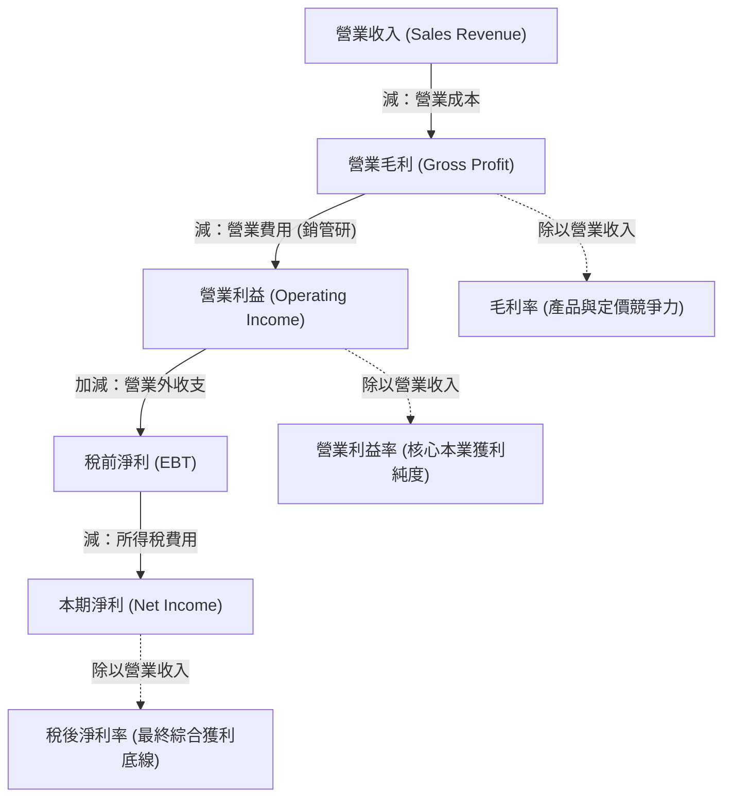
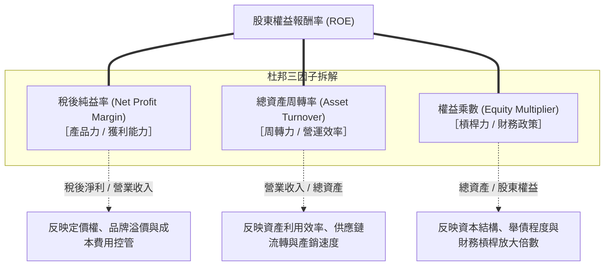

---
{"dg-publish":true,"permalink":"/01/01/ch07/","title":"Ch07 獲利能力分析","tags":["PMBA","財務報表分析","獲利能力","杜邦分析","ROE","ROA","利潤階梯"],"dg-note-properties":{"title":"Ch07 獲利能力分析","course":"財務報表分析","category":"01_基礎先修","type":"lecture-note","lecture":"01_Ch07","tags":["PMBA","財務報表分析","獲利能力","杜邦分析","ROE","ROA","利潤階梯"],"aliases":["獲利能力分析","Ch07_獲利能力分析","L07_獲利能力分析","Ch07","L07"]}}
---

# Ch07 獲利能力分析

## 💡 核心摘要

- **[[98_商業概念庫/profitability_獲利能力\|huo-li-neng-li_獲利能力]]是企業[[98_商業概念庫/business-model_商業模式\|business-model_商業模式]]與長期價值的終極裁判**：不同於評估短期生存底線的「[[98_商業概念庫/liquidity_流動性\|liu-dong-xing_流動性]]」與防範違約倒閉的「[[98_商業概念庫/long-term-solvency_長期償債能力\|zhang-qi-chang-zhai-neng-li_長期償債能力]]」，[[98_商業概念庫/profitability_獲利能力\|huo-li-neng-li_獲利能力]]衡量企業運用各項資本與資源為股東創造超額利潤的效率。它是支應營運周轉、償還債務本息與發放現金股利的源頭活水。
- **損益階梯逐層穿透：毛利、[[98_商業概念庫/operating-income_營業利益\|operating-income_營業利益]]與淨利的商業密碼**：
  - [[98_商業概念庫/gross-margin-rate_毛利率\|gross-margin-rate_毛利率]]體現產品競爭力與定價話語權（粗略獲利空間）；
  - [[98_商業概念庫/operating-income-rate_營業利益率\|operating-income-rate_營業利益率]]排除業外與稅務干擾，直接檢驗核心本業造血純度；
  - [[98_商業概念庫/net-profit-margin_淨利率\|jing-li-rate_淨利率]]為最後底線（Bottom-line）。三者的階梯差距，精準揭示了[[98_商業概念庫/operating-expenses_營業費用\|operating-expenses_營業費用]]（銷管研）負擔與營業外損益的侵蝕程度。
- **[[98_商業概念庫/dupont-analysis_杜邦分析法\|du-bang-analysis-fa_杜邦分析法]]（DuPont Identity）：ROE 的三核動力引擎**：
  $$\text{ROE} = \text{純益率 (產品力)} \times \text{總資產周轉率 (周轉力)} \times \text{權益乘數 (槓桿力)}$$
  杜邦模型將股東回報拆解為[[98_商業概念庫/business-model_商業模式\|business-model_商業模式]]的三大支柱，揭示不同產業在「高利潤」與「高周轉」之間的策略取捨，為經理人提供診斷經營體質的系統性架構。
- **警惕高 ROE 陷阱：過度依賴[[98_商業概念庫/financial-leverage_財務槓桿\|finance-gang-gan_財務槓桿]]的虛胖風險**：高 ROE 並不必然代表企業卓越。若 ROE 的推升純粹來自於拉大[[98_商業概念庫/financial-leverage_財務槓桿\|finance-gang-gan_財務槓桿]]（[[98_商業概念庫/equity_權益乘數\|equity-cheng-shu_權益乘數]]），而非源於本業[[98_商業概念庫/net-profit-margin_淨利率\|jing-li-rate_淨利率]]或資產周轉率的實質改善，這種「虛胖 ROE」在景氣反轉時將瞬間轉化為致命的債務違約與斷頭危機。
- **成本費用的雙重性與部門別獲利穿透**：成本費用既是侵蝕獲利的「阻力」，也是撬動營收的「助力」（[[98_商業概念庫/selling-expense-ratio_推銷費用率\|tui-xiao-fei-yong-rate_推銷費用率]]、[[98_商業概念庫/rd-expense-ratio_研發費用率\|yan-fa-fei-yong-rate_研發費用率]]、預期信用減損率）。結合 IFRS 8 [[98_商業概念庫/operating-information_營運部門資訊\|operations-bu-men-zi-xun_營運部門資訊]]，經理人能穿透整體財報迷霧，精準識別真正貢獻利潤的「隱形金牛」（如假電信之網際網路部門）。

---

## 📚 核心觀念與架構

### 獲利能力的多維度指標階梯

[[98_商業概念庫/profitability_獲利能力\|huo-li-neng-li_獲利能力]]分析的核心在於探討企業「以收入扣除相關成本與費用後所賺取的利潤能力」。在[[98_商業概念庫/income-loss-3_綜合損益表\|zong-he-income-statement_綜合損益表]]中，獲利並非單一數字，而是一個逐層遞減、反映不同經營層級的階梯式架構：

#### 1. 毛利率（Gross Profit Margin, GPM）
- **定義與公式**：衡量每一元[[98_商業概念庫/operating-revenue_營業收入\|ying-ye-shou-ru_營業收入]]在扣除產品的直接取得或製造成本後，所剩餘的毛利比例。
  $$\text{毛利率} = \frac{\text{營業毛利}}{\text{營業收入}} \times 100\% = \frac{\text{營業收入} - \text{營業成本}}{\text{營業收入}} \times 100\%$$
- **商業意涵**：反映產品或服務最原始的產銷空間。[[98_商業概念庫/gross-margin-rate_毛利率\|gross-margin-rate_毛利率]]越高，代表消費者對產品的偏好程度越高（願付高價）、供應鏈議價與製造成本壓低能力越強；同時，充沛的毛利也賦予企業更多資源去投入行銷推廣與研發創新。

#### 2. 營業利益率（Operating Profit Margin, OPM）
- **定義與公式**：衡量每一元[[98_商業概念庫/operating-revenue_營業收入\|ying-ye-shou-ru_營業收入]]在扣除[[98_商業概念庫/cost-of-goods-sold_營業成本\|ying-ye-cost_營業成本]]與銷管研[[98_商業概念庫/operating-expenses_營業費用\|operating-expenses_營業費用]]後，純粹由核心本業所賺得的獲利比例。
  $$\text{營業利益率} = \frac{\text{營業利益}}{\text{營業收入}} \times 100\%$$
- **商業意涵**：剔除了非本業的投資收益、資產處分損益與利息負擔，是檢驗企業核心業務獲利純度與營運管理效率的最關鍵指標。

#### 3. 稅後淨利率（Net Profit Margin, NPM / 稅後純益率）
- **定義與公式**：衡量每一元[[98_商業概念庫/operating-revenue_營業收入\|ying-ye-shou-ru_營業收入]]在考量完本業產銷、[[98_商業概念庫/operating-expenses_營業費用\|operating-expenses_營業費用]]、業外收支及所得稅費用後，最終真正為股東淨賺的比例。
  $$\text{稅後淨利率} = \frac{\text{本期淨利}}{\text{營業收入}} \times 100\%$$
- **指標差距之判讀**：
  - **[[98_商業概念庫/gross-margin-rate_毛利率\|gross-margin-rate_毛利率]]與[[98_商業概念庫/operating-income-rate_營業利益率\|operating-income-rate_營業利益率]]的差距**：反映推銷、管理與[[98_商業概念庫/rd-expense_研發費用\|yan-fa-fei-yong_研發費用]]的消耗程度。
  - **[[98_商業概念庫/operating-income-rate_營業利益率\|operating-income-rate_營業利益率]]與稅後[[98_商業概念庫/net-profit-margin_淨利率\|jing-li-rate_淨利率]]的差距**：反映[[98_商業概念庫/non-operating-income-expenses_營業外收支\|ying-ye-wai-shou-zhi_營業外收支]]的波動與租稅負擔。若兩者差距過大，代表企業獲利高度依賴業外收益（業外獲利通常不可持續且波動劇烈）。

---

### 股東權益報酬率（ROE） vs. 資產報酬率（ROA）

評估企業[[98_商業概念庫/profitability_獲利能力\|huo-li-neng-li_獲利能力]]時，除了以「營收」為基礎的利潤率外，更關鍵的是以「資本投入」為基礎的回報率：

| 比較維度 | 資產報酬率（ROA） | [[98_商業概念庫/shareholder-equity_股東權益\|shareholder-equity_股東權益]]報酬率（ROE） |
| :--- | :--- | :--- |
| **定義** | 衡量企業運用**全部資產**（不論資金來自股東或債權人）賺取收益的效率。 | 衡量企業運用**股東自有資本**為股東創造淨利潤的效率。 |
| **分子衡量** | 息前稅後淨利：$\text{稅後淨利} + \text{利息費用} \times (1 - \text{稅率})$ | [[98_商業概念庫/net-income_本期淨利\|ben-qi-jing-li_本期淨利]]（稅後淨利） |
| **分母衡量** | 平均資產總額（$\frac{\text{期初資產} + \text{期末資產}}{2}$） | 平均[[98_商業概念庫/shareholder-equity_股東權益\|shareholder-equity_股東權益]]總額（$\frac{\text{期初權益} + \text{期末權益}}{2}$） |
| **標準公式** | $$\text{ROA} = \frac{\text{稅後淨利} + \text{利息費用} \times (1 - \text{稅率})}{\text{平均總資產}}$$ | $$\text{ROE} = \frac{\text{本期淨利}}{\text{平均股東權益}}$$ |
| **核心視角** | **總經理 / 營運長視角**：純粹衡量資產管理與營運創造效益的能力，不受[[98_商業概念庫/financial-leverage_財務槓桿\|finance-gang-gan_財務槓桿]]多寡干擾。 | **董事會 / 股東視角**：衡量股東投入的每一塊錢到底能拿回多少回報，為巴菲特選股的核心指標。 |

---

### 杜邦分析法（DuPont Identity）三因子拆解

[[98_商業概念庫/dupont-analysis_杜邦分析法\|du-bang-analysis-fa_杜邦分析法]]是財務分析中最經典的利器，它將綜合性指標 [[98_商業概念庫/shareholder-equity-return-rate_股東權益報酬率\|gu-dong-equity-return-rate_股東權益報酬率]] 透過連鎖替代拆解為三個各具商業意義的驅動因子：

#### 杜邦恆等式數學推導
$$\text{ROE} = \frac{\text{稅後淨利}}{\text{股東權益}} = \left( \frac{\text{稅後淨利}}{\text{營業收入}} \right) \times \left( \frac{\text{營業收入}}{\text{總資產}} \right) \times \left( \frac{\text{總資產}}{\text{股東權益}} \right)$$
$$\text{ROE} = \text{純益率 (Profit Margin)} \times \text{總資產周轉率 (Asset Turnover)} \times \text{權益乘數 (Equity Multiplier)}$$

#### 商業三核心意涵：
1. **產品力（純益率）**：每賣出 1 元產品能留下多少利潤。體現企業的技術壁壘、品牌溢價、毛利空間與營運費用控管能力。
2. **周轉力（[[98_商業概念庫/total-assets_總資產周轉率\|zong-asset-zhou-zhuan-rate_總資產周轉率]]）**：每投入 1 元資產能撬動多少[[98_商業概念庫/operating-revenue_營業收入\|ying-ye-shou-ru_營業收入]]。體現企業的產能利用率、[[98_商業概念庫/inventory_存貨\|cun-huo_存貨]]與[[98_商業概念庫/receivable_應收帳款\|ying-shou-zhang-kuan_應收帳款]]周轉效率，以及[[98_商業概念庫/business-model_商業模式\|business-model_商業模式]]的[[98_商業概念庫/liquidity_流動性\|liu-dong-xing_流動性]]。
3. **槓桿力（[[98_商業概念庫/equity_權益乘數\|equity-cheng-shu_權益乘數]]）**：每 1 元自有資金能放大控制多少資產規模。體現企業的融資決策與財務風險偏好。

---

### 成本費用的結構性剖析：助力 vs. 阻力

在損益表中扣減的各項成本費用，在經營決策上具有本質上的矛盾與雙重性：
- **阻力視角**：費用越高，帳面淨利越低，構成獲利計算的拖累。
- **助力視角**：費用是創造[[98_商業概念庫/operating-revenue_營業收入\|ying-ye-shou-ru_營業收入]]不可或缺的資源投入。不投入[[98_商業概念庫/cost-of-goods-sold_營業成本\|ying-ye-cost_營業成本]]就沒有產品可賣；不投入推銷費用就無法打開市場；不投入[[98_商業概念庫/rd-expense_研發費用\|yan-fa-fei-yong_研發費用]]就無法維持技術領先。

#### 1. 成本習性分類與營運槓桿
- **變動成本**（Variable Costs）：隨銷量成正比例增加（如銷售佣金、計件工資、包裝材料）。
- **固定成本**（Fixed Costs）：在特定產能範圍內，不隨銷量變動而改變（如廠房設備[[98_商業概念庫/zhe-jiu_折舊\|zhe-jiu_折舊]]、長期租金、核心管理人員薪資）。
- **半變動成本**（Mixed Costs）：兼具固定與變動性質（如水電費基本費 + 依度數計費）。
> [!NOTE]
> 當營收成長時，固定成本佔營收比重被稀釋，利潤成長幅度遠高於營收成長幅度（正向營運槓桿）；但在景氣衰退、營收下滑時，固定成本一毛不減，佔比迅速暴增，嚴重侵蝕獲利。

#### 2. 各項費用佔營業收入比率
- **[[98_商業概念庫/operating-expense-ratio_營業比率\|ying-ye-bi-rate_營業比率]]（Operating Ratio）**：
  $$\text{營業比率} = \frac{\text{營業成本} + \text{營業費用}}{\text{營業收入}} \times 100\% = 1 - \text{營業利益率}$$
  衡量每一元營收中用於本業產銷與營運的支出比重。[[98_商業概念庫/operating-expense-ratio_營業比率\|ying-ye-bi-rate_營業比率]]越低，本業[[98_商業概念庫/operating-income-rate_營業利益率\|operating-income-rate_營業利益率]]越高。
- **推銷費用佔[[98_商業概念庫/operating-revenue_營業收入\|ying-ye-shou-ru_營業收入]]比率**：$\frac{\text{推銷費用}}{\text{營業收入}} \times 100\%$。需透過實質行銷成效評估，判斷是積極開拓市場的「努力」，抑或是低效行銷引發的「拖累」。
- **壞帳費用（預期信用減損）佔[[98_商業概念庫/operating-revenue_營業收入\|ying-ye-shou-ru_營業收入]]比率**：$\frac{\text{壞帳費用}}{\text{營業收入}} \times 100\%$。反映企業賒銷授信政策的嚴謹度。
- **[[98_商業概念庫/rd-expense_研發費用\|yan-fa-fei-yong_研發費用]]佔[[98_商業概念庫/operating-revenue_營業收入\|ying-ye-shou-ru_營業收入]]比率**：$\frac{\text{研發費用}}{\text{營業收入}} \times 100\%$。反映企業對未來產品競爭力與技術護城河的投資強度。部分企業會將[[98_商業概念庫/rd-expense_研發費用\|yan-fa-fei-yong_研發費用]]併入管理費用中揭露以隱藏研發動向，分析時需特別留意。

---

### 每股盈餘（EPS）與營運部門資訊

#### 1. 每股盈餘（Earnings Per Share, EPS）
- **基本[[98_商業概念庫/earnings-per-share_每股盈餘\|mei-gu-ying-yu_每股盈餘]]**：
  $$\text{基本 EPS} = \frac{\text{本期淨利} - \text{特別股股利}}{\text{流通在外普通股加權平均股數}}$$
- **[[98_商業概念庫/diluted-eps_稀釋後每股盈餘\|稀釋後每股盈餘 (Diluted EPS)]]**：假設公司所有具稀釋性質的潛在普通股（可轉換公司債、認股權憑證、員工認股權）全部執行轉換時計算的每股獲利。兩者差距揭示了潛在股權稀釋風險。

#### 2. 營運部門資訊（IFRS 8）
根據國際會計準則第 8 號公報，企業應依內部管理報表視角，揭露營運部門（產品別、地區別、重要客戶佔比 $> 10\%$）的收入、費用、損益與資產：
- 必須符合「從事經營活動可取得收入並發生費用」、「營運結果定期由主要營運決策者覆核」、「具備單獨財務資訊」三項條件。
- 讓外部分析師與經理人穿透合併報表總額，精準看清各業務線的獲利貢獻。

---

## ⚠️ 實務應用與經理人思維

### 不同產業追求 ROE 的策略抉擇

不同產業受限於商業特性與資本密集度，其追求高 ROE 的路徑截然不同：

| 戰略模式 | 杜邦特徵 | 代表產業與企業 | 核心商業邏輯與管理重點 |
| :--- | :--- | :--- | :--- |
| **高利潤型** (High Margin) | **高純益率** 低周轉率 低槓桿 | 頂級精品（LVMH、愛馬仕）、生技新藥、高階晶片設計（輝達 Nvidia） | 依靠強大技術專利或品牌情感溢價，享有極高定價權；銷量雖小但毛利驚人。管理重點在於研發創新與品牌護城河維護。 |
| **高周轉型** (High Turnover) | 低純益率 **高周轉率** 中低槓桿 | 量販超商（Costco、沃爾瑪）、電子代工（鴻海）、快時尚（Zara） | 產品標準化且競爭激烈，毛利被壓縮至極致；透過精實供應鏈管理、極速庫存去化與零應收帳期「薄利多銷」。管理重點在於周轉效率與規模經濟。 |
| **高槓桿型** (High Leverage) | 中低純益率 極低周轉率 **高[[98_商業概念庫/equity_權益乘數\|equity-cheng-shu_權益乘數]]** | 商業銀行、金融保險、房地產開發、公用事業 | 業務本身利差微薄或資產龐大周轉緩慢，必須依賴借款或存款資金放大經營規模，以高[[98_商業概念庫/financial-leverage_財務槓桿\|finance-gang-gan_財務槓桿]]推升股東回報。管理重點在於風險控管與[[98_商業概念庫/liquidity_流動性\|liu-dong-xing_流動性]]安全。 |

---

### 高 ROE 的陷阱：過度依賴財務槓桿的虛胖風險

經理人與投資人最容易落入的陷阱，就是將「高 ROE」與「優質企業」畫上等號。

#### 1. 虛胖 ROE 的風險案例對照
假設兩家企業的 ROE 同樣為 $20\%$：
- **A 公司**：純益率 $10\%$ $\times$ [[98_商業概念庫/total-assets_總資產周轉率\|zong-asset-zhou-zhuan-rate_總資產周轉率]] $1.5$ $\times$ [[98_商業概念庫/equity_權益乘數\|equity-cheng-shu_權益乘數]] $1.33$（[[98_商業概念庫/liability-ratio_負債比率\|liability-bi-rate_負債比率]] $25\%$）$= 20\%$
- **B 公司**：純益率 $2\%$ $\times$ [[98_商業概念庫/total-assets_總資產周轉率\|zong-asset-zhou-zhuan-rate_總資產周轉率]] $1.0$ $\times$ [[98_商業概念庫/equity_權益乘數\|equity-cheng-shu_權益乘數]] $10.0$（[[98_商業概念庫/liability-ratio_負債比率\|liability-bi-rate_負債比率]] $90\%$）$= 20\%$

> [!WARNING]
> A 公司的 ROE 來自於紮實的產品利潤率與卓越的資產運作效率，體質強韌；B 公司的獲利極其微薄，完全是靠高達 10 倍的危險[[98_商業概念庫/financial-leverage_財務槓桿\|finance-gang-gan_財務槓桿]]硬撐。一旦遭遇景氣下行、營收下滑 $3\%$，A 公司依然穩健獲利，B 公司則瞬間轉盈為虧，甚至因負擔不起利息而走向破產清算。

#### 2. 買回庫藏股推升 ROE 的財務魔術
企業若以現金在市場買回自家股票（[[98_商業概念庫/treasury-stock_庫藏股票\|ku-cang-stock_庫藏股票]]），會導致[[98_商業概念庫/balance-sheet_資產負債表\|balance-sheet_資產負債表]]右側的「[[98_商業概念庫/shareholder-equity_股東權益\|shareholder-equity_股東權益]]」縮水。在淨利不變的情況下，分母權益減少會**人為美化拉高 ROE 與 EPS**。經理人需審視此舉是否是為了掩蓋本業營運疲態。

---

### 獲利品質與現金流的勾稽

「獲利是會計原則下的應計意見，現金才是企業生存的客觀事實。」
1. **盈餘含金量指標**：
   $$\text{獲利含金量} = \frac{\text{營業活動現金流量 (CFO)}}{\text{本期淨利}}$$
   健康企業的比率應 $\ge 1.0$。若企業帳面淨利持續大幅增長，但 CFO 卻長期為負或遠低於淨利，代表獲利全被卡在客戶賒銷（[[98_商業概念庫/receivable_應收帳款\|ying-shou-zhang-kuan_應收帳款]]）或倉庫[[98_商業概念庫/inventory_存貨\|cun-huo_存貨]]中，存在嚴重的「盈餘品質惡化」甚至假帳造假風險。
2. **非現金損益調節**：深入檢驗[[98_商業概念庫/zhe-jiu_折舊\|zhe-jiu_折舊]]、攤銷、資產減損損失與未實現金融資產評價損益對帳面獲利的影響。

---

### 個案深度剖析：假電信公司 vs. 乙電信公司

逐字稿以台灣龍頭「假電信公司」與新興同業「乙電信公司」為實例，展現[[98_商業概念庫/profitability_獲利能力\|huo-li-neng-li_獲利能力]]與部門別營運之全方位診斷：

#### 1. 假電信公司第八年獲利全景圖
- **營收與階梯利潤**：
  - [[98_商業概念庫/operating-revenue_營業收入\|ying-ye-shou-ru_營業收入]] = 207（億元，100%）。
  - [[98_商業概念庫/cost-of-goods-sold_營業成本\|ying-ye-cost_營業成本]] = 135 $\implies$ **[[98_商業概念庫/gross-profit_營業毛利\|ying-ye-gross-margin_營業毛利]]** = 71 $\implies$ **[[98_商業概念庫/gross-margin-rate_毛利率\|gross-margin-rate_毛利率]]** $= 34.49\%$。
  - [[98_商業概念庫/operating-expenses_營業費用\|operating-expenses_營業費用]] = 30（推銷 22、管理、研發 3） $\implies$ **[[98_商業概念庫/operating-income_營業利益\|operating-income_營業利益]]** = 40 $\implies$ **[[98_商業概念庫/operating-income-rate_營業利益率\|operating-income-rate_營業利益率]]** $= 19.59\%$。
  - [[98_商業概念庫/net-income_本期淨利\|ben-qi-jing-li_本期淨利]] = 33 $\implies$ **稅後[[98_商業概念庫/net-profit-margin_淨利率\|jing-li-rate_淨利率]]** $= 16.27\%$。
  - **[[98_商業概念庫/operating-expense-ratio_營業比率\|ying-ye-bi-rate_營業比率]]** $= \frac{135 + 30}{207} = 80.35\% = 1 - 19.59\%$。
  - **[[98_商業概念庫/earnings-per-share_每股盈餘\|mei-gu-ying-yu_每股盈餘]]**：基本 EPS 4.23 元，稀釋 EPS 4.22 元（稀釋程度極微）。

#### 2. 與同業乙公司的競爭對決與經理人洞察
- **電信資費戰的耐受力差異**：
  - 早期乙公司的[[98_商業概念庫/gross-margin-rate_毛利率\|gross-margin-rate_毛利率]]高達近 $40\%$，高於假公司；但在電信資費價格戰（如低價吃到飽競爭）開打後，乙公司[[98_商業概念庫/gross-margin-rate_毛利率\|gross-margin-rate_毛利率]]一路重挫，最後被假公司超越。
  - **原因**：假電信公司歷史悠久、規模龐大、用戶基數極大，具備強大的固定資產規模經濟效應，對資費戰的承受力遠高於規模較小的乙公司。
- **[[98_商業概念庫/operating-income-rate_營業利益率\|operating-income-rate_營業利益率]]與稅後[[98_商業概念庫/net-profit-margin_淨利率\|jing-li-rate_淨利率]]的穩定領先**：假公司的[[98_商業概念庫/operating-income-rate_營業利益率\|operating-income-rate_營業利益率]]與純益率歷年皆持續高於乙公司；且乙公司[[98_商業概念庫/operating-income-rate_營業利益率\|operating-income-rate_營業利益率]]與稅後純益率之間的差距大於假公司，顯示乙公司承受較沉重的業外財務成本（借款利息）或業外收支波動。
- **[[98_商業概念庫/rd-expense_研發費用\|yan-fa-fei-yong_研發費用]]的隱藏現象**：假公司穩定提撥 $1.9\%$ 營收投入研發；而乙公司在損益表中未獨立列示[[98_商業概念庫/rd-expense_研發費用\|yan-fa-fei-yong_研發費用]]，係將其併入管理費用中以隱匿研發動向，分析時需辨明其可比性。
- **[[98_商業概念庫/operating-information_營運部門資訊\|operations-bu-men-zi-xun_營運部門資訊]]的重大發現（隱形金牛）**：
  - **國內固定通信**：部門收入 81，稅前淨利 20（利潤率 $24.7\%$，營收主力）。
  - **行動通信**：部門收入 76，稅前淨利僅 9（利潤率僅 $11.8\%$，受資費戰衝擊嚴重）。
  - **網際網路**：部門收入僅 31，但稅前淨利高達 11（利潤率高達 $35.5\%$！）。
  - **經理人決策啟示**：表面上「行動通信」營收高達 76 億，是外界關注焦點；但深入部門獲利分析可發現，「網際網路」部門僅用不到一半的營收，就創造出超越行動通信的實質淨利。經理人在配置資本支出與行銷資源時，應全力加碼網際網路與數位加值服務，而非在價格戰白熱化的行動通信業務中盲目消耗資本。
