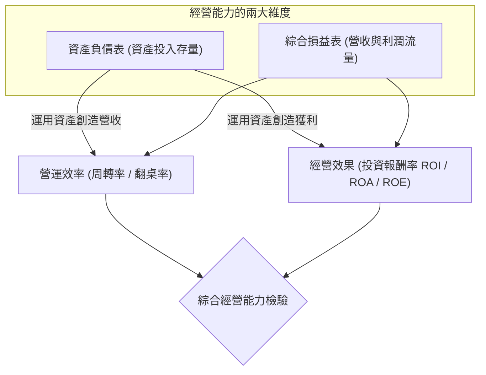
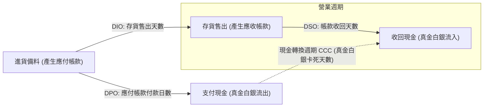

---
{"dg-publish":true,"permalink":"/01//ch08/","title":"Ch08 經營能力分析","tags":["PMBA","財務報表分析","經營能力","周轉率","現金轉換週期","CCC","營運資金管理"],"dg-note-properties":{"title":"Ch08 經營能力分析","course":"財務報表分析","category":"01_基礎先修","type":"lecture-note","lecture":"Ch08","tags":["PMBA","財務報表分析","經營能力","周轉率","現金轉換週期","CCC","營運資金管理"],"aliases":["經營能力分析","Ch08_經營能力分析","L08_經營能力分析","Ch08","L08"]}}
---

# Ch08 經營能力分析

## 💡 核心摘要

- **經營能力的雙重本質：資產利用的「效果」與「效率」**：[[98_商業概念庫/profitability_獲利能力\|huo-li-neng-li_獲利能力]]僅關注收入扣除成本後的利潤多寡，而[[98_商業概念庫/operating-efficiency-analysis_經營能力分析\|jing-ying-neng-li-analysis_經營能力分析]]進一步檢驗企業「投入了多少資產與資本來撬動這些營收與獲利」。**效率**體現於資產周轉速度與營收產出倍數（翻桌率），**效果**體現於最終資本投資回報率（[[98_商業概念庫/asset-return-rate_資產報酬率\|asset-return-rate_資產報酬率]]、[[98_商業概念庫/shareholder-equity-return-rate_股東權益報酬率\|gu-dong-equity-return-rate_股東權益報酬率]]）。
- **[[98_商業概念庫/balance-sheet_資產負債表\|balance-sheet_資產負債表]]與損益表的動態交匯：周轉速度即競爭力**：[[98_商業概念庫/balance-sheet_資產負債表\|balance-sheet_資產負債表]]記錄資源投入（存量），[[98_商業概念庫/income-loss-3_綜合損益表\|zong-he-income-statement_綜合損益表]]記錄營運產出（流量）。各項周轉率指標（[[98_商業概念庫/receivable_應收帳款\|ying-shou-zhang-kuan_應收帳款]]、[[98_商業概念庫/inventory_存貨\|cun-huo_存貨]]、[[98_商業概念庫/payable_應付帳款\|ying-fu-zhang-kuan_應付帳款]]、固定資產與[[98_商業概念庫/total-assets_總資產周轉率\|zong-asset-zhou-zhuan-rate_總資產周轉率]]）量化了企業將資產活化為現金流的運轉速率，是檢驗經理人營運功力的試金石。
- **[[98_商業概念庫/operating-cycle_營業週期\|operating-cycle_營業週期]]與現金轉換週期（CCC）：[[98_商業概念庫/working-capital_營運資金\|working-capital_營運資金]]占用的終極量尺**：從進料備料、製銷[[98_商業概念庫/inventory_存貨\|cun-huo_存貨]]（[[98_商業概念庫/inventory-turnover-tian-shu_存貨週轉天數\|inventory-turnover-tian-shu_存貨週轉天數]]）到賒銷收現（[[98_商業概念庫/receivable-days-turnover_應收帳款週轉天數\|ying-shou-zhang-kuan-zhou-zhuan-tian-shu_應收帳款週轉天數]]），扣除供應商給予的無息商業信用期（[[98_商業概念庫/payable-days-turnover_應付帳款週轉天數\|ying-fu-zhang-kuan-zhou-zhuan-tian-shu_應付帳款週轉天數]]），[[98_商業概念庫/cash-switching-cycle_現金轉換週期\|cash-zhuan-huan-cycle_現金轉換週期]] 精確衡量了真金白銀被卡死在營運供應鏈中的真空天數。
- **「負 CCC」的商業奇蹟與供應鏈話語權**：當 $\text{DPO} > \text{DSO} + \text{DIO}$ 時，現金轉換週期轉為負數。這代表企業在尚未支付供應商貨款之前，就已將貨品全數售出並收回現金，實現「拿供應商的資金做無息周轉與跨界擴張」（如好市多 Costco、戴爾 Dell、大型連鎖餐飲），構築起極致的[[98_商業概念庫/working-capital_營運資金\|working-capital_營運資金]]護城河。
- **周轉指標背後的經營決策陷阱**：盲目追求營收而放寬授信會導致 DSO 飆升並埋下呆帳地雷；[[98_商業概念庫/inventory_存貨\|cun-huo_存貨]]周轉遲緩將迅速引發跌價損失與過期報廢風險；而一味拖延 DPO 則可能惡化供應商戰略關係甚至面臨斷供。卓越經理人必須在[[98_商業概念庫/liquidity_流動性\|liu-dong-xing_流動性]]、獲利率與營運效率間取得動態平衡。

---

## 📚 核心觀念與架構

### 經營能力的基本定義與分析架構

[[98_商業概念庫/operating-efficiency-analysis_經營能力分析\|jing-ying-neng-li-analysis_經營能力分析]]（Activity / Operating Efficiency Analysis）旨在評估[[98_商業概念庫/enterprise-management_企業管理\|enterprise-management_企業管理]]層運用各項資產與資本創造營收及利潤的綜合效能。其核心架構聚焦於「**效果**（Effectiveness）」與「**效率**（Efficiency）」的辯證統一：

- **效率（周轉率 / 翻桌率）**：衡量每一元資產在一年內能夠轉化為多少倍的[[operating-revenue_營業收入|ying-ye-shou-ru_營業收入]]。周轉速度越快，代表資產閒置越少、營運流程越流暢。
- **效果（投資報酬率）**：衡量每一元資產最終轉化為淨利潤的比率。若周轉率極高但利潤率極低，仍可能無法達成良好的資本回報效果。

---

### 投資報酬率（ROI）與總資產報酬率（ROA）的深度剖析

#### 1. 投資報酬率（ROI）架構
$$\text{ROI} = \frac{\text{報酬}}{\text{平均投入資本}}$$
分母的投入資本若定義為「全部總資產」，即為 [[asset-return-rate_資產報酬率]]；若定義為「股東自有權益」，即為 [[shareholder-equity-return-rate_股東權益報酬率|gu-dong-equity-return-rate_股東權益報酬率]]。

#### 2. 總資產報酬率（ROA）的精確衡量
$$\text{ROA} = \frac{\text{息前稅後淨利}}{\text{平均總資產}} = \frac{\text{稅後淨利} + \text{利息費用} \times (1 - \text{營所稅率})}{\text{平均總資產}}$$

- **分子加回稅後利息的商業邏輯**：總資產是由股東出資與債權人借款共同構建。評估資產本身的純營運效益時，必須排除融資結構（負債多寡）與利息支出的干擾，還原其償還債權人成本之前的原始創利能力。
- **分母計算的關鍵原則**：
  - **必須採用平均總資產**：消除年度間資產增減與季節性淡旺季（如冰品業者冬季資產較低）的時點扭曲。
  - **閒置資產必須計入**：資產若處於閒置或故障狀態，正是管理效率低落的體現，排除閒置資產將虛增經營績效。
  - **[[asset-2_無形資產|wu-xing-asset_無形資產]]必須計入**：專利權、商標與軟體等[[asset-2_無形資產|wu-xing-asset_無形資產]]同樣是創造營收的重要經濟資源。

#### 3. 杜邦拆解中的營運軸心
$$\text{ROA} = \text{稅後純益率 (獲利效果)} \times \text{總資產周轉率 (營運效率)}$$
$$\text{ROE} = \text{稅後純益率} \times \text{總資產周轉率} \times \text{權益乘數}$$
杜邦分析明確指出：經營能力中的「[[total-assets_總資產周轉率|zong-asset-zhou-zhuan-rate_總資產周轉率]]」是連結資產規模與[[profitability_獲利能力|huo-li-neng-li_獲利能力]]的關鍵橋樑。

---

### 核心周轉率指標拆解

#### 1. 應收帳款周轉率與平均收現日數（DSO）
- **[[receivable-3_應收帳款周轉率|ying-shou-zhang-kuan-zhou-zhuan-rate_應收帳款周轉率]]**：衡量企業給予客戶信用（賒銷）創造[[operating-revenue_營業收入|ying-ye-shou-ru_營業收入]]的倍數與年度周轉次數。
  $$\text{應收帳款周轉率} = \frac{\text{營業收入（銷貨淨額）}}{\text{平均應收款項}} = \frac{\text{營業收入}}{\frac{\text{期初應收款} + \text{期末應收款}}{2}}$$
- **平均收現日數（Days Sales Outstanding, DSO）**：
  $$\text{平均收現日數 (DSO)} = \frac{365}{\text{應收帳款周轉率}}$$
  反映商品售出後，平均需等待多少天才能將[[receivable_應收帳款|ying-shou-zhang-kuan_應收帳款]]收回變現。DSO 越短，資金回籠越快，壞帳風險越低。

#### 2. 存貨周轉率與平均售貨日數（DIO）
- **[[inventory-3_存貨周轉率|cun-huo-zhou-zhuan-rate_存貨周轉率]]**：衡量企業庫存管理效率，反映一年內[[inventory_存貨|cun-huo_存貨]]轉化為[[cost-2_銷貨成本|xiao-huo-cost_銷貨成本]]的次數。
  $$\text{存貨周轉率} = \frac{\text{銷貨成本（營業成本）}}{\text{平均存貨}} = \frac{\text{銷貨成本}}{\frac{\text{期初存貨} + \text{期末存貨}}{2}}$$
  （分子必須採用[[cost-2_銷貨成本|xiao-huo-cost_銷貨成本]]而非營收，以符合「成本對成本」計量原則）
- **平均售貨日數（Days Inventory Outstanding, DIO / [[inventory_存貨|cun-huo_存貨]]平均銷售天數）**：
  $$\text{平均售貨日數 (DIO)} = \frac{365}{\text{存貨周轉率}}$$
  反映庫存商品在倉庫中停留的平均天數。DIO 越短，[[inventory_存貨|cun-huo_存貨]]跌價與滯銷風險越低。

#### 3. 應付帳款周轉率與平均遞延付款日數（DPO）
- **[[payable-2_應付帳款周轉率|ying-fu-zhang-kuan-zhou-zhuan-rate_應付帳款周轉率]]**：衡量企業運用供應商商業信用（賒購）的程度與清償貨款的頻率。
  $$\text{應付帳款周轉率} = \frac{\text{銷貨成本（營業成本）}}{\text{平均應付帳款}} = \frac{\text{銷貨成本}}{\frac{\text{期初應付款} + \text{期末應付款}}{2}}$$
- **平均遞延付款日數（Days Payables Outstanding, DPO / [[payable_應付帳款|ying-fu-zhang-kuan_應付帳款]]平均付款天數）**：
  $$\text{平均遞延付款日數 (DPO)} = \frac{365}{\text{應付帳款周轉率}}$$
  反映企業自採購進料到實質付現給供應商的平均緩衝天數。DPO 越長，企業享有供應商無息融資的時間越久。

#### 4. 不動產廠房及設備（固定資產）周轉率
- **定義與公式**：衡量企業廠房、機器設備等重資產的產能利用率與營收轉化效率。
  $$\text{固定資產周轉率} = \frac{\text{營業收入}}{\text{平均不動產、廠房及設備淨額 (PP\&E)}}$$
- **商業意涵**：在資本密集型產業（如半導體晶圓廠、鋼鐵、面板）中，[[fixed-assets_固定資產周轉率|gu-ding-asset-zhou-zhuan-rate_固定資產周轉率]]直接體現產能稼動率與資本支出回收速度。

#### 5. 總資產周轉率
- **定義與公式**：衡量企業全部資產在一年內創造[[operating-revenue_營業收入|ying-ye-shou-ru_營業收入]]的綜合運轉倍數（商業上的「翻桌率」）。
  $$\text{總資產周轉率} = \frac{\text{營業收入}}{\text{平均總資產}}$$

---

### 營業週期與現金轉換週期（CCC）模型

#### 1. 營業週期（Operating Cycle）
企業從投入資源採購[[inventory_存貨|cun-huo_存貨]]開始，歷經生產、銷售至最終收回客戶現金的完整產銷循環時間跨度：
$$\text{營業週期} = \text{平均售貨日數 (DIO)} + \text{平均收現日數 (DSO)}$$

#### 2. 現金轉換週期（Cash Conversion Cycle, CCC）
考量供應商提供的商業信用遞延付款期後，企業從「實質支付現金給供應商」到「最終向客戶收回現金」的真實資金缺口天數：
$$\text{現金轉換週期 (CCC)} = \text{營業週期} - \text{平均遞延付款日數 (DPO)}$$
$$\text{CCC} = \text{DSO} + \text{DIO} - \text{DPO}$$

#### 3. 「負 CCC」的商業邏輯與極致競爭優勢
當企業的供應商付款帳期長於其[[inventory_存貨|cun-huo_存貨]]銷售與帳款回收時間之和時（即 $\text{DPO} > \text{DSO} + \text{DIO}$），現金轉換週期將呈現**負數**：
- **運作機制**：客戶在第 5 天付款（現銷或刷卡，低 DSO），[[inventory_存貨|cun-huo_存貨]]在第 15 天賣光（極速周轉，低 DIO），而企業直到第 60 天才需要付錢給供應商（強勢議價，高 DPO）。
- **商業優勢**：
  1. **無本營運**：企業完全不需動用自有資金或借貸來支應日常營運，而是由供應商提供源源不絕的無息[[working-capital_營運資金]]。
  2. **跨界利差與擴張動力**：提前收進來的巨額現金可存入高利定存、購買短期理財產品或用於開設新門市，形成「靠供應商資金滾動成長」的強大護城河（如好市多 Costco、戴爾電腦 Dell、亞馬遜 Amazon、統一超商）。

---

## ⚠️ 實務應用與經理人思維

### 存貨去化速度與跌價損失風險

[[inventory-3_存貨周轉率|cun-huo-zhou-zhuan-rate_存貨周轉率]]不僅關乎營運效率，更是防範資產減損的第一道防線：
1. **時效性商品的價值雪崩**：在連鎖餐飲業（生鮮食材保鮮期僅數天）、快時尚服飾（過季即面臨腰斬折扣）與消費電子業（摩爾定律下晶片迅速淘汰），DIO 每拉長一天，[[inventory-2_存貨跌價損失|cun-huo-die-jia-sun-shi_存貨跌價損失]]與報廢風險便呈指數級上升。
2. **[[inventory_存貨|cun-huo_存貨]]積壓對現金流的雙重打擊**：庫存不僅鎖死寶貴的現金，還會衍生龐大的倉儲租金、保險費、物流搬運與防潮維護成本。經理人應落實精實生產（Just-In-Time, JIT），以極速去化替代盲目備料。

---

### 授信政策放寬的假性繁榮與呆帳陷阱

許多企業為了衝刺營業額或美化短期財報，往往採取放寬授信條件的手段：
1. **DSO 飆升的危險訊號**：若企業營收顯著成長，但[[receivable-3_應收帳款周轉率|ying-shou-zhang-kuan-zhou-zhuan-rate_應收帳款周轉率]]暴跌、DSO 急遽拉長，經理人必須高度警惕這是否為「寬鬆信用硬塞貨給客戶」的假性營收。
2. **利潤虛胖與現金斷流**：帳面上認列了漂亮的[[operating-revenue_營業收入|ying-ye-shou-ru_營業收入]]與毛利，但客戶因財務困難遲遲不付款，最終全數提列為[[bad-debt-expense-ratio_壞帳費用率|壞帳費用]]，導致企業在帳面盈利的光環下爆發「[[insolvency-with-profit_黑字倒閉|hei-zi-dao-bi_黑字倒閉]]」。

---

### 供應鏈議價權在 DPO 上的體現與界限

DPO 是衡量企業在產業鏈上下游話語權的晴雨表：
1. **強勢買方地位的紅利**：具備龐大採購規模的大型企業，能強勢要求供應商接受 90 至 120 天的付款帳期，最大化自身的現金持有時間。
2. **過度壓榨的供應鏈反噬**：經理人需警惕「過猶不及」。若過度拖延貨款，將使優質供應商面臨周轉不靈，進而以劣質原料交貨、調高報價轉嫁資金成本，甚至在原物料吃緊時優先對該企業「斷供」。

---

### 個案深度剖析：假餐飲公司 vs. 乙餐飲公司（多品牌經營能力對決）

逐字稿以台灣多品牌餐飲龍頭「假公司」與同業泰式餐飲標竿「乙公司」為實例，展現經營能力指標的實務診斷：

#### 1. 假餐飲公司第八年指標全景圖
- **B2C 現金營運特質**：
  - [[operating-revenue_營業收入|ying-ye-shou-ru_營業收入]] = 162.3 億元，平均應收款項僅約 2.5 億元。
  - **[[receivable-3_應收帳款周轉率|ying-shou-zhang-kuan-zhou-zhuan-rate_應收帳款周轉率]]** $= 63.15 \text{ 次} \implies \text{DSO} = \frac{365}{63.15} \approx 5.78 \text{ 天}$。
  - **解讀**：餐飲消費者多為現場付現或刷信用卡（銀行數天內結算撥款），幾乎無賒銷，收款極速，[[liquidity_流動性|liu-dong-xing_流動性]]卓越。
- **[[inventory_存貨|cun-huo_存貨]]與供應鏈運轉**：
  - [[cost-2_銷貨成本|xiao-huo-cost_銷貨成本]] = 90.2 億元，平均[[inventory_存貨|cun-huo_存貨]] = 13.3 億元。
  - **[[inventory-3_存貨周轉率|cun-huo-zhou-zhuan-rate_存貨周轉率]]** $= 6.79 \text{ 次} \implies \text{DIO} = \frac{365}{6.79} \approx 53.7 \text{ 天}$。
  - **[[payable-2_應付帳款周轉率|ying-fu-zhang-kuan-zhou-zhuan-rate_應付帳款周轉率]]** $= 18.42 \text{ 次} \implies \text{DPO} = \frac{365}{18.42} \approx 19.8 \text{ 天}$。
  - **[[cash-switching-cycle_現金轉換週期|cash-zhuan-huan-cycle_現金轉換週期]]** $= 5.78 + 53.7 - 19.8 \approx 39.7 \text{ 天}$。
- **[[total-assets_總資產周轉率|zong-asset-zhou-zhuan-rate_總資產周轉率]]（翻桌率）**：
  - 平均總資產 = 111.2 億元 $\implies$ **[[total-assets_總資產周轉率|zong-asset-zhou-zhuan-rate_總資產周轉率]]** $= \frac{162.3}{111.2} = 1.46 \text{ 次}$。

#### 2. 與乙餐飲公司的杜邦對照與策略啟示
- **翻桌率高 vs. 利潤率高（杜邦權衡）**：
  - **假公司**：[[total-assets_總資產周轉率|zong-asset-zhou-zhuan-rate_總資產周轉率]] $1.46$ 次，但利潤率僅 $2.55\% \implies \text{ROA} = 3.72\%$。
  - **乙公司**：[[total-assets_總資產周轉率|zong-asset-zhou-zhuan-rate_總資產周轉率]] $1.16$ 次，但利潤率高達 $7.77\% \implies \text{ROA} = 9.01\%$。
  - **啟示**：假公司透過 20 多個多品牌策略雖然在資產翻桌率上略勝一籌（1.46 vs. 1.16），但因品牌過於分散、行銷與展店成本沉重，純益率遠遜於專注泰式料理利基市場的乙公司（2.55% vs. 7.77%），導致整體資產創造利潤的效果（ROA）大幅落後。
- **[[inventory_存貨|cun-huo_存貨]]管理效率差異**：乙公司的[[inventory-3_存貨周轉率|cun-huo-zhou-zhuan-rate_存貨周轉率]]顯著高於假公司，顯示乙公司在食材採購預測、庫存保鮮與廚房備料的去化效率更為精實。
- **產業共同趨勢**：在第八年，兩家公司的[[total-assets_總資產周轉率|zong-asset-zhou-zhuan-rate_總資產周轉率]]與 ROA 同步下滑，反映餐飲業共同面臨食材原物料通膨與店面租金上漲的總體經濟逆風。
