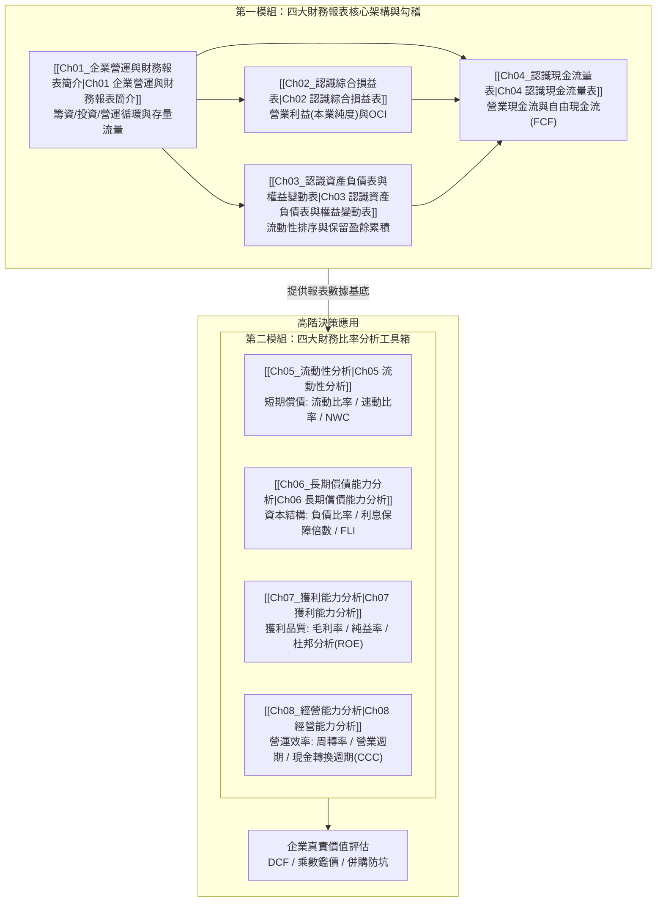

---
{"dg-publish":true,"permalink":"/01/01/moc/","title":"財務報表分析 MOC (課程總覽地圖)","tags":["PMBA","財務報表分析","MOC","知識地圖"],"dg-note-properties":{"title":"財務報表分析 MOC (課程總覽地圖)","course":"財務報表分析","category":"01_基礎先修","type":"moc","tags":["PMBA","財務報表分析","MOC","知識地圖"],"aliases":["財務報表分析","財務報表分析 MOC","財報分析 MOC"]}}
---

# 📊 財務報表分析 MOC (Financial Statement Analysis)

> **課程定位**：國立臺灣大學 PMBA 基礎先修核心模組  
> **銜接進階**：[[02_核心必修/01_財務管理/_財務管理 MOC\|財務管理 (Corporate Finance)]] ➔ [[04_主題選修/10_創業與企業財務策略/_創業與企業財務策略 MOC\|創業與企業財務策略]] ➔ [[04_主題選修/12_產業分析與投資策略/00_課程導航與進度/mindmap_產業分析與投資策略_心智圖導航\|產業分析與投資策略]]  
> **知識導航**：[[00_學程修課地圖 & 進度追蹤\|返回 PMBA 學程修課地圖與進度追蹤]]

---

## 🧭 課程知識架構與決策流向

財務報表分析是所有商業決策與企業鑑價的數位基石。本課程由**「四大表結構勾稽（存量與流量）」**出發，進一步透過**「四大財務比率工具箱」**穿透經理人的營運體質：

---

## 📚 課程單元與筆記進度

### 模組一：四大財務報表核心架構與勾稽 (Financial Statements Architecture)
- [x] **[[Ch01_企業營運與財務報表簡介|Ch01 企業營運與財務報表簡介]]**  
  *三大營運循環、存量與流量動態勾稽、IFRS 公允價值框架、四大報表連動關係。*
- [x] **[[Ch02_認識綜合損益表|Ch02 認識綜合損益表]]**  
  *損益階梯逐層剖析、營業利益之本業純度、其他綜合損益 (OCI)、盈餘品質診斷。*
- [x] **[[Ch03_認識資產負債表與權益變動表|Ch03 認識資產負債表與權益變動表]]**  
  *特定時點存量、流動性高低排序、資產配置結構、權益變動表與歷年保留盈餘軌跡。*
- [x] **[[Ch04_認識現金流量表|Ch04 認識現金流量表]]**  
  *營業/投資/籌資三大現金流、權責發生制調節、自由現金流量 (FCF)、黑字倒閉防範。*

### 模組二：四大財務比率分析工具箱 (Financial Ratios Toolbox)
- [x] **[[Ch05_流動性分析|Ch05 流動性分析 (短期償債能力)]]**  
  *流動比率、速動比率、淨營運資金 (NWC)、存貨與應收帳款折價風險。*
- [x] **[[Ch06_長期償債能力分析|Ch06 長期償債能力分析 (資本結構與槓桿)]]**  
  *負債比率、利息保障倍數、財務槓桿指數 (FLI)、三個圈圈模型、違約風險邊界。*
- [x] **[[Ch07_獲利能力分析|Ch07 獲利能力分析 (利潤階梯與杜邦分析)]]**  
  *毛利率、營業利益率、稅後純益率、杜邦分析三因子拆解 (ROE)、虛胖槓桿辨識。*
- [x] **[[Ch08_經營能力分析|Ch08 經營能力分析 (營運效率與資產活化)]]**  
  *應收帳款與存貨周轉率、平均收現日數 (DSO)、現金轉換週期 (CCC)、負 CCC 護城河。*

---

## 🧮 財務報表分析四大維度核心指標與公式速查矩陣

| 分析維度 | 核心指標 | 計算公式 | 經理人管理意涵與判讀準則 |
| :--- | :--- | :--- | :--- |
| **短期流動性** | **流動比率 (CR)** | $rac{\text{流動資產}}{\text{流動負債}}$ | 傳統標準 $\ge 200\%$。檢驗一年內變現資產支應短期債務能力。 |
|  | **速動比率 (QR)** | $rac{\text{流動資產} - \text{存貨} - \text{預付費用}}{\text{流動負債}}$ | 嚴格標準 $\ge 100\%$。剔除變現緩慢之存貨後的即期清償力。 |
|  | **淨營運資金 (NWC)** | $\text{流動資產} - \text{流動負債}$ | 短期營運安全墊；若為負數需防範流動性斷鏈危機。 |
| **長期償債力** | **負債比率 (Debt Ratio)** | $rac{\text{負債總額}}{\text{資產總額}}$ | 資本結構槓桿度；重工業通常較高，IC設計輕資產宜低。 |
|  | **利息保障倍數 (TIE)** | $rac{\text{EBIT (息稅前利潤)}}{\text{利息費用}}$ | 銀行核貸金標準；一般需 $\ge 3\sim 5$ 倍，衡量本業獲利涵蓋剛性利息之倍數。 |
|  | **財務槓桿指數 (FLI)** | $rac{\text{ROE}}{\text{ROA}}$ | $\text{FLI} > 1$ 表示借債產生正向財務槓桿；若 $< 1$ 則陷入舉債倒貼窘境。 |
| **獲利與回報** | **毛利率 (GPM)** | $rac{\text{營業毛利}}{\text{營業收入}}$ | 產品市場競爭力與定價話語權的最直觀量尺。 |
|  | **營業利益率 (OPM)** | $rac{\text{營業利益}}{\text{營業收入}}$ | 排除業外與租稅干擾之本業造血純度。 |
|  | **杜邦等式 (DuPont ROE)** | $\frac{\text{淨利}}{\text{營收}} \times \frac{\text{營收}}{\text{總資產}} \times \frac{\text{總資產}}{\text{股東權益}}$ | $\text{ROE} = \text{產品純利率} \times \text{資產周轉率} \times \text{權益乘數}$。 |
| **經營營運效率** | **應收帳款收現天數 (DSO)** | $\frac{365}{\text{應收帳款周轉率}}$ | 銷貨賒銷至真金白銀入帳的平均天數；過長易有呆帳地雷。 |
|  | **存貨周轉天數 (DIO)** | $\frac{365}{\text{存貨周轉率}}$ | 庫存從進料到銷售結案的在庫天數；天數過長引發跌價損失。 |
|  | **現金轉換週期 (CCC)** | $\text{DIO} + \text{DSO} - \text{DPO}$ | 資金被供應鏈卡死的真空天數；**負 CCC** 代表極致的無息資金占用護城河。 |

---

## 🔗 知識庫雙向鏈接（[[98_商業概念庫]] 原子卡片推薦）

- **財務報表架構**：[[balance-sheet_資產負債表]] · [[income-loss-3_綜合損益表]] · [[cash-flow-statement_現金流量表]] · [[statement-of-changes-in-equity_權益變動表]] · [[financial-2_財務報表附註]]
- **現金流量系列**：[[operating-cash-flow-statement_營業活動現金流量]] · [[investing-cash-flow-statement_投資活動現金流量]] · [[financing-activities-cash-flow_籌資活動現金流量]] · [[free-cash-flow-liang_自由現金流量]]
- **比率與評價**：[[liquidity_流動性]] · [[capital-structure_資本結構]] · [[financial-leverage_財務槓桿]] · [[dupont-analysis_杜邦分析法]] · [[cash-switching-cycle_現金轉換週期]] · [[working-capital_營運資金]]

---

## 🚀 銜接後續進階課程

- ➡️ **[[02_核心必修/01_財務管理/_財務管理 MOC|核心必修：財務管理 (Corporate Finance)]]**：由「歷史報表分析」進階至「未來投資決策（NPV / IRR）、融資結構理論（MM定理）與資本加權成本（WACC）」。
- ➡️ **[[04_主題選修/10_創業與企業財務策略/_創業與企業財務策略 MOC|主題選修：創業與企業財務策略]]**：新創估值（Pre/Post-money）、白板決策鏈、燒錢率（Burn Rate）與融資出場機制。
- ➡️ **[[04_主題選修/12_產業分析與投資策略/00_課程導航與進度/mindmap_產業分析與投資策略_心智圖導航|主題選修：產業分析與投資策略]]**：由單一公司報表擴展至產業獲利結構、三大景氣循環與宏觀資本評價。
