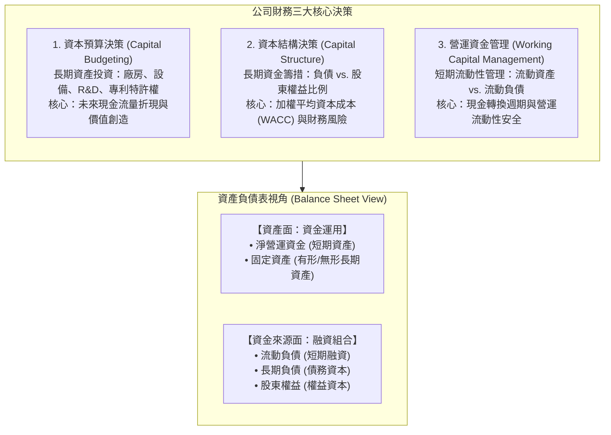
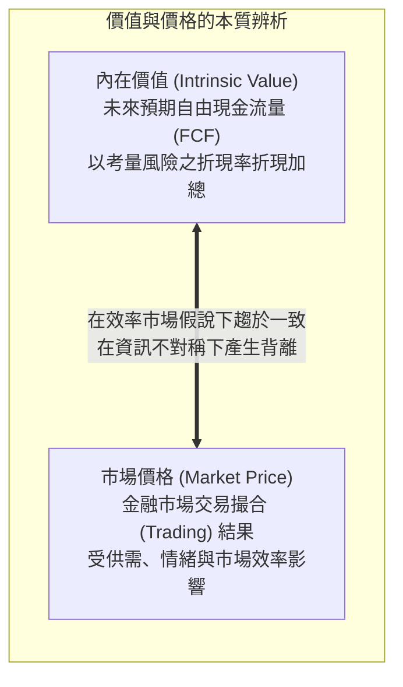
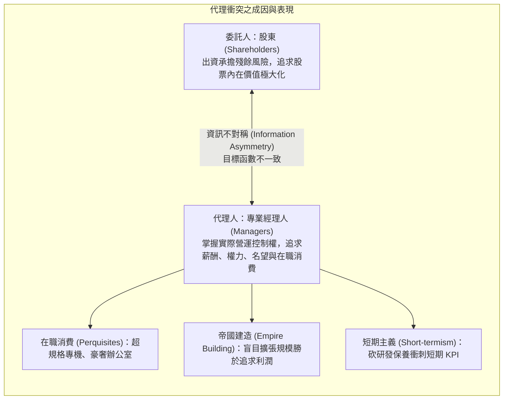
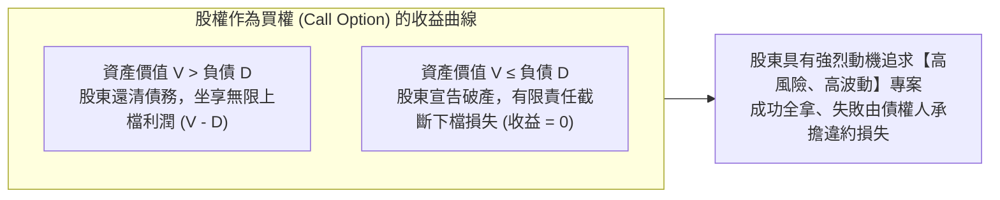
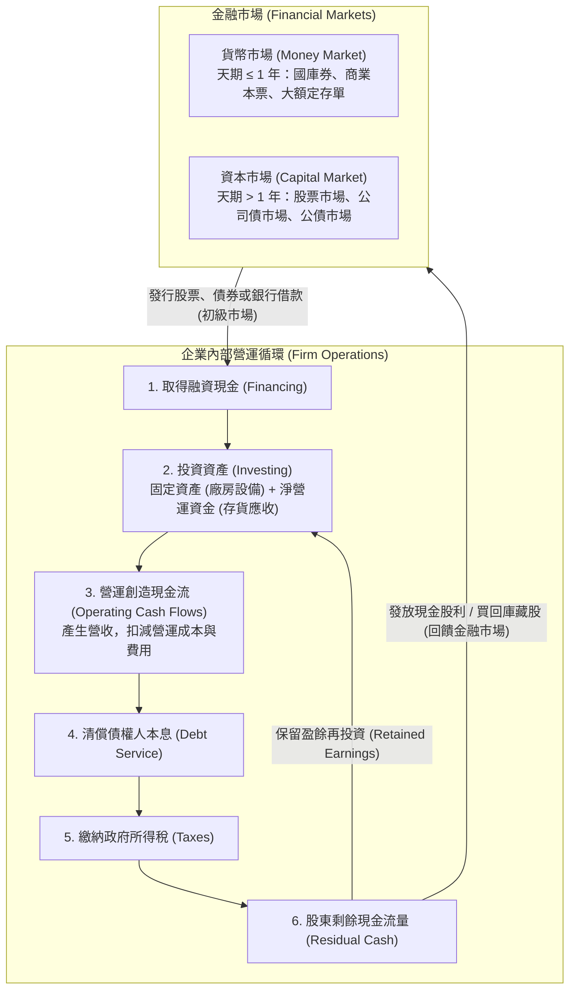

---
{"dg-publish":true,"permalink":"/02/01/l01/","title":"L01 財務管理導論","tags":["PMBA","財務管理","公司理財","股東財富極大化","代理人問題","資本配置","核心必修"],"dg-note-properties":{"title":"L01 財務管理導論","course":"財務管理","category":"02_核心必修","type":"lecture-note","lecture":"L01","tags":["PMBA","財務管理","公司理財","股東財富極大化","代理人問題","資本配置","核心必修"],"aliases":["財務管理導論","L01_財務管理導論","公司理財導論","L01"]}}
---

# L01 財務管理導論

## 💡 核心摘要

- **利潤極大化 vs. [[98_商業概念庫/shareholder-wealth-maximization_股東財富極大化\|gu-dong-cai-fu-ji-da-hua_股東財富極大化]]**：會計利潤是應計制下的歷史紀錄，忽視[[98_商業概念庫/time-value-2_貨幣時間價值\|huo-bi-shi-jian-value_貨幣時間價值]]、[[98_商業概念庫/risk-return_風險與報酬權衡\|risk-yu-return-quan-heng_風險與報酬權衡]]且易受人為會計操縱；現代[[98_商業概念庫/finance-management_財務管理\|finance-management_財務管理]]的核心目標是[[98_商業概念庫/shareholder-wealth-maximization_股東財富極大化\|gu-dong-cai-fu-ji-da-hua_股東財富極大化]]，其本質是追求企業未來[[98_商業概念庫/free-cash-flow-liang_自由現金流量\|free-cash-flow-liang_自由現金流量]]折現後的「[[98_商業概念庫/company-value_公司內在價值\|company-nei-zai-value_公司內在價值]]」極大化。
- **跨期資源配置的三大核心決策**：公司財務運作由三大支柱構成——決定資金投向與長期成長動能的[[98_商業概念庫/capital-budgeting_資本預算\|capital-yu-suan_資本預算]]（投資決策）、決定資金來源與加權資本成本的[[98_商業概念庫/capital-structure_資本結構\|capital-structure_資本結構]]（融資決策），以及維繫企業日常[[98_商業概念庫/liquidity_流動性\|liu-dong-xing_流動性]]生命線的[[98_商業概念庫/working-capital-management_營運資金管理\|operations-zi-jin-management_營運資金管理]]。
- **代理衝突與[[98_商業概念庫/corporate-governance_公司治理\|company-zhi-li_公司治理]]機制**：現代企業「所有權與經營權分離」必然誘發[[98_商業概念庫/agency-problem_代理人問題\|dai-li-ren-wen-ti_代理人問題]]。專業經理人受自利動機與[[98_商業概念庫/short-term_短期主義\|duan-qi-zhu-yi_短期主義]]驅使，容易產生[[98_商業概念庫/internal-control_內部人控制\|nei-bu-ren-kong-zhi_內部人控制]]、過度在職消費與操弄短期績效；唯有透過健全的[[98_商業概念庫/corporate-governance_公司治理\|company-zhi-li_公司治理]]、獨立董事實質監督、[[98_商業概念庫/stock-options-motivation_股票選擇權激勵\|stock-options-ji-li_股票選擇權激勵]]與外部控制權市場，方能將[[98_商業概念庫/agency-costs_代理成本\|dai-li-cost_代理成本]]降至最低。
- **股東與債權人的結構性利益衝突**：股權本質等同於以公司資產為標的、以負債面額為執行價格的「買權（Call Option）」。由於股東享有[[98_商業概念庫/limited-liability_有限責任\|you-xian-ze-ren_有限責任]]且波動度越大買權價值越高，股東天生具備轉嫁風險的誘因，引發資產替代、過度投資或投資不足等衝突，必須仰賴嚴密的債務契約限制條款加以約束。
- **金融市場與企業的資金活水循環**：企業透過[[98_商業概念庫/market-4_貨幣市場\|huo-bi-market_貨幣市場]]與[[98_商業概念庫/capital-market_資本市場\|capital-market_資本市場]]籌措資金、投資實體資產創造營運現金流，並在清償債權人本息、繳納政府稅負後，將剩餘現金流透過股利發放或庫藏股買回反哺金融市場，形成跨期配置與資本循環閉環。

---

## 📚 核心觀念與理論架構

### 1. 財務管理的頂層架構與三大核心決策

在 EMBA / PMBA 的決策視野中，[[98_商業概念庫/enterprise-management_企業管理\|enterprise-management_企業管理]]如同「駕馭車輛」：
- **駕照與駕駛技術**：象徵高階經理人的領導能力與通用管理技能（POLC 程序）。
- **車輛的機械功能**：象徵企業的五大功能（產銷人發財）。經理人必須深諳煞車、油門與儀表板的連動機制，才能安全、舒適且準時地將組織帶往戰略目標。
- **[[98_商業概念庫/finance-management_財務管理\|finance-management_財務管理]]（Corporate Finance）定位**：[[98_商業概念庫/finance-management_財務管理\|finance-management_財務管理]]是企業營運的「動力系統」與「儀表羅盤」，負責長期資金配置、風險控管與價值度量。

#### (1) 資本預算（Capital Budgeting / 長期投資決策）
- **核心內涵**：企業決定將資本配置於何種長期資產（Long-term Assets），包含有形資產（廠房、設備、產線）與[[98_商業概念庫/asset-2_無形資產\|wu-xing-asset_無形資產]]（專利權、特許權、商標、併購）。
- **生命週期與 S 曲線**：任何產品或事業均存在[[98_商業概念庫/product-life-cycle_產品生命週期\|product-sheng-ming-cycle_產品生命週期]]（導入期、成長期、成熟期、衰退期）。經理人必須在現有產品達高峰前，持續透過[[98_商業概念庫/capital-budgeting_資本預算\|capital-yu-suan_資本預算]]開闢第二成長曲線（如 Intel 錯失製程推進與 AI 浪潮陷入衰退，對比 Nvidia 與 AMD 把握 GPU 與 AI 算力需求迎來指數成長）。
- **評價基石**：投資決策的本質是「拿當前確定的現金去換取未來不確定的現金流」，因此評價的核心在於計算淨現值（NPV），唯有 NPV > 0 的專案才能為股東創造真實價值。

#### (2) 資本結構（Capital Structure / 長期融資決策）
- **核心內涵**：企業如何籌措長期資金，即負債（Debt）與[[98_商業概念庫/shareholder-equity_股東權益\|shareholder-equity_股東權益]]（Equity）的最適組合比例。
- **槓桿雙刃劍**：
  - **[[98_商業概念庫/operating-leverage_營運槓桿\|operations-gang-gan_營運槓桿]]（Operating Leverage）**：源於固定營運成本（如廠房[[98_商業概念庫/zhe-jiu_折舊\|zhe-jiu_折舊]]、租金、正職薪資）。固定成本佔比越高，營收變動對[[98_商業概念庫/operating-income_營業利益\|operating-income_營業利益]]（EBIT）的放大效應越劇烈。
  - **[[98_商業概念庫/financial-leverage_財務槓桿\|finance-gang-gan_財務槓桿]]（Financial Leverage）**：源於固定利息費用。負債比例越高，EBIT 變動對[[98_商業概念庫/earnings-per-share_每股盈餘\|mei-gu-ying-yu_每股盈餘]]（EPS）與 ROE 的放大效應越強；然而一旦營收不如預期，高額利息將大幅推升「支付不能（Insolvency）」與財務危機成本。

#### (3) 營運資金管理（Working Capital Management / 短期流動性決策）
- **核心內涵**：管理[[98_商業概念庫/current-assets_流動資產\|liu-dong-asset_流動資產]]（現金、[[98_商業概念庫/receivable_應收帳款\|ying-shou-zhang-kuan_應收帳款]]、[[98_商業概念庫/inventory_存貨\|cun-huo_存貨]]）與[[98_商業概念庫/current-liabilities_流動負債\|liu-dong-liability_流動負債]]（[[98_商業概念庫/payable_應付帳款\|ying-fu-zhang-kuan_應付帳款]]、應付費用）的差額，即「[[98_商業概念庫/net-working-capital_淨營運資金\|net-working-capital_淨營運資金]]（Net Working Capital, NWC）」。
- **決策權衡**：
  - **高[[98_商業概念庫/liquidity_流動性\|liu-dong-xing_流動性]]政策**：保有高額[[98_商業概念庫/inventory_存貨\|cun-huo_存貨]]與寬鬆信用條件，可避免缺貨與促進銷售，但會壓死大量資金並承擔[[98_商業概念庫/inventory-2_存貨跌價損失\|cun-huo-die-jia-sun-shi_存貨跌價損失]]與資金持有成本。
  - **精實[[98_商業概念庫/liquidity_流動性\|liu-dong-xing_流動性]]政策**：壓低[[98_商業概念庫/inventory_存貨\|cun-huo_存貨]]與快速收現，可提高資金周轉率，但增加斷鏈與客戶流失風險。經理人需在「[[98_商業概念庫/liquidity_流動性\|liu-dong-xing_流動性]]安全」與「[[98_商業概念庫/profitability_獲利能力\|huo-li-neng-li_獲利能力]]」間取得動態平衡。

---

### 2. 企業目標辨析：會計利潤極大化 vs. 股東財富極大化

在財務學中，企業的終極追求究竟是「帳面利潤極大化」還是「[[98_商業概念庫/shareholder-wealth-maximization_股東財富極大化\|gu-dong-cai-fu-ji-da-hua_股東財富極大化]]」？這是所有商業決策的根本分水嶺。

#### (1) 會計利潤極大化（Profit Maximization）的四大致命缺陷
1. **忽略[[98_商業概念庫/time-value-2_貨幣時間價值\|huo-bi-shi-jian-value_貨幣時間價值]]（Time Value of Money）**：
   - 會計利潤只計算某特定年度帳面收入減去費用，無視現金流入的具體時間點。今日的 100 萬元與五年後的 100 萬元在會計利潤上等值，但在財務實質價值上天差地別。
2. **忽略[[98_商業概念庫/risk-return_風險與報酬權衡\|risk-yu-return-quan-heng_風險與報酬權衡]]（Risk-Return Trade-off）**：
   - 不同的營運方案伴隨截然不同的風險溢酬。追求利潤極大化可能驅使經理人涉足超高風險投機專案，短期的帳面獲利暴增掩蓋了致命的破產風險。
3. **會計操縱與應計基礎（Accrual Basis）盲點**：
   - 損益表採應計制，營收認列與[[98_商業概念庫/cost-2_銷貨成本\|xiao-huo-cost_銷貨成本]]受[[98_商業概念庫/zhe-jiu_折舊\|zhe-jiu_折舊]]年限、[[98_商業概念庫/inventory-method_存貨計價方法\|cun-huo-ji-jia-fang-fa_存貨計價方法]]（先進先出法 vs. 加權平均法）與預估壞帳等會計估計政策影響，容易遭內部人操縱粉飾。更關鍵的是，「有獲利不等於有現金」，盲目追求帳面利潤可能導致企業陷入「[[98_商業概念庫/insolvency-with-profit_黑字倒閉\|hei-zi-dao-bi_黑字倒閉]]」。
4. **忽略股權資本成本（Cost of Equity）**：
   - 會計利潤扣除了債務利息支出，卻將[[98_商業概念庫/shareholder-equity_股東權益\|shareholder-equity_股東權益]]視為「無成本資金」，未扣除股東所要求的最低機會成本。唯有扣除全體資本成本後的經濟附加價值（EVA）才是真正的財富創造。

#### (2) 為什麼企業目標應是「股東財富極大化」？
- **本質是「[[98_商業概念庫/company-value_公司內在價值\|company-nei-zai-value_公司內在價值]]」極大化**：
  $$\text{公司內在價值} = \sum_{t=1}^{\infty} \frac{\text{自由現金流量}_t (FCF_t)}{(1 + WACC)^t}$$
- **剩餘索取權（Residual Claim）的哲學**：
  - 股東是企業所有[[98_商業概念庫/relations_利害關係人\|li-hai-guan-xi-ren_利害關係人]]中的「剩餘索取權人（Residual Claimants）」。
  - 企業在分配利潤給股東前，必須優先清償員工薪資、支付供應商貨款、繳納政府稅負、履行債權人本息合約。
  - 當股東財富實現極大化時，意味著企業必須先創造出足以超越所有前順位契約義務的龐大價值增量。因此，追求[[98_商業概念庫/shareholder-wealth-maximization_股東財富極大化\|gu-dong-cai-fu-ji-da-hua_股東財富極大化]]要求企業必須把整體蛋糕做大，非但不與[[98_商業概念庫/relations_利害關係人\|li-hai-guan-xi-ren_利害關係人]]共榮衝突，反而是健全經營的先決條件。

---

### 3. 代理人問題（Agency Problem）與公司治理機制

當企業規模擴大、股票公開發行後，「所有權與經營權分離（Separation of Ownership and Control）」成為常態，由此產生委託人（股東）與代理人（經理人）之間的利益衝突。

#### (1) 代理成本（Agency Costs）的三大構成
依據 Jensen & Meckling 理論，[[98_商業概念庫/agency-costs_代理成本\|dai-li-cost_代理成本]]包含：
1. **監督成本（Monitoring Costs）**：股東為監督經理人所發生的支出，如聘請外部獨立會計師查核簽證、設置獨立董事與審計委員會、聘用內部稽核人員等。
2. **束縛成本（Bonding Costs）**：經理人為向股東保證其自律與忠實義務所發生的支出，如經理人出具財務預測承諾、接受限制性競業合約、提撥經營保證金等。
3. **剩餘損失（Residual Loss）**：即便投入監督與束縛成本，代理人決策仍不可能與股東利益 100% 重合，由此所導致的企業價值減損即為剩餘損失。

#### (2) 公司治理制衡與股權激勵機制
為縮小代理裂痕，現代[[98_商業概念庫/corporate-governance_公司治理\|company-zhi-li_公司治理]]（Corporate Governance）發展出內部與外部制衡體系：

| 治理機制構面 | 具體工具與運作方式 | 核心優點 | 潛在盲點與代價 |
| :--- | :--- | :--- | :--- |
| **內部激勵機制** | **[[98_商業概念庫/stock-options-motivation_股票選擇權激勵\|stock-options-ji-li_股票選擇權激勵]]（Stock Options）**：給予經理人以約定執行價（Strike Price）認購股票之權利 | 將經理人財富與長期股價深度綁定，激勵其追求公司成長 | 經理人可能在到期日前過度冒險、操弄財報或回購股票拉抬短期股價 |
| **內部監督機制** | **董事會與獨立董事審計委員會**：聘任獨立專家監督內部人決策，審核重大資本支出與關係人交易 | 提供客觀專業制衡，防範內部人掏空與利益衝突 | 獨董高度仰賴經營團隊彙報，存在嚴重[[98_商業概念庫/information-asymmetry_資訊不對稱\|zi-xun-bu-dui-cheng_資訊不對稱]]，易淪為橡皮圖章 |
| **外部市場約束** | **控制權市場（Market for Corporate Control）**：若經理人經營不善導致股價低迷，外部資本將透過敵意併購發動接管 | 懸在經理人頭上的達摩克利斯之劍，迫使其維持經營效率 | 經理人可能採取毒藥丸（Poison Pills）等防衛策略，損害股東利益 |
| **外部法規監管** | **沙賓法案（SOX Act）與主管機關監理**：強制高階主管為財報正確性承擔刑事與民事責任 | 嚴懲造假欺瞞，提升市場透明度 | 鉅額合規成本，增加企業行政負擔 |

---

### 4. 股東與債權人的利益衝突：選擇權視角解構

財務學中極具洞察力的突破，是運用 Merton（1974）模型將「公司股權」視為以公司資產為標的資產的**買權（Call Option）**。

#### (1) 股權作為買權的數學本質
- 假設公司整體資產價值為 $V$，約定到期日需償還的負債本息面額為 $D$：
  - 若到期時公司資產價值 $V > D$：股東拿出 $D$ 償還債權人，享有剩餘資產價值 $V - D$。
  - 若到期時公司資產價值 $V \le D$：股東選擇違約，宣告破產，行使[[98_商業概念庫/limited-liability_有限責任\|you-xian-ze-ren_有限責任]]（Limited Liability）將資產 $V$ 丟給債權人，股東價值保底為 $0$。
- **[[98_商業概念庫/shareholder-equity_股東權益\|shareholder-equity_股東權益]]價值公式**：
  $$E = \max(V - D, 0)$$
- **買權特質之推論**：依據 Black-Scholes 選擇權定價理論，**標的資產的波動度（風險 $\sigma$）越大，買權價值（股權價值）越高！**

#### (2) 誘發衝突與三大代理問題
因為股權的買權特性與[[98_商業概念庫/limited-liability_有限責任\|you-xian-ze-ren_有限責任]]保護，股東與債權人存在天然對立：
1. **資產替代風險（Asset Substitution / Risk Shifting）**：
   - 股東有強烈動機將借來的資金從原本穩健的低風險投資案，轉移至高風險、高變異數的投機專案。若賭贏了，超額收益全歸股東；若賭輸了，破產代價由債權人吸收。
2. **過度投資問題（Overinvestment）**：
   - 當企業陷入財務困窘、瀕臨破產邊緣時，股東傾向孤注一擲，投資淨現值為負（NPV < 0）但波動度極大的博弈型專案，因為正常營運已無法翻身，唯有高風險波動能帶來翻盤生機。
3. **投資不足問題（Underinvestment / Debt Overhang）**：
   - 當企業負債極重時，即使眼前有一個淨現值為正（NPV > 0）的優質專案，股東也往往拒絕增資投資。因為該專案創造的新增現金流將全數被債權人拿去修復債信與償債，股東分不到利潤，導致優質專案遭到放棄。
4. **財產稀釋（Claim Dilution）**：
   - 企業在取得大筆無擔保貸款後，突然決議發放大額現金股利，或低價處分核心擔保資產，掏空企業[[98_商業概念庫/liquidity_流動性\|liu-dong-xing_流動性]]，直接削弱債權人的償債保障。

#### (3) 債權人的防禦武器：債務契約限制條款（Debt Covenants）
為防止股東轉嫁風險，債權人在借貸契約中會設定嚴密的保護性條款：
- **消極限制條款（Negative Covenants）**：限制現金股利發放上限、禁止處分核心生產設備、未經同意禁止新增同順位或優先順位負債、禁止從事非本業重大併購。
- **積極維護條款（Positive Covenants）**：要求維持特定的最低[[98_商業概念庫/ratio_流動比率\|liu-dong-bi-rate_流動比率]]（如 $\ge 1.5$）、最低[[98_商業概念庫/interest-coverage-ratio_利息保障倍數\|li-xi-bao-zhang-bei-shu_利息保障倍數]]（如 $\ge 3$）、按期提供經會計師查核之財報、投保足額商業火險與責任險。

---

### 5. 金融市場與公司運作之資金循環流程

企業不是封閉系統，而是深植於總體經濟與金融市場中的價值創造主體。

#### (1) 金融市場的分類維度
1. **按資金天期劃分**：
   - **[[98_商業概念庫/market-4_貨幣市場\|huo-bi-market_貨幣市場]]（Money Market）**：一年以內的短期資金借貸市場，工具具備高[[98_商業概念庫/liquidity_流動性\|liu-dong-xing_流動性]]與低違約風險，如商業本票（CP）、銀行承兌匯票（BA）、國庫券（TB）與可轉讓定期存單（NCD）。企業在此調度日常[[98_商業概念庫/liquidity_流動性\|liu-dong-xing_流動性]]。
   - **[[98_商業概念庫/capital-market_資本市場\|capital-market_資本市場]]（Capital Market）**：一年以上的長期資金籌措市場，包含股票市場（普通股、特別股）與債券市場（公司債、政府公債）。企業在此籌措長期建廠與研發資本。
2. **按發行與流通層次劃分**：
   - **[[98_商業概念庫/market-3_初級市場\|chu-ji-market_初級市場]]（Primary Market / 發行市場）**：企業首次公開發行股票（IPO）或現金增資（SPO）、發行新債券，直接從資金供給者手中取得新增資金的市場。
   - **[[98_商業概念庫/market-5_次級市場\|ci-ji-market_次級市場]]（Secondary Market / 流通市場）**：投資人之間互相買賣既有證券的交易市場（如集中市場、櫃買市場 OTC）。企業在此階段不直接獲得新增資金，但[[98_商業概念庫/market-5_次級市場\|ci-ji-market_次級市場]]提供**[[98_商業概念庫/liquidity_流動性\|liu-dong-xing_流動性]]**與**連續價格發現機制**，決定了企業在[[98_商業概念庫/market-3_初級市場\|chu-ji-market_初級市場]]融資的定價基準。

---

## ⚠️ 實務應用與經理人思維

### 1. 經理人短期衝刺 KPI 與企業長期價值創造的治理矛盾
- **病徵解構：[[98_商業概念庫/short-term_短期主義\|duan-qi-zhu-yi_短期主義]]（Short-termism）的制度誘因**
  - 高階經理人聘約多為 3～5 年，其年度績效獎金與續聘條件常與當期[[98_商業概念庫/operating-revenue_營業收入\|ying-ye-shou-ru_營業收入]]、EPS 或短期股價漲跌幅嚴格掛鉤。
  - 當經理人面臨業績達標壓力時，最快拉抬當期財報利潤的手段，往往是「犧牲看不見的長期未來」：
    1. **大幅砍掉[[98_商業概念庫/rd-expense_研發費用\|yan-fa-fei-yong_研發費用]]（R&D）**：在會計上，研究發展支出通常列為當期費用，砍掉研發可立竿見影地降低成本、拉高當期淨利，但摧毀了 3 年後的產品競爭力。
    2. **推遲生產設備例行歲修與保養**：延後機器維護可節省當期[[98_商業概念庫/cost-of-goods-sold_營業成本\|ying-ye-cost_營業成本]]，但埋下日後大規模跳電、工安事故或產線停擺的致命隱患。
    3. **壓低原料品質與縮減人才培訓**：榨取短期毛利，摧毀長期品牌[[98_商業概念庫/goodwill_商譽\|shang-yu_商譽]]與組織敏捷度。
  - **經理人套現走人**：在短期財報粉飾造就的高股價時點，經理人行使[[98_商業概念庫/stock-options-motivation_股票選擇權激勵\|stock-options-ji-li_股票選擇權激勵]]獲利了結或領取鉅額離職金，將技術斷層與設備老化的爛攤子留給繼任者與長期股東。
- **經理人與董事會的治理突破**：
  - **推行長期股權獎酬計畫（LTIPs）**：設定至少 3～5 年的分期歸屬期（Vesting Period），要求績效衡量指標涵蓋「三年複合自由現金流成長率」與「經濟增加值（EVA）」，而非單一年份 EPS。
  - **導入薪酬追回條款（Clawback Provisions）**：若日後發現前期財報存在重大人為操弄或會計重編，董事會有權依法追回過去發放的績效獎金與股票利益。

---

### 2. 獨立董事與董事會治理在防範內部人掏空上的實務痛點
- **實務痛點一：嚴重的[[98_商業概念庫/information-asymmetry_資訊不對稱\|zi-xun-bu-dui-cheng_資訊不對稱]]與「橡皮圖章化」**
  - 獨立董事多由外部法政學者、退休官員或專業會計師兼任，每月僅出席一次數小時的董事會，其所接收到的營運數據與財務報表，幾乎 100% 來自經營團隊（董事長與總經理）的過濾彙報。
  - 面對專業、複雜且經過精心包裝的資本運作（如多層次海外紙上公司轉投資、虛偽三角貿易、關係人溢價收購專利），獨董在資訊嚴重匱乏下極難洞察潛在弊端，容易淪為為經營團隊背書的「合規橡皮圖章」。
- **實務痛點二：權責不對稱與逆向淘汰**
  - 當公司爆發重大弊案（如博達科技掏空案、力霸集團掏空案、美國恩隆 Enron 案）時，各國司法與投資人保護機構（如台灣投保中心）往往對全體董監事提起天價連帶損害賠償訴訟。
  - 這種「微薄出席費卻承擔無限連帶責任」的制度缺陷，導致真正懂產業、有實力嚴格監督的專業人才不敢出任獨董，反而是求名或僅求合規自保的人選充斥，形成治理人才的逆向淘汰。
- **治理實踐與破局之道**：
  - **落實審計委員會獨立調查權**：法律與公司章程應明定審計委員會有權獨立聘請外部獨立鑑價師、法證會計師進行專案調查，並由公司全額負擔費用，打破內部人的資訊壟斷。
  - **建立直通審計委員會的匿名吹哨者（Whistleblower）管道**：保護基層同仁舉報異常關係人交易與假帳的機制，繞過經營層直接向獨董示警。
  - **投保足額董監事責任保險（D&O Insurance）**：明確釐清故意欺瞞與善良管理人注意義務的責任界線，保障恪盡職守的獨董免於不可抗力之濫訴風險。

---

### 3. 課堂核心案例深度啟發

#### (1) 科技巨頭產品生命週期與資本配置啟示
- **Intel 的衰退借鏡**：
  - 過去 30 年曾是全球 CPU 絕對霸主，但在邁入成熟期後，過度依賴既有 x86 架構的豐厚利潤，未能在導入期勇敢配置資本於極紫外光（EUV）先進製程研發與行動運算晶片。
  - 忽視[[98_商業概念庫/product-life-cycle_產品生命週期\|product-sheng-ming-cycle_產品生命週期]]的 S 曲線交替，導致製程節奏嚴重落後台積電，在 AI 浪潮降臨時被 Nvidia 與 AMD 全面超車，印證了「缺乏前瞻性[[98_商業概念庫/capital-budgeting_資本預算\|capital-yu-suan_資本預算]]的企業，即使當期利潤再高也難逃衰退命運」。
- **Nvidia 與 AMD 的第二成長曲線**：
  - 輝達執行長黃仁勳早在 15 年前即堅持投入鉅資開發 CUDA 軟硬體生態圈，當時市場多數視為浪費資金的負 NPV 專案；然而正是這筆超越當期利潤思維的長線資本配置，使 Nvidia 在生成式 AI 爆發時築起不可撼動的算力護城河。

#### (2) 大同公司經營權之爭：營運價值 vs. 重置價值的外部接管
- **理論對照：控制權市場的觸發條件**
  - 企業資產存在三大價值維度：
    1. **帳面價值（Book Value）**：[[98_商業概念庫/balance-sheet_資產負債表\|balance-sheet_資產負債表]]上的歷史成本扣除[[98_商業概念庫/zhe-jiu_折舊\|zhe-jiu_折舊]]。
    2. **營運價值（Going-concern Value）**：由現有經營團隊運用該資產所產生的預期現金流折現值（反應於當前股票市值）。
    3. **重置價值（Replacement Cost / 清算價值）**：重新購置或直接處分變現該批資產的市場[[98_商業概念庫/value_公允價值\|gong-yun-value_公允價值]]。
  - **大同案例精解**：
    - 大同公司坐擁台北精華地段龐大土地資產（重置價值與變現價值極高）。然而因原經營團隊長期經營不善、連續多年本業虧損，導致其股票市場價格（營運價值）被嚴重低估。
    - 當「營運價值 $\ll$ 重置價值（清算價值）」時，外部市場資本（市場派）聞香而來，利用[[98_商業概念庫/capital-market_資本市場\|capital-market_資本市場]]以極低成本大舉收購股票，發動敵意接管並奪取經營權，最終處分土地資產變現。
    - **高階經理人警鐘**：專業經理人若無法有效創造資產營運價值，金融市場將透過接管機制無情撤換經營者，此即外部治理機制的殘酷現實。
