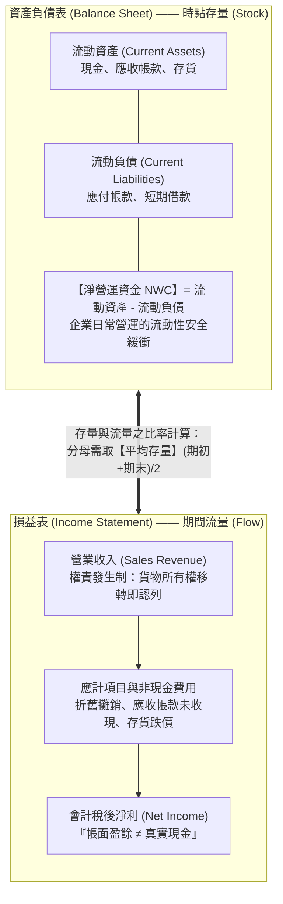
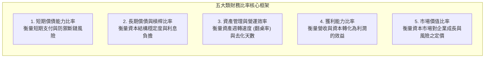
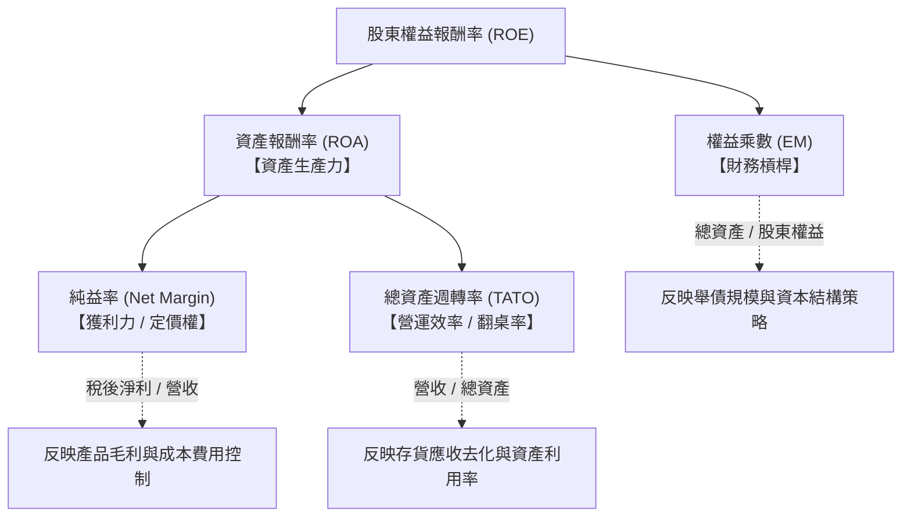

---
{"dg-publish":true,"permalink":"/02/01/l02-i/","title":"L02 基本財務報表與分析I","tags":["PMBA","財務管理","財報分析","杜邦分析","流動性比率","槓桿比率","獲利能力","核心必修"],"dg-note-properties":{"title":"L02 基本財務報表與分析I","course":"財務管理","category":"02_核心必修","type":"lecture-note","lecture":"L02","tags":["PMBA","財務管理","財報分析","杜邦分析","流動性比率","槓桿比率","獲利能力","核心必修"],"aliases":["基本財務報表與分析I","L02_基本財務報表與分析I","財務報表與比率分析","L02"]}}
---

# L02 基本財務報表與分析I

## 💡 核心摘要

- **財報是落後指標，但提供不可替代的營運回饋**：財務報表記錄的是過去已發生的經濟交易與會計估計，無法直接預測未來；但它如同企業經營的「健康檢查報告」，為高階經理人提供關鍵的營運診斷、資源配置校準與策略執行成效之定量反饋。
- **從會計盈餘向財務現金思維的本質躍遷**：[[98_商業概念庫/income-statement_損益表\|income-statement_損益表]]採應計制（[[98_商業概念庫/accrual-accounting_權責發生制\|quan-ze-fa-sheng-zhi_權責發生制]]），「帳面有獲利不等於銀行有現金」。若企業盲目追求會計利潤，放任[[98_商業概念庫/receivable-days-turnover_應收帳款週轉天數\|ying-shou-zhang-kuan-zhou-zhuan-tian-shu_應收帳款週轉天數]]拉長與庫存堆積，終將引發營運現金流枯竭，陷入致命的[[98_商業概念庫/insolvency-with-profit_黑字倒閉\|hei-zi-dao-bi_黑字倒閉]]。
- **杜邦分析系統揭示[[98_商業概念庫/business-model_商業模式\|business-model_商業模式]]的三大核心驅動力**：[[98_商業概念庫/dupont-analysis_杜邦分析法\|du-bang-analysis-fa_杜邦分析法]]將綜合獲利指標[[98_商業概念庫/shareholder-equity-return-rate_股東權益報酬率\|gu-dong-equity-return-rate_股東權益報酬率]]（ROE）拆解為「[[98_商業概念庫/net-margin_純益率\|chun-yi-rate_純益率]]（產品定價與獲利力）」$\times$「[[98_商業概念庫/total-asset-turnover-ratio_總資產週轉率\|total-asset-turnover-ratio_總資產週轉率]]（資產營運效率 / 翻桌率）」$\times$「[[98_商業概念庫/equity_權益乘數\|equity-cheng-shu_權益乘數]]（[[98_商業概念庫/financial-leverage_財務槓桿\|finance-gang-gan_財務槓桿]]）」，清晰指引企業在「利基高價」、「薄利多銷」與「金融槓桿」之間確立戰略定位。
- **警惕人為美化 ROE 的槓桿斷崖風險**：若企業本業獲利（[[98_商業概念庫/asset-return-rate_資產報酬率\|asset-return-rate_資產報酬率]]）未見起色，經理人僅靠擴大舉債拉高[[98_商業概念庫/equity_權益乘數\|equity-cheng-shu_權益乘數]]來衝高當期 ROE，一旦景氣衰退或利率走升，正向槓桿將瞬間逆轉為毀滅性的負向槓桿，推升破產清算風險。
- **景氣循環下的體質試金石**：在景氣繁榮高峰時，一線龍頭與二線廠商的財報指標皆亮麗；唯有進入景氣下行谷底時，一線廠（如台積電）憑藉定價權與技術護城河維持健康的[[98_商業概念庫/ratio_流動比率\|liu-dong-bi-rate_流動比率]]與超短的[[98_商業概念庫/cash-switching-cycle_現金轉換週期\|cash-zhuan-huan-cycle_現金轉換週期]]，而二線廠則面臨[[98_商業概念庫/inventory_存貨\|cun-huo_存貨]]暴增與現金流失血的殘酷考驗。

---

## 📚 核心觀念與財務比率架構

### 1. 資產負債表與損益表的財務解讀

在[[98_商業概念庫/finance-management_財務管理\|finance-management_財務管理]]的決策架構中，經理人解讀財報必須超越傳統會計記帳思維，聚焦於「[[98_商業概念庫/liquidity_流動性\|liu-dong-xing_流動性]]安全」與「價值創造本質」。

#### (1) 淨營運資金（Net Working Capital, NWC）與流動性健康度
- **[[net-working-capital_淨營運資金]]定義**：
  $$\text{淨營運資金 (NWC)} = \text{流動資產} - \text{流動負債}$$
- **財務涵義**：NWC 代表由長期資金所支應的[[current-assets_流動資產|liu-dong-asset_流動資產]]部位。
  - **正 NWC**：企業擁有足夠的短期緩衝資金，足以支應一年內到期的[[current-liabilities_流動負債|liu-dong-liability_流動負債]]，[[liquidity_流動性|liu-dong-xing_流動性]]結構穩健。
  - **負 NWC**：企業運用短期負債來支應長期資產（「[[maturity-mismatch_以短支長|yi-duan-zhi-zhang_以短支長]]」），一旦短期融資市場緊縮或銀行抽銀根，將立即爆發周轉不靈風險。

#### (2) 會計利潤 vs. 經營現金流之本質差異
- **會計原則之演進背景**：
  - **[[accounting-principles_會計保守原則|accounting-bao-shou-yuan-ze_會計保守原則]]（Conservatism）**：資產不虛增、負債不低估、未實現利益不認列、預期損失儘早提列（如依據「[[cost-value_成本與淨變現價值孰低法|cost-yu-jing-bian-xian-value-shu-di-fa_成本與淨變現價值孰低法]]」認列[[inventory-2_存貨跌價損失|cun-huo-die-jia-sun-shi_存貨跌價損失]]）。
  - **歷史成本 vs. [[value_公允價值|gong-yun-value_公允價值]]**：2000 年網路科技泡沫破裂與 2001 年美國安隆案（Enron）會計舞弊，揭露了傳統會計無法及時反映衍生性商品與高波動資產的弊端，促使國際財務報導準則（IFRS）大幅引進[[value_公允價值|gong-yun-value_公允價值]]（Fair Value）與更嚴格的揭露機制。
- **獲利與現金的脫節機制**：
  - [[income-statement_損益表]]採「[[accrual-accounting_權責發生制|quan-ze-fa-sheng-zhi_權責發生制]]（應計基礎）」，當貨物離岸驗收後即可認列營收，同步產生[[receivable_應收帳款|ying-shou-zhang-kuan_應收帳款]]；但實質現金流入需等待數週至數月（帳期）。
  - 企業若為了美化[[income-statement_損益表]]而放寬信用條款大舉銷貨，帳面上營收與淨利亮眼，但若款項無法收回、庫存堆積如山，將導致營業現金流（CFO）呈現巨額赤字，最終陷入[[insolvency-with-profit_黑字倒閉|hei-zi-dao-bi_黑字倒閉]]。

---

### 2. 五大類財務比率分析框架

財務比率將不同規模、不同會計期間的財報標準化，是經理人進行同業比較（Cross-sectional）與趨勢追蹤（Time-series）的核心工具：

#### (1) 短期償債能力比率（Liquidity Ratios）
衡量企業應付一年內即將到期債務的立即變現能力：
- **[[ratio_流動比率|liu-dong-bi-rate_流動比率]]（Current Ratio）**：
  $$\text{流動比率} = \frac{\text{流動資產}}{\text{流動負債}}$$
  （傳統經驗法則以 2.0 為基準，但現代精實供應鏈管理企業可能低於 1.5 仍運作良好）
- **[[ratio-2_速動比率|su-dong-bi-rate_速動比率]]（Quick Ratio / 酸性測驗比率）**：
  $$\text{速動比率} = \frac{\text{流動資產} - \text{存貨} - \text{預付款項}}{\text{流動負債}} = \frac{\text{現金} + \text{有價證券} + \text{應收帳款}}{\text{流動負債}}$$
  （排除[[current-assets_流動資產|liu-dong-asset_流動資產]]中變現最慢且跌價風險最高的[[inventory_存貨|cun-huo_存貨]]，嚴格檢驗立即償付能力，基準通常為 1.0）
- **[[cash-ratio_現金比率|cash-bi-rate_現金比率]]（Cash Ratio）**：
  $$\text{現金比率} = \frac{\text{現金及約當現金} + \text{短期具高度流動性之有價證券}}{\text{流動負債}}$$
  （最保守的終極[[liquidity_流動性|liu-dong-xing_流動性]]防線，衡量企業完全不靠新銷售或[[receivable_應收帳款|ying-shou-zhang-kuan_應收帳款]]回收時的立即支付實力）

#### (2) 長期償債與財務槓桿比率（Financial Leverage Ratios）
衡量企業[[capital-structure_資本結構]]中的負債比重與長期還本付息安全性：
- **[[liability-ratio_負債比率|liability-bi-rate_負債比率]]（Debt Ratio）**：
  $$\text{負債比率} = \frac{\text{總負債}}{\text{總資產}} \times 100\%$$
- **[[liability-equity_負債權益比|liability-equity-bi_負債權益比]]（Debt-to-Equity Ratio, D/E）**：
  $$\text{負債權益比} = \frac{\text{總負債}}{\text{股東權益}}$$
- **[[equity_權益乘數|equity-cheng-shu_權益乘數]]（Equity Multiplier, EM）**：
  $$\text{權益乘數} = \frac{\text{總資產}}{\text{股東權益}} = \frac{1}{1 - \text{負債比率}} = 1 + \text{負債權益比}$$
  （反映企業運用每一元股東自有資本所撬動的總資產倍數，是衡量[[financial-leverage_財務槓桿|finance-gang-gan_財務槓桿]]強度的核心指標）
- **[[interest-coverage-ratio_利息保障倍數|li-xi-bao-zhang-bei-shu_利息保障倍數]]（Times Interest Earned, TIE）**：
  $$\text{利息保障倍數} = \frac{\text{息稅前利潤 (EBIT)}}{\text{利息費用}}$$
  （衡量本業[[operating-income_營業利益]]支付利息的倍數。銀行通常要求至少 $\ge 3.0$ 倍；更嚴格的放款審查會要求檢視「償債保障倍數 DSCR」，將到期本金償還額併入分母）

#### (3) 資產管理與營運效率比率（Turnover / Efficiency Ratios）
衡量企業資產週轉效率與營運週期：
- **[[inventory-turnover-ratio_存貨週轉率]]（Inventory Turnover）**：
  $$\text{存貨週轉率} = \frac{\text{銷貨成本（營業成本）}}{\text{平均存貨}}$$
  （分子必須取[[cost-2_銷貨成本|xiao-huo-cost_銷貨成本]]而非[[operating-revenue_營業收入|ying-ye-shou-ru_營業收入]]，以貫徹成本對成本的計量原則）
- **[[inventory_存貨|cun-huo_存貨]]週轉天數（Days Sales of Inventory, DSI / DIO）**：
  $$\text{存貨週轉天數} = \frac{365}{\text{存貨週轉率}}$$
- **[[receivable_應收帳款|ying-shou-zhang-kuan_應收帳款]]週轉率（Receivables Turnover）**：
  $$\text{應收帳款週轉率} = \frac{\text{營業收入（賒銷淨額）}}{\text{平均應收帳款}}$$
- **[[receivable-days-turnover_應收帳款週轉天數|ying-shou-zhang-kuan-zhou-zhuan-tian-shu_應收帳款週轉天數]]（Days Sales Outstanding, DSO / 平均收現期間）**：
  $$\text{應收帳款週轉天數 (DSO)} = \frac{365}{\text{應收帳款週轉率}} = \frac{\text{平均應收帳款} \times 365}{\text{營業收入}}$$
- **[[total-asset-turnover-ratio_總資產週轉率]]（Total Asset Turnover, TATO）**：
  $$\text{總資產週轉率} = \frac{\text{營業收入}}{\text{平均總資產}}$$
  （度量企業資產的「翻桌率」，即每一元總資產在一年內所創造的營收金額）
- **[[cash-switching-cycle_現金轉換週期|cash-zhuan-huan-cycle_現金轉換週期]]（Cash Conversion Cycle, CCC）**：
  $$\text{CCC} = \text{應收帳款週轉天數 (DSO)} + \text{存貨週轉天數 (DIO)} - \text{應付帳款週轉天數 (DPO)}$$

#### (4) 獲利能力指標（Profitability Ratios）
衡量企業各營運層級將收入轉化為利潤的效率：
- **[[gross-margin-rate_毛利率]]（Gross Profit Margin）**：
  $$\text{毛利率} = \frac{\text{營業毛利}}{\text{營業收入}} = \frac{\text{營業收入} - \text{營業成本}}{\text{營業收入}} \times 100\%$$
- **[[operating-income-rate_營業利益率]]（Operating Profit Margin）**：
  $$\text{營業利益率} = \frac{\text{營業利益 (EBIT)}}{\text{營業收入}} \times 100\%$$
- **[[net-margin_純益率|chun-yi-rate_純益率]]（Net Profit Margin）**：
  $$\text{純益率} = \frac{\text{稅後淨利}}{\text{營業收入}} \times 100\%$$
- **[[asset-return-rate_資產報酬率]]（Return on Assets, ROA）**：
  $$\text{ROA} = \frac{\text{稅後淨利}}{\text{平均總資產}} \times 100\%$$
- **[[shareholder-equity-return-rate_股東權益報酬率|gu-dong-equity-return-rate_股東權益報酬率]]（Return on Equity, ROE）**：
  $$\text{ROE} = \frac{\text{稅後淨利}}{\text{平均股東權益}} \times 100\%$$

#### (5) 市場價值比率（Market Value Ratios）
連結會計報表數據與[[capital-market_資本市場]]定價：
- **[[EPS_本益比_Earnings Per Share|ben-yi-bi_本益比]]（Price-to-Earnings Ratio, P/E）**：
  $$\text{本益比} = \frac{\text{每股市價}}{\text{每股盈餘 (EPS)}} = \frac{\text{企業總市值}}{\text{稅後淨利}}$$
  （反映市場對每 1 元盈餘願意支付的溢價，體現成長預期與風險評價）
- **[[pb-ratio_股價淨值比|gu-jia-jing-zhi-bi_股價淨值比]]（Price-to-Book Ratio, P/B）**：
  $$\text{股價淨值比} = \frac{\text{每股市價}}{\text{每股淨值 (BVPS)}} = \frac{\text{企業總市值}}{\text{股東權益帳面價值}}$$
  （反映市場對企業資產創造超越帳面成本價值的認可度）
- **市值營收比（Price-to-Sales Ratio, P/S）**：
  $$\text{市值營收比} = \frac{\text{企業總市值}}{\text{營業收入}}$$
  （常用於尚未實現獲利或獲利波動極大之高成長軟體、生技新創）

---

### 3. 杜邦分析系統（DuPont Analysis）

[[dupont-analysis_杜邦分析法|du-bang-analysis-fa_杜邦分析法]]是[[finance-management_財務管理]]中最經典的診斷工具，將複合性獲利指標 ROE 進行結構性解剖。

#### (1) 經典杜邦三因子拆解
$$\text{ROE} = \left( \frac{\text{稅後淨利}}{\text{營業收入}} \right) \times \left( \frac{\text{營業收入}}{\text{總資產}} \right) \times \left( \frac{\text{總資產}}{\text{股東權益}} \right)$$
$$\text{ROE} = \text{純益率} \times \text{總資產週轉率} \times \text{權益乘數}$$

- **[[business-model_商業模式]]的三大策略光譜**：
  1. **高[[net-margin_純益率|chun-yi-rate_純益率]]模式（利基溢價型）**：如台積電先進製程、Apple、愛馬仕。依靠深厚技術護城河或品牌溢價獲取極高毛利與純益，即使資本支出龐大導致週轉率不高，仍能創造卓越 ROE。
  2. **高週轉率模式（薄利多銷型）**：如量販龍頭 Costco、全聯超商、快時尚 Zara。[[net-margin_純益率|chun-yi-rate_純益率]]僅 2%～4%，但透過極致的供應鏈管理與庫存去化，實現每年 3～4 次的總資產週轉（高翻桌率），撬動優異的 ROE。
  3. **高槓桿模式（資本營運型）**：如商業銀行、金控公司、不動產開發商。[[net-margin_純益率|chun-yi-rate_純益率]]與週轉率皆低，主要依賴吸收存款或發債（[[equity_權益乘數|equity-cheng-shu_權益乘數]]達 10～15 倍）來獲取股東回報。

#### (2) 五因子擴充模型（Extended 5-Way DuPont Analysis）
五因子模型進一步將營運本業、利息負擔與租稅規劃徹底分離：
$$\text{ROE} = \left( \frac{\text{稅後淨利}}{\text{稅前淨利 EBT}} \right) \times \left( \frac{\text{稅前淨利 EBT}}{\text{營業利益 EBIT}} \right) \times \left( \frac{\text{EBIT}}{\text{營業收入}} \right) \times \left( \frac{\text{營業收入}}{\text{總資產}} \right) \times \left( \frac{\text{總資產}}{\text{股東權益}} \right)$$

1. **稅負負擔率（Tax Burden）** = 稅後淨利 / EBT（反映政府所得稅率與企業租稅優惠抵減效益）。
2. **利息負擔率（Interest Burden）** = EBT / EBIT（反映負債利息對營業利潤的侵蝕程度；無負債時為 1.0，負債越重則越低於 1.0）。
3. **[[operating-income-rate_營業利益率]]（Operating Profit Margin）** = EBIT / [[operating-revenue_營業收入|ying-ye-shou-ru_營業收入]]（純粹反映本業產品競爭力與銷管研費用控制）。
4. **[[total-asset-turnover-ratio_總資產週轉率]]（Asset Turnover）** = [[operating-revenue_營業收入|ying-ye-shou-ru_營業收入]] / 總資產（反映資產營運效率）。
5. **[[equity_權益乘數|equity-cheng-shu_權益乘數]]（Financial Leverage）** = 總資產 / [[shareholder-equity_股東權益]]（反映財務結構放大倍數）。

---

## ⚠️ 實務應用與經理人思維

### 1. 經理人過度拉高財務槓桿美化 ROE 的潛在破產斷崖風險
- **治理弊端與道德風險**：
  - 杜邦公式揭示了高階主管的誘因盲點：要提升[[net-margin_純益率|chun-yi-rate_純益率]]需要耗費數年研發技術或品牌行銷；要提升[[total-asset-turnover-ratio_總資產週轉率]]需要優化複雜的跨國供應鏈；然而，要拉高[[equity_權益乘數|equity-cheng-shu_權益乘數]]只需「向銀行大舉借款或發行公司債」，次日即可立竿見影地推升當期 ROE。
  - 當經理人面臨續約或股票選擇權履約壓力時，常鋌而走險採取激進舉債策略，甚至借債買回庫藏股以壓縮[[shareholder-equity_股東權益]]分母。
- **正負槓桿的臨界轉換（斷崖風險）**：
  - 當企業的[[asset-return-rate_資產報酬率]]（ROA）高於借款利率時，舉債產生正向[[financial-leverage_財務槓桿|finance-gang-gan_財務槓桿]]效益，股東享受超額報酬；
  - 但一旦總體景氣反轉、央行進入升息循環，或產品營收下滑導致 ROA 跌破借款利率，負向[[financial-leverage_財務槓桿|finance-gang-gan_財務槓桿]]將以數倍幅度反噬[[shareholder-equity_股東權益]]。沉重的固定利息支出迅速擊穿[[interest-coverage-ratio_利息保障倍數|li-xi-bao-zhang-bei-shu_利息保障倍數]]，導致評等遭降、銀行抽銀根，最終引發[[liquidity_流動性|liu-dong-xing_流動性]]斷崖與破產重整。

---

### 2. 庫存去化緩慢與應收帳款膨脹背後的現金流失血警訊
- **塞貨（Channel Stuffing）與營收虛胖陷阱**：
  - 許多企業在季底或年底為達成營收目標，對經銷商實施「寬鬆授信與保證退貨」政策，強行將大量貨物塞入通路。
  - [[income-statement_損益表]]上看似營收與獲利亮麗，但財報會釋放出兩大警訊：
    1. **[[receivable-days-turnover_應收帳款週轉天數|ying-shou-zhang-kuan-zhou-zhuan-tian-shu_應收帳款週轉天數]]（DSO）異常飆升**：營收成長 10%，但[[receivable_應收帳款|ying-shou-zhang-kuan_應收帳款]]暴增 50% 以上，顯示銷售並未轉化為現金。
    2. **[[inventory-turnover-ratio_存貨週轉率]]驟降 / [[inventory_存貨|cun-huo_存貨]]天數飆長**：終端市場並未真正消化產品，經銷商後續停止拉貨甚至要求退貨，導致工廠成品倉[[inventory_存貨|cun-huo_存貨]]堆積。
- **[[cash-switching-cycle_現金轉換週期|cash-zhuan-huan-cycle_現金轉換週期]]（CCC）失控的後果**：
  - 當 DSO 與 DIO 同步拉長時，企業的[[cash-switching-cycle_現金轉換週期|cash-zhuan-huan-cycle_現金轉換週期]]大幅膨脹，日常營運遭到巨額流動資金綑綁。企業必須仰賴昂貴的短期銀行借款墊付供應商貨款與薪資，一旦市場風吹草動，即面臨現金斷裂危機。

---

### 3. 跨產業財務比率比較之陷阱
- **不同[[business-model_商業模式]]的資本密集度與週轉率差異**：
  - **資本密集製造業（如晶圓代工台積電）**：單一座 2 奈米廠投資高達數千億元，總資產規模極其龐大，[[total-asset-turnover-ratio_總資產週轉率]]通常落在 0.5～0.8 次。其高 ROE 必然依賴高達 50% 以上的[[gross-margin-rate_毛利率]]與 40% 的[[net-margin_純益率|chun-yi-rate_純益率]]支撐。
  - **零售與通路業（如好市多 Costco、全聯）**：[[gross-margin-rate_毛利率]]僅約 11%～14%，[[net-margin_純益率|chun-yi-rate_純益率]]僅約 2%～3%，但其[[total-asset-turnover-ratio_總資產週轉率]]高達 3.5～4.0 次，[[receivable_應收帳款|ying-shou-zhang-kuan_應收帳款]]幾乎為零（客戶現場刷卡或付現），且善用供應商[[payable_應付帳款|ying-fu-zhang-kuan_應付帳款]]信用，使[[cash-switching-cycle_現金轉換週期|cash-zhuan-huan-cycle_現金轉換週期]]呈現「負天數」（先收客戶現金、數月後再付供應商），創造驚人的資金運用效率。
- **經理人解讀準則**：
  - 跨越產業邊界直接比較單一指標（例如拿零售業的高週轉批評晶圓廠，或拿科技業的高毛利苛責量販店）是嚴重的管理誤區。
  - 經理人進行財報分析時，必須建立**「同業基準（Peer Group Benchmarking）」**與**「自身歷史縱向趨勢（Trend Analysis）」**的二維分析座標系。

---

### 4. 課堂核心案例深度啟發

#### (1) 一線廠 vs. 二線廠在景氣循環高低谷的體質試金石（台積電 vs. 聯電）
- **景氣繁榮期的假象**：
  - 在半導體景氣高峰期（如疫情期間晶片大缺貨），一線廠與二線廠產能全面稼動，[[gross-margin-rate_毛利率]]、[[net-margin_純益率|chun-yi-rate_純益率]]與 ROE 均大幅躍升，看似差距有限。
- **景氣下行期的真實體質檢驗**：
  - 當終端需求萎縮、景氣落入谷底時，一線廠憑藉先進製程技術壟斷地位與客戶高黏著度，維持強勁定價權，[[gross-margin-rate_毛利率]]與[[net-margin_純益率|chun-yi-rate_純益率]]回檔幅度可控；其[[ratio_流動比率|liu-dong-bi-rate_流動比率]]與[[ratio-2_速動比率|su-dong-bi-rate_速動比率]]維持在 2.4～2.6 以上，[[cash-switching-cycle_現金轉換週期|cash-zhuan-huan-cycle_現金轉換週期]]（CCC）僅約 40～50 天，現金流充沛無虞。
  - 二線廠則因成熟製程缺乏差異化，遭遇激烈的價格戰與客戶砍單，產能稼動率暴跌引發高額固定[[zhe-jiu_折舊]]侵蝕獲利；其庫存迅速堆積，CCC 大幅拉長至 100 天以上，[[operating-income-rate_營業利益率]]與[[net-margin_純益率|chun-yi-rate_純益率]]面臨斷崖式滑落。
  - **經理人啟示**：卓越的財務體質並非在順境時彰顯，而是在景氣逆風時具備抵禦寒冬的「防禦性[[liquidity_流動性|liu-dong-xing_流動性]]」與「技術護城河」。

#### (2) 中華電信商業模式轉型（B2C 轉 B2B）對營運週期的重塑
- **[[business-model_商業模式]]的財務表徵**：
  - **傳統 B2C 電信業務**：主要面向個人手機與寬頻用戶，採月租預繳或電信代扣，帳期極短且壞帳率低，[[receivable-days-turnover_應收帳款週轉天數|ying-shou-zhang-kuan-zhou-zhuan-tian-shu_應收帳款週轉天數]]（DSO）極低。
  - **轉型 B2B 企業專案與 ICT 解決方案**：承攬智慧城市、雲端資安與大型企業數位轉型專案。大型 B2B 專案具備驗收期長、依工程里程碑付款、請款審核繁瑣等特徵，帳期普遍拉長至 90～120 天。
- **經理人調適**：
  - [[business-model_商業模式]]的戰略轉移會直接重塑企業的財務比率：[[total-asset-turnover-ratio_總資產週轉率]]下滑、DSO 拉長、[[net-working-capital_淨營運資金]]需求激增。高階經理人推動策略轉型時，必須同步協調財務部門擴大短期[[liquidity_流動性|liu-dong-xing_流動性]]信用額度，避免營運成長反而引發資金緊縮。
