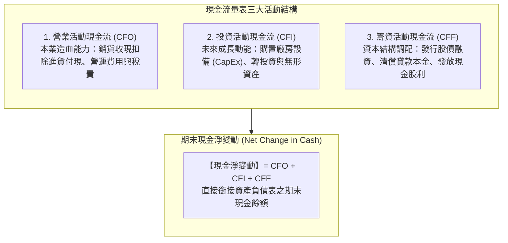
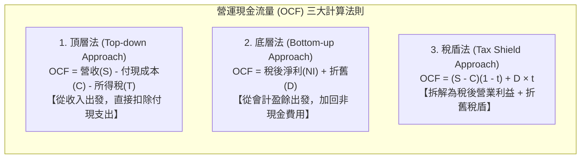
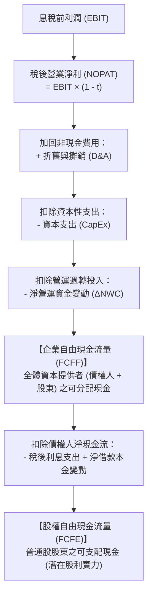
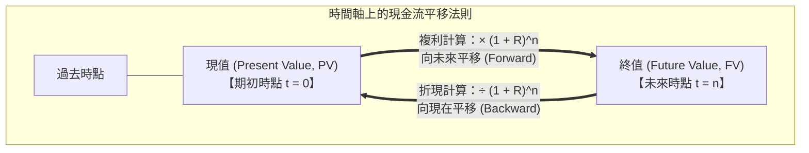

---
{"dg-publish":true,"permalink":"/02/01/l03-ii/","title":"L03 基本財務報表與分析II 現金流量評價","tags":["PMBA","財務管理","現金流量","自由現金流","營業現金流","估值評價","貨幣時間價值","核心必修"],"dg-note-properties":{"title":"L03 基本財務報表與分析II 現金流量評價","course":"財務管理","category":"02_核心必修","type":"lecture-note","lecture":"L03","tags":["PMBA","財務管理","現金流量","自由現金流","營業現金流","估值評價","貨幣時間價值","核心必修"],"aliases":["基本財務報表與分析II_現金流量評價","L03_基本財務報表與分析II_現金流量評價","現金流量評價","自由現金流量評價","L03"]}}
---

# L03 基本財務報表與分析II 現金流量評價

## 💡 核心摘要

- **獲利不等於現金，現金流是企業生存的硬通貨**：[[98_商業概念庫/accounting-profit-cash-flow-differentiation_會計利潤與現金流差異\|accounting-profit-yu-cash-liu-cha-yi_會計利潤與現金流差異]]是商業運作中最常被誤解的盲點。[[98_商業概念庫/income-statement_損益表\|income-statement_損益表]]採[[98_商業概念庫/accrual-accounting_權責發生制\|quan-ze-fa-sheng-zhi_權責發生制]]，帳面獲利可能充斥未收現的[[98_商業概念庫/receivable_應收帳款\|ying-shou-zhang-kuan_應收帳款]]或堆積如山的[[98_商業概念庫/inventory_存貨\|cun-huo_存貨]]；唯有實質流入銀行的現金流，才能用於發放薪資、償還債務與擴充投資，防範致命的[[98_商業概念庫/insolvency-with-profit_黑字倒閉\|hei-zi-dao-bi_黑字倒閉]]。
- **會計利潤可以被操縱，但現金流不能**：[[98_商業概念庫/zhe-jiu_折舊\|zhe-jiu_折舊]]攤銷年限、[[98_商業概念庫/inventory-method_存貨計價方法\|cun-huo-ji-jia-fang-fa_存貨計價方法]]與收入認列時點均存在人為調節與[[98_商業概念庫/management-2_盈餘管理\|ying-yu-management_盈餘管理]]的空間；然而，[[98_商業概念庫/cash-flow-statement_現金流量表\|cash-flow-statement_現金流量表]]記錄的是真實貨幣的收付軌跡，是穿透會計迷霧、檢驗企業獲利品質的最客觀試金石。
- **自由現金流（FCF）是企業價值的真實源泉**：在金融估值理論中，[[98_商業概念庫/enterprise-value-evaluation_企業價值評估\|enterprise-value-evaluation_企業價值評估]]絕非看帳面淨利或[[98_商業概念庫/EPS_本益比_Earnings Per Share\|ben-yi-bi_本益比]]倍數，企業的內在價值本質上等於其未來全生命週期所能產生的[[98_商業概念庫/enterprise-free-cash-flow-liang_企業自由現金流量\|enterprise-free-cash-flow-liang_企業自由現金流量]]（FCFF）以反映風險的折現率折現後的現值總和。
- **折舊稅盾的實質價值創造**：折舊費用雖非現金流出，但屬於合法的稅前可扣除項目；透過[[98_商業概念庫/depreciation-tax-shield_折舊稅盾\|zhe-jiu-shui-dun_折舊稅盾]]（$D \times t$），企業得以實質減少現金所得稅支出。採用加速折舊可在專案初期放大稅盾效益，依據[[98_商業概念庫/time-value-2_貨幣時間價值\|huo-bi-shi-jian-value_貨幣時間價值]]原理顯著推升專案淨現值（NPV）。
- **警惕人為美化現金流的營運盲點**：經理人若為達成當期 KPI，透過砍停必要維護型[[98_商業概念庫/capital-expenditure_資本支出\|capital-zhi-chu_資本支出]]（CapEx）或惡意拖延供應商[[98_商業概念庫/payable_應付帳款\|ying-fu-zhang-kuan_應付帳款]]貨款來短期美化[[98_商業概念庫/free-cash-flow-liang_自由現金流量\|free-cash-flow-liang_自由現金流量]]，實質上是在透支企業長期生產力並摧毀供應鏈信任，屬於嚴重的短視治理危機。

---

## 📚 核心觀念與現金流評價模型

### 1. 現金流量表結構與生命週期判讀

[[98_商業概念庫/cash-flow-statement_現金流量表\|cash-flow-statement_現金流量表]]將企業在特定期間內的資金進出，精準解構為三大營運構面：

#### (1) 現金流量表三大支柱之財務意涵
1. **[[98_商業概念庫/operating-cash-flow-statement_營業活動現金流量\|營業活動現金流]]（CFO）**：企業最根本的內部造血機能。長期穩健的企業必須具備持續為正且高於淨利的 CFO。
2. **[[98_商業概念庫/investing-cash-flow-statement_投資活動現金流量\|投資活動現金流]]（CFI）**：衡量企業是否持續投資未來。處於成長期的健全企業，其 CFI 通常為「負值」，代表積極進行[[98_商業概念庫/capital-expenditure_資本支出\|capital-zhi-chu_資本支出]]以構築技術護城河與累積[[98_商業概念庫/asset-2_無形資產\|wu-xing-asset_無形資產]]。
3. **[[98_商業概念庫/financing-activities-cash-flow_籌資活動現金流量\|chou-zi-huo-dong-cash-liu_籌資活動現金流]]（CFF）**：反映企業與外部[[98_商業概念庫/capital-market_資本市場\|capital-market_資本市場]]（股東與債權人）的互動，調配[[98_商業概念庫/capital-structure_資本結構\|capital-structure_資本結構]]。新創與擴張期通常為正（對外籌資），成熟期則為負（還債、分紅）。

#### (2) 八大生命週期現金流組合矩陣（8-Pattern Matrix）
經理人可透過 CFO、CFI、CFF 的正負符號組合，迅速判定企業所處的生命週期階段與潛在財務風險：

| 組合代碼 | CFO | CFI | CFF | 企業生命週期階段 | 財務特徵與經理人決策解讀 |
| :---: | :---: | :---: | :---: | :--- | :--- |
| **型態 1** | **$-$** | **$-$** | **$+$** | **初創期（Start-up）** | 本業尚未獲利且研發建廠投資鉅大，完全依賴創投或外部股權融資「輸血」維生。 |
| **型態 2** | **$+$** | **$-$** | **$+$** | **高速成長期（Growth）** | 本業已開始產生現金流入，但擴產投資需求更龐大，仍需外部舉債或增資支援。 |
| **型態 3** | **$+$** | **$-$** | **$-$** | **成熟穩健期（Cash Cow）** | **【最健康黃金型態】**：本業現金充沛，足以自給自足支應資本支出，並能還本付息與大額配息。 |
| **型態 4** | **$+$** | **$+$** | **$-$** | **轉型／衰退調整期** | 本業仍有現金，同時處分閒置資產或收回投資，將多餘資金用於減資或加速還債。 |
| **型態 5** | **$-$** | **$+$** | **$+$** | **轉型陣痛期** | 本業虧損失血，靠變賣老舊資產並對外借款或增資以支撐營運轉型。 |
| **型態 6** | **$-$** | **$+$** | **$-$** | **瀕臨危機期** | 本業失血且外部籌資困難，不得不加速變賣核心資產來償還即將到期的債務。 |
| **型態 7** | **$-$** | **$-$** | **$-$** | **全面失控期** | 本業虧損、持續盲目投資且面臨債權人催討抽銀根，流動性即將斷裂。 |
| **型態 8** | **$+$** | **$+$** | **$+$** | **罕見特殊期** | 各方現金湧入，通常發生於企業準備進行特大併購前的大規模資金囤積。 |

---

### 2. 營運現金流量（OCF）計算與三種拆解法

在公司財務學與[[98_商業概念庫/capital-budgeting_資本預算\|capital-yu-suan_資本預算]]中，[[98_商業概念庫/operations-cash-flow_營運現金流量\|operations-cash-flow_營運現金流量]]（Operating Cash Flow, OCF）是指在未扣除[[98_商業概念庫/capital-expenditure_資本支出\|capital-zhi-chu_資本支出]]與[[98_商業概念庫/working-capital_營運資金\|working-capital_營運資金]]追加前，由日常本業創造的稅後現金流入。

#### (1) 頂層法（Top-down Approach）
$$\text{OCF} = \text{營業收入 (S)} - \text{付現營業成本 (C)} - \text{實質所得稅支出 (T)}$$
- **概念核心**：完全不考慮非現金的折舊與攤銷費用，直接計算當期實際收到的現金扣除實際付出的營運與稅務現金。

#### (2) 底層法（Bottom-up Approach）
$$\text{OCF} = \text{稅後淨利 (NI)} + \text{折舊與攤銷 (D)}$$
- **概念核心**：以[[98_商業概念庫/income-statement_損益表\|income-statement_損益表]]底部的稅後淨利為起點，加回未實際流出現金的非現金費用。
- **適用前提**：僅適用於專案層級無利息費用干擾的情境（即 $\text{EBIT} = \text{EBT}$，其中 EBIT 為[[98_商業概念庫/profit_息稅前利潤\|xi-shui-qian-profit_息稅前利潤]]）。

#### (3) 稅盾法（Tax Shield Approach，評價最關鍵模型）
$$\text{OCF} = (\text{S} - \text{C}) \times (1 - t) + \text{D} \times t$$
- **兩大部分之財務本質**：
  1. **$(\text{S} - \text{C}) \times (1 - t)$**：若公司無任何固定資產折舊時，本業營運所能產生的稅後營業現金流入。
  2. **$\text{D} \times t$**：**[[98_商業概念庫/depreciation-tax-shield_折舊稅盾\|zhe-jiu-shui-dun_折舊稅盾]]（Depreciation Tax Shield）**。折舊費用本身雖非現金流出，但依法屬於稅前扣除項目，每提列 1 元折舊即可少繳 $t$ 元的所得稅，等同為企業創造了實質的現金節稅效益。

#### (4) 折舊稅盾的時間價值效益
- **總額相同，時間不同**：固定資產在其使用壽命內所能產生的總折舊金額是固定的（即資產原始成本減去殘值）。
- **加速折舊的價值創造**：若法規允許採用加速折舊法（如雙倍餘額遞減法或定率遞減法），企業在專案投資初期能夠提列更多折舊，將稅盾利益大幅提前。依據[[98_商業概念庫/time-value-2_貨幣時間價值\|huo-bi-shi-jian-value_貨幣時間價值]]原理，前期的現金流現值遠高於後期，能實質提升專案的淨現值（NPV）。

---

### 3. 自由現金流量（FCF）的嚴謹推導

[[98_商業概念庫/free-cash-flow-liang_自由現金流量\|free-cash-flow-liang_自由現金流量]]是指企業營運產生的現金在滿足了維持正常營運及支持未來成長所需之「必要[[98_商業概念庫/capital-expenditure_資本支出\|capital-zhi-chu_資本支出]]」與「[[98_商業概念庫/working-capital_營運資金\|working-capital_營運資金]]追加」後，可以完全自由分配給資本提供者的剩餘現金。

#### (1) 企業自由現金流量（FCFF）推導公式
$$\text{FCFF} = \text{EBIT} \times (1 - t) + \text{折舊與攤銷 (D\&A)} - \text{資本支出 (CapEx)} - \Delta\text{淨營運資金 (NWC)}$$
亦可簡化表述為：
$$\text{FCFF} = \text{營運現金流量 (OCF)} - \text{資本支出 (CapEx)} - \Delta\text{淨營運資金 (NWC)}$$

- **各項變數之精準定義**：
  - **$\text{EBIT} \times (1 - t)$**：稅後營業淨利（NOPAT），排除不同[[98_商業概念庫/capital-structure_資本結構\|capital-structure_資本結構]]舉債利息的干擾。
  - **$\text{CapEx}$**：當期購買不動產、廠房及設備與[[98_商業概念庫/asset-2_無形資產\|wu-xing-asset_無形資產]]的實質現金流出（維護型 + 成長型）。
  - **$\Delta\text{NWC}$**：[[98_商業概念庫/changes-in-net-working-capital_淨營運資金變動\|changes-in-net-working-capital_淨營運資金變動]]（期末 NWC $-$ 期初 NWC）。若營收擴張導致[[98_商業概念庫/receivable_應收帳款\|ying-shou-zhang-kuan_應收帳款]]與[[98_商業概念庫/inventory_存貨\|cun-huo_存貨]]增加，$\Delta\text{NWC} > 0$，代表資金被營運積壓，為現金流之**扣項**。

#### (2) 股權自由現金流量（FCFE）推導公式
$$\text{FCFE} = \text{FCFF} - \text{利息費用} \times (1 - t) + \text{淨借款 (新增借款 - 償還本金)}$$
亦可由稅後淨利出發推導：
$$\text{FCFE} = \text{稅後淨利 (NI)} + \text{折舊與攤銷} - \text{CapEx} - \Delta\text{NWC} + \text{淨借款}$$

#### (3) 評價模型與折現率匹配原則
在運用[[98_商業概念庫/dcf_現金流量折現法\|現金流量折現法 (DCF)]]進行[[98_商業概念庫/enterprise-value-evaluation_企業價值評估\|enterprise-value-evaluation_企業價值評估]]時，現金流量與折現率必須保持嚴格的定義對稱：

| 評價視角 | 現金流度量指標 | 對應之折現率 | 計算得出之價值結果 |
| :--- | :--- | :--- | :--- |
| **企業整體價值觀點** | **[[98_商業概念庫/enterprise-free-cash-flow-liang_企業自由現金流量\|enterprise-free-cash-flow-liang_企業自由現金流量]]（FCFF）** | **加權平均資本成本（WACC）** | **企業整體價值（Enterprise Value, EV）** $\text{股權價值} = \text{EV} - \text{淨負債}$ |
| **股權持有人觀點** | **[[98_商業概念庫/equity-free-cash-flow_股權自由現金流量\|gu-quan-free-cash-flow-liang_股權自由現金流量]]（FCFE）** | **股權資本成本（$K_e$，以 [[98_商業概念庫/capm_資本資產定價模型\|CAPM]] 估算）** | **股權價值（Equity Value）** 直接除以流通在外股數即得每股內在價值 |

---

### 4. 現金流量評價與企業價值創造

在課堂核心講解中，現金流量評價的核心本質在於掌握「時間軸上的價值平移」：

#### (1) 折現率 R 的本質：風險的唯一度量
- 課堂特別強調：利率、折現率、複利率、要求報酬率與資金成本，本質上都是同一個數值 $R$：
  - **投資人視角**：出資承擔風險所要求的「要求報酬率」。
  - **發行公司視角**：募集資金所必須支付的「資金成本」。
- **風險越高，折現率 $R$ 越大，未來現金流折現出的現值越低**：
  - 同樣承諾一年後給予 100 萬元現金流，新創公司（高不確定性）的折現率可能高達 20%，其現值僅約 83.3 萬元；而跨國成熟企業（低風險）的折現率僅需 5%，其現值高達 95.2 萬元。
  - **經理人決策啟示**：任何企劃案若只宣稱「未來能賺幾億元」而未界定其「風險程度（匹配折現率）」，在財務評價上毫無意義。

#### (2) 永續年金與永續成長模型（Gordon Growth Model）
1. **無窮永續年金現值**：
   若每年固定獲得現金流 $C$，折現率為 $R$：
   $$\text{PV} = \frac{C}{R}$$
2. **永續成長年金現值（高登成長模型）**：
   若第一期現金流為 $C_1$，未來每年以固定比率 $g$ 永續成長（$R > g$）：
   $$\text{PV} = \frac{C_1}{R - g}$$
   - **科技股估值飆升之謎**：當傳統企業（$g = 2\%$）跨入 AI 算力賽道，市場對其未來現金流永續成長率的預期上調至 $g = 8\%$，分母 $(R - g)$ 劇烈縮小，推動股票估值呈現倍數暴漲。但經理人亦需認知，跨入新領域意味著風險上升，$R$ 也會同步走高，兩者將展開動態博弈。

---

## ⚠️ 實務應用與經理人思維

### 1. 黑字倒閉（Profitable Insolvency）的深層病理剖析
- **「賺錢的公司為什麼會突然倒閉？」**
  - 在商業世界中，許多倒閉的企業在破產當季的[[98_商業概念庫/income-statement_損益表\|income-statement_損益表]]上依然呈現亮麗的稅後淨利。
  - **病徵形成路徑**：
    1. **過度激進擴張**：經理人為了衝刺營收成長，盲目接單並大幅放寬放帳條件（如 120 天甚至 180 天帳期）。
    2. **營運資金黑洞（$\Delta\text{NWC} \gg 0$）**：營業額暴增導致[[98_商業概念庫/receivable_應收帳款\|ying-shou-zhang-kuan_應收帳款]]與備料[[98_商業概念庫/inventory_存貨\|cun-huo_存貨]]幾何級數膨脹，將企業所有可動用的[[98_商業概念庫/liquidity_流動性\|liu-dong-xing_流動性]]全數鎖死在[[98_商業概念庫/balance-sheet_資產負債表\|balance-sheet_資產負債表]]左側。
    3. **[[98_商業概念庫/maturity-mismatch_以短支長\|yi-duan-zhi-zhang_以短支長]]與資金斷裂**：企業仰賴短期銀行周轉金墊付供應商貨款與薪資。一旦市場景氣稍有遲疑、主要客戶延遲付款，或銀行因風險控管緊縮信用額度，企業庫存無法立即變現、[[98_商業概念庫/receivable_應收帳款\|ying-shou-zhang-kuan_應收帳款]]無法貼現，即刻面臨跳票，引發連鎖破產。
- **經理人防範之道**：
  - 建立「以現金流為核心」的內控預警系統，將[[98_商業概念庫/operating-cash-flow-statement_營業活動現金流量\|營業活動現金流]]（CFO）與[[98_商業概念庫/cash-switching-cycle_現金轉換週期\|cash-zhuan-huan-cycle_現金轉換週期]]（CCC）列為比營收更優先的考核指標。

---

### 2. 經理人短期美化自由現金流（FCF）的手段與防範
- **短視經理人的兩大操弄手法**：
  1. **刻意砍停維護型[[98_商業概念庫/capital-expenditure_資本支出\|capital-zhi-chu_資本支出]]（Maintenance CapEx）**：
     - 在公式 $\text{FCFF} = \text{OCF} - \text{CapEx} - \Delta\text{NWC}$ 中，減少 CapEx 能立即按 1:1 的比例推升當期自由現金流。
     - 經理人推遲生產設備歲修、凍結軟硬體升級，短期內交出漂亮的現金流成績單以領取高額獎金；但代價是產線妥善率急跌、工安事故頻傳與良率崩潰，將殘局留給繼任者。
  2. **惡意拖延供應商[[98_商業概念庫/payable_應付帳款\|ying-fu-zhang-kuan_應付帳款]]（人為壓低 $\Delta\text{NWC}$）**：
     - 經理人在季底強行將應付帳款天數（DPO）拉長，暫停向供應商支付貨款。這會導致期末[[98_商業概念庫/current-liabilities_流動負債\|liu-dong-liability_流動負債]]虛增，進而壓低[[98_商業概念庫/net-working-capital_淨營運資金\|net-working-capital_淨營運資金]]（$\Delta\text{NWC} < 0$），在帳面上製造營運資金釋放現金的假象。
     - 此舉將重挫企業商業信用，導致關鍵供應商拒絕出貨或提高報價，破壞供應鏈長期戰略夥伴關係。
- **董事會與投資人的防禦機制**：
  - **細分 CapEx 結構**：在預算審查中嚴格拆分「維護型 CapEx」與「擴張型 CapEx」，維護型支出應設有剛性下限，不得隨意縮減。
  - **應付帳款帳齡分析**：密切監控 DPO 是否出現非尋常偏離產業常態之飆升，評估供應鏈穩定性風險。
