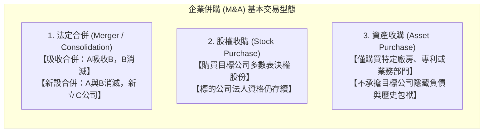
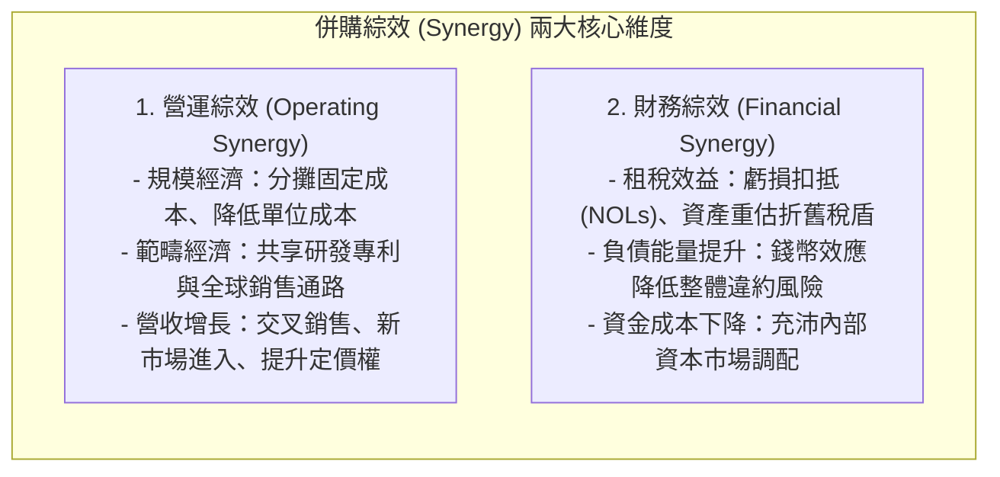
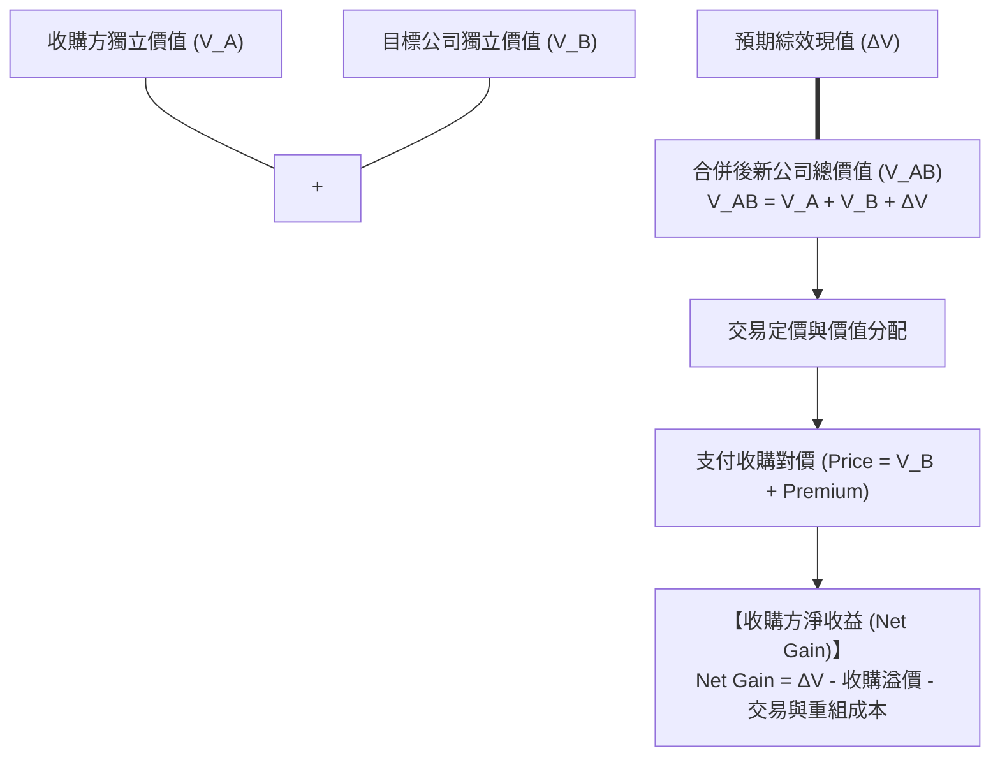
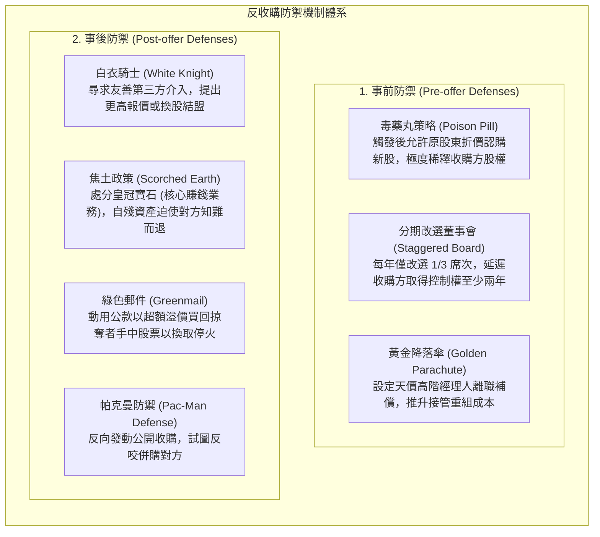

---
{"dg-publish":true,"permalink":"/02/01/l04/","title":"L04 資本支出預算(或投資)決策：合併與收購","tags":["PMBA","財務管理","資本支出","企業併購","綜效","盡職調查","估值模型","收購防禦","核心必修"],"dg-note-properties":{"title":"L04 資本支出預算(或投資)決策：合併與收購","course":"財務管理","category":"02_核心必修","type":"lecture-note","lecture":"L04","tags":["PMBA","財務管理","資本支出","企業併購","綜效","盡職調查","估值模型","收購防禦","核心必修"],"aliases":["資本支出預算(或投資)決策_合併與收購","L04_資本支出預算(或投資)決策_合併與收購","企業併購與收購","併購決策與綜效分析","M&A決策","L04"]}}
---

# L04 資本支出預算(或投資)決策：合併與收購

## 💡 核心摘要

- **併購是規模最大、風險最高的資本支出決策**：相較於內部研發與逐步擴廠的內部成長，[[98_商業概念庫/enterprise-m-and-a_企業併購\|enterprise-m-and-a_企業併購]]是「以資本換取時間」、迅速獲取技術專利與市場通路的外部成長槓桿。然而本質上，併購是企業最重大的[[98_商業概念庫/capital-expenditure_資本支出\|capital-zhi-chu_資本支出]]，一旦決策錯誤，其沉沒成本足以拖垮整家企業的[[98_商業概念庫/liquidity_流動性\|liu-dong-xing_流動性]]與信用評等。
- **統計上的冰冷現實：多數併購未能為買方創造價值**：全球實證研究一致顯示，超過 70% 的併購案未能為收購方股東創造超額報酬，甚至損害買方價值；真正的價值收割者通常是目標公司的原股東，其透過高額的[[98_商業概念庫/acquisition-premium_收購溢價\|acquisition-yi-jia_收購溢價]]提前鎖定收益。
- **綜效預估的過度樂觀陷阱**：經理人常在財務模型中灌水過於激進的[[98_商業概念庫/operating_營運綜效\|operations-zong-xiao_營運綜效]]與[[98_商業概念庫/financial_財務綜效\|finance-zong-xiao_財務綜效]]（特別是難以驗證的營收增長），將紙上富貴轉化為真實支付的收購對價；一旦合併後未能如期兌現，龐大的溢價將直接轉化為[[98_商業概念庫/goodwill_商譽\|shang-yu_商譽]]減損風暴。
- **勝者的詛咒與競價狂熱**：在拍賣競標或多方爭搶的併購場景中，得標者往往是「對綜效做出最樂觀估計」的非理性出價者。這種源於過度自信與情緒升溫的[[98_商業概念庫/winners-curse_勝者詛咒\|sheng-zhe-zu-zhou_勝者詛咒]]，導致收購價格遠超內在價值，使得「得標之日即是虧損開始之時」。
- **防禦機制與代理人問題的雙面刃**：目標公司管理層祭出的[[98_商業概念庫/strategy-4_毒藥丸策略\|du-yao-wan-strategy_毒藥丸策略]]、[[98_商業概念庫/golden-parachute_黃金降落傘\|huang-jin-jiang-luo-san_黃金降落傘]]或[[98_商業概念庫/scorched-earth-defense_焦土政策\|jiao-tu-zheng-ce_焦土政策]]，表面上是為全體股東爭取更高收購溢價或尋求[[98_商業概念庫/white-knight_白衣騎士\|bai-yi-qi-shi_白衣騎士]]，實務上常淪為經營層為捍衛個人職位、追求[[98_商業概念庫/empire-building_帝國建造\|di-guo-jian-zao_帝國建造]]而損害股東利益的[[98_商業概念庫/agency-problem_代理人問題\|dai-li-ren-wen-ti_代理人問題]]。
- **併購成敗決於併購後整合（PMI）**：商業名言「併購價值在交易桌上構想，但在整合戰場上決定生死」。忽視組織文化衝突、關鍵技術團隊流失與系統摩擦，是導致[[98_商業概念庫/merger-acquisition-integration_併購後整合\|m-and-a-hou-zheng-he_併購後整合]]徹底失靈的最主要殺手。

---

## 📚 核心觀念與理論模型

### 1. 併購基本概念與型態分類

[[98_商業概念庫/enterprise-m-and-a_企業併購\|enterprise-m-and-a_企業併購]]（Mergers and Acquisitions, M&A）泛指企業透過法定合併、股權收購或資產受讓等法律與財務途徑，取得對目標企業之全部或部分控制權之行為：

#### (1) 按業務關聯性分類
1. **[[horizontal-merger-acquisition_水平併購|shui-ping-m-and-a_水平併購]]（Horizontal Merger）**：
   - 處於相同產業、相同生產階段之直接競爭對手合併（例如封測雙雄日月光與矽品整合）。
   - **核心動機**：實現規模經濟、降低單位研發與採購成本、提高市場集中度與定價權。
   - **監理挑戰**：極易引發各國反壟斷主管機關（如公平交易委員會）之嚴格審查。
2. **[[vertical-merger-acquisition_垂直併購|chui-zhi-m-and-a_垂直併購]]（Vertical Merger）**：
   - 處於同一產業鏈上下游、具備供應商或客戶關係之企業合併。
   - **向上整合（Backward）**：併購上游原料或關鍵零組件廠（確保供料安全、保護專利）。
   - **向下整合（Forward）**：併購下游通路、系統整合商或終端品牌（掌握終端客戶數據、消除雙重邊際化）。
3. **[[merger-acquisition-3_多角化併購|duo-jiao-hua-m-and-a_多角化併購]]（Conglomerate Merger，複合式併購）**：
   - 業務完全不相關、無上下游供需關係之跨產業企業合併。
   - **財務理論批判**：傳統宣稱多角化能平滑化現金流、降低破產風險；但現代公司財務學指出，投資人可自行在公開[[capital-market_資本市場]]配置分散化投資組合，無需企業代為多角化，且複合型企業往往面臨 10%～20% 之「集團折價（Conglomerate Discount）」。

#### (2) 按交易意願與協商方式分類
1. **[[acquisition-2_善意收購|shan-yi-acquisition_善意收購]]（Friendly Takeover，合意併購）**：
   - 收購方與目標公司董事會及高階團隊經由充分協商，就收購價格、換股比例及[[corporate-governance_公司治理|company-zhi-li_公司治理]]架構達成共識，並共同提請股東會決議通過。
2. **[[merger-acquisition-2_敵意併購|di-yi-m-and-a_敵意併購]]（Hostile Takeover，非合意併購）**：
   - 目標公司管理層強烈反對收購，收購方繞過目標公司董事會，直接向股東發動[[acquisition_公開收購|gong-kai-acquisition_公開收購]]（Tender Offer）或透過[[proxy-fight_委託書爭奪|wei-tuo-shu-zheng-duo_委託書爭奪]]（Proxy Fight）撤換董監事以強行奪取經營權。

---

### 2. 併購動機與綜效（Synergy）來源

併購能否創造經濟價值的核心判準在於是否存在**[[merger-acquisition_併購綜效|m-and-a-zong-xiao_併購綜效]]**（即 $1 + 1 > 2$）：

#### (1) 營運綜效（Operating Synergy）
- **成本削減（Cost Reduction）**：最直觀且最容易衡量的綜效。裁撤重疊之後勤、法務、人資與 IT 系統，擴大原物料採購規模以壓低進貨成本。
- **營收增長（Revenue Enhancement）**：透過交叉銷售（Cross-selling）將主併方產品打入被併方通路；或結合雙方研發專利推出跨世代新產品。
- **定價權提升（Pricing Power）**：水平整合減少同業削價競爭，強化對下游客戶的議價能力。

#### (2) 財務綜效（Financial Synergy）
[[financial_財務綜效|finance-zong-xiao_財務綜效]]指企業合併後透過[[capital-structure_資本結構]]優化、稅賦減免、融資管道擴張或資金成本降低，在財務構面上所創造的增額現金流與價值提升：
- **租稅效益（Tax Gains）**：
  - **累計虧損扣抵**：利用目標公司累積未扣抵之營運虧損（Net Operating Losses, NOLs），抵減合併後新公司的應稅所得。
  - **資產重估折舊稅盾**：在收購會計中按[[value_公允價值|gong-yun-value_公允價值]]重估固定資產，擴大未來的[[depreciation-tax-shield_折舊稅盾|zhe-jiu-shui-dun_折舊稅盾]]效益。
- **負債能量提升（Debt Capacity）與錢幣效應（Coinsurance Effect）**：
  - 兩家企業現金流若非完全正相關，合併後新公司整體營運現金流的波動度顯著下降，破產風險降低，使得企業能夠承擔更高比率的廉價負債，推升利息稅盾價值。
- **內部資本市場調配（Internal Capital Market）**：
  - 將成熟事業（現金牛）產生之充沛現金流，以零交易成本調撥至缺資金的高成長專案，降低對高成本外部股權融資之依賴。

#### (3) 經理人帝國建造與代理人問題
- **盲目擴張的個人野心**：經理人的薪酬、社會聲望與權力多與「企業資產規模」呈正相關，而非與「[[earnings-per-share_每股盈餘|mei-gu-ying-yu_每股盈餘]]」掛鉤。
- **[[empire-building_帝國建造|di-guo-jian-zao_帝國建造]]（Empire Building）**：經理人為追求個人成就感，濫用手頭充沛的[[free-cash-flow-liang_自由現金流量]]發動回報率低於資本成本的併購案；或為規避個人失業風險，推動無綜效的跨界多角化，構成嚴重的[[agency-problem_代理人問題|dai-li-ren-wen-ti_代理人問題]]。

---

### 3. 目標公司估值與收購評價模型

收購評價是決定併購成敗的財務心臟。經理人需精算目標公司的獨立價值與合併後的增額價值：

#### (1) 併購增額價值與收購方淨收益公式
$$\Delta V = V_{AB} - (V_A + V_B)$$
$$\text{收購方淨收益 (Net Gain)} = \Delta V - \text{收購溢價 (Premium)} - \text{交易與重組費用}$$
其中：
$$\text{收購溢價 (Premium)} = \text{實際支付總收購對價} - V_B$$
- **經理人最高出價界限（Walk-away Price）**：
  $$\text{最高可容忍出價上限} = V_B + \Delta V$$
  - 若收購對價剛好等於 $V_B + \Delta V$，買方獲得的淨收益為零，所有綜效價值全數拱手讓給目標公司股東；
  - 若收購對價超過 $V_B + \Delta V$，買方股東價值遭到實質毀滅。

#### (2) 目標公司估值三大主流方法
1. **[[dcf_現金流量折現法|現金流量折現法]]（DCF 法應用於併購）**：
   - **獨立價值評估**：以目標公司當前營運模式預測未來 5～10 年之[[enterprise-free-cash-flow-liang_企業自由現金流量]]（FCFF），以其自身的 WACC 進行折現。
   - **綜效增額價值評估**：單獨將預期產生的成本撙節與營收增量現金流，以反映綜效實現風險的折現率進行兩階段折現。
2. **[[company-2_可比公司法|ke-bi-company-fa_可比公司法]]（Comparable Company Analysis, CCA）**：
   - 選取公開市場上相似規模與業務之同業，計算 $\text{EV}/\text{EBITDA}$ 或 $\text{P}/\text{E}$ 倍數中位數。
   - **控制權溢價加成**：公開市場股價僅反映無控制權之少數股權價值，若要收購具控制權之股權，通常需在可比公司估值基礎上外加 20%～30% 的「控制權溢價（Control Premium）」。
3. **歷史交易倍數法（Precedent Transactions）**：
   - 檢視近期同產業已完成之 M&A 交易倍數，因該倍數已內含收購溢價，通常高於一般公開市場的可比公司倍數。

#### (3) 支付方式之財務決策：現金收購 vs. 換股合併

| 比較維度 | 現金收購（Cash Offer） | 換股合併（Stock Swap） |
| :--- | :--- | :--- |
| **目標公司股東風險** | **無風險**：立即變現鎖定收益，不受後續股價波動影響。 | **共擔風險**：承擔新公司股價下跌風險，亦享有綜效超額收益。 |
| **買方股東稀釋** | **零稀釋**：[[earnings-per-share_每股盈餘|mei-gu-ying-yu_每股盈餘]]（EPS）與經營控制權不被稀釋。 | **股權稀釋**：發行新股稀釋既有[[shareholder-equity_股東權益]]持股比率與投票權。 |
| **財務槓桿與流動性** | 消耗大量現金儲備，常需大幅對外舉債（如[[leverage-acquisition_槓桿收購|gang-gan-acquisition_槓桿收購]] LBO），推升[[financial-leverage_財務槓桿|finance-gang-gan_財務槓桿]]與財務風險。 | 不消耗流動現金，保留充沛[[balance-sheet_資產負債表]]彈性。 |
| **稅務影響** | 目標公司股東通常需在當期立即繳納資本利得稅。 | 通常符合租稅延遲規定，換股時暫免課徵資本利得稅。 |
| **經理人訊號傳遞** | 釋放「買方管理層堅信自家股票被低估、目標標的極具價值」之強烈正面訊號。 | 釋放「買方管理層認為自家股票目前處於高估狀態」之保守訊號。 |

---

### 4. 敵意併購與反收購防禦機制

當面臨非合意的敵意搶奪時，目標公司管理層通常會運用事前與事後的法規、財務與公司治理工具進行防禦：

#### (1) 事前防禦機制（Pre-offer Defenses）
1. **[[strategy-4_毒藥丸策略|du-yao-wan-strategy_毒藥丸策略]]（Poison Pill，股東權利計畫）**：
   - **彈入型（Flip-in）**：當未經核准之敵意收購者持股跨過特定門檻（如 15%），除該收購者外的所有股東均有權以半價認購新股，嚴重稀釋其股權。
   - **彈出型（Flip-over）**：若公司遭強行合併，目標公司股東有權折價認購合併後「收購方新公司」之股份。
2. **分期改選董事會（Staggered Board）**：
   - 將董事會任期交錯，每年僅改選 1/3 席次。收購方即便拿下過半股權，亦需耗費兩至三年方能全面掌控董事會，大幅拉長奪權時間成本。
3. **[[golden-parachute_黃金降落傘|huang-jin-jiang-luo-san_黃金降落傘]]（Golden Parachute）**：
   - 為執行長與高階團隊設置天價離職金。一旦控制權變更且經理人遭解職，公司需支付數千萬美元補償金，推升收購方的換血成本。

#### (2) 事後防禦機制（Post-offer Defenses）
1. **[[white-knight_白衣騎士|bai-yi-qi-shi_白衣騎士]]（White Knight）**：
   - 目標公司經營層尋求友善的策略夥伴或第三方企業，提出比敵意收購方更優渥的價格或合作架構，介入接管目標公司。
2. **[[scorched-earth-defense_焦土政策|jiao-tu-zheng-ce_焦土政策]]（Scorched Earth）與處分皇冠寶石（Crown Jewels）**：
   - 將收購方最渴望取得之獲利核心資產、技術專利或子公司火速出售，使整家公司失去被併購的吸引力。
3. **[[greenmail_綠色郵件|lv-se-you-jian_綠色郵件]]（Greenmail，綠票勒索）**：
   - 目標公司管理層動用公司資金，以顯著高於市價的專項溢價買回收購方手中全部持股，並簽訂停戰協議（Standstill Agreement）。此舉極度侵害小股東利益，屬嚴重之代理人問題。
4. **帕克曼防禦（Pac-Man Defense）**：
   - 目標公司籌措巨額資金，反向對敵意收購方發動公開收購，試圖直接吃掉收購方。

---

## ⚠️ 實務應用與經理人思維

### 1. 勝者的詛咒（Winner's Curse）與紀律性退場機制
- **拍賣場中的非理性狂熱**：
  - 當併購標的進入多方競價拍賣時，出價最高者往往不是估值最精準的，而是對未來最盲目樂觀的出價者。
  - **經理人決策守則**：
    1. **設定不可逾越的「退場價格（Walk-away Price）」**：在進入競標前，由獨立財務顧問與併購小組嚴格精算最高出價上限，並在董事會白紙黑字核准。
    2. **嚴禁將「未經驗證的營收綜效」計入底價**：出價上限僅能依據保守的「獨立價值 + 確定性成本撙節」推算。
    3. **克服爭勝心魔**：在競標過程中，放棄交易往往比打腫臉充胖子的昂貴勝利更能為股東保全資本。

---

### 2. 併購後文化整合（PMI）失靈與人才留任
- **「價值毀滅於交割之後」**：
  - 統計顯示，超過 80% 併購案失敗源於組織文化互斥、管理風格衝突與關鍵研發團隊出走。
- **PMI 實務推進三大準則**：
  1. **建立獨立的整合管理辦公室（IMO）**：自簽約首日起，指派全職資深副總級主管領導跨部門整合小組，專責推動業務無縫對接。
  2. **關鍵人才黃金手銬（Retention Packages）**：針對核心技術研發人才與關鍵業務骨幹，設計 3～5 年期績效股票期權與留任獎金，防範被競業高薪挖角。
  3. **Day 1 與 Day 100 里程碑管控**：
     - **Day 1**：確保供應鏈出貨正常、客戶合約順利轉換、兩方員工薪資與福利不受干擾。
     - **Day 100**：完成 IT 系統初步串接、落實第一階段採購成本撙節，並對外公布新組織權責劃分。

---

### 3. 盡職調查（Due Diligence, DD）實務重點與防雷指南
- **穿透會計迷霧與表外風險**：
  - [[due-diligence_盡職調查|jin-zhi-diao-cha_盡職調查]]絕非例行性法規審查，而是刺破賣方財務粉飾的照妖鏡。
- **四大查核重點與合約防禦**：
  1. **隱藏負債與或有損失**：深入排查未入帳擔保、未決訴訟、環保污染潛在罰鍰與勞健保欠費。
  2. **合約控制權變更條款（Change of Control Clauses）**：清查目標公司的重大客戶與供應商合約中，是否載明「一旦經營權變更，合約自動作廢或需重新議約」，防範交割後關鍵客戶瞬間流失。
  3. **交割款第三方託管帳戶（Escrow Account）**：要求將 10%～20% 之收購對價扣留在獨立託管帳戶中，為期 12 至 24 個月，作為交割後發現陳述不實或隱藏負債時之賠償準備金。

---

### 4. 台灣經典企業併購攻防戰個案解析

#### 個案一：日月光公開收購矽品案（半導體封測雙雄之世紀攻防）
- **背景與動機**：
  - 2015 年，全球封測龍頭日月光著眼於全球半導體景氣趨緩、中國紅色供應鏈崛起及先進系統級封裝（SiP）技術門檻提高，決定對同業二哥矽品發動**[[horizontal-merger-acquisition_水平併購|shui-ping-m-and-a_水平併購]]**。
- **攻防過程**：
  1. **敵意奇襲**：日月光繞過矽品董事長林文伯，直接向廣大股東發動 25% 股權之**[[acquisition_公開收購|gong-kai-acquisition_公開收購]]**，並祭出 34% 高額**[[acquisition-premium_收購溢價|acquisition-yi-jia_收購溢價]]**。
  2. **防禦一：尋求白衣騎士**：矽品管理層緊急引進鴻海作為**[[white-knight_白衣騎士|bai-yi-qi-shi_白衣騎士]]**，擬以增資換股方式稀釋日月光股權；但因換股比例過度折價損害小股東權益，在股東臨時會遭到外資法人聯手否決破局。
  3. **防禦二：引進外資私募**：矽品隨後尋求中國紫光集團進行私募增資，但因觸碰兩岸半導體敏感神經與國家安全考量，遭主管機關嚴審阻絕。
  4. **合意收場**：日月光持續發動第二輪收購並啟動設立產業控股公司倡議。最終雙方達成和解，於 2018 年共同成立「日月光投資控股」，矽品與日月光以平行子公司方式存續，成功實現水平封測產能整合與關鍵技術守護。

#### 個案二：泰山企業處分全家持股案（焦土政策之極端自殘爭議）
- **背景與動機**：
  - 泰山企業面臨市場派大股東龍邦集團之**[[merger-acquisition-2_敵意併購|di-yi-m-and-a_敵意併購]]**與步步進逼之股權收購。
- **攻防手法**：
  - 泰山在任經營層為抵禦龍邦搶奪經營權，採取極端之**[[scorched-earth-defense_焦土政策|jiao-tu-zheng-ce_焦土政策]]**，於短短 72 小時內召開董事會，決議透過鉅額交易將泰山手中最賺錢的「皇冠寶石」——全家便利商店近 20% 股權（長期穩定獲利與現金流金雞母）全數變賣給國泰金蔡家，套現逾 80 億元。
- **商業與法理啟示**：
  - 處分皇冠寶石雖讓龍邦即使奪權亦僅剩空殼，但也徹底摧毀了泰山本身的長期核心獲利能力；隨後經營層將大額現金用於發放股利與轉投資街口支付，引發主管機關裁罰、董事會決議無效訴訟與嚴重的公司治理爭議，為典型的經營層防衛過當與[[agency-problem_代理人問題|dai-li-ren-wen-ti_代理人問題]]教材。

#### 個案三：金控併購三角戰（台新金、新光金與中信金之搶親風雲）
- **背景與動機**：
  - 2024 年，新光金控因壽險接軌 IFRS 17 資本適足率壓力尋求策略整併，台新金控與新光金控經營層推動**[[acquisition-2_善意收購|shan-yi-acquisition_善意收購]]**（換股合併）。
- **敵意插隊與攻防**：
  - 中信金控半路殺出，向金管會申請以「現金加股票」向新光金股東發動高溢價之**[[acquisition_公開收購|gong-kai-acquisition_公開收購]]**（敵意搶親），引發資本市場對「合意換股」與「敵意收購」定價效率之激烈論戰。
  - 金管會最終以「公開收購應以全數現金為原則、不確定性過高」為由予以否准，確立了金融特許行業在非合意併購上嚴格的監理門檻，亦凸顯出併購策略中監理機關審批（Regulatory Approval）往往是指標性大案最終成敗之最關鍵變數。
