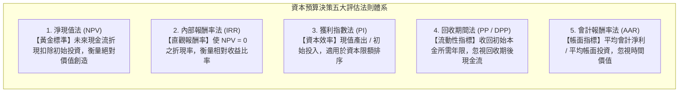
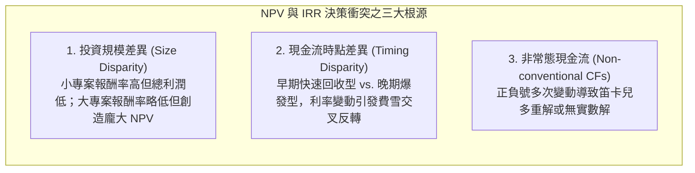
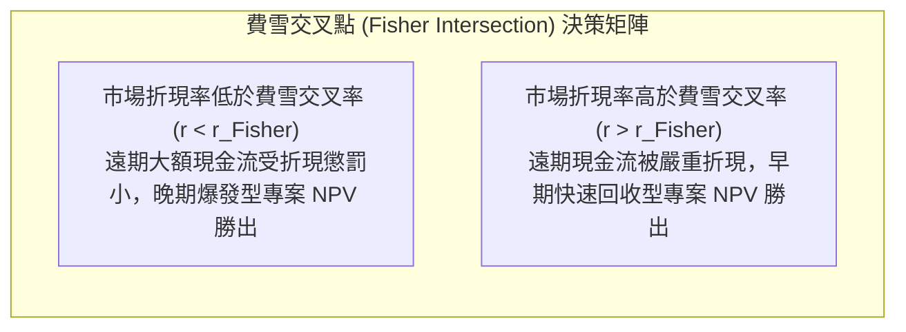

---
{"dg-publish":true,"permalink":"/02/01/l05/","title":"L05 資本支出預算(或投資)決策：五大評估法則","tags":["PMBA","財務管理","資本預算","淨現值","內部報酬率","獲利指數","互斥專案","投資決策","核心必修"],"dg-note-properties":{"title":"L05 資本支出預算(或投資)決策：五大評估法則","course":"財務管理","category":"02_核心必修","type":"lecture-note","lecture":"L05","tags":["PMBA","財務管理","資本預算","淨現值","內部報酬率","獲利指數","互斥專案","投資決策","核心必修"],"aliases":["資本支出預算(或投資)決策","L05_資本支出預算(或投資)決策","五大資本預算評估法則","NPV與IRR決策法則","資本預算法則","L05"]}}
---

# L05 資本支出預算(或投資)決策：五大評估法則

## 💡 核心摘要

- **淨現值法是企業價值極大化的唯一黃金標準**：在[[98_商業概念庫/capital-budgeting_資本預算\|capital-yu-suan_資本預算]]決策體系中，[[98_商業概念庫/NPV_淨現值法 _Net Present Value\|net-present-value-fa_淨現值法]]（NPV）直接度量專案為股東創造的絕對超額財富。它同時具備「考慮全生命週期現金流」、「嚴格反映[[98_商業概念庫/time-value-2_貨幣時間價值\|huo-bi-shi-jian-value_貨幣時間價值]]」與「價值可加性（Value Additivity）」三大優勢，是評估長期[[98_商業概念庫/capital-expenditure_資本支出\|capital-zhi-chu_資本支出]]時理論最健全的最高準繩。
- **警惕內部報酬率的再投資率假設陷阱**：[[98_商業概念庫/internal-rate-of-return_內部報酬率\|internal-rate-of-return_內部報酬率]]（IRR）雖因百分比（%）直觀而廣受高階經理人偏愛，但其隱含極度不切實際的[[98_商業概念庫/investment-2_再投資率假設\|zai-investment-rate-jia-she_再投資率假設]]（假設中間現金流能以專案自身的高 IRR 持續再投資）。當專案 IRR 異常偏高時，該指標實為數學幻象，嚴重高估專案真實回報。
- **互斥專案中規模與時點對決策排序的致命扭曲**：面對[[98_商業概念庫/mutually-exclusive-projects_互斥專案\|hu-chi-zhuan-an_互斥專案]]時，IRR 與 NPV 經常爆發排序衝突。小規模專案可能擁有極高 IRR 卻僅能賺取微薄利潤，而大規模專案 IRR 較低卻能創造數億元的實質 NPV；此外，早期回收型與晚期爆發型專案在利率變動跨越[[98_商業概念庫/fisher-intersection_費雪交叉點\|fei-xue-jiao-cha-dian_費雪交叉點]]時，決策排序將徹底逆轉。
- **資本限額環境下的專案組合最佳化思維**：在面臨預算天花板（[[98_商業概念庫/capital-2_資本限額\|capital-xian-e_資本限額]]）時，經理人不可盲目追求單一專案的最大 NPV，而應透過[[98_商業概念庫/index_獲利指數\|huo-li-zhi-shu_獲利指數]]（PI）衡量單位資本產出效率，並結合整數規劃挑選出在有限預算約束下的「最大總 NPV 專案組合」。
- **增額現金流量是投資決策的唯一實體**：資本預算的核心在於衡量「因執行該專案而產生之全公司整體現金流淨變動」。經理人必須嚴格剔除歷史發生的[[98_商業概念庫/sunk-cost_沉沒成本\|chen-mei-cost_沉沒成本]]與總部固定管理費分攤，同時精準計入資產的[[98_商業概念庫/opportunity-cost_機會成本\|ji-hui-cost_機會成本]]、新舊產品間的侵蝕效應以及[[98_商業概念庫/working-capital_營運資金\|working-capital_營運資金]]墊付。

---

## 📚 核心觀念與決策評估法則

### 1. 資本預算決策五大評估法則比較

企業在進行重大投資專案審查時，財務學界與實務界發展出五大核心評估法則：

#### (1) 淨現值法（Net Present Value, NPV）
- **定義與計算**：將專案在未來所有期間的預期現金流入，以反映專案風險之[[98_商業概念庫/cost-of-capital_資金成本\|zi-jin-cost_資金成本]]（折現率 $r$）折現至當期，扣除期初投資成本後的淨金額。
  $$\text{NPV} = \sum_{t=1}^n \frac{CF_t}{(1 + r)^t} - CF_0$$
- **判定準則**：
  - 若 $\text{NPV} > 0$，接受專案（創造實質股東價值）；
  - 若 $\text{NPV} < 0$，拒絕專案（損害股東價值）；
  - 若 $\text{NPV} = 0$，代表專案收益剛好彌補出資人要求的最低報酬率。
- **再投資率假設**：假設專案產生的中間現金流量，均能以企業的[[weighted-average-cost-of-capital_加權平均資金成本\|jia-quan-ping-jun-zi-jin-cost_加權平均資金成本]]（WACC）持續進行再投資。此假設符合[[98_商業概念庫/capital-market_資本市場\|capital-market_資本市場]]之客觀現實。

#### (2) 內部報酬率法（Internal Rate of Return, IRR）
- **定義與計算**：使投資專案之未來現金流入現值總和剛好等於期初投資成本的折現率，亦即使專案 $\text{NPV} = 0$ 的折現率。
  $$\text{NPV} = \sum_{t=1}^n \frac{CF_t}{(1 + \text{IRR})^t} - CF_0 = 0$$
- **判定準則**：
  - 若 $\text{IRR} > r$（資金成本/門檻報酬率 Hurdle Rate），接受專案；
  - 若 $\text{IRR} < r$，拒絕專案。
- **理論缺陷**：
  - **激進的再投資率假設**：隱含假設中間現金流入能以「IRR 本身」持續再投資。若專案 IRR 高達 40%，實務上企業根本無法持續找到 40% 回報的再投資標的。

#### (3) 獲利指數法（Profitability Index, PI）
- **定義與計算**：衡量每投入 1 元初始資本所能創造的未來現金流量折現值。
  $$\text{PI} = \frac{\sum_{t=1}^n \frac{CF_t}{(1 + r)^t}}{CF_0} = 1 + \frac{\text{NPV}}{CF_0}$$
- **判定準則**：
  - 若 $\text{PI} > 1$，接受專案（等價於 $\text{NPV} > 0$）；
  - 若 $\text{PI} < 1$，拒絕專案。
- **核心應用場景**：專門用於企業面臨[[98_商業概念庫/capital-2_資本限額\|capital-xian-e_資本限額]]（預算上限）時，依 PI 由高至低對多個[[98_商業概念庫/independent-projects_獨立專案\|du-li-zhuan-an_獨立專案]]進行效率排序。

#### (4) 回收期間法與折現回收期間法
1. **[[98_商業概念庫/payback-period_回收期間法\|hui-shou-qi-jian-fa_回收期間法]]（Payback Period, PP）**：
   - 衡量收回原始投資成本所需的年限。衡量資金[[98_商業概念庫/liquidity_流動性\|liu-dong-xing_流動性]]與曝險時間長短。若 $\text{PP} \le \text{目標年限}$ 則接受。
   - **兩大致命傷**：(1) 完全忽視[[98_商業概念庫/time-value-2_貨幣時間價值\|huo-bi-shi-jian-value_貨幣時間價值]]；(2) 完全忽視回收期之後的任何現金流量。
2. **[[98_商業概念庫/discounted-payback-period_折現回收期間法\|zhe-xian-hui-shou-qi-jian-fa_折現回收期間法]]（Discounted Payback Period, DPP）**：
   - 先將未來現金流以折現率折現後，再計算累計折現值等於初始投入所需時間。
   - **評價**：解決了時間價值問題，但依然忽視折現回收期後的現金流，且目標截止年限依然具高度主觀性。

#### (5) 會計報酬率法（Average Accounting Return, AAR）
- **定義與計算**：以會計帳面稅後淨利除以平均資產帳面價值。
  $$\text{AAR} = \frac{\text{專案生命週期平均預期稅後淨利}}{\text{平均帳面投資額}} = \frac{\frac{1}{n}\sum_{t=1}^n \text{Net Income}_t}{\frac{CF_0 + \text{殘值}}{2}}$$
- **評價**：基於[[98_商業概念庫/accrual-accounting_權責發生制\|quan-ze-fa-sheng-zhi_權責發生制]]之會計盈餘而非實質現金流量，且完全忽視貨幣時間價值，理論缺陷最嚴重。

#### (6) 五大評估法則全方位對比總表

| 評估法則 | 考量全期現金流？ | 考量時間價值？ | 再投資率假設 | 適用決策類型 | 理論健全度評價 |
| :--- | :---: | :---: | :--- | :--- | :--- |
| **[[98_商業概念庫/NPV_淨現值法 _Net Present Value\|淨現值法 (NPV)]]** | **是** | **是** | **資金成本（WACC）** | 獨立專案、互斥專案 | **最優（黃金標準）** |
| **[[98_商業概念庫/internal-rate-of-return_內部報酬率\|internal-rate-of-return_內部報酬率]]（IRR）** | **是** | **是** | **專案自身的 IRR** | 獨立專案（常態現金流） | 次佳（互斥專案常失真） |
| **[[98_商業概念庫/index_獲利指數\|huo-li-zhi-shu_獲利指數]]（PI）** | **是** | **是** | **資金成本（WACC）** | 資本限額下的專案排序 | 優（但互斥專案有規模盲點） |
| **[[98_商業概念庫/discounted-payback-period_折現回收期間法\|zhe-xian-hui-shou-qi-jian-fa_折現回收期間法]]** | **否** | **是** | 無再投資假設 | 流動性與風險快篩 | 普（忽略回收期後現金流） |
| **[[98_商業概念庫/payback-period_回收期間法\|hui-shou-qi-jian-fa_回收期間法]]** | **否** | **否** | 無再投資假設 | 流動性初篩 | 差（忽略時間價值與後續收益） |
| **[[98_商業概念庫/accounting-return-rate_會計報酬率\|accounting-return-rate_會計報酬率]]（AAR）** | **是**（帳面） | **否** | 無再投資假設 | 經理人 KPI 參考 | 最差（會計扭曲、無折現） |

---

### 2. 互斥專案下 NPV 與 IRR 之決策衝突與成因

當兩項專案屬於[[98_商業概念庫/mutually-exclusive-projects_互斥專案\|hu-chi-zhuan-an_互斥專案]]（彼此排他，僅能擇一執行）時，NPV 與 IRR 經常給出相互矛盾的排序結論。其衝突核心源於三大成因：

#### (1) 投資規模差異（Size Disparity）
- **衝突本質**：IRR 衡量的是「百分比（%）」，忽視了「資本規模基數」；NPV 衡量的是「絕對增額價值（元）」。
- **決策範例**：
  - **專案 A**：期初投資 1,000 萬元，一年後收回 1,500 萬元 $\implies \text{IRR} = 50\%$。在 $r = 10\%$ 下，$\text{NPV}_A = \frac{1,500}{1.1} - 1,000 = 363.6 \text{ 萬元}$。
  - **專案 B**：期初投資 1 億元，一年後收回 1.3 億元 $\implies \text{IRR} = 30\%$。在 $r = 10\%$ 下，$\text{NPV}_B = \frac{13,000}{1.1} - 10,000 = 1,818.2 \text{ 萬元}$。
- **裁決原則**：雖然 $\text{IRR}_A (50\%) > \text{IRR}_B (30\%)$，但專案 B 創造的股東財富（1,818 萬）遠大於專案 A（364 萬）。經理人必須選擇專案 B！

#### (2) 現金流量時點差異（Timing Disparity）與費雪交叉點
- **衝突本質**：專案 A 現金流集中於早期（前快後慢），專案 B 現金流集中於晚期（前慢後快）。
- **[[98_商業概念庫/fisher-intersection_費雪交叉點\|fei-xue-jiao-cha-dian_費雪交叉點]]（Fisher Intersection）**：兩專案淨現值曲線相交之特定折現率 $r_{\text{Fisher}}$。
  $$\text{NPV}_A - \text{NPV}_B = \sum_{t=0}^n \frac{CF_{A,t} - CF_{B,t}}{(1 + r_{\text{Fisher}})^t} = 0$$

#### (3) 非常態現金流量（Non-conventional Cash Flows）與多重 IRR
- **常態現金流**：期初流出（$-$），隨後各期均為流入（$+$），正負符號僅改變一次。依據笛卡兒正負號法則，IRR 必定存在唯一正實數解。
- **非常態現金流**：正負符號變動兩次或以上（例如：露天採礦專案，期初開採投資 $-$，營運期流入 $+$，期末環境復原大額支出 $-$）。
  - **多重 IRR**：存在多個令 $\text{NPV} = 0$ 的內部報酬率，使經理人無法判定應以何者作為門檻。
  - **無實數 IRR**：部分專案在任何正實數折現率下 NPV 皆大於 0，導致 IRR 無數學解。

#### (4) 修正內部報酬率（Modified IRR, MIRR）
為徹底克服傳統 IRR 的再投資率缺陷與多重解問題，[[98_商業概念庫/internal-rate-of-return-2_修正內部報酬率\|xiu-zheng-internal-rate-of-return_修正內部報酬率]]（MIRR）明確區分融資利率與再投資率：
- **組合法核心公式**：
  $$\text{PV}(\text{所有現金流出}) = \frac{\text{FV}(\text{所有現金流入})}{(1 + \text{MIRR})^n}$$
  $$\text{MIRR} = \left( \frac{\sum_{t=0}^n CF_t^+ \times (1 + r_{\text{reinvest}})^{n-t}}{\sum_{t=0}^n \frac{CF_t^-}{(1 + r_{\text{finance}})^t}} \right)^{\frac{1}{n}} - 1$$
- **優勢**：永遠存在唯一實數解，且再投資率採用真實的資金成本 WACC，數值更貼近商業真實。

---

## ⚠️ 實務應用與經理人思維

### 1. 經理人行為偏誤：為何偏好 IRR 卻常落入次佳決策？
- **百分比溝通的誘惑**：
  - 經理人向董事會報告時，宣稱「這個專案回報率高達 40%」遠比「這個專案 NPV 為 200 萬元」更具說服力與宣傳效果。
- **「小即是美」的代理人盲點**：
  - 經理人為追求漂亮的投資報酬率績效，傾向於挑選規模極小、回收極快的「小確幸專案」（IRR 虛高），而排斥需要長期投入、初期回報率看似平庸但能為企業奠定十年成長基石的大型旗艦專案（NPV 龐大）。
- **經理人破解之道**：建立以「NPV 創造總額」為核心的激勵機制，避免單一使用 IRR 考核專案成敗。

---

### 2. 資本限額（Capital Rationing）下的最佳專案組合挑選
- **軟性限額 vs. 硬性限額**：
  - **軟性限額**：內部高層主觀控制資本支出節奏（如總預算限制為 5 億元）。
  - **硬性限額**：外部資本市場對企業實施信用緊縮，無法取得額外融資。
- **獲利指數法（PI）結合整數規劃配置**：
  - 若專案可分割（Divisible），直接按 PI 由高至低排序依序挑選，直至預算耗盡；
  - 若專案不可分割（Indivisible），必須採用「0-1 整數規劃（Integer Programming）」窮舉所有預算約束下的專案組合，挑選「合計總 NPV 最大」之組合，而非單純按 PI 貪婪挑選。

---

### 3. 增額投資分析法（Incremental IRR）
- **評估專案升級之邊際效益**：
  - 當在互斥專案 A（基礎版，規模小）與專案 B（進階版，規模大）之間抉擇時，經理人應計算「增額投資（專案 B $-$ 專案 A）」的現金流量。
  - **決策流程**：
    1. 計算增額現金流量：$\Delta CF_t = CF_{B,t} - CF_{A,t}$；
    2. 計算增額內部報酬率 $\Delta\text{IRR}$；
    3. 若 $\Delta\text{IRR} > r$（資金成本），代表多投入的資本能創造超額回報，應選擇規模較大的專案 B；反之則選擇專案 A。

---

### 4. 增額現金流量四大評估原則與實務防雷指南

在課堂中，聖中老師特別強調：「資本預算計算的準確度，完全取決於輸入之[[98_商業概念庫/zeng-e-cash-flow_增額現金流量\|zeng-e-cash-flow_增額現金流量]]是否乾淨客觀！」

#### (1) 徹底剔除沉沒成本（Sunk Costs）
- **典型陷阱**：某專案立項前已委託顧問公司花費 800 萬元完成市場調研。經理人在評估專案 NPV 時，常將這 800 萬列為專案初期投資，導致原本可行的專案被否決。
- **正確原則**：這 800 萬早已流出，無論專案做與不做均無法討回，屬於[[98_商業概念庫/sunk-cost_沉沒成本\|chen-mei-cost_沉沒成本]]，決策時必須徹底忽略！

#### (2) 全額計入機會成本（Opportunity Costs）
- **典型陷阱**：新專案擬使用公司十年前以低價購入的一座閒置倉庫，經理人認為「使用自家舊倉庫無須額外付現，土地成本為零」。
- **正確原則**：該倉庫若不投入此專案，在市場上可立即以 1.5 億元售出。這 1.5 億元即為投入專案所放棄的[[98_商業概念庫/opportunity-cost_機會成本\|ji-hui-cost_機會成本]]，必須全額列為專案期初現金流出！

#### (3) 謹慎評估侵蝕效應（Erosion / Cannibalization）
- **典型陷阱**：車廠評估推出全新電動車專案，僅計算電動車帶來的營收，忽略了該電動車有 40% 的買家是原本打算購買該廠高利潤燃油車的既有車主。
- **正確原則**：因新產品上市導致舊產品減少的邊際貢獻，屬於專案引起的「負面副作用（Side Effect）」，必須作為專案現金流入的扣減項！

#### (4) 排除成管會固定間接成本分攤（Overhead Allocation）
- **典型陷阱**：總部會計部門將大樓[[98_商業概念庫/zhe-jiu_折舊\|zhe-jiu_折舊]]、高階主管薪水與法務人資費用，按各事業部營收比例分攤給新專案。
- **正確原則**：除非新專案的推動實質導致總部水電費或管理人員薪資增加，否則既有的固定分攤費用並非專案引起的增額支出，嚴禁計入專案評估！
