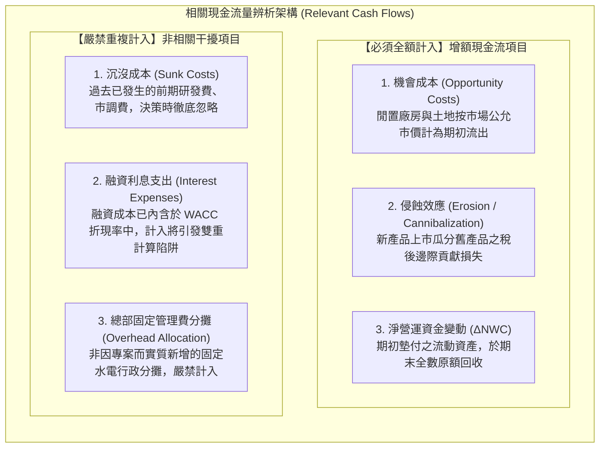
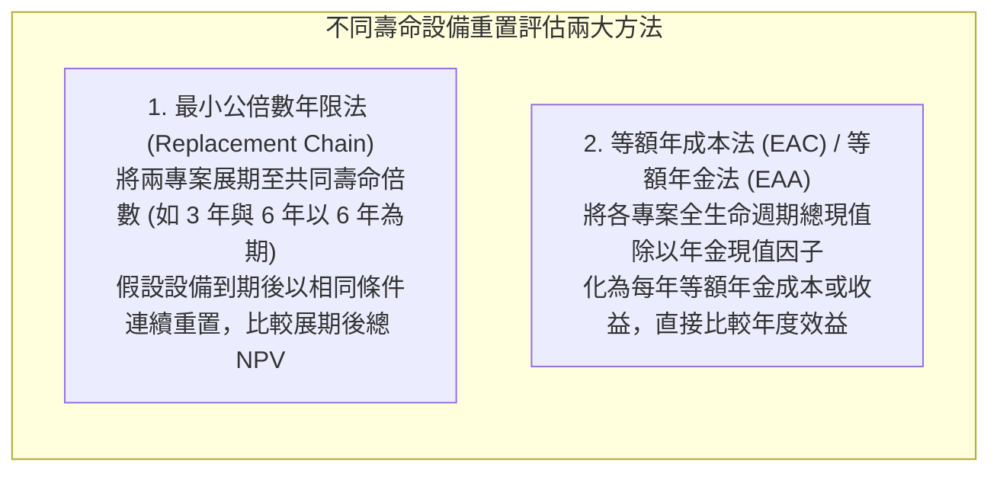
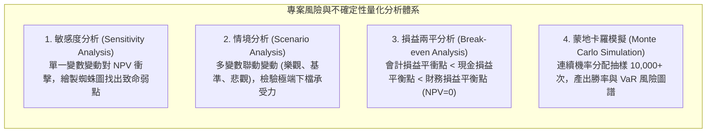
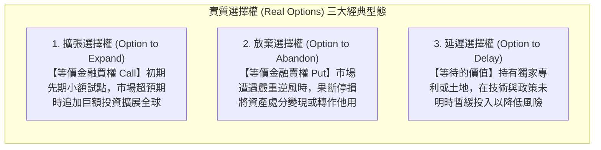

---
{"dg-publish":true,"permalink":"/02/01/l07/","title":"L07 資本支出預算決策：現金流估計與置換決策","tags":["PMBA","財務管理","資本預算","增額現金流","等額年金法","敏感度分析","實質選擇權","核心必修"],"dg-note-properties":{"title":"L07 資本支出預算決策：現金流估計與置換決策","course":"財務管理","category":"02_核心必修","type":"lecture-note","lecture":"L07","tags":["PMBA","財務管理","資本預算","增額現金流","等額年金法","敏感度分析","實質選擇權","核心必修"],"aliases":["資本支出預算決策","L07_資本支出預算決策","現金流估計與置換決策","專案現金流估計與置換","等額年金法 EAC","L07"]}}
---

# L07 資本支出預算決策：現金流估計與置換決策

## 💡 核心摘要

- **專案評估只看[[98_商業概念庫/zeng-e-cash-flow_增額現金流量\|zeng-e-cash-flow_增額現金流量]]，徹底穿透會計帳面迷霧**：在[[98_商業概念庫/capital-budgeting_資本預算\|capital-yu-suan_資本預算]]與[[98_商業概念庫/capital-expenditure_資本支出\|capital-zhi-chu_資本支出]]實務中，決策的唯一實體是「全公司整體現金流的淨變動」。經理人必須依循單一資產原則（Stand-Alone Principle），將已發生的[[98_商業概念庫/sunk-cost_沉沒成本\|chen-mei-cost_沉沒成本]]徹底排除，同時精準計入資產的[[98_商業概念庫/opportunity-cost_機會成本\|ji-hui-cost_機會成本]]與新舊產品間的[[98_商業概念庫/effect_侵蝕效應\|qin-shi-effect_侵蝕效應]]，並牢記在期末落實[[98_商業概念庫/net-working-capital-2_淨營運資金回收\|jing-operations-zi-jin-hui-shou_淨營運資金回收]]。
- **融資費用嚴禁計入現金流，防範致命的雙重計算陷阱**：許多非財務背景經理人在建模時，常誤將銀行借款利息自營業現金流中扣除。然而，借款成本與稅盾利益已完整體現在[[weighted-average-cost-of-capital_加權平均資金成本\|jia-quan-ping-jun-zi-jin-cost_加權平均資金成本]]（WACC）的折現率中；若在現金流中再次扣除利息，將落入嚴重的[[98_商業概念庫/double-counting-fallacy_雙重計算陷阱\|shuang-zhong-ji-suan-xian-jing_雙重計算陷阱]]，人為嚴重低估專案價值。
- **不同使用壽命專案嚴禁直比總 NPV**：當面臨[[98_商業概念庫/decision-2_設備重置決策\|she-bei-zhong-zhi-jue-ce_設備重置決策]]且各方案使用年限不一致時，直接比較總淨現值會產生嚴重的「年限基數扭曲」。經理人必須透過[[98_商業概念庫/cost_等額年成本法\|deng-e-nian-cost-fa_等額年成本法]]（EAC）或[[98_商業概念庫/equivalent-annual-annuity_等額年金法\|deng-e-nian-jin-fa_等額年金法]]（EAA），將全生命週期總成本或總價值平準化為每年等額年金額度，方能進行客觀裁決。
- **多維風險分析工具刺破單點估計的虛假安全感**：未來的現金流預測本質上是不確定的。經理人應結合[[98_商業概念庫/analysis-2_敏感度分析\|min-gan-du-analysis_敏感度分析]]鎖定專案的致命弱點、運用[[98_商業概念庫/analysis_情境分析\|qing-jing-analysis_情境分析]]檢驗最悲觀下檔承受力、以[[98_商業概念庫/financial-break-even_財務損益平衡點\|finance-sun-yi-ping-heng-dian_財務損益平衡點]]確立實質盈利門檻，並透過[[98_商業概念庫/monte-carlo-simulation_蒙地卡羅模擬\|meng-di-ka-luo-mo-ni_蒙地卡羅模擬]]產出完整的風險勝率機率分佈圖譜。
- **實質選擇權賦予管理彈性巨大的戰略溢價**：傳統靜態[[98_商業概念庫/discounted-cash-flow_折現現金流量\|zhe-xian-cash-flow_折現現金流量]]（DCF）模型假設決策一旦拍板就只能被動執行到底，嚴重低估了面對高度不確定性時經理人動態調整策略的管理彈性。善用[[98_商業概念庫/real-options_實質選擇權\|shi-zhi-options_實質選擇權]]（包含[[98_商業概念庫/option-to-expand_擴張選擇權\|kuo-zhang-options_擴張選擇權]]、[[98_商業概念庫/abandonment-option_放棄選擇權\|fang-qi-options_放棄選擇權]]與[[98_商業概念庫/option-to-delay_延遲選擇權\|yan-chi-options_延遲選擇權]]），能使企業在不確定環境中「鎖定下檔風險、坐享上檔利益」。

---

## 📚 核心觀念與決策評估架構

### 1. 相關現金流量辨析（Relevant Cash Flows）

資本預算評估的第一步，在於精確界定哪些現金流量與投資決策相關：

#### (1) 增額現金流量原則（Stand-Alone Principle）
在資本預算決策中，[[98_商業概念庫/zeng-e-cash-flow_增額現金流量\|zeng-e-cash-flow_增額現金流量]]是指企業「採納專案」與「不採納專案」兩種情境下，全公司整體未來現金流量的淨差額：
$$\text{增額現金流量} = \text{採納專案後全公司現金流} - \text{不採納專案全公司現金流}$$
- **單一資產原則**：將投資專案視為一個獨立於母公司既有業務的「微型企業」，僅專注於評估因該專案誕生而引起的增額現金變動。

#### (2) 必須計入之關鍵項目
1. **[[98_商業概念庫/opportunity-cost_機會成本\|ji-hui-cost_機會成本]]（Opportunity Costs）**：
   - 即使專案使用的廠房、土地或設備是公司既有的「免費資產」，亦必須按照該資產若不投入本專案時所能創造的「次佳替代收益」（如出售之稅後淨變現價值或對外出租之租金現值），全額列為專案的期初現金流出。
2. **[[98_商業概念庫/effect_侵蝕效應\|qin-shi-effect_侵蝕效應]]（Erosion / Cannibalization）**：
   - 新產品上市若分食了既有舊產品的銷量，導致舊產品減少的邊際貢獻，屬於專案引起的實質現金流失，必須作為新專案現金流入的扣減項：
     $$\text{侵蝕損失} = \Delta Q_{\text{舊產品}} \times (P_{\text{舊}} - v_{\text{舊}}) \times (1 - t)$$
3. **[[98_商業概念庫/net-working-capital-2_淨營運資金回收\|jing-operations-zi-jin-hui-shou_淨營運資金回收]]（NWC Recovery）**：
   - 專案在期初與擴張期為支援營運所墊付之[[98_商業概念庫/receivable_應收帳款\|ying-shou-zhang-kuan_應收帳款]]與[[98_商業概念庫/inventory_存貨\|cun-huo_存貨]]（$\Delta\text{NWC} > 0$），在專案終止時會隨著存貨清空、應收帳款全數收回及應付款項結清，轉化為期末的一大筆現金流入（$\text{NWC 回收} = \sum \Delta\text{NWC}$）。此項目無折舊且無須課稅。

#### (3) 嚴禁計入之干擾項目
1. **[[98_商業概念庫/sunk-cost_沉沒成本\|chen-mei-cost_沉沒成本]]（Sunk Costs）**：
   - 過去已經發生、且無論未來做出何種決策均無法收回之歷史支出（如前期市調、專利檢索與先期可行性研究費用）。此類成本與未來增額現金流完全無關，決策時必須徹底忽略。
2. **融資利息費用與[[98_商業概念庫/double-counting-fallacy_雙重計算陷阱\|shuang-zhong-ji-suan-xian-jing_雙重計算陷阱]]**：
   - **核心原理**：在以[[98_商業概念庫/discounted-cash-flow_折現現金流量\|zhe-xian-cash-flow_折現現金流量]]（DCF）法評估專案時，折現率採用的是包含股權與債務成本的[[weighted-average-cost-of-capital_加權平均資金成本\|jia-quan-ping-jun-zi-jin-cost_加權平均資金成本]]（WACC）。WACC 已經完整反映了債務借款之利息負擔與利息稅盾利益。
   - **雙重計算之危害**：若經理人在預估營業現金流量（OCF）時又扣除了利息支出，將導致債務成本在「分子（現金流）」與「分母（折現率）」中被重複扣減兩次，人為嚴重壓低專案 NPV，錯殺優質專案。

---

### 2. 不同壽命專案之重置與置換決策

當企業面臨互斥之[[98_商業概念庫/decision-2_設備重置決策\|she-bei-zhong-zhi-jue-ce_設備重置決策]]，且備選方案之使用年限不一致時，直接比較總 NPV 會產生嚴重偏差（例如：3 年期設備總 NPV 800 萬 vs. 6 年期設備總 NPV 1,200 萬，直接選後者忽略了前者在第 3 年末可重複重置再賺一次的機會）：

#### (1) 等額年成本法（Equivalent Annual Cost, EAC）
當不同壽命之設備方案產出相同服務或營收、僅需比較其生命週期總成本時，採用 EAC 法：
$$\text{EAC} = \frac{\text{總成本現值 (PV of Costs)}}{\text{年金現值因子 } \text{PVIFA}_{r, n}} = \frac{\text{初始購置成本} + \sum_{t=1}^n \frac{\text{每年維護營運成本}_t}{(1 + r)^t} - \frac{\text{期末處分殘值}_n}{(1 + r)^n}}{\frac{1 - (1 + r)^{-n}}{r}}$$
- **決策準則**：挑選**「EAC 最低」**的設備方案。

#### (2) 等額年金法（Equivalent Annual Annuity, EAA）
當不同壽命專案能帶來不同營收與現金流入時，採用 EAA 法：
$$\text{EAA} = \frac{\text{專案總 NPV}}{\text{年金現值因子 } \text{PVIFA}_{r, n}} = \frac{\text{NPV}}{\frac{1 - (1 + r)^{-n}}{r}}$$
- **決策準則**：挑選**「EAA 最高」**的投資專案。

---

### 3. 專案不確定性與風險分析工具

現金流預測本質上充滿未知，經理人需運用系統化工具量化風險：

#### (1) 敏感度分析（Sensitivity Analysis）
- 每次僅變動一個關鍵變數（如售價 $\pm 10\%$、銷量 $\pm 10\%$、原料成本 $\pm 10\%$），固定其餘變數，計算 NPV 變動幅度。
- 繪製蜘蛛圖（Spider Diagram），斜率最陡峭者即為專案成敗之關鍵樞紐。

#### (2) 情境分析（Scenario Analysis）
- 考量多個變數在不同經濟狀態下的聯動反應：
  - **最樂觀情境（Best Case）**：景氣繁榮、高銷量、高售價、低成本；
  - **基準情境（Base Case）**：當前預期之正常營運假設；
  - **最悲觀情境（Worst Case）**：景氣衰退、低銷量、削價競爭、成本上漲。
- 評估在最悲觀情境下企業是否會面臨[[98_商業概念庫/liquidity_流動性\|liu-dong-xing_流動性]]斷鏈危機。

#### (3) 三大損益平衡點全面解析
1. **會計損益平衡點**：使稅後淨利等於 0 之銷量。$Q = \frac{\text{固定成本 (FC)} + \text{折舊}}{P - v}$（其中[[98_商業概念庫/zhe-jiu_折舊\|zhe-jiu_折舊]]為非現金費用）。忽視時間價值，實質破壞股東財富。
2. **現金損益平衡點**：使營業現金流 OCF 等於 0 之銷量。$Q = \frac{\text{FC}}{P - v}$。僅能維持短期營運不跳票，完全無法回收初始資本支出。
3. **[[98_商業概念庫/financial-break-even_財務損益平衡點\|finance-sun-yi-ping-heng-dian_財務損益平衡點]]**：使專案 $\text{NPV} = 0$ 之年度最低銷售量：
   $$Q_{\text{financial}} = \frac{\text{FC} + \text{EAC} - \text{折舊稅盾}}{P - v}$$
   - 式中 $\text{EAC}$ 為平攤初始投資之等額年金成本，並扣減[[98_商業概念庫/depreciation-tax-shield_折舊稅盾\|zhe-jiu-shui-dun_折舊稅盾]]。
   - **關係式**：$Q_{\text{現金}} < Q_{\text{會計}} < Q_{\text{財務}}$。唯有超越財務損益平衡點，專案收益方能彌補出資人要求的[[98_商業概念庫/cost-of-capital_資金成本\|zi-jin-cost_資金成本]]，真正創造經濟淨價值！

#### (4) 蒙地卡羅模擬（Monte Carlo Simulation）
- 結合機率統計與電腦運算，為各變數設定機率分配（如常態分配或三角分配），隨機抽樣運算上萬次，產出專案 NPV 的連續機率分佈，提供精確的「獲利勝率 $P(\text{NPV} > 0)$」與「95% 信賴水準下的最大風險值（VaR）」。

---

### 4. 實質選擇權（Real Options）的管理價值

傳統靜態 DCF/NPV 假設經理人「今天拍板後就只能被動等待結果」，然而在真實商業環境中，經理人擁有隨市場變化調整策略的管理彈性：

$$\text{策略性 NPV (Strategic NPV)} = \text{傳統靜態 NPV} + \text{實質選擇權價值}$$

#### (1) 擴張選擇權（Option to Expand）
- **金融本質**：買權（Call Option）。
- **商業實踐**：高科技研發、生技新藥開發與新興市場佈局。初期小規模試產的靜態 NPV 往往小於 0，但它購買了一張「若市場爆發則可全面擴建」的門票，鎖定下檔風險、放大上檔利潤。

#### (2) 放棄選擇權（Option to Abandon）
- **金融本質**：賣權（Put Option）。
- **商業實踐**：當專案營運虧損擴大時，及時終止專案並將設備出售。放棄選擇權為專案提供了「價值下限（Floor Value）」，大幅削減了極端下檔風險。

#### (3) 延遲選擇權（Option to Delay）
- **金融本質**：最佳時機選擇權（Option to Wait）。
- **商業實踐**：擁有精華區土地開發權或特殊採礦權。即便當前立即投資的 NPV 為正，若暫緩一年能消除重大政策或市場不確定性，且延遲後的預期淨現值更高，則「等待」才是創造最大價值的最優決策。

---

## ⚠️ 實務應用與經理人思維

### 1. 沉沒成本執念與虧損專案失血
- **「不甘心」的心理偏誤**：
  - 經理人常因「前期已經投入了數億元研發」或「設備帳面尚未折舊完畢」，而在面對虧損專案時難以割捨，甚至盲目追加預算，陷入「沉沒成本謬誤（Sunk Cost Fallacy）」。
- **經理人決策紀律**：
  - 歷史支出永遠無法討回。在任何決策時點，經理人必須學會「向前看（Forward-looking）」，永遠只基於「未來增額投入能否創造高於資金成本的未來增額回報」做出客觀停損裁決。

---

### 2. 侵蝕效應的計算陷阱：不侵蝕是否會被對手吃掉？
- **動態競爭視角的侵蝕校準**：
  - 評估新產品時，若直接扣除舊產品的全部邊際貢獻損失，容易使新專案在財務模型中顯得無利可圖而遭到否決。
  - **關鍵反思問題**：「如果我們不推出這款新產品，舊產品的市場份額能保得住嗎？」
  - **正確處理**：若不推出新產品，市場份額在未來兩年內亦將被競爭對手吃掉，則該舊產品利潤的喪失屬於「產業市場自然萎縮」，而非新專案引起的增額代價，決策時**不可扣減新專案的現金流**。

---

### 3. 靜態 NPV 的盲點與動態管理彈性
- **低估高度不確定專案的真實價值**：
  - 在高科技、生技醫藥與創新領域，靜態 NPV 模型往往因高折現率與初期高研發支出而給出負值。若僵化依循靜態 NPV，企業將徹底扼殺所有突破性創新。
- **經理人的策略思維躍遷**：
  - 經理人應主動在合約與專案架構中設計實質選擇權（如分階段投資、保留產能擴充權、設備租賃與轉售條款），將管理彈性貨幣化，推動企業在高度不確定性的動態競爭中立於不敗之地。
