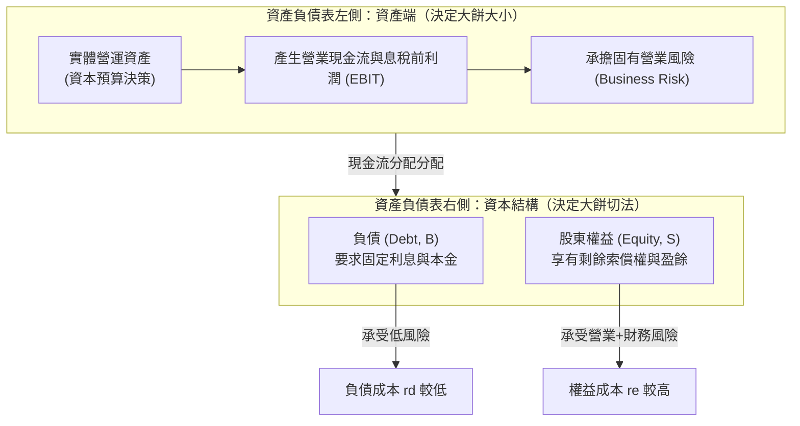
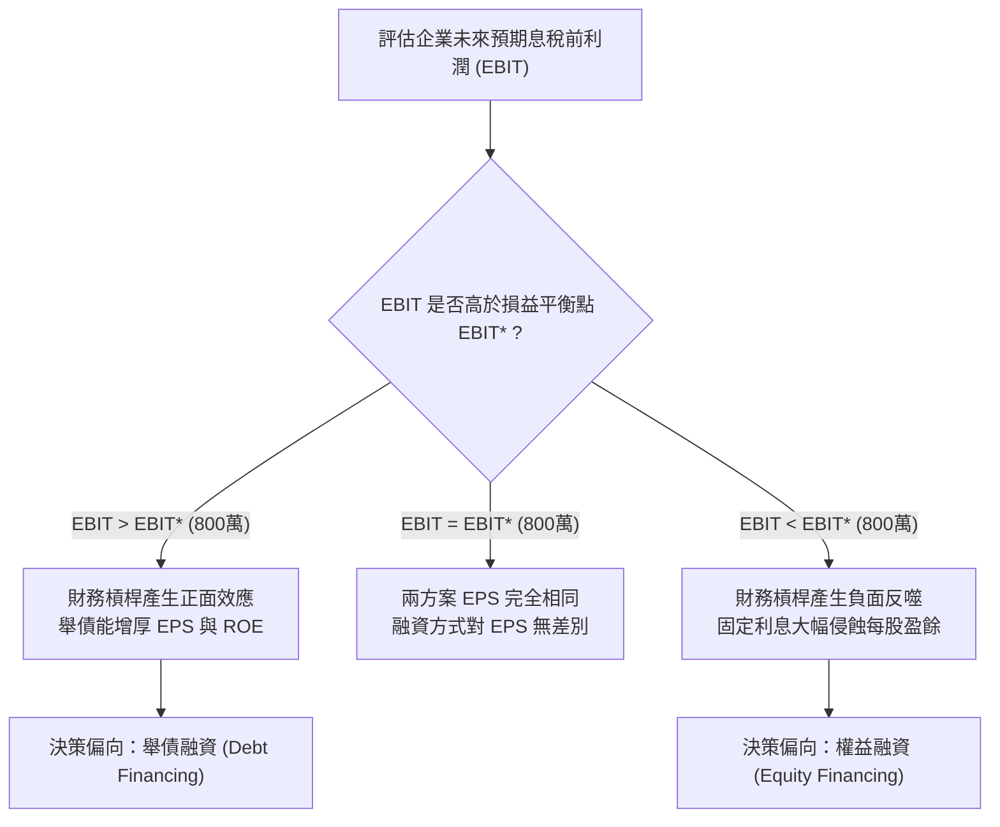
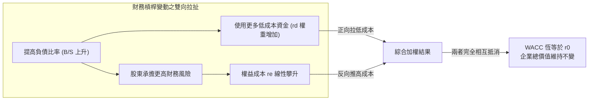

---
{"dg-publish":true,"permalink":"/02/01/l08/","title":"L08 資本結構理論與決策：財務槓桿與EBIT-EPS分析","tags":["PMBA","財務管理","資本結構","財務槓桿","自製槓桿","加權平均資金成本","WACC","EBIT-EPS分析","核心必修"],"dg-note-properties":{"title":"L08 資本結構理論與決策：財務槓桿與EBIT-EPS分析","course":"財務管理","category":"02_核心必修","type":"lecture-note","lecture":"L08","tags":["PMBA","財務管理","資本結構","財務槓桿","自製槓桿","加權平均資金成本","WACC","EBIT-EPS分析","核心必修"],"aliases":["資本結構理論與決策","L08_資本結構理論與決策","財務槓桿與EBIT-EPS分析","財務槓桿分析","資本結構導論","L08"]}}
---

# L08 資本結構理論與決策：財務槓桿與EBIT-EPS分析

## 💡 核心摘要
- **左側資產決定價值，右側融資決定分潤**：企業的實質市場價值是由資產負債表左側的底層資產獲利能力（[[98_商業概念庫/profit_息稅前利潤\|xi-shui-qian-profit_息稅前利潤]]）與[[98_商業概念庫/operating-risk_營業風險\|ying-ye-risk_營業風險]]所決定，而非右側[[98_商業概念庫/capital-structure_資本結構\|capital-structure_資本結構]]中負債與股東權益的比例切法。
- **財務槓桿是一把雙面刃**：[[98_商業概念庫/financial-leverage_財務槓桿\|finance-gang-gan_財務槓桿]]能夠在景氣繁榮或獲利高於[[98_商業概念庫/bep-break-even-point_損益平衡點\|sun-yi-ping-heng-dian_損益平衡點]]時顯著放大[[98_商業概念庫/earnings-per-share_每股盈餘\|mei-gu-ying-yu_每股盈餘]]（EPS）與[[98_商業概念庫/shareholder-equity-return-rate_股東權益報酬率\|gu-dong-equity-return-rate_股東權益報酬率]]（ROE）；但在景氣蕭條或獲利不佳時，剛性利息支出將加速侵蝕獲利，甚至引爆[[98_商業概念庫/financial-cost_財務危機成本\|finance-wei-ji-cost_財務危機成本]]。
- **自製槓桿與無套利均衡之力量**：在[[98_商業概念庫/wan-mei-capital-market_完美資本市場\|wan-mei-capital-market_完美資本市場]]環境下，個別投資人可透過個人借貸進行[[98_商業概念庫/leverage_自製槓桿\|zi-zhi-gang-gan_自製槓桿]]，完美複製或消除公司的融資槓桿。市場的[[98_商業概念庫/no-arbitrage-equilibrium_無套利均衡\|wu-tao-li-jun-heng_無套利均衡]]機制使得企業總體價值不受資本結構影響（[[98_商業概念庫/capital-structure-3_資本結構無關論\|capital-structure-wu-guan-lun_資本結構無關論]]）。
- **權益成本隨槓桿線性攀升之代價**：雖然[[98_商業概念庫/liability-cost_負債成本\|liability-cost_負債成本]]看似低廉，但舉債帶來的[[98_商業概念庫/finance-risk_財務風險\|finance-risk_財務風險]]會導致股東要求的[[98_商業概念庫/equity-cost_權益成本\|equity-cost_權益成本]]等比例線性上升，兩者在[[weighted-average-cost-of-capital_加權平均資金成本\|jia-quan-ping-jun-zi-jin-cost_加權平均資金成本]]（WACC）的加權下完全抵消。
- **資本結構決策之終極目標**：在存在市場摩擦（如稅盾利益、代理成本、財務困境）的真實世界中，經理人應致力於尋求使 [[weighted-average-cost-of-capital_加權平均資金成本\|jia-quan-ping-jun-zi-jin-cost_加權平均資金成本]] 極小化、進而達成 [[98_商業概念庫/enterprise-value-evaluation_企業價值評估\|enterprise-value-evaluation_企業價值評估]] 總現值極大化的最適資本結構。

---

## 📚 核心觀念與理論模型

### 一、資本結構的核心問題與決策目標

#### 1. 資產負債表兩側之本質對稱
在公司理財的架構中，資產負債表展現了企業資源配置與資金籌措的兩面一體：
- **左側（資產端，資本預算決策）**：決定企業的「餅有多大」。投資於具備正淨現值（NPV）的實體資產，產生[[98_商業概念庫/profit_息稅前利潤\|xi-shui-qian-profit_息稅前利潤]]（EBIT），承擔本業固有的[[98_商業概念庫/operating-risk_營業風險\|ying-ye-risk_營業風險]]。
- **右側（資本端，資本結構決策）**：決定企業「大餅如何切割」。透過普通股、優先股與負債等金融契約，將資產產生的現金流量在債權人與股東之間進行分配。

#### 2. 資本結構的終極決策目標
企業追求的最佳[[capital-structure_資本結構]]，其目標函數可表述為雙重等價關係：
$$\min 	ext{WACC} \iff \max V = B + S$$
- 企業總市場價值 $V$ 等於債務市值 $B$ 加上股權市值 $S$。
- 當企業找到一組最適負債比率，使得整體[[weighted-average-cost-of-capital_加權平均資金成本|jia-quan-ping-jun-zi-jin-cost_加權平均資金成本]]降至最低點時，未來營運現金流以該折現率折現後的企業總價值必然達到極大化。

---

### 二、財務槓桿與每股盈餘（EPS）分析

#### 1. 財務槓桿的運作機制
[[financial-leverage_財務槓桿|finance-gang-gan_財務槓桿]]指企業利用成本固定的債務資金來提高股東每股盈餘與報酬率的財務手段。
- 借入固定成本資金（負債利率 $r_d$），若投入資產後產生的[[asset-return-rate_資產報酬率]]（ROA）高於借款利率，超額利潤將全數歸屬於股東，進而拉高[[shareholder-equity-return-rate_股東權益報酬率|gu-dong-equity-return-rate_股東權益報酬率]]（ROE）與[[earnings-per-share_每股盈餘|mei-gu-ying-yu_每股盈餘]]（EPS）。
- 反之，若 ROA 低於借款利率，資產獲利連支付利息都不足，短缺部分將由股東權益承擔，導致 ROE 與 EPS 斷崖式暴跌。

#### 2. 資本結構比較範例（無稅環境試算）
假設某公司目前為純權益公司，考慮轉換為 50% 負債之槓桿公司：
- **公司現狀（無負債方案 U）**：資產總額 8,000 萬元，普通股 800 萬股，股價 10 元，負債為 0。
- **財務槓桿方案（方案 L）**：發行 4,000 萬元公司債（利率 10%，年利息 400 萬元），以每股 10 元回購 400 萬股普通股。回購後負債 4,000 萬元，股本 400 萬股。

| 景氣狀態 | 悲觀衰退 | 正常平穩 | 樂觀繁榮 |
| :--- | :---: | :---: | :---: |
| **預期息稅前利潤 (EBIT)** | **200 萬元** | **800 萬元** | **1,200 萬元** |
| **無負債方案 U** | | | |
| - 利息支出 ($I=0$) | 0 | 0 | 0 |
| - 淨利 (Net Income) | 200 萬元 | 800 萬元 | 1,200 萬元 |
| - 發行股數 | 800 萬股 | 800 萬股 | 800 萬股 |
| - **每股盈餘 (EPS)** | **0.25 元** | **1.00 元** | **1.50 元** |
| - **股東權益報酬率 (ROE)** | **2.5%** | **10.0%** | **15.0%** |
| **50% 槓桿方案 L** | | | |
| - 利息支出 ($I=400$ 萬) | 400 萬元 | 400 萬元 | 400 萬元 |
| - 淨利 (Net Income) | -200 萬元 | 400 萬元 | 800 萬元 |
| - 發行股數 | 400 萬股 | 400 萬股 | 400 萬股 |
| - **每股盈餘 (EPS)** | **-0.50 元** | **1.00 元** | **2.00 元** |
| - **股東權益報酬率 (ROE)** | **-5.0%** | **10.0%** | **20.0%** |

**核心觀察**：
- 在「正常景氣」（EBIT = 800 萬）時，兩方案 EPS 皆為 1.00 元。
- 在「繁榮景氣」（EBIT = 1,200 萬）時，槓桿方案 L 的 EPS 暴增至 2.00 元（+100%），ROE 躍升至 20%，充分展現槓桿放大威力。
- 在「衰退景氣」（EBIT = 200 萬）時，方案 L 發生淨虧損，EPS 跌入 -0.50 元，ROE 轉為 -5.0%，而無負債方案仍保持獲利。

---

### 三、EBIT-EPS 無差異點（損益平衡點）分析

#### 1. 數學推導
EBIT-EPS 無差異點即為資本結構決策中的[[bep-break-even-point_損益平衡點|sun-yi-ping-heng-dian_損益平衡點]]（Indifference Point $	ext{EBIT}^*$），在此 EBIT 水準下，兩融資方案之 EPS 恰好相等：
$$
rac{(	ext{EBIT}^* - I_1)(1 - t_c)}{S_1} = 
rac{(	ext{EBIT}^* - I_2)(1 - t_c)}{S_2}$$

在無稅環境（$t_c = 0$）且方案一為純權益（$I_1 = 0$）、方案二為舉債（利息 $I_2 = I$）的條件下：
$$
rac{	ext{EBIT}^*}{S_U} = 
rac{	ext{EBIT}^* - I}{S_L}$$

交叉相乘推導：
$$	ext{EBIT}^* \cdot S_L = 	ext{EBIT}^* \cdot S_U - I \cdot S_U$$
$$	ext{EBIT}^* (S_U - S_L) = I \cdot S_U$$
$$	ext{EBIT}^* = 
rac{I \cdot S_U}{S_U - S_L}$$

帶入前述試算範例數據：
$$	ext{EBIT}^* = 
rac{400 	imes 800}{800 - 400} = 
rac{320,000}{400} = 800 	ext{ 萬元}$$
此即前述表格中 EBIT = 800 萬時兩者 EPS 均為 1.00 元的理論根源。

#### 2. 經理人決策矩陣

- **當預期 $	ext{EBIT} > 	ext{EBIT}^*$**：舉債方案的 EPS 高於增資方案，此時企業營業獲利足夠承擔利息並創造超額回報，應傾向採用債務融資。
- **當預期 $	ext{EBIT} < 	ext{EBIT}^*$**：發行權益股票的 EPS 高於舉債方案，此時應避免承擔剛性利息壓力，以權益融資保護企業財務彈性。

---

### 四、莫迪利安尼-米勒定理（MM 定理）無稅環境

#### 1. 完美資本市場之四大基石假設
[[modigliani-miller-theorem_莫迪利安尼米勒定理|mo-di-li-an-ni-mi-lei-ding-li_莫迪利安尼米勒定理]]在 1958 年提出的無稅理論基於[[wan-mei-capital-market_完美資本市場]]（Perfect Capital Markets）假設：
1. **無交易成本與無稅收**：買賣證券無摩擦，無公司所得稅與個人資本利得稅。
2. **資訊完全對稱**：所有投資人與管理層同步掌握完全相同的資訊，無代理問題。
3. **個人與企業借貸利率相同**：個別投資人能以與大型企業完全相同的無風險利率 $r_d$ 借入或貸出款項。
4. **無財務危機與破產成本**：企業營運陷入困境時，資產重整與清算無額外摩擦成本。

#### 2. MM 第一命題：資本結構無關論
在完美資本市場中，任何企業的市場總價值由其資產實體獲利能力（[[profit_息稅前利潤|xi-shui-qian-profit_息稅前利潤]]）與[[operating-risk_營業風險|ying-ye-risk_營業風險]]所決定，與其如何融資或負債比率完全無關：
$$V_L = V_U = 
rac{	ext{EBIT}}{r_0}$$
- $V_L$：有負債企業總價值（$B + S_L$）。
- $V_U$：無負債企業總價值（純股權市值 $S_U$）。
- $r_0$：純營運風險對應的資金成本（資產要求報酬率）。

**大餅切法理論（The Pie Model）**：
資本結構的改變僅僅是切餅工具的選擇，無法把一塊 12 吋的披薩切成 16 吋。經理人透過舉債調整資本結構，只是重新分配了各類投資人的求償優先順位，並未在實體層面增加哪怕一塊錢的現金流量，因此企業總體價值保持恆定。

#### 3. 自製槓桿與無套利均衡推導
若市場違反 MM 第一命題，存在定價偏差（例如市場投資人特別偏好槓桿公司，給予 $V_L > V_U$ 的溢價），理性投資人可透過[[leverage_自製槓桿|zi-zhi-gang-gan_自製槓桿]]（Homemade Leverage）發動無風險套利，推動市場回歸[[no-arbitrage-equilibrium_無套利均衡|wu-tao-li-jun-heng_無套利均衡]]。

**數值推導與套利機制**：
- 假設投資人持有槓桿公司 $L$ 1% 的股份：
  - 投資人持股市值：$0.01 	imes S_L$。
  - 投資人每年獲取之股利收益：$0.01 	imes (	ext{EBIT} - r_d B)$。
- **替代策略（自製槓桿策略）**：
  - 投資人賣出 $L$ 股票，套現 $0.01 	imes S_L$。
  - 投資人以個人名義按利率 $r_d$ 借入資金 $0.01 	imes B$。
  - 投資人手中共有資金：$0.01 	imes (S_L + B) = 0.01 	imes V_L$。
  - 投資人將此資金全數購買無負債公司 $U$ 的股份：購入份額為 $
rac{0.01 	imes V_L}{V_U}$。
  - 若 $V_L > V_U$，投資人只需花費 $0.01 	imes V_U$ 就能買到 $U$ 公司 1% 股權，剩餘資金為純套利利潤 $0.01 	imes (V_L - V_U)$！
  - 投資人持有 $U$ 公司 1% 股權獲得現金流 $0.01 	imes 	ext{EBIT}$，扣除個人借款利息 $0.01 	imes r_d B$ 後，淨收益剛好為 $0.01 	imes (	ext{EBIT} - r_d B)$，與直接持有 $L$ 股票完全相同！
- **結論**：由於投資人個人就能以完全相同的成本與效果「自製槓桿」，市場絕不會為企業舉債支付任何額外溢價。套利者的拋售 $L$ 與買入 $U$ 力量將迅速迫使 $V_L = V_U$。

#### 4. MM 第二命題：權益成本隨財務槓桿線性攀升
既然負債成本 $r_d$ 明顯低於股權成本 $r_e$，為何多借低成本的負債無法降低企業整體的[[weighted-average-cost-of-capital_加權平均資金成本|jia-quan-ping-jun-zi-jin-cost_加權平均資金成本]]？
MM 第二命題給出了解答：
$$r_e = r_0 + 
rac{B}{S}(r_0 - r_d)$$

- **公式構成拆解**：
  1. $r_0$：**純營運風險報酬率**（Business Risk Premium），由本業營運資產特性決定。
  2. $
rac{B}{S}(r_0 - r_d)$：**財務風險溢酬**（Financial Risk Premium），由負債權益比率 $
rac{B}{S}$ 決定。
- **內在平衡機制**：
  當企業增加負債比率時，雖然使用了更多較便宜的債務（$r_d$ 權重增加），但由於負債的增加直接提升了破產與盈餘波動的[[finance-risk_財務風險]]，普通股股東為了承擔此額外風險，必然要求更高的報酬率，促使[[equity-cost_權益成本]] $r_e$ 以斜率 $(r_0 - r_d)$ 線性攀升。
  兩者加權後的結果：
  $$	ext{WACC} = 
rac{B}{V} r_d + 
rac{S}{V} r_e = 
rac{B}{V} r_d + 
rac{S}{V} \left[ r_0 + 
rac{B}{S}(r_0 - r_d) 
ight] = r_0$$
  **加權平均資金成本（WACC）始終維持定值 $r_0$，完全不受資本結構變動的影響！**

---

## ⚠️ 實務應用與經理人思維

### 一、經理人常見認知盲區

#### 盲區：「借錢成本比股權便宜，所以舉債越多公司資金成本越低」
許多非財務背景的高階主管常落入此經典誤區：
> 「銀行貸款利率才 3%，發新股股東動輒要求 10% 以上報酬率；既然借錢這麼便宜，我們把負債比率拉到最高，公司的平均資金成本不就大幅降低、企業價值大幅提升了嗎？」

**助教深度解析**：
1. **忽視了隱性權益風險溢酬**：債務的表面利率確實低，但那是以犧牲股權安全為代價換來的。每新增一元債務，都在悄悄推升股東承擔的[[finance-risk_財務風險]]，導致整體股東群體提高要求報酬率。低成本債務帶來的「表面省錢」，在整體層面被股權成本的「實質攀升」徹底吃掉。
2. **忽視了邊際負債成本的跳升與信用評等**：當負債比率突破安全臨界點，債權人亦非盲目慈善機構。銀行會提高授信利率、要求嚴苛的債務保護條款（Debt Covenants），甚至債券評等遭降評為垃圾級，使[[liability-cost_負債成本]] $r_d$ 本身也隨之暴增。

### 二、財務槓桿的反噬效應：擴張期 vs 衰退期

- **擴張期的槓桿狂歡**：
  在宏觀流動性寬鬆或產業高速成長階段，高槓桿能讓企業展現出極具吸引力的 ROE 成長曲線，管理層往往將這種「槓桿放大效益」誤認為自身的「卓越營運能力」。
- **衰退期的槓桿反噬**：
  一旦產業週期反轉或黑天鵝事件爆發，營業獲利滑落至[[bep-break-even-point_損益平衡點|sun-yi-ping-heng-dian_損益平衡點]]下方，剛性利息費用不會因為景氣差而減少分毫。高槓桿企業的淨利將以數倍於營收下滑的速度崩解，迅速陷入週轉不靈，甚至引發供應商抽銀根、客戶抽單等災難性的[[financial-cost_財務危機成本|finance-wei-ji-cost_財務危機成本]]。

### 三、PMBA 經理人資本結構決策之黃金準則
1. **本業為本，融資為用**：進行[[enterprise-value-evaluation_企業價值評估]]時，永遠牢記價值源於資產負債表左側的核心產品與商業模式。單靠右側的融資財技無法拯救一個平庸的商業計劃。
2. **嚴密監控 EBIT 損益平衡安全邊際**：在敲定任何大規模舉債計劃前，務必精算 EBIT-EPS [[bep-break-even-point_損益平衡點|sun-yi-ping-heng-dian_損益平衡點]]，並設定至少 30%~50% 的景氣下行安全緩衝空間（Margin of Safety）。
3. **動態權衡稅盾與危機成本**：現實世界中存在所得稅，負債確實具備利息稅盾利益；但經理人的智慧在於精準拿捏「稅盾效益」與「潛在[[financial-cost_財務危機成本|finance-wei-ji-cost_財務危機成本]]折現值」之間的動態平衡點，避免將企業推向違約深淵。
