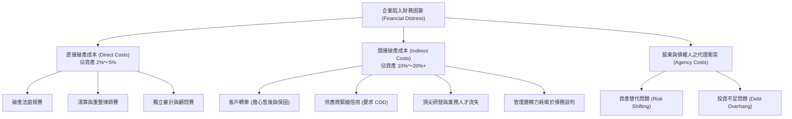
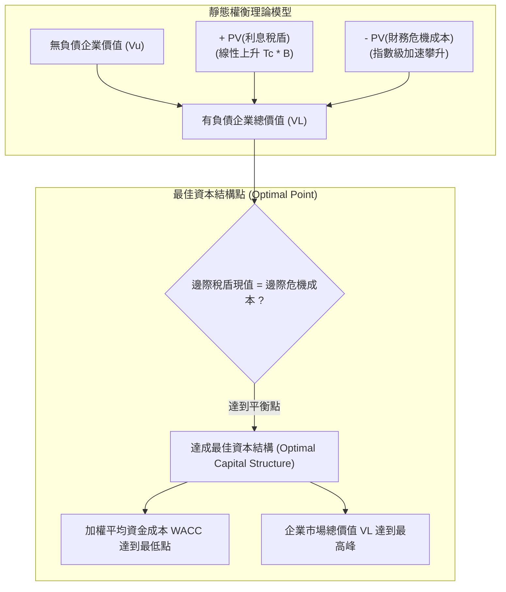
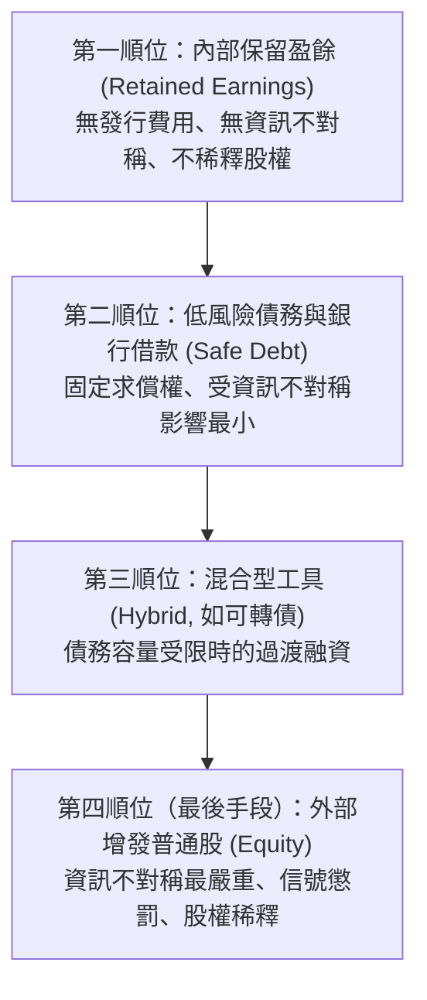

---
{"dg-publish":true,"permalink":"/02/01/l09/","title":"L09 資本結構理論與決策：MM定理與當代權衡模型","tags":["PMBA","財務管理","資本結構","MM定理","利息稅盾","權衡理論","啄食順序理論","代理成本","核心必修"],"dg-note-properties":{"title":"L09 資本結構理論與決策：MM定理與當代權衡模型","course":"財務管理","category":"02_核心必修","type":"lecture-note","lecture":"L09","tags":["PMBA","財務管理","資本結構","MM定理","利息稅盾","權衡理論","啄食順序理論","代理成本","核心必修"],"aliases":["L09_資本結構理論與決策","MM定理與當代權衡模型","當代資本結構理論","MM定理","權衡理論與順序融資","L09"]}}
---

# L09 資本結構理論與決策：MM定理與當代權衡模型

## 💡 核心摘要
- **利息稅盾創造價值但非無窮無盡**：在有公司所得稅環境下，[[98_商業概念庫/financing_債券融資\|bond-rong-zi_債券融資]]享用法定[[98_商業概念庫/interest-tax-shield_利息稅盾\|li-xi-shui-dun_利息稅盾]]優惠，負債公司價值隨債務增加而抬升（$V_L = V_U + T_C 	imes B$）；然而，稅盾利益的邊際貢獻隨著槓桿提升而逐漸被指數級攀升的危機風險所抵消。
- **間接破產成本遠重於法庭規費**：[[98_商業概念庫/financial-cost_財務危機成本\|finance-wei-ji-cost_財務危機成本]]中，付給律師與會計師的[[98_商業概念庫/direct-bankruptcy-cost_直接破產成本\|zhi-jie-bankruptcy-cost_直接破產成本]]僅佔企業資產的 2%～5%；而客戶轉單、供應商抽銀根、核心人才出走及管理精力扭曲等[[98_商業概念庫/indirect-bankruptcy-cost_間接破產成本\|jian-jie-bankruptcy-cost_間接破產成本]]高達 10%～20% 以上，往往在正式破產前就已徹底擊垮企業。
- **高負債引爆代理衝突扭曲決策**：在深陷困境時，股東與債權人的利益嚴重錯配，引發「贏了全拿、輸了債權人承擔」的[[98_商業概念庫/asset_資產替代問題\|asset-ti-dai-wen-ti_資產替代問題]]（賭博性投資），以及「為債權人打工而放棄正 NPV 專案」的[[98_商業概念庫/investment_投資不足問題\|investment-bu-zu-wen-ti_投資不足問題]]（債務懸垂）。
- **靜態權衡理論奠定最佳資本結構**：企業並非負債越多越好，而是在邊際[[98_商業概念庫/interest-tax-shield_利息稅盾\|li-xi-shui-dun_利息稅盾]]等於邊際[[98_商業概念庫/financial-cost_財務危機成本\|finance-wei-ji-cost_財務危機成本]]現值處，達成 [[98_商業概念庫/capital-structure-2_最佳資本結構\|zui-jia-capital-structure_最佳資本結構]]，此時 [[weighted-average-cost-of-capital_加權平均資金成本\|jia-quan-ping-jun-zi-jin-cost_加權平均資金成本]]（WACC）降至最低點，[[98_商業概念庫/enterprise-value-evaluation_企業價值評估\|enterprise-value-evaluation_企業價值評估]] 總現值達到極大化。
- **啄食順序反映資訊不對稱真實面**：現實中因存在[[98_商業概念庫/information-asymmetry_資訊不對稱\|zi-xun-bu-dui-cheng_資訊不對稱]]，經理人遵循融資偏好階梯：優先依賴內部[[98_商業概念庫/retained-earnings_保留盈餘\|bao-liu-ying-yu_保留盈餘]]，其次為低風險[[98_商業概念庫/financing_債券融資\|bond-rong-zi_債券融資]]，最後才是外部增發新股以避免[[98_商業概念庫/equity-dilution_股權稀釋\|gu-quan-xi-shi_股權稀釋]]與[[98_商業概念庫/signaling-theory_信號傳遞理論\|xin-hao-chuan-di-theory_信號傳遞理論]]所帶來的股價懲罰。

---

## 📚 核心觀念與當代資本結構理論

### 一、莫迪利安尼-米勒定理（MM 定理：有公司稅環境）

#### 1. 命題一：利息稅盾價值與企業總價值
在 1963 年的修正模型中，[[98_商業概念庫/modigliani-miller-theorem_莫迪利安尼米勒定理\|mo-di-li-an-ni-mi-lei-ding-li_莫迪利安尼米勒定理]]（MM 定理）引入了「公司所得稅（Corporate Income Tax）」，徹底翻轉了無稅環境下的[[98_商業概念庫/capital-structure_資本結構\|capital-structure_資本結構]]結論。由於稅法允許企業將借款利息列為營業外費用並於課稅所得額中全額扣除，政府實際上替舉債企業承擔了一部分的融資成本，此即[[98_商業概念庫/interest-tax-shield_利息稅盾\|li-xi-shui-dun_利息稅盾]]。

- **每年利息稅盾現金流**：
  $$	ext{Tax Shield} = 	ext{利息支出} 	imes T_C = (r_d 	imes B) 	imes T_C$$
  其中 $B$ 為負債市場價值，$r_d$ 為負債利率，$T_C$ 為企業邊際所得稅率。
- **永久負債之稅盾現值推導**：
  若負債為永久存續，且稅盾現金流承擔與負債相同的風險（以 $r_d$ 折現）：
  $$	ext{PV}(	ext{利息稅盾}) = 
rac{(r_d 	imes B) 	imes T_C}{r_d} = T_C 	imes B$$
- **MM 第一命題（含稅公式）**：
  $$V_L = V_U + T_C 	imes B$$
  **意涵**：有負債企業的總價值等於無負債企業價值加上利息稅盾現值。舉債不再與企業價值無關，政府成為企業的被動補貼合夥人，每一元新增負債都能替企業帶來 $T_C$ 元的實質價值增厚。

#### 2. 命題二：稅後權益成本與 WACC 的極端推論
在考慮利息抵稅利益後，雖然[[98_商業概念庫/financial-leverage_財務槓桿\|finance-gang-gan_財務槓桿]]仍會增加普通股股東的[[98_商業概念庫/finance-risk_財務風險\|finance-risk_財務風險]]，但部分風險被稅盾吸收，因此[[98_商業概念庫/equity-cost_權益成本\|equity-cost_權益成本]]的攀升速度較無稅環境平緩：
$$r_e = r_0 + 
rac{B}{S}(r_0 - r_d)(1 - T_C)$$
- $r_0$：無負債資產成本（反映純營運風險）。
- $
rac{B}{S}(r_0 - r_d)(1 - T_C)$：稅後財務風險溢酬。

**加權平均資金成本（WACC）公式**：
$$	ext{WACC} = 
rac{B}{V} r_d (1 - T_C) + 
rac{S}{V} r_e$$
將命題二之 $r_e$ 代入後可得：
$$	ext{WACC} = r_0 \left[ 1 - T_C 
rac{B}{V} 
ight]$$

**MM 含稅模型的極端推論**：
隨著負債比率 $
rac{B}{V}$ 持續拉高，加權平均資金成本 WACC 將單調遞減。當負債比率達到 100% 時，WACC 達到最低點，企業價值達到極大化！
> **實務反思**：如果 MM 含稅模型完全成立，為什麼真實世界中沒有任何一家理性企業會採用 100% 負債？這證明現實中必然存在強大的反向制約力量——**財務危機成本與代理成本**。

---

### 二、財務危機成本與代理問題

#### 1. 財務危機的本質
當企業負債比率過高，營業活動產生的現金流量不足以履約償還剛性本息時，企業便陷入「財務困窘（Financial Distress）」。財務困窘引發的價值損失即為[[98_商業概念庫/financial-cost_財務危機成本\|finance-wei-ji-cost_財務危機成本]]。

#### 2. 直接破產成本 vs 間接破產成本
- **[[direct-bankruptcy-cost_直接破產成本|zhi-jie-bankruptcy-cost_直接破產成本]]（Direct Bankruptcy Costs）**：
  企業進入法院清算拍賣或重整程序時，直接支付給律師、會計師、清算專家的法庭與諮詢規費。
  - 特徵：佔破產時企業總資產的 **2% 至 5%**，具備顯著的規模不經濟（中小企業佔比極高）。
- **[[indirect-bankruptcy-cost_間接破產成本|jian-jie-bankruptcy-cost_間接破產成本]]（Indirect Bankruptcy Costs）**：
  在法院敲槌之前，因市場對企業喪失信心所引爆的全面營運中斷與商譽摧毀。
  - 特徵：規模通常高達企業總價值的 **10% 至 20%**，是直接成本的數倍。包含客戶拒買、供應商拒絕賒銷、核心人才出走及管理層注意力扭曲。

#### 3. 股東與債權人的兩大經典代理衝突
當企業面臨高額債務壓頂時，股東（享有有限責任與剩餘索償權）與債權人（享有固定求償權）的利益嚴重對立，引發破壞價值的次佳決策：

1. **[[asset_資產替代問題|asset-ti-dai-wen-ti_資產替代問題]]（Asset Substitution / Risk Shifting）**：
   - **機制**：股東權益本質上是一張買權。當企業瀕臨破產，股東具有強烈動機將低風險穩健資產置換為高風險、高變異度的賭博專案。
   - **利益錯配**：賭贏了大賺全歸股東，賭輸了損失全由債權人承擔（「贏了全拿，輸了算債權人的」）。這導致企業可能去投資 NPV < 0 的劣質高風險專案。
2. **[[investment_投資不足問題|investment-bu-zu-wen-ti_投資不足問題]]（Underinvestment / Debt Overhang）**：
   - **機制**：即使眼前出現淨現值為正（NPV > 0）的優良專案，若專案產生的現金流主要被現有債權人拿去償還歷史欠債，股東注資後無法獲取合理報酬。
   - **利益錯配**：股東不願「為債權人打工」，因而選擇放棄投資正 NPV 專案，導致企業失去成長動力，加速走向衰亡。

---

### 三、靜態權衡理論（Trade-off Theory）

#### 1. 核心模型架構
靜態[[theory-7_權衡理論|quan-heng-theory_權衡理論]]（Static Trade-off Theory）將「利息稅盾利益」與「財務危機成本及代理成本」納入同一定價模型：
$$V_L = V_U + 	ext{PV}(	ext{利息稅盾}) - 	ext{PV}(	ext{財務危機成本})$$

#### 2. 最適負債比率之決定
- **低負債區間**：違約機率極低，財務危機成本近乎為零，邊際稅盾增量大於危機成本增量，企業價值隨舉債增加而提升。
- **過度負債區間**：違約風險與代理衝突呈指數級爆發，邊際財務危機成本迅速超越稅盾利益，企業價值遭受嚴重侵蝕。
- **平衡點（最佳資本結構）**：
  $$
rac{d(	ext{PV of 利息稅盾})}{dB} = 
rac{d(	ext{PV of 財務危機成本})}{dB}$$
  在此比率下，[[weighted-average-cost-of-capital_加權平均資金成本|jia-quan-ping-jun-zi-jin-cost_加權平均資金成本]]（WACC）達到 U 型曲線之谷底，[[capital-structure-2_最佳資本結構|zui-jia-capital-structure_最佳資本結構]]正式確立。

---

### 四、資訊不對稱與現代資本結構理論

#### 1. 信號傳遞理論（Signaling Theory）
在真實市場中，經理人對企業真實價值與未來現金流的掌握遠多於外部大眾投資人，此即[[information-asymmetry_資訊不對稱|zi-xun-bu-dui-cheng_資訊不對稱]]。經理人的融資手段會被市場解讀為重大信號：
- **增發普通股（Equity Issuance）$
ightarrow$ 負面信號**：
  根據 Myers-Majluf 模型，內部人只會在認為自家「股價被市場嚴重高估」時，才願意發行新股換取便宜資金。市場一旦得知增資消息，股價通常立即重挫（市場懲罰機制）。
- **發行債券（Debt Issuance）$
ightarrow$ 正面信號**：
  舉債伴隨著剛性本息償付約束。唯有對未來營運現金流極具信心的管理層才敢大舉發債。因此發債向市場釋放出「經理人看好公司前景」的利多信號。

#### 2. 啄食順序理論（Pecking Order Theory）
[[theory-6_啄食順序理論|zhuo-shi-shun-xu-theory_啄食順序理論]]指出：企業並不存在一個固定的「最佳負債比率」目標，融資行為是由內部現金流赤字與資訊不對稱成本所驅動的偏好階梯：

1. **第一順位：內部[[retained-earnings_保留盈餘|bao-liu-ying-yu_保留盈餘]]**：成本最低，完全掌控自主權。
2. **第二順位：低風險[[financing_債券融資|bond-rong-zi_債券融資]]**：固定收益求償權，資訊敏感度低。
3. **第三順位：可轉換公司債**：介於股債之間的混合工具。
4. **最後手段：增發普通股**：面臨嚴重的[[equity-dilution_股權稀釋|gu-quan-xi-shi_股權稀釋]]與股價折價，僅在債務容量耗盡時無奈動用。

---

## ⚠️ 實務應用與經理人思維

### 一、為什麼不同產業有截然不同的負債水準？
在實務中，不同產業的負債容量（Debt Capacity）天差地別，其背後的根本驅動因子在於「資產特性」與「[[indirect-bankruptcy-cost_間接破產成本|jian-jie-bankruptcy-cost_間接破產成本]]的高低」：

| 產業類型 | 典型代表 | 負債比率傾向 | 關鍵驅動因子與 PMBA 經理人洞察 |
| :--- | :--- | :---: | :--- |
| **重資產 / 現金流穩定產業** | 公用事業（電力、自來水）、電信、收費公路、不動產開發 | **偏高 (50%～70%)** | 1. 營運現金流具備類獨占性與極高可預測性。 2. 擁有大量具通用價值之有形資產可供抵押。 3. 客戶無轉單疑慮，[[indirect-bankruptcy-cost_間接破產成本|jian-jie-bankruptcy-cost_間接破產成本]]極低，能充分享受[[interest-tax-shield_利息稅盾|li-xi-shui-dun_利息稅盾]]。 |
| **高科技 / 高研發輕資產產業** | 半導體設計、生技醫藥、SaaS 軟體、網際網路平台 | **極低 (0%～15%) 甚至淨現金** | 1. 核心資產為無形資產（專利、演算法、團隊智慧），清算價值幾乎為零。 2. 研發與盈餘波動劇烈，剛性利息極易引爆危機。 3. 客戶與人才對企業財務體質極度敏感，[[indirect-bankruptcy-cost_間接破產成本|jian-jie-bankruptcy-cost_間接破產成本]]極高。 |

### 二、財務彈性（Financial Slack）的戰略重要性
許多初入 PMBA 的經理人常感到困惑：
> 「像 Apple、Alphabet、微軟、台積電這些全球獲利最頂尖的科技巨頭，每年坐擁數百億美元營業利潤，若依 MM 含稅理論舉債數千億抵稅，豈不是能創造巨大價值？為何他們反而長期維持龐大的『淨現金（Net Cash）』部位？」

**助教深度解析**：
1. **現金是危機時刻的保命符**：
   科技與高成長產業的環境變化日新月異。保留充裕的[[financial-flexibility_財務彈性|finance-dan-xing_財務彈性]]（Financial Slack），能確保企業在遭遇宏觀流動性凍結或景氣寒冬時，永遠不需要看銀行的臉色，徹底杜絕因短期資金鏈斷裂而猝死的風險。
2. **逆勢擴張與掠奪性併購的終極武器**：
   在金融海嘯或市場恐慌期，高槓桿競爭對手往往深陷斷糧泥淖，被迫收縮戰線或賤賣資產。此時手握充沛現金的企業，能以極度便宜的估值展開「掠奪性併購」或持續加碼前瞻研發，在下一個景氣循環中實現贏家通吃。

### 三、經理人融資策略之黃金準則
1. **警惕市場低谷增資的雙重打擊**：
   當公司股價處於歷史低檔時，增發新股會帶來致命的「雙重打擊」：一方面對原有股東造成永久且嚴重的[[equity-dilution_股權稀釋|gu-quan-xi-shi_股權稀釋]]；另一方面觸發[[signaling-theory_信號傳遞理論|xin-hao-chuan-di-theory_信號傳遞理論]]的負面懲罰，坐實市場對公司陷入財務困頓的猜疑。
2. **動態維護負債容量**：
   在景氣繁榮、獲利豐沛時，經理人不應盲目把槓桿拉到極致，而應有意識地保留 20%～30% 的剩餘舉債容量（Unused Debt Capacity），作為應對未來未知的戰略防火牆。
3. **對齊生命週期的融資組合**：
   創業期與高成長期嚴格遵循[[theory-6_啄食順序理論|zhuo-shi-shun-xu-theory_啄食順序理論]]，以股權與內部資金為主；進入成熟穩健期後，逐步過渡至[[theory-7_權衡理論|quan-heng-theory_權衡理論]]框架，適度發行債券以擷取利息稅盾，實現企業價值最大化。
