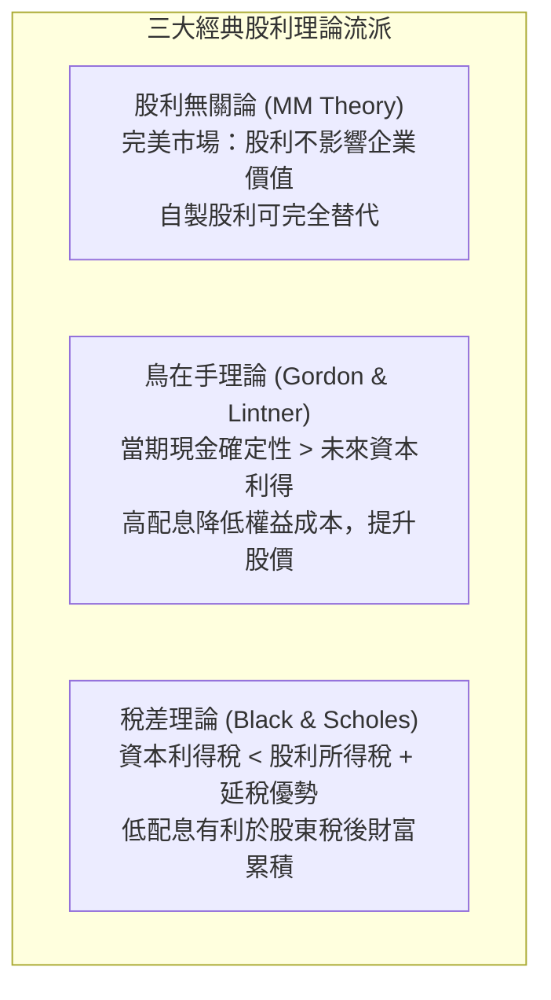
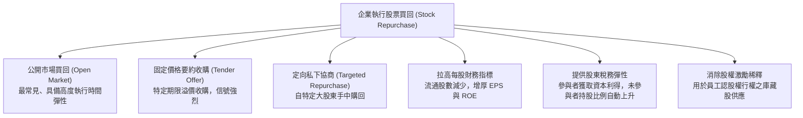
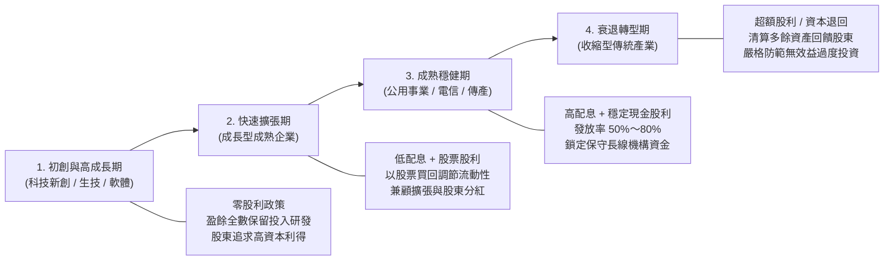

---
{"dg-publish":true,"permalink":"/02/01/l10/","title":"L10 股利政策","tags":["PMBA","財務管理","股利政策","現金股利","股票買回","庫藏股","信號理論","剩餘股利政策","核心必修"],"dg-note-properties":{"title":"L10 股利政策","course":"財務管理","category":"02_核心必修","type":"lecture-note","lecture":"L10","tags":["PMBA","財務管理","股利政策","現金股利","股票買回","庫藏股","信號理論","剩餘股利政策","核心必修"],"aliases":["股利政策","L10_股利政策","股利政策與股票買回","L10"]}}
---

# L10 股利政策

## 💡 核心摘要
- **股利政策的本質是再投資與回饋的戰略權衡**：企業的[[98_商業概念庫/dividend-policy_股利政策\|dividend-policy_股利政策]]絕非單純的分錢遊戲，其本質是高階管理層在「將[[98_商業概念庫/retained-earnings_保留盈餘\|bao-liu-ying-yu_保留盈餘]]投入正 NPV 專案以追求長期[[98_商業概念庫/capital_資本利得\|capital-li-de_資本利得]]」，與「將現金以[[98_商業概念庫/cash_現金股利\|cash-gu-li_現金股利]]或[[98_商業概念庫/share-repurchase_股票買回\|stock-mai-hui_股票買回]]形式回饋股東」之間的資本配置權衡。
- **股利發放釋放不可逆的強烈信號**：根據[[98_商業概念庫/signaling-theory_信號傳遞理論\|xin-hao-chuan-di-theory_信號傳遞理論]]，在存在資訊不對稱的現實市場中，經理人調升股利是對未來持久性盈利能力的堅定背書；而無預警調降股利常被市場解讀為營運告急，招致股價斷崖式崩跌的嚴厲懲罰。
- **股票買回具備稅務優勢與極高執行彈性**：相較於現金股利的剛性承諾，[[98_商業概念庫/share-repurchase_股票買回\|stock-mai-hui_股票買回]]為股東提供[[98_商業概念庫/capital_資本利得\|capital-li-de_資本利得]]的延遲納稅優勢，並賦予經理人調控資金的時間彈性，同時能縮減流通在外股數、拉抬[[98_商業概念庫/earnings-per-share_每股盈餘\|mei-gu-ying-yu_每股盈餘]]（EPS）。
- **顧客效果告誡經理人維持政策連貫性**：不同稅率與現金需求的投資人會形成特定的[[98_商業概念庫/customer-effectiveness_顧客效果\|customer-xiao-guo_顧客效果]]。成熟藍籌企業應維持[[98_商業概念庫/dividend-policy-2_穩定股利政策\|wen-ding-dividend-policy_穩定股利政策]]以鎖定保守長線資金，切忌無端大幅更動政策而引發股東結構的恐慌性換手。

---

## 📚 核心觀念與股利理論模型

### 一、股利發放型態與關鍵時程

#### 1. 三大發放型態對比
企業回饋股東或調整股權結構主要有三種形式：[[98_商業概念庫/cash_現金股利\|cash-gu-li_現金股利]]、[[98_商業概念庫/stock-dividend_股票股利\|stock-gu-li_股票股利]]與[[98_商業概念庫/stock-split_股票分割\|stock-fen-ge_股票分割]]。

| 比較維度 | 現金股利 (Cash Dividends) | 股票股利 (Stock Dividends) | 股票分割 (Stock Splits) |
| :--- | :--- | :--- | :--- |
| **定義** | 以現金直接發放給股東 | 將保留盈餘轉增資發行新股無償配發 | 將現有股份按比例拆細，等比例降低面額 |
| **資產負債表影響** | 資產（現金）減少，股東權益（保留盈餘）等額減少 | 資產負債表總額不變，保留盈餘轉入股本 | 資產負債表所有金額完全不變，僅調整股數與面額 |
| **流通股數** | 維持不變 | 股數增加 | 股數倍增 |
| **每股指標 (EPS/BVPS)** | 維持不變（除息後每股現金減少） | 被等比例稀釋 | 被等比例稀釋 |
| **除權息參考價** | $	ext{收盤價} - 	ext{每股現金股利}$ | $
rac{	ext{收盤價}}{1 + 	ext{配股率}}$ | $
rac{	ext{收盤價}}{	ext{分割倍數}}$ |
| **主要策略目的** | 實質回饋股東當期可支配現金流 | 保留現金擴張，同時滿足股東分紅預期 | 壓低單股價格至最優交易區間，活絡市場流動性 |

#### 2. 關鍵日程與除息交易機制
現金股利分派遵循嚴格的時間順序鏈：

1. **宣告日（Declaration Date）**：董事會通過股利發放決議並向市場公告發放金額與基準日程。
2. **[[ex-dividend-date_除息交易日|chu-xi-jiao-yi-ri_除息交易日]]（Ex-Dividend Date）**：
   - 考慮證券市場交割結算制度（如 T+2 交割），除息交易日通常設定在停止過戶基準日的前兩個營業日。
   - **交易規則**：在除息交易日前一日（含）收盤前買進者享有配息權利；在除息日當天（含）開盤後買進者，不再享有當期股利。
   - **價格調整**：除息日開盤基準價由交易所自動向下扣除現金股利金額。
3. **停止過戶與股東名冊確定基準日（Date of Record）**：公司正式清點造冊享有分配權之股東名單。
4. **發放日（Payment Date）**：公司正式將現金劃撥入股東帳戶。

---

### 二、三大經典股利理論流派

#### 1. 股利無關論（MM Dividend Irrelevance Theory）
- **代表學者**：Franco Modigliani & Merton Miller (1961)。
- **核心假設**：完美資本市場（無稅收、無交易成本、資訊對稱、企業[[capital-budgeting_資本預算|capital-yu-suan_資本預算]]投資決策已定）。
- **核心論點**：[[dividend-irrelevance-theory_股利無關論|gu-li-wu-guan-lun_股利無關論]]指出，企業市場總價值完全由其資產投資獲利能力（產生的[[free-cash-flow-liang_自由現金流量]]與正 NPV 專案）決定，與盈餘如何分配毫無關係。
- **[[homemade-dividends_自製股利|zi-zhi-gu-li_自製股利]]機制**：若企業不分派股利，需要現金的股東可在市場上自行出售部分持股以「自製股利」；若企業分派過多股利，股東可將現金買回股票。在無摩擦市場中，股利政策只是左手換右手，無法創造任何超額價值。

#### 2. 鳥在手理論（Bird-in-the-Hand Theory）
- **代表學者**：Myron Gordon & John Lintner。
- **核心哲學**：[[theory-4_鳥在手理論|niao-zai-shou-theory_鳥在手理論]]源於「雙鳥在林，不如一鳥在手」。
- **核心論點**：投資人具有風險厭惡傾向，認為未來的[[capital_資本利得|capital-li-de_資本利得]]充滿高度市場不確定性（雙鳥在林），而當期的[[cash_現金股利|cash-gu-li_現金股利]]則是確定落袋的真實回報（一鳥在手）。因此，高股利發放率能顯著降低投資人感知的風險，促使權益折現率下降，進而推升公司股票價值。

#### 3. 稅差理論（Tax Preference Theory）
- **代表學者**：Fischer Black & Myron Scholes。
- **核心論點**：[[theory-5_稅差理論|shui-cha-theory_稅差理論]]指出，在真實世界的稅制環境中，現金股利通常被課徵高額的個人綜合所得稅（最高可達 40%～50%）；而[[capital_資本利得|capital-li-de_資本利得]]往往享有較低的租稅優惠甚至免稅，且具備「未出售即不需納稅」的延遲納稅時間價值。因此，理性投資人實質上偏好企業減少配息，將盈餘保留在公司內部推升股價，以獲取最大化的稅後複利回報。

---

### 三、市場不完美性與現代股利假說

#### 1. 資訊不對稱與信號假說（Signaling Hypothesis）
在資訊不對稱的現實環境中，管理層比外部大眾更清楚公司的真實經營狀況。股利政策因而成為一種代價高昂、難以偽造的資訊溝通工具：
- **調升股利（正面信號）**：經理人深知股利具有高度黏性，唯有確信公司未來的[[free-cash-flow-liang_自由現金流量]]具有永久性增長，才敢宣布調升現金股利。市場將此解讀為重大經營利多。
- **調降股利（負面信號）**：調降股利等於公開承認公司現金流枯竭、營運遭遇嚴重逆風，市場往往給予嚴厲的拋售懲罰。

#### 2. 追隨者效應 / 顧客效果（Clientele Effect）
資本市場中的投資人會依據自身的稅率與現金流需求自我篩選：
- **高股利顧客群**：免稅或低稅率機構（退休基金、捐贈基金）及依賴現金養老的長者，聚集於高配息的成熟企業。
- **低股利顧客群**：高所得級距個人投資人與創投機構，聚集於零配息或低配息的高成長科技企業。
- **經理人啟示**：既有股東群體已形成穩定的顧客平衡，隨意更動股利政策將引發股東結構劇烈震盪與股價折價。

#### 3. 代理成本假說（Agency Cost Hypothesis）
著名學者 Michael Jensen 提出「自由現金流量假說」：
- 當企業坐擁龐大的內部現金儲備時，自利的經理人往往產生過度投資、盲目推動無效益併購以建立個人企業帝國的衝動，引發嚴重的[[agency-costs_代理成本|dai-li-cost_代理成本]]。
- **股利的紀律約束功能**：透過定期承諾發放高額現金股利，將多餘的[[free-cash-flow-liang_自由現金流量]]實質抽離經理人的掌控，迫使經理人在面臨新投資時必須走向外部資本市場接受監督，能有效約束代理衝突。

---

### 四、實務股利政策類型與替代工具

#### 1. 剩餘股利政策（Residual Dividend Policy）
- **核心邏輯**：[[dividend-policy-3_剩餘股利政策|sheng-yu-dividend-policy_剩餘股利政策]]嚴格遵循「投資優先原則」。當期淨利優先用於滿足所有正 NPV [[capital-budgeting_資本預算|capital-yu-suan_資本預算]]所需的內部權益資金，最後所剩餘的利潤才分派為股利：
  $$	ext{現金股利} = \max(0, \, 	ext{Net Income} - 	ext{資本支出} 	imes 	ext{目標權益比率})$$
- **優缺點評估**：理論上資本配置效率最高，能徹底避免增資成本；但缺點是每期股利金額隨投資週期起伏劇烈，易引發市場疑慮。

#### 2. 穩定股利政策（Stable Dividend Policy）
- **核心邏輯**：刻意維持每股現金股利金額的平滑穩定，或維持可預測的緩步漸進增長。經理人透過 Lintner 股利平滑模型，僅在確認盈餘達到永久性增長門檻時才小幅調升股利。
- **低底加額外股利政策**：設定低額但高度確定的常態股利底線，在豐收年度加發「特別股利（Extra Dividend）」，兼顧穩定性承諾與景氣彈性。

#### 3. 股票買回（Stock Repurchases）
[[share-repurchase_股票買回|stock-mai-hui_股票買回]]指公司動用營運現金在公開市場或透過要約收購購回自家已發行普通股。

---

## ⚠️ 實務應用與經理人思維

### 一、股利發放的「棘輪效應（Ratchet Effect）」
- **現象剖析**：機械工程中的「棘輪（Ratchet）」只能單向向前旋轉而無法輕易後退。在公司財務中，股利政策具備強烈的「棘輪效應」或稱「股利黏性（Dividend Stickiness）」：**股利調升極易，但調降極難**。
- **經理人深層心理**：經理人深知調降股利會向市場傳遞致命的負面信號，因此在獲利爆發時，普遍拒絕大幅調升常態股利，寧可將現金留在帳上或進行股票買回；唯有當確信獲利成長具備高度持續性時，才敢小幅推進股利水平。

### 二、企業生命週期與股利政策配置

### 三、股票買回的潛在道德風險與治理防線
許多高階主管常將股票買回包裝為「回饋股東的最佳途徑」，但 PMBA 經理人必須洞悉其背後的潛在代理衝突：
1. **人為美化 EPS 以達成獎金考核**：高階主管的年度績效獎金或股權激勵（Stock Options）常與每股盈餘（EPS）掛鉤。部分經理人動用巨額公司現金買回股票，僅是為了縮小分母（股數）以強行推高 EPS，實質上並未為公司創造任何營運利潤。
2. **股價高檔盲目護盤浪費資本**：經理人常在牛市頂峰或市場狂熱時大舉買回股票以支撐股價，實質上是在最昂貴的時候賤賣了企業珍貴的現金防禦儲備；而在景氣蕭條、股價被嚴重低估時卻因現金匱乏無力買回。
3. **治理防線**：董事會薪酬委員會在設定高階主管激勵指標時，應以「經濟增加值（EVA）」或「扣除買回效應後的營業利益」為基準，杜絕透過財務工程操弄 EPS 的自肥誘因。
