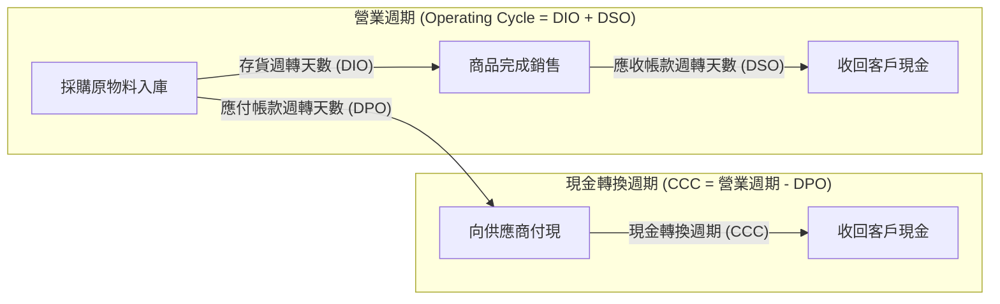
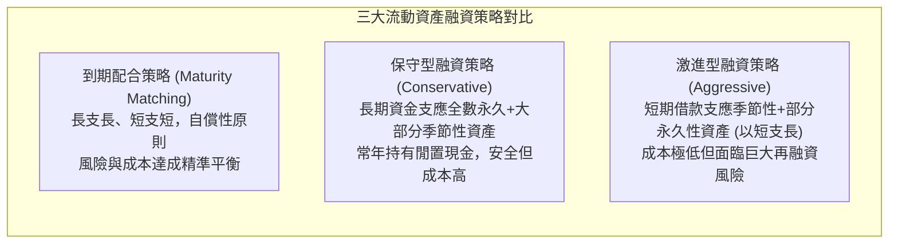

---
{"dg-publish":true,"permalink":"/02/01/l11/","title":"L11 短期融資規劃","tags":["PMBA","財務管理","營運資金","現金轉換週期","短期融資","信用政策","流動性管理","核心必修"],"dg-note-properties":{"title":"L11 短期融資規劃","course":"財務管理","category":"02_核心必修","type":"lecture-note","lecture":"L11","tags":["PMBA","財務管理","營運資金","現金轉換週期","短期融資","信用政策","流動性管理","核心必修"],"aliases":["短期融資規劃","L11_短期融資規劃","營運資金與短期融資","短期財務規劃","L11"]}}
---

# L11 短期融資規劃

## 💡 核心摘要
- **長期投資決定走多遠，短期營運資金決定能否活下去**：企業的破產絕大多數並非源於長期策略失誤，而是起因於短期的流動性枯竭。嚴謹的[[98_商業概念庫/working-capital-management_營運資金管理\|operations-zi-jin-management_營運資金管理]]是確保企業度過景氣寒冬的生命防線。
- **負現金轉換週期是戴爾與好市多的無息融資護城河**：透過極致的供應鏈效率，將[[98_商業概念庫/inventory-turnover-tian-shu_存貨週轉天數\|inventory-turnover-tian-shu_存貨週轉天數]]（DIO）與[[98_商業概念庫/receivable-days-turnover_應收帳款週轉天數\|ying-shou-zhang-kuan-zhou-zhuan-tian-shu_應收帳款週轉天數]]（DSO）壓縮至極限，同時拉長[[98_商業概念庫/payable-days-turnover_應付帳款週轉天數\|ying-fu-zhang-kuan-zhou-zhuan-tian-shu_應付帳款週轉天數]]（DPO），創造「負[[98_商業概念庫/cash-switching-cycle_現金轉換週期\|cash-zhuan-huan-cycle_現金轉換週期]]（Negative CCC）」，實質利用供應商資金無息支應企業擴張。
- **放棄現金折扣是極其昂貴的高利貸**：供應商提供的商業信用條件（如 2/10, net 30）中，放棄折扣的[[98_商業概念庫/cash-zhe-kou-cost_現金折扣成本\|cash-zhe-kou-cost_現金折扣成本]]高達年化 44.6%，經理人忽視此隱含利息常導致沉重財務負擔。
- **短期融資策略本質是資金成本與流動性風險的博弈**：[[98_商業概念庫/financing-strategy-2_激進型融資策略\|ji-jin-xing-rong-zi-strategy_激進型融資策略]]雖然利息便宜，但「以短支長」極易引發[[98_商業概念庫/financing-risk_再融資風險\|zai-rong-zi-risk_再融資風險]]與[[98_商業概念庫/insolvency-with-profit_黑字倒閉\|hei-zi-dao-bi_黑字倒閉]]；[[98_商業概念庫/financing-strategy_保守型融資策略\|bao-shou-xing-rong-zi-strategy_保守型融資策略]]安全性高但成本昂貴；[[98_商業概念庫/strategy-3_到期配合策略\|dao-qi-pei-he-strategy_到期配合策略]]則是兼顧風險與效益的黃金平衡。

---

## 📚 核心觀念與短期融資架構

### 一、營運資金與週期分析

#### 1. 淨營運資金與資產負債平衡
- **[[98_商業概念庫/net-working-capital_淨營運資金\|net-working-capital_淨營運資金]]（Net Working Capital, NWC）**：
  $$	ext{NWC} = 	ext{流動資產} - 	ext{流動負債}$$
- **健康營運的本質**：一般健全企業通常維持正向的 NWC，以提供營運緩衝；然而，具備強大市場支配力與極高週轉率的零售巨頭（如好市多、沃爾瑪），常態維持負 NWC，展現出極致的資金運用效率。

#### 2. 營業週期 vs 現金轉換週期

- **[[operating-cycle_營業週期]]（Operating Cycle）**：從採購存貨到最終收回現金的全程天數：
  $$	ext{營業週期} = 	ext{存貨週轉天數 (DIO)} + 	ext{應收帳款週轉天數 (DSO)}$$
- **[[cash-switching-cycle_現金轉換週期|cash-zhuan-huan-cycle_現金轉換週期]]（Cash Conversion Cycle, CCC）**：企業從實際支付供應商貨款，到最終收回銷售現金之間的淨時間差：
  $$	ext{CCC} = 	ext{營業週期} - 	ext{應付帳款週轉天數 (DPO)} = 	ext{DIO} + 	ext{DSO} - 	ext{DPO}$$

#### 3. 負現金轉換週期的商業運作機制（Dell 與 Costco 案例）
- **傳統製造業**：DIO（60天）+ DSO（45天）- DPO（30天）= **CCC 正 75 天**。企業必須準備 75 天的營運資金投入生產週轉。
- **戴爾電腦（Dell）直銷革命**：
  - **接單後組裝（BTO）**：客戶下單時以信用卡全額付款（$	ext{DSO} pprox 1 \sim 3$ 天）。
  - **供應商管理庫存（VMI）**：零組件直到進入生產線才算進貨（$	ext{DIO} pprox 4 \sim 6$ 天）。
  - **強勢供應商談判**：付款條件設定為 60 天以上（$	ext{DPO} pprox 60$ 天）。
  - **計算結果**：$	ext{CCC} = 5 + 2 - 60 = -53 	ext{ 天}$！
- **商業優勢**：在「負 CCC」模式下，企業是在「收回客戶現金」後將近兩個月才需要「付款給供應商」。公司業務規模越大，手頭持有的免費供應商無息營運資金就越龐大，形成無可撼動的擴張護城河。

---

### 二、流動資產整體融資策略

企業的流動資產可細分為兩大部分：
1. **永久性流動資產（Permanent Current Assets）**：即便在業務淡季亦必須常態維持的最低限度存貨與安全現金。
2. **波動性 / 季節性流動資產（Fluctuating / Seasonal Current Assets）**：隨旺季訂單攀升而暫時增加的存貨與應收帳款。

| 比較維度 | 到期配合策略 (Maturity Matching) | 保守型融資策略 (Conservative) | 激進型融資策略 (Aggressive) |
| :--- | :--- | :--- | :--- |
| **核心配置** | 長期資金支應固定與永久資產；短期負債支應季節性資產 | 長期資金支應固定、永久及大部分季節性資產 | 短期負債支應季節性資產與部分永久性資產（以短支長） |
| **利息成本** | 中等 | 最高（長期借款與股權成本高） | 最低（短期利率通常較低） |
| **流動性與再融資風險** | 中等，具備自償性 | 極低（無短期還款壓力） | **極高（面臨銀行抽銀根與利率跳升危機）** |
| **適用情境** | 絕大多數營運成熟健全企業 | 缺乏穩定銀行關係、現金流波動劇烈企業 | 資金實力極雄厚或過度追求高 ROE 的高風險企業 |

---

### 三、應收帳款管理與信用政策決策

#### 1. 信用政策四要素
企業在推動賒銷時，必須建立完整的[[credit-policy_信用政策|xin-yong-zheng-ce_信用政策]]：
1. **信用標準**：客戶取得賒銷資格的財務實力門檻。
2. **信用條件**：包含信用期間長短與現金折扣。
3. **信用額度**：個別客戶之最高賒銷金額上限。
4. **催收政策**：對逾期帳款之追討程序。

#### 2. 客戶信用評估五C原則
在核給信用額度前，依據[[evaluation-c-principles_信用評估五C原則|xin-yong-evaluation-wucyuan-ze_信用評估五C原則]]進行全方位徵信：
- **品德 (Character)**：客戶履約意願與歷史還款紀錄（首要考量）。
- **能力 (Capacity)**：客戶營運產生現金流償還到期款項的能力（檢視流動比率與現金流）。
- **資本 (Capital)**：客戶的淨資產實力與負債比率。
- **擔保 (Collateral)**：客戶提供之抵押品或母公司連帶保證。
- **條件 (Conditions)**：宏觀經濟與產業景氣對客戶經營的衝擊。

#### 3. 現金折扣成本之數學推導
供應商常提供如「`2/10, net 30`」之信用條件（10 天內付款享有 2% 現金折扣，否則須在 30 天內全額付清）。
若買方選擇放棄折扣、在第 30 天付款，相當於以「放棄 2 元折扣」為代價，在額外的 20 天借款 98 元：

$$	ext{20 天借款利率} = 
rac{2\%}{100\% - 2\%} = 
rac{2}{98} pprox 2.0408\%$$

- **名目年利率（APR）**：
  $$	ext{APR} = 2.0408\% 	imes 
rac{365}{20} pprox 37.24\%$$
- **實質有效年利率（EAR）**：
  $$	ext{EAR} = (1 + 0.020408)^{
rac{365}{20}} - 1 = (1.020408)^{18.25} - 1 pprox 44.59\%$$

**PMBA 經理人決策準則**：
放棄現金折扣的[[cash-zhe-kou-cost_現金折扣成本]]高達年化 44.6%！除非企業面臨借貸無門的極度危機，否則應立刻向銀行以 3%～5% 利率借入短期週轉金，於第 10 天享受折扣付款，淨賺利差。

---

### 四、短期融資工具配置

#### 1. 無擔保短期融資工具
- **[[commercial-paper_商業本票|shang-ye-ben-piao_商業本票]]（Commercial Paper, CP）**：信譽卓著之大型企業在貨幣市場上發行之短期無擔保本票（天期多為 30～90 天），利率低於銀行放款利率。
- **銀行信用額度（Line of Credit）**：非承諾性授信，銀行保留隨時取消之權利。
- **[[revolving-credit_循環信用貸款|xun-huan-xin-yong-dai-kuan_循環信用貸款]]（Revolving Credit Facility）**：銀行簽署具法律約束力之承諾授信合約，企業在額度內可隨借隨還，未動用額度須支付小額承諾費（Commitment Fee）。

#### 2. 擔保短期融資工具
- **應收帳款質押（Pledging Accounts Receivable）**：以應收帳款作為向銀行借款之抵押擔保品。
- **[[receivable-2_應收帳款承購|ying-shou-zhang-kuan-cheng-gou_應收帳款承購]]（Factoring）**：將應收帳款折價直接轉讓給承購商（保理銀行），由承購商提供現金融資並承擔催收與壞帳風險（無追索權模式下可實現資產表外化）。
- **存貨融資 / 倉單質押**：以企業標準化庫存商品或倉單作為質押向銀行融資。

---

## ⚠️ 實務應用與經理人思維

### 一、衝刺營收放寬信用政策引發的呆帳陷阱
- **業務部門 vs 財務部門的經典衝突**：業務人員為追求季度業績與銷售獎金，常施壓財務主管放寬客戶信用標準或大幅提高信用額度。
- **營運資金被套牢之惡果**：過度寬鬆的授信雖然換來帳面營收增長，但客戶素質參差不齊導致應收帳款大幅增加、DSO 劇烈拉長。一旦宏觀景氣反轉，應收帳款將大面積轉化為壞帳呆帳，吞噬全部營業利潤，企業陷入嚴重的現金斷流。

### 二、「以短支長」在信用收縮期的流動性猝死
- **黑字倒閉的悲劇**：許多企業在資產負債表上展現極佳的營業利益，但由於過度依賴[[financing-strategy-2_激進型融資策略|ji-jin-xing-rong-zi-strategy_激進型融資策略]]，將短期借款投入回收期長達 5～10 年的不動產或大型廠房設備（以短支長）。
- **致命反噬**：一旦遭遇央行連續升息或銀行因風控抽銀根拒絕展延借款，企業無法在數天內處分廠房變現，面臨短期負債集中到期的[[financing-risk_再融資風險|zai-rong-zi-risk_再融資風險]]，引發跳票與[[risk-3_流動性風險|liu-dong-xing-risk_流動性風險]]，最終走向[[insolvency-with-profit_黑字倒閉|hei-zi-dao-bi_黑字倒閉]]。
- **防禦之道**：經理人應編制動態的「13 週滾動[[cash-budget_現金預算|cash-yu-suan_現金預算]]」，嚴密監控未來每一週的現金流入與流出缺口，杜絕任何以短支長的僥倖心理。

### 三、壓榨供應商拉長 DPO 的反噬極限
- **假性競爭優勢的破滅**：部分經理人將強行拖延供應商貨款（如將付款期由 60 天無預警拉長至 120 天甚至 180 天）視為展現採購實力的財務技巧。
- **深層隱性代價**：
  1. **採購報價加價**：精明的供應商早已將被積壓資金的利息成本隱性灌入後續報價中。
  2. **供貨優先順位降級**：在原物料短缺或產能吃緊時，被拖欠貨款的供應商會優先將貨物供應給付款準時的競爭對手，導致企業自身面臨缺料停工危機。
  3. **供應鏈生態系崩解**：過度壓榨中小供應商可能直接將優質夥伴推向破產重整，摧毀企業長久建立的供應鏈生態護城河。
