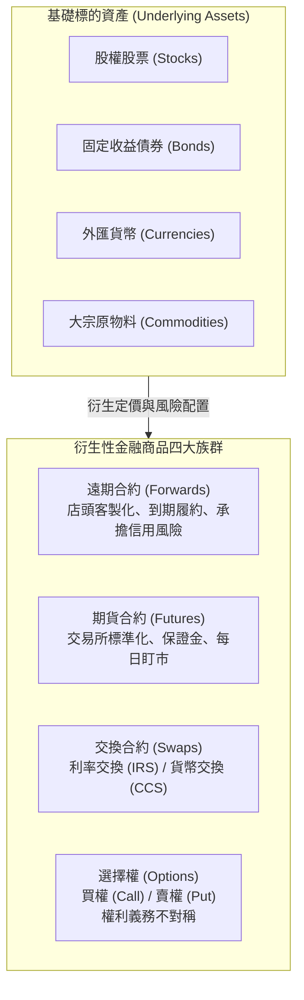
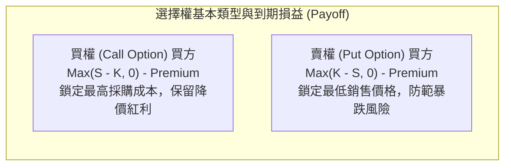

---
{"dg-publish":true,"permalink":"/02/01/l12/","title":"L12 衍生性商品","tags":["PMBA","財務管理","衍生性商品","選擇權","期貨","遠期合約","利率交換","避險策略","風險管理","核心必修"],"dg-note-properties":{"title":"L12 衍生性商品","course":"財務管理","category":"02_核心必修","type":"lecture-note","lecture":"L12","tags":["PMBA","財務管理","衍生性商品","選擇權","期貨","遠期合約","利率交換","避險策略","風險管理","核心必修"],"aliases":["衍生性商品","L12_衍生性商品","衍生性商品與風險管理","選擇權與期貨避險","L12"]}}
---

# L12 衍生性商品

## 💡 核心摘要
- **衍生性商品的本質是風險轉移而非賭博投機**：[[98_商業概念庫/financial-derivatives_衍生性金融商品\|yan-sheng-xing-jin-rong-shang-pin_衍生性金融商品]]的真正商業價值，在於將企業無法承受或不願承擔的市場價格風險，轉移給具備承擔意願與能力的金融交易對手，絕非經理人獲取超額暴利的投機工具。
- **企業避險是為了鎖定營運利潤而非追求金融利差**：高階經理人推動[[98_商業概念庫/strategy-2_避險策略\|bi-xian-strategy_避險策略]]的核心宗旨，是為實體業務創造穩定可預測的現金流與毛利空間，讓企業專注於產品研發與本業競爭，而非試圖猜測匯率或利率走勢進行市場對賭。
- **槓桿是一把雙刃劍，警惕流動性追繳風險**：期貨與選擇權的高槓桿特性伴隨著[[98_商業概念庫/margin-system_保證金制度\|bao-zheng-jin-zhi-du_保證金制度]]與[[98_商業概念庫/settlement_每日結算制度\|mei-ri-jie-suan-zhi-du_每日結算制度]]。若企業流動性儲備不足，極端行情下的保證金追繳將引爆致命的流動性斷裂，在現貨利益實現前遭到強制斷頭。
- **買賣權平價與無套利均衡確立定價基準**：在金融工程中，[[98_商業概念庫/theory-3_買賣權平價理論\|mai-mai-quan-ping-jia-theory_買賣權平價理論]]揭示了現貨、買權、賣權與債券之間的定價對偶關係，任何市場偏離都將迅速被[[98_商業概念庫/arbitrage_套利\|tao-li_套利]]力量撫平。

---

## 📚 核心觀念與金融工程架構

### 一、衍生性金融商品本質與四大族群

#### 1. 衍生性金融商品的本質
[[98_商業概念庫/financial-derivatives_衍生性金融商品\|yan-sheng-xing-jin-rong-shang-pin_衍生性金融商品]]的價值由底層基礎資產（如股票、債券、商品、外匯）所衍生而來。就像農產品市場中，農夫可以將香蕉加工為香蕉乾、香蕉牛奶再行銷售；金融市場亦將基礎金融工具重新打包、切割與重組，衍生出符合不同避險或收益需求的結構化工具。

金融工程體系將衍生性工具歸納為四大核心家族：
1. **[[contract_遠期合約|yuan-qi-he-yue_遠期合約]]（Forward Contracts）**：店頭市場私下協議、高度客製化之遠期交割合約。
2. **[[contract-2_期貨合約|futures-he-yue_期貨合約]]（Futures Contracts）**：集中交易所公開掛牌、標準化規格與保證金控管之期貨契約。
3. **交換合約（Swaps）**：雙方約定定期互換現金流之合約，主要包含[[interest-rate-swap_利率交換|li-rate-jiao-huan_利率交換]]（IRS）與[[currency-swap_貨幣交換|huo-bi-jiao-huan_貨幣交換]]（CCS）。
4. **[[options_選擇權]]（Options）**：賦予買方未來特定價格買賣權利之非對稱契約。

#### 2. 四大衍生品家族特性深入對比

| 比較維度 | 遠期合約 (Forwards) | 期貨合約 (Futures) | 交換合約 (Swaps) | 選擇權 (Options) |
| :--- | :--- | :--- | :--- | :--- |
| **交易場所** | 店頭市場 (OTC) | 集中期貨交易所 | 店頭市場 (OTC) | 交易所 或 店頭市場 |
| **合約規格** | 完全客製化 | 高度標準化 | 完全客製化 | 交易所標準化 / OTC 客製化 |
| **保證金與結算** | 無保證金、到期結算 | 需保證金、[[settlement_每日結算制度|mei-ri-jie-suan-zhi-du_每日結算制度]] | 無保證金、定期淨額結算 | 買方付權利金、賣方繳保證金 |
| **[[risk-2_交易對手風險|jiao-yi-dui-shou-risk_交易對手風險]]** | **高**（承擔對方違約風險） | **極低**（結算所擔保履約） | **高**（需嚴密審查信用） | 買方承擔賣方違約（OTC 模式下） |
| **權利義務關係** | 雙方均有履約義務 | 雙方均有履約義務 | 雙方均有履約義務 | **不對稱**（買方享權利，賣方負義務） |
| **企業常見應用** | 遠期外匯鎖定出口匯率 | 原油、銅、鋼鐵進料避險 | 浮動利率轉固定利率 (IRS) | 匯率/商品價格下跌防護保險 |

---

### 二、選擇權基礎與損益圖解結構

#### 1. 買權與賣權的本質
- **[[call-option_買權|mai-quan_買權]]（Call Option）**：賦予買方以約定之[[price_履約價格|lv-yue-jia-ge_履約價格]]（Strike Price, $K$）「買入」標的資產的權利。
  - 買方最大損失：已支付之[[option-premium_權利金|quan-li-jin_權利金]]（Premium）。
  - 買方獲利空間：隨標的市價上漲而無限放大。
  - 賣方承擔義務：獲利上限為權利金，承擔上檔無限虧損。
- **[[put-option_賣權|mai-quan-2_賣權]]（Put Option）**：賦予買方以約定之[[price_履約價格|lv-yue-jia-ge_履約價格]]（$K$）「賣出」標的資產的權利。
  - 買方最大損失：已支付之[[option-premium_權利金|quan-li-jin_權利金]]。
  - 買方獲利空間：隨標的市價暴跌而擴大（實質資產跌價保險）。
  - 賣方承擔義務：獲利上限為權利金，承擔資產價格崩跌之接刀義務。

#### 2. 選擇權的三種狀態（Moneyness）
- **價內（In-the-Money, ITM）**：若立即履約具備正向現金流利益（買權 $S > K$；賣權 $S < K$）。
- **價平（At-the-Money, ATM）**：標的市價恰好等於履約價（$S = K$）。
- **價外（Out-of-the-Money, OTM）**：若立即履約將發生虧損，理性持有人選擇放棄（買權 $S < K$；賣權 $S > K$）。

#### 3. 選擇權價值兩大組成
$$	ext{選擇權價值 (權利金)} = 	ext{內在價值} + 	ext{時間價值}$$
- **[[company-value_公司內在價值|nei-zai-value_內在價值]]（Intrinsic Value）**：立即行使權利所能獲得的實質利益（$	ext{Call: } \max(S - K, 0)$；$	ext{Put: } \max(K - S, 0)$）。價平與價外選擇權之內在價值恆為 0。
- **[[time-value-2_貨幣時間價值|shi-jian-value_時間價值]]（Time Value）**：市場為「到期日前標的價格可能產生有利波動」所支付的溢價。隨著到期日逼近，時間價值呈現加速衰減（Theta 衰減），在到期日當天歸零。

---

### 三、核心評價定理與避險機制

#### 1. 買賣權平價理論（Put-Call Parity）
在無套利市場中，歐式買權（$C$）、賣權（$P$）、標的現貨（$S$）與面額為 $K$ 的無風險零息債券（現值 $PV(K) = K e^{-rT}$）之間存在嚴密的對偶恆等式：

$$C + PV(K) = P + S$$

- **投資組合 A（受信買權 Fiduciary Call）**：買入 1 單位買權 $C$ $+$ 買入面額為 $K$ 之零息債券 $PV(K)$。
  - 到期總價值：若 $S_T > K$，履約得到 $S_T$；若 $S_T \le K$，債券到期拿回 $K$。總價值為 $\max(S_T, K)$。
- **投資組合 B（保護性賣權 Protective Put）**：買入 1 單位現貨 $S$ $+$ 買入 1 單位賣權 $P$。
  - 到期總價值：若 $S_T > K$，賣權作廢，現貨價值 $S_T$；若 $S_T \le K$，行使賣權以 $K$ 賣出現貨。總價值同樣為 $\max(S_T, K)$。
- **無套利推論**：由於兩組合在未來任何情境下的現金流完全一致，根據一價定律，兩者在當前的市場價格必須完全相等。若出現定價失衡，市場將透過[[arbitrage_套利|tao-li_套利]]迅速修復價差。

#### 2. 影響選擇權價值的五大要素

| 變數符號 | 變數名稱 | 變數增加對買權 (Call) 價值之影響 | 變數增加對賣權 (Put) 價值之影響 | 理論機制與經理人洞察 |
| :---: | :--- | :---: | :---: | :--- |
| **$S$** | 標的資產現價 | **正向 (+) ↑** | **負向 (-) ↓** | 現價越高，買權履約獲利越大，賣權越無價值 |
| **$K$** | 履約價格 | **負向 (-) ↓** | **正向 (+) ↑** | 買入成本門檻越高對買方越不利，賣權售價越高越有利 |
| **$\sigma$** | 標的價格波動率 | **正向 (+) ↑** | **正向 (+) ↑** | **核心特性**：選擇權下檔風險被截斷，波動越大，上檔暴賺機率越高 |
| **$T$** | 距離到期時間 | **正向 (+) ↑** | **正向 (+) ↑** | 時間越長，出現極端有利價格變動的可能性越高 |
| **$r$** | 無風險利率 | **正向 (+) ↑** | **負向 (-) ↓** | 延遲支付購買現貨資金的時間價值越高，利於買權買方 |

#### 3. 企業實務避險策略（Hedging Strategies）
1. **進出口外匯避險**：
   - 台灣出口廠商（收美元）：面臨台幣升值（美元貶值）風險。策略：簽訂遠期外匯賣出美元、或買入美元[[put-option_賣權|mai-quan-2_賣權]]（Put），鎖定新台幣最低兌換底線。
2. **製造業原物料避險**：
   - 航空公司或鋼鐵廠：面臨航油或鐵礦石價格暴漲風險。策略：買入商品期貨或買入原油[[call-option_買權|mai-quan_買權]]（Call），鎖定未來最高進料採購成本。
3. **借款人利率避險**：
   - 浮動利率借款企業：面臨央行升息風險。策略：簽訂[[interest-rate-swap_利率交換|li-rate-jiao-huan_利率交換]]（IRS，將浮動利率轉為固定利率），或購買利率上限合約（Interest Rate Cap）。

---

## ⚠️ 實務應用與經理人思維

### 一、避險變投機的悲劇：經典暴雷案例反思
許多企業原本抱持「避險」初衷進入衍生品市場，最終卻演變成摧毀企業的投機災難：
- **方向性對賭陷阱**：經理人因連續數次「猜對」市場方向，開始產生過度自信，將避險部位擴大至遠超實體業務需求的數倍，由「消除風險」墮落為「單邊豪賭」。
- **結構型衍生品陷阱（如 Target Redemption Forward, TRF）**：銀行設計「賺小錢、賠無限」的非對稱合約（表面上每月收取微薄權利金，一旦匯率突破防守線則承擔數倍槓桿虧損），許多中小企業經理人未穿透複雜公式，最終導致公司破產清算。
- **百年名校與金融帝國崩塌（霸菱銀行事件）**：交易員尼克·李森（Nick Leeson）原本負責日經指數套利，後因違規建立未授權單邊多頭部位，且利用內部監控漏洞隱匿巨額虧損，最終導致具有 233 年歷史的英國霸菱銀行以 1 英鎊象徵性價格被收購。

### 二、基差風險與保證金追繳之流動性斷裂
- **[[risk_基差風險|ji-cha-risk_基差風險]]（Basis Risk）的殘酷現實**：現貨價格與期貨價格之間的差價（基差）並非恆定不變。若企業使用的期貨規格、交割地點或交割月份與實體現貨存在偏差，基差的異常擴大可能導致期貨端虧損遠超現貨端獲利。
- **保證金追繳（Margin Call）引發的猝死**：
  - 德國金屬公司（Metallgesellschaft）的慘痛教訓：該公司簽署了長期固定價格供油合約，並在期貨市場買入短期原油期貨進行滾動避險。
  - 當國際油價暴跌時，雖然實體長期合約未來具備超額利潤，但期貨市場每日盯市制度引發數十億美元的巨額保證金追繳。母公司因流動性耗竭被迫在期貨最低檔全數斷頭砍倉，避險部位瓦解，釀成 13 億美元的實質巨虧。

### 三、企業內部控制與金融風險管理防線
健全的[[risk-management_金融風險管理|jin-rong-risk-management_金融風險管理]]體系是經理人駕馭衍生性商品的唯一解方：
1. **前後台嚴格職能分離**：負責衍生品交易的前台人員，絕對不得兼任負責確認交易、結算與帳務核對的後台職務，徹底杜絕李森式「球員兼裁判」的內部舞弊空間。
2. **董事會明訂授權限額與嚴格停損機制**：
   - 設定單一交易員與全公司的「最高名目本金限額」與「累計最大虧損停損線（Stop-Loss Limit）」。
   - 嚴格落實「一旦觸及停損線無條件強制平倉」的鋼鐵紀律，嚴禁任何「加碼攤平」的僥倖行為。
3. **落實壓力測試與情境分析**：定期模擬極端黑天鵝事件（如地緣政治衝突、貨幣單日暴跌 10%、央行暴力升息），評估企業在最壞情境下的現金流量承載力，確保隨時具備充沛的應急流動性儲備。
