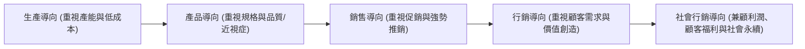
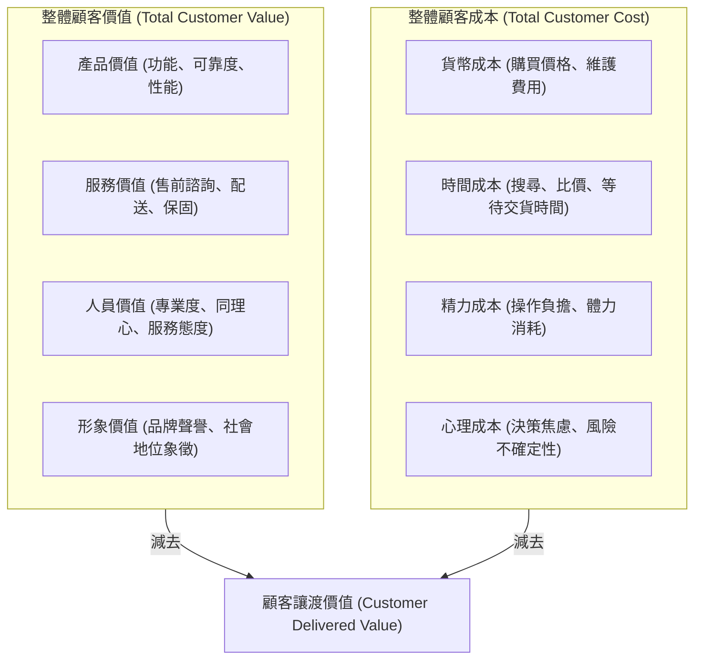
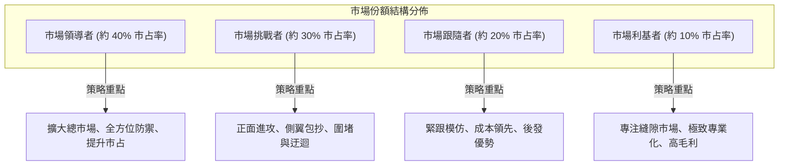

---
{"dg-publish":true,"permalink":"/02/02/l01/","title":"L01 現代行銷的角色與競爭行銷","tags":["PMBA","核心必修","行銷管理","顧客讓渡價值","競爭行銷","市場領導者","利基者"],"dg-note-properties":{"title":"L01 現代行銷的角色與競爭行銷","course":"行銷管理","category":"02_核心必修","type":"lecture-note","lecture":"L01","tags":["PMBA","核心必修","行銷管理","顧客讓渡價值","競爭行銷","市場領導者","利基者"],"aliases":["現代行銷的角色與競爭行銷","L01_現代行銷的角色與競爭行銷","行銷哲學與競爭地位","L01"]}}
---

# L01 現代行銷的角色與競爭行銷

## 💡 核心摘要
1. **行銷的終極本質在於使推銷成為多餘**：現代行銷的核心並非「如何把製造出來的東西賣出去」，而是「深刻理解顧客未被滿足的需求」，進而創造出高度匹配且自我銷售的解決方案。
2. **顧客買的不是產品本身，而是問題的解決方案與知覺價值**：消費者購買鑽頭是為了牆上的孔洞，購買名牌礦泉水或頭等艙機位是為了自我認同、身分象徵與身心舒適。企業競爭的勝負取決於能否提供極大化的[[98_商業概念庫/customer-value_顧客讓渡價值\|customer-rang-du-value_顧客讓渡價值]]。
3. **競爭地位決定資源配置方式**：企業在市場中所處的競爭階層（[[98_商業概念庫/market-leadership-zhe_市場領導者\|market-leadership-zhe_市場領導者]]、[[98_商業概念庫/market_市場挑戰者\|market-tiao-zhan-zhe_市場挑戰者]]、[[98_商業概念庫/market-2_市場跟隨者\|market-gen-sui-zhe_市場跟隨者]]、[[98_商業概念庫/market-niche_市場利基者\|market-li-ji-zhe_市場利基者]]）直接制約了其策略選擇。領導者應重在防禦核心陣地與做大市場蛋糕；挑戰者應避實擊虛、側翼包抄；跟隨者需善用後發優勢控制成本；利基者則需追求極致專業化與高利潤率。
4. **行銷投入是長期顧客資產的資本化投資**：行銷預算絕非純粹的損益表當期費用，而是為企業累積[[98_商業概念庫/brand-equity_品牌權益\|brand-equity_品牌權益]]與[[98_商業概念庫/customer-equity_顧客權益\|customer-equity_顧客權益]]。唯有當單客的[[98_商業概念庫/clv-customer-lifetime-value_顧客終身價值\|customer-zhong-shen-value_顧客終身價值]]（CLV）顯著大於[[98_商業概念庫/cac-customer-acquisition-cost_獲客成本\|huo-ke-cost_獲客成本]]（CAC）時，企業的擴張才具備實質經濟意義。

---

## 📚 核心觀念與理論框架

### 行銷的核心本質與哲學演進

#### 杜拉克論行銷之本質
現代管理大師彼得·杜拉克（Peter Drucker）曾指出企業的兩項基本功能：**行銷（Marketing）** 與 **創新（Innovation）**。杜拉克精闢地定義：
> 「行銷的目的在於使推銷成為多餘（The aim of marketing is to make selling superfluous）。行銷的目的在於充分理解並契合顧客，讓產品或服務自然適合顧客而實現自我銷售。」

傳統銷售（Selling）著眼於賣方將現有存貨變現的需求；現代行銷則著眼於買方的根本利益與潛在渴望。

#### 五種企業經營導向觀念演進
企業經營哲學隨市場供需結構的變遷經歷了五個重要演進階段：

1. **生產導向（Production Concept）**：
   - **核心假設**：消費者偏好價格低廉且隨處可購得的產品。
   - **企業行為**：專注於提高生產效率、追求規模經濟以壓低單位成本、擴大配銷網絡。經典代表如福特早期生產的黑色 Model T 汽車（「顧客可以選擇任何顏色的車，只要它是黑色的」）。
2. **產品導向（Product Concept）**：
   - **核心假設**：消費者偏好具有最高品質、卓越性能與創新功能的產品。
   - **盲點與陷阱**：極易誘發希爾多·李維特（Theodore Levitt）所警示的 [[marketing-myopia_行銷近視症|xing-xiao-jin-shi-zheng_行銷近視症]]。企業管理層沉迷於技術改良與規格升級（例如工程師致力於打造「更好的捕鼠器」），卻忽視了顧客可能只需要化學藥劑或超音波驅鼠等替代解決方案。
3. **銷售導向（Selling Concept）**：
   - **核心假設**：若放任市場自然發展，消費者不會主動購買足夠數量的產品。
   - **企業行為**：通常適用於「非搜尋品（Unsought Goods）」（如保險、生前契約）或產能過剩的行業。企業投入大量推銷員進行高壓推銷與侵略性促銷（Hard Sell），其風險在於破壞顧客信任，造成交易後的高客訴與退貨率。
4. **[[orientation-2_行銷導向|xing-xiao-dao-xiang_行銷導向]]（Marketing Concept）**：
   - **核心假設**：實現企業目標的關鍵在於比競爭對手更有效率地確定目標市場的需求與慾望，並創造、傳遞及溝通優越的顧客價值。
   - **運作模式**：貫徹由外而內（Outside-in）視角，以目標市場為起點，透過整合行銷創造顧客滿意，進而透過長期顧客關係獲取利潤。
5. **[[orientation_社會行銷導向|she-hui-xing-xiao-dao-xiang_社會行銷導向]]（Societal Marketing Concept）**：
   - **核心假設**：純粹滿足消費者當下的短期慾望，可能會危害消費者長期健康或社會公共利益。
   - **平衡維度**：企業必須在「企業利潤」、「顧客需求滿意」與「公眾長期福祉」三者之間維持動態平衡（如推廣綠色包裝、減少糖分攝取、履行 ESG 永續責任）。

---

### 顧客價值與關係資產創造

#### 顧客讓渡價值架構
在理性選擇情境下，顧客傾向於在競爭方案中選擇能夠提供最高 [[customer-value_顧客讓渡價值|customer-rang-du-value_顧客讓渡價值]] 的品牌。顧客讓渡價值由「[[customer-value-2_整體顧客價值|zheng-ti-customer-value_整體顧客價值]]」與「[[customer-cost_整體顧客成本|zheng-ti-customer-cost_整體顧客成本]]」之差額所決定：

$$\text{顧客讓渡價值} = \text{整體顧客價值} - \text{整體顧客成本}$$

- **價值維度剖析**：
  - **產品與服務價值**：如航空公司的飛行安全與準點率（產品）及客艙餐飲服務（服務）。
  - **形象與心理價值**：以高價礦泉水（如沛綠雅 Perrier）為例，消費者支付數倍於自來水或一般包裝水的代價，所換取的並非單純解渴功能，而是產品所傳遞的社交品味、自我身分認同與生活風格。
- **成本維度剖析**：
  - 許多企業誤以為削價競爭是吸引顧客的唯一手段，卻忽略了降低顧客的非貨幣成本（如無條件退貨減少心理成本、一鍵下單減少時間與精力成本）能以更健康的方式擴大讓渡價值。

#### 顧客滿意度與顧客忠誠度的非線性動態
[[customer-satisfaction_顧客滿意度|customer-man-yi-du_顧客滿意度]] 是顧客對產品的「知覺績效（Perceived Performance）」與「事前期望（Prior Expectations）」比較後的心理狀態：
- 當知覺績效小於期望：顧客產生不滿。
- 當知覺績效等於期望：顧客感到滿意，但黏著度有限。
- 當知覺績效大於期望：顧客產生驚喜（Customer Delight），極易轉化為深度忠誠。

根據 Jones & Sasser 的經典研究，顧客滿意度與 [[customer-loyalty_顧客忠誠度|customer-zhong-cheng-du_顧客忠誠度]] 之間並非線性正相關，而是呈現明顯的分區特徵：

| 顧客類型 | 滿意度水準 | 忠誠度水準 | 特徵與行為模式 | 企業應對策略 |
| :--- | :--- | :--- | :--- | :--- |
| **傳教士 (Apostles)** | 極高（超越預期） | 極高 | 主動向親友推薦、在社群捍衛品牌、對小瑕疵具高包容度。 | 提供專屬禮遇，將其培育成品牌大使。 |
| **恐怖分子 (Terrorists)** | 極低（嚴重失望） | 極低 | 在各大論壇散播負面評價、發動抵制、嚴重破壞品牌形象。 | 啟動快速補救機制，專人處理化解危機。 |
| **人質 (Hostages)** | 低至中等 | 高（被迫留下） | 因高轉換成本、合約綁定或市場壟斷無法離開（如特定電信、專利軟體）。 | 改善服務痛點，防範解約潮爆發。 |
| **傭兵 (Mercenaries)** | 中至高 | 低（無忠誠度） | 逐水草而居，哪裡有折扣促銷就往哪裡跳槽。 | 避免過度補貼，建立非價格壁壘。 |

#### 顧客終身價值與顧客權益管理
現代行銷管理的核心指標已由單次交易金額轉向 [[clv-customer-lifetime-value_顧客終身價值|customer-zhong-shen-value_顧客終身價值]]（CLV）與 [[customer-equity_顧客權益]]（Customer Equity）：

1. **顧客終身價值（CLV）評價模型**：
   $$CLV = \sum_{t=1}^n \frac{(R_t - C_t) \times r^t}{(1 + d)^t}$$
   - $R_t$：第 $t$ 期顧客產生的營收。
   - $C_t$：第 $t$ 期維護與服務顧客的直接成本。
   - $r$：顧客保留率（Retention Rate）。
   - $d$：資本折現率（WACC）。
2. **單位經濟指標與 [[cac-customer-acquisition-cost_獲客成本|huo-ke-cost_獲客成本]]（CAC）**：
   - 企業的健康成長仰賴於 $\frac{CLV}{CAC} \ge 3$。
   - 若 $CLV / CAC < 1$，代表企業處於「買顧客失血」的狀態，營收規模擴大反而加速破產。
3. **顧客權益的三大驅動要素**：
   - **價值權益（Value Equity）**：顧客對品質、價格與便利性的客觀認知。
   - **[[brand-equity_品牌權益]]（Brand Equity）**：顧客對品牌的無形情感連結與聯想價值。
   - **關係權益（Relationship Equity）**：顧客因忠誠計畫、個人化數據綁定所產生的依賴度。

---

### 市場競爭地位與競爭行銷策略

根據企業在目標市場所佔有的份額與資源優勢，競爭者通常劃分為四種戰略角色：

#### 1. 市場領導者策略（Market Leader）
身為 [[market-leadership-zhe_市場領導者]]，其首要目標是維持龍頭地位，核心策略包括三大方向：
- **擴大整體市場需求**：
  - 開發新使用者（如推廣長者使用智慧型手機）。
  - 發現產品新用途（如小蘇打粉從烘焙延伸至清潔除臭）。
  - 增加使用量與使用頻率（如洗髮精「每次洗兩遍」的宣傳）。
- **防禦既有市場占有率**：
  1. **陣地防禦（Position Defense）**：強化既有核心市場與通路據點（如便利商店透過門市改裝、動線升級、提升單店坪效鞏固優勢）。
  2. **[[flank-defense_側翼防禦|ce-yi-fang-yu_側翼防禦]]（Flank Defense）**：在自身脆弱的邊緣地帶建立前哨防線或設立戰鬥品牌（Fighting Brands），防範挑戰者從低價或次級品類發動突襲。
  3. **先制防禦（Preemptive Defense）**：在競爭者發動攻擊前先發制人（如宣布重大技術研發突破、大規模預售或心理威嚇）。
  4. **反擊防禦（Counteroffensive Defense）**：遭受挑戰者價格戰或促銷進攻時，採取直接價格壓制或反攻對手核心利潤基地。
  5. **移動防禦（Mobile Defense）**：透過市場拓寬與多元化，將業務延伸至具未來潛力的新技術領域。
  6. **收縮防禦（Contraction Defense）**：有計畫地放棄不具綜效與獲利微薄的次要戰線，集中資源固守核心競爭力。
- **提升市場占有率**：需審慎評估反托拉斯法規風險、單位獲客成本急劇攀升以及利潤率邊際遞減效應。

#### 2. 市場挑戰者策略（Market Challenger）
身為 [[market_市場挑戰者|market-tiao-zhan-zhe_市場挑戰者]]，企業必須明確鎖定進攻目標（攻擊領導者、同規模同業或脆弱地方企業），並採取適當戰術：
- **[[frontal-attack_正面進攻|zheng-mian-jin-gong_正面進攻]]（Frontal Attack）**：
  - 直接在主力產品、定價與主要公眾通路與領導者正面對決。
  - **蘭徹斯特法則限制**：進攻方通常需要擁有至少 3:1 以上的資源力量優勢，否則極易淪為兩敗俱傷的惡性消耗戰。
- **側翼進攻（Flank Attack）**：
  - 避開領導者的強防區域，專門針對領導者因忽視或資源顧及不及而留下的地理盲點或未滿足的特定客群發動進攻。
- **包圍/圍堵進攻（Encirclement Attack）**：
  - 挑戰者具備極為充沛的資源，同時在多條產品線與市場區隔發動全方位攻擊，迫使防守方顧此失彼。
- **迂迴進攻（Bypass Attack）**：
  - 完全避開現有交戰領域，透過跨足無關領域的產品、開闢全新地理市場、或引入顛覆性新技術實現彎道超車。
- **[[strategy_游擊戰策略|you-ji-zhan-strategy_游擊戰策略]]（Guerrilla Attack）**：
  - 採取小規模、不定期、靈活多變的游擊戰術（局部閃電降價、社群快閃行銷、針對性公關議題），牽制巨頭並累積局部優勢。

#### 3. 市場跟隨者策略（Market Follower）
身為 [[market-2_市場跟隨者|market-gen-sui-zhe_市場跟隨者]]，策略重心在於以低研發成本與低市場風險維持生存與穩健獲利：
- **仿效者（Counterfeiter）**：非法複製產品與品牌（黑市盜版），承受高法律風險。
- **複製者（Cloner）**：近乎原封不動複製領導者的產品特性與風格，僅變更品牌商標。
- **模仿者（Imitator）**：借鑒領導者的成功元素，但在包裝、定價或局部服務上維持自身微調特色。
- **適應者（Adapter）**：對領導者的產品進行改良優化，銷售於不同市場區隔，甚至伺機演化為未來的挑戰者。
- **後發優勢**：跟隨者省去龐大的市場教育費用與技術試錯成本，透過精準製造與營運效率創造高資產回報率。

#### 4. 市場利基者策略（Market Nicher）
身為 [[market-niche_市場利基者|market-li-ji-zhe_市場利基者]]，經營核心在於避開紅海競爭，透過極致專業化創造 [[differentiation-advantage_差異化優勢|cha-yi-hua-you-shi_差異化優勢]]：
- **專業化角色類型**：
  - **最終使用者專業化**：專注服務特定特殊客群（如僅專注為視障人士開發輔助工具）。
  - **垂直層級專業化**：專精於產業價值鏈的某一個特殊生產或流通節點（如半導體特用化學品）。
  - **特定規模顧客專業化**：專做大企業不屑經營的小微型企業，提供客製化軟體。
  - **地理區域專業化**：深耕特定封閉或偏遠地理區域，構築在地通路壁壘。
  - **產品特色專業化**：僅生產極致高品質的單一零件（如精密光學鏡片）。
  - **客製化服務專業化**：提供一般大型企業無法標準化處理的高黏著度顧問與售後維修。
- **多重利基（Multiple Niching）避險**：單一利基市場存在被大企業侵入或需求萎縮的致命風險，因此利基者應建立 2～3 個互不相關的利基業務組合，分散營運風險。

---

## ⚠️ 實務應用與經理人思維

### 經理人常見的「行銷近視症」陷阱
許多資深經理人往往對自身技術或產品陷入過度自信的「工程師思維」，誤將產品當成事業的本質：
1. **柯達（Kodak）的歷史教訓**：柯達最早發明了數位相機，但內部高層深陷於傳統底片高達 70% 以上的高額毛利資產，擔心數位化會自我蠶食（Cannibalization），最終因過度保護既有產品而遭時代洪流吞噬。經理人必須明白：**「如果妳不主動顛覆自己的產品，競爭者就會替妳顛覆它。」**
2. **鑽頭與孔洞的本質思維**：經理人需每日審視團隊的研發清單：我們是在改良鑽頭的硬度（產品思維），還是在為顧客尋求更高效、更靜音、無灰塵的打孔或固定方案（解決方案思維）？

### 盲目追求市占率的「虛假繁榮」陷阱
在實務決策中，經理人經常落入盲目追求「市場份額（Market Share）」的迷思：
1. **價格戰失血循環**：透過降價與高額補貼衝高市占率，表面上營收亮眼，實質上引來大量缺乏忠誠度的「傭兵型顧客」。一旦促銷停止，顧客即刻流失，留下沉重的固定資產折舊與虧損。
2. **忽視獲客成本與留存率**：成功的行銷決策必須嚴密監控單客的單位經濟效益（Unit Economics）。若獲客成本（CAC）節節攀升，而顧客流失率（Churn Rate）居高不下，擴大市占率只會加速消耗公司的自由現金流量。
