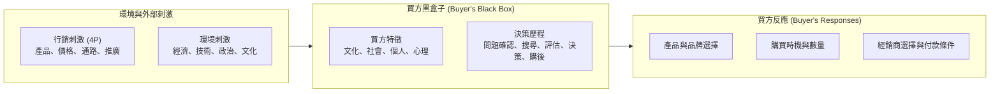
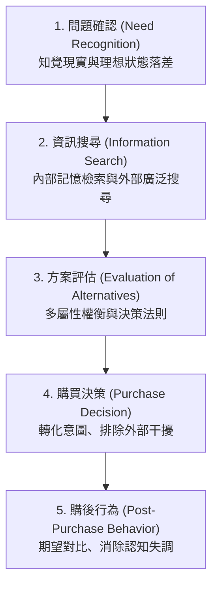
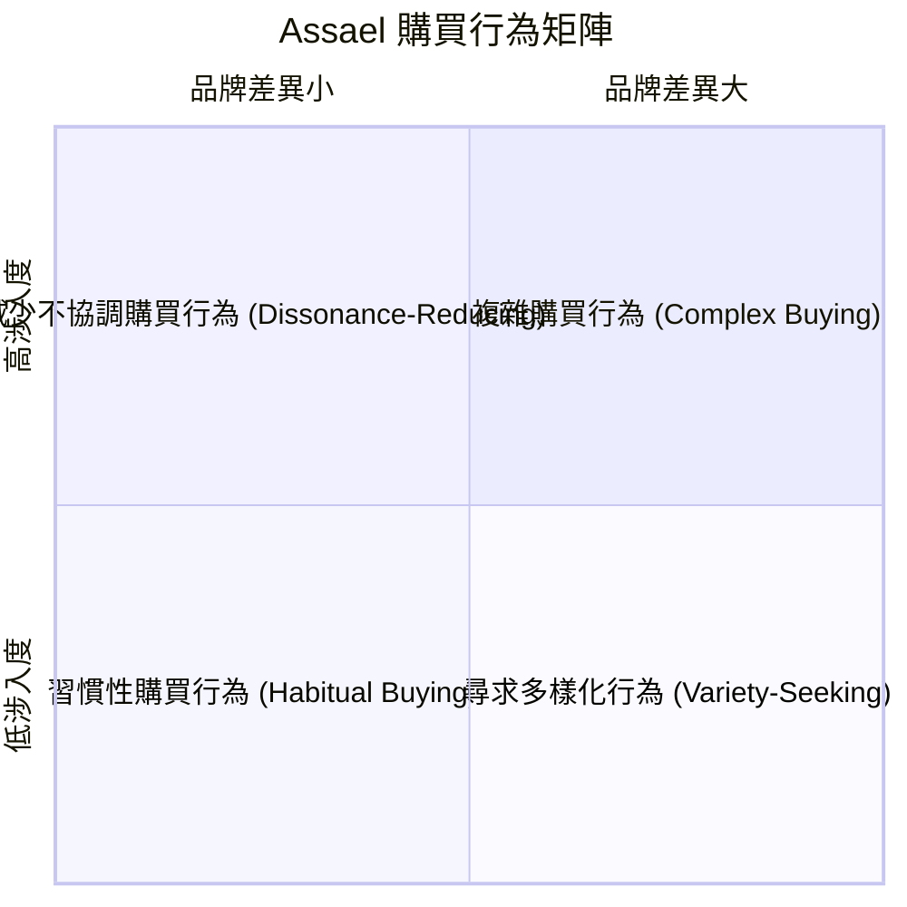

---
{"dg-publish":true,"permalink":"/02/02/l02/","title":"L02 消費者購買行為","tags":["PMBA","核心必修","行銷管理","消費者行為","購買決策過程","知覺風險","B2B採購"],"dg-note-properties":{"title":"L02 消費者購買行為","course":"行銷管理","category":"02_核心必修","type":"lecture-note","lecture":"L02","tags":["PMBA","核心必修","行銷管理","消費者行為","購買決策過程","知覺風險","B2B採購"],"aliases":["消費者購買行為","L02_消費者購買行為","消費者決策旅程","B2B與B2C行為模型","L02"]}}
---

# L02 消費者購買行為

## 💡 核心摘要
1. **消費者買的是情感、認同與自我實現，而非冰冷的規格參數**：在現代行銷中，顧客購買名牌礦泉水、名車或迪士尼門票，本質上是在購買身分地位、心理慰藉與夢想成真的情感體驗；唯有跳脫純功能導向，才能在金字塔頂層創造無可比擬的[[98_商業概念庫/perception-value_知覺價值\|zhi-jue-value_知覺價值]]。
2. **大腦決策依賴雙系統，啟動系統二往往導致「不買」**：消費者在日常消費中多由直覺與情感（系統一）驅動；行銷若過度強調細節成本或讓消費者陷入繁瑣計算，反而會啟動理性深思（系統二），引發猶豫並阻斷成交。
3. **涉入度決定溝通戰略，高低涉入需完全不同的行銷刺激**：高涉入產品（如房屋、工作站）需要嚴密論述以應對[[98_商業概念庫/behavior-4_複雜購買行為\|fu-za-gou-mai-xing-wei_複雜購買行為]]；低涉入產品（如日用品、零食）則需仰賴高密度貨架覆蓋與視覺刺激以引導[[98_商業概念庫/behavior-2_習慣性購買行為\|xi-guan-xing-gou-mai-xing-wei_習慣性購買行為]]或滿足[[98_商業概念庫/behavior-3_尋求多樣化行為\|xun-qiu-duo-yang-hua-xing-wei_尋求多樣化行為]]。
4. **交易完成不是終點，購後行為決定顧客終身價值**：消費者在高額消費後普遍面臨[[98_商業概念庫/cognitive-dissonance_認知失調\|ren-zhi-shi-diao_認知失調]]與[[98_商業概念庫/buyer-remorse_買家懊悔\|mai-jia-ao-hui_買家懊悔]]；企業若能在第一時間提供心理確認與主動關懷，便能化解負面口碑，將顧客轉化為忠誠的品牌倡導者。
5. **B2B 是多人理性格局，B2C 是個人感性決策**：B2B 行銷本質源於[[98_商業概念庫/derived-demand_衍生需求\|yan-sheng-xu-qiu_衍生需求]]，面對的是由六種角色構成的[[98_商業概念庫/buying-center_採購中心\|cai-gou-zhong-xin_採購中心]]；業務攻防的關鍵在於辨識誰是握有一票否決權的[[98_商業概念庫/gatekeeper_把關者\|ba-guan-zhe_把關者]]與掌管預算的決策者，而非僅僅取悅第一線使用者。

---

## 📚 核心觀念與行為決策模型

### 消費者行為黑盒子模型

行銷學將消費者的內在決策過程視為一個精密的「買方黑盒子（Buyer's Black Box）」，其運作依循刺激—反應架構（Stimulus-Response Model）：

- **外部刺激**：企業可掌控的 [[marketing-4p-mix_行銷4P|xing-xiao4p_行銷4P]]，以及總體環境中的科技變革、經濟景氣與社會潮流。
- **買方黑盒子**：由買方的個人特質（年齡、生活型態、價值觀）、社會背景（[[reference-groups_參考團體|can-kao-tuan-ti_參考團體]]、家庭角色）以及心理機制（動機、知覺、學習、記憶）共同構成，深刻轉化外部刺激。
- **買方反應**：最終顯現於外的購買行為、品牌偏好與長期顧客忠誠。

---

### 消費者五階段購買決策歷程

消費者在面對中高涉入度的購買情境時，通常會經歷結構完整的 [[decision_消費者購買決策歷程|xiao-fei-zhe-gou-mai-jue-ce-li-cheng_消費者購買決策歷程]]：

#### 1. 問題確認（Need Recognition）
- 購買起源於 [[problem-recognition_問題確認|wen-ti-que-ren_問題確認]]，即消費者意識到「現有實際狀態」與「期望理想狀態」之間產生了不可忽視的差距。
- **內部刺激**：生理飢餓、日常耗損、設備老化。
- **外部刺激**：同儕展示奢華商品、吸睛的社群開箱文、精心設計的廣告氛圍。行銷經理人的任務在於透過視覺與情感線索「放大差距」，喚醒消費者的潛在痛點。

#### 2. 資訊搜尋（Information Search）
- 當內部驅力足夠強烈時，消費者啟動 [[information_資訊搜尋|zi-xun-sou-xun_資訊搜尋]]：
  - **內部搜尋**：提取過往自身的使用經驗、既有品牌印象與記憶。
  - **外部搜尋**：蒐集個人來源（親友口碑）、商業來源（廣告宣傳）、大眾來源（獨立評測、論壇討論）與經驗來源（現場試用）。
- **關鍵法則**：商業來源提供廣度知名度，但個人來源與經驗來源才具備終極說服力。

#### 3. 方案評估（Evaluation of Alternatives）
- 在 [[plan-evaluation_方案評估|fang-an-evaluation_方案評估]] 階段，消費者對進入「考慮集合」的各品牌方案進行比較：
  - **補償性原則（Compensatory Rules）**：消費者認為某屬性的劣勢可由其他屬性的優勢彌補（例如：雖然價格稍貴，但續航力超強且外觀精美，總分依然最高）。
  - **非補償性原則（Non-compensatory Rules）**：
    - **字典編纂法（Lexicographic）**：挑選最重要的第一核心屬性，直接選該項目得分最高者。
    - **消去法（Conjunctive / Elimination by Aspects）**：設定關鍵屬性的最低及格門檻，凡低於門檻者直接剔除淘汰。
    - **情感捷思法（Affect Heuristic）**：在複雜環境下，消費者常放棄理性加權計算，直接「跟著感覺走」，依賴品牌帶來的情緒直覺做出決策。

#### 4. 購買決策（Purchase Decision）
- 在形成購買意向後，最終的購買決策仍可能受到兩大中介因素的干擾：
  1. **他人態度（Attitudes of Others）**：[[reference-groups_參考團體|can-kao-tuan-ti_參考團體]]、配偶或關鍵意見領袖的強烈反對，可能瞬間瓦解購買意向。
  2. **非預期情境因素（Unexpected Situational Factors）**：突發的經濟支出、店面缺貨、結帳程序繁複或店員惡劣態度導致放棄購買。

#### 5. 購後行為（Post-Purchase Behavior）
- 交易完成並非旅程終點。在全景 [[customer_顧客體驗旅程|customer-ti-yan-lv-cheng_顧客體驗旅程]] 中，依據 [[theory_期望不一致理論|qi-wang-bu-yi-zhi-theory_期望不一致理論]]，消費者的滿意度取決於「實際知覺績效」與「事前期望」的對比：
  - 當績效小於期望時，產生強烈不滿。
  - 當績效超越期望時，產生驚喜與高度黏著。
- **[[cognitive-dissonance_認知失調|ren-zhi-shi-diao_認知失調]] 與 [[buyer-remorse_買家懊悔|mai-jia-ao-hui_買家懊悔]]**：在高額支出或不可逆決策後，消費者大腦常出現自我懷疑（「我是不是買貴了？」、「別的牌子會不會更好？」）。企業必須在購後立即提供正面心理確認，協助顧客完成自我合理化。

---

### 涉入度理論與四種購買行為矩陣

依據 [[theory-2_涉入度理論|she-ru-du-theory_涉入度理論]]，消費者的決策深度受「涉入度高低」與「知覺品牌差異大小」雙重維度制約，形成 Assael's 四種購買行為矩陣：

| 購買行為類型 | 涉入度 | 品牌差異 | 核心特徵與實例 | 經理人應對策略 |
| :--- | :--- | :--- | :--- | :--- |
| **[[behavior-4_複雜購買行為|fu-za-gou-mai-xing-wei_複雜購買行為]]** | **高** | **大** | 價格高昂、具自我象徵、購買頻率低（如買房、名車、高階筆電）。買方經歷完整學習歷程。 | 提供詳盡客觀參數、權威評測與一對一專家諮詢，建立深度信任。 |
| **減少不協調購買行為** | **高** | **小** | 價格昂貴且具風險，但各品牌規格看起來大同小異（如買高級原木桌、地毯、鑽石）。購後極易產生失調。 | 重點在於提供優雅的購買環境、親切服務與強大的購後保證（無條件退換、產地認證）。 |
| **[[behavior-3_尋求多樣化行為|xun-qiu-duo-yang-hua-xing-wei_尋求多樣化行為]]** | **低** | **大** | 單價低、風險小，但市場充滿各色口味與風格（如洋芋片、餅乾、手搖飲）。轉換純粹為了新鮮感。 | 領導者應包攬所有貨架空間（貨架封鎖）；挑戰者應提供特價嘗鮮組與吸睛新品。 |
| **[[behavior-2_習慣性購買行為|xi-guan-xing-gou-mai-xing-wei_習慣性購買行為]]** | **低** | **小** | 單價低、各品牌幾乎無差異（如食鹽、衛生紙、包裝水）。消費者為節省認知精力而重複購買。 | 透過高頻廣告維持熟悉感，確保極高通路鋪貨率；挑戰者則需以破壞性促銷打破慣性。 |

---

### B2B 組織購買行為 vs. B2C 消費者市場

在企業端市場中，[[organizational-buying-behavior_組織購買行為]] 與一般消費端市場呈現顯著差異：

#### 1. 組織市場的核心特徵
- **[[derived-demand_衍生需求|yan-sheng-xu-qiu_衍生需求]]（Derived Demand）**：企業對生產設備或原物料的採購需求，非來自自身消費，而是源於終端消費者對終端商品的需求。終端微小的需求波動將引發上游設備採購的劇烈震盪（加速原理與牛鞭效應）。
- **需求缺乏彈性（Inelastic Demand）**：短期內特定零組件的價格變動，通常不會顯著影響總採購量（因為該零組件往往不可或缺且佔總成本比例有限）。
- **專業化採購與群聚效應**：由經過專業培訓的採購專家主導，且特定產業的買方高度集中於特定地理區域（如竹科半導體聚落）。

#### 2. 採購中心（Buying Center / DMU）六大角色
組織內部由跨部門組成的 [[buying-center_採購中心|cai-gou-zhong-xin_採購中心]] 共同承擔決策風險：
1. **發起者（Initiator）**：首先察覺組織痛點並提出採購需求者（如產線主管反映機台良率不足）。
2. **使用者（User）**：實際操作與使用該產品的基層同仁，最在乎介面友善度與工作負擔。
3. **影響者（Influencer）**：協助制定規格標準與技術評估準則的內部專家（如研發工程師、資安主管）。
4. **決策者（Decider）**：握有最終專案核准權與預算大權的高階主管。
5. **採購者（Buyer）**：負責發包競標、商務條件談判與簽訂正式合約的專責採購人員。
6. **[[gatekeeper_把關者|ba-guan-zhe_把關者]]（Gatekeeper）**：控制外部資訊流入與阻斷廠商接觸決策層的人員（如秘書、總機、審查專員）。

#### 3. 三種組織採購情境（Buyclasses）
- **直接再購（Straight Rebuy）**：例行性採購消耗品或標準原物料，流程全自動化，對手極難切入。
- **修正再購（Modified Rebuy）**：客戶希望調整規格、降價或縮短交期，給予外部競爭者競標空間。
- **全新任務（New Task）**：企業首次購置昂貴複雜的新系統（如導入 ERP 或建置無人倉儲），採購中心全員動員，資訊搜尋與評估最為嚴謹。

---

## ⚠️ 實務應用與經理人思維

### 經理人過度迷信「消費者是理性的」之認知陷阱
1. **快思慢想與情緒驅動**：
   - 許多經理人習慣羅列密密麻麻的規格數據（工程師思維），誤以為消費者會像試算表一樣逐項加權評估。
   - 實務上，人類大腦是極度吝嗇消耗能量的。在多數情況下，決策是由直覺與情感（系統一）在數秒內拍板，事後才調用理性（系統二）尋找說詞自我合理化。
2. **「開箱文 vs. 關箱文」效應**：
   - 消費者在購買前往往只看充滿憧憬的「開箱文」（刺激系統一的情感渴望）；若此時向其展示詳細列出保養稅費、折舊折損與維修清單的「關箱文」，便會強行啟動理性系統二，導致 80% 以上的高額奢侈消費或衝動決策直接胎死腹中。
   - 經理人應致力於為顧客創造「夢想實現之地（如迪士尼樂園）」的情感共鳴，而非讓顧客陷入精打細算的痛苦。

### 購後確認與客服追蹤：消弭「買家懊悔」
1. **主動關懷築起心理防火牆**：
   - 當顧客做出重大消費（如購車、購買昂貴軟體）後，必定伴隨強烈的 [[perception-risk_知覺風險|zhi-jue-risk_知覺風險]] 與 [[buyer-remorse_買家懊悔|mai-jia-ao-hui_買家懊悔]]。此時任何負面評價都會引發劇烈焦慮。
   - 卓越經理人將售後視為維護 [[customer-value_顧客讓渡價值|customer-rang-du-value_顧客讓渡價值]] 的核心環節：在交貨第一時間寄發主管親筆致謝函、提供專屬 VIP 開箱引導，並給予超越預期的退換貨保障，主動鞏固其「做出了明智決定」的心理認同。
2. **避免行銷與交易部門脫節**：
   - 課堂案例指出，若顧客甫以高價購買某商品，演算法卻因各部門未串聯而持續向其推播該產品的「降價促銷廣告」，將引發顧客極度嚴重的背叛感與認知失調，造成不可逆的品牌傷害。

### B2B 業務攻防陷阱：找錯溝通對象
1. **跨越「把關者」與直搗「決策者」**：
   - B2B 業務人員常犯的致命錯誤，是把 90% 的精力花在第一線使用者身上，忽略了使用者往往最沒有預算話語權。
   - 卓越的業務經理人懂得繪製「組織權力地圖」，不僅尊重並賦能 [[gatekeeper_把關者|ba-guan-zhe_把關者]]（為其提供無瑕疵的評估報告），更能直接切中「決策者」最在乎的投資報酬率（ROI）與風險管控，實現精準打擊。
