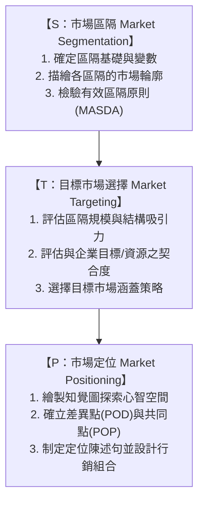
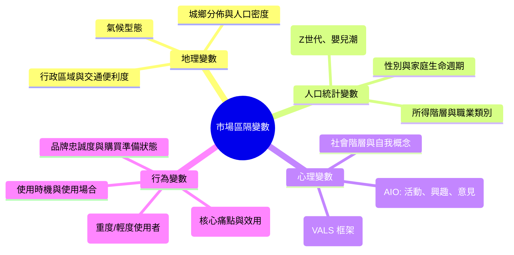
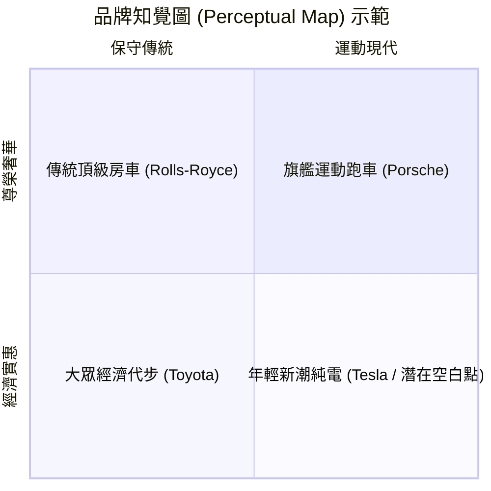
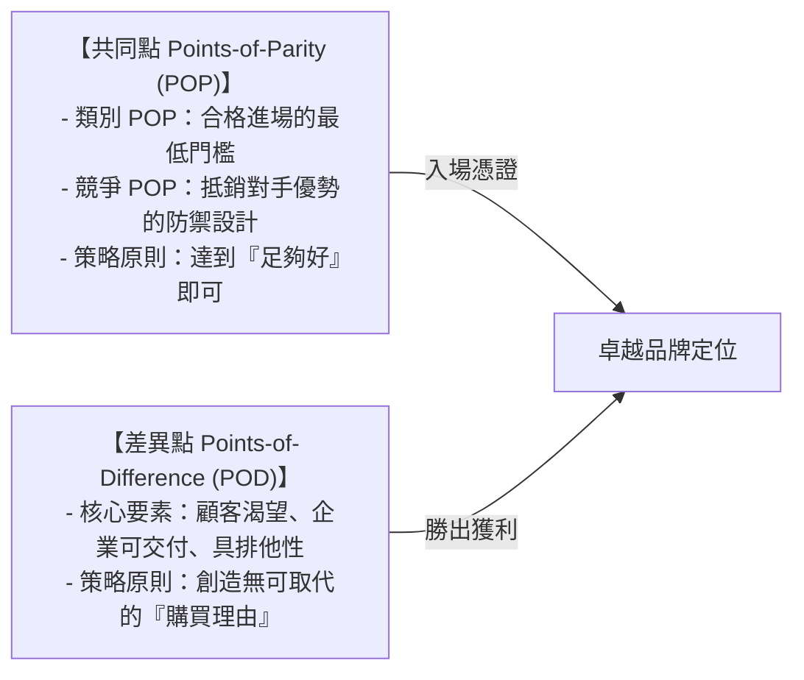

---
{"dg-publish":true,"permalink":"/02/02/l03/","title":"L03 市場區隔與定位策略","tags":["PMBA","核心必修","行銷管理","STP","市場區隔","目標市場","定位策略","知覺圖","POD","POP"],"dg-note-properties":{"title":"L03 市場區隔與定位策略","course":"行銷管理","category":"02_核心必修","type":"lecture-note","lecture":"L03","tags":["PMBA","核心必修","行銷管理","STP","市場區隔","目標市場","定位策略","知覺圖","POD","POP"],"aliases":["市場區隔與定位策略","L03_市場區隔與定位策略","STP分析策略","市場區隔與知覺圖定位","L03"]}}
---

# L03 市場區隔與定位策略

## 💡 核心摘要
1. **企圖討好所有人的品牌，最終什麼人都討好不了**：市場是由具備高度異質性需求的消費者所組成；企業的行銷成敗不在於追求無邊界的擴張，而在於透過 [[98_商業概念庫/STP分析\|STP分析]] 進行策略性取捨（Trade-off），將有限資源聚焦於最具戰略優勢的子市場。
2. **定位不是對產品做什麼，而是對潛在顧客的心智做什麼**：正如 Ries & Trout 定位論所揭示，行銷的終極戰場在於爭奪顧客的 [[98_商業概念庫/mind-share_心智佔有率\|xin-zhi-zhan-you-rate_心智佔有率]]。企業必須在心智階梯上佔據獨特、鮮明且具排他性的認知位置，方能享有持久的定價溢價能力。
3. **共同點（POP）是入場券，差異點（POD）才是獲勝牌**：類別 [[98_商業概念庫/points-of-parity_共同點\|gong-tong-dian_共同點]]（Category POP）是品牌被視為該行業合法參與者的最低及格線，而競爭 [[98_商業概念庫/differentiation-2_差異點\|cha-yi-dian_差異點]]（POD）才是驅動顧客購買的決定性理由。卓越定位策略必須「先求 POP 達標，再求 POD 領先」。
4. **定位陳述句是組織行動的北極星**：清晰的 [[98_商業概念庫/positioning-statement_定位陳述句\|positioning-chen-shu-ju_定位陳述句]] 能將抽象的 [[98_商業概念庫/value-proposition_價值主張\|value-proposition_價值主張]] 具體化為跨部門研發、定價與溝通的一致依歸，防範企業因貪大求全而導致致命的 [[98_商業概念庫/brand-dilution_品牌稀釋\|brand-xi-shi_品牌稀釋]] 與定位混淆。

---

## 📚 核心觀念與理論框架

### STP 策略核心邏輯架構

在現代行銷決策中，[[98_商業概念庫/STP分析\|STP分析]] 構成了從市場分析落地至[[98_商業概念庫/marketing-4p-mix_行銷4P\|xing-xiao4p_行銷4P]]執行的戰略漏斗：

---

### S：市場區隔（Market Segmentation）

#### 消費者市場四大區隔變數
進行 [[market-segmentation_市場區隔|market-qu-ge_市場區隔]] 時，企業通常結合四大變數維度以精準刻畫客群：

1. **地理變數（Geographic）**：根據地域環境、氣候特徵（如高溫潮濕地區對除濕家電的需求）或城市等級劃分。
2. **人口統計變數（Demographic）**：最易衡量且數據最易取得的基礎維度，但僅能說明「消費者是誰」，無法解釋其深層購買動機。
3. **[[psychographic-segmentation_心理變數區隔|xin-li-bian-shu-qu-ge_心理變數區隔]]（Psychographic）**：深入消費者的價值觀與生活型態。透過 VALS 系統將人群劃分為創新者、成就者、體驗者等，賦予品牌深層的情感與文化共鳴。
4. **[[behavior_行為變數區隔|xing-wei-bian-shu-qu-ge_行為變數區隔]]（Behavioral）**：被公認為最具預測力的區隔基礎。其中「追求利益（Benefit Sought）」直接決定了產品的核心功能需求（如牙膏之防蛀、美白、抗敏）；而「使用率」則協助企業鎖定貢獻 80% 利潤的 20% 重度使用者。

#### 有效市場區隔的評估原則（MASDA / SAMDA 準則）
一個具備商業實戰價值的市場區隔，必須嚴格通過五大檢驗準則：
- **可衡量性（Measurable）**：區隔市場的規模大小、購買力水準與特徵輪廓必須能夠被具體數據量化。
- **足量性（Substantial）**：該子市場必須具備足夠的營收容量與長期獲利潛力，值得企業為其設立專屬生產線與行銷團隊。
- **可接近性（Accessible）**：企業必須能透過現有或可建立的實體通路與傳播媒體，有效觸達並服務該群體。
- **可差異化（Differentiable）**：不同區隔在概念上必須能清晰區隔，且對不同的[[marketing-4p-mix_行銷4P|xing-xiao4p_行銷4P]]刺激（如降價促銷、品質提升）展現出顯著相異的反應。
- **可行動性（Actionable）**：企業必須具備相匹配的內部資源與執行力，能夠針對該區隔擬定並具體推動行銷方案。

---

### T：目標市場選擇（Market Targeting）

在完成市場區隔後，企業必須進行 [[target-market-selection_目標市場選擇|target-market-xuan-ze_目標市場選擇]]，決定資源投放的主攻戰場：

#### 目標市場評估三大維度
1. **區隔規模與成長潛力**：評估當前市場容量是否充足，以及未來年複合成長率（CAGR）。注意：規模過大往往意味著競爭極度白熱化。
2. **區隔結構吸引力**：導入波特五力分析（Porter's Five Forces），評估產業內的同業競爭強度、替代品威脅、潛在進入者門檻，以及買方與供應商的議價籌碼。
3. **公司目標與資源契合度**：即使某市場極具吸引力，若與企業長期策略願景背離，或企業缺乏該領域的非對稱核心優勢（如專利、特許執照、通路夥伴），亦應果斷放棄。

#### 四種目標市場涵蓋策略
依據市場異質性與企業資源規模，企業可採行四種涵蓋策略：

| 涵蓋策略類型 | 策略內涵 | 適用情境與典型範例 | 核心挑戰與風險 |
| :--- | :--- | :--- | :--- |
| **[[mass_大眾行銷|da-zhong-xing-xiao_大眾行銷]]** (無差異行銷) | 將市場視為單一整體，以同一套[[marketing-4p-mix_行銷4P|xing-xiao4p_行銷4P]]面向所有消費者。 | 產品高度標準化、需求高度同質（如食鹽、原油、公用事業）。 | 極易遭受採取分眾定位的對手蠶食。 |
| **[[differentiation_差異化行銷|cha-yi-hua-xing-xiao_差異化行銷]]** (多區隔策略) | 同時進入多個子市場，為各區隔分別設計專屬產品與品牌。 | 資源雄厚的大型企業（如 Toyota 集團旗下之 Toyota, Lexus, Daihatsu）。 | 營運與研發成本高昂，需嚴防產品線自相殘殺。 |
| **[[concentration_集中化行銷|ji-zhong-hua-xing-xiao_集中化行銷]]** ([[niche_利基行銷|li-ji-xing-xiao_利基行銷]]) | 將全部資源集中深耕於單一特定利基子市場，追求局部絕對優勢。 | 資源有限的新創或專業廠商（如 Porsche 早期專注純種跑車）。 | 仰賴單一市場風險集中，需建構「多重利基」避險。 |
| **[[one-to-one-marketing_一對一行銷]]** (微型行銷) | 針對個別顧客即時定制專屬產品、服務與溝通訊息。 | 數位電商推薦系統（Amazon/Netflix）、高端客製（B2B 帳戶行銷）。 | 演算法與客製化履約成本高，需平衡隱私紅線。 |

---

### P：市場定位（Market Positioning）

#### 定位的本質：佔據心智空間
依據 Ries & Trout 的定位理論，行銷的終極戰場不是貨架，而是潛在顧客的大腦。當顧客面對資訊爆炸時，大腦會建立「心智階梯（Mind Ladder）」，每個品類通常僅能牢記排名前 2～3 個品牌。[[positioning-strategy_定位策略]] 的目的，正是要在這座階梯上搶佔第一位置，累積穩固的 [[mind-share_心智佔有率|xin-zhi-zhan-you-rate_心智佔有率]]。

#### 知覺圖與競爭空白點探索
[[perception_知覺圖|zhi-jue-tu_知覺圖]]（Perceptual Map）是將消費者對各品牌的主觀認知，以視覺化座標軸呈現的關鍵工具：

- **知覺圖之實戰價值**：
  - **診斷現有認知**：檢視消費者對本品牌的主觀認知是否與內部設定的定位一致。
  - **鎖定直接競爭對手**：座標越緊鄰的品牌，代表在消費者心智中替代彈性越高。
  - **探索競爭空白點（White Space）**：尋找圖中尚未有品牌佔據的屬性組合空間。
  - **警惕偽空白點**：若某空白點缺乏足夠客群規模或技術不可行，盲目進入將落入「無人問津的死穴」。

#### 差異點（POD）vs. 共同點（POP）
任何品牌定位均建立在兩大基石之上：

- **類別共同點（Category POP）**：成為該品類成員的必備要件。例如：跨足智慧型手機市場，觸控螢幕、應用程式商店與多鏡頭模組是基本 POP；若不具備，消費者甚至不會將其列入考慮集合。
- **競爭共同點（Competitive POP）**：旨在打破競爭對手的獨家優勢。例如：傳統速食店推出無糖綠茶或生菜沙拉，旨在建立健康屬性的競爭 POP，抵銷健康輕食品牌的威脅。
- **跨類別定位動態（以 Subway 賽百味為例）**：
  - 相對於高熱量油炸速食（麥當勞、肯德基），Subway 的「新鮮、現做、低脂」構成了鮮明的 **POD**。
  - 但相對於專門的有機輕食沙拉吧，其健康屬性僅能勉強算作 **POP**。Subway 巧妙遊走於兩類別之間，實現了「跨類別定位」。

#### 定位陳述句（Positioning Statement）黃金公式
企業必須將 [[value-proposition_價值主張]] 凝練為內部指導性的 [[positioning-statement_定位陳述句|positioning-chen-shu-ju_定位陳述句]]：

$$	ext{針對【目標族群】，我們是【產品類別/參照架構】，能提供【核心利益與獨特 POD】，因為【支持證據與理由 RTB】。}$$

- **關鍵構成**：
  1. **目標族群（Target）**：明確界定所要服務的核心客群及其核心痛點。
  2. **參照架構（Frame of Reference）**：告訴顧客應將本品牌與誰相提並論（定義競爭邊界）。
  3. **差異點（POD）**：最重要且最獨特的利益承諾。
  4. **支持證據（Reason to Believe, RTB）**：讓承諾可信的技術專利、科學實驗數據或權威認證。

---

## ⚠️ 實務應用與經理人思維

### 經理人「貪大求全」的認知盲區
在實務決策中，許多經理人常落入「希望將產品賣給所有人」的貪婪陷阱：
1. **客群泛化引發價值模糊**：當企業試圖同時討好高端商務客與極致性價比族群時，產品設計必定妥協，行銷訴求必定失焦，最終淪為「高不成低不就」的中庸平庸者。
2. **[[brand-dilution_品牌稀釋|brand-xi-shi_品牌稀釋]] 危機**：盲目追求短期銷量而向下延伸品牌（如高端跑車推出廉價平價車款，或過度濫發品牌授權），雖然短期衝高營收，實質上卻嚴重摧毀了品牌在既有忠誠客群心中的排他性與尊榮感。經理人必須牢記：**「明確說出誰不是我們的顧客，比說出誰是我們的顧客更需要勇氣與智慧。」**

### 定位四大常見失誤
經理人在市場溝通時，必須警惕四種典型的定位病症：
1. **定位不足（Underpositioning）**：行銷訴求過於模糊、缺乏鮮明特色，消費者完全感知不到該品牌與其他同業有何本質區別。
2. **過度定位（Overpositioning）**：給予市場過於狹隘死板的認知（如「豆豆先生」演員被定型而無法出演嚴肅正劇），導致品牌在想要延伸產品線或轉型時，遭遇消費者強烈的心理抗拒。
3. **混淆定位（Confused Positioning）**：企業缺乏戰略定力，定位訴求隨季度頻繁變更（一下子強調極致科技、一下子宣傳溫馨環保、一下子主打破盤低價），令消費者無所適從。
4. **可疑定位（Doubtful Positioning）**：宣稱的產品功能或利益遠遠超出消費者在現有價格或技術水準下的合理認知，缺乏堅實的 RTB 支持，引發市場的強烈懷疑與不信任。

### 品牌再定位（Repositioning）的風險與代價
當市場環境變遷或品牌老化時，企業往往面臨 [[brand-11_品牌再定位|brand-zai-positioning_品牌再定位]] 的重大抉擇：
1. **夾縫中的「死亡之谷」**：再定位的最大凶險在於，激進的形象轉變極易使原有的核心忠誠客群感到背叛而流失；然而新世代客群卻可能依然抱持過去的刻板印象而不願買單，導致企業陷入「新客未至、老客已逝」的雙輸深淵。
2. **再定位成功的關鍵基石**：再定位絕非單純更換 Logo、包裝或找年輕網紅代言，而是必須伴隨產品實質體驗的全面革新。唯有在終端接觸點交付貨真價實的 [[customer-value_顧客讓渡價值|customer-rang-du-value_顧客讓渡價值]]，才能真正重塑消費者的大腦心智認知。
