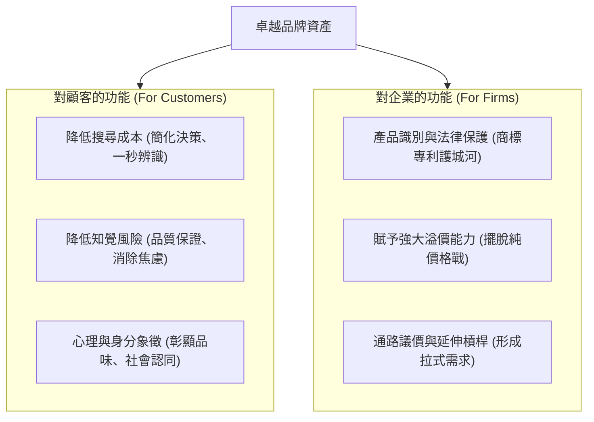
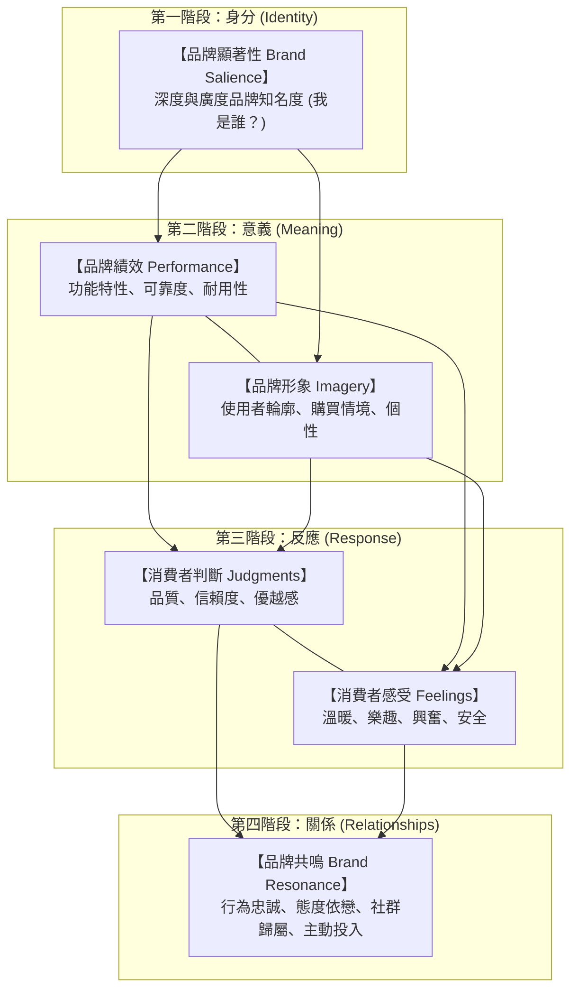
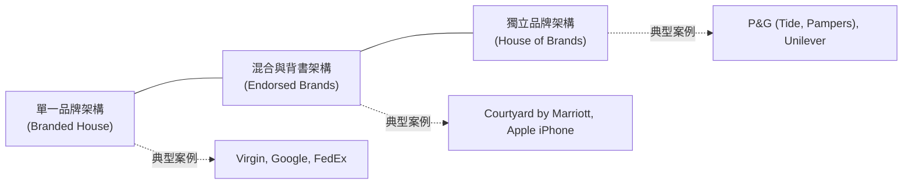

---
{"dg-publish":true,"permalink":"/02/02/l04/","title":"L04 品牌管理與品牌權益","tags":["PMBA","核心必修","行銷管理","品牌管理","品牌權益","CBBE金字塔","品牌架構","品牌延伸"],"dg-note-properties":{"title":"L04 品牌管理與品牌權益","course":"行銷管理","category":"02_核心必修","type":"lecture-note","lecture":"L04","tags":["PMBA","核心必修","行銷管理","品牌管理","品牌權益","CBBE金字塔","品牌架構","品牌延伸"],"aliases":["品牌管理與品牌權益","L04_品牌管理與品牌權益","CBBE模型","品牌架構與延伸","L04"]}}
---

# L04 品牌管理與品牌權益

## 💡 核心摘要
1. **品牌是企業在顧客心智中建立的「溢價特許權」**：品牌絕非單純的名稱或商標，而是顧客所有體驗與承諾的綜合體。強大的品牌能有效降低顧客的搜尋成本與 [[98_商業概念庫/perception-risk_知覺風險\|zhi-jue-risk_知覺風險]]，賦予企業強大的 [[98_商業概念庫/pricing-power_溢價能力\|yi-jia-neng-li_溢價能力]] 與抗風險護城河。
2. **品牌權益是降低獲客成本與提升顧客終身價值的終極資產**：依據凱勒（Keller）的 [[98_商業概念庫/customer-brand-equity_顧客基礎品牌權益\|customer-ji-chu-brand-equity_顧客基礎品牌權益]]（CBBE）模型，品牌建設必須由底層的 [[98_商業概念庫/brand-8_品牌知名度\|brand-zhi-ming-du_品牌知名度]] 向上攀升，歷經績效與 [[98_商業概念庫/brand-4_品牌形象\|brand-xing-xiang_品牌形象]] 的塑造、理智判斷與感性反應，最終締造難以撼動的 [[98_商業概念庫/brand-5_品牌共鳴\|brand-gong-ming_品牌共鳴]]。
3. **品牌架構是一場綜效與風險隔離的權衡藝術**：[[98_商業概念庫/brand-9_家族品牌\|jia-zu-brand_家族品牌]]（Branded House）能極大化行銷綜效但牽一髮動全身；[[98_商業概念庫/brand-6_個別品牌\|ge-bie-brand_個別品牌]]（House of Brands）與 [[98_商業概念庫/brand-strategy_多品牌策略\|duo-brand-strategy_多品牌策略]] 能精準鎖定不同區隔並隔離風險，但伴隨龐大的維護成本。經理人需依企業資源與市場跨度審慎配置。
4. **品牌延伸能借力使力，但也暗藏品牌稀釋的毒藥**：透過 [[98_商業概念庫/product-2_產品線延伸\|xian-yan-shen_線延伸]] 或類別延伸進軍新領域，能大幅縮減市場教育費用；然而過度延伸或跨足不相容領域，極易誘發 [[98_商業概念庫/brand-dilution_品牌稀釋\|brand-xi-shi_品牌稀釋]]，甚至摧毀母品牌數十年累積的核心信譽。

---

## 📚 核心觀念與品牌管理架構

### 品牌的定義與策略功能

#### 品牌定義的典範轉移
- **傳統美國行銷協會（AMA）定義**：
  > 品牌是一個名稱、名詞、符號、標誌、設計，或是其組合，旨在識別特定賣方或賣方群體的產品與服務，並使之與競爭對手的產品與服務相區別。
- **當代顧客感知定義**：
  在現代行銷學中，品牌被重新定義為「企業在顧客大腦心智中佔據的一組獨特神經聯想與價值承諾總和」。它是顧客在跨越所有接觸點體驗後，所知覺到的整體信賴與情感關係。

#### 品牌的策略功能剖析

- **對顧客而言**：
  - **降低搜尋成本**：在琳瑯滿目的貨架或電商平台中，品牌是指引決策的燈塔，大幅節省消費者的認知精力。
  - **降低 [[98_商業概念庫/perception-risk_知覺風險\|zhi-jue-risk_知覺風險]]**：為產品功能與售後服務提供信用背書，化解顧客害怕買錯或受騙的心理防線。
  - **心理與身分投射**：名牌精品或潮牌服飾已超越實用功能，成為消費者展現社會階層與自我認同的社交符號。
- **對企業而言**：
  - **法律資產保護**：透過商標註冊構築排他性壁壘，防止對手惡意仿冒。
  - **賦予 [[98_商業概念庫/pricing-power_溢價能力\|yi-jia-neng-li_溢價能力]]**：強大品牌能享有遠高於同業的毛利率；在面臨通膨或原物料上漲時，能從容轉嫁成本。
  - **通路話語權**：具備高品牌力的產品自帶客流，能強勢要求通路給予更優越的排面與更低的抽成條件。

---

### 凱勒顧客基礎品牌權益模型（CBBE / 品牌金字塔）

達特茅斯學院凱勒（Kevin Lane Keller）教授提出的 [[98_商業概念庫/customer-brand-equity_顧客基礎品牌權益\|customer-ji-chu-brand-equity_顧客基礎品牌權益]]（CBBE）模型，揭示了品牌建設的四階段金字塔路徑：

1. **底層：品牌顯著性（Brand Salience / 身分建立）**：
   - **核心提問**：「你是誰？（Who are you?）」
   - **關鍵任務**：建立鮮明的 [[98_商業概念庫/brand-3_品牌識別\|brand-shi-bie_品牌識別]]，以及具備深度（容易回憶）與廣度（多場合聯想）的 [[98_商業概念庫/brand-8_品牌知名度\|brand-zhi-ming-du_品牌知名度]]。確保顧客在產生需求時，第一時間能將該品牌納入考慮集合。
2. **第二層：品牌意涵（Brand Meaning / 意義塑造）**：
   - **核心提問**：「你是什麼？（What are you?）」
   - **理性路徑：品牌績效（Brand Performance）**：產品的核心功能、可靠度、耐用度、價格及服務效率。
   - **感性路徑：[[98_商業概念庫/brand-4_品牌形象\|brand-xing-xiang_品牌形象]]（Brand Imagery）**：品牌所代表的無形心理屬性、生活風格、象徵意涵及消費者對品牌個性的聯想。
3. **第三層：品牌反應（Brand Response / 激發評價）**：
   - **核心提問**：「我對你有何看法與感覺？（What about you?）」
   - **消費者判斷（Brand Judgments）**：顧客對品牌品質的客觀評估、專業信賴度與相較於競品的優越感。
   - **消費者感受（Brand Feelings）**：品牌所引發的情緒共鳴（如迪士尼帶來歡樂、Volvo 帶來安全感、Apple 帶來創新自豪）。
4. **頂層：[[98_商業概念庫/brand-5_品牌共鳴\|brand-gong-ming_品牌共鳴]]（Brand Resonance / 締結關係）**：
   - **核心提問**：「你和我之間有何深層關係？（What about you and me?）」
   - **極致境界**：顧客展現出極致的 [[98_商業概念庫/brand-loyalty_品牌忠誠度\|brand-loyalty_品牌忠誠度]]、深厚的情感依戀，甚至主動加入品牌社群（如哈雷車友會、果粉），成為品牌的義務傳教士。

---

### 品牌架構與品牌命名策略

企業在擴張多元業務時，必須依據市場特性選擇合適的品牌架構：

| 品牌架構類型 | 核心運作模式 | 主要優點 | 主要風險與限制 |
| :--- | :--- | :--- | :--- |
| **單一品牌架構** ([[98_商業概念庫/brand-9_家族品牌\|jia-zu-brand_家族品牌]] / 傘狀品牌) | 所有產品線均使用同一母品牌名稱（如 Virgin 跨足航空、鐵路、電信、可樂）。 | 行銷綜效極大化、新產品借力使力、大幅壓低推廣成本。 | 牽一髮動全身（連坐效應）；若產品跨度過大易引發定位模糊。 |
| **獨立品牌架構** ([[98_商業概念庫/brand-6_個別品牌\|ge-bie-brand_個別品牌]] / 多品牌) | 各產品線使用彼此獨立、互不關聯的專屬品牌（如 P&G 旗下各洗髮精、洗衣精）。 | 完美隔離公關風險；能為不同區隔量身定制純粹的 [[98_商業概念庫/positioning-strategy_定位策略\|positioning-strategy_定位策略]]。 | 資源消耗極為龐大；各品牌無法共享商譽與行銷綜效。 |
| **混合與背書架構** (主副品牌策略) | 由母品牌提供信譽背書，子品牌專注特定產品特徵（如 Marriott 背書 Courtyard）。 | 兼具母品牌的公信力與子品牌的靈活性，降低新市場進入風險。 | 需謹慎維持主副品牌之間的聯想契合度，防範子品牌反噬。 |

---

### 品牌延伸策略與聯名策略

#### 品牌延伸的兩大路徑
企業運用既有強大母品牌的商譽資產，跨足新業務領域時稱為 [[98_商業概念庫/brand-10_品牌延伸\|brand-yan-shen_品牌延伸]]：
- **[[98_商業概念庫/product-2_產品線延伸\|xian-yan-shen_線延伸]]（Line Extension）**：在現有產品類別中，推出新口味、新包裝、新配方或不同價格帶的子產品（如可口可樂推出 Zero、香草口味）。風險較低但易引發產品線混亂。
- **類別延伸（Category Extension）**：跨足全新產品類別（如 Dyson 從吸塵器跨足吹風機與空氣清淨機）。成敗關鍵在於母品牌的核心技術能力（如氣旋與馬達技術）能否合理解釋新產品的優越性。

#### 聯名品牌與成分品牌策略
- **[[98_商業概念庫/brand-7_聯名品牌\|lian-ming-brand_聯名品牌]]（Co-branding）**：兩個或多個知名品牌攜手打造單一產品（如 Apple Watch $\times$ Hermès、Nike $\times$ Tiffany），透過雙方客群的互補與文化碰撞，創造「1+1 > 2」的破圈吸引力。
- **[[98_商業概念庫/brand-2_成分品牌\|cheng-fen-brand_成分品牌]]（Ingredient Branding）**：B2B 關鍵零組件或材料供應商，透過向終端消費者宣傳自身技術標籤（如「Intel Inside」微處理器、Gore-Tex 防水布料），反向逼迫終端品牌廠商必須採購並標示該成分，成功建立定價權與通路話語權。

---

## ⚠️ 實務應用與經理人思維

### 品牌延伸的「品牌稀釋」陷阱
許多經理人在追求短期營收成長時，常陷入無休止品牌延伸的致命盲區：
1. **過度授權的警訊（Pierre Cardin 案例）**：法國知名時尚品牌皮爾卡登曾將商標授權給數百種與時尚毫不相干的廉價日常用品（如廉價打火機、文具、甚至馬桶座），短期收穫巨額授權費，但不出幾年，其在消費者心智中的頂級奢華地位蕩然無存，演變成不可逆的 [[98_商業概念庫/brand-dilution_品牌稀釋\|brand-xi-shi_品牌稀釋]]。
2. **能力轉移性檢驗**：經理人推動延伸前，必須自問：「消費者是否相信我們具備在新領域做好這款產品的能力？」若缺乏核心技術關聯，延伸只會被視為撈錢之舉。

### 「品牌資產」的價值折損：促銷成癮症
1. **折扣戰對高端形象的侵蝕**：
   - 許多經理人面對季末業績壓力時，習慣以「全面下殺打折」衝刺短期銷量。
   - 課堂深刻指出：頻繁的降價促銷是毀滅 [[98_商業概念庫/brand-equity_品牌權益\|brand-equity_品牌權益]] 的毒藥。它不僅吸引來毫無忠誠度的「價格傭兵」，更會向市場傳遞「這項產品根本不值原價」的強烈負面信號，嚴重摧毀品牌的 [[98_商業概念庫/pricing-power_溢價能力\|yi-jia-neng-li_溢價能力]]。
2. **守護價格底線**：卓越品牌寧可銷毀庫存或贈送非金錢禮遇，也絕不在公開主流通路隨意降價，以捍衛早期全價購買顧客的自豪感與 [[98_商業概念庫/customer-value_顧客讓渡價值\|customer-rang-du-value_顧客讓渡價值]]。

### 品牌重塑（Rebranding）的時機與風險控管
1. **何時該啟動 [[98_商業概念庫/brand_品牌重塑\|brand-zhong-su_品牌重塑]]**：當企業發生重大戰略併購、原有品牌形象嚴重老化脫節、或陷入毀滅性公關危機時，品牌重塑是重生的必要契機。
2. **防範「為重塑而重塑」的災難**：純粹更換 Logo 或包裝而無實質產品革新的重塑，往往招致慘敗（如純果汁品牌 Tropicana 換包裝後銷量暴跌 20%）。經理人必須明白：重塑是一場涵蓋產品、服務、文化與組織架構的全面系統工程。
