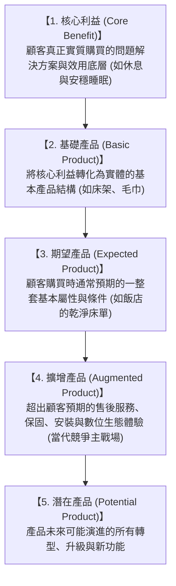
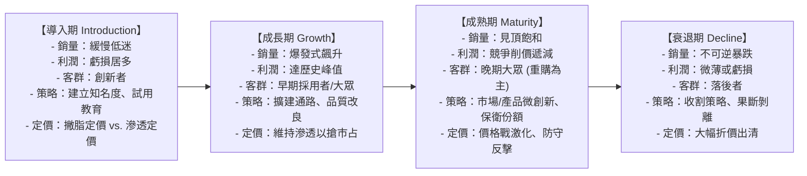
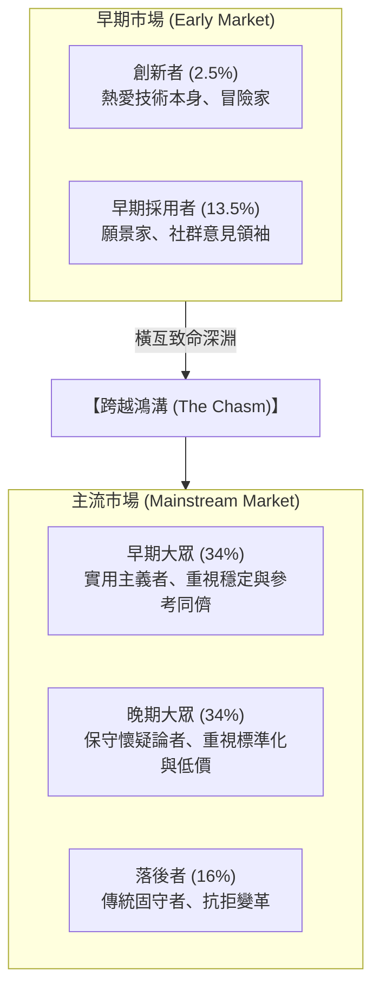

---
{"dg-publish":true,"permalink":"/02/02/l05/","title":"L05 產品相關策略","tags":["PMBA","核心必修","行銷管理","產品策略","產品五層次","產品組合","產品生命週期","創新擴散"],"dg-note-properties":{"title":"L05 產品相關策略","course":"行銷管理","category":"02_核心必修","type":"lecture-note","lecture":"L05","tags":["PMBA","核心必修","行銷管理","產品策略","產品五層次","產品組合","產品生命週期","創新擴散"],"aliases":["產品相關策略","L05_產品相關策略","產品五層次","產品生命週期 PLC","創新擴散理論","L05"]}}
---

# L05 產品相關策略

## 💡 核心摘要
1. **競爭的本質已從核心功能移轉至擴增產品層次**：在現代高度同質化的市場中，單純滿足顧客的基礎與期望功能已是基本門檻；企業唯有在 [[98_商業概念庫/kuo-zeng-product_擴增產品\|kuo-zeng-product_擴增產品]]（服務、保固、數位生態與尊榮體驗）上創造驚喜，方能賦予產品強大的溢價空間與競爭防禦力。
2. **產品組合維度是一場成長擴張與營運複雜度的權衡**：追求 [[98_商業概念庫/product-portfolio_產品組合\|product-zu-he_產品組合]] 的寬度與長度能擴大市場覆蓋率，但過度延伸將落入「SKU 膨脹」的庫存與管理成本黑洞；經理人必須在滿足市場需求與維持精實營運之間求取最佳平衡。
3. **拒絕將產品生命週期（PLC）視為既定宿命**：成熟期產品絕非只能坐以待斃，卓越經理人能透過市場修正、產品微創新與發掘全新使用場景，為金牛產品開闢「第二成長曲線」。
4. **新產品開發的生死關在於跨越鴻溝**：從早期市場（創新者與 [[98_商業概念庫/early-adopters_早期採用者\|zao-qi-cai-yong-zhe_早期採用者]]）走向主流大眾市場時，橫亙著巨大的心理鴻溝；企業必須聚焦單一利基市場並交付 100% 的完整解決方案，方能實現 [[98_商業概念庫/crossing-the-chasm_跨越鴻溝\|kua-yue-hong-gou_跨越鴻溝]]。

---

## 📚 核心觀念與產品決策模型

### 產品層級與顧客價值層次

現代行銷學大師菲利普·科特勒（Philip Kotler）提出了著名的「顧客價值五層次模型」，揭示了產品從實體功能走向價值體驗的進化階梯：

1. **[[core-benefit_核心利益|he-xin-li-yi_核心利益]]（Core Benefit）**：顧客真正購買的根本價值。消費者買鑽頭不是為了擁有金屬工具，而是為了「牆上的孔洞」；買化妝品是為了「希望與自信」。
2. **基礎產品（Basic Product）**：將核心利益具體化為最基本的實體形式。
3. **期望產品（Expected Product）**：顧客在購買時視為理所當然的基本屬性。例如入住商務飯店，顧客期望房間必須安靜、床鋪整潔乾淨、具備穩定熱水與 Wi-Fi。
4. **[[kuo-zeng-product_擴增產品]]（Augmented Product）**：超出顧客預期、提供競爭差異化的附加利益（如 24 小時管家服務、無條件退換保障、OTA 軟體功能自動更新）。**當代企業競爭的主戰場已全面轉移至擴增層次**。
5. **潛在產品（Potential Product）**：該產品在未來可能納入的所有潛在演進與附加價值。

---

### 產品組合與產品線策略

#### 消費品四大分類
依據消費者在購買時所付出的時間、心力與決策涉入度，消費品可劃分為四大類別：
- **[[convenience-goods_便利品|bian-li-pin_便利品]]（Convenience Goods）**：經常購買、立即需要、付出極少搜尋心力（如零食、衛生紙、飲料）。策略關鍵在於**密集性配銷通路與高貨架能見度**。
- **[[shopping-goods_選購品|xuan-gou-pin_選購品]]（Shopping Goods）**：在品質、價格、款式與適用性上進行深入比較的商品（如家具、服裝、家電）。策略關鍵在於**提供清晰的比較資訊與專業顧問解說**。
- **[[specialty-goods_特殊品|te-shu-pin_特殊品]]（Specialty Goods）**：具備獨特品牌標識與卓越工藝，顧客絕不接受替代品的高涉入商品（如勞力士腕錶、保時捷跑車）。策略關鍵在於**維持稀缺性與獨家配銷**。
- **非搜尋品（Unsought Goods）**：消費者平時不會主動想到要買的商品（如生前契約、人身保險）。需仰賴強勢的推銷與公信力建立。

#### 產品組合四大維度
企業的 [[product-portfolio_產品組合|product-zu-he_產品組合]]（Product Mix）具備四個關鍵戰略維度：
1. **寬度（Width）**：企業所擁有產品線的數量（如 P&G 擁有洗髮精、紙尿褲、口腔護理、刮鬍刀等多條產品線）。
2. **長度（Length）**：所有產品線中產品項目的總數。
3. **深度（Depth）**：各產品項目所提供的不同規格、容量、口味與款式數量。
4. **一致性（Consistency）**：各產品線在終端用途、生產要求或通路分配上的緊密關聯度。

#### 產品線決策與延伸
企業透過 [[product-2_產品線延伸|product-xian-yan-shen_產品線延伸]] 來追求成長或防衛陣地：
- **向下延伸（Down-market Stretch）**：推出平價入門款，旨在阻擊低價競爭對手、利用剩餘產能或搶攻大眾市場。**核心風險在於引發 [[cannibalization_自我蠶食|zi-wo-can-shi_自我蠶食]] 與母品牌形象貶值**。
- **向上延伸（Up-market Stretch）**：進軍高階市場以提升品牌尊榮度並追求高毛利率。**核心挑戰在於能否克服消費者對其高端技術能力的懷疑**。
- **雙向延伸（Two-way Stretch）**：中階市場領導者同時向上下兩端出擊，實現全光譜覆蓋。
- **產品線填補（Line Filling）**：在現有產品線內部增添更多項目以封鎖貨架空隙，但需嚴防造成顧客選擇障礙與庫存混亂。

---

### 產品生命週期（PLC）四大階段策略

[[product-life-cycle_產品生命週期|product-sheng-ming-cycle_產品生命週期]]（Product Life Cycle, PLC）描繪了產品自進入市場至退出市場的典型 S 曲線歷程：

1. **[[introduction-stage_導入期|dao-ru-qi_導入期]]（Introduction）**：
   - 市場認知度低，企業面臨沉重研發攤提。
   - **兩大定價策略抉擇**：
     - **[[pricing_撇脂定價法|pie-zhi-pricing-fa_撇脂定價法]]（Market-Skimming）**：設定高價，快速獲取先鋒市場高毛利，建立高端形象（如 Apple 旗艦機上市）。
     - **[[penetration-pricing_市場滲透定價|market-shen-tou-pricing_市場滲透定價]]（Market-Penetration）**：設定超低價，以閃電戰迅速搶佔市場份額與建立規模經濟壁壘。
2. **[[growth-stage_成長期|cheng-zhang-qi_成長期]]（Growth）**：
   - 早期大眾湧入，市場呈現爆發成長。
   - 策略重心：開拓新配銷通路、持續改善品質、擴大市場份額以追求規模經濟。
3. **[[maturity-stage_成熟期|cheng-shu-qi_成熟期]]（Maturity）**：
   - 市場飽和，價格競爭極度白熱化。
   - 策略重心：防禦既有市占，透過「市場修正（尋找新客群）」、「產品修正（微創新與特色升級）」與「[[marketing-4p-mix_行銷4P|xing-xiao4p_行銷4P]]修正」延長生命週期。
4. **[[decline-stage_衰退期|shuai-tui-qi_衰退期]]（Decline）**：
   - 遭遇技術替代或消費者偏好轉移。
   - 策略重心：採取收割策略（Harvesting）榨取剩餘現金流，或果斷剝離資產轉型。

---

### 新產品開發與創新擴散理論

#### 新產品開發（NPD）流程
成功的 [[product_新產品開發|xin-product-kai-fa_新產品開發]] 依循嚴格的門徑管理模型（Stage-Gate Process）：
`構想產生與篩選` $
ightarrow$ `概念發展與概念測試` $
ightarrow$ `商業分析 (ROI 試算)` $
ightarrow$ `實體原型開發 (MVP)` $
ightarrow$ `市場試銷 (Test Marketing)` $
ightarrow$ `全面商業化`。

#### 羅傑斯創新擴散模型與摩爾跨越鴻溝
依據羅傑斯（Everett Rogers）的 [[diffusion-of-innovations_創新擴散理論]]，消費者接納新創技術的速度呈現常態分佈：

- **鴻溝的本質**：[[early-adopters_早期採用者|zao-qi-cai-yong-zhe_早期採用者]]（願景家）期望透過新技術實現戰略躍進，願意容忍產品的不完美；而主流大眾（實用主義者）則厭惡風險，需要 100% 穩定成熟的解決方案與同儕成功案例背書。
- **[[crossing-the-chasm_跨越鴻溝|kua-yue-hong-gou_跨越鴻溝]] 的保齡球道戰略**：
  1. **單點突破**：將有限資源聚焦於單一高度具體的垂直利基市場（第一號保齡球瓶）。
  2. **交付完整產品（Whole Product）**：為該利基市場提供包含硬體、軟體、安裝培訓與售後承諾的一站式解決方案。
  3. **贏得實用主義者背書**：一旦在該利基成為無可爭議的標準，即可產生連鎖骨牌效應擊倒其他球瓶，順利跨入主流大眾市場。

---

## ⚠️ 實務應用與經理人思維

### 產品線過度擴充的「庫存與管理成本暴增」黑洞
1. **SKU 膨脹引發的營運危機**：
   - 許多產品經理為衝刺短期業績，不斷推出微小變異的子規格與特殊包裝。
   - 實務痛點：過度的產品線填補雖然表面上滿足了邊緣客群，但隨之而來的是工廠換模頻繁、供應鏈排程混亂、存貨呆滯跌價與零售通路貨架擁擠。
   - 卓越經理人必須建立「新增一個 SKU 必須淘汰一個舊 SKU」的嚴格治理機制，持續優化資產回報率。

### 自我蠶食（Cannibalization）的戰略權衡
1. **主動顛覆 vs. 被動挨打**：
   - 當企業研發出更高效、更便宜的新技術時，經理人常因擔心損害既有高利潤旗艦產品而猶豫不決。
   - 經理人必須牢記賈伯斯的名言：**「如果你不主動蠶食自己，競爭對手就會替你蠶食。」** 只要新產品能為顧客創造更高的 [[customer-value_顧客讓渡價值|customer-rang-du-value_顧客讓渡價值]] 並擴大總毛利池，主動的戰略性自我蠶食就是最明智的生存之道。

### 將 PLC 視為既定命運的致命盲點
1. **擺脫生命週期的宿命論**：
   - 許多經理人誤將產品生命週期的階段當作自然規律，一旦銷量放緩便直接認定產品已進入成熟或衰退期，盲目削減行銷預算，反而親手造成了產品的「自我實現式衰退」。
   - 透過大膽發掘新使用場景（如將運動飲料推廣為日常補水、將威士忌延伸至居家調酒）、結合數位科技升級為智慧硬體，成熟產品隨時能打破 PLC 限制，開闢出波瀾壯闊的第二成長曲線。
