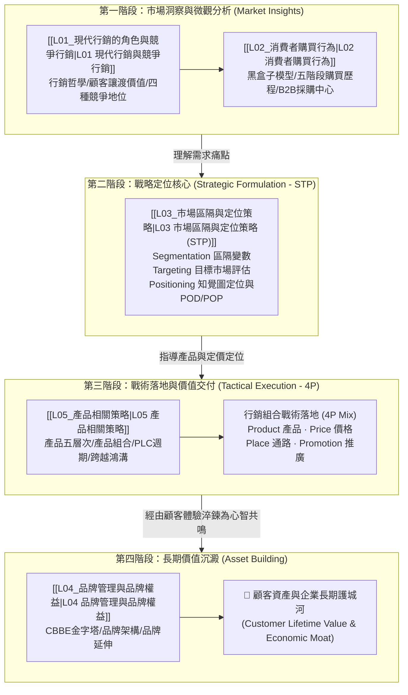

---
{"dg-publish":true,"permalink":"/02/02/moc/","title":"行銷管理 MOC (課程總覽地圖)","tags":["PMBA","核心必修","行銷管理","STP","品牌管理","MOC","知識地圖"],"dg-note-properties":{"title":"行銷管理 MOC (課程總覽地圖)","course":"行銷管理","category":"02_核心必修","type":"moc","tags":["PMBA","核心必修","行銷管理","STP","品牌管理","MOC","知識地圖"],"aliases":["行銷管理","行銷管理 MOC","Marketing Management MOC"]}}
---

# 🎯 行銷管理 MOC (Marketing Management)

> **課程定位**：國立臺灣大學 PMBA 核心必修核心模組  
> **決策主軸**：從**市場洞察與顧客分析**出發，制定**STP 策略定位**，並透過**行銷組合 (4P)** 與**品牌資產建構**轉化為可持續的市場競爭優勢與顧客終身價值  
> **銜接前置**：[[01_基礎先修/管理概論/_管理概論 MOC\|管理概論 (Ch05 競爭策略與市場環境)]]  
> **銜接後續**：[[02_核心必修/01_財務管理/_財務管理 MOC\|財務管理 (顧客資產與行銷投資評價)]] · [[04_主題選修/10_創業與企業財務策略/_創業與企業財務策略 MOC\|創業與企業財務策略 (價值主張設計與 PMF 驗證)]]  
> **學程總覽**：[[00_學程修課地圖 & 進度追蹤\|返回 PMBA 學程修課地圖與進度追蹤]]

---

## 🧭 行銷戰略引擎：從市場洞察到顧客資產創造

現代行銷管理的核心不僅是廣告促銷，更是企業創造、溝通與傳遞**顧客讓渡價值（Customer Delivered Value）**的戰略引擎：

---

## 📚 課程講次與學習進度看板

- [x] **[[L01_現代行銷的角色與競爭行銷|L01 現代行銷的角色與競爭行銷]]**  
  *行銷哲學五大演進（生產/產品/銷售/行銷/社會行銷導向）、顧客讓渡價值（CPV = 總顧客價值 - 總顧客成本）、四大競爭地位策略（市場領導者/挑戰者/跟隨者/利基者）。*
- [x] **[[L02_消費者購買行為|L02 消費者購買行為]]**  
  *消費者行為刺激-反應黑盒子模型、五階段購買決策歷程（問題認知 ➔ 資訊搜尋 ➔ 方案評估 ➔ 購買決策 ➔ 購後行為）、涉入度與知覺風險、B2B 採購決策中心（DMU 六大角色）。*
- [x] **[[L03_市場區隔與定位策略|L03 市場區隔與定位策略 (STP)]]**  
  *STP 戰略核心、區隔四大變數（地理/人口/心理/行為）、有效區隔 MASDA 原則、目標市場三種覆蓋策略、知覺圖（Perceptual Map）、差異點（POD）與同質點（POP）定位。*
- [x] **[[L04_品牌管理與品牌權益|L04 品牌管理與品牌權益]]**  
  *品牌本質與無形資產、凱勒顧客導向品牌權益（CBBE）四層金字塔（顯著度/意象績效/判斷感受/共鳴）、品牌架構（品牌之家 House of Brands vs. 家之品牌 Branded House）、品牌線延伸與跨界風險。*
- [x] **[[L05_產品相關策略|L05 產品相關策略]]**  
  *科特勒產品五層次（核心利益/基本產品/期望產品/附加產品/潛在產品）、產品組合寬度與深度矩陣、產品生命週期（PLC 四階段動態策略）、羅傑斯創新擴散與摩爾鴻溝理論（Crossing the Chasm）。*

---

## 🧮 行銷管理經典戰略模型與工具箱矩陣

| 戰略維度 | 核心模型 / 理論名稱 | 代表學者 | 經理人管理意涵與分析工具箱 | 實務應用情境 |
| :--- | :--- | :--- | :--- | :--- |
| **價值導向** | **顧客讓渡價值 (CPV)** | 柯特勒 (Kotler) | $\text{CPV} = \text{總顧客價值} - \text{總顧客成本}$；提升功能/服務價值，降低貨幣/時間/精力/心理成本。 | 避免陷入單純價格戰，透過全鏈條體驗優化提升實質獲利。 |
| **競爭地位** | **競爭地位四象限策略** | 柯特勒 (Kotler) | **領導者**（擴大總市場/防禦市占）；**挑戰者**（正面/側翼進攻）；**跟隨者**（模仿緊跟）；**利基者**（深耕細分利基市場）。 | 評估企業在細分產業中的相對實力，選擇正面迎擊或利基避險。 |
| **戰略定位** | **STP 戰略框架** | 溫德爾史密斯 & 柯特勒 | **S (區隔)** 找出異質市場 ➔ **T (目標)** 評估規模與獲利率 ➔ **P (定位)** 在目標顧客心智中建立獨特佔位。 | 新產品上市、新市場拓展或既有產品再定位之頂層設計。 |
|  | **差異點 vs. 同質點** | 凱勒 (Keller) | **POD (Point of Difference)**：顧客選擇你的獨特購買理由；**POP (Point of Parity)**：進入該品類必須具備的基本及格線。 | 進入強敵環伺的新市場時，先補齊 POP、再放大 POD 發動奇襲。 |
| **品牌資產** | **CBBE 品牌金字塔** | 凱勒 (Keller) | 品牌顯著度 (Who are you?) ➔ 品牌績效與意象 (What are you?) ➔ 品牌判斷與感受 (What about you?) ➔ 品牌共鳴 (What about you and me?)。 | 衡量品牌從單純「知名度」升級為「忠誠粉絲社群」的健康度指標。 |
| **產品組合** | **產品五層次模型** | 柯特勒 (Kotler) | 核心利益 ➔ 基本產品 ➔ 期望產品 ➔ **附加產品 (競爭主戰場)** ➔ 潛在產品。 | 產品研發與服務加值升級，從實體功能競爭躍升為解決方案競爭。 |
|  | **跨越鴻溝 (Chasm)** | 摩爾 (Moore) | 創新擴散中，「早期採用者（願景家）」與「早期大眾（實用主義者）」之間存在致命鴻溝。 | B2B 科技新創從驗證原型走向主流市場規模化擴張的生死關鍵。 |

---

## 🔗 跨學程前後貫通與綜效思考

- ⬅️ **[[01_基礎先修/管理概論/_管理概論 MOC|基礎先修：管理概論]]**：L01、L03 承接 Ch05 競爭策略（波特三大通用策略），將總體策略落實至目標客群切分與品牌定位。
- ➡️ **[[02_核心必修/01_財務管理/_財務管理 MOC|核心必修：財務管理]]**：行銷預算本質上是對「顧客終身價值（CLV）」與「無形品牌資產」的資本支出，需透過 NPV / ROI 嚴謹評估獲客成本（CAC）與留存效益。
- ➡️ **[[04_主題選修/10_創業與企業財務策略/_創業與企業財務策略 MOC|主題選修：創業與企業財務策略]]**：L03 與 L05 是創業早期尋找「產品市場契合度（PMF）」與精實驗證的核心指南。
- ➡️ **[[04_主題選修/12_產業分析與投資策略/00_課程導航與進度/mindmap_產業分析與投資策略_心智圖導航|主題選修：產業分析與投資策略]]**：結合產業價值鏈與競爭行銷地位，剖析領導者與利基者的利潤池分配機制。

---

## 💎 推薦關聯之 [[98_商業概念庫]] 原子卡片

- **行銷與顧客**：[[market-segmentation_市場區隔]] · [[positioning_市場定位]] · [[customer-value_顧客讓渡價值]] · [[marketing-4p-mix_行銷4P]]
- **品牌權益**：[[brand-equity_品牌權益]] · [[brand-image_品牌形象]] · [[brand-extension_品牌延伸]] · [[product-2_產品線延伸]]
- **產品與生命週期**：[[product-life-cycle_產品生命週期 PLC]] · [[innovation-diffusion_創新擴散理論]] · [[crossing-the-chasm_跨越鴻溝]]
