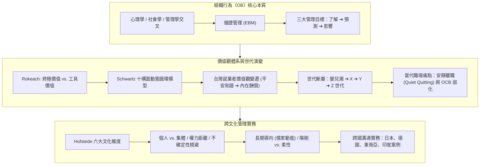
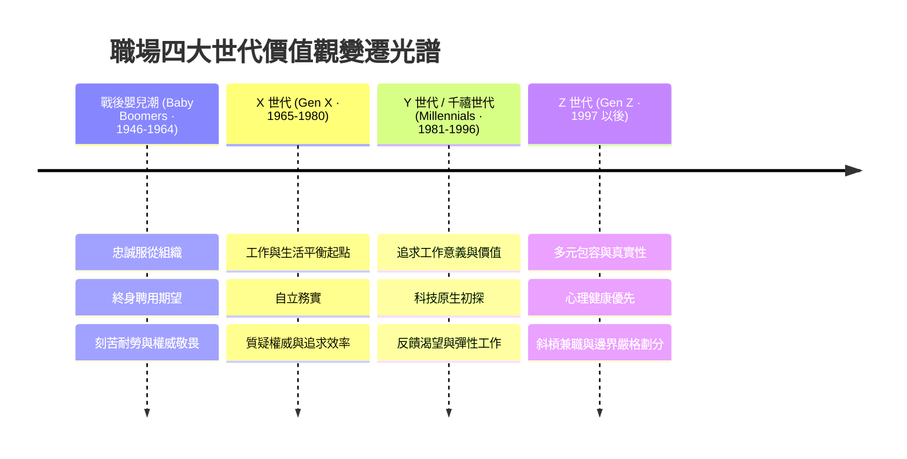

---
{"dg-publish":true,"permalink":"/02/03/02/module-1/m1-1/","tags":["課程筆記","PMBA","核心必修","組織行為","循證管理","價值觀","跨文化管理","安靜離職"],"dg-note-properties":{"類別":"課程筆記","課程名稱":"[[組織行為]]","模組編號":"Module 1","模組名稱":"個體行為與心理機制","章節編號":"M1-1","主題":"組織行為導論與跨文化價值觀 (Introduction to OB & Cross-Cultural Values)","對應週次":"Week 1 & 2 (2026-10-04)","狀態":"🟢 已完成","tags":["課程筆記","PMBA","核心必修","組織行為","循證管理","價值觀","跨文化管理","安靜離職"],"aliases":["M1-1 組織行為導論與跨文化價值觀","組織行為導論與跨文化價值觀"]}}
---

# 📚 M1-1 組織行為導論與跨文化價值觀

> **授課教師**：臺大工商管理學系暨商學研究所 戚樹誠 教授  
> **課程脈絡**：[[02_核心必修/03_組織行為/_組織行為 MOC\|組織行為 MOC]] ➔ **Module 1 個體行為與心理機制** ➔ M1-1  
> **核心概念對接**：[[98_商業概念庫/organizational-behavior_組織行為\|組織行為本質]] · [[98_商業概念庫/Terminal_and_Instrumental_Values_終極與工具性價值觀\|終極與工具價值觀]] · [[98_商業概念庫/Schwartz_Value_Theory_施瓦茨價值觀十構面模型\|Schwartz 價值觀體系]] · [[98_商業概念庫/Hofstede_Cultural_Dimensions_霍夫斯泰德文化六維度\|Hofstede 文化六維度]] · [[98_商業概念庫/Quiet_Quitting_安靜離職與組織公民行為\|安靜離職與 OCB]]

---

## 🎯 本章學習目標與核心架構

---

## 一、 組織行為學（OB）的本質與管理目標

### 1. 什麼是組織行為學？
- **學科定義**：組織行為學（Organizational Behavior, OB）是系統性研究**個體（Individual）**、**群體（Group）**以及**組織結構（Structure）**對組織內部行為之影響的科學，其宗旨在於運用相關知識提升組織有效性（Organizational Effectiveness）。
- **學門基石**：
  - **心理學（Psychology）**：微觀視角，聚焦於學習、激勵、性格、知覺、情緒、態度與決策。
  - **社會學與社會心理學（Sociology & Social Psychology）**：中觀視角，聚焦於群體動力、溝通網絡、權力政治、衝突協商與團隊行為。
  - **人類學（Anthropology）**：宏觀視角，聚焦於組織文化、組織環境與跨文化價值體系比較。

### 2. 從直覺管理走向「循證管理」（Evidence-Based Management, EBM）
- 戚樹誠教授強調，直覺（Intuition）與個人經驗往往受限於「可得性捷思（Availability Heuristic）」與主觀偏誤。
- **循證管理的核心精神**：經理人做決策時，應系統性結合以下四項證據：
  1. **最佳科學實證研究**（Rigorous Scientific Evidence）
  2. **組織內部客觀數據與指標**（Organizational Facts & Metrics）
  3. **專業經理人沉澱之實踐經驗**（Practitioner Expertise）
  4. **關鍵利害關係人之價值與倫理關懷**（Stakeholder Values & Ethics）

### 3. OB 的三大管理目的
1. **了解（Understand）**：客觀解讀員工為何產生特定行為（如離職、消極怠工、組織公民行為），探究深層心理驅動機制。
2. **預測（Predict）**：依據性格特質、工作價值觀與情境線索，預先研判員工未來的績效表現、承諾度與適應力。
3. **影響與引導（Influence）**：透過激勵機制設計、文化塑造、溝通技巧與領導賦能，促進行為改變，實現組織目標。

### 4. 理論模型的「邊界條件」（Boundary Conditions）
- 課堂核心警語：**管理學沒有放諸四海皆準的萬靈丹（No Silver Bullet）**。
- 任何管理理論都具備其適用的邊界條件（如文化背景、組織規模、產業特性、員工成熟度）。
- **主位觀點（Emic）vs. 客位觀點（Etic）**：
  - **客位觀點（Etic）**：普同性假說，探討跨文化共通的人性法則（如大五人格特質之基本構面）。
  - **主位觀點（Emic）**：本土特殊性，探討特定文化脈絡下的獨特現象（如華人社會的「關係（Guanxi）」、「人情面子」與「差序格局」）。

---

## 二、 價值觀體系與工作價值觀分析

### 1. 價值觀（Values）的本質
- **定義**：個體對於何種行為模式或存在狀態在個人或社會層面更為可取、更有價值的持久信念體系。
- 價值系統（Value System）：個人依據相對重要性將價值觀排列形成的階層化優先次序，是經理人重大抉擇與道德判斷的內在指南針。

### 2. Rokeach 價值觀調查架構（RVS）
密西根州立大學教授 Milton Rokeach 將價值觀清晰劃分為兩大維度：

| 價值觀類型 | 定義與意涵 | 典型範例 | 經理人管理意涵 |
| :--- | :--- | :--- | :--- |
| **[[Terminal_and_Instrumental_Values_終極與工具性價值觀#終極價值觀（Terminal Values）|終極價值觀 (Terminal Values)]]** | 個體期望窮盡一生達成的**終極存在目標與理想境界**。 | • 自由獨立 • 家庭安全 • 自尊與成就感 • 世界和平與真誠和諧 | 決定員工長期的職涯願景、生命追求與組織使命認同。 |
| **[[Terminal_and_Instrumental_Values_終極與工具性價值觀#工具性價值觀（Instrumental Values）|工具性價值觀 (Instrumental Values)]]** | 達成終極目標過程中所偏好的**行為模式、手段與道德準則**。 | • 誠實正直 • 負責任與自律 • 勇於開拓與進取 • 寬容有禮 | 決定員工日常行為規範、團隊合作默契與合規守信標準。 |

### 3. Schwartz 價值觀十構面動態圓環模型
Shalom Schwartz 提出的跨文化價值觀結構，將十種基本價值觀排列於二維四向度的連續圓環中：
1. **對變革開放度（Openness to Change）**：自主（Self-Direction）、刺激（Stimulation）。
2. **維持現狀（Conservation）**：順從（Conformity）、傳統（Tradition）、安全（Security）。
3. **自我超越（Self-Transcendence）**：博愛普濟（Universalism）、仁慈和睦（Benevolence）。
4. **自我增強（Self-Enhancement）**：權力支配（Power）、成就成就（Achievement）、享樂（Hedonism，介於開放與增強之間）。
- **圓環動力學**：相鄰價值觀彼此相容相輔（如自主與刺激）；對角相對價值觀呈現內在衝突與取捨（如維持現狀 vs. 對變革開放度；自我超越 vs. 自我增強）。

### 4. 台灣就業者工作價值觀變遷實證
- 戚樹誠教授回顧台灣 1990 年代以來的代表性縱貫研究：
  - **價值觀排序**：**平安和諧 > 內在酬償（成就感、自主性） > 外在酬償（薪資、升遷） > 社會與集體利益**。
  - **手段排序**：**能力與理智 > 謙和寬容 > 尊重傳統**。
- **管理啟示**：台灣員工表面上追求人際和諧與平安穩定，但對工作內在成就與專業自主具備極高渴求；高壓威權或純金錢誘因無法長久激發承諾。

---

## 三、 世代價值觀變遷與「安靜離職」（Quiet Quitting）剖析

### 1. 職場四大世代價值觀光譜

### 2. 當代焦點議題：[[Quiet_Quitting_安靜離職與組織公民行為|安靜離職（Quiet Quitting）]] 的深層心理機制
- **課堂定義**：員工並非真正遞交辭呈，而是心理層面「按章工作（Working to Rule）」——僅完成職務說明書（Job Description）最低底線要求，拒絕無償加班、拒絕情感投入、拒絕主動承擔額外專案。
- **與[[Quiet_Quitting_安靜離職與組織公民行為#組織公民行為（OCB）的消退|組織公民行為（Organizational Citizenship Behavior, OCB）]]的直接對立**：
  - OCB 代表自發性、非正式考核要求、但有利於組織運作的利他與奉獻行為（如指導新進同仁、主動補位、下班後協助緊急危機）。
  - 安靜離職本質上是 **OCB 的全面消退**。
- **結構性成因剖析（戚樹誠教授課堂深度洞察）**：
  1. **總經與資產結構失衡**：資產通膨與極端高房價，導致年輕世代產生「無論如何拚命工作也無法在都市成家置產」的習得性無助感。傳統「苦幹 ➔ 買房 ➔ 晉升」的社會階梯斷裂，工作成就動機被結構性解構。
  2. **心理契約（Psychological Contract）破裂**：過去員工願意投入額外 OCB，是基於組織會給予長期職業安全與照顧的默契；當大企業頻繁裁員、組織績效至上，員工轉向建立嚴格的「交易型心理契約」。
  3. **健康與個人界線覺醒**：疫情後遠距辦公打破生活與工作界線，引發嚴重工作倦怠（Burnout），新世代選擇以物理和心理上的「工作退行」保護自身心理健康。

---

## 四、 跨文化差異與跨國管理實務：Hofstede 六維度模型

### 1. 文化定義：心智的集體程式設計（Collective Programming of the Mind）
- 荷蘭學者 Geert Hofstede 指出，文化不是個人特徵，而是在同一社會環境中長大的人們所共有的心智運作系統。全球化並未抹平文化差異，跨國企業經理人若忽視文化維度，必然導致決策癱瘓與管理衝突。

### 2. Hofstede 文化六大維度全景解析

| 文化維度 (Dimension) | 核心概念與兩極光譜 | 台灣常模定位與特徵 | 課堂實證案例與管理因應 |
| :--- | :--- | :--- | :--- |
| **[[Hofstede_Cultural_Dimensions_霍夫斯泰德文化六維度#1-個人主義-vs-集體主義-individualism-vs-collectivism|個人主義 vs. 集體主義]] (IDV)** | 社會人際連結緊密度。 • 個人主義：自我實現、個人權利。 • 集體主義：群體和諧、內外群有別。 | **高集體主義（中低 IDV）** 但年輕世代受西方影響正快速向個人主義位移。 | • **處罰小孩文化差**：美國父母處罰「Grounding（禁足在家）」；華人父母處罰「趕出家門在門口反省」（群體剝奪感）。 • **防疫戴口罩**：集體主義文化視為保護大眾的利他責任；個人主義文化視為侵犯身體自由。 |
| **[[Hofstede_Cultural_Dimensions_霍夫斯泰德文化六維度#2-權力距離-power-distance-index-pdi|權力距離指數]] (PDI)** | 社會或組織弱勢成員對「權力分配不均」的接受與預期程度。 | **中等偏高 PDI** 組織層級分明，對上位者保持高度敬畏。 | • 跨國會議中，亞洲工程師往往等候主管定調後才發言；歐美工程師直呼平級、公開挑戰上級。 • 經理人需刻意建立「心理安全感」促成跨級發聲。 |
| **[[Hofstede_Cultural_Dimensions_霍夫斯泰德文化六維度#3-陽剛傾向-vs-柔性傾向-masculinity-vs-femininity|陽剛 vs. 柔性傾向]] (MAS)** | 社會主導價值觀是強調成就、果斷、競爭（陽剛），或是重視關係、生活品質與照顧弱者（柔性）。 | **中等偏柔性 MAS** 重視職場和諧氣氛、人情味與工作生活平衡。 | • 日本為極高陽剛文化（拚命工作、追求第一、工匠競爭）；北歐為極端柔性文化。 • 台灣管理實務上，嚴酷末位淘汰制常遭遇強烈文化排斥。 |
| **[[Hofstede_Cultural_Dimensions_霍夫斯泰德文化六維度#4-不確定性規避-uncertainty-avoidance-index-uai|不確定性規避指數]] (UAI)** | 對於模糊、未知與無結構情境感到威脅並藉由規則防範的程度。 | **中等偏高 UAI** 偏好明確 SOP、規章制度、證照認證。 | • 台灣製造業卓越的品質管控源自於高 UAI 的程序嚴謹性；但在 0 到 1 破壞式創新中容易因害怕風險而猶豫遲疑。 |
| **[[Hofstede_Cultural_Dimensions_霍夫斯泰德文化六維度#5-長期導向-vs-短期導向-long-term-vs-short-term-orientation|長期導向 vs. 短期導向]] (LTO)** | 社會著眼於未來報償（節儉、恆心、適應變革），或是著眼於過去與現在（尊重傳統、維持面子、短期結算）。 | **極高長期導向 LTO** （儒家動能，Michael Bond 倡議新增之維度）。 | • 儲蓄率高、重視下一代教育基金、企業傾向追求永續長青。 • 相較於美英重視當季財報 EPS，台灣家族企業更具備跨代資產配置思維。 |
| **[[Hofstede_Cultural_Dimensions_霍夫斯泰德文化六維度#6-享樂主義-vs-約束-indulgence-vs-restraint|享樂 vs. 約束]] (IVR)** | 社會規範是否允許自由滿足對享受生活、娛樂的慾望。 | **中等偏約束（Restraint）** 傳統重視克制慾望、延遲滿足。 | • 面對休假福利，員工常有休假罪惡感；跨國經理人應主動鼓勵全員落實休假。 |

### 3. 跨國商務互動文化觀察實錄（課堂案例沉澱）
- **日本商務文化**：
  - **準時的定義**：約定 14:00 開會，13:55 抵達是及格，14:00 到達已經算遲到。
  - **溝通委婉與讀空氣（KY）**：日本人回答「Hai（はい）」僅代表「我聽到了」，絕非「我同意你」；若對方表示「這件事情有點困難（ちょっと難しい）」，實質上是 100% 拒絕。
- **德國商務文化**：精準守時，公私分明，會議直奔問題核心，批評針對任務本身（Task-oriented），不視為人身攻擊。
- **東南亞（泰國、印尼）**：時間觀念具備彈性（Rubber time），商務會議不宜過早抵達給東道主施加壓力，重視人際寒暄與情面建立。
- **印度商務思維**：思維邏輯具備發散與辯證性，溝通習慣繞大圈（Jugaad 哲學），重視整體脈絡勝過線性因果。

---

## 💡 經理人管理實務反思與行動指引

1. **破除單一世代偏見**：
   - 不應以「草莓族」或「躺平族」標籤化年輕世代，應理解其背後所承受的資產階級結構性壓力。
   - 將「命令控制型管理」轉化為「透明合約型賦能」，工作指派需清楚交代「Why（價值意義）」而不只是「What」。
2. **重塑組織公民行為（OCB）的激勵回路**：
   - 明確劃分基本職責與 OCB 範疇；對願意多承擔、協助團隊的成員，給予即時、公開且實質的認可與反饋，避免將利他行為視為理所當然。
3. **建立全球化團隊的「文化智商（CQ）」**：
   - 跨國外派與跨文化團隊協作時，先進行團隊文化維度盤點，避免將母國文化管理手段強行移植至異地子公司。

---

## 🔗 模組導航與延伸閱讀

- ⬅️ **前置模組總覽**：[[_組織行為 MOC|組織行為 MOC 全景地圖]]
- ➡️ **下一章節**：[[M1-2_商業倫理決策與性格特質模型|M1-2 商業倫理決策與性格特質模型]]
- 💎 **本章關聯概念卡片**：
  - [[organizational-behavior_組織行為]]
  - [[Terminal_and_Instrumental_Values_終極與工具性價值觀]]
  - [[Schwartz_Value_Theory_施瓦茨價值觀十構面模型]]
  - [[Hofstede_Cultural_Dimensions_霍夫斯泰德文化六維度]]
  - [[Quiet_Quitting_安靜離職與組織公民行為]]