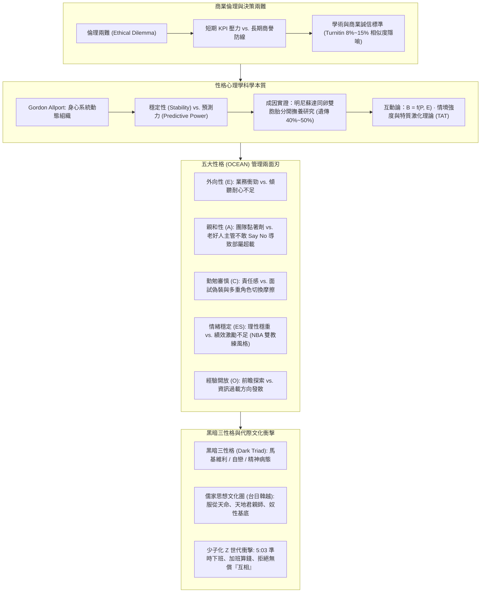

---
{"dg-publish":true,"permalink":"/02/03/02/module-1/m1-2/","tags":["課程筆記","PMBA","核心必修","組織行為","商業倫理","大五人格","MBTI","黑暗三性格","特質激化理論","儒家文化","Z世代","性格可塑性"],"dg-note-properties":{"類別":"課程筆記","課程名稱":"[[組織行為]]","模組編號":"Module 1","模組名稱":"個體行為與心理機制","章節編號":"M1-2","主題":"商業倫理決策與性格特質模型 (Business Ethics & Personality Frameworks)","對應週次":"2026-11-07 課堂 (融合 10-04 與 11-07 全域重構)","狀態":"🟢 已完成","tags":["課程筆記","PMBA","核心必修","組織行為","商業倫理","大五人格","MBTI","黑暗三性格","特質激化理論","儒家文化","Z世代","性格可塑性"],"aliases":["M1-2 商業倫理決策與性格特質模型","商業倫理決策與性格特質模型"]}}
---


# 🧠 M1-2 商業倫理決策與性格特質模型：五大特質兩面刃、黑暗三性格防線與世代文化衝擊

> [!abstract] 導讀與對接
> - **上級地圖**：[[02_核心必修/03_組織行為/_組織行為 MOC\|組織行為 MOC]] ➔ **Module 1 個體行為與心理機制** ➔ M1-2
> - **進度看板**：[[05_AI選修/10_AiX/00_課程導航與進度/progress_📊 課程與筆記進度追蹤\|課程與筆記進度追蹤看板]]
> - **核心概念對接**：[[98_商業概念庫/Big_Five_Personality_Traits_大五人格特質模型\|大五人格 (Big Five)]] · [[98_商業概念庫/MBTI_Personality_Framework_邁爾斯布里格斯性格類型\|MBTI 十六型人格]] · [[98_商業概念庫/Dark_Triad_黑暗三性格模型\|黑暗三性格 (Dark Triad)]] · [[98_商業概念庫/Trait_Activation_Theory_特質激化理論\|特質激化理論]] · [[98_商業概念庫/Personality_Plasticity_性格可塑性與高階職涯跨越\|性格可塑性與高階職涯跨越]]
> - **本章脈絡**：本篇筆記全面融合 10-04 與 11-07 兩次課堂精華，堅決破除「拼貼補丁」，將商業倫理兩難、性格心理學本質、大五人格管理兩刃性、黑暗三性格識別防線，以及**「儒家絕對服從文化」與「少子化 Z 世代拒絕無償互相」**之辦公室代際衝突融鑄為一體。

---

## 🧭 本章學習目標與核心架構圖 (Mindmap)



---

## 一、 商業倫理與決策兩難（Ethical Dilemma）

### 1. 倫理兩難的本質
- **定義**：當經理人面臨兩種或多種互相衝突的道德規範或價值追求，且任何一種選擇都必然伴隨某種程度的道德妥協或利益損害時的決策困境。
- **商業實務中的典型兩難**：
  - **短期利益 vs. 長期誠信**：為了達成當季季報 KPI 掩蓋潛在品質缺陷，或是如實揭露承擔股價震盪？
  - **組織忠誠 vs. 公共利益**：面對企業內部的舞弊行為，選擇包庇維持團隊和諧，或是擔任吹哨者（Whistleblower）？

### 2. 學術倫理與實務比對標準的啟示
- 戚樹誠教授在課堂中特別提醒 PMBA 同學學術誠信的底線：
  - 台大學術倫理委員會對論文相似度（Turnitin）之嚴格規範，一般比對門檻訂在 **8% ~ 15%** 之間。
  - **管理學隱喻**：誠信與倫理如同企業的合規安全氣囊；在日常運營中看似增加摩擦成本，但在關鍵危機時刻，卻是決定企業能否免於毀滅性打擊的唯一屏障。

---

## 二、 性格心理學核心：穩定性與預測力

### 1. 什麼是性格（Personality）？
- **Gordon Allport 的經典定義**：性格是個體內部身心系統的動態組織（Dynamic Organization），決定了該個體對環境適應時特有的行為模式、思維架構與人際風格。
- 課堂教授生動詮釋：「性格是你大腦神經網絡經過先天遺傳與後天累積，對外在刺激產生的最直覺、最反射性的反應習慣。」

### 2. 為什麼企業管理必須深入研究性格？
性格具備現代管理學極為看重的兩大科學價值：
1. **穩定性（Stability）**：成年後的性格特質具備跨時間與跨情境的持久一致性。個體不會在短時間內因單純口頭告誡而徹底改變其天生氣質。
2. **預測力（Predictive Power）**：具備高信效度的性格評測工具，能高度顯著預測員工的**工作績效（Job Performance）**、**離職傾向（Turnover Intention）**、**壓力耐受力（Stress Tolerance）**以及**團隊協作風格**。

### 3. 性格的成因：先天基因 vs. 後天學習
- **明尼蘇達雙胞胎分開撫養研究（Minnesota Twin Study）**：追蹤同卵雙胞胎自出生即被不同家庭領養、在完全相異的社會環境中成長之案例。
- **研究結論**：基因遺傳對成年性格特質的決定程度約佔 **40% ~ 50%**，其餘由後天生活經歷、家庭教養、重大創傷與職場環境所形塑。性格既有深厚的先天生物學基石（「出廠設定」），同時也保留了顯著的後天適應與演變空間。

---

## 三、 情境強度與特質激化理論（Trait Activation Theory）

### 1. 互動論觀點（Interactionist Perspective）
- 著名公式：$$B = f(P, E)$$（行為 Behavior 是人 Personality 與環境 Environment 相互作用的函數）。

### 2. 情境強度理論（Situation Strength Theory）
情境強度決定了性格特質對行為的影響力大小：
- **強情境（Strong Situation）**：具備明確嚴謹的 SOP、嚴密監控與強烈處罰機制（如軍隊操演、台積電晶圓代工無塵室生產線）。情境壓力迫使所有個體展現高度一致的合規行為，**性格特質被高度壓抑**。
- **弱情境（Weak Situation）**：規範模糊、自主裁量權高、無既定標準答案（如新創探索業務、策略規劃會議、藝術創作）。個體行為主要取決於其內在特質，**性格差異充分顯現**。

### 3. 特質激化理論（Trait Activation Theory, TAT）
- 由 Tett & Burnett 提出，強調情境並非只是籠統的「強或弱」，而是組織環境中存在特定的「**情境線索（Contextual Cues）**」。
- 當組織情境出現符合特定特質的線索時，會主動「激化（Activate）」員工隱藏的性格特質。

---

## 四、 五大性格特質（Big Five OCEAN）的管理兩面刃（11/07 課堂旗艦深化）

相較於 MBTI 的二分法分類，學術界公認最嚴謹、具備跨文化預測效度的是 **Big Five 五大性格模型**。課堂教授帶領學員深入剖析五大維度在管理實戰中的「利與弊」，徹底破除「某種性格絕對最優」的迷思：

| 特質維度 | 典型高分行為特徵 | 管理優勢 (Pros) | 管理隱患與潛在盲點 (Cons) | 經理人實戰配置啟示 |
| :--- | :--- | :--- | :--- | :--- |
| **外向性<br>(Extraversion)** | 熱情、社交活躍、善於言談、主導欲強。 | 擅長陌生破冰、業務開拓、展會公關，迅速建立人際網絡。 | 傾聽耐心不足，容易搶話；辦公室坐不住，行政細節耐受度低。 | 適合商務拓展、公關發言人；需搭配嚴謹細膩之內向型幕僚。 |
| **親和性<br>(Agreeableness)** | 善解人意、信任他人、追求和諧、富有同理心。 | 團隊衝突潤滑劑，易贏得跨部門信任，營造溫暖團隊氛圍。 | **「好人主管陷阱」**：不敢拒絕高層無理要求，致使下屬工作嚴重超載；難以推動爭議性變革。 | 適合客戶滿意、人力資源；高階變革領導者若親和性過高需刻意建立原則防線。 |
| **勤勉審慎性<br>(Conscientiousness)** | 條理分明、高度自律、責任心強、追求卓越。 | 工作績效最強預測指標；交付準時、品質嚴密、值得託付。 | 面試易偽裝（裝出負責任）；完美主義導致決策遲緩；多重角色切換時心理摩擦巨大。 | 核心營運與專案管理不可或缺；需防範員工過度內耗與工作倦怠。 |
| **情緒穩定性<br>(Emotional Stability)** | 冷靜、不易焦慮、抗壓性強、情緒起伏小。 | 危機時刻定海神針，不遷怒員工，不亂發脾氣摔東西。 | **激勵盲點**：表現過於平淡，可能缺乏感染力；部分績效爆發往往需要適度情緒張力（如 NBA 激勵教練）。 | 關鍵決策崗位必備；面對平淡型主管需主動建立即時反饋機制。 |
| **經驗開放性<br>(Openness to Exp)** | 好奇心強、富想像力、樂於擁抱新事物、跨界學習。 | 敏銳洞察新技術（如 AI 工具鏈）、勇於突破既有典範與商模。 | 容易被新奇事物吸引而發散方向，缺乏落地執行耐心；易資訊超載。 | 適合前瞻研發、策略創新部；需由高勤勉性成員協助閉環落地。 |

> 💡 **NBA 教練激勵風格案例**：情緒穩定的教練（「你可以的，慢慢來」）固然讓球員放鬆，但在比分落後的生死關頭，往往是具備強烈情緒爆發力、咆哮摔戰術板的強勢教練更能激發球員腎上腺素與求勝飢渴感。高階領導者必須因應情境靈活切換情緒展示。

---

## 五、 黑暗三性格（Dark Triad）與防禦性選才

課堂中特別針對組織內部潛藏的「破壞性人格」展開剖析。黑暗三性格（Dark Triad）由 Paulhus & Williams 提出，包含三種具備次臨床特徵的負面特質：

```
                    ┌───────────────────────────────┐
                    │      黑暗三性格 (Dark Triad)   │
                    └───────────────┬───────────────┘
                                    │
        ┌───────────────────────────┼───────────────────────────┐
        ▼                           ▼                           ▼
┌───────────────┐           ┌───────────────┐           ┌───────────────┐
│ 馬基維利主義  │           │   自戀傾向    │           │   精神病態    │
│(Machiavellian)│           │ (Narcissism)  │           │ (Psychopathy) │
├───────────────┤           ├───────────────┤           ├───────────────┤
│• 不擇手段成大事│           │• 權威自我膨脹 │           │• 缺乏同理心   │
│• 冷酷計算人際 │           │• 渴望被極致崇拜│           │• 衝動、無視規則│
│• 善於操縱他人 │           │• 聽不進任何批評│           │• 追求刺激冷酷無情│
└───────────────┘           └───────────────┘           └───────────────┘
```

1. **馬基維利主義（Machiavellianism）**：信奉「目的證明手段合理（The ends justify the means）」。擅長在組織政治中站隊、操縱資訊差、在關鍵利益關頭果斷背叛同儕以換取個人晉升。
2. **自戀傾向（Narcissism）**：極度自我中心與宏大自尊（Grandiosity）。在面試中往往表現得極具領袖魅力與願景感，但在實務管理中無法容忍任何質疑，容易將團隊功勞據為己有、將錯誤甩鍋下屬。
3. **精神病態（Psychopathy）**：顯著缺乏同理心與罪惡感，冷血且具高風險偏好。在金融交易或短期激進併購中可能創造驚人數字，但長期必然引發組織文化崩解與合規災難。
- **經理人選才防禦**：此類求職者極擅長利用**「社會期許效應（Social Desirability）」**偽裝答題；企業必須導入行為事件訪談法（BEI）、360 度背調（Reference Check）與壓力測試方能識破偽裝。

---

## 六、 世代價值觀斷層：儒家服從文化 vs. 少子化 Z 世代衝擊

課堂教授從宏觀社會文化視角，點出當前台灣職場最劇烈的文化斷層與管理摩擦：

### 1. 華人思想文化圈的底層程式碼：儒家思想與「服從」
- 台灣、中國、日本、韓國、越南同屬東亞儒家文化圈，其深層核心價值觀為**「天地君親師」與「階層序位」**。
- **管理學雙刃劍**：
  - 正面：高度的紀律性、尊師重道、吃苦耐勞與極致服從，造就了台灣在半導體製造與代工供應鏈無可匹敵的執行力與「隨傳隨到」的配合度；
  - 負面：過度強調服從演化為職場「奴性」文化，員工不敢挑戰權威、壓抑真實想法、慣性無償加班「互相」。

### 2. 少子化 Z 世代帶來的辦公室革命
- **「互相」文化的終結**：
  - 傳統思維：主管 5:00 交代「大家辛苦了，今天這件事留下來大家互相幫忙一下」，老員工默默留下來無償加班。
  - Z 世代思維：指著時鐘直球對決——**「老闆，現在 5:03，留下來算加班費嗎？沒有算加班費就沒有互相。」**包包拿了立刻下班。
- **少子化底氣**：在少子化浪潮下，就業市場結構性缺工，年輕員工深知「這家公司不要我，外面多得是缺人的公司」，傳統以威權、情懷或道德綁架留人的管理手段徹底失效。
- **經理人領導調適**：高階主管必須戒除「把下屬當家庭成員互相情勒」的家長式思維，轉向**「權責分明、績效合約透明、加班依法給付、尊重個人邊界」**的現代人本管理契約。

---

## 🔗 相關筆記與關聯地圖

- 上層模組 MOC：[[02_核心必修/03_組織行為/_組織行為 MOC\|_組織行為 MOC]]
- 前置模組主筆記：[[02_核心必修/03_組織行為/02_模組筆記/Module_1_個體行為與心理機制/M1-1_組織行為導論與跨文化價值觀\|M1-1_組織行為導論與跨文化價值觀]]
- 後續模組主筆記：[[02_核心必修/03_組織行為/02_模組筆記/Module_1_個體行為與心理機制/M1-3_情緒勞動情感事件與職場壓力管理\|M1-3 情緒勞動情感事件與職場壓力管理]] · [[02_核心必修/03_組織行為/02_模組筆記/Module_1_個體行為與心理機制/M1-4_管理決策偏誤有限理性與卡特賽車實證\|M1-4 管理決策偏誤有限理性與卡特賽車實證]]
- 核心概念原子卡片：
  - [[98_商業概念庫/Big_Five_Personality_Traits_大五人格特質模型\|Big_Five_Personality_Traits_大五人格特質模型]] · [[98_商業概念庫/MBTI_Personality_Framework_邁爾斯布里格斯性格類型\|MBTI_Personality_Framework_邁爾斯布里格斯性格類型]]
  - [[98_商業概念庫/Dark_Triad_黑暗三性格模型\|Dark_Triad_黑暗三性格模型]] · [[98_商業概念庫/Trait_Activation_Theory_特質激化理論\|Trait_Activation_Theory_特質激化理論]] · [[98_商業概念庫/Personality_Plasticity_性格可塑性與高階職涯跨越\|Personality_Plasticity_性格可塑性與高階職涯跨越]]
