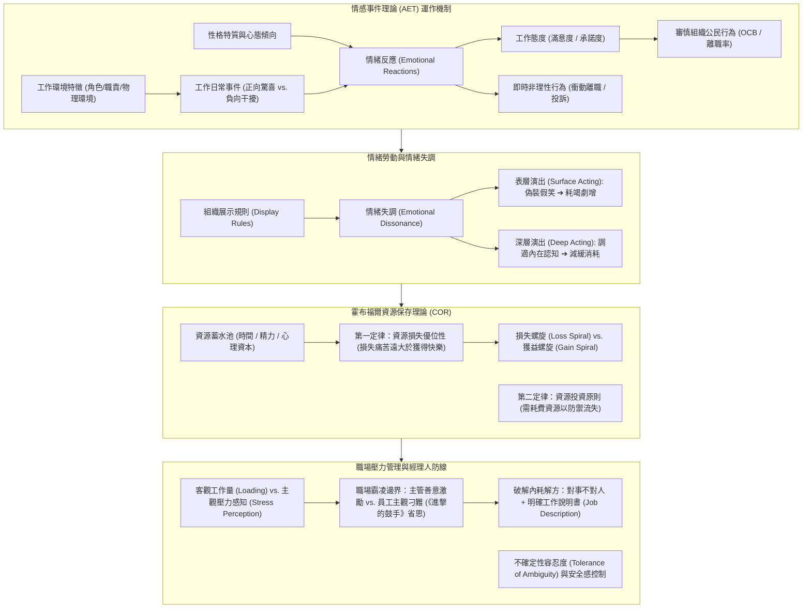
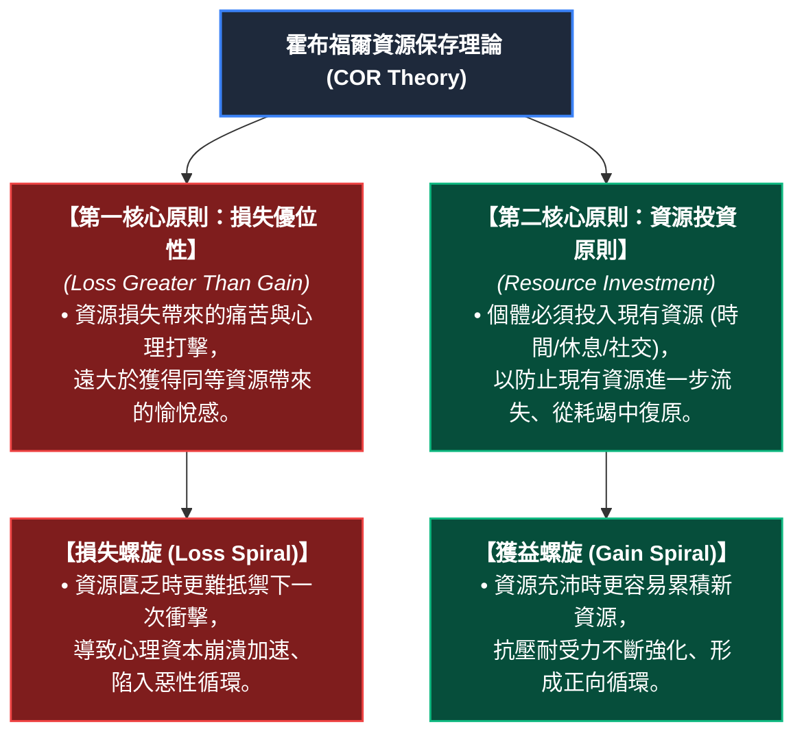

---
{"dg-publish":true,"permalink":"/02/03/02/module-1/m1-3/","tags":["課程筆記","PMBA","核心必修","組織行為","情緒勞動","情緒失調","情感事件理論","資源保存理論","職場壓力","職場霸凌","不確定性容忍度"],"dg-note-properties":{"類別":"課程筆記","課程名稱":"[[組織行為]]","模組編號":"Module 1","模組名稱":"個體行為與心理機制","章節編號":"M1-3","主題":"情緒勞動情感事件與職場壓力管理 (Emotional Labor, Affective Events & Stress Management)","對應週次":"2026-11-07 課堂","狀態":"🟢 已完成","tags":["課程筆記","PMBA","核心必修","組織行為","情緒勞動","情緒失調","情感事件理論","資源保存理論","職場壓力","職場霸凌","不確定性容忍度"],"aliases":["M1-3 情緒勞動情感事件與職場壓力管理","情緒勞動情感事件與職場壓力管理"]}}
---

# 🎭 M1-3 情緒勞動情感事件與職場壓力管理：AET 動態傳導、資源保存理論 (COR) 與經理人防禦防線

> [!abstract] 導讀與對接
> - **上級地圖**：[[02_核心必修/03_組織行為/_組織行為 MOC\|組織行為 MOC]] ➔ **Module 1 個體行為與心理機制** ➔ M1-3
> - **進度看板**：[[05_AI選修/10_AiX/00_課程導航與進度/progress_📊 課程與筆記進度追蹤\|課程與筆記進度追蹤看板]]
> - **核心概念對接**：[[98_商業概念庫/AET_Affective_Events_Theory_情感事件理論\|情感事件理論 (AET)]] · [[98_商業概念庫/Emotional_Dissonance_情緒失調與情緒勞動\|情緒失調與情緒勞動]] · [[98_商業概念庫/COR_Theory_資源保存理論\|資源保存理論 (COR)]] · [[98_商業概念庫/Tolerance_of_Ambiguity_不確定性容忍度與控制感\|不確定性容忍度]]
> - **本章脈絡**：本篇筆記全面提煉 2026-11-07 下午第一堂（PM1）課堂精華。個體在組織中的行為不僅取決於靜態性格，更時時刻刻受到工作環境事件觸發之情緒波動與壓力消耗所支配。本篇完整建構：情感事件理論（AET）之事件-情緒-行為傳導鏈、情緒失調與表層/深層演出代價、不確定性容忍度與控制感陷阱、霍布福爾（Hobfoll）資源保存理論（COR）之心理蓄水池模型，以及職場霸凌爭議中經理人「對事不對人、落實工作說明書」的實務防線。

---

## 🧭 本章學習目標與核心架構圖 (Mindmap)

---

## 一、 情感事件理論（Affective Events Theory, AET）

傳統管理學往往假設員工是冷靜理性的「經濟人」，忽視了情緒在組織日常生活中的動態主導地位。Weiss & Cropanzano（1996）提出之**情感事件理論（AET）**，揭示了微觀工作事件如何引爆情緒連鎖反應：

### 1. AET 核心因果傳導路徑
1. **工作環境特徵 (Work Environment Features)**：包含工作要求、自主裁量權、物理工作環境、組織文化等結構性要素。
2. **日常工作事件 (Work Events)**：環境中每天發生的微觀事件（如投影機突然故障少了一個畫面、被主管在走廊無心批評一句、客戶突如其來的感謝信）。
3. **情緒反應 (Emotional Reactions)**：事件並非直接決定行為，而是先引發**正向或負向的情緒震盪**。個人的**性格特質（如情緒穩定性、神經質、樂觀度）**在此扮演關鍵調節變數（Moderator）。
4. **雙軌行為輸出**：
   - **情緒驅動型行為（Affect-driven Behaviors）**：未經深思熟慮的即時衝動反應（如當場拍桌翻臉、怒摔電話、當天提離職）；
   - **判斷驅動型行為（Judgment-driven Behaviors）**：情緒沉澱後轉化為長期的「工作態度（如組織承諾度、工作滿意度）」，進而影響組織公民行為（OCB）或離職決策。

### 2. 課堂實證觀察：自知之明與先見之明
- 課堂教授以自身為例深刻分享：
  - 「我承認我會有起床氣，早晨剛醒處於情緒低谷，這段時間我絕不排定 Office Hour 與學生面談，因為我知道那時開口容易缺乏耐心、承諾過度或口出重話。」
  - **經理人心法**：人必須先有「自知之明」（深刻感知自己的情緒節律與容量限制），才能擁有「先見之明」（預先規劃工作時段、設立情緒防火牆），避免在狀態不佳時做出讓自己後悔的破壞性決定。

---

## 二、 情緒失調（Emotional Dissonance）與情緒勞動

在現代知識經濟與服務業中，員工付出的不僅是體力與腦力，更是龐大的**情緒勞動（Emotional Labor，由 Arlie Hochschild 提出）**。

### 1. 情緒失調的本質
- **定義**：組織要求的「外在展示規則（Display Rules）」（如微笑、冷靜、熱情）與員工內心「真實感受（Felt Emotions）」之間的嚴重脫節與撕裂。
- **典型場景**：
  - 社工人員或醫護人員面對悲痛慘劇，內心極度悲傷卻必須在公眾面前維持專業冷靜；
  - 航空空服員或客服專員面對奧客惡意辱罵，內心憤怒卻必須維持 45 度鞠躬微笑；
  - 教授課堂突聞家中重大變故，卻必須鎮定自若握著麥克風講滿 3 小時。

### 2. 表層演出 vs. 深層演出
- **表層演出（Surface Acting）**：單純「裝出來的假笑」。內心情感未變，僅靠臉部肌肉與肢體語言勉強合規。實證顯示，長期表層演出是引發**工作倦怠（Burnout）、人格解體與慢性憂鬱**的最強殺手。
- **深層演出（Deep Acting）**：主動重構認知（Cognitive Appraisal）。透過同理心與心態重塑，試圖真正調適自己的內心感受（如將奧客想像為生活受挫的病人），讓外在表現與內在感受趨於一致，大幅降低情緒內耗。

---

## 三、 職場不確定性容忍度（Tolerance of Ambiguity）與控制感

### 1. 對不確定性的心理耐受差異
- 課堂教授指出，人天生具備抗拒不確定性、追求秩序的強烈慣性。但每個人對於「不確定性」的心理容忍閾值截然不同：
  - **低容忍度者**：需要所有細節清清楚楚、非黑即白。面對模糊任務會陷入高度焦慮，不斷向主管確認細節（「老師你會不會出四題？會不會考簡答？」）。
  - **高容忍度者**：能與模糊共存，具備探險精神，在缺乏明確指示下仍能自主探索向前。

### 2. 控制感的心理陷阱與主管偏見
- **安全感錨定**：教授分享自己長年開車往返新竹與嘉義中正大學，明知沿途定速且路況極熟，卻依然習慣全程開啟導航與測速警報。「這是一種對掌握感的心理依賴，所有的儀表都在掌控之中才能帶來內心平靜。」
- **主管的認知偏見**：高階經理人往往容易產生「特徵投射偏誤」，誤以為下屬反覆確認細節是「能力不足或智商不夠」，實則是下屬缺乏安全感與不確定性容忍度較低。主管應提供清晰的任務里程碑以化解其心理恐慌。

---

## 四、 霍布福爾資源保存理論（COR Theory）與壓力管理

面對職場日益沉重的壓力，美國心理學家 Stevan Hobfoll 提出之**資源保存理論（Conservation of Resources Theory, COR）**，是當代壓力與倦怠研究的權威理論基石。

### 1. 資源蓄水池模型與主客觀分離
- **資源定義**：包括客觀物件資源（金錢、工具）、條件資源（職位、婚姻穩定）、個人特質資源（自尊、樂觀、抗壓力）與能量資源（時間、精力、知識）。
- **客觀工作量 vs. 主觀壓力感知**：
  - **客觀工作量（Loading）**：可以透過工時、專案數量進行客觀測量；
  - **主觀壓力（Stress Perception）**：取決於個體內部資源蓄水池的大小與消耗速率。同樣的工作量，資源充沛者視為挑戰，蓄水池見底者視為滅頂之災。

### 2. 延遲滿足能力與先天/後天養成
- **史丹佛棉花糖實驗（Marshmallow Test）**：幼兒面對立即吃掉一顆或等待 15 分鐘獲得兩顆棉花糖的抉擇。
- **課堂深度辯證**：
  - 抗壓力與自律既有先天遺傳成分（衝動抑制的神經機制），亦受後天經驗形塑；
  - 當後天經歷告訴個體「等待確實能帶來超額成果」時，個體會主動擴充其心理資源庫，提升抗壓耐受度。

---

## 五、 職場霸凌爭議與經理人防禦防線

課堂中學員與教授針對「部屬主觀宣稱工作壓力過大、指控主管職場霸凌」的實務痛點展開了熱烈探討：

### 1. 主觀解讀與邊界模糊的困局
- 主管自認為是「恨鐵不成鋼的善意鍛鍊與手把手教導（Coaching）」，但在抗壓閾值低或蓄水池見底的員工眼中，極易被解讀為「故意刁難、穿小鞋甚至職場霸凌」。
- 教授引用經典電影《進擊的鼓手》（*Whiplash*）中交響樂團魔鬼指揮對鼓手的極限羞辱與施壓：「在追求極致卓越與心理虐待之間，往往只有一線之隔。」

### 2. 破解內耗的唯一鐵律：落實「對事不對人」與工作說明書
面對潛在的霸凌指控與組織內耗，經理人自我保護與公平治理的關鍵武器：
1. **確立「對事不對人」原則**：拒絕在人際關係中選邊站或進行人格評價。
2. **拿客觀的工作說明書（Job Description, JD）講話**：
   - 當員工抱怨工作過載時，主管應請其將當前所有任務與時間分配完全列出，逐條比對招聘時簽署的 JD；
   - 若任務超出 JD 且超出同儕平均水平，主動協助其分流減負；
   - 若任務皆屬 JD 範疇且客觀工作量合理，則透過績效改善計畫（PIP）或輔導對話，以客觀數據破除其受害者心態。
3. **建立第三方針對目擊者的調查機制**：一旦出現霸凌爭議，絕不能僅聽信加害者與受害者雙方片面之詞，必須全面訪談周遭同仁與第三方客觀記錄，捍衛組織體制的公信力。

---

## 🔗 相關筆記與關聯地圖

- 上層模組 MOC：[[_組織行為 MOC]]
- 前置模組主筆記：[[M1-2_商業倫理決策與性格特質模型]]
- 後續模組主筆記：[[02_模組筆記/Module_1_個體行為與心理機制/M1-4_管理決策偏誤有限理性與卡特賽車實證|M1-4 管理決策偏誤有限理性與卡特賽車實證]]
- 核心概念原子卡片：
  - [[AET_Affective_Events_Theory_情感事件理論]]
  - [[Emotional_Dissonance_情緒失調與情緒勞動]]
  - [[COR_Theory_資源保存理論]]
  - [[Tolerance_of_Ambiguity_不確定性容忍度與控制感]]
