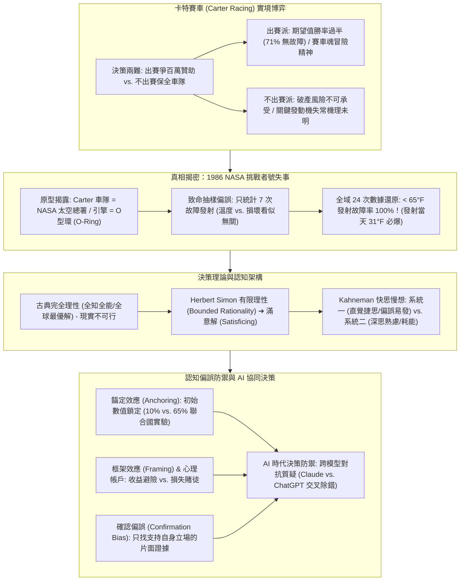
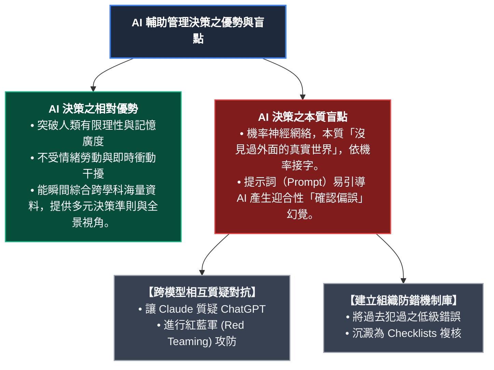

---
{"dg-publish":true,"permalink":"/02/03/02/module-1/m1-4/","tags":["課程筆記","PMBA","核心必修","組織行為","卡特賽車","挑戰者號","有限理性","滿意解","抽樣偏誤","錨定效應","框架效應","快思慢想","AI決策"],"dg-note-properties":{"類別":"課程筆記","課程名稱":"[[組織行為]]","模組編號":"Module 1","模組名稱":"個體行為與心理機制","章節編號":"M1-4","主題":"管理決策偏誤有限理性與卡特賽車實證 (Managerial Decision Biases, Bounded Rationality & Carter Racing)","對應週次":"2026-11-07 課堂","狀態":"🟢 已完成","tags":["課程筆記","PMBA","核心必修","組織行為","卡特賽車","挑戰者號","有限理性","滿意解","抽樣偏誤","錨定效應","框架效應","快思慢想","AI決策"],"aliases":["M1-4 管理決策偏誤有限理性與卡特賽車實證","管理決策偏誤有限理性與卡特賽車實證"]}}
---

# 🏎️ M1-4 管理決策偏誤有限理性與卡特賽車實證：挑戰者號歷史真相、認知捷徑與 AI 時代決策防禦

> [!abstract] 導讀與對接
> - **上級地圖**：[[02_核心必修/03_組織行為/_組織行為 MOC\|組織行為 MOC]] ➔ **Module 1 個體行為與心理機制** ➔ M1-4
> - **進度看板**：[[05_AI選修/10_AiX/00_課程導航與進度/progress_📊 課程與筆記進度追蹤\|課程與筆記進度追蹤看板]]
> - **核心概念對接**：[[98_商業概念庫/Carter_Racing_NASA_Challenger_卡特賽車與挑戰者號決策個案\|卡特賽車與挑戰者號]] · [[98_商業概念庫/Anchoring_and_Adjustment_錨定與調整效應\|錨定效應]] · [[98_商業概念庫/Framing_Effect_Mental_Accounting_框架效應與心理帳戶\|框架效應與心理帳戶]] · [[98_商業概念庫/_待改寫草稿庫/bounded-rationality_有限理性\|有限理性與滿意解]]
> - **本章脈絡**：本篇筆記全面提煉 2026-11-07 下午第二堂與第三堂（PM2 & PM3）的個案演練與決策理論精華。透過經典哈佛商業個案**「卡特賽車（Carter Racing）」**的實境沙盤推演，揭發管理決策史上最震撼的致命偏誤——**「以偏概全／遺漏未故障數據（Sampling on the Dependent Variable）」**，還原 1986 年 NASA 挑戰者號太空梭失事的歷史悲劇；系統性剖析赫伯特·西蒙（Herbert Simon）的有限理性、丹尼爾·康納曼（Daniel Kahneman）的快思慢想雙系統，深入拆解錨定、框架、確認偏誤等認知捷徑，並拓展至 AI 時代下如何運用大語言模型（LLM）進行決策偏誤交叉檢驗。

---

## 🧭 本章學習目標與核心架構圖 (Mindmap)

---

## 一、 經典個案實境：卡特賽車（Carter Racing）的生死決策

在課堂中，全班學員被分成五個小組，限時研讀個案並做出「出賽（Race）」或「棄賽（Don't Race）」的重磅商業決策：

### 1. 個案情境設定與利益攸關方衝突
- **車隊營運背景**：全美頂級專業賽車最後一場關鍵分站賽事。若出賽並擠進前五名，主要贊助商 Goodrich 將簽訂下賽季高達上百萬美元的巨額贊助合約與高額獎金；若不出賽，贊助商將解除合作，車隊面臨沉重負債與生存危機。
- **內部技術隱患**：過去 24 場比賽中，發動機發生了 7 次嚴重的墊片故障（失常比例約 29%）。若在出賽過程中發動機再次爆掉，車隊將徹底失去參賽資格並直接面臨破產清算。
- **關鍵決策角色**：
  - **John（車隊 CEO/合夥人）**：承擔車隊商業生存與財務底線壓力；
  - **Fred（技術總監）**：提出數據圖表，主張溫度與發動機故障並無明顯線性相關；
  - **Paul & Tom（首席引擎技師與工程師）**：直覺認為低溫會導致墊片硬化破裂，強烈建議在原因未完全查明前暫停出賽。

### 2. 課堂小組激烈交鋒
- **【出賽派】（約佔 3 組）論點**：
  - *期望值精算*：歷史故障率僅 29%，意味著成功率高達 71%；成功出賽有八成機率進前五名，數學期望值顯著為正。
  - *商業現實逼迫*：退出比賽等於慢性死亡，退無可退；賽車產業本質就是與風險共存，「沒有人可以不冒險就獲得勝利」。
  - *賽車魂與故事包裝*：就算最後衝線爆掉，領跑的故事性與運動家精神仍能博取贊助商同情與公關聲量。
- **【不出賽派】（約佔 2 組）論點**：
  - *破產風險不可逆*：作為理性經營者，哪怕只有 20%~30% 導致公司徹底破產清算的災難性風險，都絕對不能押上全部籌碼。
  - *關鍵原因未明*：技術團隊已指出低溫風險，在未找到確切故障機理前盲目賭博並非勇敢，而是失職。

---

## 二、 震撼真相揭密：1986 年 NASA 挑戰者號太空梭失事

小組報告結束後，教授投影片翻開震撼全場——**卡特賽車（Carter Racing）個案中的所有人物、數據與情境，完全改編自 1986 年 1 月 28 日美國 NASA 挑戰者號（Challenger Space Shuttle）失事的真實歷史事件！**

### 1. 歷史原型與角色對照
- **Carter 車隊** ➔ **美國太空總署（NASA）**；
- **發動機墊片故障** ➔ **固態火箭助推器（SRB）之 O 型橡膠環（O-Ring）失效**；
- **Goodrich 百萬贊助與電視轉播** ➔ **國會撥款預算審查、雷根總統國情咨文連線與全美首位平民教師上太空的宣傳壓力**；
- **工程師 Paul & Tom** ➔ **Morton Thiokol 承包商工程師 Roger Boisjoly**（曾苦苦哀求 NASA 取消發射，警告低溫將使 O 型環凍硬失去彈性密封功能）。

### 2. 致命抽樣偏誤：遺漏未故障數據（Sampling on the Dependent Variable）
為什麼當年在 Morton Thiokol 和 NASA 聚集了全球頂尖科學家與高階官員的決策會議上，竟然會做出「同意發射」的荒謬決定？關鍵就在於**嚴重的統計抽樣偏誤**：

``> [!WARNING] **NASA 挑戰者號致命抽樣偏誤對比**
>
> | 分析維度 | 【誤導性圖表】（僅看 7 次故障發射） | 【真相全貌圖】（全域 24 次發射紀錄） |
> | :--- | :--- | :--- |
> | **樣本覆蓋** | 僅統計發生損壞的 7 次發射紀錄 (Dependent Variable = 1) | 納入全部 24 次發射紀錄 (含 17 次成功且 0 故障) |
> | **溫度分佈** | 53°F (3次), 57°F (1次), 63°F (1次), 70°F (1次), 75°F (2次) | **< 65°F**：4 次發射全部故障 (故障率 100%) **≥ 65°F**：20 次發射中 17 次完全正常 (無損率 85%) |
> | **直覺結論** | 高溫 75°F 也壞過、低溫 53°F 也壞過 ➔ **「溫度與故障無關」**（致命誤導） | 低溫極度惡化橡膠彈性 ➔ **「低於 65°F 必然損壞」**（真實因果規律） |
> | **實證結果** | 貿然在 **31°F (-0.5°C)** 極低溫下同意發射 | 升空 73 秒後 O 型環硬化失效爆炸，7 名太空人全數罹難 |``

- **偏誤本質**：決策團隊只研究了「發動機出事（Dependent Variable = 1）」的 7 次發射紀錄，完全排除了「成功發射且無故障（Dependent Variable = 0）」的 17 次數據！
- **血淋淋的代價**：當把全部 24 次發射放在一起觀察時，一目了然：**所有無故障的發射全部發生在 65°F（華氏 65 度）以上！**低於 65°F 的 3 次發射全部發生 O 型環損壞（損壞率 100%）。而挑戰者號發射當天佛羅里達發射場清晨溫度僅 **31°F（約攝氏 -0.5 度）**，發射即注定粉身碎骨。最終在升空 73 秒後空中爆炸解體，7 名太空人全部罹難。

---

## 三、 理性決策理論架構：從古典理性到有限理性

### 1. 古典完全理性模型（Rational Decision-Making Model）
- **假設前提**：決策者全知全能，掌握所有完備資訊；清楚知曉所有替代方案及其確定概率；具備無限計算能力；能客觀計算並追求全域最佳化（Optimization）。
- **現實困境**：在真實商業世界中，資訊不對稱、時間極度匱乏、大腦認知資源有限，完全理性模型純屬烏托邦。

### 2. 赫伯特·西蒙的「有限理性」（Bounded Rationality）與「滿意解」
- 諾貝爾經濟學獎得主赫伯特·西蒙（Herbert Simon）指出：經理人在真實世界中只能實踐**「有限理性（Bounded Rationality）」**。
- **滿意原則（Satisficing）**：經理人受限於認知容量與環境複雜度，不會尋求理論上的「最優解（Optimal Solution）」，而是依據內心的「抱負水準（Aspiration Level）」，一旦找到第一個符合基本期望的**「滿意解（Satisfactory Solution）」**，便停止搜尋並敲定決策。

### 3. 康納曼「快思慢想」雙系統架構（System 1 vs. System 2）
- **系統一（System 1 · 快思）**：直覺、自動、省力、下意識運作。依賴情感與經驗捷思（Heuristics），反應極快，但極容易掉入認知偏誤陷阱。
- **系統二（System 2 · 慢想）**：深思熟慮、耗費大量心力、講求邏輯與統計分析。極度耗能，大腦天生傾向偷懶而默認依賴系統一。

---

## 四、 關鍵認知捷徑與管理偏誤深度剖析

### 1. 錨定與調整效應（Anchoring and Adjustment Effect）
- **機制**：人在進行數值估計或價值判斷時，過度依賴最初接收到的第一個數據（「錨點」），後續的調整往往嚴重不足。
- **課堂實驗實證**：
  - 輪盤隨機停在 **10** 的組別，估計非洲在聯合國會員國比例平均僅 **25%**；
  - 輪盤隨機停在 **65** 的組別，估計比例卻大幅飆高至 **45%**（真實數字約 28%）；
  - 一個完全無關的隨機數，竟然強烈扭曲了專業經理人的量化判斷！
- **商業實戰**：電視購物「原價 10,000 元，今日特價 1 折不到 70 元，下單再加碼 30 盒」；房地產買賣開高價漫天喊價；皆在人為鎖定錨點。

### 2. 框架效應（Framing Effect）與心理帳戶（Mental Accounting）
- **機制**：同一個客觀事實，僅因「陳述方式（正面獲利 vs. 負面損失）」不同，就會引發決策者截然相反的風險偏好：
  - **獲利框架（Gain Frame）**：人們傾向**風險規避（Risk Averse）**（落袋為安，寧要確定的 1,000 元，不願賭 50% 機率得 2,000 元）；
  - **損失框架（Loss Frame）**：人們傾向**風險追逐（Risk Seeking）**（賭徒心態，面對確定損失 1,000 元，寧願賭一把 50% 機率不賠但 50% 賠 2,000 元）。
- **心理帳戶（Richard Thaler 提出）**：丟失 200 元現金會讓人心痛不已，但若丟失 200 元的演唱會門票，卻往往會毫不猶豫再買一張；金錢在心理帳戶中被貼上了不同標籤，破壞了資金的可替代性。

### 3. 確認偏誤（Confirmation Bias）
- **機制**：一旦形成初步立場，個體會下意識地只搜尋、採信支持自身觀點的證據，而對所有反面證據視而不見或百般挑剔質疑。
- **職場重災區**：卡特賽車中出賽派努力抓取「71% 成功率」，不出賽派努力強調「發動機溫度疑點」；碩士生寫論文時為了硬湊結論，刻意過濾掉矛盾數據。

---

## 五、 AI 時代下的決策進化與偏誤檢驗

課堂尾聲，教授與學員針對「生成式 AI（大語言模型 LLM）如何重塑管理決策」展開了前瞻探討：

1. **AI 比人類更接近「理性決策模型」**：AI 沒有面子包袱，沒有情緒耗竭，能瞬間列出 10 項經理人遺漏的決策準則，將決策標準大幅提高。
2. **警惕 AI 的機率生成本質**：AI 本身沒有世界模型資料庫，它所有的回答皆基於語意機率預測，同樣會犯錯；只要 AI 犯錯率（如 2%）低於人類（如 5%），就具備巨大的決策輔助價值。
3. **跨模型對抗與偏誤防禦實踐**：
   - 善用不同模型（如 Claude vs. ChatGPT）進行**「紅藍軍攻防（Red Teaming）」**；
   - 將 A 模型的方案交給 B 模型審查盲點，再將錯誤反饋給 A 模型修正；
   - 建立組織級的**「決策檢核清單（Decision Checklist）」**，強制檢驗是否遺漏未故障數據、是否存在錨定與框架偏差。

---

## 🔗 相關筆記與關聯地圖

- 上層模組 MOC：[[_組織行為 MOC]]
- 前置模組主筆記：[[M1-2_商業倫理決策與性格特質模型]] · [[M1-3_情緒勞動情感事件與職場壓力管理]]
- 核心概念原子卡片：
  - [[Carter_Racing_NASA_Challenger_卡特賽車與挑戰者號決策個案]]
  - [[Anchoring_and_Adjustment_錨定與調整效應]]
  - [[Framing_Effect_Mental_Accounting_框架效應與心理帳戶]]
  - [[bounded-rationality_有限理性]]
