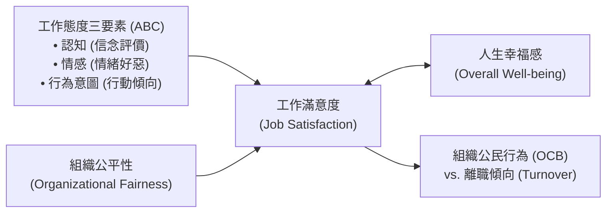

---
{"dg-publish":true,"permalink":"/02/03/02/module-2/m2-1/","tags":["PMBA","核心必修","組織行為","工作態度","工作滿意度","組織公平","研究方法論"],"dg-note-properties":{"類別":"課程筆記","課程名稱":"[[組織行為]]","模組編號":"Module 2","模組名稱":"個體動能_知覺歸因與激勵","章節編號":"M2-1","主題":"工作態度滿意度與組織研究方法論 (Work Attitudes, Job Satisfaction & Empirical Research Methodology)","對應週次":"2026-11-21 課堂","狀態":"🟢 已完成","tags":["PMBA","核心必修","組織行為","工作態度","工作滿意度","組織公平","研究方法論"]}}
---

# 📝 M2-1_工作態度滿意度與組織研究方法論

> [!abstract] 課程脈絡與學習核心
> - **課程歸屬**：[[02_核心必修/03_組織行為/_組織行為 MOC\|組織行為 MOC]] ▸ **Module 2 個體動能：知覺、歸因與激勵**
> - **授課日期**：2026-11-21（L5 態度 AM_1）
> - **核心命題**：為何組織行為學高度關注「工作態度」與「工作滿意度」？在實務管理與研究調查中，主管如何扮演「自然研究者（Natural Researcher）」，避開社會期許偏差並精準診斷團隊真實態度？

---

## 一、 工作態度的本質與職場幸福感連動

### 1.1 工作滿意度（Job Satisfaction）與人生幸福感（Well-being）
在組織行為學中，**工作態度（Work Attitudes）** 代表員工對工作任務、主管、薪酬與組織環境的穩定心理評價傾向（參見 [[98_商業概念庫/three-components-of-attitude_態度三要素\|three-components-of-attitude_態度三要素]]）。當代心理學與組織研究特別強調 **工作滿意度與人生幸福感（Well-being）的雙向互應**：
- **職場是人生幸福感的鏡像**：多數成年人每日清醒時間有超過三分之一投入於工作，對工作的滿意度直接反映了個人對整體人生的滿足感。
- **台灣職場滿意度的結構性警訊**：以五點量表（1 分非常不滿意～5 分非常滿意）觀察台灣就業市場（含竹科工程師與一般企業員工），整體平均工作滿意度往往僅落在 **2 點多至 3 分之間**，顯示「對工作不滿意」在台灣職場屬於常態現象，亦是人才流動與[[98_商業概念庫/Quiet_Quitting_安靜離職與組織公民行為\|安靜離職]]的溫床。

### 1.2 從工作-家庭衝突（Work-Family Conflict）到生命週期調節
早期的組織研究聚焦於「工作與家庭之間的衝突（Work-Family Conflict）」，近年則逐步轉向探討如何創造兩者平衡與增益。在課堂實務觀察中，不同生命週期與家庭角色的員工，對工作滿意度與薪酬的敏感度存在顯著差異：
- **30 歲以下（未婚單身 vs. 已婚）**：彈性較高，對職涯成長與即時報酬敏感。
- **30～40 歲（已婚育有學齡前或小學子女 vs. 單身）**：家庭照護責任形成剛性約束，若工作時數與家庭角色衝突加劇，即使薪資水準不低，仍可能出現與主管預期相反的離職傾向或滿意度反轉；反之，若組織提供彈性工時或友善家庭支持，往往能換取極高的組織忠誠度。

### 1.3 組織公平性（Organizational Fairness）與離職傾向
當員工評估組織公平性時，往往會將「**工作說明書（Job Description）的正式邊界**」與「實際承擔的工作量及回報」進行比對（對接 [[98_商業概念庫/job-satisfaction_工作滿意度\|job-satisfaction_工作滿意度]] 與 [[98_商業概念庫/equity-theory_公平理論\|equity-theory_公平理論]]）：
- **公平感與角色外行為**：若組織制度公平、賞罰透明，員工願意主動跨出工作說明書，展現協助同事與維護組織的[[98_商業概念庫/Quiet_Quitting_安靜離職與組織公民行為\|組織公民行為（OCB）]]。
- **不公平感的代償行為**：若員工覺得工作說明書未涵蓋的雜務不斷轉嫁到自己身上卻無相應回報，即便表面維持合作，內心對組織的滿意度已大幅滑落，並逐步累積離職傾向（Turnover Intention）。

---

## 二、 經理人作為「自然研究者」的實證研究方法論

課堂中教授特別引導 PMBA 經理人跳脫「直覺猜測」，學習以**自然研究者（Natural Researcher）**的視角，透過科學化的問卷與訪談設計來診斷組織問題（詳見 [[98_商業概念庫/social-desirability-bias_社會期許偏差與實證研究設計\|social-desirability-bias_社會期許偏差與實證研究設計]]）。

### 2.1 社會期許偏差（Social Desirability Bias）與配對問卷設計
在調查員工「工作滿意度」、「組織公平」或「離職傾向」時，單純發放自陳式問卷（Self-report Survey）極易遭遇兩大失真：
1. **社會期許偏差（Social Desirability Bias）**：填答者會傾向選擇「符合社會規範或討好主管」的答案（例如：明明想離職，卻勾選「對公司高度認同」；或避免顯得計較而高估對公平性的滿意度）。
2. **共同方法變異（Common Method Variance）**：所有題項皆由同一人於同一時間點填答，容易產生虛假的統計相關性。

**課堂實務解方 — 配對設計（Paired Design）與質性追蹤**：
- **交叉配對評量**：由員工本人填寫「工作滿意度與內心態度」，並由其**同事或直屬主管配對填寫**其外顯的「組織公民行為或協作表現」，藉此降低單方自評的偏誤。
- **反常樣本的深度訪談**：若問卷數據中出現「原本預期某高薪單身員工應高度滿意，結果卻極度不滿」或「高壓部門卻異常滿意」的離群值（Outliers），管理者應主動進行半結構式訪談，挖掘量表無法捕捉的家庭與情境變數。

### 2.2 統計顯著性（Statistical Significance）與研究局限性
在企業內部進行小規模調查（例如 10～20 人的工程公司或單一部門）與學術大樣本實證之間，經理人必須清楚區分其適用邊界：

| 比較維度 | 學術大樣本實證研究 | 企業內部診斷（Natural Researcher） |
| :--- | :--- | :--- |
| **樣本規模要求** | 通常需 **150～200 人以上** 才具備足夠統計檢定力（Power）與顯著性 | 單一部門或中小企業（10～30 人）無法追求統計顯著性 |
| **分析重心** | 檢驗跨產業、跨部門之普遍規律與變項因果關係 | 聚焦「**為何他滿意、為何他不滿意**」的脈絡診斷與部門差異比較 |
| **核心限制** | 單一研究永遠存在控制變數遺漏與外推限制，沒有「四海皆準的完美研究」 | 樣本易受特定產業文化（如高科技業低離職率基準）與主管盲點影響 |
| **管理實務應用** | 提供循證管理（EBM）的理論基準與除偏架構 | 結合多維度人格測驗（如大五人格、內外控）與質性對話，精準留才 |

---

## 三、 經理人行動檢核與跨章節對接

### 經理人反思檢核清單
- [ ] **區分「產業基準」與「管理問題」**：評估團隊離職率時，是否已考量該產業本身的結構特性（例如部分產業整體流動率本就偏低，不能單憑低離職率就誤以為員工滿意度高）？
- [ ] **檢視問卷發放的心理安全感**：在收集員工滿意度回饋時，是否確保匿名性與避免「打電話追問補填」所造成的社會期許壓力？
- [ ] **關注「反常滿意／不滿」個案**：對於表現與主管直覺相反的成員，是否透過一對一深度對話了解其工作-家庭界線與真實需求？

### 關聯筆記與原子卡片
- **前期理論基石**：[[02_核心必修/03_組織行為/02_模組筆記/Module_1_個體行為與心理機制/M1-1_組織行為導論與跨文化價值觀\|M1-1_組織行為導論與跨文化價值觀]] · [[02_核心必修/03_組織行為/02_模組筆記/Module_1_個體行為與心理機制/M1-3_情緒勞動情感事件與職場壓力管理\|M1-3_情緒勞動情感事件與職場壓力管理]]
- **同模組延伸**：[[02_核心必修/03_組織行為/02_模組筆記/Module_2_個體動能_知覺歸因與激勵/M2-2_社會知覺偏誤與跨文化歸因理論\|M2-2_社會知覺偏誤與跨文化歸因理論]] · [[02_核心必修/03_組織行為/02_模組筆記/Module_2_個體動能_知覺歸因與激勵/M2-3_績效激勵機制與組織正義個案_DBF律師事務所\|M2-3_績效激勵機制與組織正義個案_DBF律師事務所]]
- **商業概念庫**：[[98_商業概念庫/three-components-of-attitude_態度三要素\|three-components-of-attitude_態度三要素]] · [[98_商業概念庫/job-satisfaction_工作滿意度\|job-satisfaction_工作滿意度]] · [[98_商業概念庫/social-desirability-bias_社會期許偏差與實證研究設計\|social-desirability-bias_社會期許偏差與實證研究設計]] · [[98_商業概念庫/equity-theory_公平理論\|equity-theory_公平理論]]
