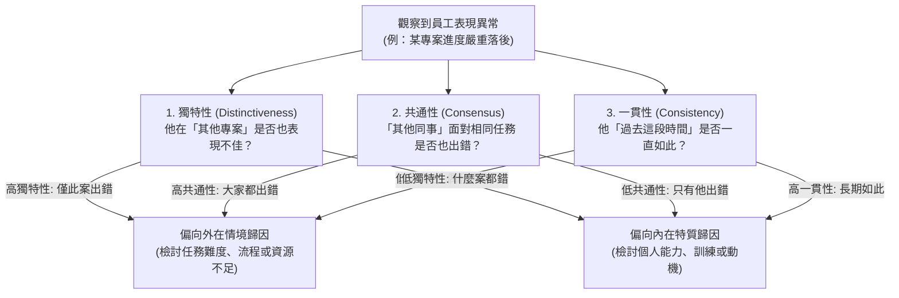

---
{"dg-publish":true,"permalink":"/02/03/02/module-2/m2-2/","tags":["PMBA","核心必修","組織行為","社會知覺","暈輪效應","歸因理論","基本歸因謬誤","跨文化管理"],"dg-note-properties":{"類別":"課程筆記","課程名稱":"[[組織行為]]","模組編號":"Module 2","模組名稱":"個體動能_知覺歸因與激勵","章節編號":"M2-2","主題":"社會知覺偏誤與跨文化歸因理論 (Social Perception Biases & Cross-Cultural Attribution Theory)","對應週次":"2026-11-21 課堂","狀態":"🟢 已完成","tags":["PMBA","核心必修","組織行為","社會知覺","暈輪效應","歸因理論","基本歸因謬誤","跨文化管理"]}}
---

# 📝 M2-2_社會知覺偏誤與跨文化歸因理論

> [!abstract] 課程脈絡與學習核心
> - **課程歸屬**：[[02_核心必修/03_組織行為/_組織行為 MOC\|組織行為 MOC]] ▸ **Module 2 個體動能：知覺、歸因與激勵**
> - **授課日期**：2026-11-21（L6 知覺 AM_2 & L6 知覺 PM_1）
> - **核心命題**：人類並不是對「客觀事實」做出反應，而是對自己大腦所「知覺到的事實」做出反應。經理人如何辨識知覺過濾與偏誤，並運用歸因理論校正對部屬績效與跨文化團隊的誤判？

---

## 一、 社會知覺系統與意義建構（Sense-making）

### 1.1 知覺架構與三大影響因子
**社會知覺（Social Perception）** 是個體透過感官接收外部刺激，並進行選擇、組織與解釋，以建構有意義的心理圖像（Sense-making）之過程。我們口中所謂的「主觀」，本質上就是一套受情緒、背景與經驗過濾的知覺系統。影響知覺精準度的三大因子為：
1. **知覺者（Perceiver）**：自身的生理狀態、當下情緒、過往經驗與個人動機。
2. **標的物（Target）**：事物的顯著性（Salience）、對比度、新奇性與動態特徵。
3. **情境脈絡（Situation）**：事件發生的時間點、環境氛圍與社會場合。

### 1.2 職場六大知覺偏誤與決策陷阱
大腦為了節省認知能量，在評估他人與事件時常依賴心理捷徑，進而衍生六大典型知覺偏誤（參見 [[98_商業概念庫/halo-effect-and-projection_暈輪效應與投射偏誤\|halo-effect-and-projection_暈輪效應與投射偏誤]] 與 [[98_商業概念庫/cognitive-bias_認知偏誤\|cognitive-bias_認知偏誤]]）：

| 知覺偏誤類型 | 心理運作機制 | 課堂實例與管理陷阱 |
| :--- | :--- | :--- |
| **選擇性知覺 (Selective Perception)** | 只挑選符合自身興趣、背景或預期的刺激，過濾其餘資訊 | 日常資訊過載時，主管只注意到自己關心的 KPI，忽略現場異常警訊 |
| **知覺防衛 (Perceptual Defense)** | 潛意識阻擋令人不悅、威脅自尊或與自我認知衝突的訊息 | 對負面批評「只聽想聽的」，自我感覺良好卻忽略團隊真實怨言 |
| **刻板印象 (Stereotyping)** | 依據對象所屬群體（學歷、國籍、性別）的特徵推論個人表現 | **雙面刃**：正向功能是快速建立認知模型（如對德國／日本客戶的商務預期）；負向則淪為「純血／名校／留學」等招募偏見 |
| **投射 (Projection)** | 將自身的情緒、特質或行事邏輯投射到他人身上 | 「以己度人」，誤以為部屬也跟自己一樣追求相同誘因或具備相同動機 |
| **暈輪效應 (Halo Effect)** | 依據單一顯著特質（外貌、第一題表現、坐姿）推論整體評價 | **面試與閱卷陷阱**：考生第一題寫得好，後面的題目就容易給高分；或面試官因候選人過於放鬆的坐姿而全面否定其專業能力 |
| **近期偏誤與可得性 (Recency / Availability)** | 過度放大記憶中最鮮明或最近發生的事件權重 | **年終考績偏誤**：主管只記得員工最近一兩個月的表現，遺忘年初的重大貢獻 |

### 1.3 展望理論（Prospect Theory）在知覺決策的延伸
延續 [[02_核心必修/03_組織行為/02_模組筆記/Module_1_個體行為與心理機制/M1-4_管理決策偏誤有限理性與卡特賽車實證\|M1-4 決策偏誤]]，課堂進一步連結行為經濟學（Kahneman 等諾貝爾獎研究）：人類在知覺損益時具有非對稱性——**面對確定收益時趨於避險（見好就收），面對損失時卻傾向追逐風險（不願認賠停損）**。在投資與專案管理中，唯有依靠明確的**紀律（Discipline）**與事前設定可接受的損失上限，才能對抗過去成功經驗帶來的**過度自信（Overconfidence）**。

---

## 二、 歸因理論（Attribution Theory）與跨文化實驗

### 2.1 凱利共變模型（Kelley's Covariation Model）
當我們觀察到部屬或他人出現某種行為（如「專案延誤」或「業績下滑」）時，哈羅德·凱利（Harold Kelley）提出應檢驗三個維度，以判斷該行為屬於**內在原因（個人能力／態度）**還是**外在原因（環境／情境因素）**（詳見 [[98_商業概念庫/kelley-covariation-model_凱利共變歸因模型\|kelley-covariation-model_凱利共變歸因模型]]）：

### 2.2 基本歸因謬誤（FAE）與雙重文化認同實驗
**基本歸因謬誤（Fundamental Attribution Error, FAE）** 指觀察者在解釋他人行為時，習慣**高估個人內在特質、低估外部情境脈絡**（對接 [[98_商業概念庫/fundamental-attribution-error_基本歸因謬誤\|fundamental-attribution-error_基本歸因謬誤]]）。然而，跨文化心理學研究揭示了東西方思維的顯著差異：
- **西方個人主義 vs. 華人情境導向**：西方文化較凸顯個人英雄或個人責任（如將美國政治或企業結果高度歸因於領袖個人特質）；華人文化則相對更重視上下尊卑、人情關係與環境脈絡，因此華人的基本歸因謬誤程度通常低於西方人。
- **課堂實證 — 雙重文化認同（Bicultural Identity Switching）實驗**：戚樹誠教授分享自身於研究室進行的實驗設計，將受試者隨機分配至兩種情境房間：
  - **華人情境房**：懸掛中國水墨畫、擺設茶具與播放中樂；
  - **西方情境房**：呈現西方文化線索。
  - **實驗發現**：具備跨文化經驗（如曾留學或具雙重文化背景）的華人受試者，會因環境線索的啟動而「**切換身份認同（Identity Switch）**」——在西方情境誘發下展現較強的個人主義歸因，在華人情境下則回歸關係與情境導向。反之，若移民第二代已完全融入美國文化、缺乏華人文化底蘊，則無法透過華人線索激發情境歸因。

### 2.3 自利偏差與自我實現預言
1. **自利偏差（Self-Serving Bias）**：個體將成功歸因於自身努力與能力，將失敗歸咎於外部運氣與環境（對接 [[98_商業概念庫/self-serving-bias_自利偏誤\|self-serving-bias_自利偏誤]]）。教授提醒經理人：「過去的成功往往是今天最大的危機」，若沉溺於過去的零失敗紀錄而不自我反省，極易在環境劇變時陷入盲區。
2. **自我實現預言（Self-Fulfilling Prophecy / 比馬龍效應 Pygmalion Effect）**：當管理者或教師對某位部屬（或班級學生）抱持高度正向預期時，會不自覺給予更多資源、指導與鼓勵，最終使對方真的達成卓越績效（詳見 [[98_商業概念庫/self-fulfilling-prophecy_自我實現預言與比馬龍效應\|self-fulfilling-prophecy_自我實現預言與比馬龍效應]]）。
3. **「偏差」vs.「機會」的辯證**：課堂最後引導學員思考——我們常將刻板印象、知覺防衛視為負面的「Bias（偏差）」，但所謂偏差是相對於「客觀理想基準」而言；若管理者能意識到這套大腦運作機制，反過來檢視職場霸凌、選才盲點與期望管理，便能將偏誤轉化為系統性改善組織的 **Opportunity（機會）**。

---

## 三、 經理人行動檢核與跨章節對接

### 經理人除偏檢核清單
- [ ] **年終考績「全年度回溯」**：評估部屬年度績效時，是否調閱全年紀錄以對抗近期偏誤（Recency Bias）？
- [ ] **凱利三維度強制檢驗**：在認定部屬「態度不佳」或「能力不足」前，是否先確認該問題的獨特性與共通性，排除系統性流程缺陷？
- [ ] **善用正面比馬龍效應**：對於潛力新進成員，是否刻意消除負面刻板印象，並透過正向期待與資源賦能引導其成長？

### 關聯筆記與原子卡片
- **前期理論基石**：[[02_核心必修/03_組織行為/02_模組筆記/Module_1_個體行為與心理機制/M1-4_管理決策偏誤有限理性與卡特賽車實證\|M1-4_管理決策偏誤有限理性與卡特賽車實證]] · [[02_核心必修/03_組織行為/02_模組筆記/Module_2_個體動能_知覺歸因與激勵/M2-1_工作態度滿意度與組織研究方法論\|M2-1_工作態度滿意度與組織研究方法論]]
- **同模組延伸**：[[02_核心必修/03_組織行為/02_模組筆記/Module_2_個體動能_知覺歸因與激勵/M2-3_績效激勵機制與組織正義個案_DBF律師事務所\|M2-3_績效激勵機制與組織正義個案_DBF律師事務所]]
- **商業概念庫**：[[98_商業概念庫/halo-effect-and-projection_暈輪效應與投射偏誤\|halo-effect-and-projection_暈輪效應與投射偏誤]] · [[98_商業概念庫/kelley-covariation-model_凱利共變歸因模型\|kelley-covariation-model_凱利共變歸因模型]] · [[98_商業概念庫/fundamental-attribution-error_基本歸因謬誤\|fundamental-attribution-error_基本歸因謬誤]] · [[98_商業概念庫/self-serving-bias_自利偏誤\|self-serving-bias_自利偏誤]] · [[98_商業概念庫/self-fulfilling-prophecy_自我實現預言與比馬龍效應\|self-fulfilling-prophecy_自我實現預言與比馬龍效應]]
