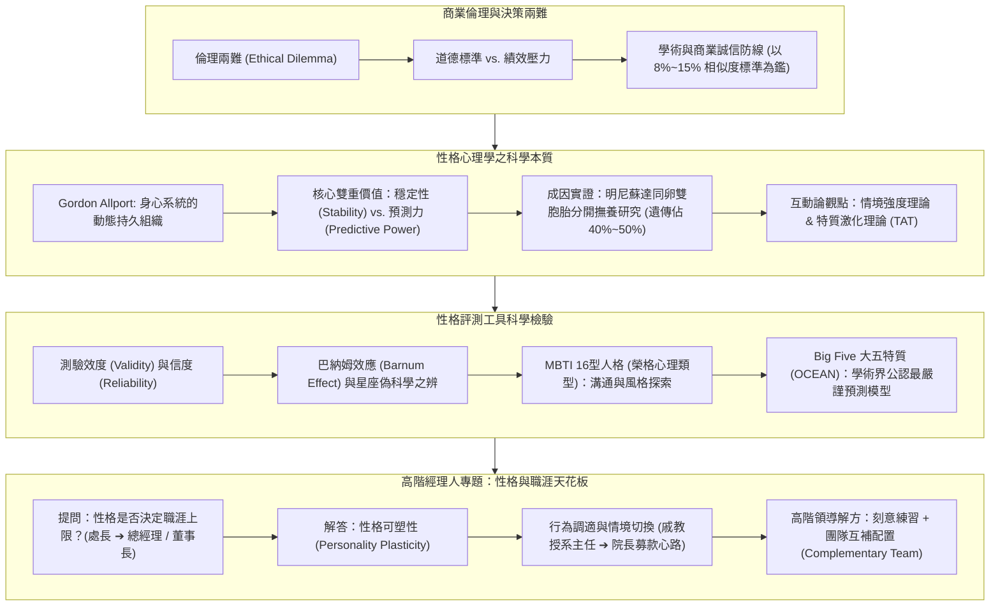
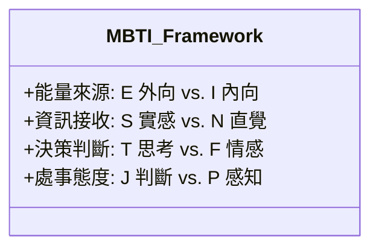
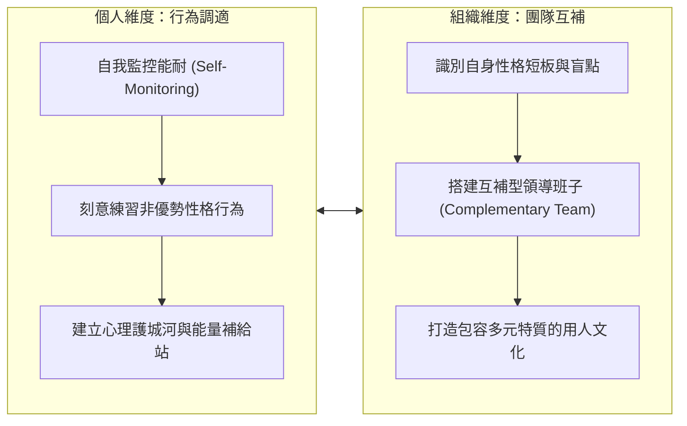

---
{"dg-publish":true,"permalink":"/02/03//m1-2-backup-20261107/","tags":["課程筆記","PMBA","核心必修","組織行為","商業倫理","大五人格","MBTI","特質激化理論","性格可塑性"],"dg-note-properties":{"類別":"課程筆記","課程名稱":"[[組織行為]]","模組編號":"Module 1","模組名稱":"個體行為與心理機制","章節編號":"M1-2","主題":"商業倫理決策與性格特質模型 (Business Ethics & Personality Frameworks)","對應週次":"Week 1 & 2 (2026-10-04)","狀態":"🟢 已完成","tags":["課程筆記","PMBA","核心必修","組織行為","商業倫理","大五人格","MBTI","特質激化理論","性格可塑性"],"aliases":["M1-2 商業倫理決策與性格特質模型","商業倫理決策與性格特質模型"]}}
---

# 🧠 M1-2 商業倫理決策與性格特質模型

> **授課教師**：臺大工商管理學系暨商學研究所 戚樹誠 教授  
> **課程脈絡**：[[02_核心必修/03_組織行為/_組織行為 MOC\|組織行為 MOC]] ➔ **Module 1 個體行為與心理機制** ➔ M1-2  
> **核心概念對接**：[[98_商業概念庫/Big_Five_Personality_Traits_大五人格特質模型\|大五人格 (Big Five)]] · [[98_商業概念庫/MBTI_Personality_Framework_邁爾斯布里格斯性格類型\|MBTI 十六型人格]] · [[98_商業概念庫/Trait_Activation_Theory_特質激化理論\|特質激化理論]] · [[98_商業概念庫/Personality_Plasticity_性格可塑性與高階職涯跨越\|性格可塑性與高階職涯跨越]]

---

## 🎯 本章學習目標與核心架構

---

## 一、 商業倫理與決策兩難（Ethical Dilemma）

### 1. 倫理兩難的本質
- **定義**：當經理人面臨兩種或多種互相衝突的道德規範或價值追求，且任何一種選擇都必然伴隨某種程度的道德妥協或利益損害時的決策困境。
- **商業實務中的典型兩難**：
  - **短期利益 vs. 長期誠信**：為了達成當季季報 KPI 掩蓋潛在品質缺陷，或是如實揭露承擔股價震盪？
  - **組織忠誠 vs. 公共利益**：面對企業內部的舞弊行為，選擇包庇維持團隊和諧，或是擔任吹哨者（Whistleblower）？

### 2. 學術倫理與實務比對標準的啟示
- 戚樹誠教授在課堂中特別提醒 PMBA 同學學術誠信的底線：
  - 台大學術倫理委員會對論文相似度（Turnitin）之嚴格規範，一般比對門檻訂在 **8% ~ 15%** 之間。
  - **管理學隱喻**：誠信與倫理如同企業的合規安全氣囊；在日常運營中看似增加摩擦成本，但在關鍵危機時刻，卻是決定企業能否免於毀滅性打擊的唯一屏障。

---

## 二、 性格心理學核心：穩定性與預測力

### 1. 什麼是性格（Personality）？
- **Gordon Allport 的經典定義**：性格是個體內部身心系統的動態組織（Dynamic Organization），決定了該個體對環境適應時特有的行為模式、思維架構與人際風格。

### 2. 為什麼企業管理必須深入研究性格？
性格具備現代管理學極為看重的兩大科學價值：
1. **穩定性（Stability）**：成年後的性格特質具備跨時間與跨情境的持久一致性。個體不會在短時間內因單純口頭告誡而徹底改變其天生氣質。
2. **預測力（Predictive Power）**：具備高信效度的性格評測工具，能高度顯著預測員工的**工作績效（Job Performance）**、**離職傾向（Turnover Intention）**、**壓力耐受力（Stress Tolerance）**以及**團隊協作風格**。

### 3. 性格的成因：先天基因 vs. 後天學習
- **明尼蘇達雙胞胎分開撫養研究（Minnesota Twin Study）**：
  - 追蹤同卵雙胞胎自出生即被不同家庭領養、在完全相異的社會環境中成長之案例。
  - **研究結論**：基因遺傳對成年性格特質的決定程度約佔 **40% ~ 50%**，其餘由後天生活經歷、家庭教養、重大創傷與職場環境所形塑。
  - **結論解讀**：性格既有深厚的先天生物學基石（「出廠設定」），同時也保留了顯著的後天適應與演變空間。

---

## 三、 情境強度與特質激化理論（Trait Activation Theory）

### 1. 互動論觀點（Interactionist Perspective）
- 著名公式：$$B = f(P, E)$$（行為 Behavior 是人 Personality 與環境 Environment 相互作用的函數）。

### 2. 情境強度理論（Situation Strength Theory）
情境強度決定了性格特質對行為的影響力大小：
- **強情境（Strong Situation）**：具備明確嚴謹的 SOP、嚴密監控與強烈處罰機制（如軍隊操演、台積電晶圓代工無塵室生產線）。
  - *特徵*：情境壓力迫使所有個體展現高度一致的合規行為，**性格特質被高度壓抑**。
- **弱情境（Weak Situation）**：規範模糊、自主裁量權高、無既定標準答案（如新創探索業務、策略規劃會議、藝術創作）。
  - *特徵*：個體行為主要取決於其內在特質，**性格差異充分顯現**。

### 3. 特質激化理論（Trait Activation Theory, TAT）
- 由 Tett & Burnett 提出，強調情境並非只是籠統的「強或弱」，而是組織環境中存在特定的「**情境線索（Contextual Cues）**」。
- 當組織情境出現符合特定特質的線索時，會主動「激化（Activate）」員工隱藏的性格特質：
  - *例*：高競爭性與排名榜線索，激化了高成就動機與陽剛特質員工的爆發力；開放無結構的高層戰略專案，激化了高經驗開放性（Openness）成員的想像力。

---

## 四、 主流性格評估工具檢驗：MBTI vs. Big Five

### 1. 科學測量之門檻：信度（Reliability）與效度（Validity）
- **信度（穩定度）**：重測信度高，即一個人在一個月前後重複測驗，應得出高度一致的結果。
- **效度（準確度）**：測驗結果確實能精準測量出目標心理構造，並能有效預測實質工作績效。
- **巴納姆效應（Barnum Effect）**：
  - 星座與通俗算命常使用極度籠統、模稜兩可、對全人類皆適用的描述，讓人誤以為「神準」。
  - 戚教授提醒經理人：星座缺乏統計學信效度支持，企業選育留用絕不可訴諸占星偽科學。

### 2. MBTI 十六型人格（Myers-Briggs Type Indicator）
源自瑞士心理學家榮格（Carl Jung）的心理類型理論，透過四個二元維度組合出 16 種人格：

- **四大構面拆解**：
  1. **能量導向（E vs. I）**：Extraversion（外向，從外部人際互動充電） vs. Introversion（內向，從獨處內省充電）。
  2. **資訊蒐集（S vs. N）**：Sensing（實感，專注具體事實、細節與現狀） vs. iNtuition（直覺，專注未來趨勢、宏觀關聯與可能性）。
  3. **決策風格（T vs. F）**：Thinking（思考，講求邏輯分析、客觀公平與原則） vs. Feeling（情感，講求人際價值、同理和諧與情感共鳴）。
  4. **生活型態（J vs. P）**：Judging（判斷，偏好計畫排程、結構條理與迅速收斂） vs. Perceiving（感知，偏好彈性自由、擁抱變化與開放選項）。
- **企業應用評價**：
  - *優勢*：標籤中立友善、通俗易懂，極度適合用於團隊破冰、跨部門溝通工作坊與自我風格覺察。
  - *學術限制*：二分法人為切斷連續分佈、重測信度相對較弱，學術界不建議將其作為單一嚴格的招募淘汰工具。

### 3. Big Five 大五人格特質（OCEAN 模式）
當代心理學與管理學界公認最具實證科學效度、最穩健的性格測量基準：

| 特質構面 (Dimension) | 高分特徵 | 低分特徵 | 職場預測力與管理意涵 |
| :--- | :--- | :--- | :--- |
| **[[98_商業概念庫/Big_Five_Personality_Traits_大五人格特質模型#1-經驗開放性-openness-to-experience\|經驗開放性 (Openness)]]** | 富想像力、具好奇心、思想開明、熱愛創新。 | 務實守舊、偏好常規、抗拒變革。 | 預測創新能力、培訓學習適應力；適合研發、策略轉型崗位。 |
| **[[98_商業概念庫/Big_Five_Personality_Traits_大五人格特質模型#2-嚴謹自律性-conscientiousness\|嚴謹自律性 (Conscientiousness)]]** | 負責任、有條理、自律、追求卓越、誠信可靠。 | 粗枝大葉、漫不經心、拖延散漫。 | **跨所有職業種類工作績效最具普適預測力的單一指標**！高度預測任務績效與忠誠度。 |
| **[[98_商業概念庫/Big_Five_Personality_Traits_大五人格特質模型#3-外向性-extraversion\|外向性 (Extraversion)]]** | 熱情善談、自信果決、社交主動、充滿活力。 | 沉靜內斂、保守獨立、低調慎言。 | 高度預測業務銷售績效、公關拓展能耐與領導職位晉升潛力。 |
| **[[98_商業概念庫/Big_Five_Personality_Traits_大五人格特質模型#4-親和性-agreeableness\|親和性 (Agreeableness)]]** | 善良信任、具同理心、合作熱忱、重視和諧。 | 懷疑多疑、冷漠競爭、強勢挑剔。 | 高度預測團隊合作滿意度與顧客服務滿意度；低親和性在嚴格審計與談判崗位具優勢。 |
| **[[98_商業概念庫/Big_Five_Personality_Traits_大五人格特質模型#5-情緒穩定性-neuroticism\|情緒穩定性 (Neuroticism)]]** | （高情緒穩定）：沉著冷靜、抗壓性強、情緒平穩。 | （高神經質）：焦慮易怒、缺乏安全感、情緒波動大。 | 預測危機應變、高壓抗壓能耐與工作倦怠防禦力；高管與決策者必備基石。 |

---

## 五、 【高階專題研討】性格是否決定職涯上限？高階經理人的性格轉型與可塑性

### 1. 課堂震撼提問：升遷的「性格天花板」
- **同學現場提問（大企業主管親身困惑）**：
  > 「教授，一個嚴謹、沉穩、內向的工程師或專業經理人，靠著極高的責任感（高 C）一路升到協理、處長；但如果要再往上晉升為**總經理（GM）甚至是董事長（Chairman）**，往往需要極度外向（E）、具備願景感染力與強大公關社交能耐。**性格是否直接決定了一個人職涯的最終天花板？**」

### 2. 戚樹誠教授深度解答：性格可塑性（Personality Plasticity）
- **核心論點：性格是傾向，絕非宿命！**
  - 天生性格決定了個人的「心理舒適區（Comfort Zone）」，做符合天性之事耗費的心理能量最少；
  - 但高階經理人的卓越之處，恰恰在於**「認知到職務角色的需要，並具備主動跨出舒適區調適行為模式的可塑性」**。

### 3. 教授的生命實證分享：從學者到院長的轉型之路
- **真實經歷**：
  - 戚教授坦言自身天性偏向內斂、專注學術研究與個體省思（偏好內向專研與安靜思考）。擔任系主任時，主要面對校內教授同仁與學術行政，尚在舒適區之內。
  - 當晉升至管學院院長甚至校級高層職務時，核心職責劇變：**必須頻繁面對外界企業領袖、校友企業家、主管機關，進行高密度的募款餐敘、公關應酬與大眾演講**。
- **調適心法**：
  - 將外向公關視為**「專業角色演出（Professional Role Play）」**與神聖責任；
  - 白天全力切換至熱情外向模式為學院爭取資源，傍晚或週末則給予自己充裕的獨處空間徹底「充電（Recharge）」，維持心理能量的動態平衡。

### 4. 高階主管破局之道：雙軌策略

1. **行為層面的刻意調適**：
   - 內向型領導者透過演說訓練與人際技巧提升氣場，外向型領導者則需學會刻意克制發言、練習深度傾聽。
2. **組織層面的互補團隊配置（Complementary Team）**：
   - 頂級企業家深知無人全能。
   - 內向專注技術與戰略的執行長（如微軟 Satya Nadella），可以搭配極具魅力與公關拓展能耐的副總裁或策略官；性格互補的領導團隊才是跨越組織規模天花板的根本保證。

---

## 💡 經理人管理實務反思與行動指引

1. **落實招募中的「人職匹配（Person-Job Fit）」**：
   - 善用大五人格特質（OCEAN）作為職缺適配工具；所有崗位優先篩選高責任感（Conscientiousness）人選，銷售公關側重外向性，研發策劃側重開放性。
2. **善用 MBTI 作為團隊溝通潤滑劑**：
   - 在跨部門專案啟動時，運用 MBTI 盤點成員風格，讓思考型（T）與情感型（F）、計畫型（J）與感知型（P）理解彼此決策出發點，化解無謂的情感衝突。
3. **拒絕性格標籤化宿命論**：
   - 不應以「我天生性格就是這樣」作為抗拒成長的藉口；高階經理人應以「終身學習者」心態，持續鍛鍊跨情境的角色調適能耐。

---

## 🔗 模組導航與延伸閱讀

- ⬅️ **上一章節**：[[02_核心必修/03_組織行為/02_模組筆記/Module_1_個體行為與心理機制/M1-1_組織行為導論與跨文化價值觀\|M1-1 組織行為導論與跨文化價值觀]]
- ➡️ **下一堂進階預覽**：[[S03_性格情緒與壓力\|S03 性格、情緒與職場壓力調適]]
- 💎 **本章關聯概念卡片**：
  - [[98_商業概念庫/Big_Five_Personality_Traits_大五人格特質模型\|Big_Five_Personality_Traits_大五人格特質模型]]
  - [[98_商業概念庫/MBTI_Personality_Framework_邁爾斯布里格斯性格類型\|MBTI_Personality_Framework_邁爾斯布里格斯性格類型]]
  - [[98_商業概念庫/Trait_Activation_Theory_特質激化理論\|Trait_Activation_Theory_特質激化理論]]
  - [[98_商業概念庫/Personality_Plasticity_性格可塑性與高階職涯跨越\|Personality_Plasticity_性格可塑性與高階職涯跨越]]