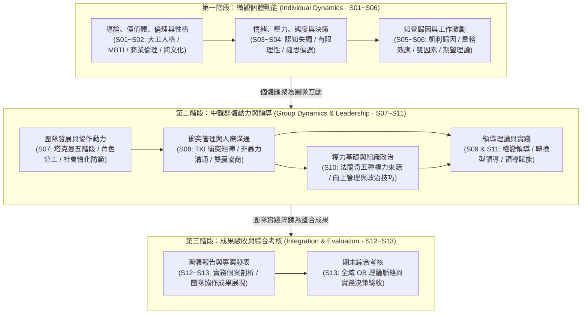

---
{"dg-publish":true,"permalink":"/02/03//moc-backup-20261107/","title":"組織行為 MOC (課程總覽地圖)","tags":["PMBA","核心必修","組織行為","OB","領導力","團隊動力","MOC","知識地圖"],"dg-note-properties":{"title":"組織行為 MOC (課程總覽地圖)","course":"組織行為","category":"02_核心必修","type":"moc","tags":["PMBA","核心必修","組織行為","OB","領導力","團隊動力","MOC","知識地圖"],"aliases":["組織行為","組織行為 MOC","組織行為學 MOC","Organizational Behavior MOC"]}}
---

# 👥 組織行為 MOC (Organizational Behavior)

> **課程定位**：國立臺灣大學 PMBA 核心必修核心模組  
> **授課教師**：臺大工商管理學系暨商學研究所 戚樹誠 教授  
> **研究核心**：以心理學、社會學與管理學為基石，穿透**個體（Individual）➔ 群體（Group）➔ 組織系統（Organization）**三層次之人性行為規律與領導治理能耐  
> **進度追蹤看板**：[[05_AI選修/10_AiX/00_課程導航與進度/progress_📊 課程與筆記進度追蹤\|📊 課程與筆記進度追蹤看板]]  
> **學程總覽**：[[00_學程修課地圖 & 進度追蹤\|返回 PMBA 學程修課地圖與進度追蹤]]  

---

## 🧭 組織行為三層次分析架構與決策脈絡圖

組織行為（OB）旨在協助高階經理人「**理解人性、預測行為、驅動賦能**」。本學期課程沿著**微觀個體到中觀群體與領導，並貫通至成果驗收**之路徑展開：

---

## 📅 課程進度與時程規劃總覽

| 上課日期 | 堂次 | 授課主題 | 核心範疇與理論對接 | 模組主筆記對接 | 狀態 |
| :---: | :---: | :--- | :--- | :---: | :---: |
| **10/04** | Session 1 | **導論、價值觀** | OB 本質、循證管理 (EBM)、Rokeach 終極/工具價值、Schwartz 圓環、Hofstede 六維度、安靜離職 (Quiet Quitting) | [[M1-1_組織行為導論與跨文化價值觀|M1-1 導論與跨文化價值觀]] | 🟢 已完成 |
| **10/04** | Session 2 | **倫理、性格** | 商業倫理決策、大五人格特質 (Big Five)、MBTI 職業性格、特質激化理論 (TAT)、高階職涯性格可塑性 (Plasticity) | [[M1-2_商業倫理決策與性格特質模型|M1-2 商業倫理與性格特質]] | 🟢 已完成 |
| **10/24** | Session 3 | **性格、情緒、壓力** | 人格深化、情緒勞動、情緒智商 (EQ)、職場壓力源與心理韌性調適 | [[02_模組筆記/S03_性格情緒與壓力|S03 性格情緒與壓力]] | ⚪ 待重整 |
| **10/24** | Session 4 | **態度、決策** | 態度三要素 (ABC)、費斯汀格認知失調、有限理性、滿意決策與捷思偏差 | [[02_模組筆記/S04_態度與決策|S04 態度與決策]] | ⚪ 待重整 |
| **11/07** | Session 5 | **知覺、歸因** | 社會知覺、凱利歸因模型 (三維度)、基本歸因謬誤、自利偏差 | [[02_模組筆記/S05_知覺與歸因|S05 知覺與歸因]] | ⚪ 未開始 |
| **11/07** | Session 6 | **激勵** | 馬斯洛、赫茲伯格雙因素、佛洛姆期望理論、亞當斯公平理論、目標設定 | [[02_模組筆記/S06_激勵|S06 激勵]] | ⚪ 未開始 |
| **11/21** | Session 7 | **團隊** | 塔克曼團隊發展五階段、團隊角色認知、防範社會惰化、心理安全感 | [[02_模組筆記/S07_團隊|S07 團隊]] | ⚪ 未開始 |
| **11/21** | Session 8 | **衝突、溝通** | 溝通障礙克服、建設性衝突、Thomas-Kilmann 衝突模式 (TKI) | [[02_模組筆記/S08_衝突與溝通|S08 衝突與溝通]] | ⚪ 未開始 |
| **12/12** | Session 9 | **領導** | 特質論、行為論、費德勒權變領導、赫塞-布蘭查德情境領導 (SLT) | [[02_模組筆記/S09_領導|S09 領導]] | ⚪ 未開始 |
| **12/12** | Session 10 | **權力、政治** | 法蘭奇與雷文五大權力基礎、建設性組織政治、跨部門影響力與向上管理 | [[02_模組筆記/S10_權力與政治|S10 權力與政治]] | ⚪ 未開始 |
| **12/26** | Session 11 | **領導、課程總結** | 轉換型領導、僕人式領導、敏捷教練型領導與全課程全景脈絡總結 | [[02_模組筆記/S11_領導與課程總結|S11 領導與課程總結]] | ⚪ 未開始 |
| **01/09** | Session 12 | **團體報告** | 實務商業個案／組織診斷專案小組成果發表（第一階段） | [[01_個案與實務討論/S12_團體報告|S12 團體報告]] | ⚪ 未開始 |
| **01/09** | Session 13 | **團體報告、期末考** | 小組成果發表（第二階段）與組織行為學期末綜合評量考核 | [[01_個案與實務討論/S13_團體報告與期末考|S13 團體報告與期末考]] | ⚪ 未開始 |

---

## 📚 課程模組規劃與學習進度看板

### 模組一：微觀個體動能與心理機制 (Individual Dynamics · S01~S06)
- [x] **[[M1-1_組織行為導論與跨文化價值觀|M1-1_組織行為導論與跨文化價值觀 (10/04)]]**  
  *OB 本質、循證管理 (EBM)、Rokeach 終極/工具價值、Schwartz 十構面圓環、Hofstede 文化六維度、世代變遷與安靜離職 (Quiet Quitting)。*
- [x] **[[M1-2_商業倫理決策與性格特質模型|M1-2_商業倫理決策與性格特質模型 (10/04)]]**  
  *企業商業倫理決策、明尼蘇達雙胞胎研究、大五人格特質 (Big Five OCEAN)、MBTI 十六型人格、特質激化理論 (TAT)、性格可塑性 (Plasticity) 與高階職涯跨越。*
- [ ] **S03_性格、情緒與壓力 (10/24)**  
  *性格特質深化、情緒勞動 (Emotional Labor)、情緒智商 (EQ 五大構面)、工作倦怠預防、職場壓力源與心理韌性調適。*
- [ ] **S04_態度與決策 (10/24)**  
  *態度三要素 (ABC 模型)、費斯汀格認知失調理論、工作滿意度與組織公民行為 (OCB)、理性決策架構、有限理性與捷思偏差。*
- [ ] **S05_知覺與歸因 (11/07)**  
  *社會知覺選擇性、暈輪效應與刻板印象、凱利歸因模型 (一致性/普遍性/特異性)、基本歸因謬誤與自利偏差校正。*
- [ ] **S06_激勵 (11/07)**  
  *內容型與過程型激勵體系：馬斯洛需求層次、赫茲伯格雙因素理論、佛洛姆期望理論、亞當斯公平理論、目標設定理論與工作特性模型 (JCM)。*

### 模組二：中觀群體動力、團隊協作與領導 (Group Dynamics & Leadership · S07~S11)
- [ ] **S07_團隊 (11/21)**  
  *塔克曼（Tuckman）團隊發展五階段（形成/動盪/規範/表現/解散）、團隊多元角色搭配、防範社會惰化（Social Loafing）、高績效團隊心理安全感。*
- [ ] **S08_衝突與溝通 (11/21)**  
  *組織人際溝通障礙克服、積極傾聽與非暴力溝通、建設性衝突 vs. 破壞性衝突、Thomas-Kilmann 衝突處理模式（TKI 五大策略）、雙贏協商原則。*
- [ ] **S09_領導 (12/12)**  
  *領導特質論與行為論、費德勒權變模型、赫塞-布蘭查德情境領導（SLT）、交易型領導 vs. 轉換型領導（TL）、僕人式領導。*
- [ ] **S10_權力與政治 (12/12)**  
  *法蘭奇與雷文五大權力基礎（法定/獎賞/強制/專家/參照權力）、建設性組織政治、向上管理策略、跨部門非職權影響力建立。*
- [ ] **S11_領導與課程總結 (12/26)**  
  *當代領導力前沿實踐（教練型領導、賦能授權）、穿透個體到組織系統的三層次行為規律、全課程核心決策脈絡總結。*

### 模組三：成果驗收、實務個案與評量考核 (Evaluation & Case Studies · S12~S13)
- [ ] **S12_團體報告 (01/09)**  
  *各小組實務商業個案／組織診斷專案成果發表（第一階段）、同儕互評與教授講評反饋。*
- [ ] **S13_團體報告與期末考 (01/09)**  
  *各小組實務專案發表（第二階段）、組織行為學全學期理論精華與實務應用綜合期末考核。*

---

## 🧮 組織行為經典理論矩陣與經理人工具箱

| 分析層次 | 理論 / 模型名稱 | 代表學者 | 經理人管理意涵與分析工具箱 | 實務應用情境 |
| :--- | :--- | :--- | :--- | :--- |
| **個體層次** | **[[Big_Five_Personality_Traits_大五人格特質模型|大五人格 (Big Five)]]** | 戈德堡等 | 開放性 (O)、嚴謹性 (C)、外向性 (E)、親和性 (A)、情緒穩定性 (低 N)。 | 人才招募甄選、適才適所崗位配置與高階職涯可塑性調適。 |
| | **[[Hofstede_Cultural_Dimensions_霍夫斯泰德文化六維度|霍夫斯泰德六維度]]** | Hofstede | 個人主義、權力距離、陽剛傾向、不確定性規避、長期導向、約束。 | 跨國外派溝通、跨國團隊激勵機制在地化與合資文化整合。 |
| | **[[Schwartz_Value_Theory_施瓦茨價值觀十構面模型|Schwartz 價值觀模型]]** | Schwartz | 開放 vs. 保守；自我超越 vs. 自我增強。二維動態圓環動力學。 | 組織文化診斷、人-組織適配度 (P-O Fit) 評估與動機激勵。 |
| | **[[Trait_Activation_Theory_特質激化理論|特質激化理論 (TAT)]]** | Tett & Burnett | 工作環境中的情境線索（Cues）主動激活相應的潛在性格特質。 | 工作設計 (Job Crafting)、激勵環境搭建與適性發展。 |
| **群體層次** | **團隊發展五階段** | Tuckman | 形成期 ➔ 動盪期 ➔ 規範期 ➔ 表現期 ➔ 解散期。 | 敏捷專案團隊組建、穿越動盪期阻力與快速凝聚戰鬥力。 |
| | **TKI 衝突處理矩陣** | Thomas & Kilmann | 依「堅持度」與「合作度」劃分：競爭、合作、妥協、迴避、遷就。 | 跨部門專案利益衝突協商、供應鏈商務談判策略選擇。 |
| | **權力五基礎** | French & Raven | 職位權力（法定/獎勵/強制）vs. 個人權力（專家/參照權力）。 | 無實質職權時（如矩陣專案經理）建立個人權威與跨部門影響力。 |
| | **轉換型領導 (TL)** | Burns & Bass | 願景魅力感召、智力啟發、個別化關懷、鼓舞性激勵。 | 企業遭遇危機逆境或重大轉型時，凝聚向心力與重塑文化。 |

---

## 🔗 跨學程前後貫通與綜效思考

- ⬅️ **[[01_基礎先修/02_管理概論/_管理概論 MOC|基礎先修：管理概論]]**：承接 Ch08 個體行為、Ch09 激勵理論與 Ch10 領導模型，將理論進一步昇華為實踐心理與政治治理。
- ➡️ **[[02_核心必修/02_行銷管理/_行銷管理 MOC|核心必修：行銷管理]]**：消費者購買行為之知覺、態度與決策旅程，即為組織行為個體心理學向外部市場端之延伸。
- ➡️ **[[04_主題選修/10_創業與企業財務策略/_創業與企業財務策略 MOC|主題選修：創業與企業財務策略]]**：新創團隊早期核心合夥人激勵機制、股權激勵（ESOP）與組織文化奠基。

---

## 💎 推薦關聯之 **98 商業概念庫** 原子卡片

- **學科核心**：[[organizational-behavior_組織行為]]
- **價值觀與文化**：
  - [[Terminal_and_Instrumental_Values_終極與工具性價值觀]]
  - [[Schwartz_Value_Theory_施瓦茨價值觀十構面模型]]
  - [[Hofstede_Cultural_Dimensions_霍夫斯泰德文化六維度]]
  - [[Quiet_Quitting_安靜離職與組織公民行為]]
- **性格與領導潛能**：
  - [[Big_Five_Personality_Traits_大五人格特質模型]]
  - [[MBTI_Personality_Framework_邁爾斯布里格斯性格類型]]
  - [[Trait_Activation_Theory_特質激化理論]]
  - [[Personality_Plasticity_性格可塑性與高階職涯跨越]]