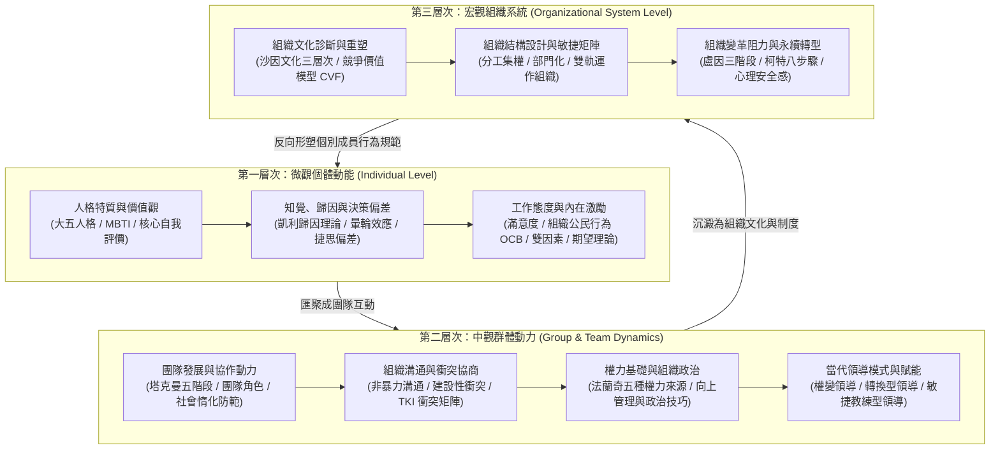

---
{"dg-publish":true,"permalink":"/02/03/moc/","title":"組織行為 MOC (課程總覽地圖)","tags":["PMBA","核心必修","組織行為","OB","領導力","團隊動力","MOC","知識地圖"],"dg-note-properties":{"title":"組織行為 MOC (課程總覽地圖)","course":"組織行為","category":"02_核心必修","type":"moc","tags":["PMBA","核心必修","組織行為","OB","領導力","團隊動力","MOC","知識地圖"],"aliases":["組織行為","組織行為 MOC","組織行為學 MOC","Organizational Behavior MOC"]}}
---

# 👥 組織行為 MOC (Organizational Behavior)

> **課程定位**：國立臺灣大學 PMBA 核心必修核心模組  
> **研究核心**：以心理學、社會學與管理學為基石，穿透**個體（Individual）➔ 群體（Group）➔ 組織系統（Organization）**三層次之人性行為規律與領導治理能耐  
> **銜接前置**：[[01_基礎先修/02_管理概論/_管理概論 MOC\|管理概論 (POLC 架構之 Leading 領導職能)]]  
> **學程總覽**：[[00_學程修課地圖 & 進度追蹤\|返回 PMBA 學程修課地圖與進度追蹤]]

---

## 🧭 組織行為三層次分析架構與決策脈絡圖

組織行為（OB）旨在協助高階經理人「理解人性、預測行為、驅動賦能」。本課程沿著**微觀個體到宏觀組織系統**的演進路徑展開：

---

## 📚 課程模組規劃與學習進度看板

### 模組一：微觀個體動能與心理機制 (Individual Dynamics)
- [ ] **L01_組織行為導論與人性假設**  
  *OB 本質、從古典機械觀到現代人本觀、跨文化背景下的人性假設與管理者視角。*
- [ ] **L02_人格特質、價值觀與工作適配**  
  *大五人格（Big Five）、MBTI、控制信念、個人-組織適配度（Person-Organization Fit）。*
- [ ] **L03_知覺、歸因理論與認知偏差**  
  *凱利歸因模型（一致性/普遍性/特異性）、基本歸因謬誤、自利偏差、暈輪效應與職場識人陷阱。*
- [ ] **L04_工作態度、情感勞動與激勵實踐**  
  *工作滿意度、組織承諾、組織公民行為（OCB）、工作倦怠與情緒智商（EQ）、當代激勵激勵體系設計。*

### 模組二：中觀群體動力、團隊協作與領導 (Group Dynamics & Leadership)
- [ ] **L05_團隊發展歷程與高績效團隊建構**  
  *塔克曼（Tuckman）團隊發展五階段（形成/動盪/規範/表現/解散）、社會惰化（Social Loafing）防範、團隊心理安全感。*
- [ ] **L06_人際溝通、衝突管理與協商談判**  
  *溝通障礙克服、建設性衝突 vs. 破壞性衝突、Thomas-Kilmann 衝突處理模式（TKI）、雙贏協商原則。*
- [ ] **L07_權力基礎、組織政治與影響力策略**  
  *法蘭奇與雷文五大權力基礎（法定/獎賞/強制/專家/參照權力）、建設性組織政治、向上管理與跨部門影響力。*
- [ ] **L08_當代領導理論與情境領導實踐**  
  *權變領導理論、赫塞-布蘭查德情境領導（SLT）、交易型領導 vs. 轉換型領導、僕人式領導與賦能授權。*

### 模組三：宏觀組織文化、設計與變革轉型 (Culture, Structure & Change)
- [ ] **L09_組織文化診斷、傳承與重塑**  
  *埃德加·沙因（Edgar Schein）文化三層次（外顯人工器物/宣稱價值觀/核心潛意識假設）、文化對併購整合的決定性影響。*
- [ ] **L10_組織設計、矩陣結構與敏捷轉型**  
  *組織結構六要素、傳統官僚科層制 vs. 敏捷網絡組織、無邊界組織與跨功能協作機制。*
- [ ] **L11_組織變革管理與變革抗拒化解**  
  *盧因變革三步驟（解凍/變革/再凍結）、柯特（Kotter）變革八步驟、組織防衛心理與心理契約重建。*
- [ ] **L12_組織發展、學習型組織與綜合個案**  
  *彼得·聖吉第五項修練、組織學習障礙穿透、高階經理人心智模式升級與全課程實務整合。*

---

## 🧮 組織行為經典理論矩陣與經理人工具箱

| 分析層次 | 理論 / 模型名稱 | 代表學者 | 經理人管理意涵與分析工具箱 | 實務應用情境 |
| :--- | :--- | :--- | :--- | :--- |
| **個體層次** | **大五人格特質 (Big Five)** | 戈德堡等 | 開放性、嚴謹性、外向性、親和性、情緒穩定性。 | 人才招募甄選、適才適所崗位配置與團隊互補搭配。 |
|  | **歸因理論 (Attribution)** | 凱利 (Kelley) | 透過一致性（Consensus）、特異性（Distinctiveness）、一貫性（Consistency）判斷行為歸因於內因或外因。 | 部屬績效考核、錯誤歸因偏差校正與建設性績效面談。 |
|  | **工作特性模型 (JCM)** | 哈克曼 & 歐德罕 | 技能多樣性、任務完整性、任務重要性、自主性、回饋性。 | 工作豐富化設計（Job Enrichment）、提升員工內在成就動機。 |
| **群體層次** | **團隊發展五階段** | 塔克曼 (Tuckman) | 形成期 ➔ 動盪期 (衝突高發) ➔ 規範期 ➔ 表現期 ➔ 解散期。 | 敏捷專案團隊組建、穿越動盪期阻力與快速凝聚戰鬥力。 |
|  | **TKI 衝突處理矩陣** | 湯瑪斯 & 基爾曼 | 依「堅持度」與「合作度」劃分：競爭、合作、妥協、迴避、遷就。 | 跨部門專案利益衝突協商、供應鏈商務談判策略選擇。 |
|  | **權力五基礎** | 法蘭奇 & 雷文 | 職位權力（法定/獎勵/強制）vs. 個人權力（專家/參照權力）。 | 無實質職權時（如矩陣專案經理）建立個人權威與跨部門影響力。 |
|  | **轉換型領導 (TL)** | 伯恩斯 & 巴斯 | 願景魅力感召、智力啟發、個別化關懷、鼓舞性激勵。 | 企業遭遇危機逆境或重大轉型時，凝聚向心力與重塑文化。 |
| **組織層次** | **文化三層次模型** | 沙因 (Schein) | 1. 外顯表象 (Artifacts) ➔ 2. 宣稱價值觀 (Values) ➔ 3. 深層基本假設 (Assumptions)。 | 企業併購後的文化整合診斷、突破「口惠而實不至」的口號文化。 |
|  | **變革八步驟** | 柯特 (Kotter) | 創造急迫感 ➔ 建立領導聯盟 ➔ 確立願景 ➔ 溝通願景 ➔ 授權賦能 ➔ 創造短期成果 ➔ 鞏固戰果 ➔ 錨定文化。 | 企業數位轉型、全球化組織重組與全面品質變革推動。 |

---

## 🔗 跨學程前後貫通與綜效思考

- ⬅️ **[[01_基礎先修/02_管理概論/_管理概論 MOC\|基礎先修：管理概論]]**：承接 Ch08 個體行為、Ch09 激勵理論與 Ch10 領導模型，將理論進一步昇華為實踐心理與政治治理。
- ➡️ **[[02_核心必修/02_行銷管理/_行銷管理 MOC\|核心必修：行銷管理]]**：消費者購買行為（L02）之知覺、態度與決策旅程，即為組織行為個體心理學向外部市場端之延伸。
- ➡️ **[[04_主題選修/10_創業與企業財務策略/_創業與企業財務策略 MOC\|主題選修：創業與企業財務策略]]**：新創團隊早期核心合夥人激勵機制、股權激勵（ESOP）與組織文化奠基。

---

## 💎 推薦關聯之 [[98_商業概念庫\|98_商業概念庫]] 原子卡片

- **個體心理**：[[98_商業概念庫/organizational-behavior_組織行為\|organizational-behavior_組織行為]] · [[98_商業概念庫/bounded-rationality_有限理性\|bounded-rationality_有限理性]] · [[98_商業概念庫/perception-2_知覺\|perception-2_知覺]] · [[cognitive-bias_認知偏差\|cognitive-bias_認知偏差]]
- **激勵與領導**：[[98_商業概念庫/two-factor-theory_雙因素理論\|two-factor-theory_雙因素理論]] · [[98_商業概念庫/transformational-leadership_轉換型領導\|transformational-leadership_轉換型領導]] · [[98_商業概念庫/servant-leadership_僕人式領導\|servant-leadership_僕人式領導]]
- **團隊與組織**：[[98_商業概念庫/organizational-structure_組織結構\|organizational-structure_組織結構]] · [[98_商業概念庫/change-management_變革管理\|change-management_變革管理]] · [[corporate-culture_企業文化\|corporate-culture_企業文化]]
